Around 1900, Paris posters sold everything from bicycles to biscuits with the
same few devices. Alphonse Mucha put a figure in front of a glowing disc, and
Louis Comfort Tiffany's studio built windows from jewel-coloured glass held
in black lead. Both framed everything in whiplash plant stems.

In this tutorial you'll use those devices in **Queen's Gambit**, a
1200 × 1800 poster for an imaginary 1903 chess tournament. A tall ivory
queen stands in for Mucha's figure, and the glowing disc behind her crown is
the sun in a stained-glass window. A fallen black pawn at her foot is the
"gambit", the piece given up to win the game.

Along the way you'll use:

- **Define Pattern** and **Fill with Pattern**, then a **Perspective** transform
- the **Pen** tool to stroke lead lines and outline the chess pieces
- the **Magic Wand** on one layer to fill glass on another
- Shift, Alt and Shift+Alt selections (add, subtract, intersect)
- the Clouds, Hue/Saturation, Gaussian Blur and Add Noise filters
- a tapered Brush stroke, Duplicate Layer and **Flip Horizontal**
- copy and paste, Merge Down, groups, guides and **Snap to Guides**
- Stroke, Outer Glow and Drop Shadow effects
- two Google Fonts: **Federant** and **Federo**

Palette:

- Aubergine ground `#563A58` → `#2E1D33` → `#170E1B`
- Lead `#1A121D`, gold `#D2A951`, ivory `#F2E8D0`
- Sunrise glass `#FFE29A` → `#F2AE45` → `#D9772F` → `#2F8A84` → `#1C4A5A`
- Iris `#A88BE0` / `#8D6FCB` / `#6E4DB0` / `#432C7E`
- Leaves `#4E8E3E` / `#86B85E` / `#2D5A3C`, vine leaves `#7E9A62`
- Sun `#FFFBEA`, backlight `#FFD98A` → `#8A4A22`
- Queen `#FFF8E8` → `#F2E8D0` → `#A8936F`
- Pawn `#8A7192` → `#241B28` → `#110B13`
- Floor cream `#E9DEC3`, floor teal `#284A52`
- Sill `#5A4860`, oxblood `#8A2E3B`

## Set up the page and the aubergine ground

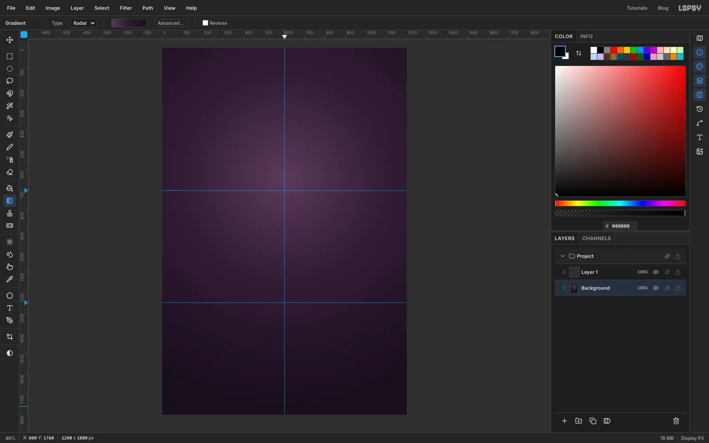

Choose **File → New**, set the size to `1200` × `1800` pixels and click
**Create**.

Click the rulers to drop three guides:

- on the top ruler at `600`, the centre line
- on the left ruler at `700`, where the window's arch will start
- on the left ruler at `1250`, the window's bottom edge and the floor's horizon

Select the **Background** layer and pick the **Gradient** tool. Set **Type**
to Radial and click **Advanced…** to set three stops: `#563A58`, `#2E1D33`
at about 45%, and `#170E1B`. Drag from just above the middle of the page
straight down to near the bottom edge. The glow sits behind where the window
will be.

Rename `Layer 1` to `Floor`. You'll use it in a moment.

## Make a checker tile and define it as a pattern

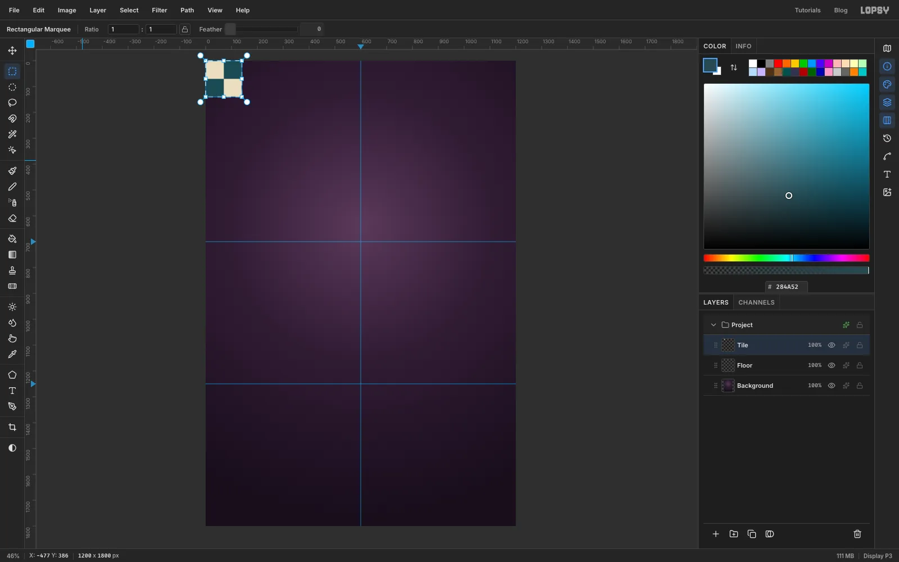

Add a new layer called `Tile`. In the top-left corner of the canvas, fill a
140 × 140 square with cream `#E9DEC3`. Then fill its top-right and
bottom-left quarters (70 × 70 each) with dark teal `#284A52`.

> **Tip:** To get exact squares, pick the **Rectangular Marquee** and click
> once without dragging. A **Rectangular Selection** dialog opens where you
> can type the From and To corners.

Select the whole 140 px tile and choose **Edit → Define Pattern**. Delete
the `Tile` layer; the pattern stays in the list.

## Fill the floor with the pattern

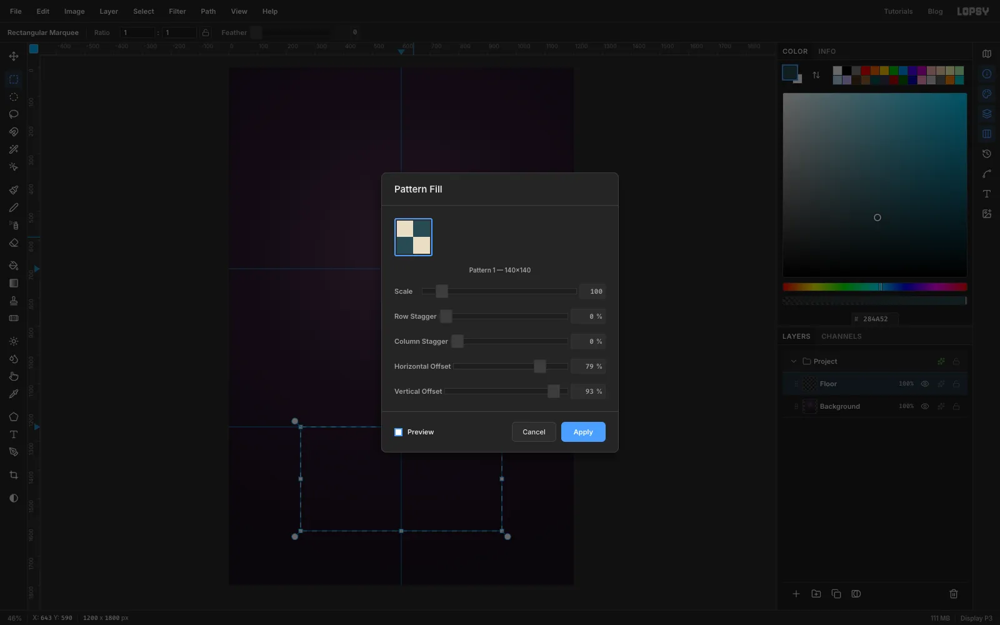

Select the `Floor` layer. Draw a marquee from the `1250` guide down to
`1612`, spanning `250` to `950` across. That's the width the window will
be.

Choose **Edit → Fill with Pattern…** and click your checker tile. Set
**Horizontal Offset** to `79` and **Vertical Offset** to `93`, then click
**Apply**.

The offsets are percentages of one tile, and they line the squares up with
the window's edges. The pattern starts tiling from the top-left corner of the
canvas, so the marquee's left edge at `250` falls 110 px into a tile
(250 = 140 + 110), and 110 ÷ 140 is about 79%. Its top edge at `1250` falls
130 px into a tile, and 130 ÷ 140 is about 93%.

## Pull the floor into perspective

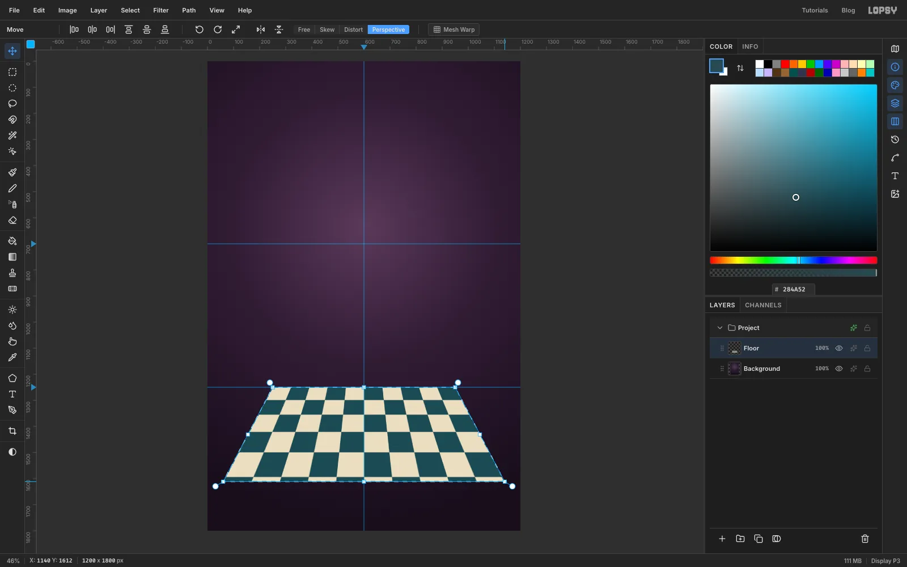

Keep the selection and switch to the **Move** tool. In the options bar,
click **Perspective**. Drag the bottom-right corner handle out to the right,
to about `1140`, just inside where the frame will go. Perspective mode moves
the bottom-left corner out by the same amount, so the board widens towards
you and its near rows grow taller. Press [[Enter]] to apply.

## Shade the far rows

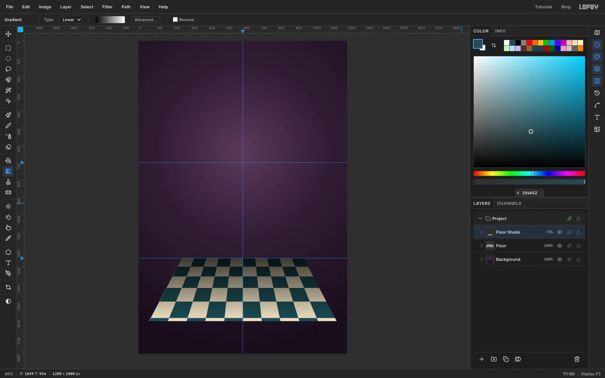

Add a layer called `Floor Shade`. [[Cmd]]-click the `Floor` thumbnail in the
Layers panel to select its pixels. Pick the **Gradient** tool, switch **Type**
to Linear and set the stops to black and white. Drag from the `1250` guide
straight down to the front edge of the floor.

Deselect, set the layer's blend mode to **Multiply** and its opacity to 75%.
White disappears in Multiply, so only the back rows darken.

## Select the arched window

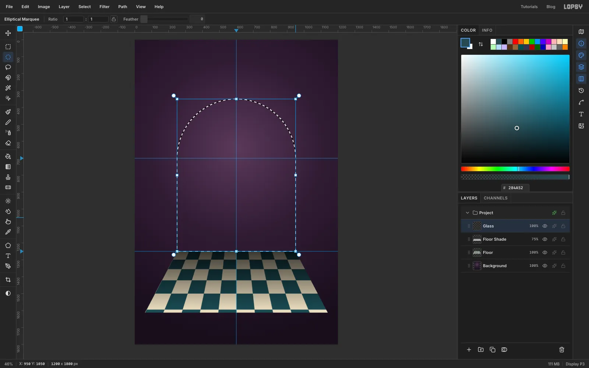

Add a layer called `Glass`. The window is a rectangle with a half-circle on
top:

1. Draw a rectangular marquee from `250, 700` to `950, 1250`, from the arch
   guide down to the horizon guide.
2. Switch to the **Elliptical Marquee**, hold [[Shift]] and drag a circle from
   `250, 350` to `950, 1050`. It is 700 px across and centred on the `700`
   guide.

Shift adds the circle to the rectangle. You'll make this same selection
three more times, so it's worth getting comfortable with it.

## Fill the glass with a sunrise gradient

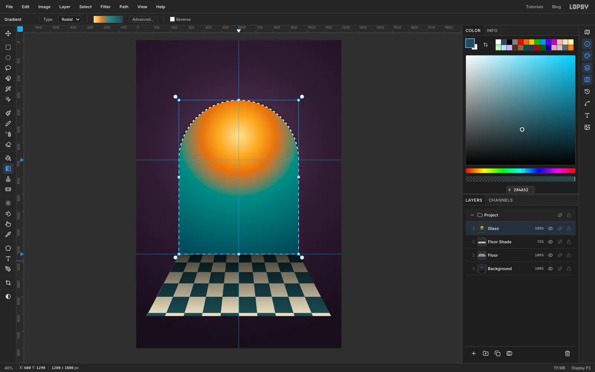

Pick the **Gradient** tool, set **Type** to Radial and use **Advanced…**
for five stops:

- `#FFE29A` at the start
- `#F2AE45` at about 16%
- `#D9772F` at about 30%
- `#2F8A84` at 50%
- `#1C4A5A` at the end

Drag from `600, 560`, where the sun will be, straight down to just below the
window. The upper arch goes orange and the lower panes cool to teal.

## Lead the window frame and the sun

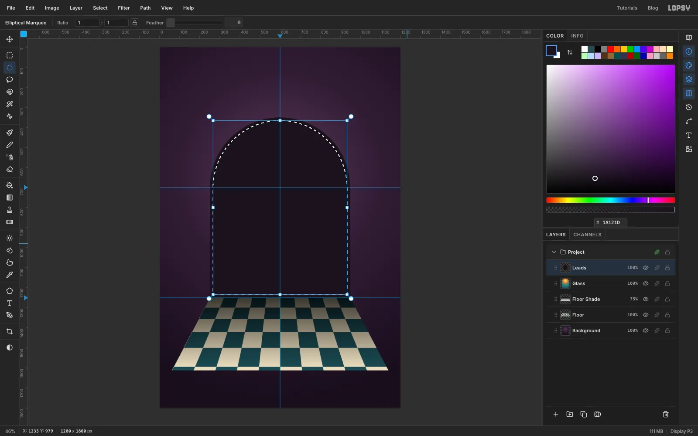

Add a layer called `Leads` and set the foreground to `#1A121D`. Make the arched
window selection again and choose **Edit → Fill**, which turns the whole
window dark. Choose **Select → Shrink…**, enter `16` and press [[Delete]]. A
16 px lead frame is left around the edge.

Do the same for the sun. Draw a circle 230 px across centred on `600, 560`,
fill it, shrink it by `10` and press [[Delete]].

## Lead the sunrays

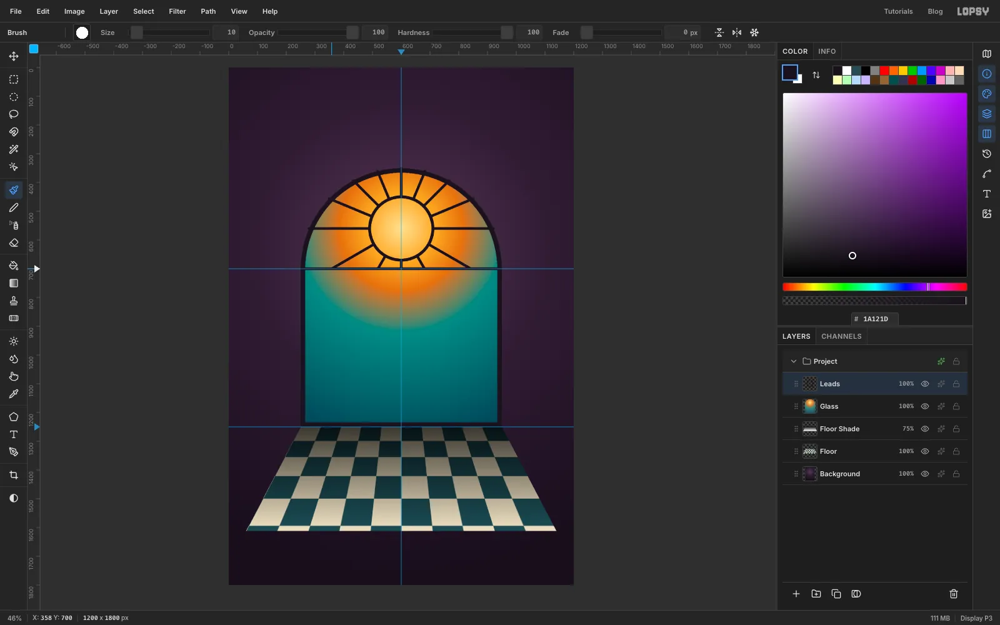

Pick the **Brush**, open the Brushes window from the tip thumbnail in the
options bar and set **Size** to `10` and
**Hardness** to `100`. To draw a straight line with any paint tool, click at
the start and [[Shift]]-click at the end.

- Draw the transom bar across the window along the `700` guide, from frame
  to frame.
- Draw nine rays fanned evenly across the top half of the sun, the outer
  two horizontal and the middle one straight up. Each runs from the sun ring
  out to the arch.
- Draw five more rays fanned evenly below the sun, the middle one straight
  down, from the ring to the transom.

## Draw the first iris with the Pen

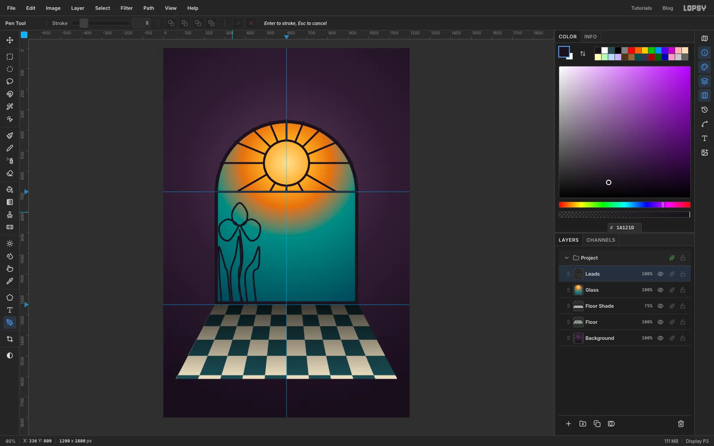

Pick the **Pen** tool (P) and set **Stroke** to `8` in the options bar.
Press [[Enter]] while a path is in progress to stroke it in the foreground
colour.

The left flower is centred near `372, 858`, with its bottom edge around
`940`. Build it around that point:

- **Leaves:** each blade is one open path. Start on the window's bottom edge,
  go up to a point about two-thirds of the way to the flower, and come back
  down a little to the side. Drag at each anchor to curve it, then press
  [[Enter]]. Make three blades leaning different ways.
- **Stem:** an open path from under the flower, with a slight S-bend, down to
  the bottom edge.
- **Petals:** the upright *standard* is a teardrop about 70 px wide and
  110 px tall, rising from the flower's centre. The two *falls* are rounded
  lobes about 90 px wide, one each side. They start at the centre, swing out
  and down, and hang about 80 px below it. Draw each as a closed path by
  clicking back on its first anchor, then press [[Enter]] to stroke it.

After each stroke, click **Delete Path** in the Paths panel. Otherwise your
next click edits the old path instead of starting a new one. Keep the falls
inside the lead frame.

## Finish the leading

Draw the second iris on the right, centred near `830, 818`.

Real stained glass is cut into pieces small enough to handle, so add more
leads:

- a wavy **ground line** across the lower panes, about 80 px above the
  window's bottom edge (Stroke `8`)
- a few gently curved lines through the open teal sky (Stroke `7`). Each one
  runs from the frame or transom to a petal or stem.
- a thin **vein** down the middle of every petal (Stroke `4`). The veins
  split each standard into a left and a right piece, and each fall into an
  upper and a lower piece.

## Colour the petals with the Magic Wand

The leads layer is mostly empty, so each gap between lead lines is a
separate transparent area. The **Magic Wand** reads only the active layer, so
clicking inside a gap selects exactly that piece of glass.

1. With `Leads` active, pick the **Magic Wand** (Tolerance `32`) and click
   inside the left half of the left iris's standard. [[Shift]]-click the left
   half of the right iris's standard to add it.
2. Choose **Select → Grow…** with `3`. This tucks the colour under the
   lead's soft edges.
3. Click the `Glass` layer, set the foreground to `#A88BE0` and choose
   **Edit → Fill**.

Repeat for each colour, always clicking on `Leads` and filling on `Glass`:

- the right halves of the standards, `#8D6FCB`
- the upper halves of the falls, `#6E4DB0`
- the lower halves of the falls, `#432C7E`

## Colour the leaves and the ground

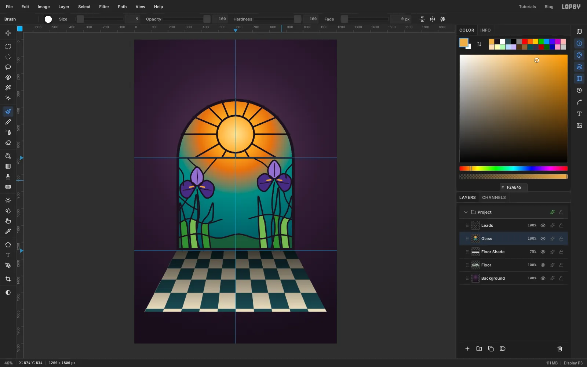

Use the same wand-then-fill routine for the leaves. Alternate `#4E8E3E` and
`#86B85E` so neighbouring blades read separately. Remember to click both the
piece above the ground line and the piece below it. Fill the ground pieces
between the leaves with `#2D5A3C`.

For the gold *beard* on each fall, stay on the `Glass` layer and take a 9 px
hard Brush in `#F2AE45`. Click and [[Shift]]-click a short dash from the
middle of the flower out onto each fall.

## Shade every other sunray

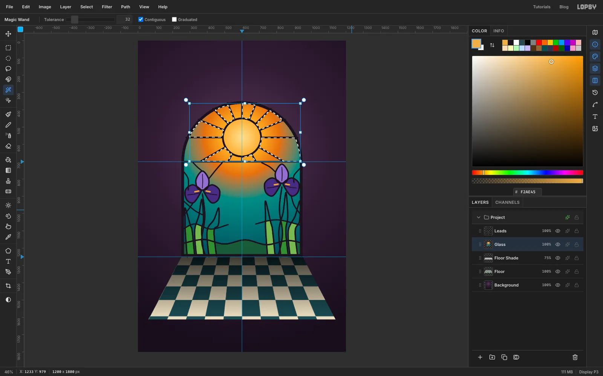

Flat fills would wipe out the sunrise gradient, so shade these pieces with a
filter instead. On `Leads`, wand-click every other ray piece with [[Shift]],
then **Grow** by `3`. Click `Glass` and open **Filter → Hue/Saturation…**:

- **Hue** `-12`
- **Saturation** `15`
- **Lightness** `-18`

The filter only changes the selected pieces, so the gradient survives and
the rays alternate light and dark.

Next, click `Leads`, wand-click inside the sun disc and grow it by `3`.
Click `Glass` and give the disc its own small radial gradient. Use `#FFFBEA` at the centre, `#FFE29A` at about 60% and `#F2AE45`
at the edge, dragged from just above-left of the sun's centre to its bottom
edge.

Finally, deselect and run **Hue/Saturation** once more on the whole `Glass`
layer with **Saturation** `-25`. That calms the colours so they sit with the
gold and ivory.

## Mottle the glass with Clouds

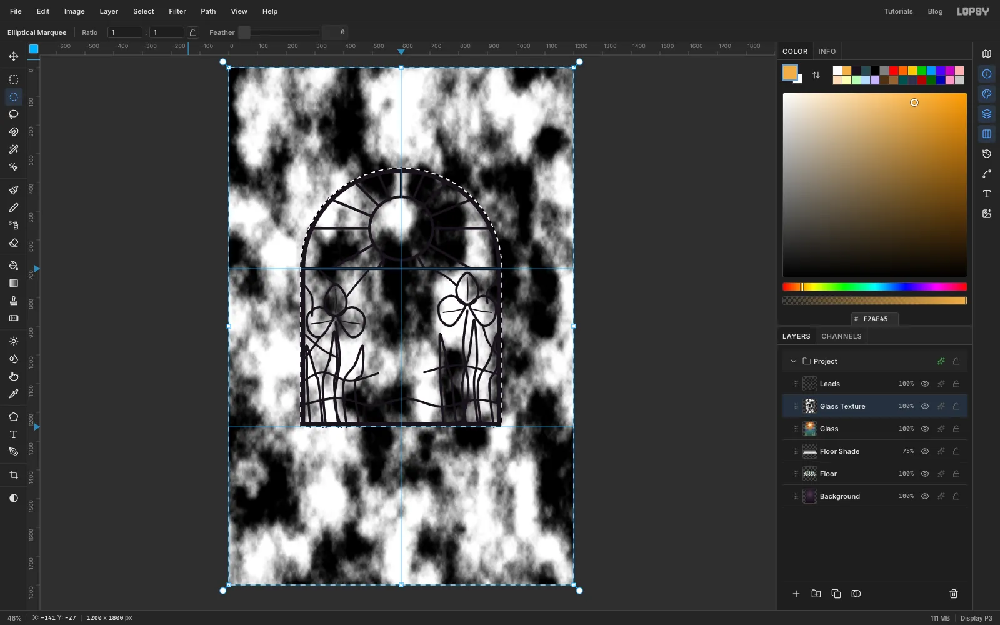

With `Glass` active, add a layer called `Glass Texture`. It goes above
`Glass` and below `Leads`. Run **Filter → Clouds…** with **Scale** `14`.

Make the arched window selection once more, choose **Select → Inverse** and
press [[Delete]]. Deselect, then set the layer to **Overlay** at 30%. The
clouds now read as the streaks and bubbles of hand-rolled glass.

## Light the window from behind

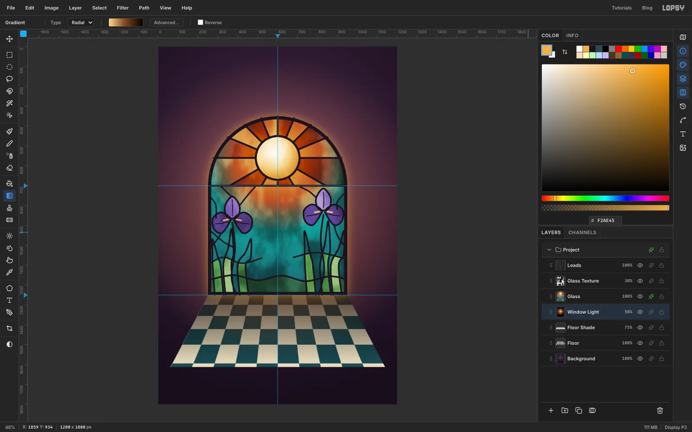

Select `Glass` and add an **Outer Glow** in its layer effects:

- **Size** `70`
- **Spread** `10`
- **Opacity** `55`
- colour `#F2AE45`

For light on the wall and floor, select `Floor Shade` and add a layer called
`Window Light`, so it sits under the glass. Draw a radial gradient
(`#FFD98A`, `#8A4A22` at about 45%, `#000000`) from the middle of the
window's lower panes down to the front of the floor. Set it to **Screen** at
50%.

Because the light sits under the glass and leads, the lead lines stay
properly black.

## Add a sill and group the window

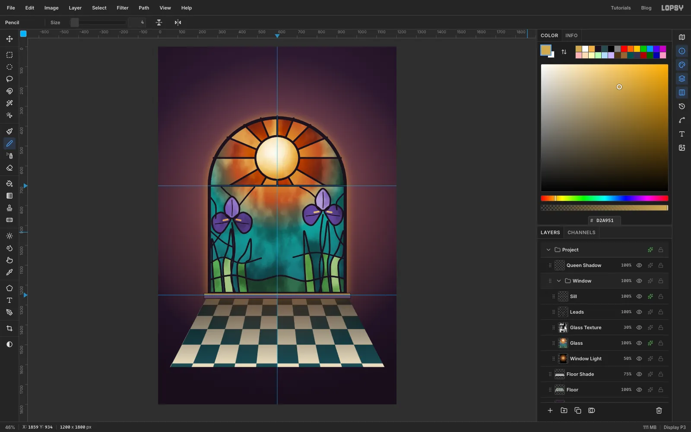

Select `Leads` and add a layer called `Sill`. Click with the Rectangular
Marquee to open the **Rectangular Selection** dialog and enter `232, 1244`
to `968, 1266`. Fill it with `#5A4860`.

> **Tip:** Typing the corners gives an exact 22 px strip. A strip this thin
> is hard to drag accurately right on top of a guide, because the marquee
> snaps to it.

Give the sill a gold top edge: pick the **Pencil** at size `4` and draw a
line in `#D2A951` along its top with a click and a [[Shift]]-click. Add a 3 px
`#1A121D` **Stroke** effect.

Add one more layer, `Queen Shadow`, above the sill. After grouping, the group
row is selected, and a new layer would land inside it. Making `Queen Shadow`
now gives you a layer outside the group to work from. Then click `Window Light`, [[Shift]]-click `Sill`, click
**Group Layers** and name the group `Window`.

## Outline the queen with the Pen

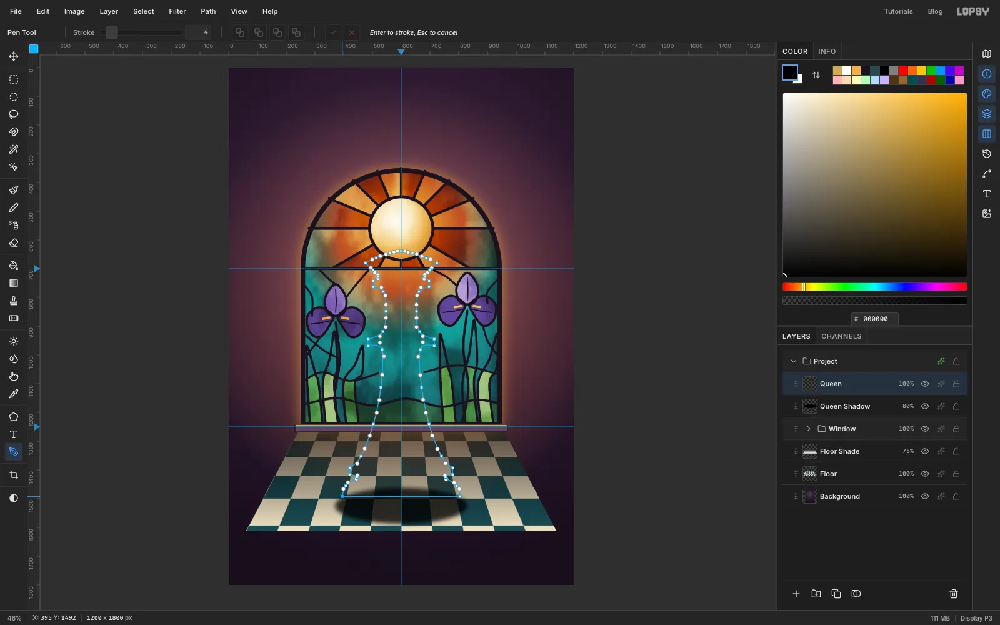

First, the shadow. Select `Queen Shadow` and set the foreground to black.
Fill an ellipse about 460 px wide under where the queen will stand, from
`370, 1462` to `830, 1588`. Deselect, then blur it with **Filter → Gaussian
Blur…** at `22`. Deselecting first matters: a filter stays inside the
selection, so the blur would stop at the ellipse's edge.

Fill a thinner ellipse right at the base line, from `390, 1483` to
`810, 1501`. Deselect and blur it by only `3`. Set the layer to 80%. The
window is behind her, so the shadow falls straight towards you.

Add a layer called `Queen` and pick the **Pen**. Trace her profile
symmetrically on the centre guide. Working from the bottom up, the
landmarks are:

- **foot:** flat bottom at `1492`, 410 px wide
- **base collar:** a square-edged band from `1393` to `1416`, 360 px wide
- **body:** flaring down to the collar, 195 px wide at `1240`
- **waist:** 135 px wide at `1000`
- **collar disc:** a square-edged band from `944` to `967`, 230 px wide
- **neck:** 105 px wide at `850`
- **small ring:** a square-edged band from `742` to `763`, 195 px wide
- **coronet rim:** flaring out to 250 px wide at `680`
- **top:** the coronet's shallow cup at `640`

Go down one side and up the other, with about twenty anchors per side.
Click plain anchors at the square corners of the three rings and the foot,
and drag a little at the others so the body and neck curve smoothly. Click
the first anchor to close the path.

## Shade her ivory

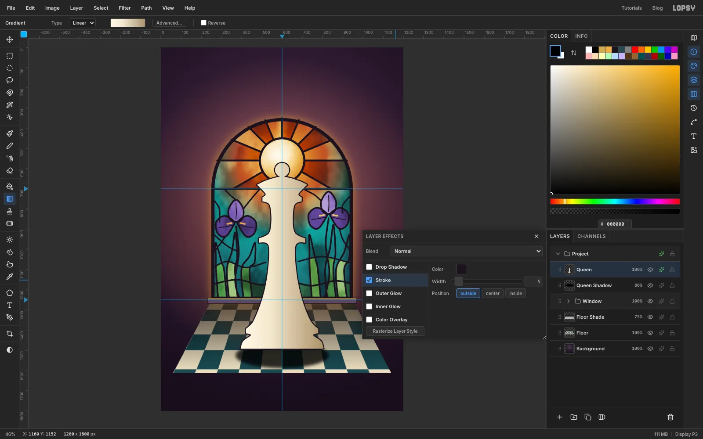

In the Paths panel, click **Path to Selection**, then **Delete Path**. Pick the
**Elliptical Marquee** and [[Shift]]-drag a 70 px circle for the ball on top
of the crown, centred near `600, 606` so it sits in the sun.

Pick the **Gradient** tool, check that **Type** is Linear, and drag across
her from left to right. Use `#FFF8E8`,
`#F2E8D0` at about 35% and `#A8936F`, so she's lit from the left with a
shadowed right side.

Deselect and add a 5 px `#1A121D` **Stroke**. A heavy contour is part of the
Mucha look.

## Cut curved gold rings

Gold rings on a turned piece curve slightly, because you see them from just
above. A rectangle would look flat, so build each ring from two ellipses:

1. Add a layer called `Queen Gold` and set the foreground to `#D2A951`.
2. [[Cmd]]-click the `Queen` thumbnail to select her shape.
3. Pick the **Elliptical Marquee** and [[Shift]]+[[Alt]]-drag an ellipse
   about 1¼ times the queen's width at that height and about 60 px tall. Its
   bottom edge should sit where the ring's bottom will be. Shift+Alt keeps
   only the overlap.
4. [[Alt]]-drag the same size ellipse about 25 px higher to subtract it.
   What's left is a band whose top and bottom edges curve the same way.
5. Choose **Edit → Fill**, then deselect.

Repeat steps 2–5 for each of the three rings: the small ring under the
coronet (`742`–`763`), the collar disc (`944`–`967`) and the base collar
(`1393`–`1416`).

## Bead the crown

Still on `Queen Gold`, take a hard 20 px Brush and click seven gold beads
along the rim of the coronet, following its curve. Add a 2 px `#1A121D`
**Stroke** to the layer so the gold reads as inlaid metal.

## Draw the pawn standing up

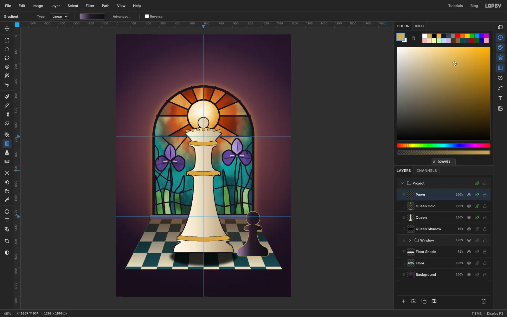

It's easier to draw the pawn standing and tip it over afterwards. Add a
layer called `Pawn`. Draw it with the Pen on the right side of the floor,
centred on `x 940`. Working from the bottom up:

- **bottom:** flat, at `1520`, 190 px wide
- **domed base:** widest (210 px) at `1496`, curving in to 170 px at `1462`
- **body:** slim, 60 px wide at `1390`
- **collar ring:** from `1326` to `1336`, 120 px wide
- **neck top:** 45 px wide at `1306`

Click the first anchor to close the path. Use **Path to Selection**, then
[[Shift]]-add a circle about 90 px across, centred near `940, 1262`, for the
head.

Fill it with a linear gradient from `#8A7192` on the left through
`#241B28` (about 40%) to `#110B13`. Deselect and give it a 3 px gold
`#D2A951` **Stroke**, so it shows against the dark floor squares.

## Tip the pawn over

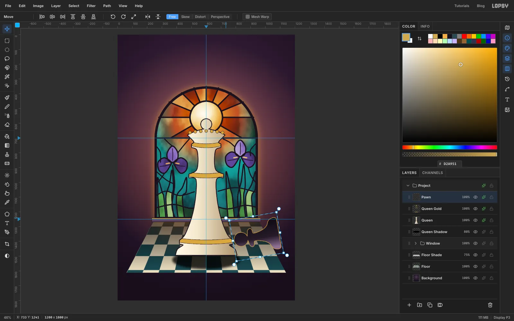

Draw a marquee around the pawn and switch to the **Move** tool. Drag the
rotation handle, just outside a corner, counter-clockwise until the pawn
lies on its side with its head pointing at the queen, about 100°. The
head end dips a little because the base is wider than the head. Press
[[Enter]].

Deselect and use the arrow keys to slide it into place. Its base end should
be just inside the right edge of the floor and its lowest point just above
the front edge. Leave about 20 px between its head and the queen's base.

Select `Queen Shadow`, set the foreground to black and add the pawn's shadow
the same way as the queen's. Use a soft ellipse along its length (blur `12`)
and a thin one along its contact line (blur `3`), deselecting before each
blur.

## Group the pieces

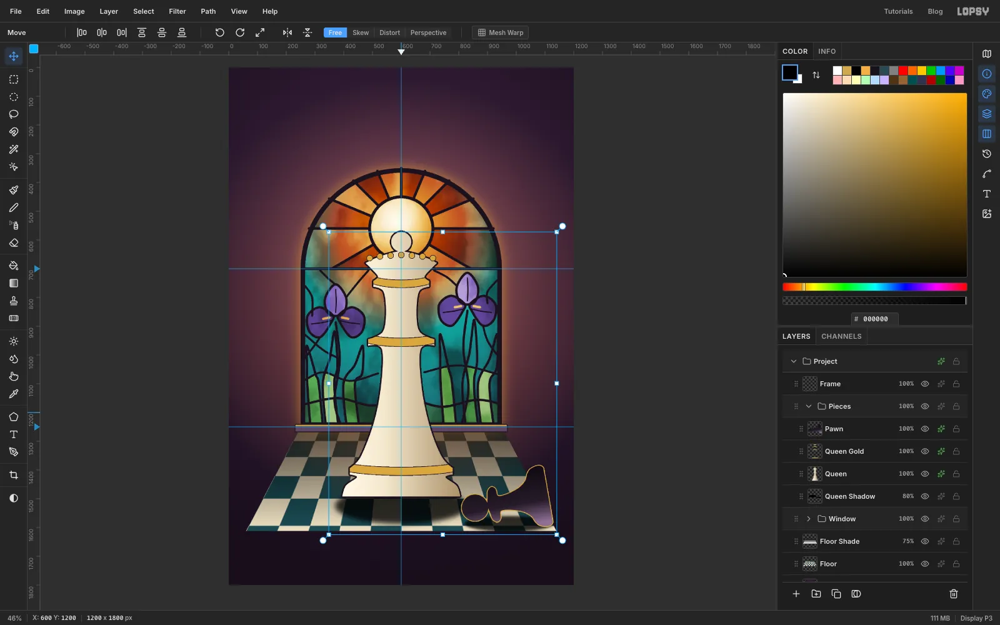

Select `Pawn` and add a layer called `Frame`. Then click `Queen Shadow`,
[[Shift]]-click `Pawn` and click **Group Layers**. Name the group `Pieces`.

Dragging the group with the Move tool now moves the queen, the pawn and
their shadows together.

## Snap the gold frame to guides

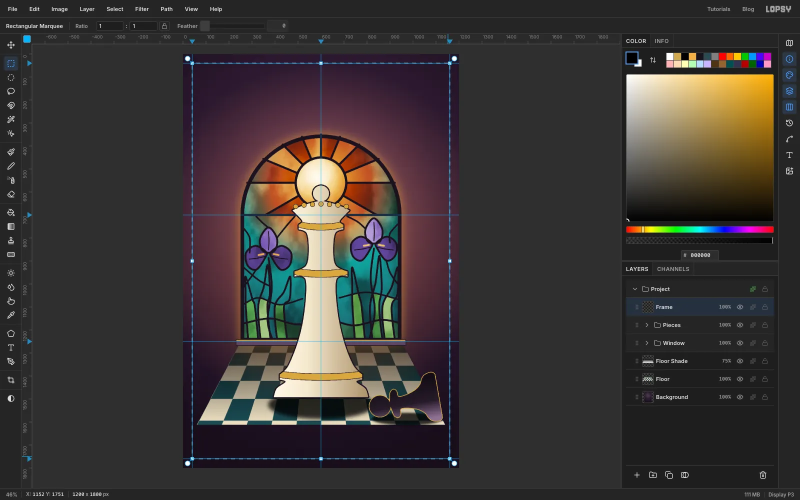

Add guides at `40` and `1160` on the top ruler, and at `40` and `1760` on the
left ruler. Make sure **View → Snap to Guides** is on.

Select `Frame` and drag a marquee from near the top-left guide crossing to
near the bottom-right one. Both corners jump onto the guides. Fill it with
gold `#D2A951`, **Shrink** by `10` and press [[Delete]] to leave a 10 px
border.

For the inner keyline, select `58, 58` to `1142, 1742` in the
**Rectangular Selection** dialog. Fill it, shrink by `3` and delete. Turn
**Snap to Guides** off again.

With the **Pencil** at size `3`, draw two gold rules from the inner keyline
on one side to the other: one at `284` under the title area and one at
`1614` above the footer.

## Paste roundels into the corners

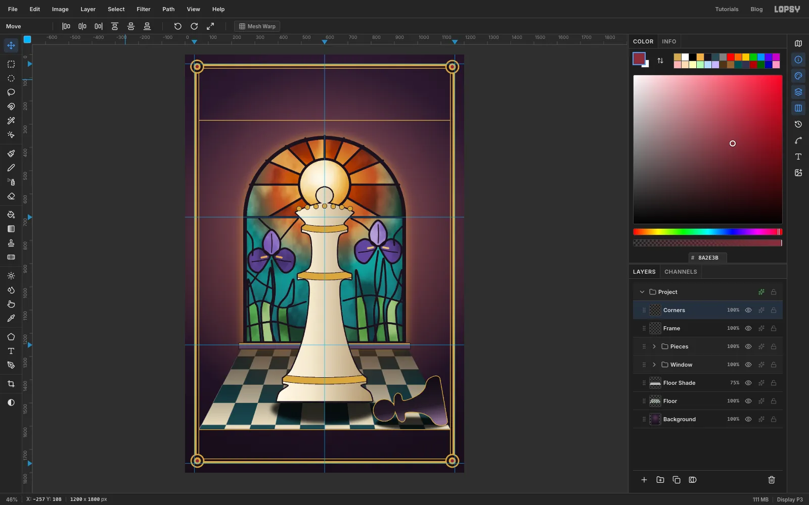

Add a layer called `Corners`. At the top-left corner of the frame, build a
roundel centred on `52, 52` from four filled circles:

- 60 px gold `#D2A951`
- 48 px lead `#1A121D`
- 30 px gold
- a 14 px oxblood `#8A2E3B` dot

Marquee around the roundel, copy with [[Cmd+C]] and deselect. Press
[[Cmd+V]] to paste it as a new layer. Drag the copy with the Move tool to
the top-right corner, then fine-tune with the arrow keys until it is centred
on `1148, 52`. Choose **Layer → Merge Down**. Repeat for the bottom corners,
centred on `52, 1748` and `1148, 1748`.

Press [[Cmd+D]] when you're done. The last paste leaves a selection behind,
and the next brush stroke would only paint inside it.

## Paint a tapered whiplash vine

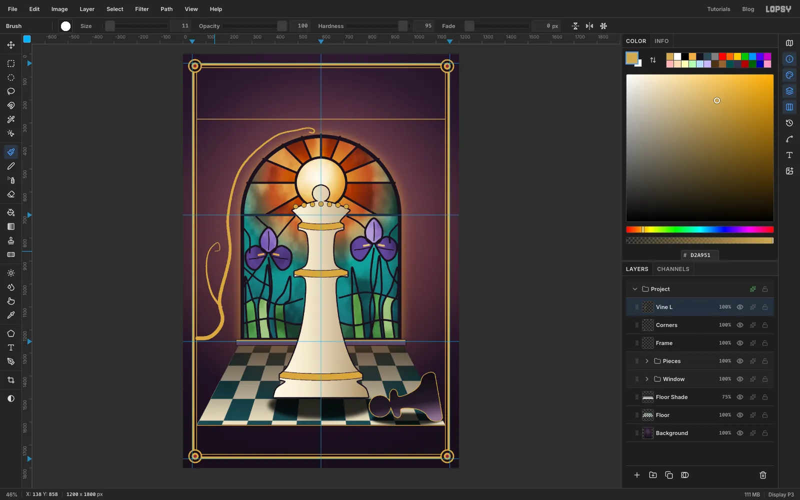

Add a layer called `Vine L` and set the foreground to gold. Open the Brushes
window and set **Size** `18`, **Hardness** `95` and **Taper** `1860`. Taper
is the distance, in pixels, over which a stroke thins to nothing. 1860 is a
little more than the vine's full length, so it starts thick and ends as a
whisker.

In one stroke, start at the left frame level with the sill and curl once.
Climb up the left side about 50 px outside the window, follow the arch over
the top, and finish in a small curl just left of the top of the arch. Keep
the vine at least 30 px below the title rule.

Paint a second, shorter shoot (Size `11`, Taper `520`). It branches off low
on the vine and curls outward at about mid-height.

## Add leaves and gold buds

Set the foreground to sage `#7E9A62`. Draw six pointed leaves along the vine
with the Pen as closed paths. For each one, click **Path to Selection** and
then **Delete Path**, choose **Edit → Fill** and deselect.

Switch the foreground back to gold and click a few 20 px gold buds right on
the vine, at the curl and the bends.

Add a 3 px `#1A121D` **Stroke** to the layer. It outlines the vine, the
leaves and the buds in one go.

## Mirror the vine to the right

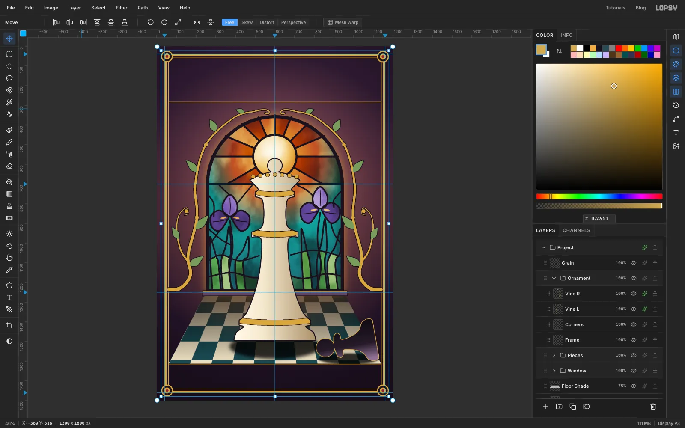

Click **Duplicate Layer**, rename the copy `Vine R` and choose **Image → Flip
Horizontal**. The copy flips where it stands, so drag it with the Move tool
across to the right side, then fine-tune with the arrow keys. It should
mirror the left vine across the centre guide: its left edge sits as far right
of `600` as the left vine's right edge sits left of it.

Add a layer called `Grain` above it; it will hold the texture later. Then
click `Frame`, [[Shift]]-click `Vine R`, click **Group Layers** and name it
`Ornament`.

## Set the title and supertitle

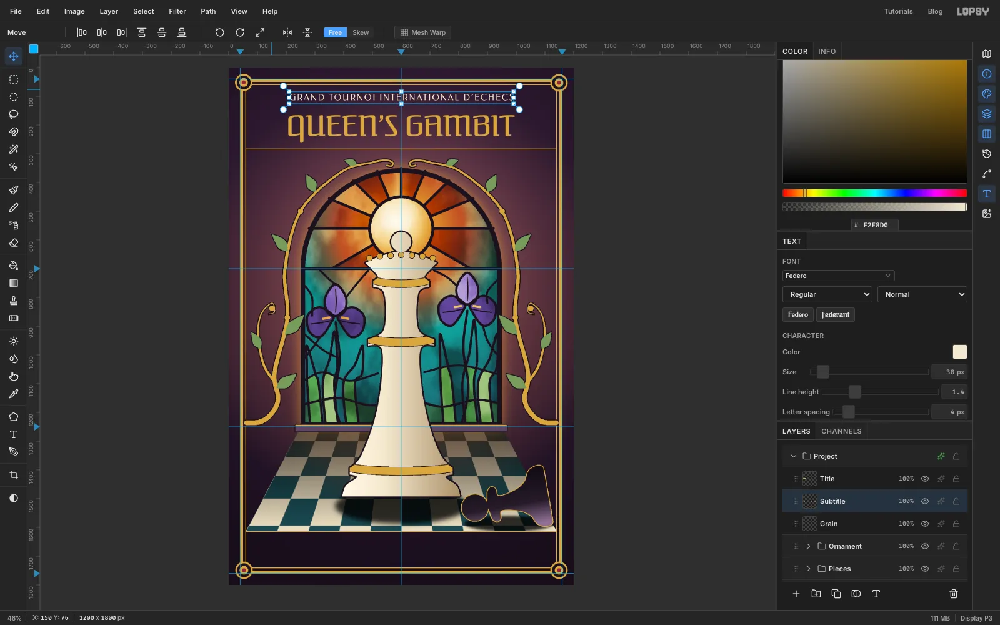

Select `Grain` so the text layers land at the top of the stack. Pick the
**Text** tool and set it up before you click:

- font **Federant**
- **Size** `100`
- colour gold `#D2A951`

Click in the top band and type `QUEEN’S GAMBIT`. Press [[Tab]] to commit,
and rename the layer `Title`. Federant's flared capitals look carved, which
suits the period.

Select `Grain` again so the next text doesn't restyle the title. For the
supertitle, use **Federo** at `30` in ivory `#F2E8D0`, click in empty space
above the title and type `GRAND TOURNOI INTERNATIONAL D’ÉCHECS`. Commit,
rename the layer `Subtitle`, and set **Letter spacing** to `4` in the Text
panel.

Centre both lines on the `600` guide with the Move tool and arrow keys:

- the title's capitals sit roughly from `165` to `259`, which leaves about
  25 px above the rule at `284`
- the supertitle sits about 30 px under the frame and 50 px above the title

## Outline the title and set the footer

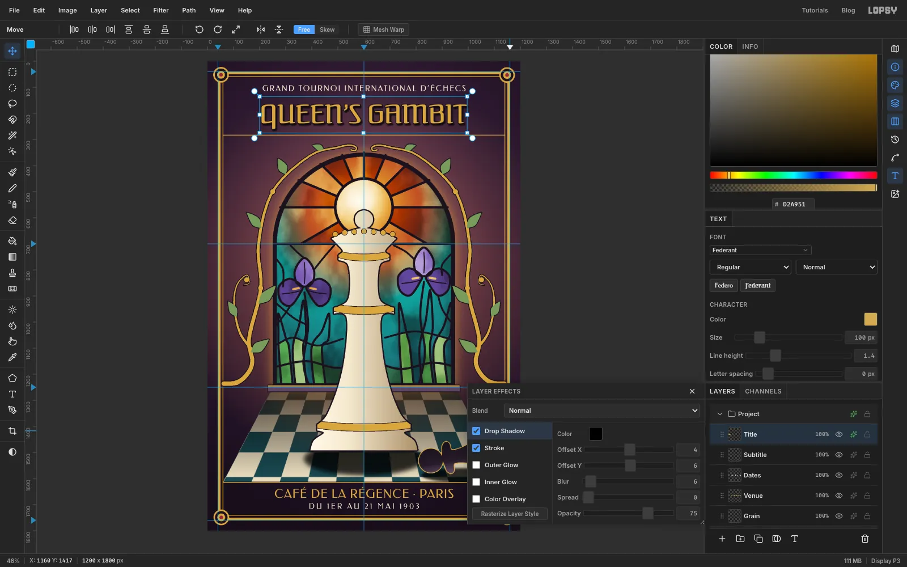

Give `Title` two effects:

- a 3 px `#1A121D` **Stroke**
- a black **Drop Shadow** with **Offset X** `4`, **Offset Y** `6`, **Blur**
  `6` and **Opacity** `75`

The outline separates the gold from the plum ground, and the shadow lifts it
like an embossed label.

In the footer band, add two lines in Federo, selecting `Grain` before each
one. Clicking on existing text edits it, so click in empty space for each
new line.

- `DU 1ER AU 21 MAI 1903` at `30`, ivory, letter spacing `6`. Rename it
  `Dates`.
- `CAFÉ DE LA RÉGENCE · PARIS` at `46`, gold, letter spacing `2`. Rename it
  `Venue`.

Centre both on the guide and stack them so the pair sits midway between the
rule at `1614` and the frame. The Café de la Régence was Paris's real chess
café, which is why it's named here.

## Add lithographic grain

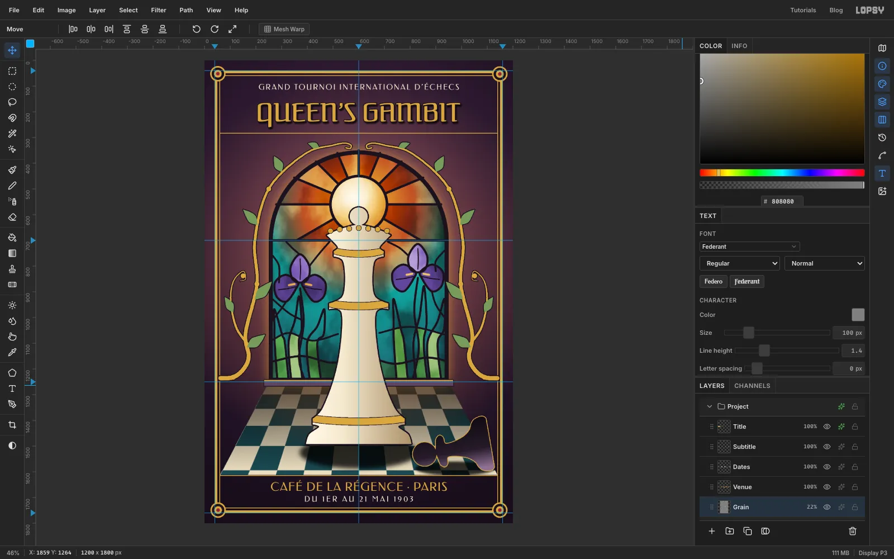

Select `Grain` and fill it with mid-grey `#808080`. Run **Filter → Add
Noise…** with **Amount** `40`, **Mono** and **Gaussian**. Set the layer to
**Overlay** at 22%. Grey disappears in Overlay, so only the speckle is left,
like ink on a lithographic stone.

The grain sits below the text layers, so the lettering stays crisp. Choose
**File → Quick Export PNG** for the finished poster, and **File → Save
Project** to keep the layers.
