A **tattoo flash sheet** is a printed page of ready-to-tattoo designs that a client can point at and pick from. Traditional flash is bold and simple: a heavy dark outline round every shape, flat colour, a hard-edged darker tone for shading, and little white "flicks" for shine.

This sheet mixes that with **Art Nouveau**, the decorative style of around 1900. Think Alphonse Mucha's posters: a flower set inside a round halo of rings and beads, a ribbon banner, whiplash curls, and a frame of thin parallel rules. The theme is *Dahlia Reliquary*, a dahlia kept like a relic, with a dagger, a locket and a crescent moon as the other pieces on the sheet.

Almost nothing here is painted freehand. The dahlia is drawn **one petal at a time** with the Brush's **Radial Symmetry**, which copies each stroke round the centre. Most of the rest is either a marquee shrunk ring by ring, or a **Pen** shape turned into a selection and filled, with a **Stroke** layer effect for the outline.

The sheet is 1200 × 1600 px. As a drawing reference I used Pierre-Joseph Redouté's *Dahlia simplex* plate from *Choix des plus belles fleurs* (public domain; on Wikimedia Commons as **Dahlia pinnata - 001x.jpg**). It's only a reference: no part of it goes into the artwork.

The tools you'll use:

- the **Brush** with **Radial Symmetry** and with the **Symmetry Horizontal** and **Symmetry Vertical** mirrors
- the **Pen** tool: closed paths turned into selections, and open paths stroked with [[Enter]]
- the **Magic Wand**, **Select → Inverse**, **Shrink** and **Grow**, and [[Cmd]]-click on a layer thumbnail
- the **Elliptical** and **Rectangular Marquee**, including [[Alt]]-drag to subtract and the click-once exact-corners dialog
- **Edit → Fill**, the **Gradient** tool, the **Pencil**
- **Copy**, **Copy Merged**, **Paste**, **Flip Horizontal**, and the **Move** tool's scale and rotate handles
- **Add Noise**, **Motion Blur** and **Clouds**
- live text in two Google fonts, including text bound to a curved path
- the **Stroke** layer effect, groups, **Merge Down** and the **Soft Light**, **Overlay** and **Multiply** blend modes
- the **Reference** drawer and ruler guides

The palette:

- Ink `#2A1D1A`
- Paper `#EEE3C9`, cream `#F8F0DC`, tail tan `#D7C397`, fold `#5E4630`
- Crimson `#8A2A40`, rose `#C9586C`, blush `#E58E8E`, pale petal `#F7CDBF`
- Gold `#F3DA9E` → `#D49B36` → `#A06B1E`
- Teal `#2E6A66`
- Leaf green `#8DA683`, leaf shadow `#4A6A53`
- Steel `#E1E6E3`, steel shadow `#8B9A9C`

Coordinates in this tutorial are document pixels. Watch the **X** and **Y** readout in the status bar at the bottom left while you hover, and use the guides you add in the first step.

Two kinds of "stroke" come up again and again:

- **Pen-stroke at N** means: draw an open Pen path and press [[Enter]] with the Pen's **Stroke** width (in the options bar) set to N. The line is drawn in the current foreground colour, so the steps always say which colour to set first.
- **Add a Stroke of N** means: open the layer's effects drawer (the ✦ button on its row), tick **Stroke**, and set **Width** N with the colour ink `#2A1D1A`. Every outline on this sheet is made that way.

## Set up the page, guides and reference

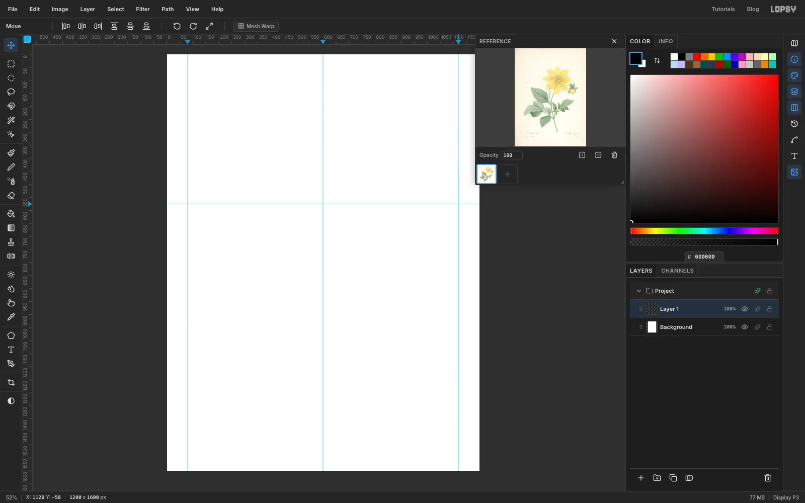

Choose **File → New**, pick **Pixels**, and make a **1200 × 1600** document.

Click the top ruler at **x 600**, **x 80** and **x 1120** to drop three vertical guides (a click on a ruler makes a guide, no dragging needed). Click the left ruler at **y 575** for a horizontal guide. That's the centre line of the sheet and the centre of the dahlia medallion.

Download **Dahlia pinnata - 001x.jpg** from Wikimedia Commons first. Then open the **Reference** drawer from the right-hand toolbar and load it. Look at how the petals are pointed and how the leaves meet the stem. Close the drawer when you're done; the image stays loaded for later.

## Age the paper

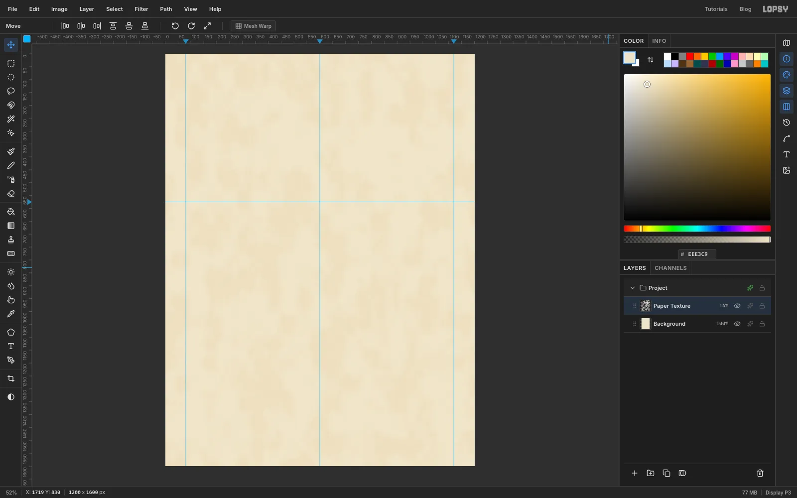

Click the **Background** row, set the foreground colour to paper `#EEE3C9` in the Color panel, and choose **Edit → Fill**. With nothing selected, Fill covers the whole layer.

Click **Layer 1** and rename it **Paper Texture** (double-click the name). Run **Filter → Clouds...** with **Scale 40**. Open the layer's effects drawer (the ✦ button on the row), set the blend mode to **Soft Light**, close the drawer, and drop the row's opacity to **14%**. You get a faint, uneven mottle, like old card stock.

## Rule the outer frame

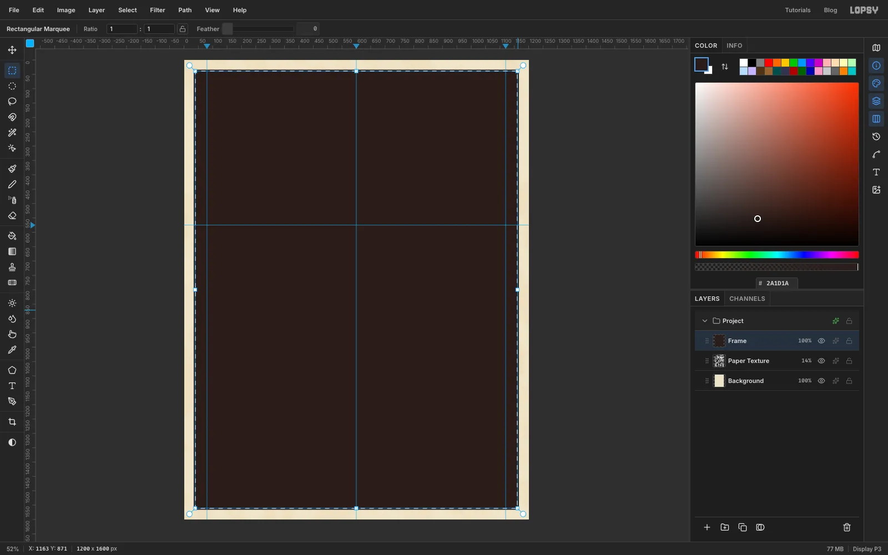

A frame rule is just a filled rectangle with its middle cut out.

1. With **Paper Texture** selected, click **Add Layer** and name the new layer **Frame**.
2. Take the **Rectangular Marquee** ([[M]]) and click once on the canvas without dragging. A dialog asks for exact corners: enter **From 34, 34** and **To 1166, 1566**.
3. Set the foreground to ink `#2A1D1A` and choose **Edit → Fill**.
4. Choose **Select → Shrink…**, enter **5** and apply. The marquee moves 5 px inwards, as in the screenshot.
5. Press [[Delete]]. You're left with a 5 px frame line.

The click-once dialog only opens when nothing is selected, so press [[Cmd+D]] first, then do the same twice more:

- From **42, 42** to **1158, 1558** in gold `#D49B36`, Shrink **3**, Delete: a gold rule just inside the heavy one.
- From **56, 56** to **1144, 1544** in ink, Shrink **2**, Delete: a thin third rule.

## Mirror the corner ornaments

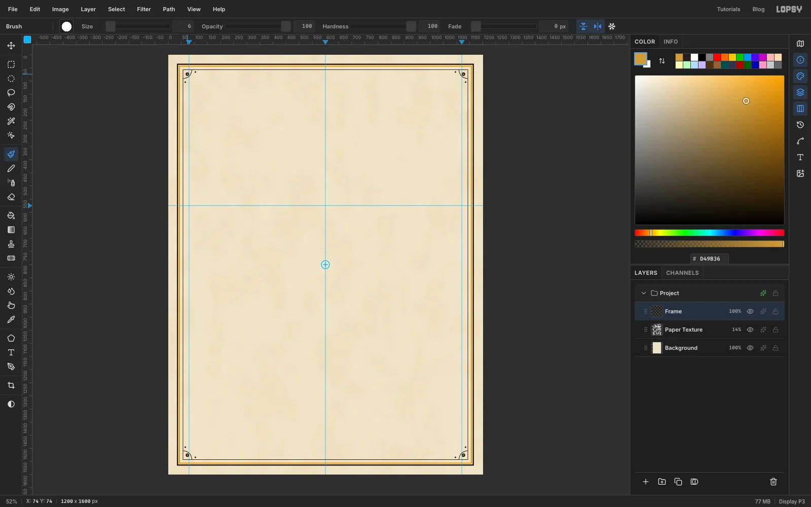

Press [[Cmd+D]], pick the **Brush** ([[B]]) and switch on both **Symmetry Horizontal** and **Symmetry Vertical** in the options bar. Each stroke is now repeated in all four corners, mirrored around the centre of the page.

In the **Brushes** panel (click the brush tip in the options bar) set **Hardness 100**, **Opacity 100** and **Spacing 4%**. Then, still on the Frame layer:

- At **Size 3** in ink, drag a quarter circle centred on the inner rule's corner (57, 57): from (91, 57) through about (81, 81) to (57, 91).
- At **Size 14**, click once at (74, 74) for a dot inside the arc.
- At **Size 7**, click at (104, 66) and (66, 104).
- Switch to gold `#D49B36` at **Size 6** and click (74, 74) again to put a gold eye in the big dot.

Turn both symmetry buttons off again before you move on.

## Set the title and subtitle

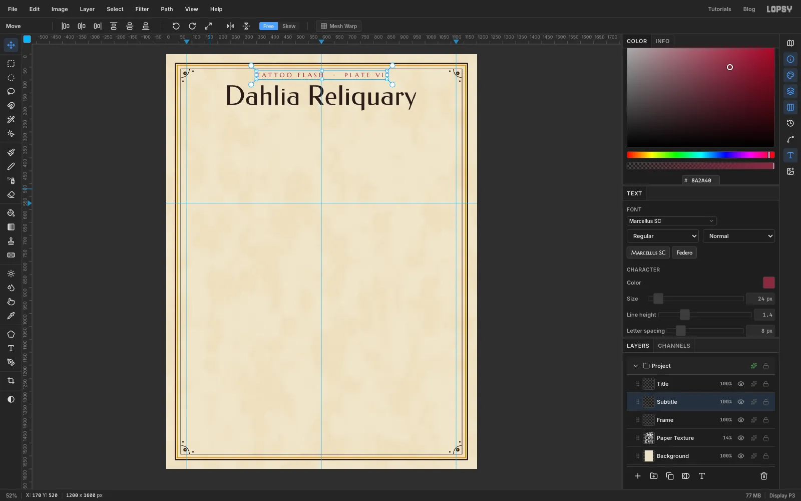

Click the **Frame** row first. New text goes above the selected layer, and the Text options would restyle a selected text layer.

Pick the **Text** tool ([[T]]), set the font to **Federo**, **Size 104**, colour ink, and in the Text panel set **Letter spacing 2**. Click in an empty part of the page, type **Dahlia Reliquary**, and press [[Tab]] to commit it. Rename the layer **Title**.

Click the **Frame** row again, then set **Marcellus SC**, **Size 24**, colour crimson `#8A2A40` and **Letter spacing 8**. Click in another empty part of the page and type **TATTOO FLASH · PLATE VII** with two spaces either side of the dot (on a Mac, type the middle dot with [[Alt+Shift+9]]). Commit with [[Tab]] and rename the layer **Subtitle**.

Switch to the **Move** tool ([[V]]), drag each line roughly into place, and finish with the arrow keys ([[Shift]] moves 10 px) to centre both lines on the x 600 guide. Put the subtitle's capitals at about **y 72–88** and the title's capitals from about **y 120**, which leaves roughly 30 px between them.

## Draw the divider with a turned diamond

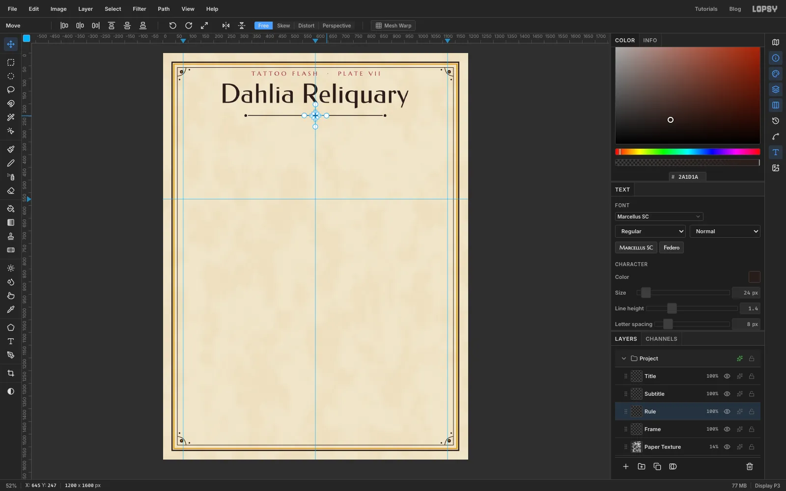

Click **Frame**, add a layer called **Rule**, and pick the **Pencil** ([[N]]) at **Size 3** in ink.

Click at (336, 246), then hold [[Shift]] and click at (570, 246). The Pencil joins the two clicks with a perfectly straight line. Do the same from (630, 246) to (864, 246).

For the end dots, click once with the **Elliptical Marquee** and enter **From 321, 241 To 331, 251**, then **Edit → Fill**. Press [[Cmd+D]] and repeat at **From 869, 241 To 879, 251**.

For the diamond, press [[Cmd+D]] and make a small square: Rectangular Marquee click, **From 589, 235 To 611, 257**, and Fill. Switch to the **Move** tool, hover just outside the top-right corner of the marquee until the cursor turns into a rotate arrow, and drag around **45°** so the square stands on its point. Press [[Cmd+D]] to commit the rotation.

## Build the halo from shrinking circles

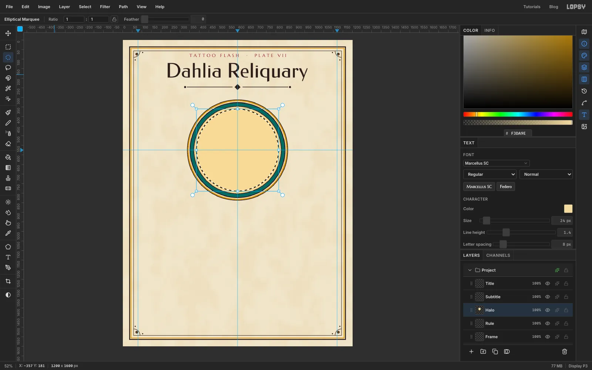

Mucha's halos are rings inside rings. Here every ring comes from one circle and **Shrink**.

With **Rule** selected, add a layer called **Halo**. Click once with the **Elliptical Marquee** and enter **From 336, 311 To 864, 839**: a 528 px circle centred on the guides' crossing (600, 575). Then work inwards:

1. Fill with ink. **Shrink 3**, fill with gold `#D49B36`. **Shrink 6**, press [[Delete]]. That leaves a thin ink edge and a gold band round the outside.
2. Press [[Cmd+D]] (the click-once dialog only opens when nothing is selected; you'll do this before every typed-in shape from now on), click once for a new circle, **From 350, 325 To 850, 825**, and fill with ink.
3. **Shrink 4**, fill with teal `#2E6A66`.
4. **Shrink 16**, fill with ink.
5. **Shrink 3**, fill with pale gold `#F3DA9E`: this is the plate the flower sits on.
6. **Shrink 9**, fill with gold `#D49B36`. **Shrink 3**, fill with pale gold again. That leaves a thin gold ring just inside the plate's edge.

Press [[Cmd+D]].

## Bead the halo and add spokes with Radial Symmetry

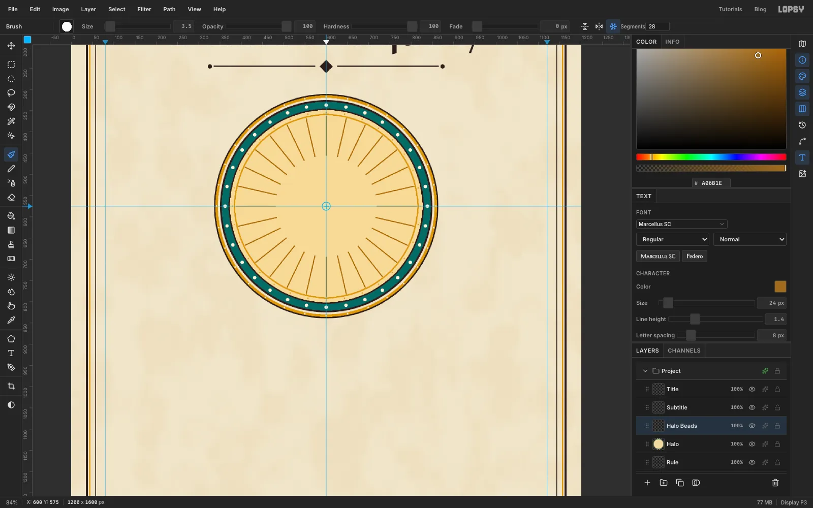

Add a layer called **Halo Beads** and pick the **Brush**. Click **Radial Symmetry** in the options bar (the snowflake). A **Segments** box appears next to it.

Radial Symmetry repeats each dab round a centre point. [[Cmd]]-click the centre of the halo, at (600, 575), to move the symmetry centre there. It stays there until you move it, so you'll reuse it for the whole dahlia.

- Set **Segments 32**, **Size 9**, colour cream `#F8F0DC`, and click once in the middle of the teal band at the top (600, 337). Thirty-two beads appear round the ring.
- Set **Segments 64** and **Size 4.5** and click once on the outer gold band at (600, 318).
- Set **Segments 48**, **Size 4**, colour gold `#D49B36`, and click once just inside the plate edge at (600, 354).
- Set **Segments 28**, **Size 3.5**, colour dark gold `#A06B1E`, and drag one short line slowly and straight up from (600, 455) to (600, 363). You get 28 spokes. The flower will cover their inner ends.

## Draw one petal, get fourteen

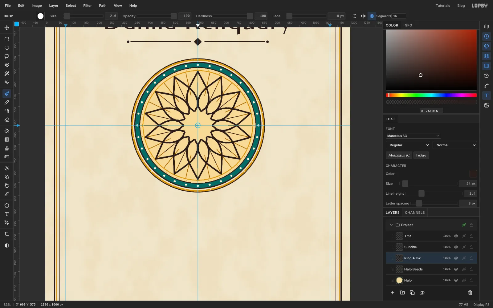

The dahlia has three rings of petals, and each ring gets two layers: an **ink** layer for the outlines and a **colour** layer underneath. Start with the outer ring.

Add a layer called **Ring A Ink**. Brush **Size 7**, **Hardness 100**, ink, Radial Symmetry on with **Segments 14** (the centre is still at 600, 575).

Draw a single petal pointing straight up, in one stroke: start just left of centre at about (585, 519), sweep out to a sharp tip at (600, 363) just inside the gold plate, and come back down the other side to (615, 519). Make it widest about two-thirds of the way out, roughly 74 px across, so each petal overlaps the next. Fourteen petals appear at once.

Now set **Size 2.6** and drag one short crease up the middle of the top petal, from about (600, 491) to (600, 407). That's repeated too.

> **Tip:** The overlap matters. Neighbouring petals must cross each other right down to the centre, so the outlines make one closed shape for the next step.

## Fill the petals with the Magic Wand and Inverse

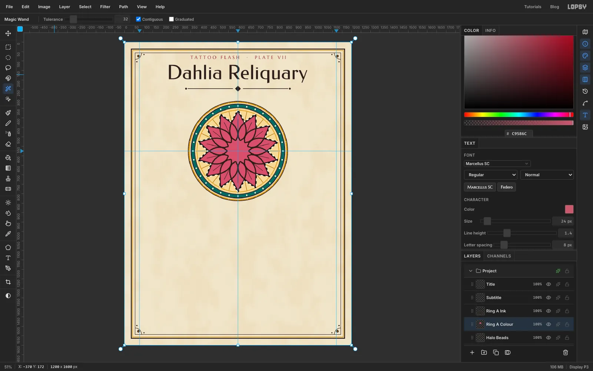

Click the **Halo Beads** row and add a layer called **Ring A Colour**. Because new layers go above the selected one, it lands under Ring A Ink.

Click the **Ring A Ink** row. Take the **Magic Wand** ([[W]]) with **Contiguous** on and click an empty spot outside the petals but inside the halo, such as (600, 339). The wand only reads the selected layer, so it selects everything outside the outlines.

Choose **Select → Inverse**. Now just the flower is selected. Click the **Ring A Colour** row, set the foreground to rose `#C9586C`, and **Edit → Fill**. The colour sits neatly under the ink lines.

> **Note:** After Inverse, the transform handles frame the whole canvas instead of the flower. It doesn't affect the fill.

## Shade like flash: hard dabs and white flicks

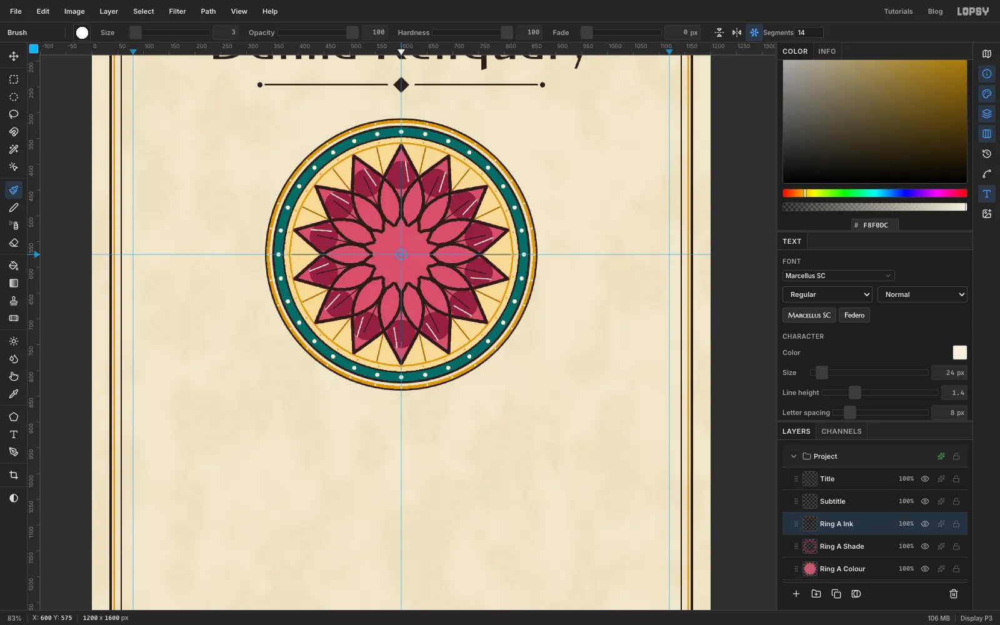

Keep the selection. With **Ring A Colour** selected, add a layer called **Ring A Shade**. It sits between the colour and the ink.

Brush **Size 56**, **Hardness 100**, **Opacity 100**, crimson `#8A2A40`, Radial Symmetry still on at **14**. Click once at (600, 421), on the top petal's crease, about 154 px above the centre. The selection keeps all fourteen dabs inside the petals. Each dab's round, hard edge leaves a crimson base and a rose tip, the way flash is shaded. Press [[Cmd+D]].

Click **Ring A Ink**. With the Brush at **Size 3** in cream `#F8F0DC`, draw one short line just right of the top petal's crease, from about (614, 433) to (608, 394). That's the shine on every petal.

## Draw the second ring of petals

Repeat the last three steps one layer higher for **Ring B**:

1. Click **Ring A Ink**, add **Ring B Ink**. Brush **Size 7** in ink, Segments **14**. Draw one petal pointing slightly right of straight up, half a petal's turn (about 13°) clockwise, so the new petals sit between the old ones. Its base is about 46 px from the centre, its tip at about (633, 429), and it's about 58 px wide. Add the crease at **Size 2.6**.
2. Click **Ring A Ink**, add **Ring B Colour**. Click **Ring B Ink**, wand outside the new petals at (600, 395), **Select → Inverse**, click **Ring B Colour** and fill with blush `#E58E8E`. This layer covers the Ring A ink lines that run behind the new petals.
3. Add **Ring B Shade** and, with the selection still live, click a **Size 44** dab in rose `#C9586C` on the tilted petal's crease, about 102 px from the centre. Press [[Cmd+D]].
4. Add a **Size 3** cream flick on **Ring B Ink**.

## Add the third ring

Do it once more for **Ring C**, the small inner ring, with **Segments 10**:

- Outline at **Size 5** in ink, petals pointing straight up, base about 36 px out, tip about 98 px out, about 44 px wide.
- Colour pale petal `#F7CDBF` (wand outside at (601, 447)).
- Shade with a **Size 33** blush `#E58E8E` dab about 50 px above the centre, then press [[Cmd+D]]. No flick on this ring.

## Plant the seed head

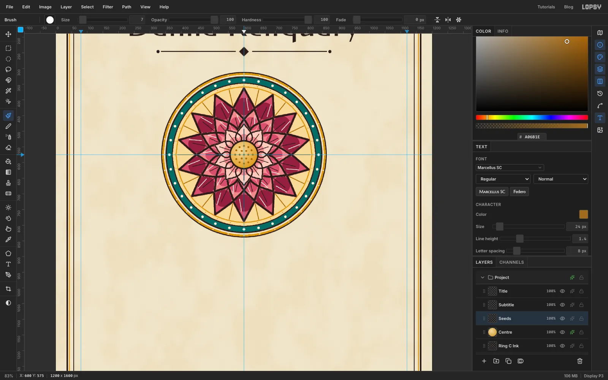

Turn **Radial Symmetry off** for a moment. Click **Ring C Ink**, add a layer called **Centre**, and make a circle with the click-once dialog: **From 558, 533 To 642, 617**.

Pick the **Gradient** tool (it's in the toolbox; it has no shortcut), choose **Radial**, and click **Advanced…** in the options bar. Click each stop under the gradient bar and type its colour in the Hex field: pale gold `#F3DA9E` on the left, gold `#D49B36` on the right. Drag from just above-left of the centre, at (590, 563), to (630, 607). Deselect.

Add a Stroke of **5** to **Centre**.

Add a layer called **Seeds**. Pick the Brush again: **Size 7**, dark gold `#A06B1E`, Radial Symmetry on. With **Segments 12**, click once 28 px above the centre. With **Segments 6**, click once at (607, 563). Turn symmetry off and click the centre itself.

## Cut the ribbon band and its tails

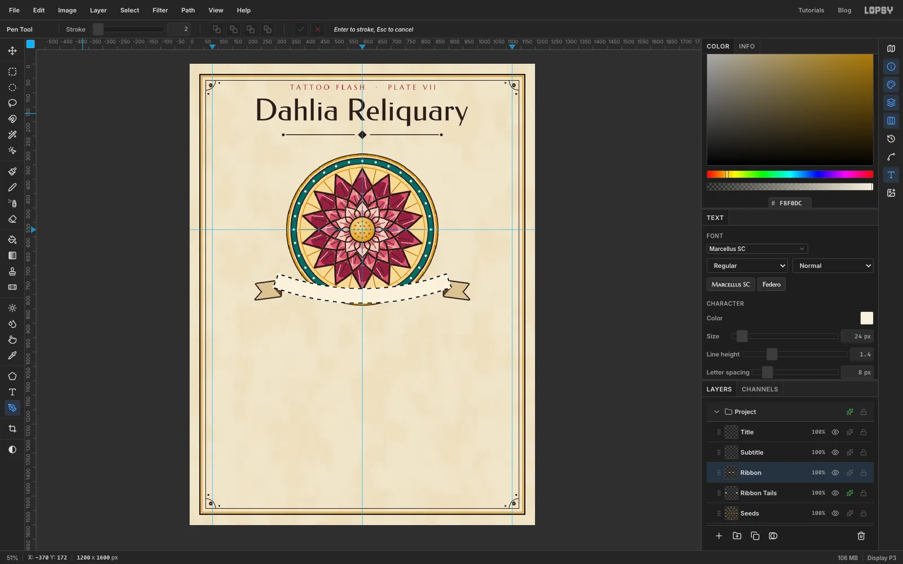

The ribbon is three Pen shapes. Pen shapes become selections with **Path to Selection** in the **Paths** panel (open it from the right-hand toolbar), which you then fill. After each Path to Selection, click **Delete Path** so old paths don't get in the way of new ones.

Click **Seeds** and add a layer called **Ribbon Tails**. Pick the **Pen** ([[P]]). Turn Radial Symmetry off if it's still on. Click five corner points for the left tail, starting with its lower outer point: (230, 818), then (318, 806) and (318, 752), which will be hidden under the band, then out to the upper point at (232, 764) and in to the notch at (254, 791). Click the first point again to close the path. Start each closed shape at its left-most point, because the Pen's ✓ and ✗ buttons appear just left of the first anchor.

In the Paths panel click **Path to Selection**, fill with tan `#D7C397`, and click **Delete Path**. Draw the right tail as its mirror image. Then add two small triangles for the folds, where the band turns under, in dark brown `#5E4630`. Deselect and add a **Stroke** effect, **Width 4**.

Add a layer called **Ribbon**. With the Pen, draw a curved band, 50 px deep, that follows the bottom of the halo:

1. Click (292, 776), the band's lower-left corner.
2. Click (309, 729), its upper-left corner.
3. At (600, 780), press and drag a little to the right to make a smooth dip.
4. Click (891, 729), then (909, 776).
5. At (600, 830), press and drag a little to the left.
6. Click the first point to close the shape. Path to Selection, fill with cream `#F8F0DC`, deselect, and add a Stroke of **5**.

## Draw a baseline arc for the lettering

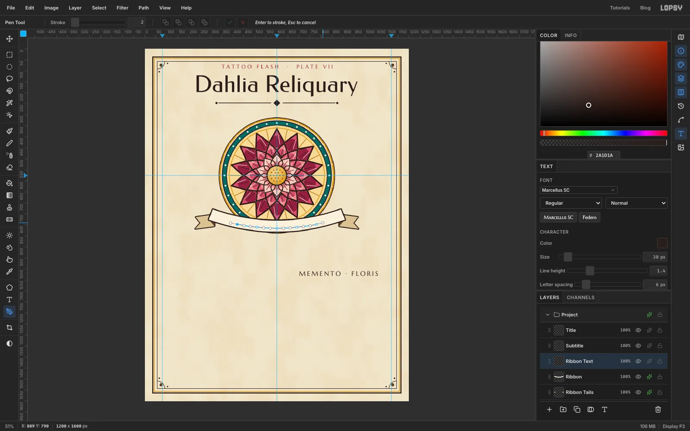

With **Ribbon** selected, make the text first so you know its width: **Marcellus SC**, **Size 30**, ink, **Letter spacing 6**. Click in an empty area, type **MEMENTO · FLORIS** and press [[Tab]]. Rename the layer **Ribbon Text**. It is about 360 px wide.

Now draw the curve the letters will sit on. With the Pen, click-and-drag five points along a shallow arc through the lower half of the ribbon band, starting at about (420, 797) on the left, running through (600, 815) in the middle, and ending at about (780, 797). That's the same width as the text. Drag each handle along the curve so the arc stays smooth. Commit the path with the **✓** button in the options bar. Don't press [[Enter]], which would stroke the path onto the layer.

## Bind the text to the path

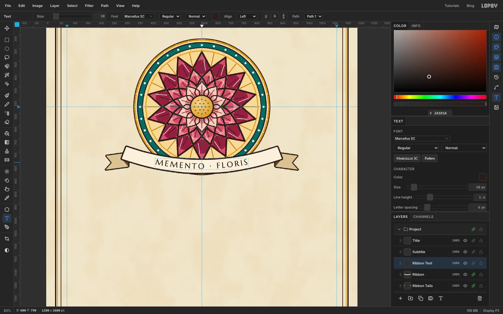

Click the **Ribbon Text** row, pick the **Text** tool, and choose the arc from the **Path** dropdown in the Text options bar. Each letter moves onto the curve and turns to follow it.

The text starts at the path's first point, so an arc the same width as the text centres it automatically. Check that the capitals sit with even space above and below inside the band. Then click the path's row in the Paths panel to deselect it and hide its line. Keep the path: deleting it would unbind the text.

## Add the leaves and whiplash tendrils

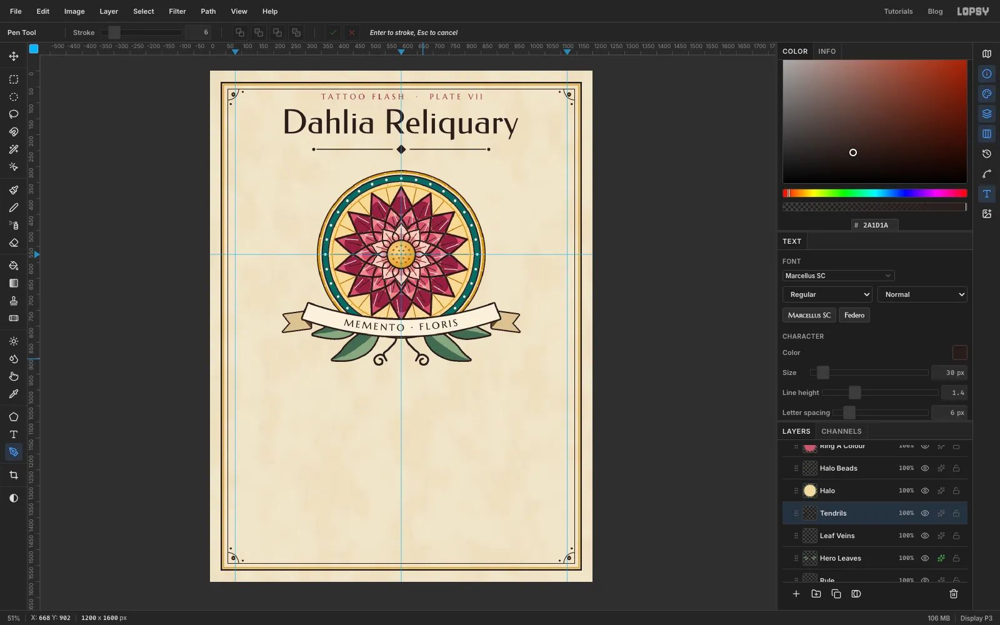

The leaves go *behind* the halo, so click the **Rule** row before adding a layer called **Hero Leaves**.

For each leaf, draw a closed almond shape with the Pen: click the base and the tip as corners, and drag handles at the points along each side. Fill it with leaf green `#8DA683`. Then draw just the leaf's left half, from base to tip along the midrib, and fill it with leaf shadow `#4A6A53`. Two hard tones read as flash; a gradient wouldn't.

Make two leaves on each side, tucked under the ribbon ends: one from a base at (530, 806) to a tip at (384, 906), about 60 px wide, and a slimmer one from (470, 790) to (322, 826). Mirror both on the right (base (670, 806) to tip (816, 906), and (730, 790) to (878, 826)). Deselect and add a Stroke of **5**.

On a new layer, **Leaf Veins**, keep leaf shadow `#4A6A53` as the foreground and Pen-stroke a midrib down each leaf at **3**. Delete each path after stroking it, so the next click doesn't edit it.

On a layer called **Tendrils**, set the foreground to ink and Pen-stroke two curls at **6**. Start the left one under the ribbon at (588, 820), swing it down and out, and finish in a tightening spiral round about (532, 908). Mirror it on the right.

## Hang a bead chain

Add a layer called **Chain**. Pick the Brush and, in the Brushes panel, set **Size 11** and **Spacing 140%**. Spacing over 100% leaves gaps between dabs, so a straight stroke becomes a row of beads.

In gold `#D49B36`, click just under the ribbon at (600, 842), then [[Shift]]-click at (600, 1186). Add a Stroke of **2** so every bead gets its own outline.

Set **Spacing** back to **4%** before you paint anything else, or every later brush line comes out dotted.

## Group the medallion

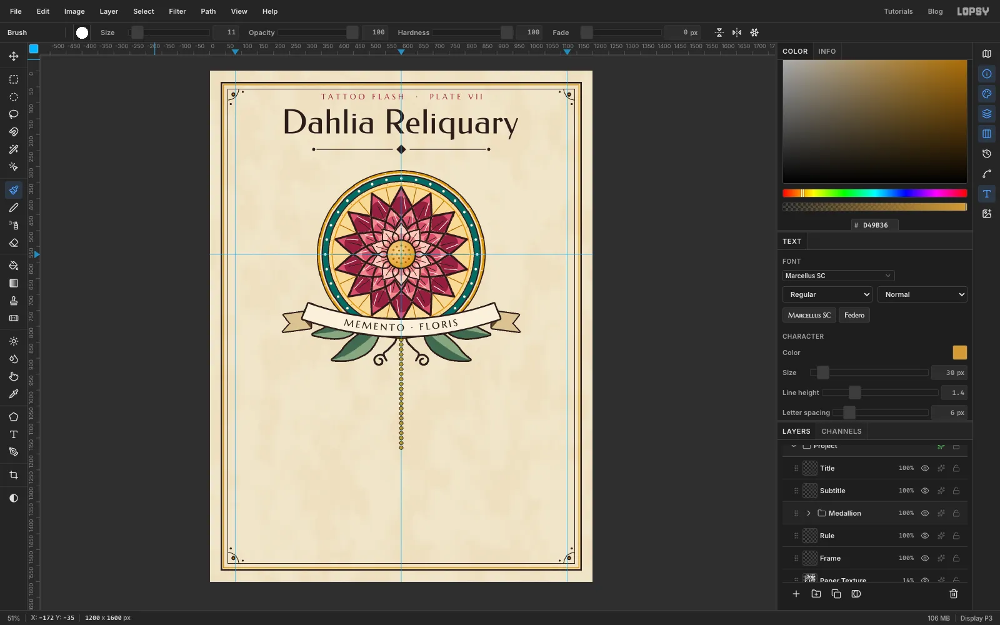

Click **Hero Leaves**, then [[Shift]]-click **Ribbon Text** to select everything from the leaves to the ribbon text. Choose **Layer → Group Layers** and name the group **Medallion**. Collapse it with its arrow.

Try it out: select the group, switch to **Move**, press [[Shift+Right]] four times, and the whole medallion slides 40 px. Press [[Cmd+Z]] four times to put it back. Nothing else on the page moves.

## Cut a dagger blade with brushed steel

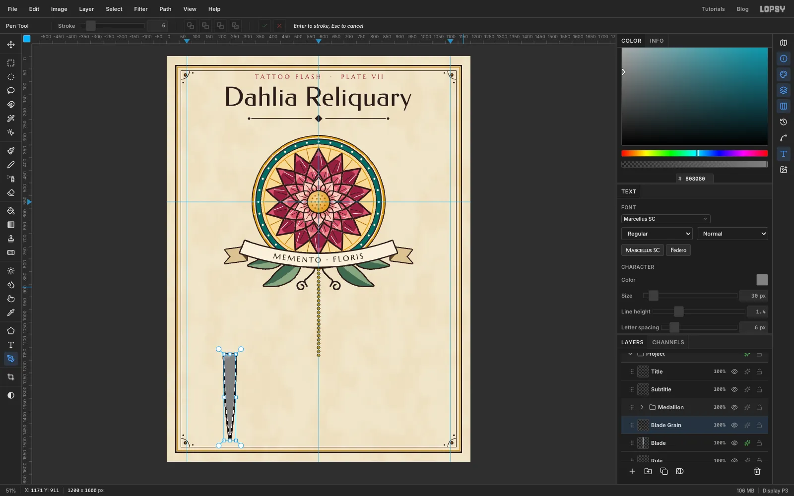

Each of the other flash pieces gets its own group. Start every piece by clicking **Rule**, so its layers go in below the Medallion group.

The dagger stands on the x 250 line, with its pommel at the top and its point at the bottom. Add a layer called **Blade**. With the Pen, draw a long blade pointing down. It is 48 px wide at the top (y 1176), narrows gradually, and ends in a sharp point at (250, 1518). Path to Selection and fill with steel `#E1E6E3`. Then draw just the right half, from the centre line to the right edge, and fill it with steel shadow `#8B9A9C`. Deselect and add a Stroke of **5**.

For a brushed look, [[Cmd]]-click the Blade thumbnail to select its shape. Add a layer called **Blade Grain**, fill it with grey `#808080`, run **Filter → Add Noise...** at **Amount 60** with **Mono**, then **Filter → Motion Blur...** at **Angle 90**, **Distance 40**. Deselect, set the layer to **Overlay** and drop it to **60%**.

## Build the hilt

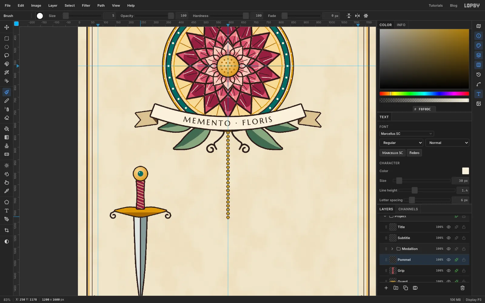

On a layer called **Dagger Lines**, set the foreground to ink. Pen-stroke a ridge down the middle of the blade at **4**, from (250, 1184) to (250, 1498). Then Pen-stroke two small curls at **5**, hanging down from the guard tips at (146, 1154) and (354, 1154).

**Guard:** add a layer called **Guard**. Pen a slim bow shape across the top of the blade, from x 146 to x 354 and y 1142 to y 1178. Make it pointed at both ends, with the top edge nearly flat and the bottom edge bowing down. Fill it with gold `#D49B36`. Then hold [[Alt]] and drag a rectangle with the Rectangular Marquee over its top half. [[Alt]]-drag *subtracts* from the selection, leaving only the bottom band. Fill that with dark gold `#A06B1E`, deselect, and add a Stroke of **4**.

**Grip:** add a layer called **Grip**. Pen a rectangle 30 px wide from y 1033 down to the guard at y 1146, pinched in to 24 px wide at the middle (y 1090). Fill it with crimson `#8A2A40`. Keep it selected. With the Pencil at **Size 2** in pale gold `#F3DA9E`, make the wire: click on the grip's left edge, then [[Shift]]-click on its right edge 14 px lower. Start the next wire 12 px further down, and repeat to the bottom. The selection keeps the wire inside the grip. Deselect and add a Stroke of **4**.

**Pommel:** add a layer called **Pommel**. Make a circle **From 223, 979 To 277, 1033** and fill it with a radial gradient, pale gold to gold. Press [[Cmd+D]], make a 22 px circle in the middle (**From 239, 995 To 261, 1017**), and fill it with teal `#2E6A66`. Deselect. Click once with a **Size 5** cream brush on the gem's upper left for a glint, and add a Stroke of **4**.

## Pierce a rosebud

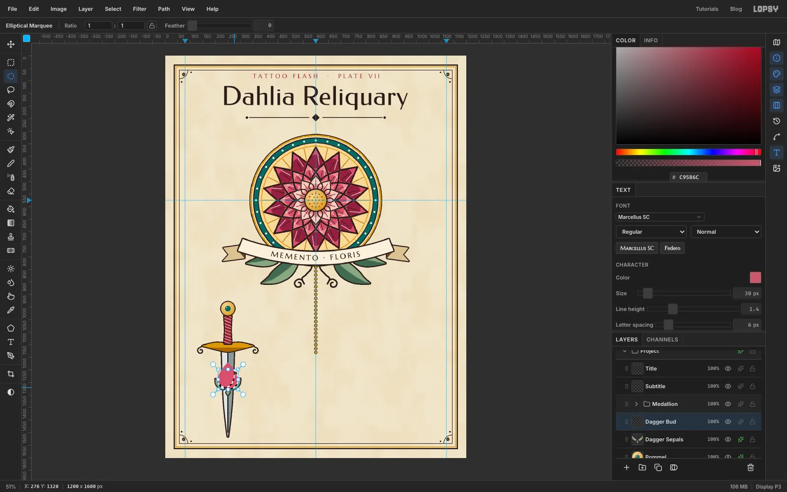

The bud sits about a third of the way down the blade, centred at (250, 1278). Add a layer called **Dagger Sepals**. Pen three small pointed leaves round where its base will be (around y 1325), one curling up on each side and one pointing down, and fill them with leaf green. Add a Stroke of **4**.

Add a layer called **Dagger Bud**. Pen a teardrop, 80 px wide and 108 px tall, centred on (250, 1278), with a corner at its pointed top, and fill it with rose `#C9586C`. Keep it selected. With the **Elliptical Marquee**, hold [[Alt]] and drag an ellipse a little smaller than the bud, shifted up and left. What's left selected is a crescent down the bud's right side, as in the screenshot. Fill it with crimson `#8A2A40`, deselect, and add a Stroke of **5**.

Add a layer called **Dagger Bud Lines**, set the foreground to ink, and Pen-stroke two curved petal edges at **3**, each from the bud's base up towards its tip. Add a short cream flick on the bud's upper left with a **Size 4** brush.

Finish with three loose petals on a new layer called **Loose Petals**: small teardrops about 20 px wide, filled with rose and tilted at different angles, falling beside the blade at about (320, 1418), (188, 1458) and (302, 1498). Add a Stroke of **3**.

## Group and tilt the dagger

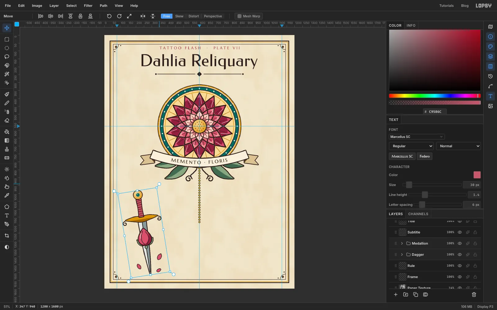

Click **Blade**, [[Shift]]-click **Loose Petals**, choose **Layer → Group Layers**, and name it **Dagger**.

With the group selected and no marquee active (press [[Cmd+D]] to be sure), switch to **Move**. Hover just outside the top-right corner of the group's box until you see the rotate cursor, and drag anticlockwise about **9°**. Press [[Esc]] to drop the handles; the rotation stays. A slight tilt makes the sheet feel hand-placed.

## Make the heart locket

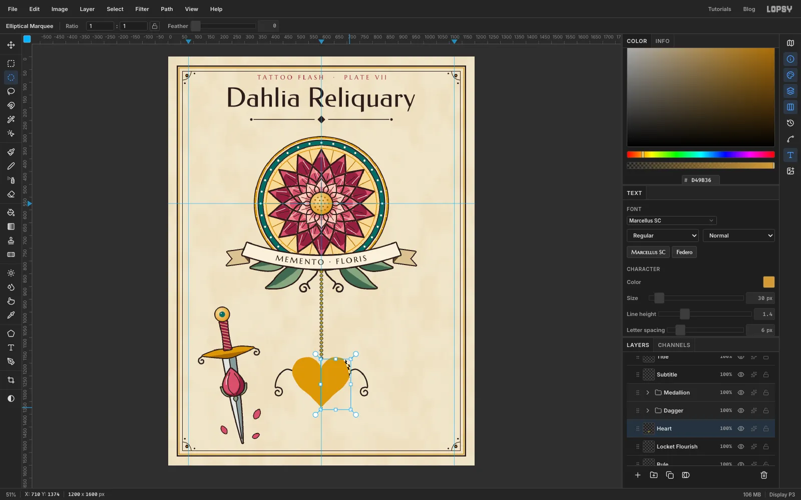

Click **Rule**. On a layer called **Locket Flourish**, set the foreground to ink and Pen-stroke two whiplash curls at **5**. Each starts at the side of where the heart will be, at about (492, 1232) and (708, 1232), arcs outwards, and spirals into a curl at about (430, 1314) and (770, 1314).

Add a layer called **Heart**. Draw a heart with the Pen, 230 px wide, centred at (600, 1262): a corner at the top dip, a corner at the bottom point, and smooth points round the two lobes. Fill it with gold `#D49B36`.

For the hard shadow, take the **Elliptical Marquee** and [[Alt]]-drag an ellipse that covers almost the whole heart but sits a little up and to the left, from about (450, 1132) to (710, 1374). Only a crescent on the right edge and bottom point stays selected. Fill it with dark gold `#A06B1E`, deselect, and add a Stroke of **5**.

## Engrave the inner line and keyhole

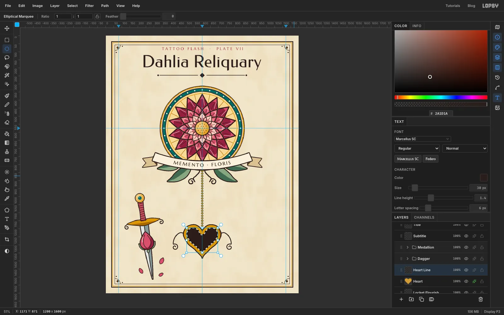

[[Cmd]]-click the **Heart** thumbnail to select its shape, then **Select → Shrink…** by **15**. Add a layer called **Heart Line**, fill the selection with ink, then **Shrink 3** more and press [[Delete]]. What's left is a 3 px line that follows the heart's edge 15 px in.

For the keyhole, still on Heart Line: press [[Cmd+D]], make a circle **From 586, 1238 To 614, 1266** and fill it with ink. Then Pen a small trapezoid below it, 14 px wide at the top (y 1264) and 28 px wide at the bottom (y 1302), and fill that too. Press [[Cmd+D]]. With a **Size 6** cream brush, drag a short flick on the upper-left lobe.

## Hang the locket on a bail

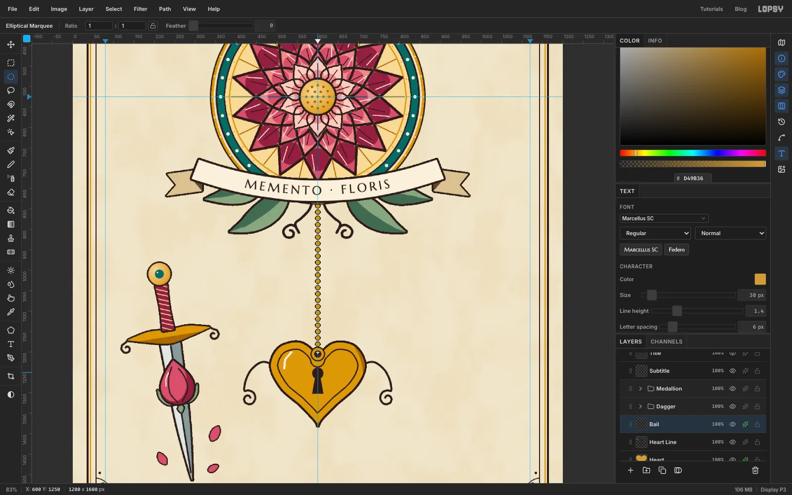

Add a layer called **Bail**. Press [[Cmd+D]] and make a circle **From 585, 1190 To 615, 1220** in the heart's top dip, fill it with gold, **Shrink 6**, and press [[Delete]] to leave a ring. Deselect and add a Stroke of **3**. The chain now runs straight into the ring.

Group **Locket Flourish** through **Bail** as **Locket**.

## Draw one sprig

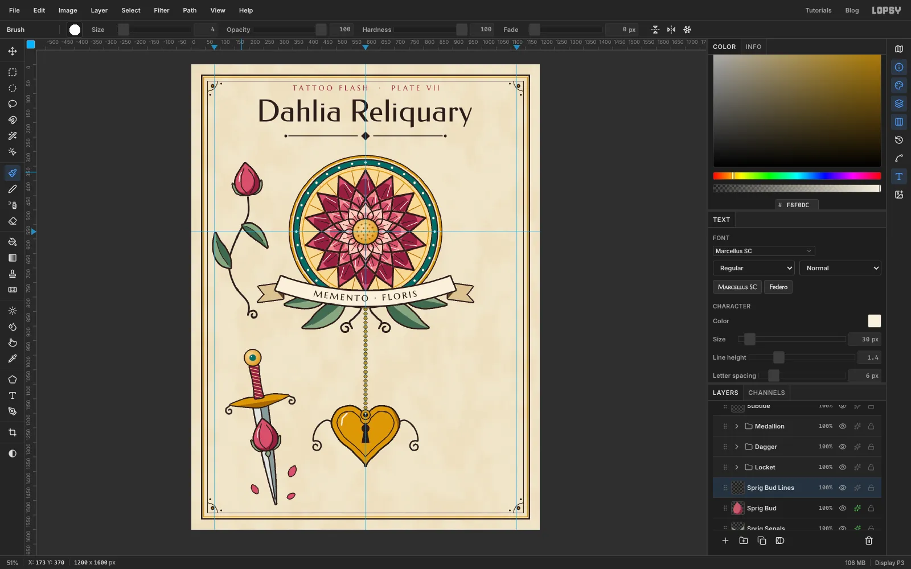

Click **Rule** and draw the left-hand sprig on its own layers:

- **Sprig Stem:** with ink as the foreground, Pen-stroke an S-shaped stem at **6**, from (196, 862) up to (196, 456) under where the bud will be, swinging out to the left on the way. Add a little curl at the bottom.
- **Sprig Leaves:** two leaves off the stem, two-tone like the medallion leaves: one from (136, 700) up and left to a tip at (84, 580), one from (176, 552) down and right to (262, 630). Add a Stroke of **5**.
- **Sprig Veins:** midribs Pen-stroked at **2.5** in ink.
- A bud at the top, made exactly like the dagger's bud: **Sprig Sepals**, **Sprig Bud** with its crescent, and **Sprig Bud Lines**.

Group these layers as **Sprig Left**.

## Copy the sprig with Copy Merged

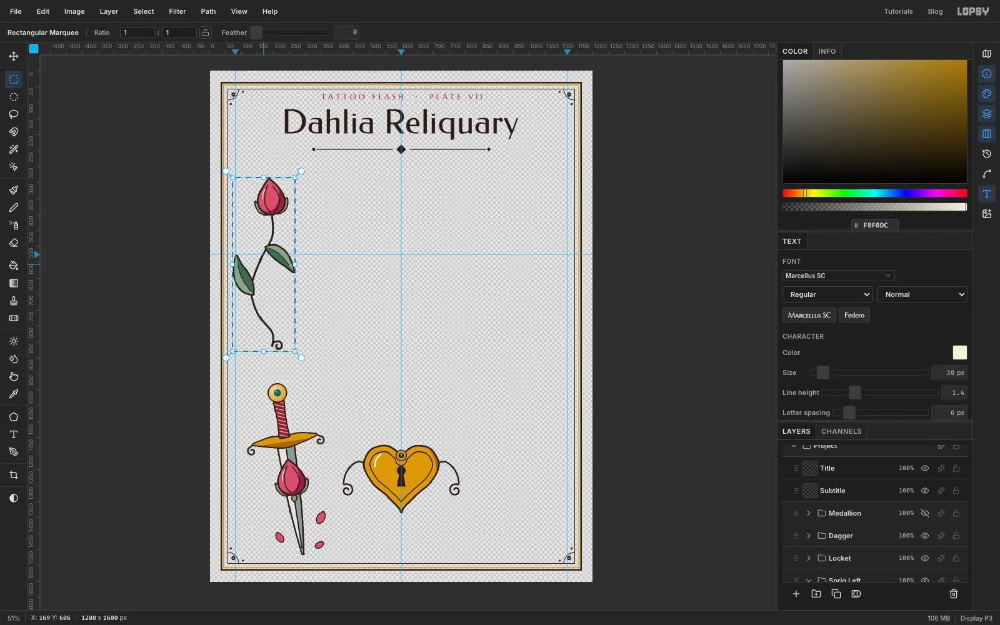

The right-hand sprig is a mirror image, so copy the finished one instead of drawing it again.

**Copy Merged** copies everything visible inside the selection, flattened. Hide **Background**, **Paper Texture** and the **Medallion** group with their eye buttons first, or the paper comes along too. Then drag a rectangular marquee round the sprig, with a little room on every side but keeping its left edge right of the frame rules (x 60 or more), and choose **Edit → Copy Merged**.

Show the three layers again and press [[Cmd+D]].

## Paste, flip and place the copy

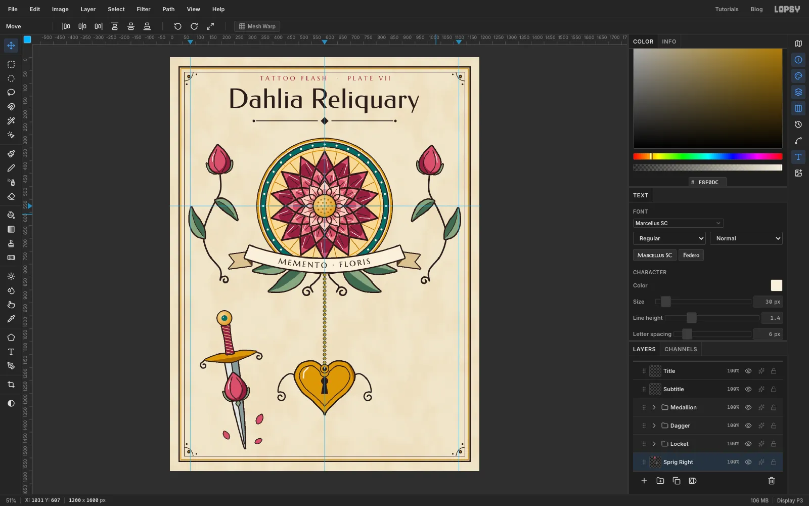

Collapse **Sprig Left** with its arrow, click its row, and choose **Edit → Paste**. The copy lands exactly on top of the original as a new layer; rename it **Sprig Right**.

Choose **Image → Flip Horizontal**. The layer mirrors in place. Then drag it with the **Move** tool to the right of the halo, and finish with the arrow keys until it's exactly as far from the right edge as the original is from the left: its stem should sit at x 1004.

## Cut a crescent moon

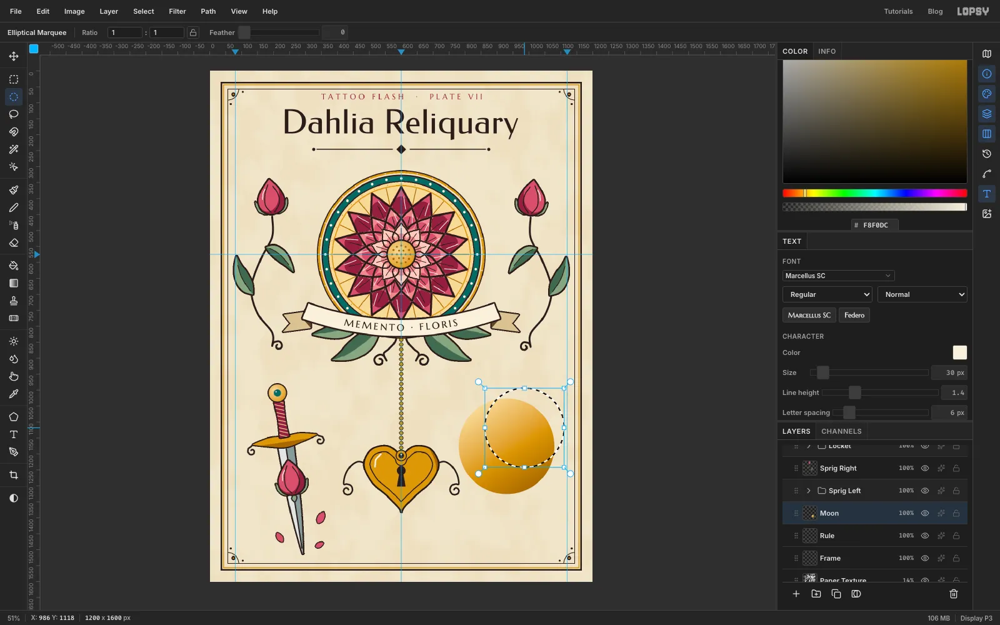

Click **Rule** and add a layer called **Moon**. Make a circle **From 780, 1026 To 1080, 1326**. Set up a **Linear** gradient from pale gold `#F3DA9E` through gold `#D49B36` to dark gold `#A06B1E`: in **Advanced…**, click an empty spot on the bar to add the middle stop and type its colour. Drag the gradient from the circle's upper left to its lower right.

Press [[Cmd+D]], make a second circle, **From 862, 994 To 1110, 1242**, overlapping the first towards the upper right, and press [[Delete]]. (If the dialog didn't open, nothing is selected and Delete would remove the whole layer, so check for marching ants first.) A crescent is left. Deselect and add a Stroke of **5**.

## Shade the inside curve

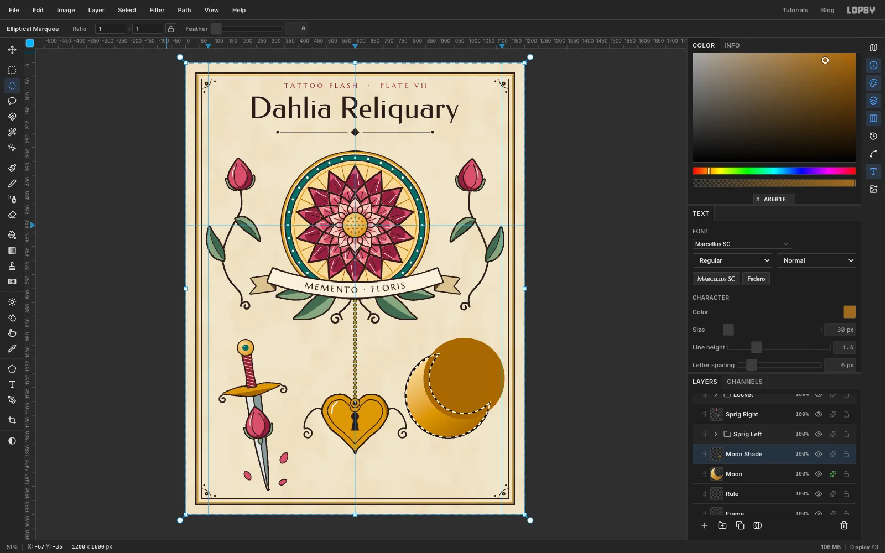

Flash moons get a hard band of shadow along the inside curve. Add a layer called **Moon Shade**, press [[Cmd+D]], and fill a circle a little bigger than the hole you just cut, **From 842, 974 To 1130, 1262**, with dark gold `#A06B1E`.

Now trim it to the moon. [[Cmd]]-click the **Moon** thumbnail, choose **Select → Inverse** so everything *except* the moon is selected, click the **Moon Shade** row and press [[Delete]]. Only a band along the moon's inner edge is left. Deselect, set the layer to **Multiply** at **70%**.

## Line and polish the moon

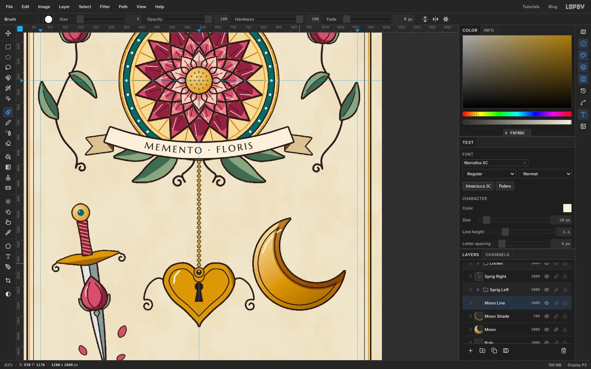

[[Cmd]]-click the **Moon** thumbnail again, **Shrink 12**, and on a new layer called **Moon Line** fill with ink, **Shrink 3** and **Delete**. That leaves an engraved line inside the crescent.

With a **Size 5** cream brush, drag two short curved flicks along the outer edge of the moon on its left, following the curve.

## Copy the dahlia for the moon

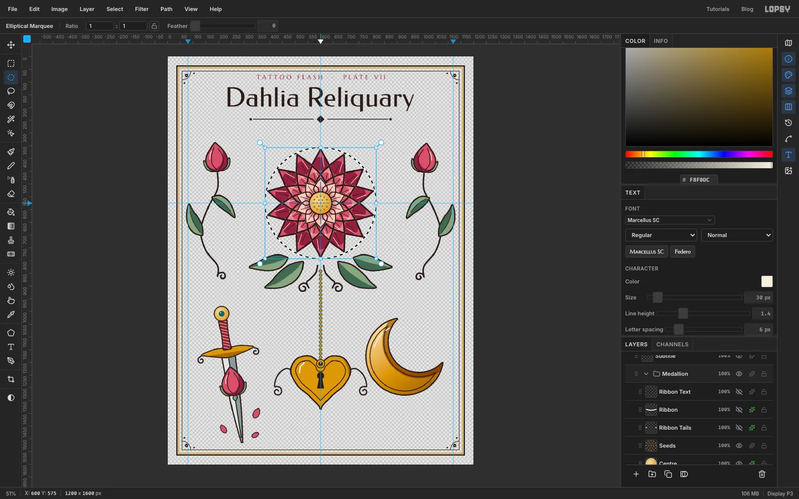

The moon cradles a small copy of the dahlia. Expand the **Medallion** group and hide **Background**, **Paper Texture**, **Halo**, **Halo Beads**, **Ribbon**, **Ribbon Tails** and **Ribbon Text**.

Select a circle round the flower, **From 382, 357 To 818, 793**, choose **Edit → Copy Merged**, then show those layers again, collapse the group and deselect.

## Paste and shrink the mini dahlia

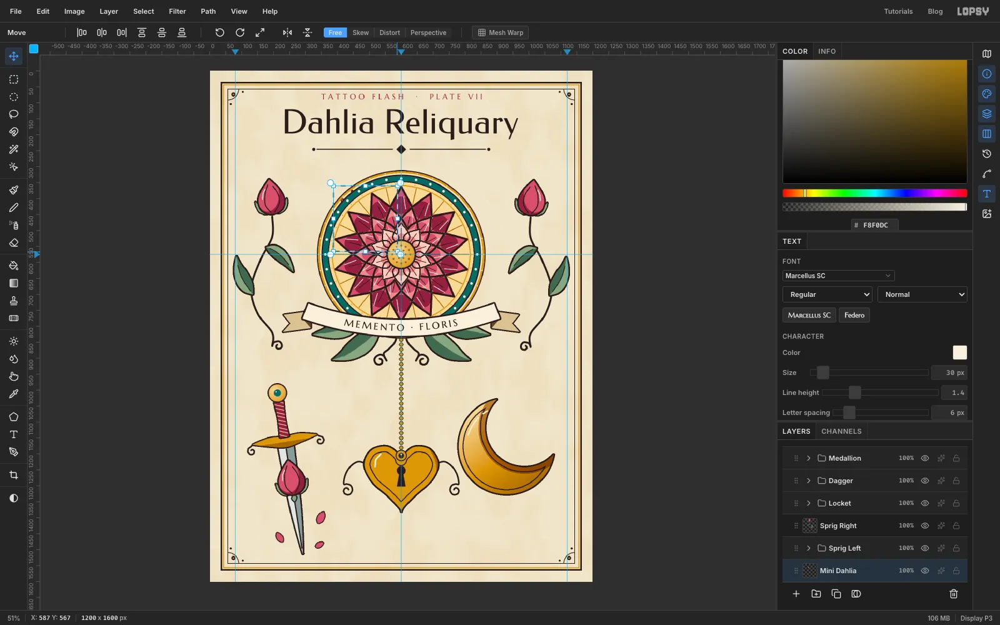

Click **Moon Line** and **Edit → Paste**. Rename the new layer **Mini Dahlia**. It lands exactly on top of the big dahlia, so the page looks unchanged until you scale it.

Drag a rectangular marquee just round the pasted flower. With the **Move** tool, hold [[Cmd]] and drag the bottom-right corner handle inwards until the flower is a bit under half size, about 200 px across. [[Cmd]] keeps the proportions. Press [[Cmd+D]] to commit the scale.

Drag the small flower into the moon's hollow, centred at about (940, 1158), so its lower-left petals overlap the inner horn. Add a Stroke of **4** so its outline is as bold as everything else.

## Hang bead strands from the moon

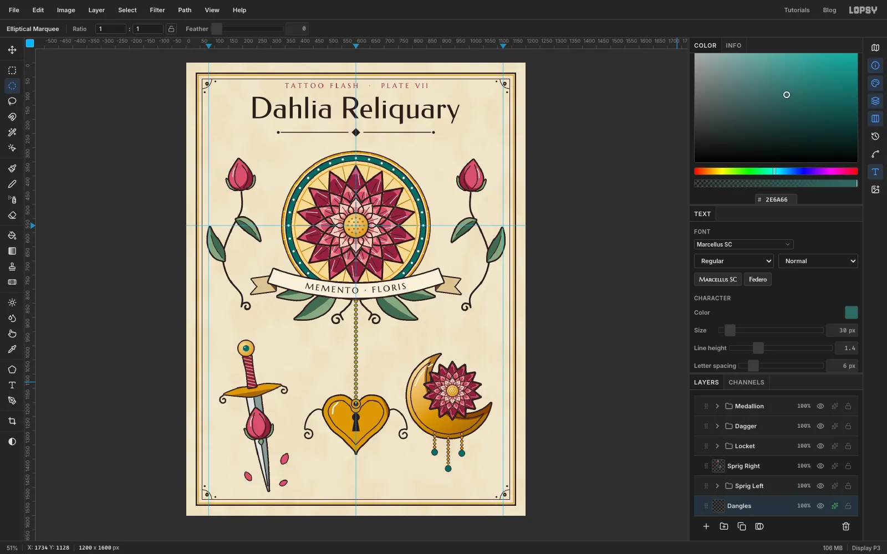

Add a layer called **Dangles**. Brush **Size 9**, **Spacing 140%**, gold. Click on the moon's lower edge and [[Shift]]-click straight down to make three bead strands: the outer two about 56 px long, the middle one about 96 px. Put a teal `#2E6A66` circle 20 px across at the end of each strand with the click-once dialog and Fill, pressing [[Cmd+D]] before each one. Deselect and add a Stroke of **2**.

Group **Moon** through **Dangles** as **Crescent**.

## Make a cartouche for the plate number

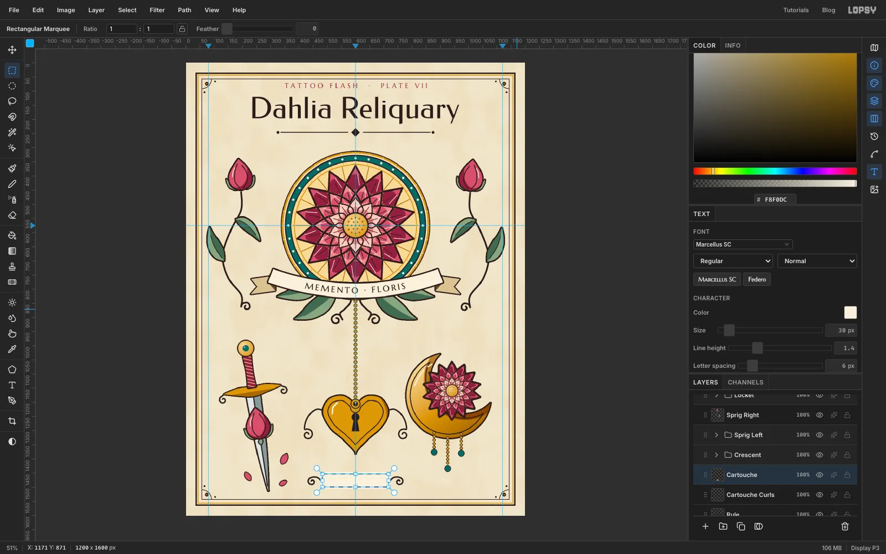

Click **Rule**. On a layer called **Cartouche Curls**, set the foreground to ink and Pen-stroke two small whiplash curls at **5**, one off each end of where the tablet will go (x 476 and x 724, y 1476), curling outwards.

Add a layer called **Cartouche**. Rectangular Marquee click, **From 476, 1446 To 724, 1506**. To round its corners, **Shrink 14** and then **Grow 14**. Grow rounds corners as it expands, so shrinking first and growing back by the same amount gives the same rectangle with rounded corners. Fill with cream.

Then **Shrink 7** and fill with ink, **Shrink 2** and fill with cream: an inner rule. Deselect and add a Stroke of **5**.

With **Cartouche** selected, add the text **Nº VII** in **Marcellus SC**, **Size 28**, crimson, **Letter spacing 4** (on a Mac, type º with [[Alt+0]]). Rename the layer **Plate Number** and nudge it to the middle of the tablet.

## Scatter the sparkles

Click **Rule** and add a layer called **Sparkles**. With the Pen, click eight corner points for a four-point star: the four tips 24 px from the centre, and four inner points between them, about 7 px from the centre. Fill it with pale gold. Draw three of these: at (440, 1030), (760, 1030) and (1086, 1446).

For the smaller ones, copy instead of drawing. Marquee round the first star and choose **Edit → Copy** once. For each small star: choose **Edit → Paste**, draw a marquee round the pasted star, switch to **Move** ([[V]]), [[Cmd]]-drag a corner handle to scale it to half or less, press [[Cmd+D]], and drag it into place. Switch back to the marquee for the next one. Place them in mirrored pairs: (492, 1102) with (708, 1102), (374, 1508) with (826, 1508), and one at (1094, 1010).

Select the topmost pasted star and choose **Layer → Merge Down** until they're all on **Sparkles**, then add a Stroke of **3**.

## Finish the paper

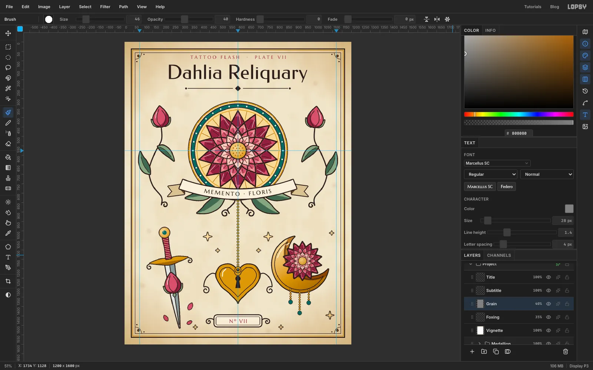

Click the collapsed **Medallion** group (just under the **Title** and **Subtitle** rows) and add a layer called **Vignette**. Because the group is collapsed, the new layer goes above it rather than into it.

- **Vignette:** set a **Radial** gradient of white, white again at 66% along the bar, and warm tan `#DECBA6` at the end. Drag from the centre of the page (600, 800) to the top-left corner (0, 0). That's a 1000 px radius, so the tan just reaches the corners. Set the layer to **Multiply**. The edges warm up; the art doesn't change.
- **Foxing:** on a layer called **Foxing**, click six or so times in the margins and empty corners with a soft brush (**Size 46**, **Hardness 0**, **Opacity 40%**) in `#A9824F`. Set it to **Multiply** at **35%** for faint age spots.
- **Grain:** on a layer called **Grain**, fill with grey `#808080`, run **Add Noise** at **30** with **Mono**, and set it to **Overlay** at **40%**.

Save the project with **File → Save Project**, and export with **File → Quick Export PNG**.
