Around 1900, Louis Comfort Tiffany's studio in New York made windows that looked painted but were built entirely from glass. They didn't paint on the glass. Instead they used **opalescent glass**: milky, streaky sheets where the colour swirls through the material. They cut it into pieces and joined the pieces with lead, and the lead lines became part of the drawing. Those lines follow the same flowing "whiplash" curves you see in Art Nouveau posters by Mucha and in the ironwork of Paris Métro entrances.

In this tutorial you'll design **Mistletoe Xmas**, a 5 × 7 holiday card (1200 × 1680 px) built like one of those windows. It's an arched window with an amber border, an opalescent night sky, a full moon and a mistletoe kissing-bunch hanging on a crimson ribbon. Around it is a dark green card with gold wallpaper, gold whiplash vines and gilt lettering.

You'll build the window the way a glazier does. First you draw the lead lines on their own layer. Then you pick each pane with the **Magic Wand** and fill the glass underneath. Finally you add texture pane by pane, so the pattern breaks at every lead the way real glass does.

Along the way you'll use:

- **Edit → Define Pattern** and **Fill with Pattern…** with a half-drop stagger
- exact-size marquees, **Shift** to add to a selection, and **Select → Grow / Shrink / Feather**
- the **Pencil** with Shift-click for straight lines, and the **Pen** for curves, a text path and a vine
- the **Magic Wand** on one layer to fill glass on another
- **Clouds**, **Smoke**, **Fibers**, **Motion Blur** and **Gaussian Blur**
- the **Soft Light**, **Screen**, **Multiply** and **Overlay** blend modes
- **Copy**, **Paste**, **Move**, scaling and rotating, and **Merge Down**
- **Stroke**, **Inner Glow**, **Outer Glow** and **Drop Shadow** effects
- a layer **group**, **⌘-click** and **⌘⇧-click** to select layer pixels, and a **layer mask**
- live text in **Federant** and **Bellefair**, text bound to a path, and **Duplicate** + **Flip Horizontal**

The palette:

- Card `#16201C`, gold `#D9AE55`, lead `#2B2A2E`, halo `#F0A040`
- Amber border `#C98A2B` / `#E3A847` / `#B86E1E`
- Sky glass `#203A86`, `#2B2C6E`, `#1E4F7A`, `#3B3478`, `#23468A`, `#2F3F8C`
- Moon `#FFF8DE` → `#F8E39C` → `#E7B456`, moonlight `#FFF1C2`
- Sky shade `#6A77AE`, jewel facets `#FFF1C4` / `#E8A93E`, jewel glow `#FFD77A`
- Snow glass `#E8EEF4`, lavender `#DCD6EC`, ice `#D3DFEE`, aqua `#CFE6EA`
- Stems `#8C8A3A`
- Inner leaves `#9DB24E` / `#47703A`
- Leaf light `#B9CB5E` / `#C6D46A` / `#AFC457`, leaf shade `#5C8A3E` / `#4F7F3A` / `#638F40`
- Ribbon `#A3203A`, bow `#B8283F`, knot `#7E1428`
- Berries `#EEF1E6`, berry glow `#8FA7B6`
- Gilt `#F4CC70` → `#C48A2C`

> **Note:** Shortcuts are written for a Mac. On Windows use [[Ctrl]] wherever it says [[Cmd]].

Positions are given in document pixels as `x, y` where things need to line up. The status bar at the bottom of the window shows the pointer's **X** and **Y**. The window is centred on `x 600`, and the arch is a circle centred at `600, 560`.

Two habits will save you trouble. When a step says to type exact corners for a marquee, click once on the canvas with the marquee tool (don't drag) while nothing is selected. A small box opens where you type **From X/Y** and **To X/Y**. And before you start new text, click a layer that isn't text, or the font and colour you pick will restyle the text you just made.

## Start the card and drop the guides

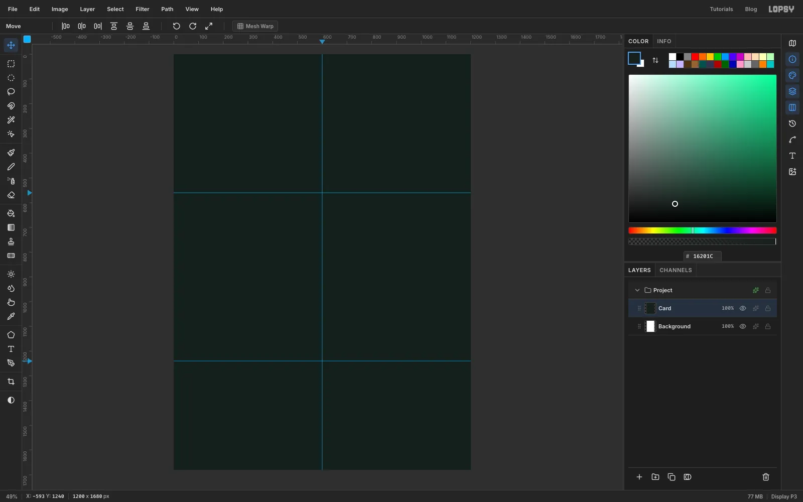

1. Choose **File → New** and make a **1200 × 1680** px document.
2. Click **Layer 1**, set the foreground colour to `#16201C` and choose **Edit → Fill**. Double-click the layer's name and rename it `Card`.
3. Click the top ruler at `x 600` to drop a vertical guide down the middle.
4. Click the left ruler at `y 560` and `y 1240`. The first is where the arch meets the straight sides of the window. The second is the bottom of the window.

## Draw a little mistletoe motif

This motif becomes the wallpaper, so draw it small, in the top-left corner where nothing else will go.

1. Click **Add Layer** at the bottom of the Layers panel and name the layer `Motif`. Set the foreground to `#D9AE55`.
2. Pick the **Lasso** and draw a small leaf about 40 px long, starting at `60, 64` and pointing up and to the left. Hold [[Shift]] and draw a second leaf from the same point, pointing up and to the right. Shift adds the second leaf to the selection.
3. Choose **Edit → Fill**.
4. Pick the **Elliptical Marquee** and draw a berry about 14 px wide just under the point where the leaves meet. Shift-drag two slightly smaller berries below it on either side, then **Edit → Fill** again.

## Define it as a pattern

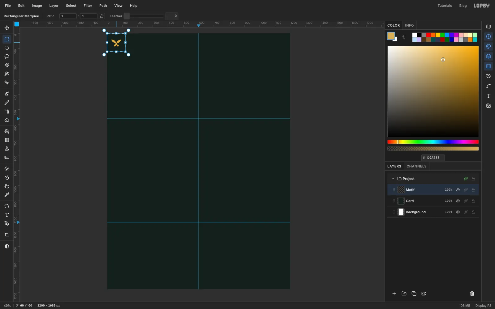

1. Pick the **Rectangular Marquee**. Make sure nothing is selected ([[Cmd+D]]), click once on the canvas, and type the corners **From** `0, 0` **To** `120, 120`. The motif sits in the middle of that square. The empty space around it becomes the spacing between repeats.
2. Choose **Edit → Define Pattern**.
3. Press [[Cmd+D]], then click **Delete Layer** at the bottom of the Layers panel to throw away the `Motif` layer. The pattern is stored now.

## Tile a half-drop wallpaper

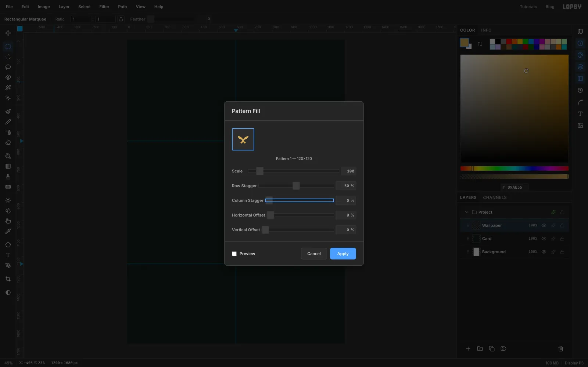

1. Click **Add Layer** and name it `Wallpaper`.
2. Choose **Edit → Fill with Pattern…**. Your motif is already picked.
3. Set **Row Stagger** to `50` %. Every other row slides over by half a tile. That's a classic wallpaper "half-drop", and it stops the motifs lining up in stiff columns.
4. Click **Apply**, then click the opacity figure on the layer's row and drag it to `14%`. The wallpaper should be a whisper, not a pattern you notice first.

## Cut a double gold keyline

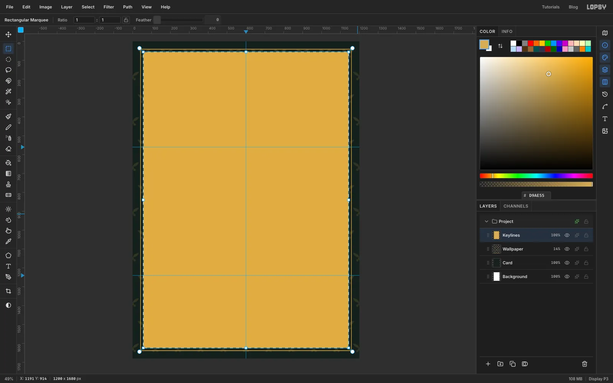

1. Add a layer called `Keylines` and set the foreground to `#D9AE55`.
2. With the Rectangular Marquee, type the corners **From** `40, 40` **To** `1160, 1640` and choose **Edit → Fill**.
3. Choose **Select → Shrink…**, enter `3` and click **Apply**. Press [[Delete]]. Only a 3 px gold frame is left.
4. Press [[Cmd+D]] so the corners box will open again, then do the inner line the same way: corners **From** `54, 54` **To** `1146, 1626`, **Fill**, **Shrink** `2`, [[Delete]]. Press [[Cmd+D]].

## Light the window from behind

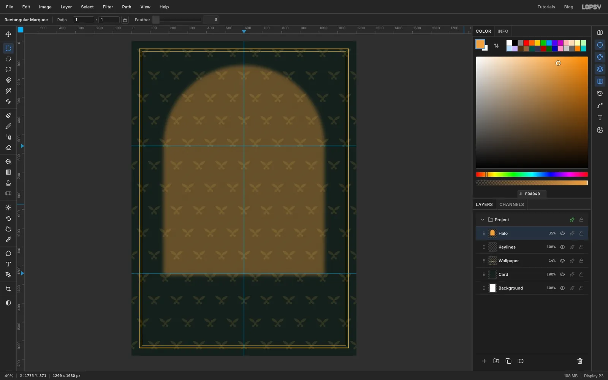

A real window glows against a dark wall. Make the glow first, so it sits behind all the glass.

1. Add a layer called `Halo`.
2. Pick the **Elliptical Marquee** and type the corners **From** `180, 140` **To** `1020, 980`. That's a circle 840 px across, centred on `600, 560`.
3. Pick the **Rectangular Marquee**, hold [[Shift]] and drag from `180, 560` to `1020, 1240`. Together the circle and the box make the arched window shape.
4. Choose **Select → Grow…** `10`, set the foreground to `#F0A040` and **Edit → Fill**. Press [[Cmd+D]].
5. Choose **Filter → Gaussian Blur…** with **Radius** `28`.
6. Click the ✦ button on the layer's row to open the effects drawer and set the blend mode to **Screen**. Set the layer's opacity to `35%`.

## Select the arched window

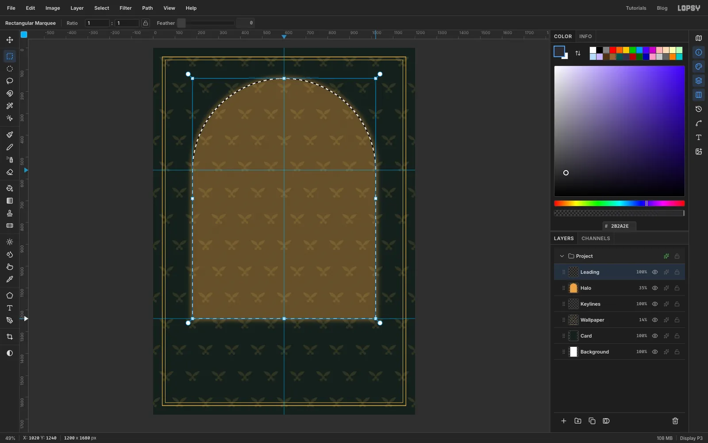

Now the lead. All the lead lines go on one layer. Later you'll use the gaps between them to select each pane.

1. Add a layer called `Leading` and set the foreground to `#2B2A2E`, a warm pewter grey.
2. Make the same arched selection as before: the Elliptical Marquee **From** `180, 140` **To** `1020, 980`, then a Shift-dragged rectangle from `180, 560` to `1020, 1240`.

## Shrink out the frame and border band

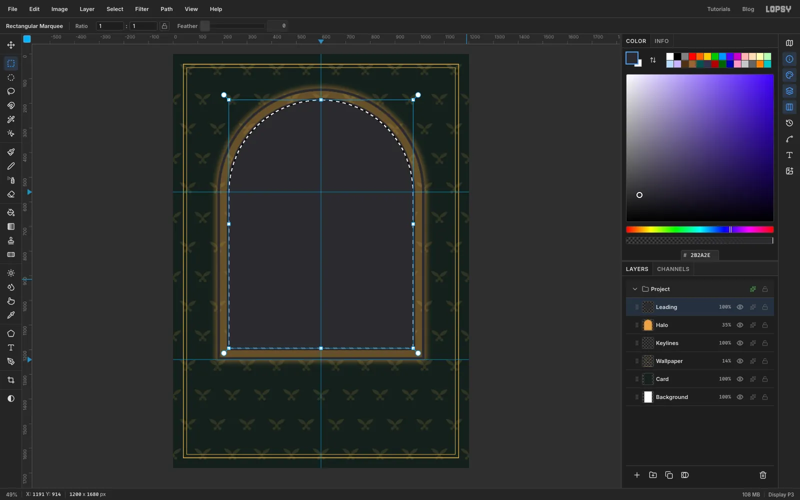

This makes three rings out of one shape:

- a heavy outer frame
- an empty band for the amber border
- a thinner inner lead

1. Choose **Edit → Fill**. The whole window is lead coloured for a moment.
2. Choose **Select → Shrink…** `10` and press [[Delete]]. That leaves a 10 px frame.
3. **Shrink** `28` more and **Edit → Fill**. Then **Shrink** `8` and press [[Delete]]. You now have an 8 px lead line 28 px inside the frame, with an empty band between them. Press [[Cmd+D]].

## Lead the moon

1. Pick the **Elliptical Marquee** and type **From** `408, 313` **To** `792, 697`. That's a circle 384 px across, centred on `600, 505`.
2. **Edit → Fill**, **Select → Shrink…** `8`, and [[Delete]]. Press [[Cmd+D]].

## Divide the border with the Pencil

A glazier can't bend one long strip of glass around an arch, so the border is cut into short pieces.

1. Pick the **Pencil** and set **Size** to `8` in the options bar.
2. Click on the inner edge of the band, then [[Shift]]-click straight across on the outer edge. That draws a straight tick. Keep both ends just inside the two leads so nothing pokes out.
3. Around the arch, aim every tick at the point where the guides cross (`600, 560`), like the spokes of a wheel, one every 20°. That's ten ticks: one at each springline (where the arch meets the sides, on the `y 560` guide) and eight in between. There's no tick at the very top: the top-centre piece straddles the middle.
4. Down both sides, add a level tick every 100 px from `y 660` to `y 1160`. Along the bottom, add an upright tick every 100 px from `x 250` to `x 950`.

## Draw whiplash leads with the Pen

These lines turn the sky into Art Nouveau. Each one is a single curve that starts on one lead and ends on another.

1. Pick the **Pen** and set **Stroke** to `6` in the options bar.
2. For each curve, press where it starts and drag out a handle in the direction the line should leave. Then press where it ends and drag again. Dragging the end handle the *same* way as the start handle makes an S; dragging it the opposite way makes a C. Press [[Enter]] and the path is stroked in the foreground colour.
3. Draw the snow first, so the lines above have something to land on:
   - A rolling hill line from the left side at `y 1000` to the right side at `y 950`. Pull the first handle up and the second one down so it rises, dips and rises again.
   - A second hill line about 90 px lower, from `y 1090` on the left to `y 1080` on the right, waving the opposite way.
   - Three short S-curves that cut the snow into drifts: one from the upper hill near `x 330` down to the bottom lead near `x 480`, one from the lower hill near `x 790` down to the bottom near `x 880`, and a short one between the two hills around `x 600–650`.
4. Then the sky. Every line ends on the moon ring:
   - From the left side at about `y 800` to the moon at about 8 o'clock, and from the arch at about `y 456` to the moon at about 9 o'clock.
   - The same pair on the right: from the side at about `y 860` to the moon at 4 o'clock, and from the arch at about `y 450` to 3 o'clock.
   - From the arch on each side of the top, about 230 px either side of centre, down to the moon at about 11 and 1 o'clock.
   - From the bottom of the moon at about 7 and 5 o'clock, flaring out down to the upper hill line near `x 400` and `x 830`.
5. Each line must start and end *on* another lead. A gap of even one pixel joins two panes into one.
6. Open the **Paths** panel and delete the paths when you're done. The lead is already painted.

## Select panes with the Magic Wand

1. Click `Halo` and click **Add Layer**. Name the new layer `Glass`. It sits under `Leading`, so the lead covers the edges of the glass.
2. Click `Leading` and pick the **Magic Wand** (**Tolerance** `32`, **Contiguous** on). Click inside one segment of the border band: the wand selects just the empty gap between the leads.
3. [[Shift]]-click every third segment around the band to add those as well.
4. Choose **Select → Grow…** `3`. The glass now tucks under the lead, so no thin gaps show along the edges.

This is the routine for every piece of glass from here on: **wand on `Leading`, grow by 3, then click `Glass` and fill**.

## Glaze the border

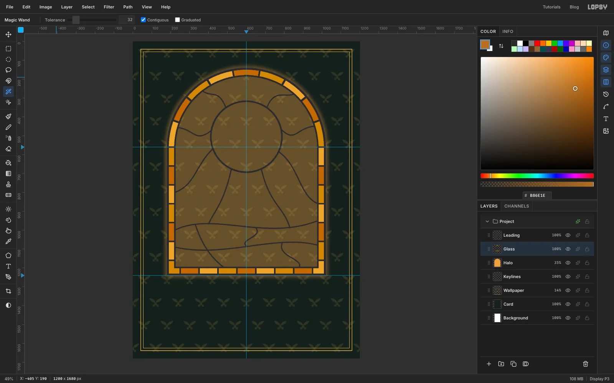

1. Click `Glass`, set the foreground to `#C98A2B` and **Edit → Fill**. Press [[Cmd+D]].
2. Repeat for the next set of every-third segments in `#E3A847`, then the last set in `#B86E1E`.

Three alternating ambers read as separate pieces of glass, not a painted stripe.

## Glaze the sky and snow

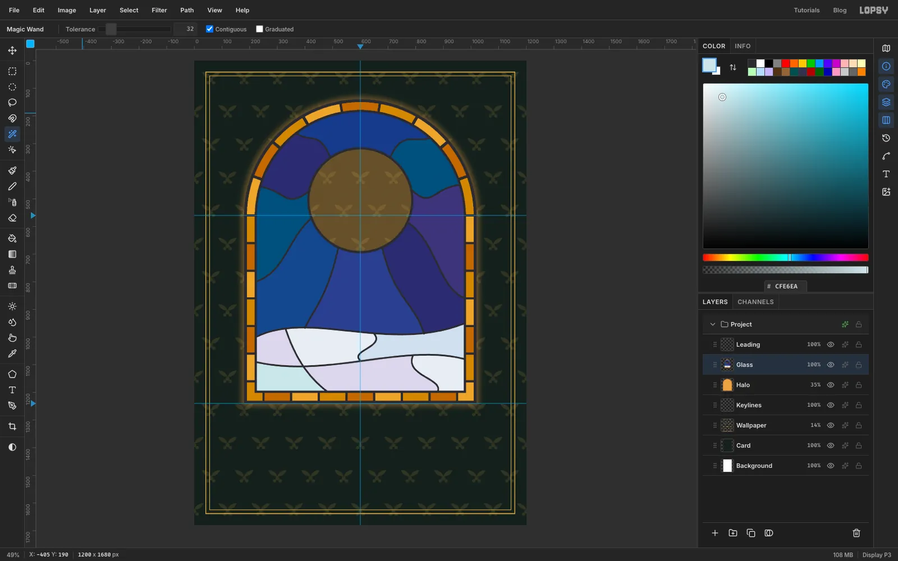

Wand, grow and fill the panes inside the window the same way. Neighbouring panes should never share a colour:

- the pane at the top of the arch, behind the ribbon's path, in `#203A86`
- the upper-left pane (around `365, 384`) and the lower-right pane (around `828, 804`) in `#2B2C6E`
- the upper-right pane (around `833, 384`) and the pane on the left beside the moon (around `298, 607`) in `#1E4F7A`
- the pane on the right beside the moon (around `902, 620`) in `#3B3478`
- the lower-left pane (around `364, 804`) in `#23468A`
- the pane right under the moon (around `613, 859`) in `#2F3F8C`

The snow drifts:

- the drift just left of centre on the upper hill (around `484, 1029`) and the bottom-right corner drift in `#E8EEF4`
- the upper-left drift and the long drift across the bottom middle in lavender `#DCD6EC`
- the upper-right drift in ice blue `#D3DFEE`
- the bottom-left corner drift in pale aqua `#CFE6EA`

## Grade the moon

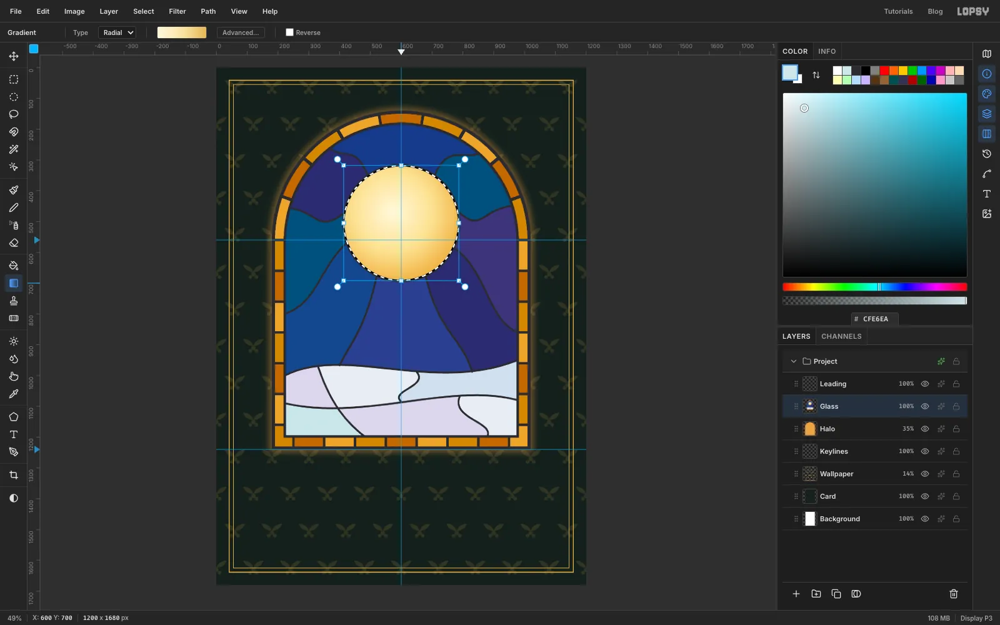

1. Wand the inside of the moon ring on `Leading`, **Grow** `3`, and click `Glass`.
2. Pick the **Gradient** tool, set **Type** to **Radial** and open **Advanced…**. Set three stops: `#FFF8DE`, `#F8E39C` at about 55%, and `#E7B456`.
3. Drag from a little above and left of the moon's centre (around `572, 468`) to its bottom edge. The off-centre start makes the moon look lit from one side. Press [[Cmd+D]].

## Mottle each pane with Clouds

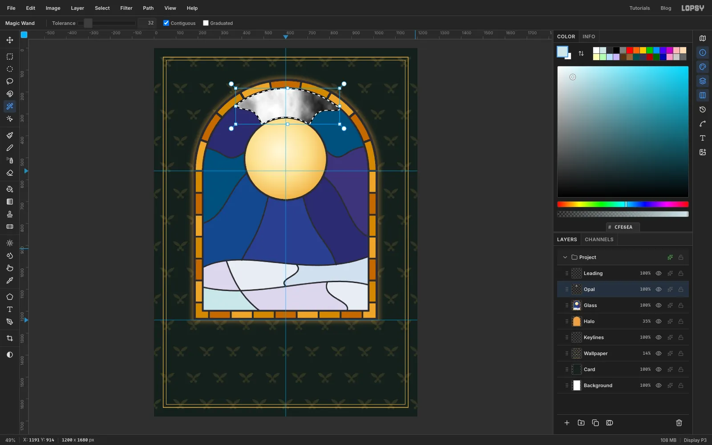

Here's the trick that makes it look like glass and not a print: texture each pane on its own. **Clouds** rolls a new random pattern every time it runs, so neighbouring panes never match.

1. Click `Glass` and add a layer called `Opal`.
2. Wand the top sky pane on `Leading`, **Grow** `3`, click `Opal`, and choose **Filter → Clouds…** with **Scale** `6`.
3. Repeat for every sky pane and the moon. Vary the Scale between `6`, `8` and `10` so some panes swirl more than others.

## Blend the clouds on Soft Light

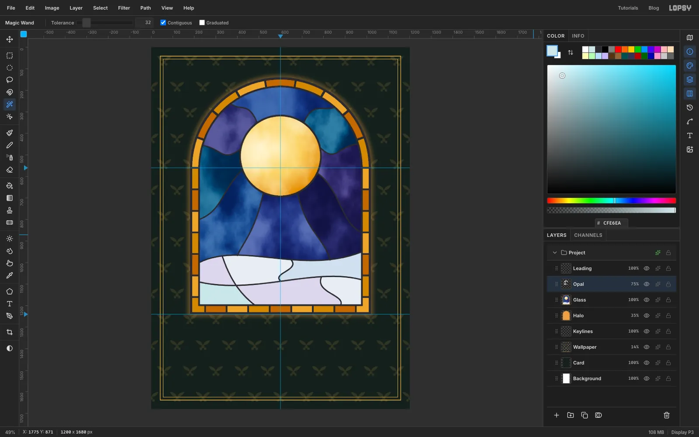

Press [[Cmd+D]], open the effects drawer for `Opal` and set its blend mode to **Soft Light**. Then set its opacity to `75%`. The grey clouds now lighten and darken the colours underneath, and the texture stops at every lead.

## Add milky swirls with Smoke

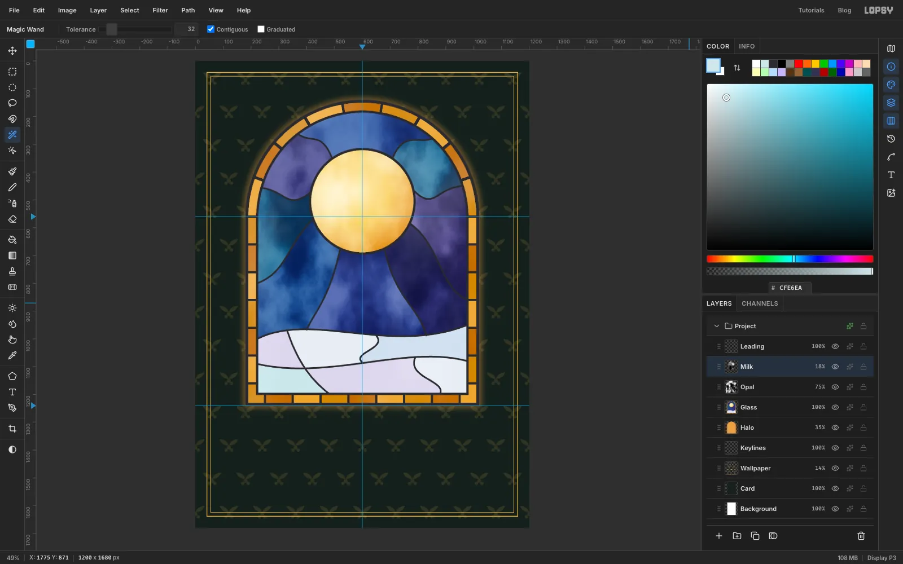

Opalescent glass has milky streaks floating in it.

1. Add a layer called `Milk`.
2. [[Cmd]]-click the `Glass` thumbnail to select every piece of glass.
3. Choose **Filter → Smoke…** with **Scale** `5` and **Turbulence** `70`. Press [[Cmd+D]].
4. Set the blend mode to **Screen** and the opacity to `18%`.

## Darken the sky toward the top

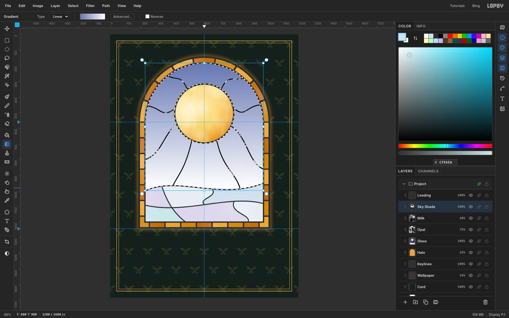

1. Wand all the sky panes on `Leading` (Shift-click to add each one), **Grow** `3`, click `Milk` and add a layer called `Sky Shade`.
2. Pick the **Gradient** tool, set **Type** to **Linear**, open **Advanced…** and set two stops: `#6A77AE` and white. Drag from the top of the arch (`600, 190`) down to `600, 980`.
3. Press [[Cmd+D]] and set the blend mode to **Multiply**. White disappears in Multiply, so only the top of the sky gets deeper.

## Streak the snow glass

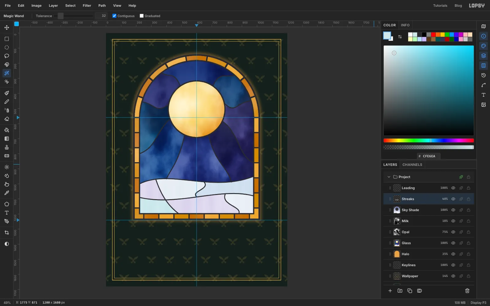

1. Add a layer called `Streaks`.
2. For each snow drift, wand it on `Leading`, **Grow** `3`, click `Streaks` and run **Filter → Fibers…** with **Variance** `24` and **Strength** `30`.
3. Press [[Cmd+D]] and run **Filter → Motion Blur…** with **Angle** `0` and **Distance** `24`. That lays the fibres down sideways, like streaky glass rolled flat. The blur spreads a few pixels past the snow, but the lead covers most of it, and at Overlay 40% the rest doesn't show.
4. Set the blend mode to **Overlay** and the opacity to `40%`.

## Let the moonlight spill over the lead

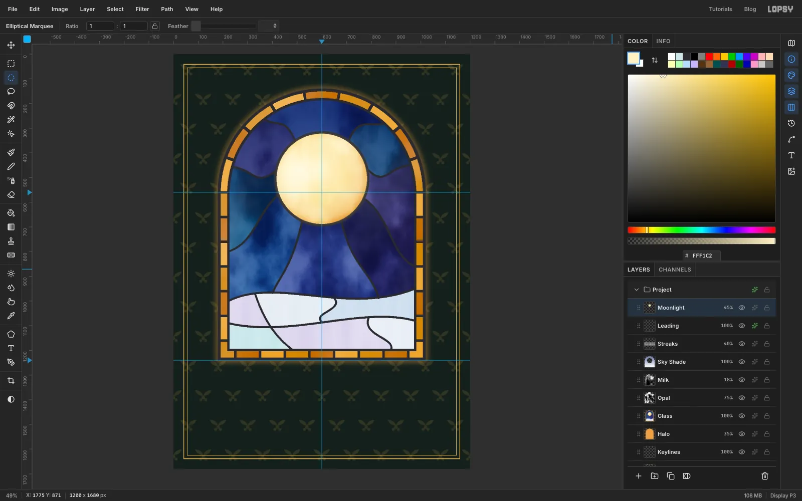

1. Click `Leading`, open the effects drawer and turn on **Stroke**: **Width** `1`, colour `#2B2A2E`. That adds a hair more weight to every lead at once.
2. Add a layer called `Moonlight` above `Leading`. Pick the Elliptical Marquee and type **From** `424, 329` **To** `776, 681`. Set the foreground to `#FFF1C2`, **Edit → Fill**, and press [[Cmd+D]].
3. Choose **Filter → Gaussian Blur…** `40`, set the blend mode to **Screen** and the opacity to `45%`. Backlit glass glows past its lead, so the moon's light now spills softly over its ring.

## Cut a faceted keystone jewel

Tiffany windows often set chunky glass "jewels" into the border. You'll make one, then copy it.

1. Add a layer called `Jewels`.
2. Zoom in on the top of the arch. With the Lasso, draw a diamond 60 px tall and 32 px wide, centred on the top of the band at `600, 164`, and fill it with the lead colour `#2B2A2E`. A diamond is just four clicks' worth of straight edges, so move steadily from point to point.
3. Lasso the left half of the diamond a few pixels inside the edge and fill it with `#FFF1C4`. Then lasso the right half and fill it with `#E8A93E`. Leave a thin dark line down the middle. Two facets, one catching light and one in shadow.

## Copy it to the springline

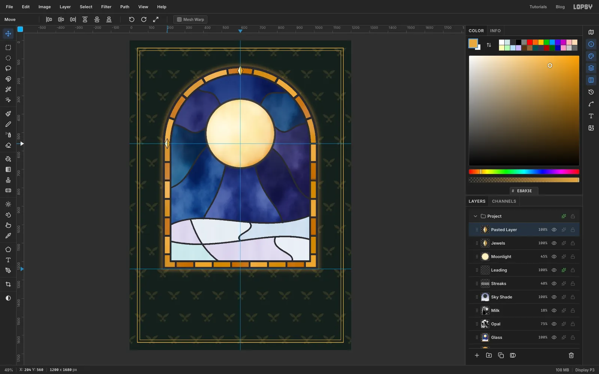

The **springline** is where an arch springs from its straight sides, at `y 560`.

1. Draw a rectangular marquee around the jewel. Press [[Cmd+C]] then [[Cmd+V]]. The copy lands on a new **Pasted Layer**, in the same place.
2. Press [[Cmd+D]], pick the **Move** tool and drag the copy down and left until it's centred on the band at `204, 560`.

## Scale the copy

Draw a rectangular marquee around the copy and switch to the **Move** tool. Transform handles appear. Hold [[Cmd]] and drag the bottom-right corner inward until the jewel is about 80% of its size. [[Cmd]] keeps the proportions. Scaling from a corner pulls the jewel a few pixels up and to the left, which is fine here.

## Turn it on its side

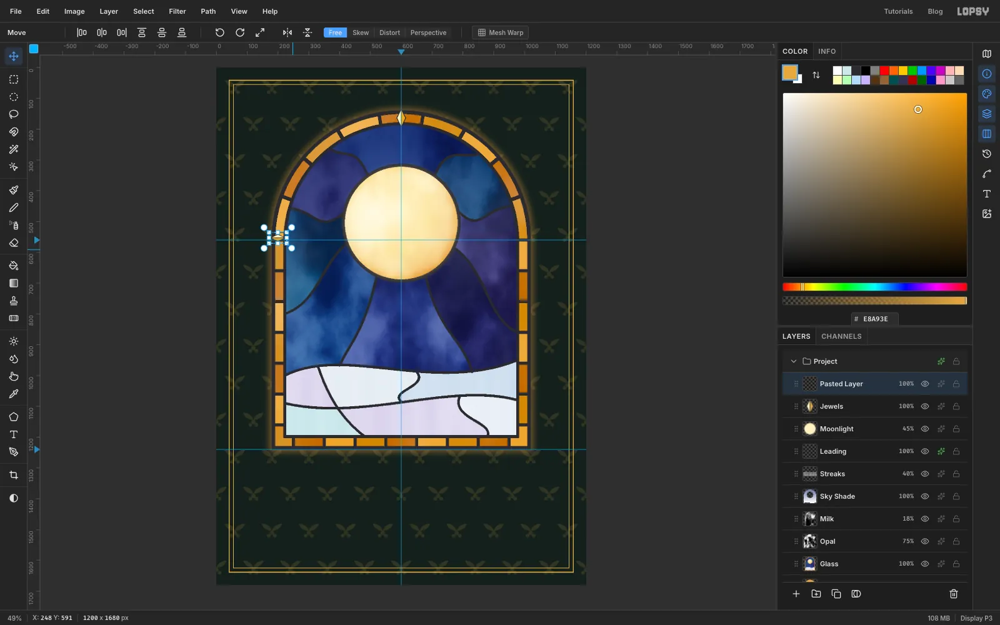

1. Move the pointer just outside a corner of the box until it turns into the rotate cursor. Drag around a quarter turn clockwise, so the jewel lies across the band. Hold [[Cmd]] while you drag to snap in 15° steps.
2. Press [[Cmd+D]] to finish the transform, then choose **Layer → Merge Down** to merge it into `Jewels`.
3. Do the same for the right side at `996, 560`, but turn it a quarter turn counter-clockwise. The two side jewels then mirror each other, with their light facets both facing up toward the keystone.

## Make the jewels glow

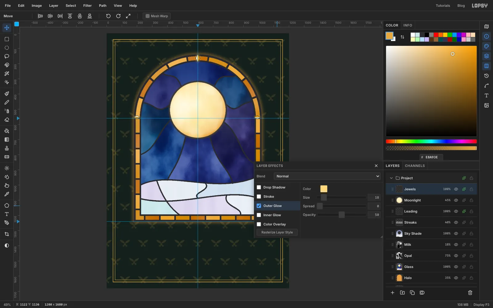

On `Jewels`, turn on **Outer Glow** with colour `#FFD77A`, **Size** `18` and **Opacity** `50`.

## Start the Mistletoe group with a ribbon

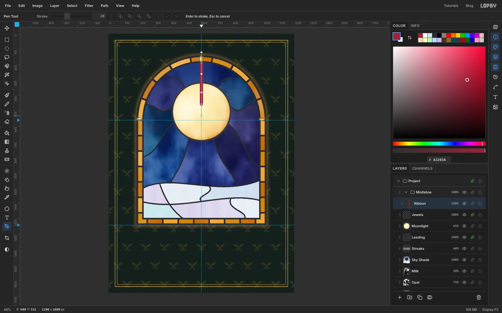

1. With `Jewels` selected, click **New Group** at the bottom of the Layers panel and name it `Mistletoe`.
2. With the group selected, click **Add Layer**. It goes inside the group. Name it `Ribbon`.
3. Set the foreground to `#A3203A`, pick the **Pen**, set **Stroke** to `20`, and draw a straight line from the jewel at `600, 190` down to `600, 456`. Press [[Enter]] and delete the path.

## Tie the bow

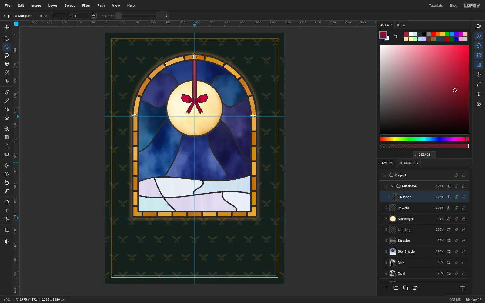

1. With the Lasso, draw two pointed bow loops out to the left and right of `600, 457`, each about 90 px long. Shift-add the second loop, then fill with `#B8283F`.
2. Lasso two short tails hanging down from the knot, each about 80 px long, with a notch cut into the end like a swallowtail. Fill them with `#A3203A`.
3. Lasso a small triangle inside each loop next to the knot, and fill them with `#7E1428`. These are the folds.
4. Make a 30 px circle at `600, 457` with the Elliptical Marquee and fill it with `#7E1428` for the knot.
5. Give `Ribbon` a **Stroke** effect (**Width** `4`, `#2B2A2E`) for its lead. Add an **Inner Glow** in `#5A0A1C` with **Size** `10` and **Opacity** `60` to round it.

## Paint forked stems

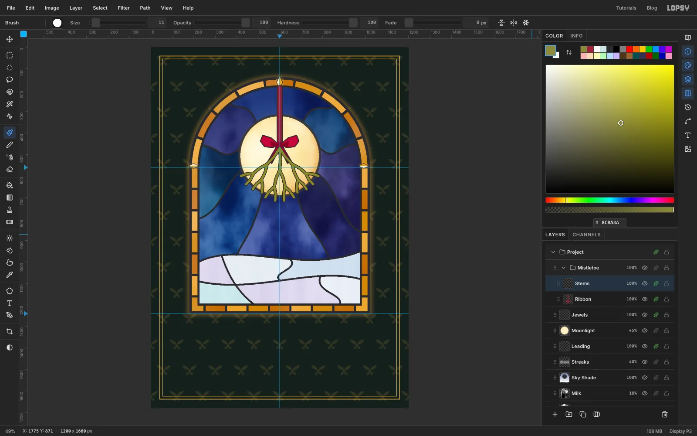

Mistletoe forks in pairs, over and over, like a Y on top of a Y.

1. Add a layer called `Stems` and set the foreground to `#8C8A3A`.
2. Pick the **Brush**, open the brush settings and set **Size** `11`, **Hardness** `100` and **Spacing** `5`.
3. Each piece of stem is a short, almost straight stroke: press at one end and drag to the other with the slightest bend. Click and [[Shift]]-click instead if you want it dead straight.
4. From the knot, paint three branches about 100 px long: one straight down and two angled out about 40° either side.
5. At the end of each branch, fork into two twigs of about 80 px, spread about 20° either side. The ends of these six twigs are the **middle forks**. Fork each one once more into two short pieces of about 65 px. Their ends are the twelve **twig tips**.
6. Add a **Stroke** effect of `3` px in `#2B2A2E`.

## Lead a single leaf

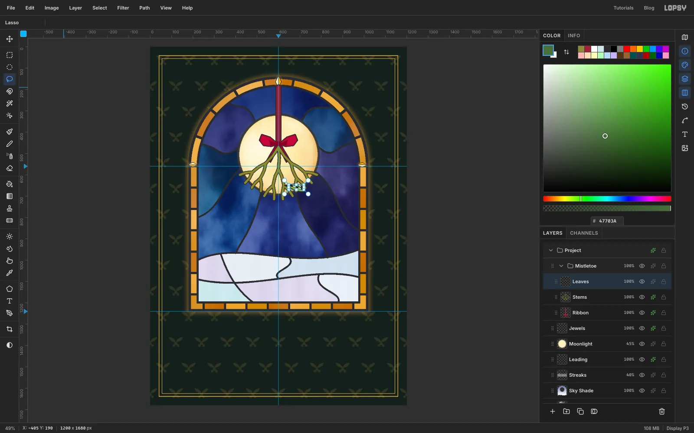

Each leaf is three lasso fills on one `Leaves` layer. Zoom in to about 200% for this. You need to stay a few pixels inside your own edges.

1. Add a layer called `Leaves`. Start at the left-hand middle fork. With the Lasso, draw a whole leaf about 100 px long, pointing out and up from the fork, narrow at the stem and rounded at the tip. Fill it with lead, `#2B2A2E`.
2. Lasso one half of the leaf, staying about 4 px inside the edge and 2 px off the centre line, and fill it with `#9DB24E`.
3. Lasso the other half the same way and fill it with `#47703A`.

The lead you leave showing becomes the outline and the midrib. Because each leaf carries its own lead, a leaf drawn later sits cleanly on top of the leaves behind it.

## Tuck in the inner leaves

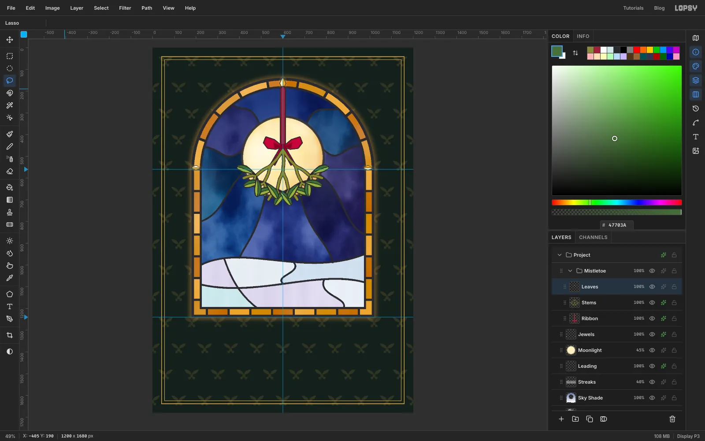

Work from back to front. Finish the pair you started, then add a pair at each of the other middle forks, pointing out at about 60° from the stem. They're about 100 px long. Use the deeper greens `#9DB24E` and `#47703A`. These are the leaves furthest back, so they're a little darker.

## Fan out the outer leaves

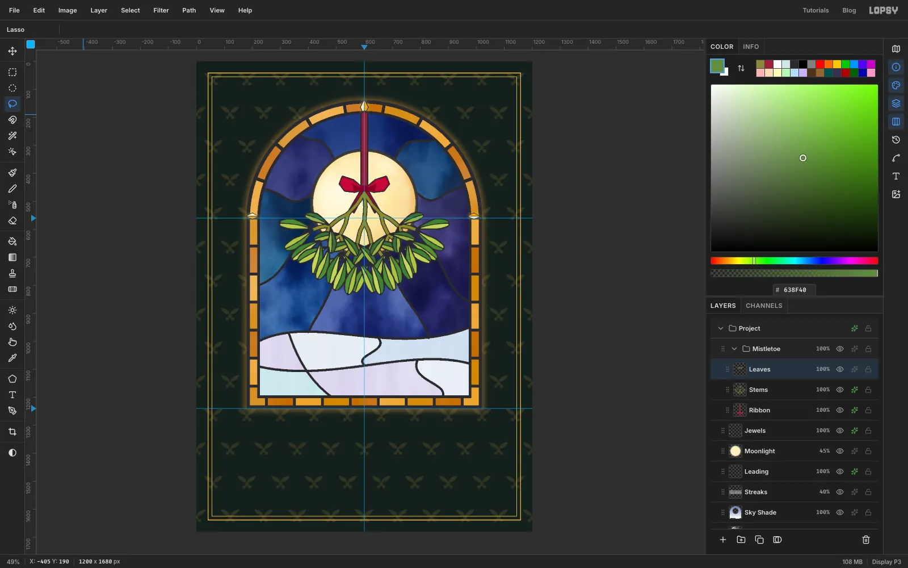

At every twig tip, add a pair of leaves about 125 px long, opening about 20° either side of the twig. Draw the top ones first and work down, so the lower leaves overlap the upper ones. Rotate the light halves through `#B9CB5E`, `#C6D46A` and `#AFC457`, and the shade halves through `#5C8A3E`, `#4F7F3A` and `#638F40`.

## Marquee the berries

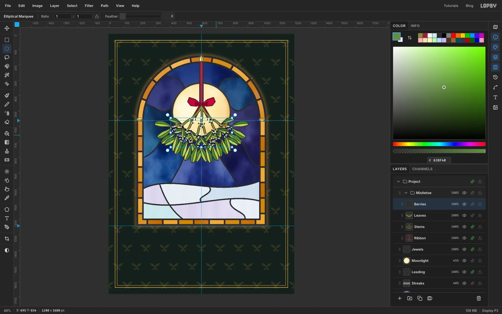

1. Add a layer called `Berries`.
2. Choose **View → Snap to Guides** to turn snapping off for now. Small marquees next to the centre guide would otherwise jump onto it and come out as ovals.
3. With the **Elliptical Marquee**, Shift-drag berries between 14 and 20 px across. Put singles, pairs and clusters of three at each fork and twig tip. Keep a couple of pixels between neighbours so each berry gets its own lead.
4. Turn **Snap to Guides** back on.

## Turn them into pearls

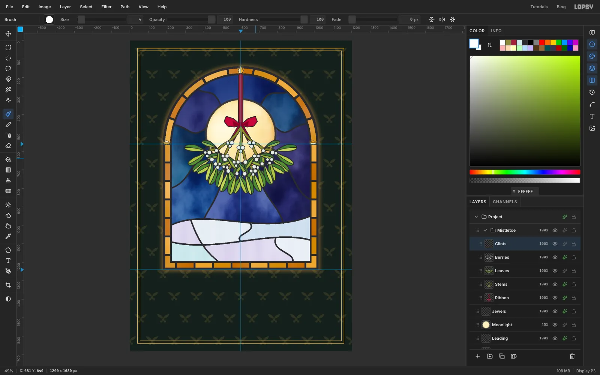

1. Fill the berries with `#EEF1E6` and press [[Cmd+D]].
2. Add **Inner Glow** (`#8FA7B6`, **Size** `8`, **Opacity** `75`) and **Stroke** (`3`, `#2B2A2E`).
3. Add a layer called `Glints`. With a white **Brush** at **Size** `4`, click once on the upper left of each berry.

## Select the leaves and ribbon together

The mistletoe is glass too, so give it the same texture.

1. Add a layer called `Leaf Opal` at the top of the group.
2. [[Cmd]]-click the `Leaves` thumbnail, then [[Cmd+Shift]]-click the `Ribbon` thumbnail to add the ribbon's pixels to the selection.

## Texture the mistletoe glass

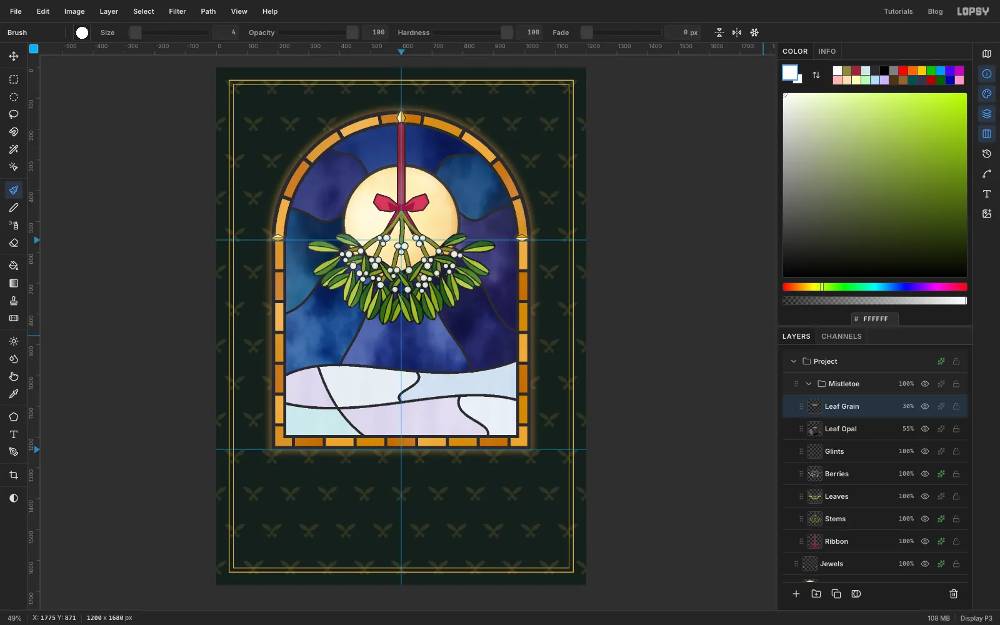

1. Run **Filter → Clouds…** with **Scale** `4`, press [[Cmd+D]], and set `Leaf Opal` to **Soft Light** at `55%`.
2. Add a layer called `Leaf Grain`, [[Cmd]]-click the `Leaves` thumbnail and run **Filter → Fibers…** with **Variance** `16` and **Strength** `24`. Press [[Cmd+D]] and set it to **Soft Light** at `30%`. Now the leaves have the faint streaks of real green glass.

## Draw an arc for the motto

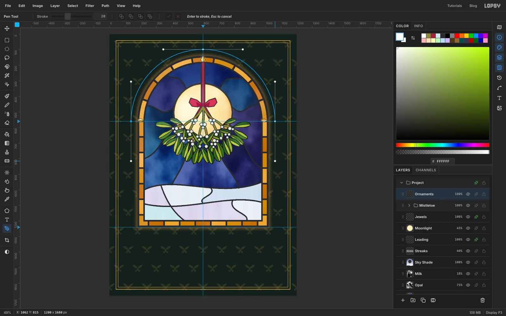

1. Collapse the `Mistletoe` group with its arrow, click it, and click **Add Layer**. The new layer goes above the group. Name it `Ornaments`.
2. Pick the **Pen**. Press at `138, 560` and drag straight up to `138, 305`. Press at the top, `600, 98`, and drag right to `855, 98`. Press at `1062, 560` and drag down to `1062, 815`.
3. Click the ✓ button in the options bar to keep the path without stroking it.

The three points sit on a circle 462 px from the arch's centre. That puts the type a comfortable 42 px outside the window.

## Set the motto on the arc

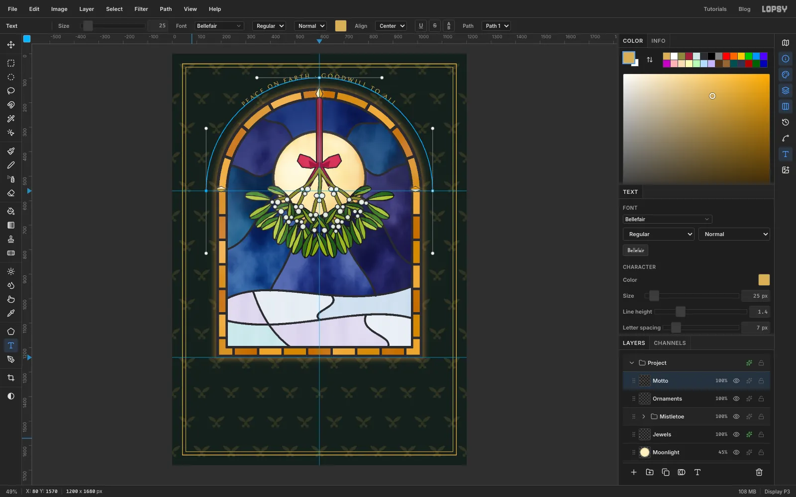

1. Pick the **Text** tool. Set **Size** `25`, the font **Bellefair** and the colour `#D9AE55`.
2. Click in an empty spot near the bottom left of the card and type `PEACE ON EARTH · GOODWILL TO ALL`. Press [[Tab]] to finish, and rename the layer `Motto`.
3. In the **Text** panel, set **Letter spacing** to `7`.
4. In the options bar, set **Align** to **Center** and choose your arc in the **Path** dropdown. The words jump onto the curve, centred over the top of the window.

Leave this path in the Paths panel. Deleting it would unbind the text.

## Set the title

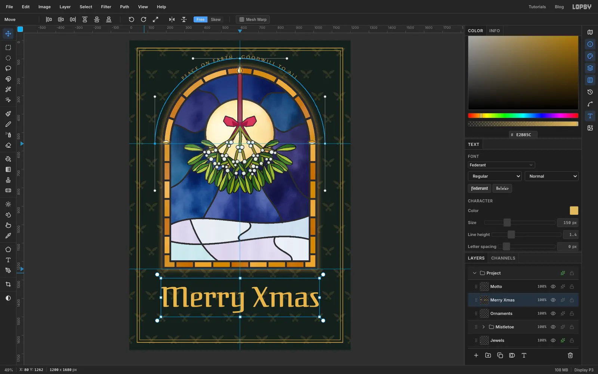

1. Click `Ornaments`. Set **Align** back to **Left** and **Letter spacing** to `0`. Those settings carry over to new text.
2. Pick the **Text** tool, then **Federant** at **Size** `150` in `#E2B85C` (any gold works, because you'll gild it next). Click in empty space low on the card, type `Merry Xmas` and press [[Tab]].
3. Use the **Move** tool and the arrow keys to centre it on `x 600` with its middle at about `y 1407`. That leaves roughly 95 px between the window and the tops of the capitals.

Federant's curling **M** and the drop of the **y** are exactly the kind of lettering you see on Art Nouveau posters.

## Gild the title

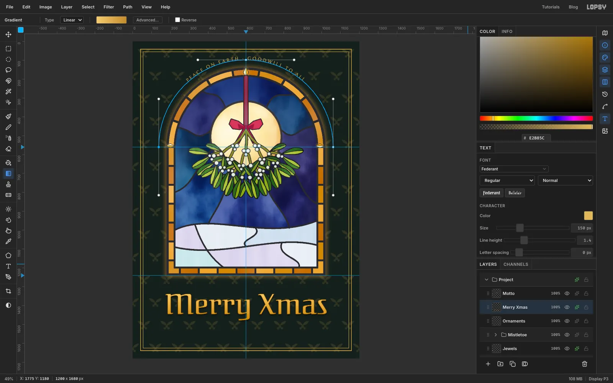

1. Click **Rasterize Layer** at the bottom of the Layers panel to turn the title into pixels.
2. [[Cmd]]-click its thumbnail to select the letters. With the **Gradient** tool on **Linear**, drag from the top of the letters to the bottom, from `#F4CC70` to `#C48A2C`. Press [[Cmd+D]].
3. In the effects drawer, turn on **Stroke** with **Width** `2` in `#7A4E12` and click **inside**. Then turn on **Drop Shadow** with **Offset Y** `5`, **Blur** `8`, **Opacity** `75` and colour `#050807`.

## Add the subtitle and rules

1. Click `Ornaments`, pick the **Text** tool and set **Bellefair** at **Size** `30` in `#D9AE55`. Click in empty space, type `BENEATH THE MISTLETOE`, press [[Tab]] and rename the layer `Beneath`. Set **Letter spacing** to `9` and centre the line at about `y 1545`.
2. Click `Ornaments` again. Pick the **Pencil**, set **Size** `2` and the colour `#D9AE55`. On each side of the subtitle, click and [[Shift]]-click a straight rule about 110 px long. Stop each rule about 45 px from the letters.
3. In each gap, lasso a small diamond about 14 px across and fill it. Keep the gaps on both sides the same, so the line looks centred.

## Draw a whiplash vine

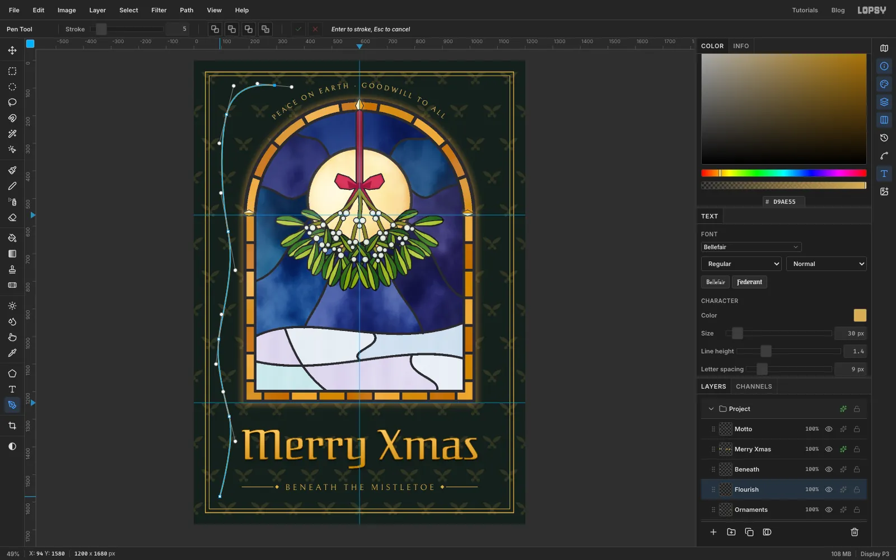

1. Add a layer called `Flourish` and keep the gold foreground.
2. Pick the **Pen** and set **Stroke** to `5`.
3. Start near the top of the card, just under the keyline and about 290 px in from the left edge (`292, 90`). Press there and pull the handle out to the left along the keyline.
4. Place the next point near the top-left corner (about `118, 196`), dragging its handle straight down the margin.
5. Work down the margin, adding a point every 300 px or so. Swing the line in and out between about `x 90` and `x 125`, and pull each handle about 100 px downward, angled slightly toward where the line is heading next. Stay at least 30 px from the window frame and the keyline.
6. End with a plain click near the bottom corner at `94, 1580`.

The line sways in and out down the margin: the long, lazy S that Art Nouveau calls a whiplash. Press [[Enter]] to stroke it, then delete the path.

## Add spirals, leaves and berries

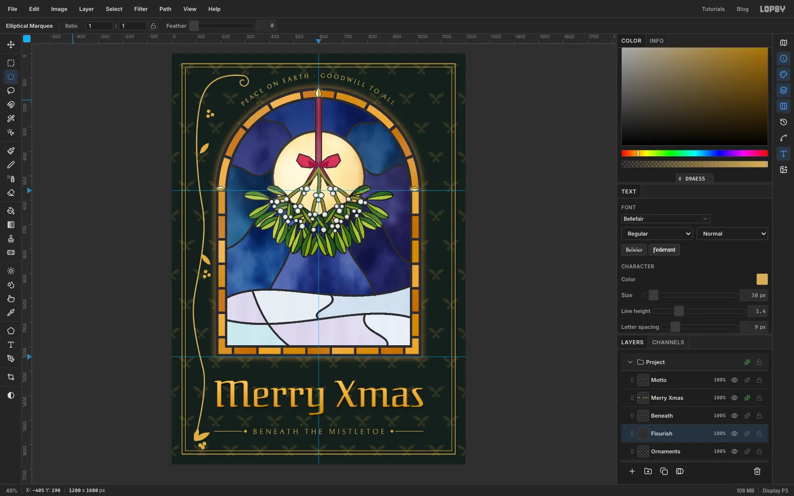

1. Curl the top end into a spiral about 50 px across. With the Pen at **Stroke** `4`, press on the end of the vine and drag a short handle to the right. Keep winding clockwise, down and back around, through five more points. Drag a short handle along the curve at each one, and set each point a little closer to the centre than the last, so you make about one and a quarter turns. Press [[Enter]] and delete the path.
2. Lasso two small gold leaves on the vine, about 58 px long: one near `114, 410` pointing up and in, one near `120, 820` pointing down and in.
3. Lasso two bigger leaves at the bottom where the vine ends, near `92, 1584`. Point them up and to the right, toward the end of the subtitle rule.
4. Add three trios of 14–16 px berries: near the top corner, at the middle of the margin, and beside the bottom leaves. Fill everything with gold.

## Mirror the vine with Duplicate and Flip

1. Click **Duplicate Layer** and name the copy `Flourish R`.
2. Choose **Image → Flip Horizontal**. The copy flips in place, around its own edges, so it's still on the left.
3. With the **Move** tool, drag it straight across to the right margin. The top spiral should land at about `x 908`, the mirror of the left one at `x 292`. Watch the **X** in the status bar. If the drag drifts up or down, nudge it level with the arrow keys.

## Fade the wallpaper with a mask

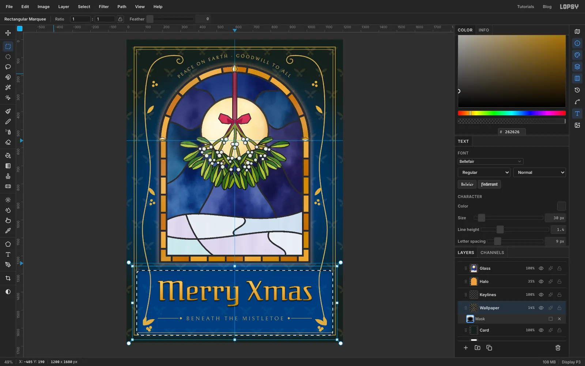

The wallpaper shouldn't compete with the window or the lettering.

1. Click `Wallpaper`, click **Add Mask**, then click the mask thumbnail to edit the mask.
2. Drag a **Radial** gradient from `600, 860` down to `600, 1640`. Use three stops: black at 0%, black at 40%, and white at 100%. The wallpaper disappears behind the window and only shows toward the corners.
3. Draw a rectangular marquee from `56, 1280` to `1144, 1640`, choose **Select → Feather…** `24`, set the foreground to `#262626` and **Edit → Fill**. That quiets the motifs behind the lettering to a trace.
4. Press [[Cmd+D]] and click any other layer to stop editing the mask.

Finally, choose **File → Save Project** to keep a `.lopsy` with all the live layers, and **File → Quick Export PNG** for the card.
