Most ASCII art is monochrome: one ink, one paper. Colour ASCII, like old ANSI art, treats every character as a tiny pixel with its own colour. The picture lives in two places. **Density** (how much ink a character carries, from `.` to `@`) does the shading. **Colour** does the light.

This poster is for an imaginary exhibition about the moai of Ahu Tongariki on Rapa Nui (Easter Island), where fifteen statues stand with their backs to the Pacific sunrise. You'll paint a simple greyscale tone study in Lopsy, convert it to characters, and paste them back as live text on an exact character grid. Then you'll colour the characters through selections, the way a screen printer inks a stencil. No photos are used.

Along the way you'll use:

- **ruler guides**, and turning off **Snap to Guides** when an edge has to sit just beside one
- **Rectangular** and **Elliptical Marquee** selections combined with **Shift** (add) and **Shift+Alt** (intersect)
- the **Lasso** for silhouettes, and **Alt**-dragging a selection with the **Move** tool to stamp copies
- **Cmd**-dragging transform corners to resize while keeping proportions
- radial and linear **gradients** with transparent stops, and a **layer mask** painted with a gradient
- **Cmd**-clicking layer thumbnails to paint colour *through* the characters
- **Gaussian Blur**, **Outer Glow**, and the **Screen** and **Multiply** blend modes
- live text in **IBM Plex Mono** and **Rubik Mono One**, recolouring selected characters, **Rasterize Layer**, and rotating text with the **Move** tool's handles and **Align** buttons

The palette is a dawn sky in coral and violet, a cool sea, and pale gold for anything the sun touches:

- Sky `#FFF6DC` → `#FFE08A` → `#FF9A62` → `#F2557E` → `#A447C4` → `#4B4FC9` → `#2C86B0`
- Horizon glow `#FF8A5B` → `#FF9A62` → `#FFD98A`
- Sea `#5FE0D6` → `#2F9FC8` → `#2C70B8`
- Sun path `#FFF0B8` → `#FFD27A` → `#FFB347`
- Rim light `#FFF6D8` → `#FFE9A8` → `#FFD08A`
- Title `#FFF0C0` → `#FFB070` → `#FF6F8F` → `#C060E0`, letter body `#2A1450`
- Head dots `#4446A8` (on black)
- Cream type `#F3E6CF`, cyan labels `#5FE0D6`, gold dates `#FFD27A`, lavender frame `#9A86D0`

> **Tip:** Positions are in document pixels, written `x, y`. The status bar at the bottom shows where the pointer is. When a step says to fill, that's **Edit → Fill**, and [[Cmd+D]] deselects.

## Start a portrait poster

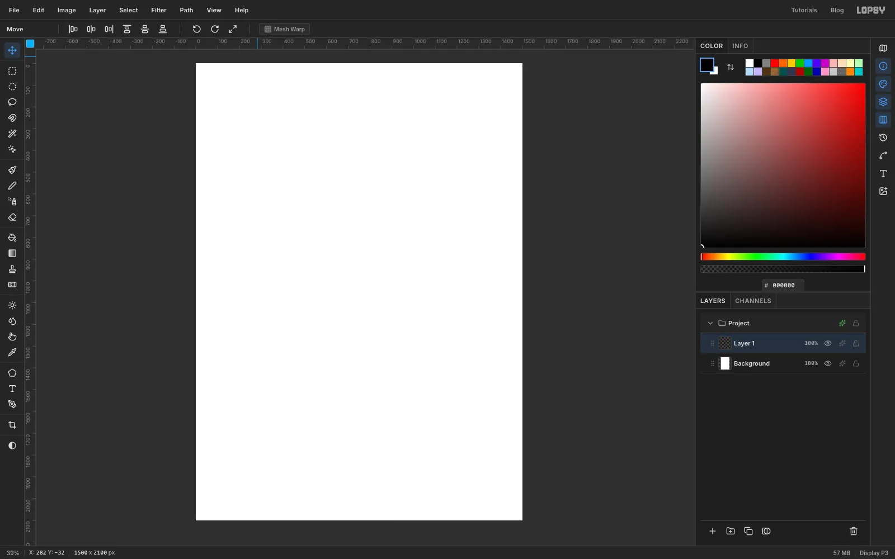

Open [Lopsy](/). In the **New Document** dialog, set **Width** to `1500` and **Height** to `2100`, leave the background white (you'll fill it black in a moment) and click **Create**. A new document also comes with an empty `Layer 1`. You won't need it, so leave it empty or delete it.

Select the **Background** layer, set the foreground colour to black (`#000000`) in the Color panel, press [[Cmd+A]] and fill. ASCII art reads best as light characters on black, like a terminal.

## Lay out the character grid with guides

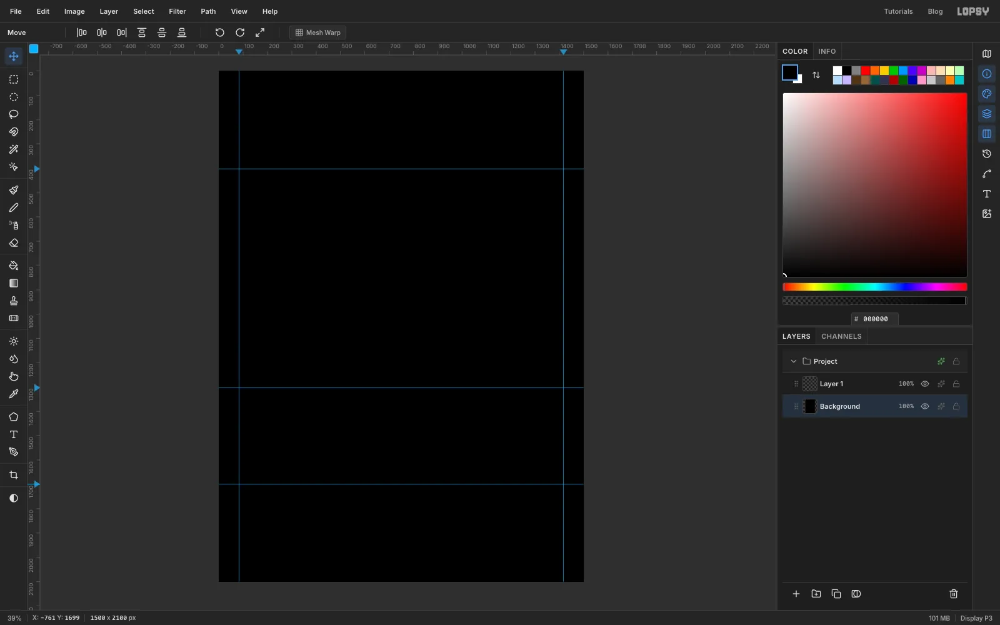

The scene will be a grid of characters in IBM Plex Mono at 16 px. At that size every character is exactly **9.6 px wide**, and with a line height of 1 every row is **16 px tall**. The grid is 139 characters wide and 81 rows tall, which works out at 1334 × 1296 px.

Click the top ruler at `83` and `1417` to drop two vertical guides. Click the left ruler at `403` (the top of the scene), `1303` (the horizon) and `1699` (the bottom of the scene). Everything in the next steps is painted inside this box.

## Paint the sky as one smooth glow

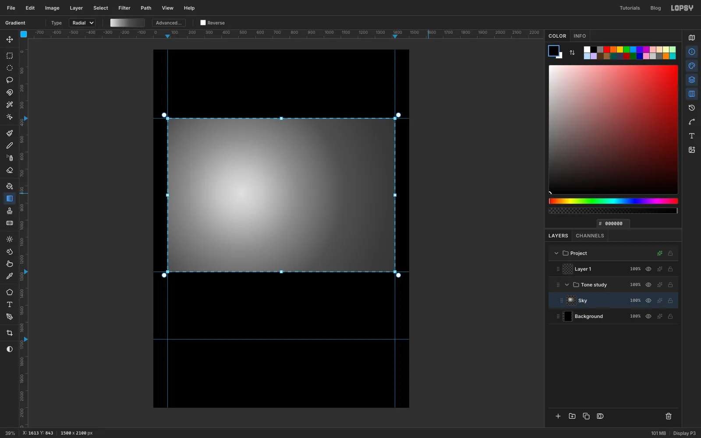

You're painting a **tone study** first: a plain greyscale picture whose brightness becomes the density of the characters. Keep it simple and smooth. Hard, noisy detail turns into noisy text.

Click **New Group** in the Layers panel and name it `Tone study`, then click **Add Layer** and name the layer `Sky`. With the **Rectangular Marquee**, drag from the top-left guide corner (`83, 403`) to the right-hand guide at the horizon (`1417, 1303`).

Pick the **Gradient** tool, set **Type** to **Radial** and click **Advanced…**. Give it six stops from light to dark: `#E0E0E0`, `#C6C6C6` at 12%, `#8C8C8C` at 30%, `#505050` at 55%, `#3A3A3A` at 80% and `#323232` at the end. Drag from where the sun will be, at `513, 843`, straight to the right for about 1100 px, to past the right edge of the canvas. Deselect.

The darkest stop is a mid grey, not black, on purpose. Even the far corners of the sky should come out as a sparse `-` texture, not empty space, so the sky never looks like the black page.

## Brighten the horizon

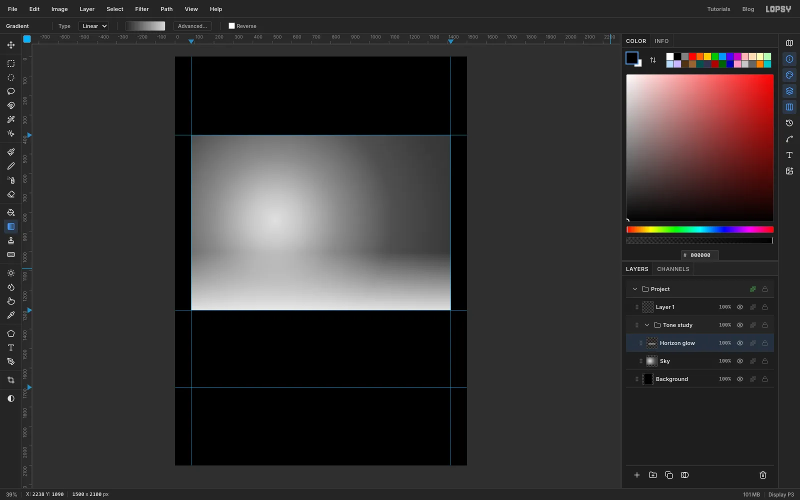

The statues will be silhouettes, and a silhouette needs the brightest light directly behind it.

Add a layer named `Horizon glow`. Marquee a band across the whole grid from `83, 1003` down to the horizon at `1417, 1303`. In the **Gradient** tool's **Advanced…** editor make a two-stop **Linear** gradient of `#D8D8D8`: set the first stop's opacity to 0 and leave the second at 100%. Drag from the top of the band straight down to the horizon, so it fades in towards the sea. Deselect.

Open the layer's effects drawer (the ✦ button on its row) and set the **Blend mode** to **Screen**, so the band only ever lightens the sky.

## Draw the sun and mark its stripes

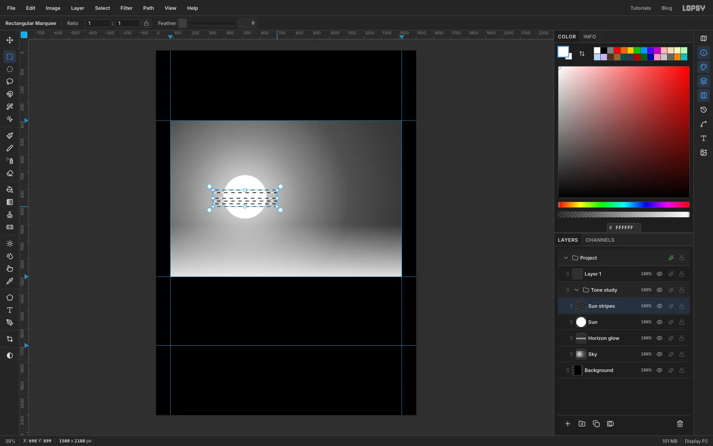

Add a layer named `Sun`. With the **Elliptical Marquee**, drag from `388, 718` to `638, 968` (a circle with a 125 px radius centred on `513, 843`) and fill it with white. Deselect.

The retro sun gets three black bars across its middle, closer together towards the bottom. Add a layer named `Sun stripes` and pick the **Rectangular Marquee**:

1. Drag a strip from `328, 803` to `698, 819`. It's exactly one character row tall (16 px), so the bar turns into one clean empty row of text later.
2. Hold **Shift** and drag a second strip from `328, 851` to `698, 867`. Shift adds it to the selection.
3. Hold **Shift** again for a third strip from `328, 883` to `698, 899`.

The strips line up with the grid rows on purpose. A bar that cut a row in half would come out as a ragged row of half-dark characters.

## Trim the stripes to the sun

The strips run well past the sun. To trim them, hold **Shift+Alt** and drag a circle with the **Elliptical Marquee** from `364, 694` to `662, 992`. This circle is 24 px bigger than the sun all round. Shift+Alt keeps only where the old and new selections overlap.

The extra 24 px carries the bars a little way into the glow. That way they don't end in a fringe of half-bright characters at the sun's edge.

## Fill the stripes

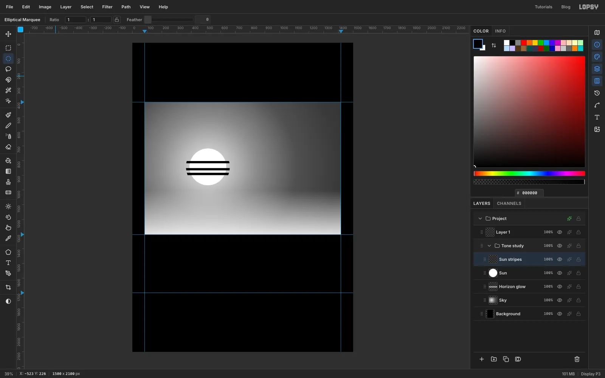

Set the foreground to black and fill, then deselect. Two rows of sun between the first bars, then one: the bars crowd together towards the horizon, the classic sunset rhythm. The last bar stops a couple of rows above where the statues' heads will be, so it doesn't break up against them.

## Paint the sea and the sun path

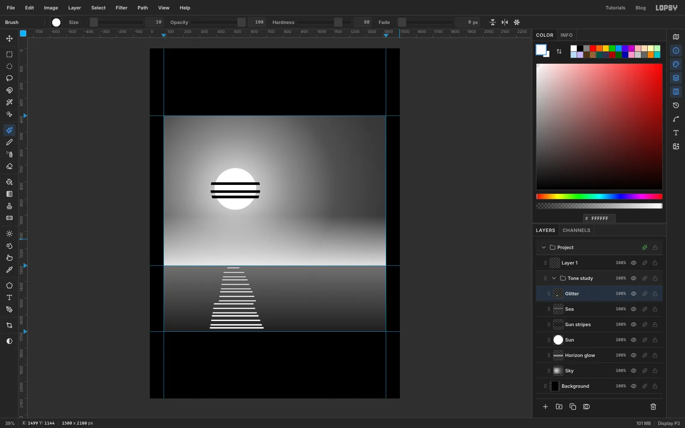

Add a layer named `Sea`. Marquee from the horizon at `83, 1303` to the bottom-right guide corner `1417, 1699`. Draw a two-stop **Linear** gradient from `#707070` at the horizon down to `#1E1E1E` at the bottom, then deselect.

Add a layer named `Glitter` for the sun's reflection. Pick the **Brush**, set the foreground to white and draw about sixteen horizontal dashes under the sun, one every 24 px, starting just below the horizon. For each one, click at its left end and **Shift**-click at its right end to get a straight line. Start narrow (about 70 px wide, brush **Size** `5`) and widen each dash as you come down. Let the last ones reach about 300 px wide at **Size** `10`. Nudge each dash a few pixels left or right so the column wobbles like real water.

Run **Filter → Gaussian Blur…** with **Radius** `2` to soften the dashes. Then click the `Tone study` group's arrow to collapse it.

## Build the ahu and the first moai

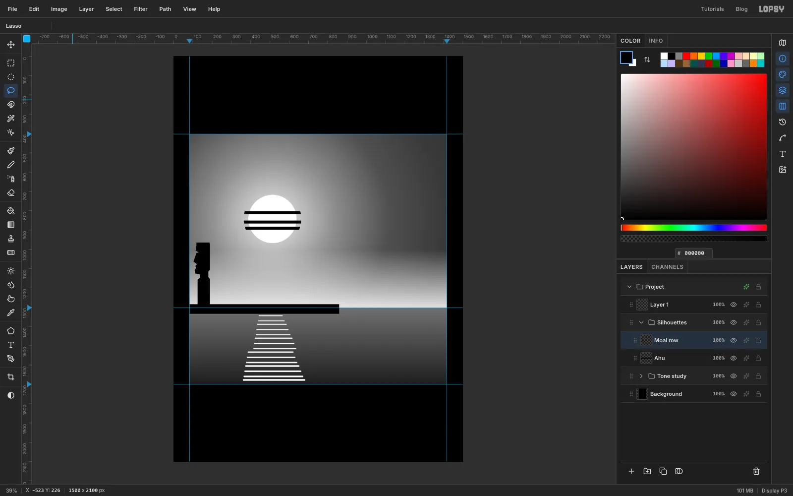

The statues stand on an **ahu**, a stone platform. Its top edge has to sit 18 px above the horizon guide, close enough to snap onto it. Turn off **View → Snap to Guides** first, or the marquee will jump down to the guide.

With the `Tone study` group collapsed and selected, click **New Group** and name it `Silhouettes`, then add a layer named `Ahu`. Marquee from `77, 1285` to `859, 1334`. That's three rows of characters tall, and it starts a few pixels left of the guide so the first column of characters is solid. Fill with black and deselect.

Add a layer named `Moai row` and draw the first statue with the **Lasso**, facing left, standing on the ahu at `x 103`. It's about 86 px wide and 320 px tall. Trace it as a head block on a body:

- **Top and back:** a flat top from `119, 965` to `186, 965`, and a straight back down to the ahu at `189, 1285`. Give the back a small notch, about 9 px deep, around `y 1106`–`1154` for the neck.
- **Body front:** from the ahu at `125, 1285` straight up to the shoulder at `125, 1157`.
- **Neck and chin:** step out to `138, 1147`, up to `138, 1131`, then jut forward to the chin at `109, 1109`.
- **Face:** small in-and-out steps for the lips (`117, 1096` and `113, 1087`), then out to the nose tip, the left-most point, at `103, 1064`.
- **Eyes and brow:** back up the nose to `119, 1019`, cut in to an eye notch at `132, 1016`, out again to the brow at `114, 1007`, then up the forehead to `119, 981`.

Zoom in and keep an eye on the status bar while you trace. Being a pixel or two out doesn't matter, because the converter rounds everything to whole characters. Fill it with black and deselect. The big head, jutting chin and narrow neck are what make a moai read as a moai once it's turned into characters.

## Stamp copies along the ahu

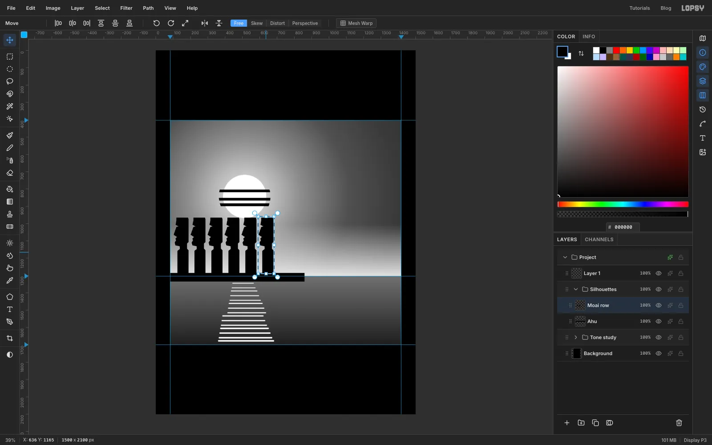

Marquee around the statue, from `101, 959` to `193, 1289`, and switch to the **Move** tool. Hold **Alt** and drag from the middle of the statue 98 px to the right. With a marquee active, Alt-drag copies the selected pixels instead of moving them.

Alt-drag again from the copy to the next spot, 98 px further on, and repeat until you have six statues, the last one starting at `x 593`. Each Alt-drag stamps the copy where it sits and pulls a new one. Press [[Cmd+D]] to drop the last one.

## Vary the heights

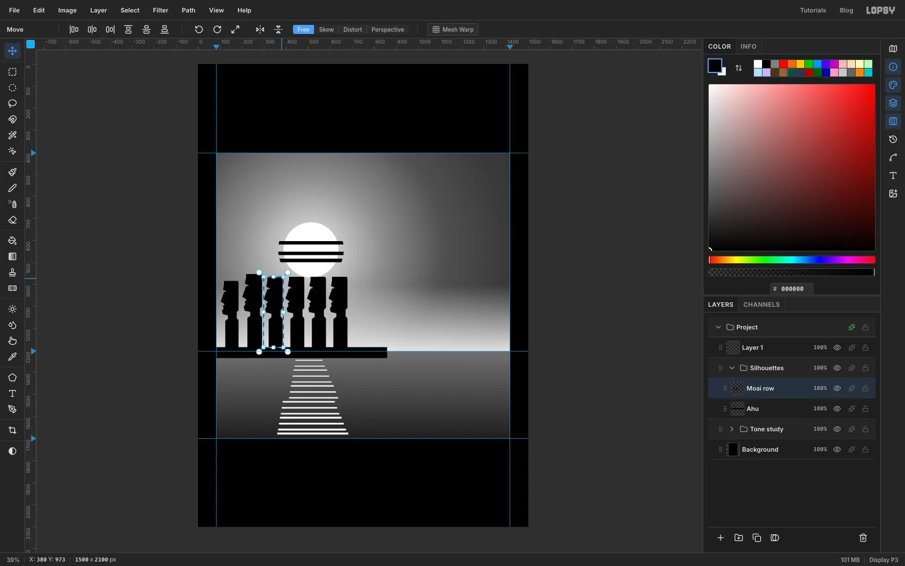

Real moai are all slightly different. Resize each statue on its own: marquee tightly around it, from 2 px left of its nose to 2 px past its back and from its head down to the ahu. Then **Cmd**-drag the top-right corner handle. Cmd keeps the proportions, and dragging the top-right corner keeps the bottom-left corner pinned, so the statue stays standing on the ahu. Press [[Cmd+D]] after each one.

Aim for heights of roughly `300`, `332`, `316`, `348`, `300` and `324` px from left to right. Uneven tops make the row read as a crowd, not a fence.

## Add the topknots

Some Tongariki moai wear a **pukao**, a red-stone topknot. In silhouette it's a short block sitting on the head. On the second and fifth statues, marquee a block about 50 px wide and 30 px tall sitting right on top of the head, a little towards the back, and fill it with black.

## Draw the giant head with the Lasso

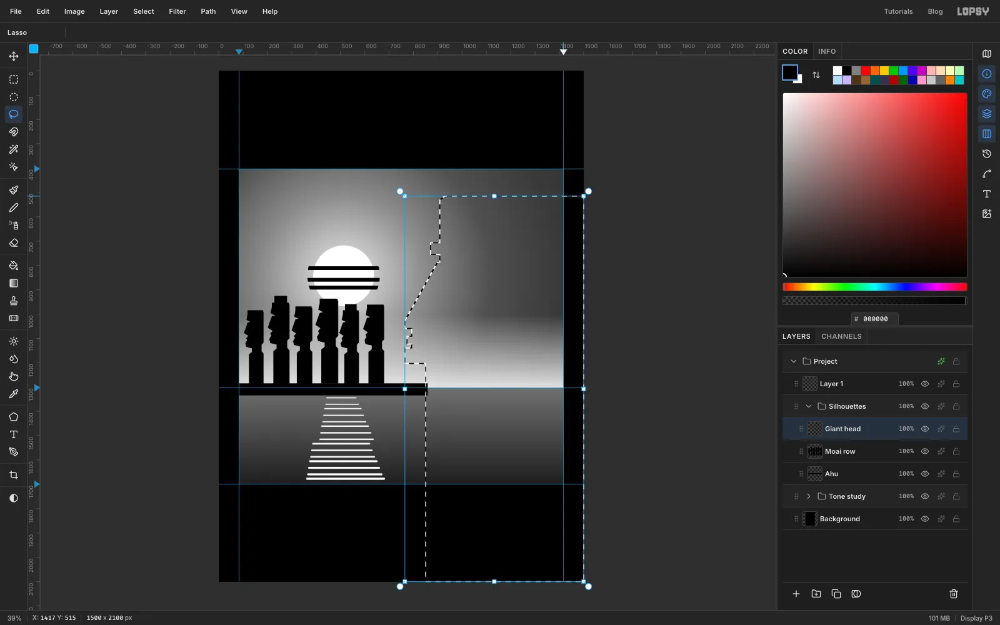

The giant head is the hero of the poster. It's built from straight horizontal and vertical steps that fall on the character grid (multiples of 9.6 px across and 16 px down), so each part of the face becomes a clean block of characters.

Add a layer named `Giant head` and trace this outline with the **Lasso**, starting at the right edge and going down the face. Zoom in to trace each part, and remember that a pixel or two either way won't change the characters:

1. The **crown** runs flat from the right edge of the grid at `1417, 515` to `928, 515`, with a small bevel down to `909, 531`.
2. The **forehead** drops straight down to `909, 707`.
3. The **brow ledge** steps out four characters to `870, 707`, runs down three rows to `870, 755`, then steps back in to `909, 755`.
4. The **eye socket** goes down two rows to `909, 787` and steps out a character to `899, 787`.
5. The **nose** is one long straight slope down and to the left, to its tip at `765, 1027`. The tip goes straight down for two rows to `765, 1059`.
6. The **undercut** under the nose steps back three characters to `793, 1059` and down to `793, 1091`.
7. The **upper lip** pouts out to `774, 1091`, down to `774, 1123`, then back to `793, 1123` and down to `793, 1139`.
8. The **chin** juts out square to `765, 1139` and drops four rows to `765, 1203`.
9. Under the chin, go back to the **neck** at `851, 1203`. From there run straight down off the bottom of the canvas, along the bottom edge to the right corner, and back up the right edge to where you started.

Moai faces are mostly nose: long, straight and heavy-browed, with a small, tight-lipped mouth above a big chin.

## Fill the head with a special grey

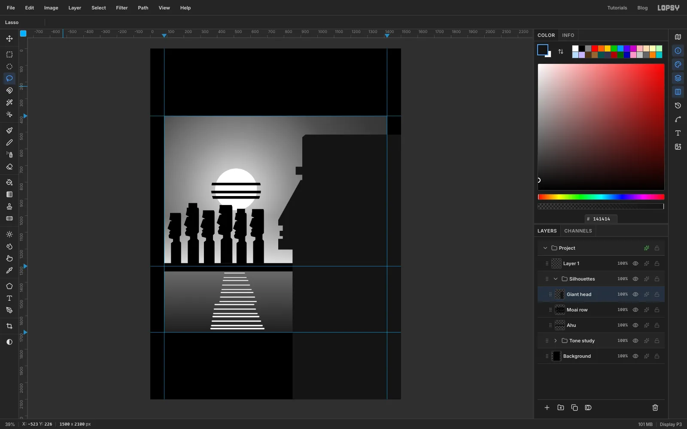

Fill the head with `#141414`, a grey just above black, and deselect.

The odd colour is a marker. The converter in the next step turns that grey into a field of faint `.` dots, so you can find every character inside the head and give the head its own colour.

## Export the study and convert it to text

Choose **File → Quick Export PNG** to save the study. Then turn it into characters. Common converters split the brightness range into equal bands, so near-black would become a space and the head would vanish. A short script of your own, or a converter that lets you set exactly which brightness each character covers, is the way to go. Use these settings so the text lands exactly on your guides:

- **Area:** crop the image to the guide box, from `83, 403` to `1417, 1699`, in the converter or any image viewer.
- **Size:** 139 columns × 81 rows, so each character covers a 9.6 × 16 px cell.
- **Characters**, from dark to light: a space, then `.` `-` `=` `+` `*` `o` `%` `#` `@`. Only pure black becomes a space. Spread the other nine characters over the rest of the brightness range, so even the near-black head comes out as `.`.
- **Contrast:** darken the midtones slightly (a gamma of about 1.2) so the outer sky stays sparse and the sun gets all the `@`.

> **Tip:** No converter to hand? Open the follow-along project. The three blocks are kept there as editable text layers in the `Scene` group (the scene and rim blocks are hidden), so you can copy them straight out.

Avoid commas, colons and semicolons in the dark end of the ramp. They read as vertical dots next to the horizontal `-`, and the sky would seem to change material halfway across.

Open the result in a text editor and make three copies, each 81 lines long. From the crown's row down, the head is the unbroken run of dots that reaches the end of each line. Dots elsewhere, in the sea or under the statues, are just dark texture.

1. **Scene:** replace the head's run of dots with spaces.
2. **Rim:** keep only the one character just before the head's run on each row, plus the crown-width row of characters just above the crown. Turn everything else into spaces. If a rim character is sparser than `#`, make it a `#`. This becomes the gold edge light.
3. **Head:** keep only the head's run of dots, with spaces everywhere else.

Your editor's column (block) selection makes this quick. Keep the leading spaces in every line, so all three copies line up character for character.

## Set the scene in IBM Plex Mono

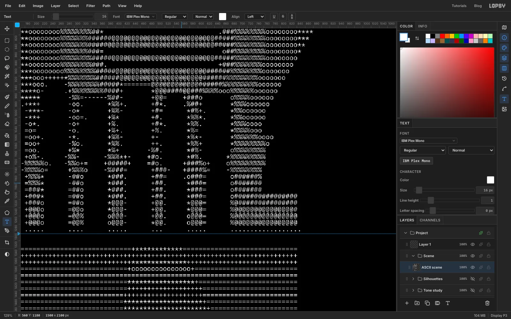

Hide the `Silhouettes` and `Tone study` groups with their eye buttons, and collapse `Silhouettes`. Click **New Group** and name it `Scene`.

Set the foreground to white. Pick the **Text** tool, set **Size** to `16` and choose **IBM Plex Mono** in the font browser. Open the **Text** panel and set **Line height** to `1` and **Letter spacing** to `0`. Click exactly on the top-left guide corner, `83, 403`. Paste the **Scene** text with [[Cmd+V]] and press [[Tab]] to commit. Rename the layer `ASCII scene`.

The characters land on the guides. The moai and the head are now slots of empty space in a field of text, and only the characters' density draws the picture.

## Add the rim and head separations

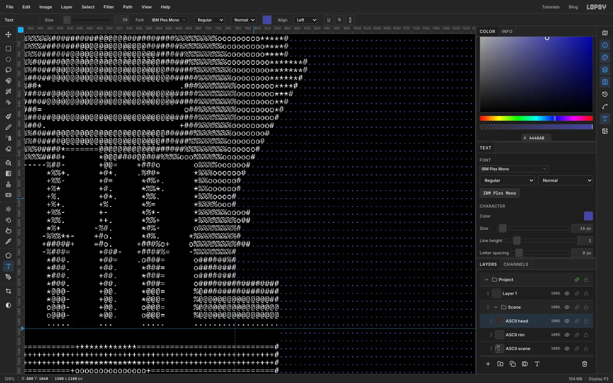

The next two blocks start at the same corner. A text-tool click inside a text layer's box would edit that layer instead of starting a new one, but hidden layers are ignored. So hide `ASCII scene` with its eye button first.

Click `83, 403` again, paste the **Rim** text, commit it, rename it `ASCII rim` and hide it too.

Set the foreground to `#4446A8` (a dim indigo), click `83, 403` once more and paste the **Head** text. Commit it and name the layer `ASCII head`. Its colour is final. Show `ASCII scene` and `ASCII rim` again to check that the three layers line up exactly. They do, because they share one grid. All three stay as live text, so you can fix a character later.

## Load the characters as a selection

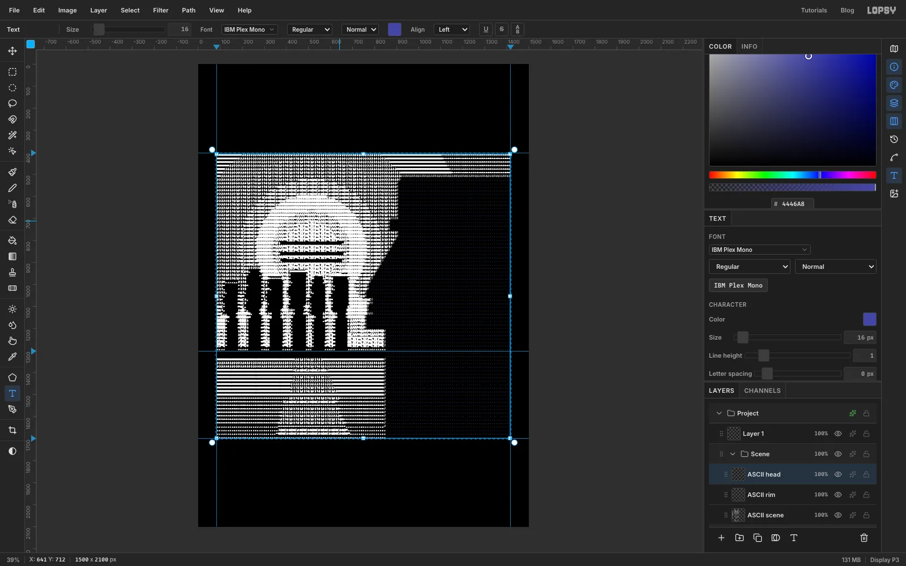

From here on, colour goes *through* the characters, the way ink goes through a stencil.

**Cmd**-click the thumbnail of `ASCII scene`. Lopsy selects every non-transparent pixel of the layer, which is the shape of every character in the scene.

## Ink the sky through the characters

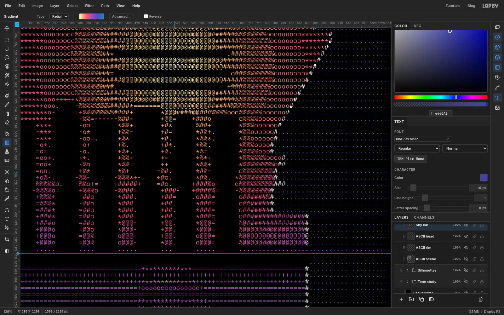

With the selection still active, select `ASCII head` and click **Add Layer**. Name the new layer `Sky ink`. Make a **Radial** gradient from the sky colours in the palette: `#FFF6DC`, `#FFE08A` at 7%, `#FF9A62` at 17%, `#F2557E` at 32%, `#A447C4` at 52%, `#4B4FC9` at 75% and `#2C86B0` at the end. Drag it from the sun's centre at `513, 843` about 1100 px to the right.

Because of the selection, only the characters take the colour. Hide `ASCII scene` with its eye button, since the ink layer now carries the picture, and deselect to see the colours properly.

## Warm up the horizon

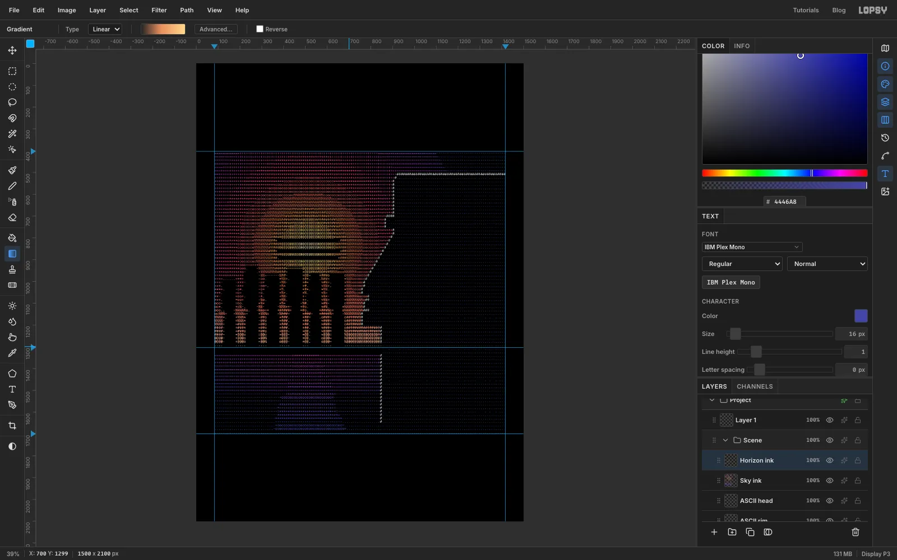

The glow behind the statues should be warmer and brighter than the violet sky above it. **Cmd**-click the `ASCII scene` thumbnail again (it works on a hidden layer too), then hold **Shift+Alt** and drag a marquee from `63, 963` to `1437, 1299`. Shift+Alt intersects, so now only the characters in that band are selected.

With `Sky ink` selected, add a layer named `Horizon ink`. Draw a **Linear** gradient from a transparent `#FF8A5B` at the top, through `#FF9A62` at 90% opacity in the middle, to `#FFD98A` at the bottom. Drag from `y 963` down to `y 1299`. The transparent stop lets the band melt into the sky instead of ending on a line. Deselect.

## Colour the sea and the sun path

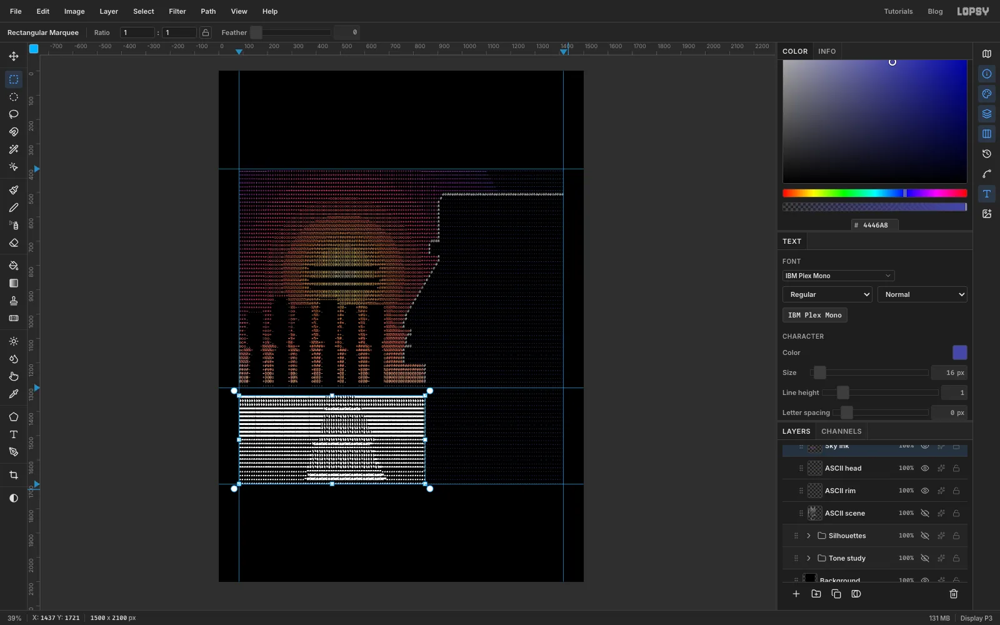

Select `Sky ink`, **Cmd**-click the `ASCII scene` thumbnail again, then **Shift+Alt**-drag a marquee over the sea, from just under the horizon (`63, 1305`) to below the bottom guide (`1437, 1719`). Draw a **Linear** gradient from `#5FE0D6` at the horizon through `#2F9FC8` to `#2C70B8` at the bottom. It paints onto `Sky ink`, but only the sea's characters change.

Keep the selection. Select `Horizon ink`, add a layer named `Sun path`, and draw a **Linear** gradient from `#FFF0B8` through `#FFD27A` to `#FFB347`, top to bottom. For now this turns the whole sea gold. Deselect.

## Fade the sun path with a mask

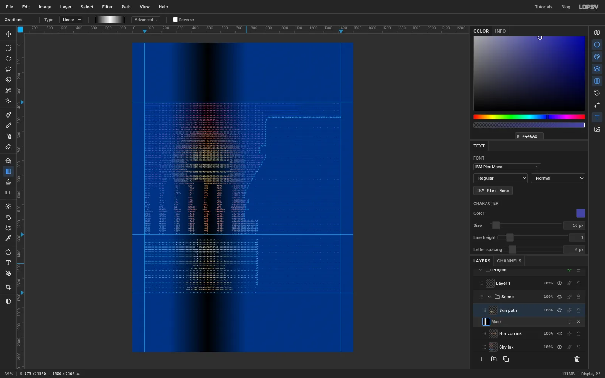

Click **Add Mask** in the Layers panel, then click the new mask thumbnail on the `Sun path` row to edit the mask. Draw a **Linear** gradient black → white → black (stops at 0%, 50% and 100%) horizontally from `253, 1500` to `773, 1500`. That's 260 px either side of the sun.

Only a soft column of gold survives under the sun, and it fades into the teal on both sides. Click the name on the `Sun path` row to stop editing the mask.

## Light the rim of the head

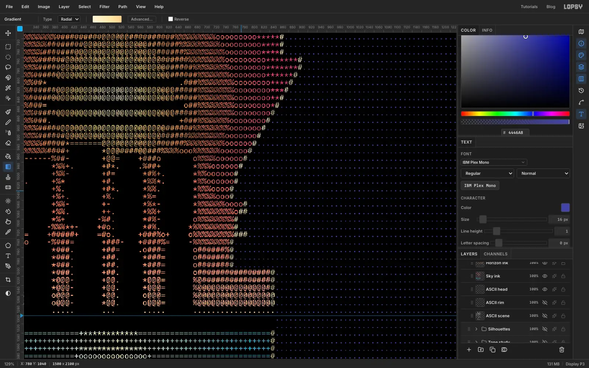

Select `Sun path`, then **Cmd**-click the `ASCII rim` thumbnail. Add a layer named `Rim ink` and draw a **Radial** gradient from `#FFF6D8` through `#FFE9A8` to `#FFD08A`, from the sun's centre to about 1300 px to the right. Deselect and hide `ASCII rim`.

Light from behind catches the very edge of a silhouette. The single line of pale gold characters is the only thing that draws the brow, nose, lips and chin, so make it paler than the coral glow next to it.

## Add a phosphor bloom

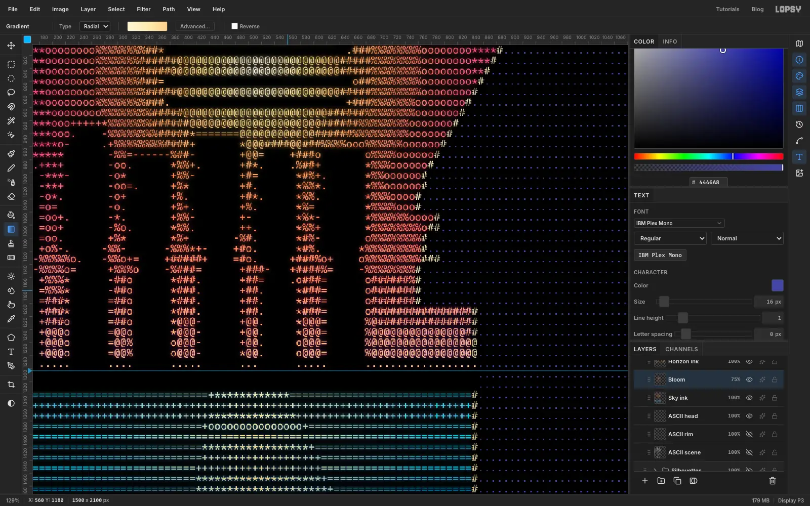

Select `Sky ink` and choose **Layer → Duplicate Layer**. Name the copy `Bloom` and run **Filter → Gaussian Blur…** with **Radius** `9`.

Toggle `Bloom`'s eye button to compare the scene with and without it. In the effects drawer set `Bloom` to **Screen**, then click its **Opacity** button and set it to about `75%`. The blur spreads each character's colour into a soft halo, like phosphor on an old CRT. Screen means the halo can only add light. Collapse the `Scene` group.

## Start the title band

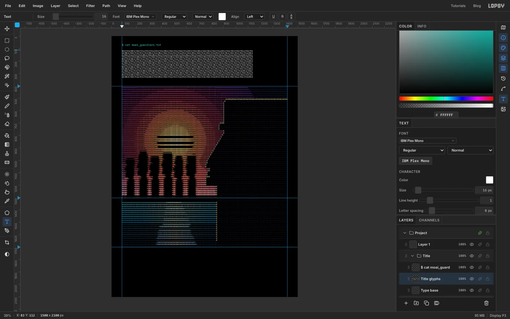

Click **New Group**, name it `Title`, and add an empty layer named `Type base`. Keep a plain layer like this selected whenever you start new text. If a text layer is selected, changing the font or size restyles that layer instead.

1. Set the foreground to cyan `#5FE0D6`. With the **Text** tool at **Size** `22`, click `83, 57` and type `$ cat moai_guardians.txt`. Press [[Tab]].
2. Select `Type base`, set the foreground to white, set **Size** to `16` and **Line height** to `1`. Click `83, 112` and paste 14 lines of `MOAIMOAIMOAI…`, each 110 characters long. Start each line one letter later than the line above (`MOAI…`, `OAIM…`, `AIMO…`, `IMOA…`) so the words slant down the block.
3. Click **Rasterize Layer** and name the layer `Title glyphs`. It has to be pixels so that Delete can cut it to the shape of the letters.

## Cut the text into letters

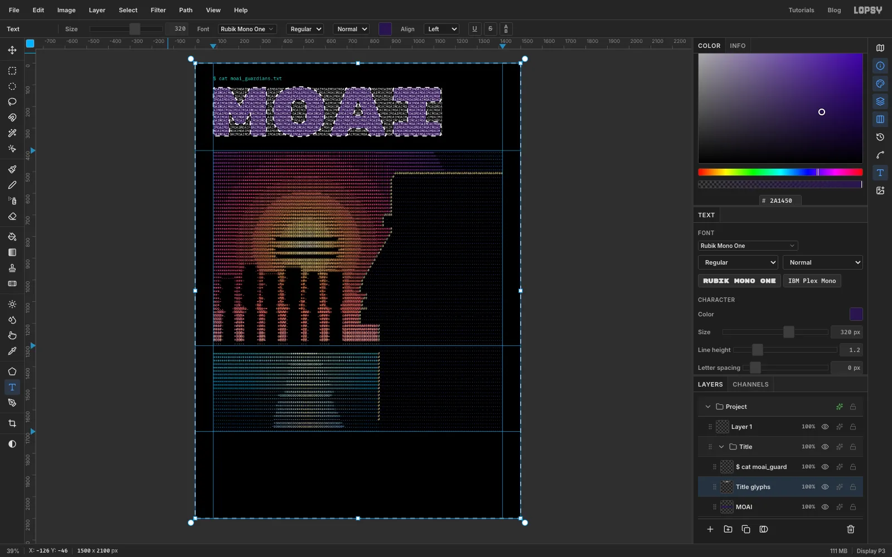

Select `Type base` and set the foreground to a deep violet `#2A1450`. Choose **Rubik Mono One**, set **Size** to `320`, click `70, 44` and type `MOAI`. Press [[Tab]].

**Cmd**-click the `MOAI` thumbnail to select the letters, then choose **Select → Inverse**. Now everything *except* the letters is selected.

## Delete the text outside the letters

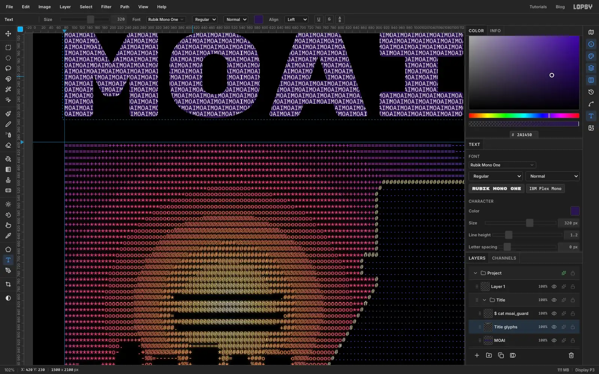

Select `Title glyphs` and press [[Delete]], then deselect. Only the part of the text block inside the letters is left.

Keep the violet `MOAI` text visible underneath. It gives each letter a solid body, so the word still reads from across the room even though the fill text is busy.

## Colour the title with Multiply

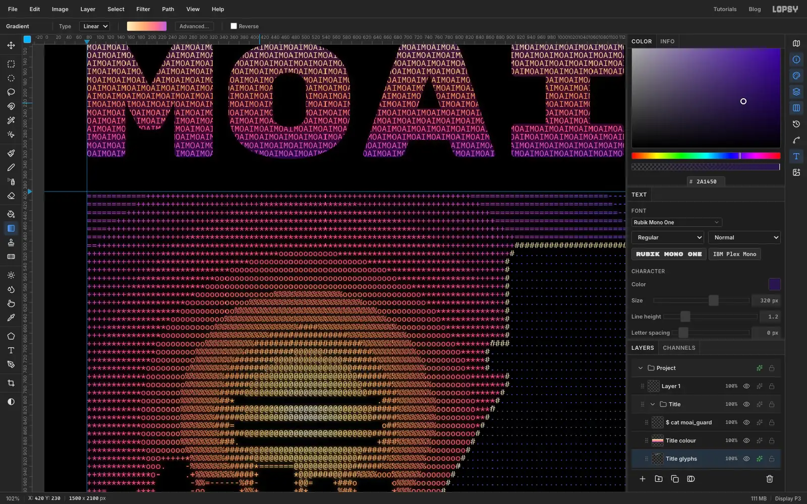

With `Title glyphs` selected, add a layer named `Title colour`. Marquee from `60, 98` to `1170, 358`. Draw a **Linear** gradient straight down from `y 112` to `y 336`: `#FFF0C0`, then `#FFB070` at 40%, `#FF6F8F` at 75% and `#C060E0` at the bottom. Deselect.

Set `Title colour` to **Multiply**. White text multiplied by the gradient becomes the gradient, and black stays black, so only the letters change colour. The violet body darkens a little too, which helps the fill text stand out.

Finally, open the effects drawer for `Title glyphs` and add an **Outer Glow** in `#FF7A59`, with **Size** `16` and **Opacity** `40`.

## Stack the subtitle

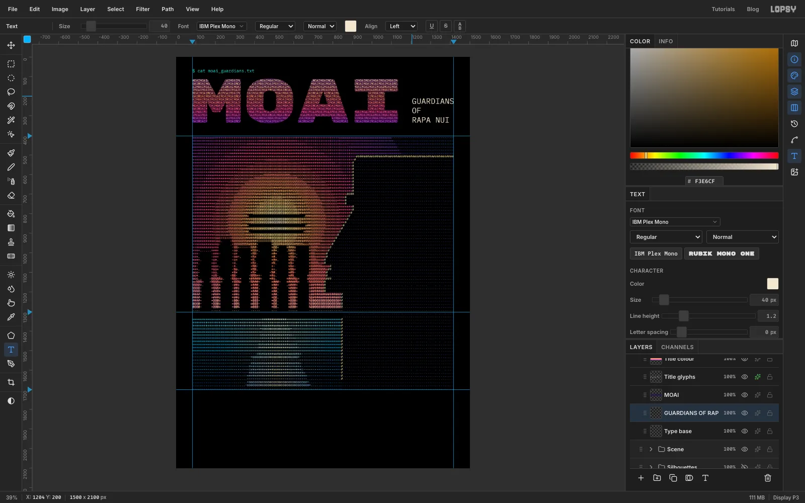

Select `Type base`. Set the foreground to cream `#F3E6CF`, choose **IBM Plex Mono** at **Size** `40` and **Line height** `1.2`. Click `1204, 200` and type three lines, pressing [[Enter]] between them: `GUARDIANS`, `OF` and `RAPA NUI`. Press [[Tab]].

Check two alignments. The baseline of `RAPA NUI` should sit on the baseline of `MOAI`. The right edge of `GUARDIANS` should line up with the right-hand guide.

## Frame the scene like a terminal window

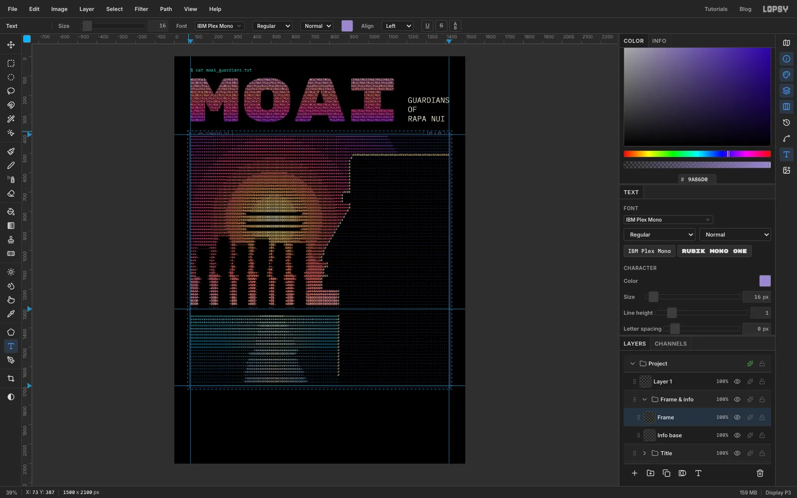

Select the `Title` group and collapse it, then click **New Group** and name it `Frame & info`. Add an empty layer named `Info base`.

In a text editor, make the frame 141 characters wide:

- The top line is `+--[ ahu_tongariki.txt ]`, then 102 dashes, ending in `[ 139 x 81 ]--+`.
- Then 81 lines of `|`, 139 spaces and `|`.
- The bottom line is `+`, 139 dashes and `+`.

Set the foreground to lavender `#9A86D0` and the **Text** tool to IBM Plex Mono, **Size** `16`, **Line height** `1`. Click one character up and left of the grid, at `73, 387`, and paste. Rename the layer `Frame`.

## Set the information in three columns

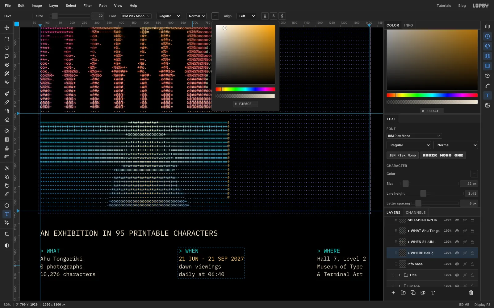

Select `Info base`, set the foreground to cream and type `AN EXHIBITION IN 95 PRINTABLE CHARACTERS` at **Size** `30`, clicking at `83, 1771`.

Then make three columns at **Size** `22` with **Line height** `1.45`. Click at `83, 1845`, `645, 1845` and `1206, 1845` in turn, selecting `Info base` before each one:

- `> WHAT` / `Ahu Tongariki,` / `0 photographs,` / `10,276 characters` (count the non-space characters in your three blocks; most editors show a count for a selection)
- `> WHEN` / `21 JUN - 21 SEP 2027` / `dawn viewings` / `daily at 06:40`
- `> WHERE` / `Hall 7, Level 2` / `Museum of Type` / `& Terminal Art`

While each column is still being edited, press [[↑]] three times to reach the first line, press [[Home]], then [[Shift+End]] to select it. Click the **Text color** swatch in the options bar and pick cyan `#5FE0D6`. In the WHEN column, also press [[↓]], [[Home]] and [[Shift+End]] to select the date line, and pick gold `#FFD27A` for it. Close the picker by clicking the swatch again before you press [[Tab]], so the keys go back to your text.

The third column starts at `x 1206`, the same as `GUARDIANS` above, so the left edges line up from top to bottom.

## Add the footer and a vertical label

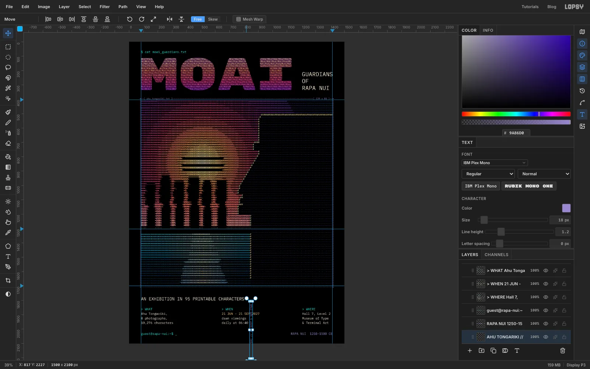

Select `Info base` again and set two footer lines at **Size** `22`. Type `guest@rapa-nui:~$ _` in cyan at `83, 2019`, and `RAPA NUI  1250-1500 CE` in lavender at `1127, 2019`, so it ends on the right-hand guide.

For the margin label, set the foreground to lavender and **Size** to `18`. Click in empty space low on the page, around `650, 1995`, and type `AHU TONGARIKI // 27.1257 S 109.2768 W`. These are the real coordinates of the ahu. Press [[Tab]].

Switch to the **Move** tool. Handles appear around the text. Each corner has a rotation handle sitting just outside it on a short line. Hold **Cmd** and drag one of them a quarter turn counter-clockwise. Cmd snaps the angle in 15° steps, so the text lands exactly upright and reads from bottom to top. Press [[Cmd+D]] to commit. The text stays live and editable.

## Place the label in the margin

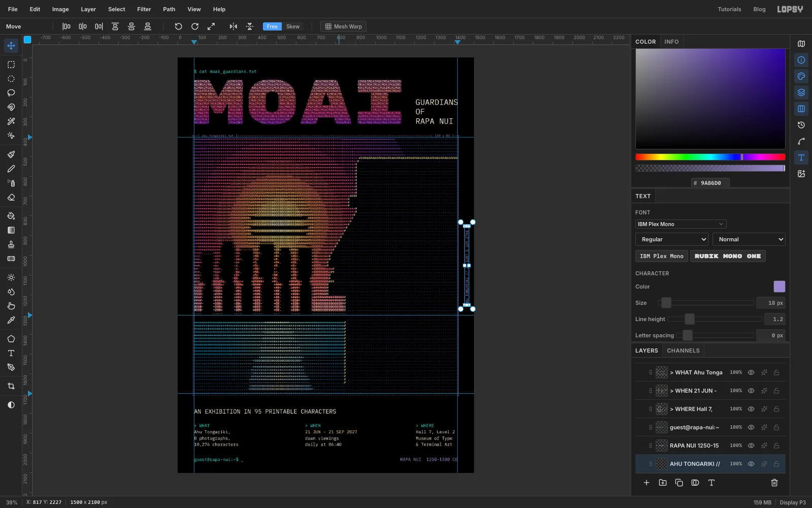

With the label still selected and the **Move** tool active, click **Align right**, then **Align center vertically** in the options bar. That parks it against the right edge of the page, halfway down.

Tap [[Shift+←]] twice and [[←]] seven times to move it 27 px left, into the middle of the gap between the frame and the edge of the page. Tap [[↓]] once to centre it on the frame. Then **File → Quick Export PNG** to export, and **File → Save Project** to keep a copy of every layer, including the hidden tone study.
