Victorian botanical plates are built like a page of evidence. A large drawing of the plant, called the *habit*, fills the middle. Small numbered figures around it show the parts up close, and a key at the bottom says what each number is. Put a snow crystal under the glass, add a red greeting, and the same layout makes a quiet, clever holiday card.

This tutorial makes a winter-solstice card of the balsam fir, *Abies balsamea*. You'll paint the branch needle by needle with a tapering brush, model two upright cones with gradients, dodge and burn, then add engraver's hatching. A stellar snow crystal comes from a single arm drawn with the **Radial Symmetry** brush, and a specimen tag hangs off the branch on a string drawn with the **Pen** tool.

The card is **1500 × 2100 px**, a 5 × 7 portrait. Some steps give a rough position in document pixels. Hover the canvas and read **X** and **Y** at the bottom left of the window to find it. The main places are:
- **Inner frame:** 70 px in from every edge. The header rule sits at y 296 and the footer rule at y 1712.
- **Twig:** from a cut end at about (220, 1430), curving up to a tip at about (1300, 870).
- **Detail figures:** a row between y 350 and y 660, centred at about x 270, 500, 800 and 1150.
- **Snow row:** small crystals at (590, 1470) and (800, 1470), and the roundel centred at about (1140, 1378).

Two habits help throughout:
- **Name layers as you go.** Double-click a layer's name to rename it. Later steps refer to layers by name, text layers included.
- **Straight lines:** with the Brush or Pencil, click one end, then **Shift+click** the other.

Palette:

- Paper `#F1E8D4`, ink `#2E2419`, sepia `#5A4632`, crimson `#A3262A`
- Needles `#2F5538`, dark `#284329`, light `#4F7A50`, sheen `#6E9461`, needle ink `#1F3624`
- Bark `#7A5638` / `#4E3523`, buds `#8A5A3A`, pale wood `#D9B98C`
- Cones `#3A2040` → `#B58AB0` → `#7A4A72` → `#2A1530`, scale ink `#24112A`
- Seed wing `#D9B98C` → `#EFE0C4`, seed `#5A3A2A`, tag `#E6D3A8`, handwriting `#2B2A4A`
- Crystal ink `#3D5A80` / `#2B3A4A`, ice wash `#DCE8F2`, lens `#C8D2DB` → `#9EAFBE`
- Brass `#C9A45E` → `#B08D4A` → `#6E5427`, brass shadow `#4A3518`

## Lay down the paper and guides

1. Create a **1500 × 2100 px** document with a white background.
2. Select the **Background** layer, set the foreground colour to `#F1E8D4` and choose **Edit → Fill**.
3. Click the top ruler at x **110**, **750** and **1390** to drop vertical guides for the margins and the centre line.
4. Click the left ruler at y **296** and **1712** for the header and footer rules.

## Rule a double plate border

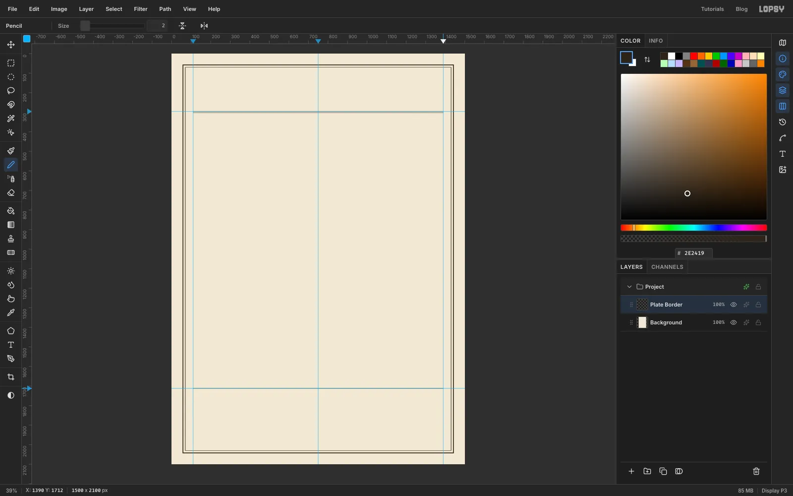

Old plates are framed with a heavy rule and a hairline just inside it.

1. Rename `Layer 1` to `Plate Border`. Pick the **Pencil** and set the colour to ink, `#2E2419`.
2. At **Size 4**, click the top-left corner 58 px in from both edges. Then **Shift+click** the other three corners and the first one again.
3. At **Size 2**, draw a second rectangle the same way, 70 px in from the edges.
4. Still at Size 2, draw two rules under the header from the left guide to the right guide, at y 296 and y 302. Draw one more along the footer guide at y 1712.

## Set the plate header

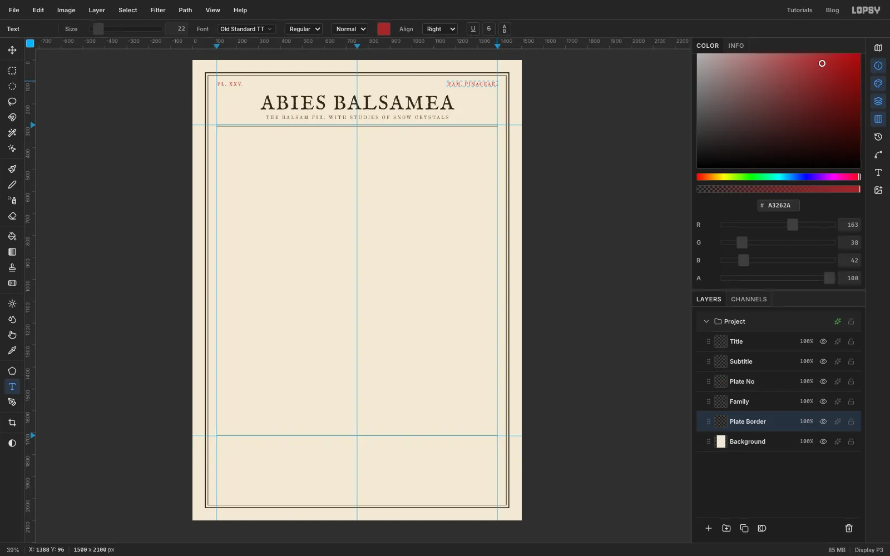

> **Tip:** With a text layer selected, the Text tool's font, size and colour change *that* layer. Click a picture layer in the Layers panel, such as `Plate Border`, before you start each new piece of text.

1. Pick the **Text** tool. Set **IM Fell English SC** at **92 px**, **Align** to **Center**, and colour `#2E2419`. Click on the centre guide near the top and type `ABIES BALSAMEA`. Press **Tab** to commit it, and rename the layer `Title`.
2. In the **Text** panel, set **Letter spacing** to **6**. Then use the **Move** tool and the arrow keys to centre the title on the centre guide, about halfway between the top frame and the header rule.
3. Click `Plate Border`. Type `THE BALSAM FIR, WITH STUDIES OF SNOW CRYSTALS` in **Old Standard TT** at **22 px**, colour `#5A4632`, letter spacing **5**. Centre it about 30 px under the title and rename it `Subtitle`.
4. Click `Plate Border` again. In crimson `#A3262A`, at 22 px with letter spacing 3, add `PL. XXV.` left-aligned at the left margin, just inside the top frame. Click `Plate Border` once more and add `FAM. PINACEAE.` right-aligned at the right margin.

## Paint the twig with a tapering brush

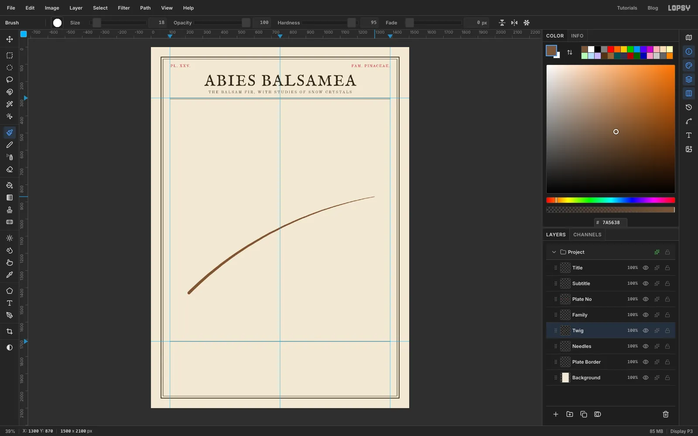

1. Add two layers above `Plate Border`: `Needles` first, then `Twig` above it. The needles go underneath so the bark covers their bases.
2. Pick the **Brush** and open the brush settings from the tip thumbnail in the options bar. Set **Size 18**, **Hardness 95**, **Spacing 2** and **Taper 1500**.
3. Paint the twig in bark brown `#7A5638` in one slow stroke. Start at the cut end, about (220, 1430), and curve up to the tip at about (1300, 870), with the steepest part near the start.

**Taper** is the distance over which the stroke shrinks to nothing, counted from where it starts. Set it a little longer than the stroke, so the twig thins toward the tip but still reaches it.

## Add the side shoots

Fir branches grow in a flat spray, with side shoots leaving the twig at about 50–60°.

1. Set the brush to **Size 10** and **Taper 250**.
2. Paint six side shoots from points along the twig, on both sides. Make each one 150–225 px long, with a slight curve toward the tip.
3. Make the lowest upward shoot the longest, rising toward the empty top-left of the page.

## Shade the bark inside a selection

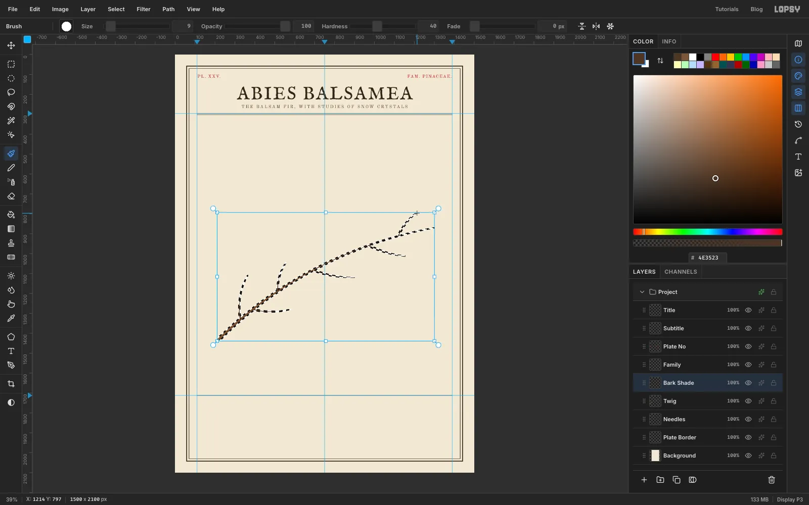

1. **⌘-click** the `Twig` thumbnail in the Layers panel to load its outline as a selection.
2. Add a layer called `Bark Shade`. Set the brush to **Size 9**, **Hardness 40** and **Taper 0**.
3. Paint `#4E3523` along the underside of the twig and each shoot, just below the centre line. The selection keeps the paint on the wood.
4. Press **⌘D** to deselect. Open the layer's effects drawer (the ✦ button on its row) and set the blend mode to **Multiply**.

## Add the cut end, buds and an ink outline

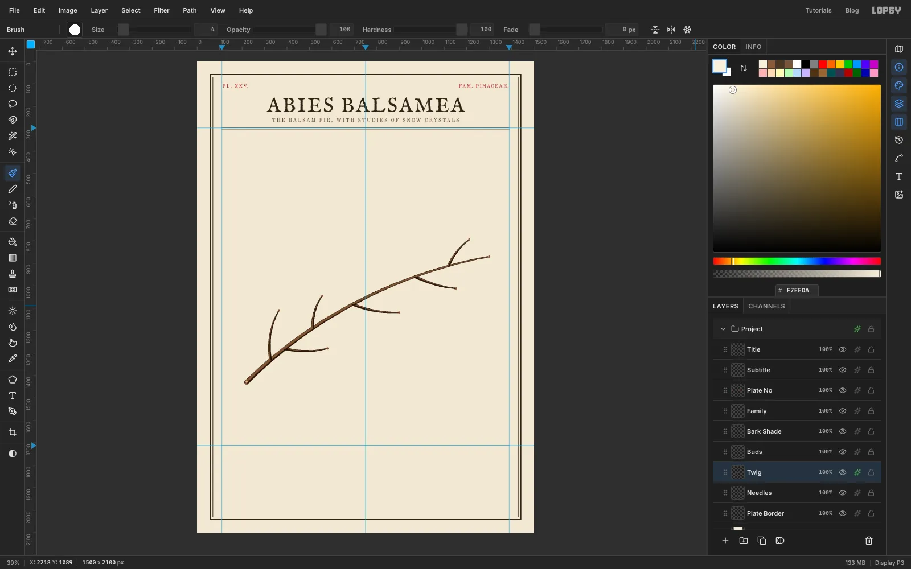

1. Select `Twig`. Lasso a small oval across the cut end, about 8 × 18 px, and fill it with pale wood `#D9B98C`.
2. Add a layer called `Buds`. With a **Size 11** brush in `#8A5A3A`, click once on every shoot tip. Then click a **Size 4** dot of `#F7EEDA` just up and left of each one, for the resin highlight.
3. Select `Twig`, open its effects and turn on **Stroke** at **Width 2** in ink `#2E2419`.

## Paint the needles two by two

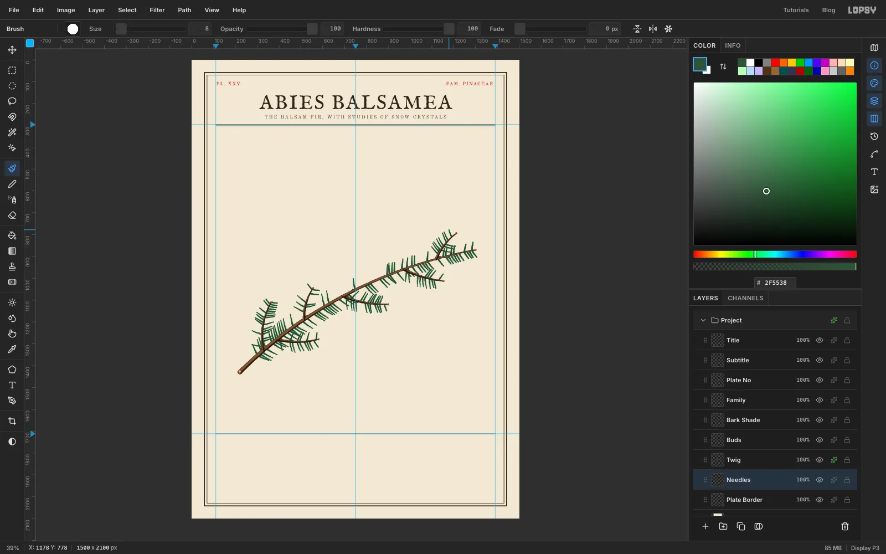

This is the longest step: about 400 needles. Balsam fir needles lie flat in two rows, one each side of the twig, leaning forward toward the tip.

1. Select `Needles`. Set the brush to **Size 9**, **Hardness 100**, **Spacing 2** and **Taper 110**. A short taper rounds the needle tips.
2. In `#2F5538`, work along the main twig from just past the cut end to the tip, painting one needle out from each side every needle's width or so. Each needle is a short, slightly curved stroke 50–60 px long, angled 65–75° forward from the twig.
3. Make the needles shorter as you near the tip, and leave two gaps on top of the twig where the cones will sit.
4. Paint the side shoots the same way at **Size 8**, with needles about 48 px long.

## Vary the needle tones

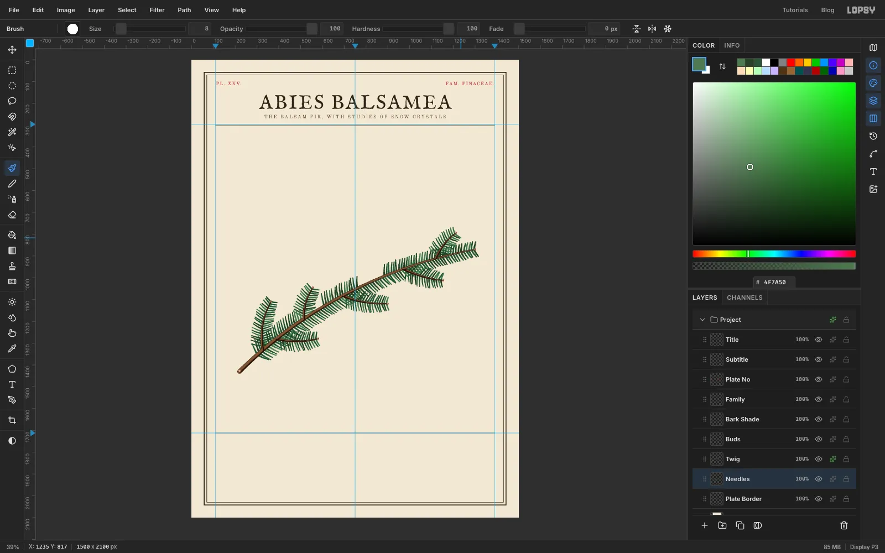

Needles that all match look stamped. Go over about a third of them again in darker `#284329`, then about a fifth in lighter `#4F7A50`. Scatter the darker and lighter ones over the whole branch, not in clusters.

## Add sheen and shade to the needles

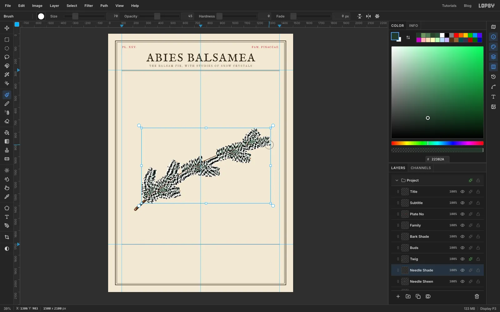

1. Add a layer called `Needle Sheen` above `Needles`. With a **Size 3** brush at **Opacity 80** and **Taper 80**, paint `#6E9461` along the upper edge of each needle on the main twig, stopping short of the tip.
2. **⌘-click** the `Needles` thumbnail to select every needle. Then add a layer called `Needle Shade`.
3. Set a big soft brush: **Size 70**, **Hardness 0**, **Opacity 45**. Paint one stroke of `#22382A` along the underside of the twig, about 35 px below it. The needles that hang below the twig fall into shadow.
4. Deselect, and set `Needle Shade` to **Multiply**.

## Ink the needles

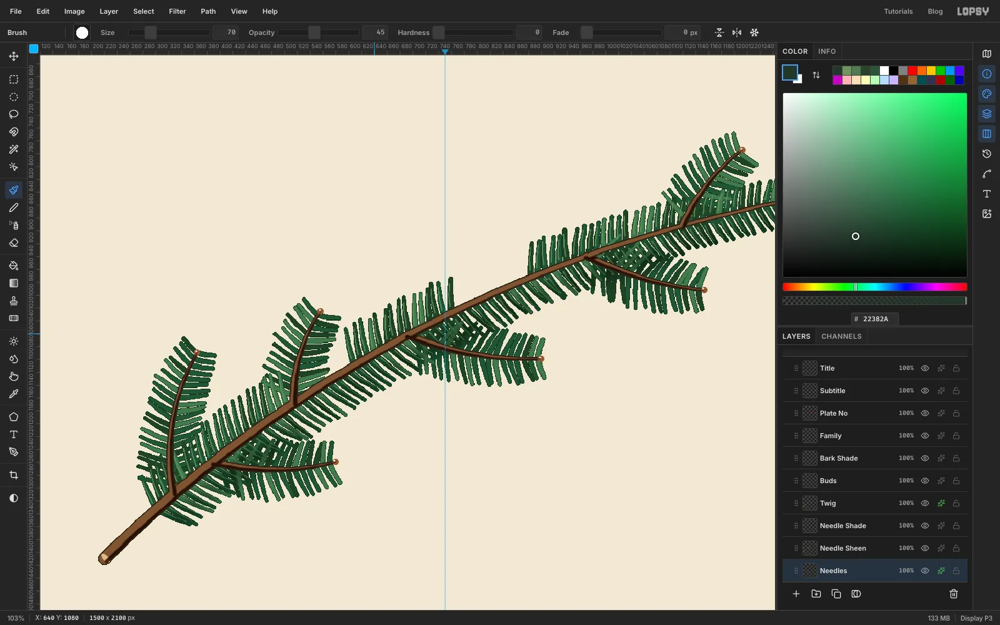

Give `Needles` a **Stroke** effect at **Width 1** in needle ink `#1F3624`. That's a shade darker than the needles rather than black, so the foliage reads as drawn, not cut out.

## Shape the first cone

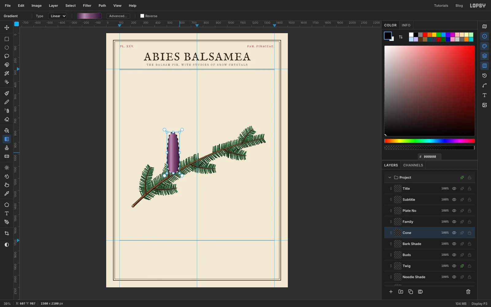

Fir cones stand upright on top of the branch.

1. Select `Bark Shade` and add a layer called `Cone`, so it sits above all the wood.
2. With the **Lasso**, draw an upright cone on the first gap in the needles: about 104 px wide, rising 340 px from the twig. Round the foot, keep the sides straight for the lower half, narrow the top to about 60% of the width, and finish with a rounded tip.
3. Pick the **Gradient** tool, open **Advanced…** and set four stops:
   - `#3A2040` at the start
   - `#B58AB0` at the 30% point
   - `#7A4A72` at the 55% point
   - `#2A1530` at the end
4. Drag straight across the cone from its left edge to its right edge. The light band a third of the way in turns the flat shape into a cylinder.

## Paint the cone scales

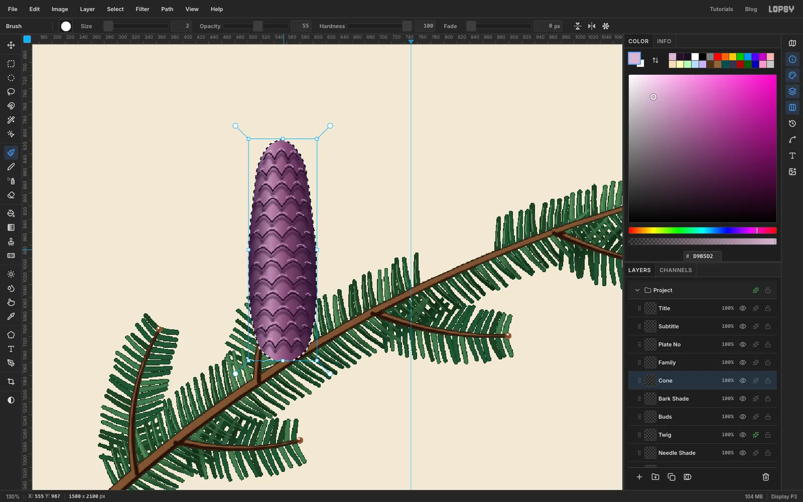

Keep the cone selected so nothing spills.

1. **Shadows:** with a soft brush (**Size 9**, **Hardness 0**, **Opacity 40**, **Taper 0**) in `#1E0C24`, paint a short arch every 24 px up the cone, five or six across. Stagger each row by half a scale, like brickwork. Narrow the arches toward the sides, where the scales turn away from you.
2. **Edges:** switch to **Size 3**, **Hardness 100**, **Opacity 90** in scale ink `#24112A`, and trace each arch again just above its shadow.
3. **Rims:** at **Size 2**, **Opacity 55** in `#D9B5D2`, add a short pale line along the top of each edge.

## Dodge and burn the cone

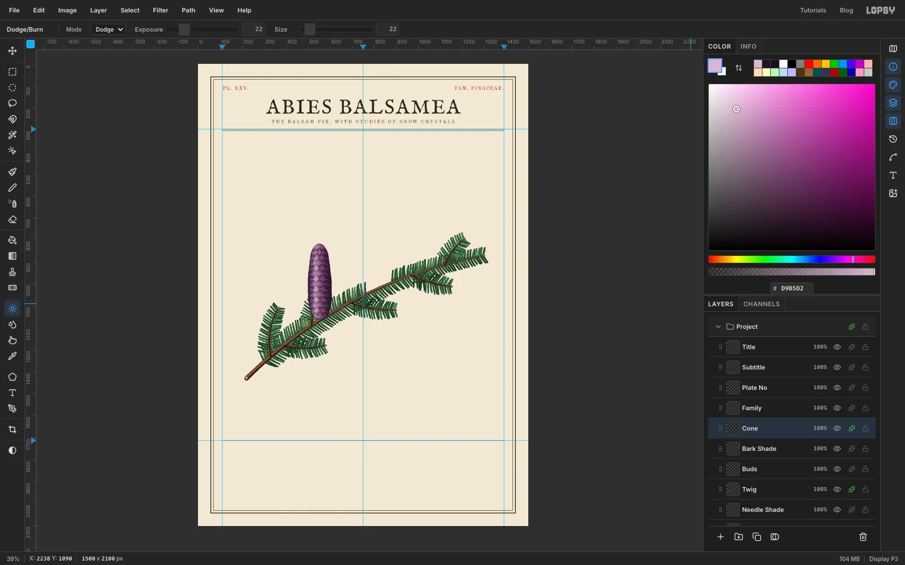

1. Pick the **Dodge / Burn** tool and set **Mode** to **Burn**, **Exposure 20** and **Size 30**. Drag once from the foot to near the tip, down the right third of the cone.
2. Switch **Mode** to **Dodge** at **Exposure 22** and **Size 22**. Drag once down the left third, where the gradient's highlight is.
3. Deselect. Give `Cone` a **Stroke** effect at **Width 2** in `#24112A`.

## Paste and move the second cone

1. **⌘-click** the `Cone` thumbnail, then press **⌘C** and **⌘V**. The copy pastes in place on a new layer, already selected, with the **Move** tool active. Rename it `Cone 2` and give it the same Stroke effect.
2. **⌘-click** the `Cone 2` thumbnail to select it again, then drag it along the twig to the second gap, about 260 px to the right and 140 px up.

## Scale the second cone down

Two identical cones look copied. Hold **⌘** and drag the top-left corner handle in toward the centre until the cone is about three quarters of its size. ⌘ keeps the proportions.

## Tilt the second cone

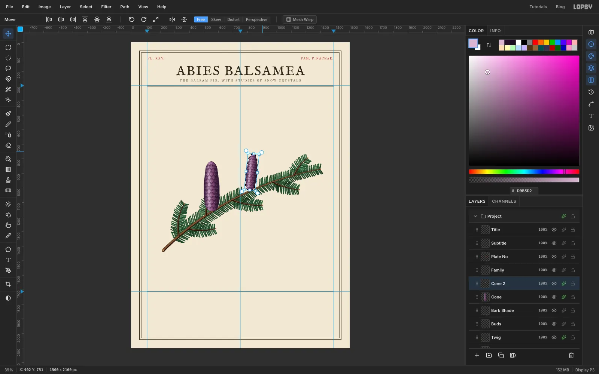

1. Drag the round rotation handle just outside the top-right corner to tilt the cone about 6° to the right.
2. Press **⌘D** to apply the transform.
3. Nudge the cone with the arrow keys until its foot sits on the twig.

## Select the shadow side of each cone

Engravers shaded with lines, not soft paint. The hatching should only cover the shadow side, so build that selection first.

1. Add a layer called `Cone Hatching`.
2. **⌘-click** the `Cone` thumbnail.
3. Pick the **Rectangular Marquee**, hold **Shift+Alt**, and drag a box over the right third of the cone. Shift+Alt **intersects**, leaving only the part of the cone inside your box.
4. Choose **Select → Feather…** and feather by **6 px**, so the hatching fades out toward the light.

## Hatch the cones

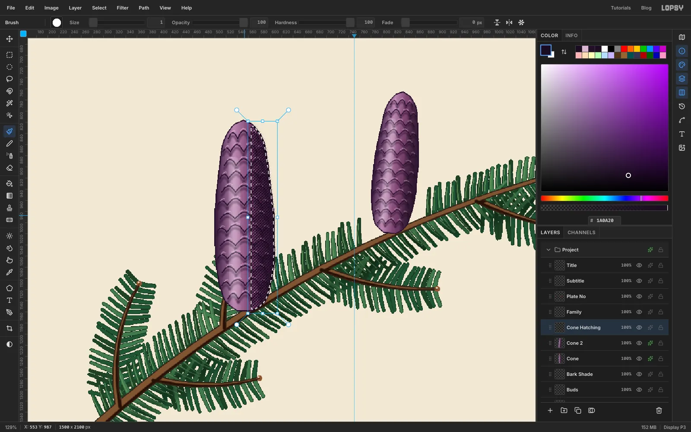

1. Select the `Cone Hatching` layer. Set the brush to **Size 1**, **Hardness 100**, **Opacity 100**, in `#1A0A20`.
2. Draw straight diagonal lines rising to the right, at 45°, every 5 px across the selected area. Overshoot the cone: the selection trims the lines to the shadow side.
3. Deselect. Then do the same for `Cone 2`: ⌘-click its thumbnail, Shift+Alt-drag a marquee over its right third, feather by 6 px, and hatch it.
4. Set `Cone Hatching` to **Multiply** at **70%** opacity.

## Tuck the cones into the needles

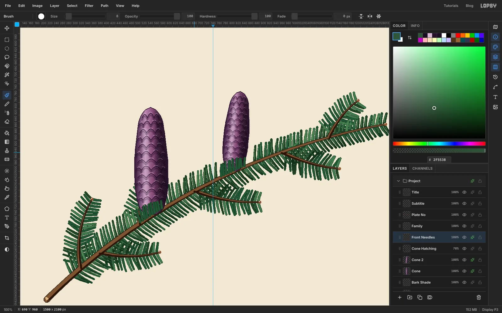

A cone sitting on top of every needle looks pasted on. Add a layer called `Front Needles` above the hatching. With the needle brush (**Size 8**, **Taper 110**) in `#2F5538`, paint about ten short needles (about 40 px) from the twig up across the foot of each cone. Give the layer the same Width 1 Stroke as `Needles`.

## Draw the needle figure lying flat

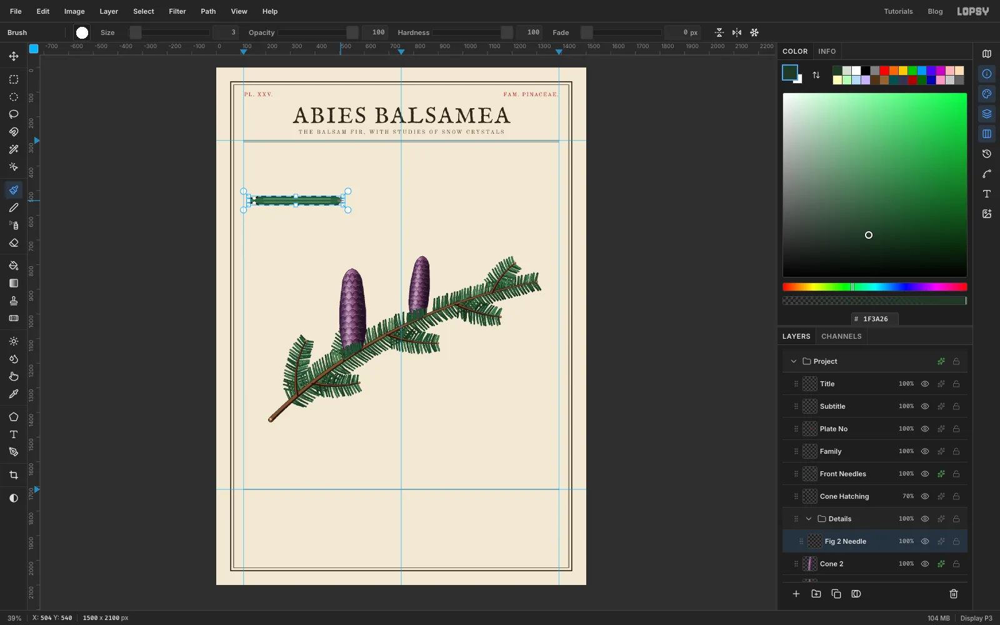

The detail figures go in their own group. Select `Cone 2`, click **New Group** in the Layers panel and rename it `Details`. Add a layer called `Fig 2 Needle` inside it.

It's much easier to draw a long thin shape level and turn it afterwards.

1. With the **Lasso**, draw a needle lying flat across the top-left of the page, about 390 px long and 36 px wide. Give it a narrow stalk ending in a small round disc on the left, and a rounded tip with a tiny notch on the right.
2. Fill it with a linear gradient across its width, from `#264A2F` at the edges to `#4B7B52` in the middle.
3. Inside the selection, paint two faint pale bands (**Size 4**, **Opacity 50**, `#D3DFCF`) along its length, stopping 60 px short of each end. These are the rows of breathing pores on the underside.
4. Paint a dark midrib (`#1F3A26`, Size 3) down the centre. Deselect, and add a **Stroke** of Width 2 in ink.

## Rotate the needle into place

1. **⌘-click** the `Fig 2 Needle` thumbnail to select it, and pick the **Move** tool.
2. Drag the top-right rotation handle counter-clockwise until the needle stands diagonally, about 60°.
3. Press **⌘D** to apply it. Then nudge the needle with the arrow keys until it's centred at about (270, 540).

## Draw the needle in section

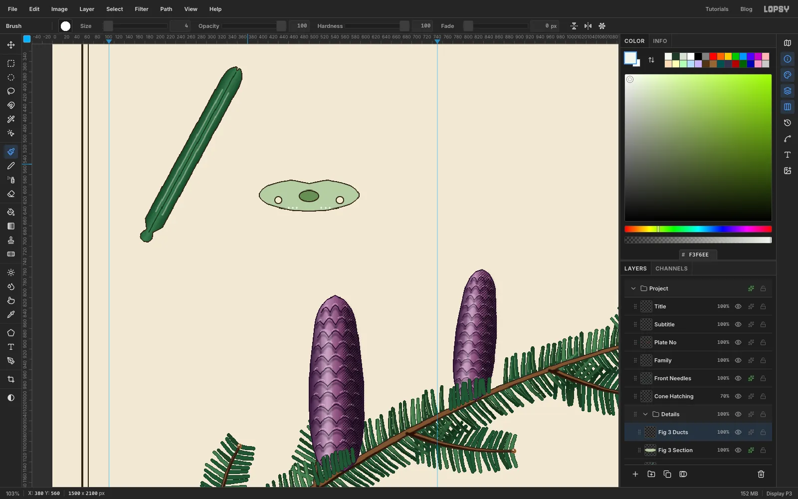

1. Add a layer called `Fig 3 Section`. Lasso a flattened lens shape about 192 × 60 px, centred at (500, 620), with a slight bump on top. Fill it with `#B9CDA6` and add a **Stroke** of Width 2 in ink.
2. Add a layer called `Fig 3 Ducts`. For each ring: drag an **Elliptical Marquee**, fill it with ink, choose **Select → Shrink…** by **2 px**, and fill again with the inside colour.
   - In the middle, a 40 × 24 px vascular strand filled with `#6F8F5A`.
   - Near each end, a 16 px resin duct filled with `#F3EBD3`.
3. Click a row of **Size 4** white dots along the bottom edge for the pores.

## Add the cone scale and bract

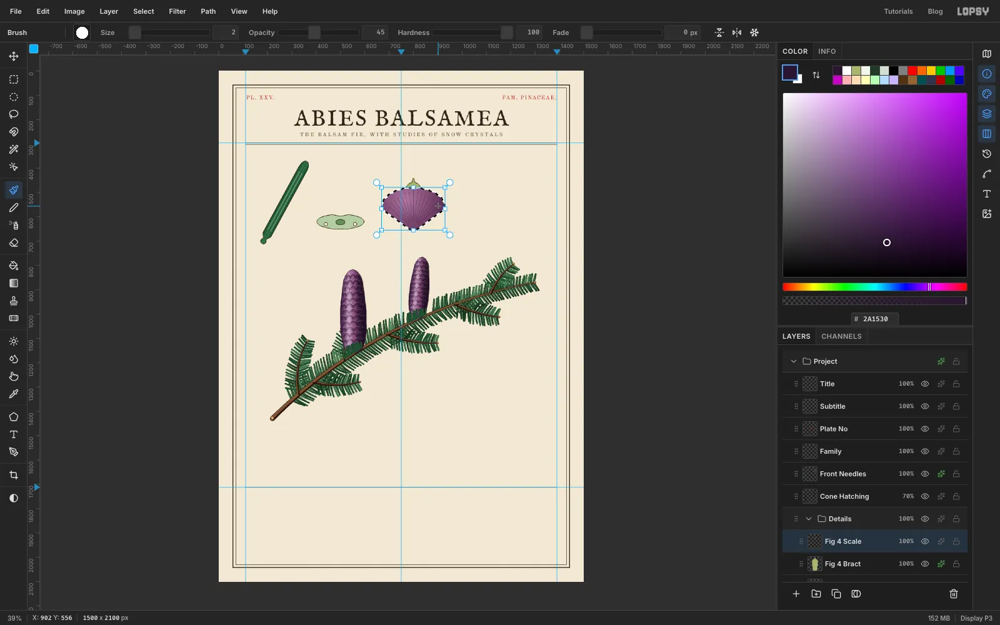

1. Add a layer called `Fig 4 Bract`. Lasso a tongue shape centred on x 800, with a sharp point that pokes about 40 px above where the scale's top edge will be. Fill it with `#A9B66E` and give it an ink Stroke.
2. Add a layer called `Fig 4 Scale`. Lasso a broad fan about 260 px wide and 175 px tall, narrowing to a short stalk at the bottom, centred at (800, 560).
3. Fill it with a **radial** gradient: `#A97AA0` at the start, `#6E4466` at the 55% point and `#3A2040` at the end. Drag from just above the centre out toward the lower right.
4. Still selected, paint fine lines (**Size 2**, **Opacity 45**, `#2A1530`) fanning up from the stalk. Deselect, and add an ink Stroke.

## Add the winged seed

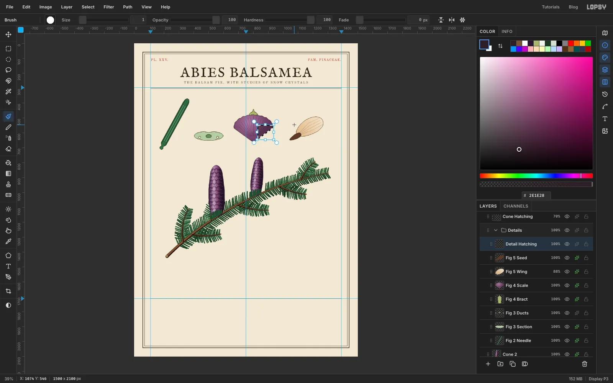

1. Add a layer called `Fig 5 Wing`. Lasso a smooth, rounded paddle shape tilted up to the right, centred at about (1150, 590). Fill it with a linear gradient from `#D9B98C` at the seed end to `#EFE0C4` at the tip.
2. Paint four faint veins (`#7A5636`, **Size 2**, **Opacity 50**) along the wing. Add a **Stroke** of Width 2 in sepia, and set the layer to **88%** opacity so it reads as papery.
3. Add a layer called `Fig 5 Seed` and lasso a small dark oval (`#5A3A2A`) at the wing's lower end. Give it an ink Stroke.
4. Add a layer called `Detail Hatching`. **⌘-click** `Fig 4 Scale`, then **Shift+Alt**-drag a marquee over its lower-right lobe and **Feather** it by 6 px. That's the shadow side, ready for hatching.

## Hatch the details

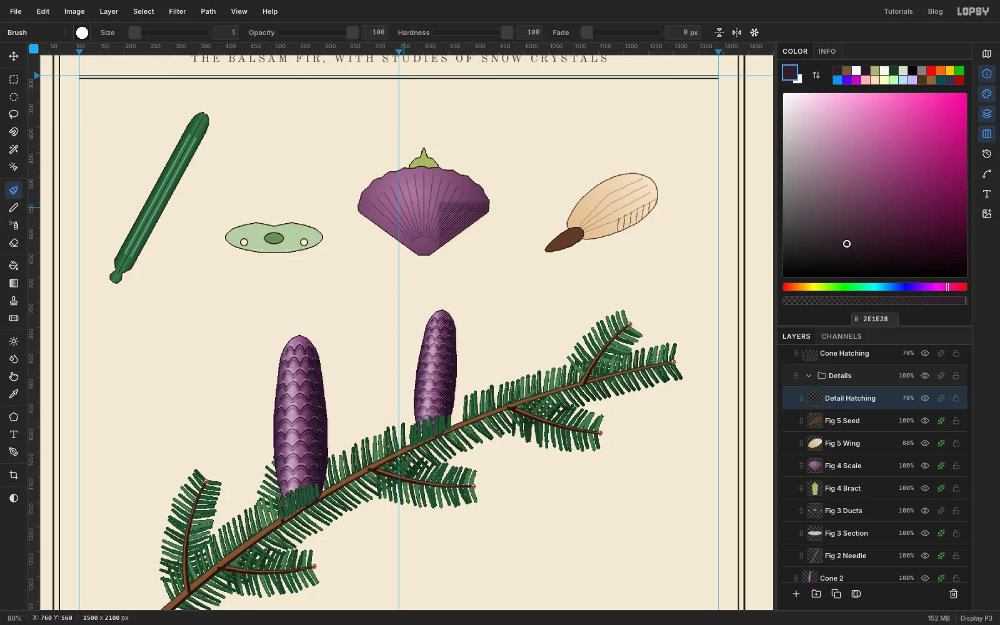

1. On `Detail Hatching`, hatch the selected lobe at 45° with a **Size 1** brush in `#2E1E28`, 5 px apart, as you did the cones.
2. **⌘-click** `Fig 5 Wing` and draw seven short hatch lines across the trailing edge of the wing.
3. Deselect, and set the layer to **Multiply** at **70%**.

## Make the microscope field

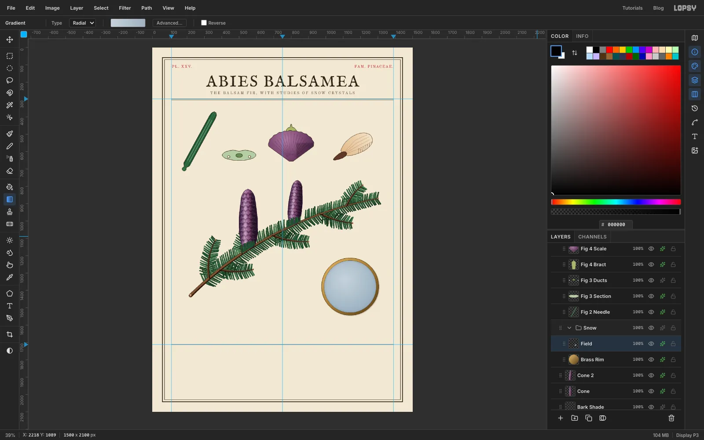

1. Select `Cone 2` and add a new group called `Snow`.
2. Inside it, add a layer called `Brass Rim`. Drag an **Elliptical Marquee** 328 px across, centred at about (1140, 1378). Fill it with a linear gradient from `#C9A45E` (top left) through `#B08D4A` to `#6E5427` (bottom right).
3. Give the rim a **Stroke** of Width 2 in brass shadow `#4A3518`, and a light **Drop Shadow** (offset 3, blur 6, opacity 25%).
4. Add a layer called `Field` and select a 300 px circle on the same centre. Fill it with a **radial** gradient from `#C8D2DB` to `#9EAFBE`, starting a little above and left of the centre.
5. Add a Width 1 Stroke in `#4A3518`, and a faint **Inner Glow** in `#4A5A6A` at Size 24 and 30% opacity.

## Start the crystal with Radial Symmetry

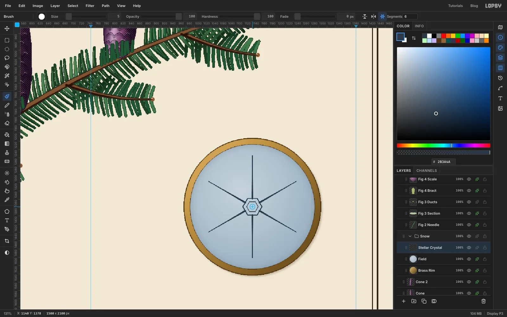

Snow crystals have six-fold symmetry, so draw one sixth and let the brush copy it.

1. Add a layer called `Stellar Crystal` and pick the **Brush**.
2. Click **Radial Symmetry** in the options bar and set **Segments** to **6**.
3. **⌘-click** the centre of the field to move the symmetry centre there.
4. Set the colour to `#2B3A4A`. With a **Size 3** brush, draw one straight edge of a small hexagon about 23 px above the centre. Draw a second, fainter edge inside it at **Size 2**. The other five edges appear as you draw.
5. At **Size 5** with **Taper 150**, draw one arm straight up from the hexagon, about 120 px long. Five copies appear around it.

## Branch the arms

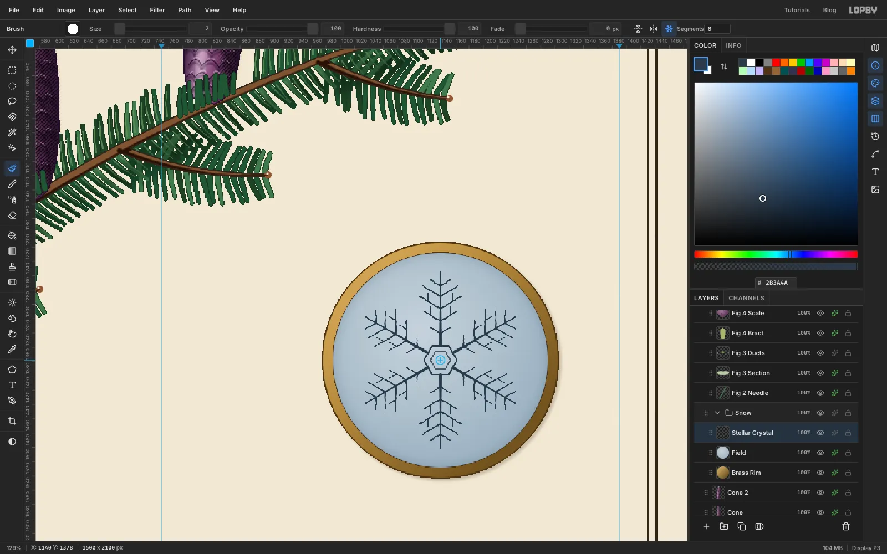

Side branches on a real crystal run parallel to the neighbouring arms, so they leave the arm at 60°.

1. Set the brush to **Size 3** and **Taper 40**. Add five pairs of side branches up the arm, at 60° to either side. Make them longest in the middle (about 36 px) and shortest near the centre and the tip (about 17 px).
2. At **Size 2**, add a small twig pointing outward from the middle of each of the two longest branches.

Every stroke you make on one arm lands on all six.

## Draw the small crystal figures

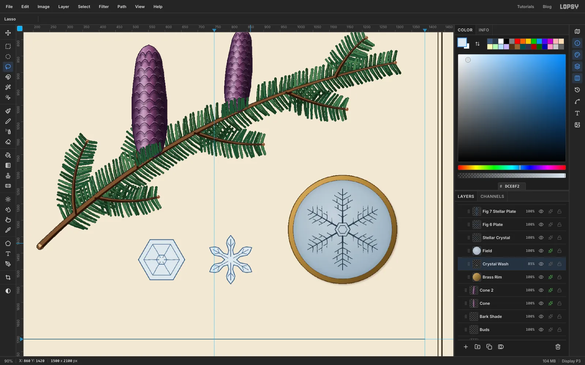

Symmetry is still on, so these take only a few strokes each.

1. **Fig. 6, a hexagonal plate:** add a layer called `Fig 6 Plate` and **⌘-click** at (590, 1470) to move the symmetry centre there. In `#3D5A80` at Size 3, draw the top edge of a hexagon about 140 px across. At Size 2, add a smaller inner edge, a spoke from the centre to a corner, and a tiny centre hexagon.
2. **Fig. 7, a stellar plate:** add a layer called `Fig 7 Stellar Plate` and **⌘-click** at (800, 1470). Draw the outline of one broad arm about 74 px long with click and Shift+click lines. Shape it like a leaf on a short stem, joining the next arm near the centre. Add a midrib and two short veins.
3. Click **Radial Symmetry** again to turn it off, so ⌘-click goes back to normal.
4. Select `Brass Rim`, add a layer called `Crystal Wash`, and lasso-fill both figures' outlines with `#DCE8F2`. Set the layer to **85%** opacity.

## Cut the specimen tag

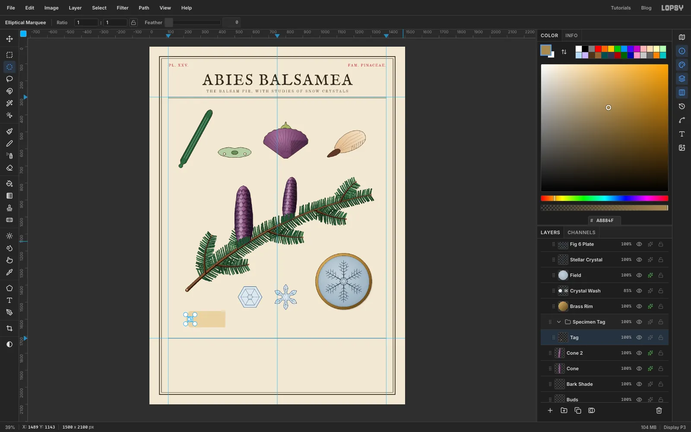

Draw the tag level first and turn it at the end.

1. Select `Cone 2`, add a group called `Specimen Tag` and a layer called `Tag` inside it.
2. Lasso a 230 × 96 px tag with its two left corners clipped, centred at about (330, 1600). Fill it with `#E6D3A8`.
3. **Eyelet:** select a 22 px circle near the left end and fill it with `#A8884F`. Choose **Select → Shrink…** by **4 px** and press **Delete** to punch the hole.

## Letter the tag

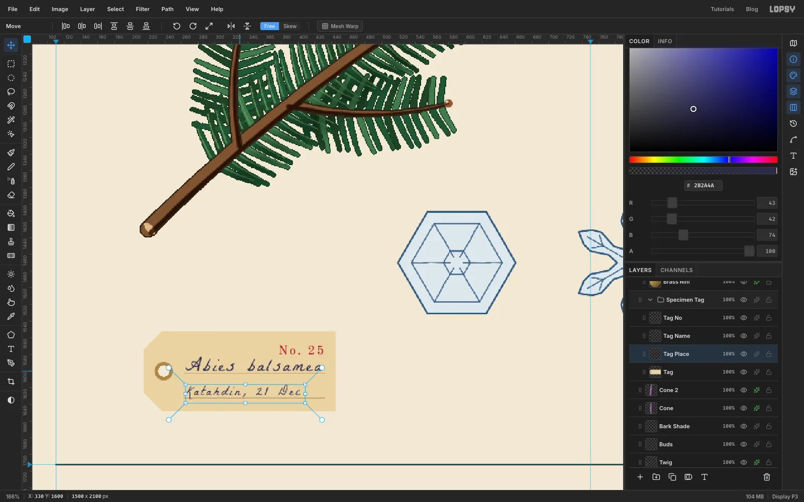

1. With the **Pencil** at **Size 1** in `#B79C72`, draw two ruled lines across the tag, 30 px apart.
2. Click `Tag`. Add `No. 25` in Old Standard TT, 15 px, crimson, right-aligned near the top-right corner, and rename it `Tag No`.
3. Click `Tag` again. Type `Abies balsamea` in **La Belle Aurore** at 22 px, colour `#2B2A4A`, above the first rule. Rename it `Tag Name`.
4. Click `Tag` again and type `Katahdin, 21 Dec.` at 16 px above the second rule. Rename it `Tag Place`.
5. Now nudge each line until it sits just on its rule. Type both lines before moving either one: a click near an existing line of text edits that line.

## Turn the tag

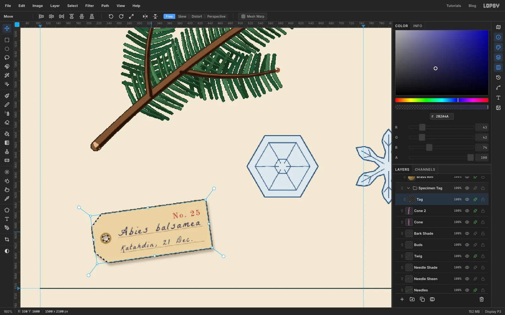

1. Select `Tag Place`, the text layer just above `Tag`, and choose **Layer → Merge Down**. Do the same for `Tag Name` and then `Tag No`, until all the lettering is part of `Tag`.
2. Give `Tag` a sepia **Stroke** at Width 2 and a soft **Drop Shadow** (offset 3, 5; blur 6; 30%).
3. **⌘-click** the `Tag` thumbnail. With the **Move** tool, drag a rotation handle to turn the tag about 8° counter-clockwise, then press **⌘D**.

## Wrap the string round the twig

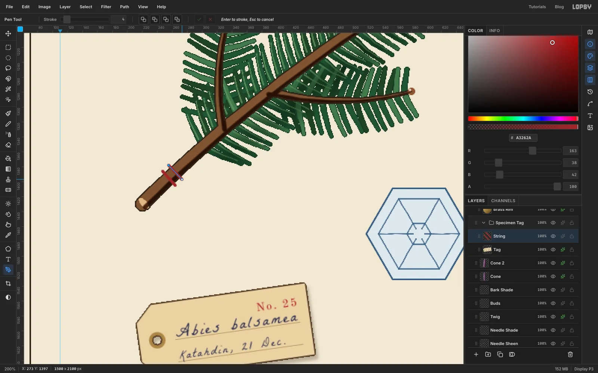

1. Add a layer called `String`. Set the colour to crimson `#A3262A`, pick the **Pen** tool and set **Stroke** to **4** in the options bar.
2. Zoom in on the cut end with **⌘-scroll**. You need to see the anchors clearly.
3. Click once on one side of the twig near the cut end, click again on the other side, and press **Enter**. Enter adds the path and strokes it in the foreground colour.
4. Make a second wrap the same way, 12 px further along.

## Tie the bow and hang the tag

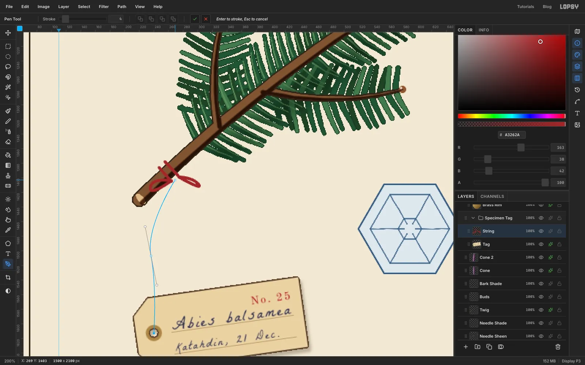

The last path you drew stays selected, and a click on one of its anchors edits it. So start each new path a few pixels away from the last one's anchors.

1. **Bow:** for each loop, click just below the twig, drag out a curved anchor about 34 px to one side, then click back on the first anchor to close it. Press **Enter**.
2. **Tail:** click the eyelet, drag a sagging anchor halfway up, click just under the knot, and press **Enter**. Add one short loose end the same way.
3. Open the **Paths** panel and click the highlighted path to deselect it, so its outline stops showing.
4. Give `String` a small **Drop Shadow** and choose **View → Fit to Screen**.

## Number the figures

1. Select the `Title` layer, add a group called `Lettering`, and add a layer called `Leaders` inside it.
2. Click `Leaders` before each numeral. Add `1` to `8` in **Old Standard TT** at **26 px**, ink, center-aligned, and rename each one (`Fig 1`, `Fig 2` and so on).
3. Put `2`, `3`, `4` and `5` on one shared baseline about 30 px below the lowest figure in the row, each centred under its figure.
4. Put `1` just left of the cut end. Put `6`, `7` and `8` on one baseline under the snow row.

## Key the cross-section

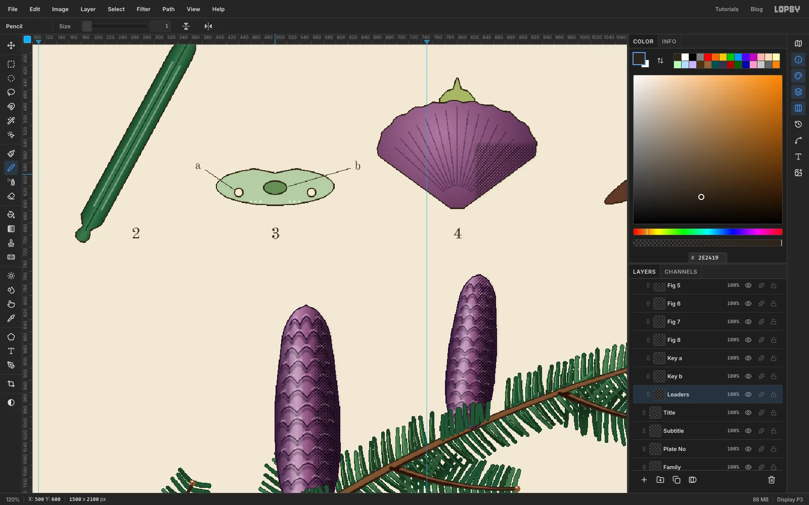

1. Click `Leaders`, then add a small `a` (20 px) to the left of the cross-section. Click `Leaders` again and add a `b` to its right.
2. Select `Leaders`. With the **Pencil** at **Size 1**, click next to each letter and **Shift+click** on the part it names. The `a` points to a resin duct and the `b` to the central strand.

## Write the greeting

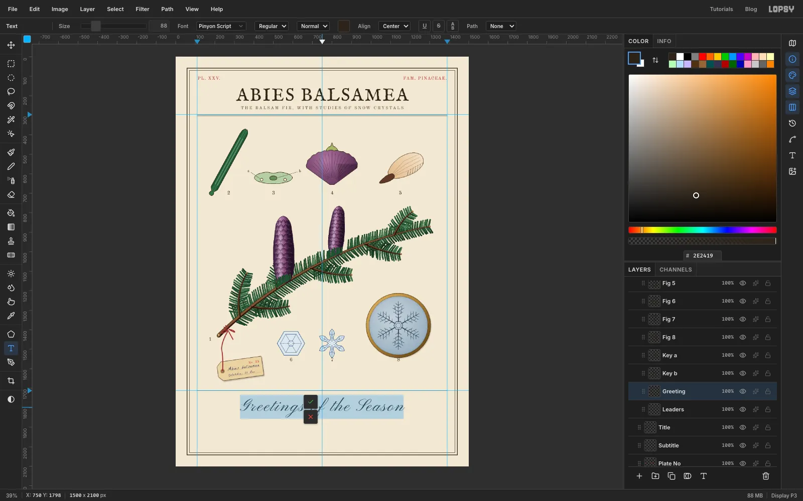

1. Click `Leaders`. Pick **Pinyon Script** at **88 px**, center-aligned, in ink. Click on the centre guide below the footer rule and type `Greetings of the Season`, then press **Tab**. Rename the layer `Greeting`.
2. Nudge it so its tallest swash sits 35 px below the footer rule.
3. Click into the greeting with the **Text** tool and press **⌘A** to select every letter. Set the colour to crimson `#A3262A` and press **Tab**.

## Add the key, footer and margin note

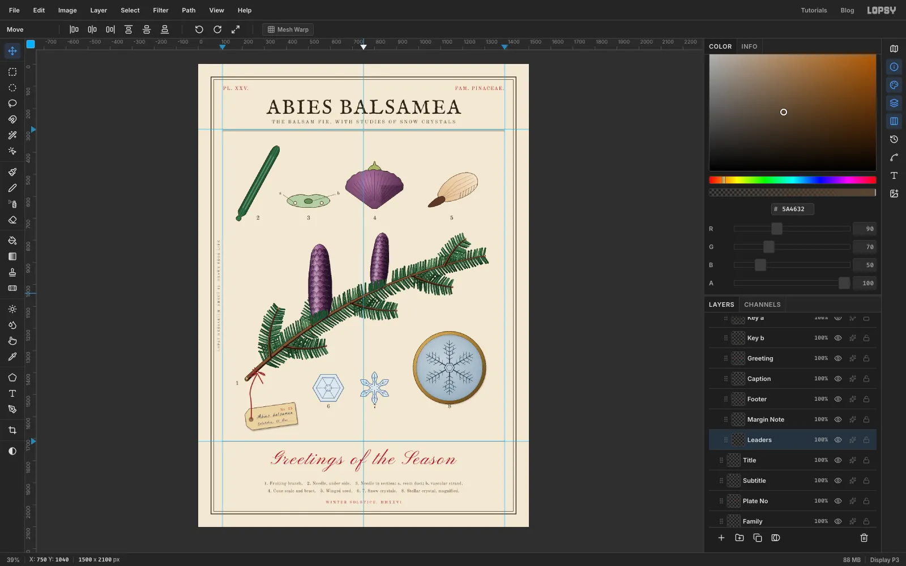

Start each new line well away from any existing text, for example over the empty middle of the branch, then nudge it into place. A click inside the greeting's text box would add to the greeting.

1. **Key:** click `Leaders`. In **Old Standard TT**, 19 px, `#5A4632`, center-aligned, type the first line, press **Return**, and type the second:
   - `1. Fruiting branch.   2. Needle, under side.   3. Needle in section: a, resin duct; b, vascular strand.`
   - `4. Cone scale and bract.   5. Winged seed.   6, 7. Snow crystals.   8. Stellar crystal, magnified.`
2. In the **Text** panel, set **Letter spacing** to **1** and **Line height** to **1.8**. The panel keeps the last spacing you used, so check it. Nudge the key so its top sits about 45 px under the greeting.
3. **Footer:** click `Leaders`, then type `WINTER SOLSTICE, MMXXVI` in Old Standard TT at 16 px, crimson, letter spacing 5. Centre it about 35 px under the key.
4. **Margin note:** click `Leaders`, then type `LOPSY HERBARIUM  SHEET 25  DRAWN FROM LIFE` at 13 px in sepia, letter spacing 4. Pick the **Move** tool and click **Rotate 90° CCW** in the options bar. The text turns and stays editable. Nudge it into the left margin, centred on the frame's height.

## Age the paper

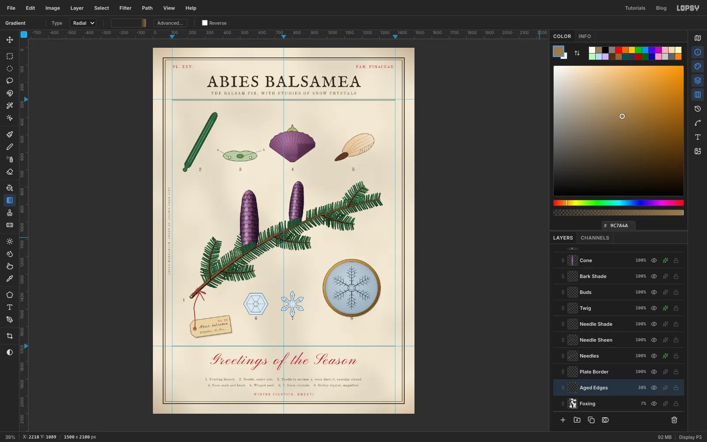

1. Select `Background` and add a layer called `Foxing`. Set the colour to `#9C7A4A` and run **Filter → Clouds…** at **Scale 6**.
2. Run **Filter → Gaussian Blur…** at **60 px** to melt the clouds into soft stains, then **Filter → Add Noise…** at **3**, **Mono**.
3. Set the layer to **Multiply** at **7%** opacity. Keep it subtle.
4. Add a layer called `Aged Edges`. Make a **radial** gradient that stays transparent until the 86% point and ends in `#8E6E42`. Drag from the centre of the page to a corner, and set the layer to **Multiply** at **30%**.

## Add grain and balance the snow row

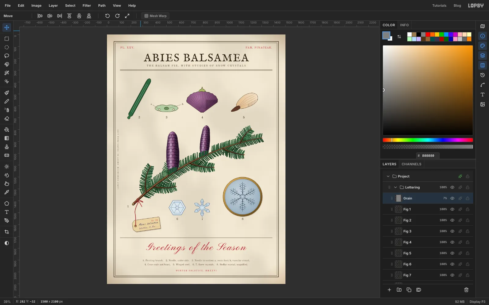

1. Select the `Lettering` group and add a layer called `Grain`. It lands inside the group, which is fine. Fill it with `#808080` and run **Add Noise…** at **14**, **Mono**, **Gaussian**. Set it to **Overlay** at **7%**, so everything looks printed on the same sheet.
2. Step back and look at the bottom margin. The roundel's shadow sits a little close to the footer rule. Select the `Snow` group in the Layers panel, pick the **Move** tool, and press **Shift+↑** once and **↑** twice. The whole group, roundel and crystals together, rises 12 px.
3. Turn off **View → Show Guides** and choose **File → Quick Export PNG**.
