Baroque painters loved to punch a hole in the ceiling. Mantegna painted a
round opening onto the sky above a room in Mantua, with a balustrade seen
from directly below. Later, Pozzo and Tiepolo filled whole vaults with clouds
and light. The trick is called *di sotto in sù*, "seen from below". It works
because everything points at one spot overhead: the balusters, the light and
the birds.

In this tutorial you'll make **Quiet Zenith**, a 1200 × 1680 px cover for an
imaginary zine about looking up. The painted oculus sits in a dark vault with
gilded rays. Swifts spiral into a golden glory, and clouds spill over a stone
rail. A gold masthead arches over the top, and the cover lines sit in a
scrolled cartouche.

The swifts come from a real photo:
[Pallid swift (in flight)](https://commons.wikimedia.org/wiki/File:Pallid_swift_(in_flight).jpg)
by Hobbyfotowiki on Wikimedia Commons, released under **CC0** (no rights
reserved). Any photo of a swift or swallow against a clear blue sky works the
same way.

Along the way you'll use:

- the **Gradient** tool (radial and linear) with stops typed into the Gradient Editor, plus **Clouds**, **Sunburst**, **Voronoi**, **Add Noise**, **Hue/Saturation** and **Gaussian Blur**
- the **Brush** with **Radial Symmetry** and **Symmetry Vertical**, and [[Shift]]-click straight lines
- pasting a photo, the **Magic Wand**, **Grow** and **Feather**, and scaling and rotating with the **Move** tool
- **Duplicate Layer**, **Group Layers**, **New Group** and **Rename**
- the **Elliptical Marquee** with its exact-corners dialog, the **Rectangular Marquee**, [[Alt]] to subtract, and [[Cmd]]-clicking thumbnails to load a layer's shape
- **Shrink**, **Grow**, **Edit → Fill** and **Delete** to cut rings and keylines
- the **Pen** tool, **Text** on a path in Cinzel Decorative, and Marcellus SC and Monsieur La Doulaise for the cover lines
- layer effects (**Inner Glow**, **Outer Glow**, **Drop Shadow** and **Stroke**) and the **Multiply**, **Screen** and **Overlay** blend modes
- ruler guides, **Snap to Guides**, **Align center horizontally**, and undo and redo

The palette:

- Vault `#4E2A1F` → `#2C1712` → `#140A07`, stucco gold `#C99A45`
- Sky `#FFFDF2` → `#FFEDB8` → `#F3CB8C` → `#A7C6E4` → `#4F84C2` → `#24508F`
- Clouds `#7F84B4` / `#CFC6E0` / `#FFF3DA`, glory `#FFE7A6`
- Stone `#9A7F5E`, lit stone `#F4E2BC`, plinth `#8A6A48` → `#1E130B`
- Gilt `#FFF2B8` → `#E8BC5C` → `#9C6A1E` → `#D9AE55` → `#FBE29A`
- Moulding `#5A3A10` / `#E2B04A` / `#A87620` / `#EDC566`, beads `#C8952F`
- Type gold `#EFCF7A`, cover line `#E6C57C`, kicker `#F0D08A`, cream script `#F4E6C6`, small print `#D2AA66`
- Cartouche `#1E0E0A`, frame gold `#D4AA55`, keyline `#8C6A2E`, bead channel `#3A2306`

## Paint the dark vault

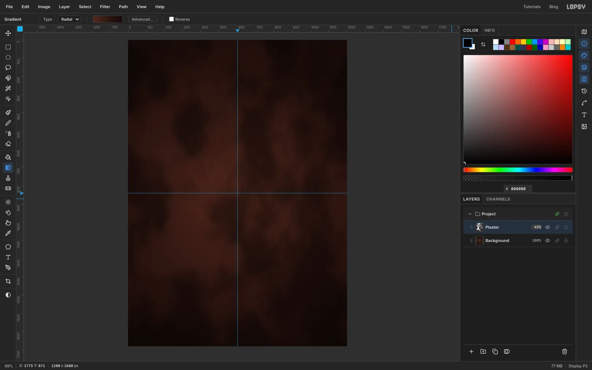

Create a new document **1200 × 1680 px** with a **White** background. Show
the rulers, then click the top ruler at **600** and the left ruler at **840**
to drop two guides. They cross at the centre of the oculus, and almost every
circle in this tutorial is centred there.

Click the **Background** layer. Choose the **Gradient** tool, set **Type** to
**Radial** and click **Advanced…**. In the Gradient Editor, make three stops:
`#4E2A1F` at the left end, `#2C1712` about halfway and `#140A07` at the right
end. Click a stop and type its colour into the **Hex** field. Click **Done**,
then drag from the guide crossing out past the right edge of the canvas.

Now click **Layer 1**, the empty layer a new White document starts with, and
rename it **Plaster** (double-click its name). Choose
**Filter → Clouds…**, set **Scale** to **7** and click **Apply**. Open
the layer's effects drawer (the ✦ button on its row), set **Blend** to
**Multiply**, and set the row's opacity to **45%**. The vault now has the
blotchy look of old painted plaster.

## Paint the sky in the oculus

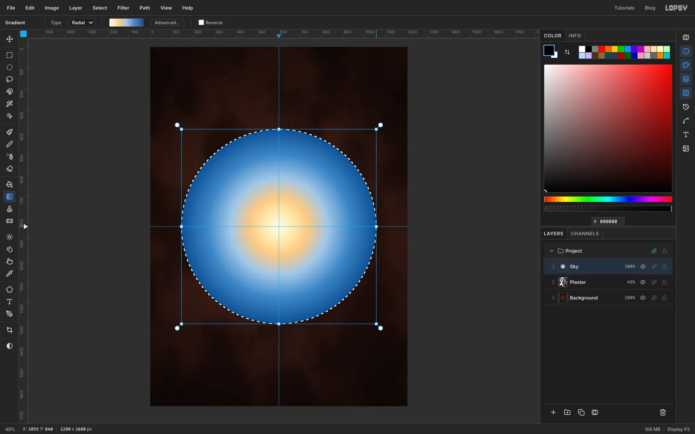

Click **Add Layer** and name the new layer **Sky**. Choose the **Elliptical
Marquee**. With nothing selected, click once on the canvas without dragging
to open the **Elliptical Selection** dialog. Enter **From** 145, 385 and
**To** 1055, 1295, then click **OK**. That gives a 910 px circle centred on the
guides.

Set up a radial gradient with six stops: `#FFFDF2` at 0%, `#FFEDB8` at 14%,
`#F3CB8C` at 30%, `#A7C6E4` at 50%, `#4F84C2` at 74% and `#24508F` at 100%. To
add a stop, click the gradient bar where you want it. Drag from the centre of
the circle to its right edge. The small cream core will become the glory, and
the deep blue rim will show between the balusters later.

Press [[Cmd+D]] to deselect.

## Block in the cloud shadows

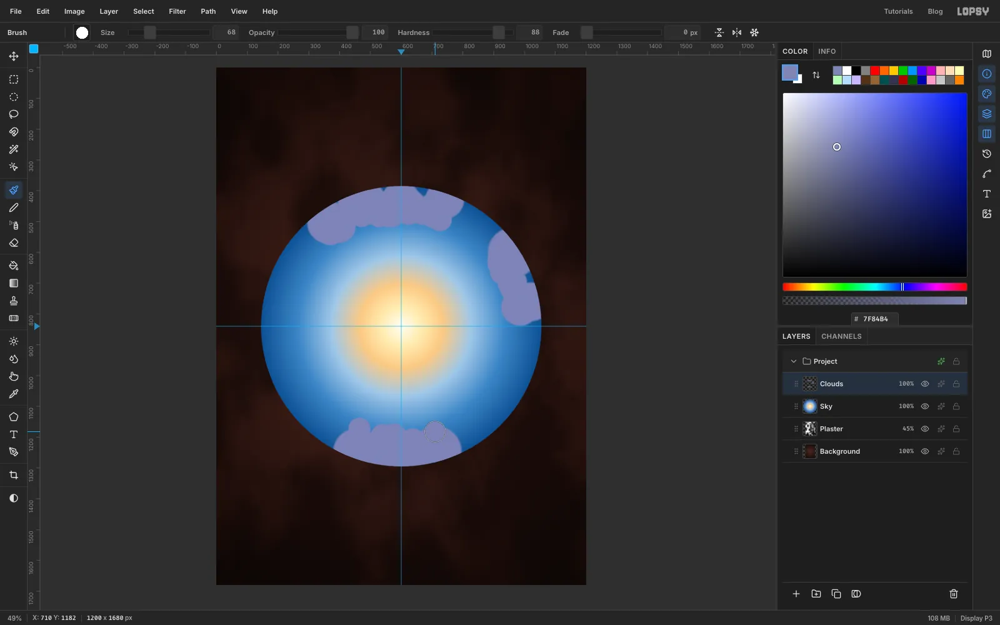

Add a layer named **Clouds**. Select the same circle again with the dialog
(145, 385 to 1055, 1295). The brush only paints inside a selection, so no cloud
can spill onto the vault.

Choose the **Brush**, set **Hardness** to **88** and **Opacity** to **100**, and
set the foreground colour to `#7F84B4`. This is the shadow colour of the
clouds. Click (don't drag) overlapping dabs to build three banks against the
rim: a long one across the top, a short one at about half past two, and one at
the bottom.

Use three brush sizes. Put the biggest dabs (about **150 px**) right against
the rim, then a row of **110 px** dabs a little further in, then **76 px**
dabs on the inside. Vary the sizes and spacing slightly so no two puffs line
up.

Press [[Cmd+D]].

## Light the clouds from the zenith

[[Cmd]]-click the **Clouds** thumbnail to select its shape. Add a layer named
**Clouds Light**. Anything you paint now stays inside the clouds, so their
outline stays crisp.

The light comes from the centre, so each puff's lit side faces the middle of
the circle:

1. Set the colour to `#CFC6E0` and **Hardness** to **82**. On every puff, click
   a dab about **90%** of its size, nudged slightly toward the centre.
2. Set the colour to `#FFF3DA` and **Hardness** to **92**. Click a smaller dab,
   about two-thirds of the puff's size, nudged further toward the centre.

The lilac shadow is left showing only on the side away from the light. Press
[[Cmd+D]].

## Add the glory

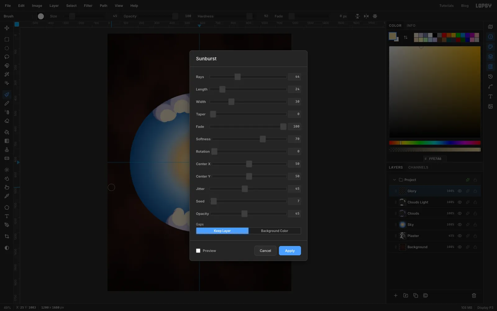

Add a layer named **Glory** and set the foreground colour to `#FFE7A6`.
Choose **Filter → Sunburst…** and set:

- **Rays** 44, **Length** 24, **Width** 30
- **Fade** 100, **Softness** 70
- **Jitter** 45, **Seed** 7
- **Opacity** 45

Leave **Center X / Y** at 50 / 50, the middle of the document and the centre
of the oculus. Click **Apply**, then set the layer's blend mode to **Screen**.
The rays brighten the sky without ever darkening it.

## Paste in the swift photo

Click the **Glory** layer so the photo lands above it. Crop the swift photo
loosely around the bird in any image viewer (mine was about 570 × 940 px),
copy it, and press [[Cmd+V]] in Lopsy. It arrives at the top-left corner as **Pasted
Layer**, already selected. Press [[Cmd+D]] and rename the layer **Swift**.

## Cut out the swift with the Magic Wand

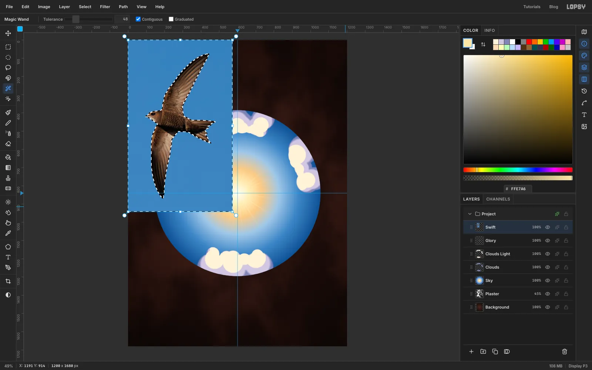

Choose the **Magic Wand**, set **Tolerance** to **48**, and click the blue sky
in the photo. Choose **Select → Grow…** with **1 px**, then
**Select → Feather…** with **1 px**, so the cut takes the blue fringe with it
and leaves a soft edge rather than a stair-stepped one. Press [[Delete]], then
[[Cmd+D]].

## Darken the swift against the light

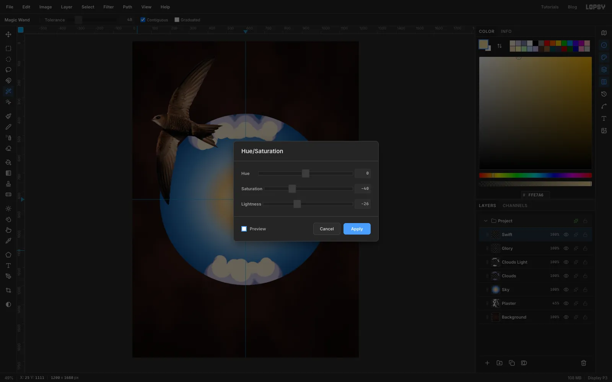

A bird flying in front of the sun is mostly silhouette. Choose
**Filter → Hue/Saturation…**, set **Saturation** to **−40** and **Lightness**
to **−26**, and click **Apply**. The feathers still show, but the bird now
reads dark against the glory.

## Shrink the swift

First turn off **View → Snap to Guides**. With it on, a marquee edge drawn
near the centre guide jumps onto it and can cut off a wing tip, which is then
left behind when you scale or rotate the bird.

Draw a **Rectangular Marquee** just around the bird and switch to the **Move**
tool. Hold [[Cmd]] (so the bird keeps its proportions) and drag the
bottom-right handle toward the top-left until the bird is about **29%** of its
size, roughly 230 px from wing tip to wing tip. Press [[Cmd+D]] to commit the
scale.

## Turn it onto its flight path

Draw a new marquee around the small bird. With the **Move** tool, hover just
outside the top-right corner of the box until the cursor turns into a rotate
arrow. Drag clockwise to turn the bird about **64°**, so its head points along
a clockwise circle. Press [[Cmd+D]].

Drag the bird into the sky to about one o'clock, just inside the oculus.
Then open its effects drawer and add an **Outer Glow** in `#FFE2A0`, **Size**
10, **Opacity** 70, as a thin rim of backlight.

## Build the flock

Swifts seen from below look smaller the higher they fly. Arrange the flock as
a spiral that climbs into the glory. For each new bird:

1. Click **Swift** and click **Duplicate Layer**. Click the copy's row (so you
   move the copy, not the original) and rename it **Swift 2**, **Swift 3** and
   so on.
2. Marquee the copy, then [[Cmd]]-drag a corner to shrink it. Press [[Cmd+D]].
3. Marquee it again, rotate it so it flies clockwise around the circle, and
   press [[Cmd+D]].
4. Drag it into place.

Each copy starts as an exact twin of the first bird, so turn it a further
amount clockwise to keep it flying round the circle:

- **Swift 2**: about 195 px wing to wing, turned 78°, at three o'clock about
  235 px from the centre
- **Swift 3**: about 160 px, turned 124°, at five o'clock about 195 px out
- **Swift 4**: about 130 px, turned 200°, at seven o'clock about 155 px out
- **Swift 5**: about 105 px, turned 250°, at nine o'clock about 115 px out
- **Swift 6**: about 85 px, turned 315°, at eleven o'clock about 80 px out

Each bird is a little smaller and closer to the centre than the one before. The
copies keep the Outer Glow.

## Group the flock

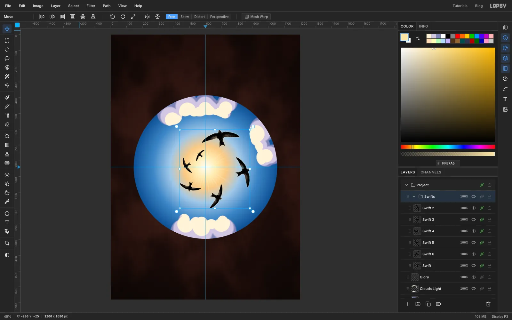

Every copy landed above the original, so **Swift 2** is at the top of the stack
and **Swift** at the bottom. Click **Swift 2**, [[Shift]]-click **Swift**, and
choose **Layer → Group Layers**. Rename the group **Swifts** and collapse it
with its arrow.

## Lay the stone plinth

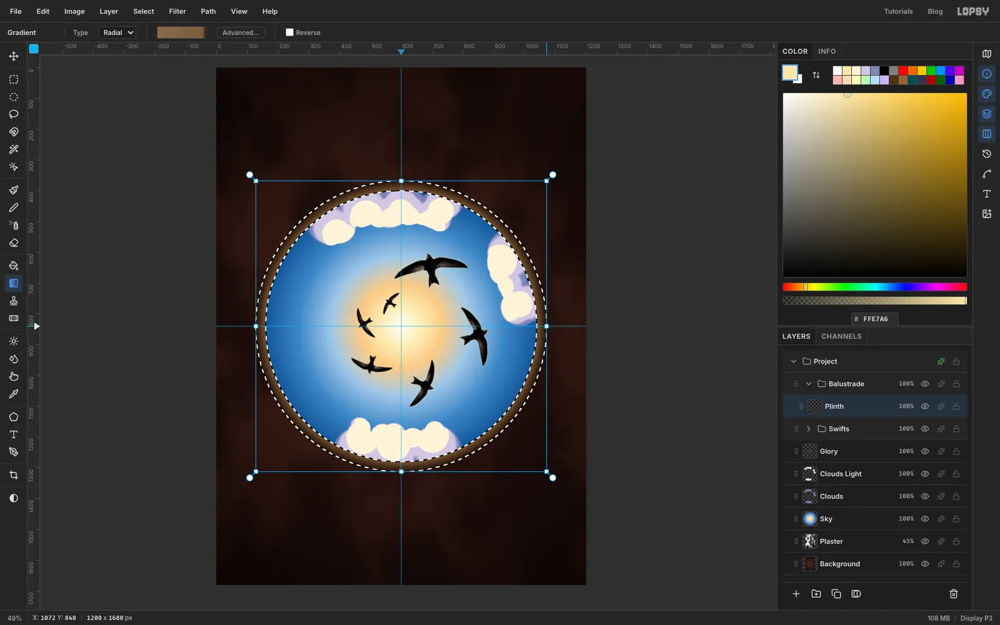

With the collapsed **Swifts** group selected, click **New Group** at the
bottom of the Layers panel and name it **Balustrade**. Click **Add Layer**
inside it and name the layer **Plinth**.

Use the Elliptical Selection dialog for a circle from **128, 368** to
**1072, 1312**. Then hold [[Alt]] and drag a second circle from about
**160, 400** to **1040, 1280** to cut out the middle. Zoom in for the
[[Alt]]-drag and watch the X/Y readout in the status bar so each edge lands
within a pixel or two. You now have a 32 px ring.

> **Tip:** For an exact ring, fill the whole outer circle first, press
> [[Cmd+D]], open the dialog again for the inner circle and press [[Delete]].
> Every ring in this tutorial can be cut either way.

Fill it with a radial gradient dragged from the centre to the ring's outer
edge: `#8A6A48` at 0%, `#7A5C3E` at 93%, `#3E2A1A` at 97% and `#1E130B` at
100%. Press [[Cmd+D]].

## Paint one baluster and get thirty-two

Add a layer named **Balusters**. Choose the **Brush** with **Hardness** 100,
**Opacity** 100 and the colour `#9A7F5E`. In the options bar, click
**Radial Symmetry** and set **Segments** to **32**. The symmetry centre starts
at the middle of the canvas, which is the oculus centre.

Now paint one baluster straight up the vertical guide. Each mark is repeated
round the circle:

- **Size 40**: click at y **388**, then [[Shift]]-click at y **408** (the foot)
- **Size 46**: click at y **430** (the belly)
- **Size 38**: click at y **446**, then **Size 28** at y **458** (the taper)
- **Size 14**: click at y **460** and [[Shift]]-click at y **480** (the neck)
- **Size 24**: click at y **483** (the collar)
- **Size 28**: click at y **486** and [[Shift]]-click at y **498** (the cap)

Seen from below, the foot is nearest you and the cap points up toward the sky.
Turn **Radial Symmetry** off.

## Model the balusters

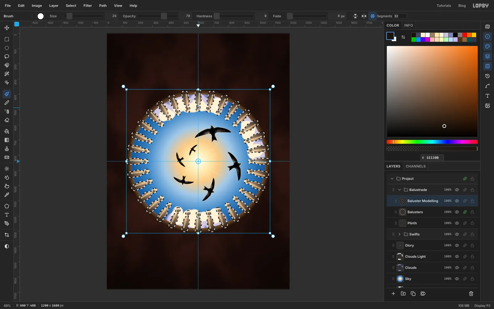

[[Cmd]]-click the **Balusters** thumbnail and fill the selection with a radial
gradient from the centre outward: `#F4E2BC` at 0%, `#F0DCB2` at 74%, `#B4946C`
at 86% and `#3A2A1E` at 100%. Drag it out to about 455 px. The stone is now
lit where it is nearest the sky. Press [[Cmd+D]].

In the effects drawer, add an **Inner Glow** in `#3B281B` (**Size** 7,
**Opacity** 70) to round the edges, and an **Outer Glow** in `#1A0F08`
(**Size** 8, **Opacity** 35) as a contact shadow against the sky.

[[Cmd]]-click the thumbnail again and add a layer named **Baluster Modelling**.
Turn **Radial Symmetry** back on with **32** segments, set **Hardness** to 0,
and paint on the baluster that sits on the vertical guide:

- a light streak in `#FFEFC8` (**Size** 16, **Opacity** 60), [[Shift]]-clicked
  from just right of the foot to just right of the cap
- a cool shadow streak in `#3E4462` (**Size** 14, **Opacity** 50) down the
  left side
- one dark dab in `#1E130B` (**Size** 26, **Opacity** 70) where the cap meets
  the rail

Turn symmetry off and press [[Cmd+D]].

## Add the handrail

Add a layer named **Handrail**. Select a circle from **256, 496** to
**944, 1184**, then [[Alt]]-drag a circle from **300, 540** to **900, 1140** to
leave a ring 44 px thick.

Fill it with a radial gradient from the centre to the ring's outer edge:
`#F6E8C8` at 0% and at 87%, `#DCC296` at 90%, `#8A6C4C` at 94% and
`#3A281A` at 100%. The inner lip catches the light and the underside, which
faces you, sinks into shadow. Press [[Cmd+D]].

Add a **Drop Shadow** in `#2A1A10` with **Offset X** 0, **Offset Y** 0,
**Blur** 10 and **Opacity** 55, so the rail casts a soft shadow onto the
balusters and the sky.

## Let clouds spill over the rail

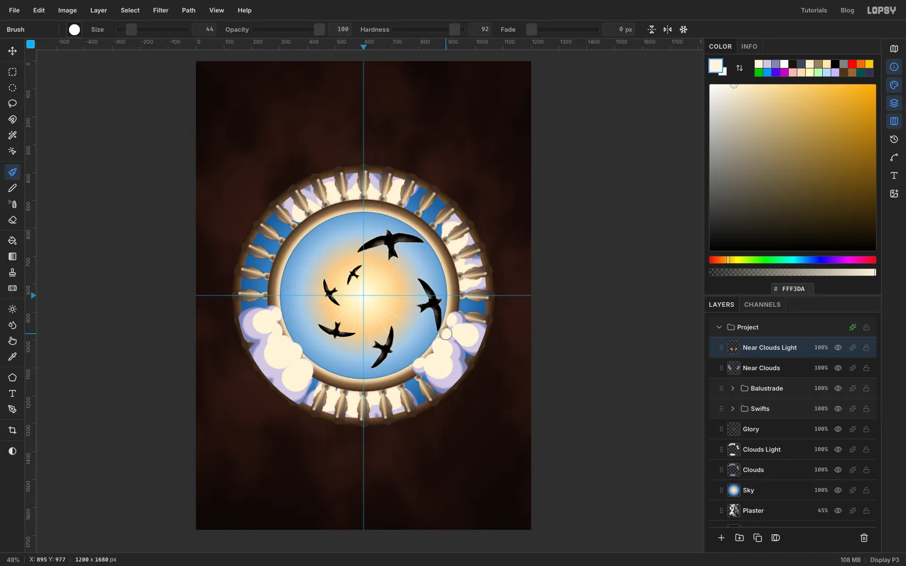

Baroque clouds never stay politely behind the architecture. Collapse the
**Balustrade** group and select it, then add a layer named **Near Clouds**
above it.

Paint two masses exactly as before: select the sky circle (145, 385 to
1055, 1295), block in `#7F84B4` dabs, [[Cmd]]-click the thumbnail, then light
them on a **Near Clouds Light** layer with `#CFC6E0` and `#FFF3DA`. Put one
mass at about **four o'clock** and one at about **eight o'clock**. Let them
reach from the rim right across the balusters and over the rail.

## Gild the moulding

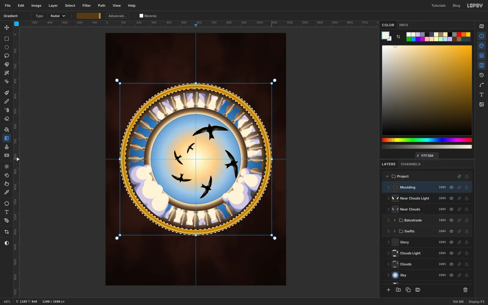

Click **Near Clouds Light** and add a layer named **Moulding**. Select a circle
from **95, 335** to **1105, 1345**, then [[Alt]]-drag a circle from
**132, 372** to **1068, 1308**.

Fill the ring with a radial gradient from the centre to its outer edge, using
stops close together so that they fall inside the ring:

- `#5A3A10` at 0% and at 93%
- `#E2B04A` at 94%
- `#A87620` at 96%
- `#EDC566` at 98%
- `#4A2F0C` at 100%

That gives two rounded gold bands with a groove between them.

Keep the selection. Add a layer named **Gilt Light** and drag a **Linear**
gradient across the ring from its top-left to its bottom-right: `#D2D2D2`,
`#808080` in the middle and `#404040`. Set the layer to **Overlay**, so the
gold brightens at the top-left and darkens at the bottom-right as if lit by a
window. Press [[Cmd+D]].

## Add the bead-and-reel

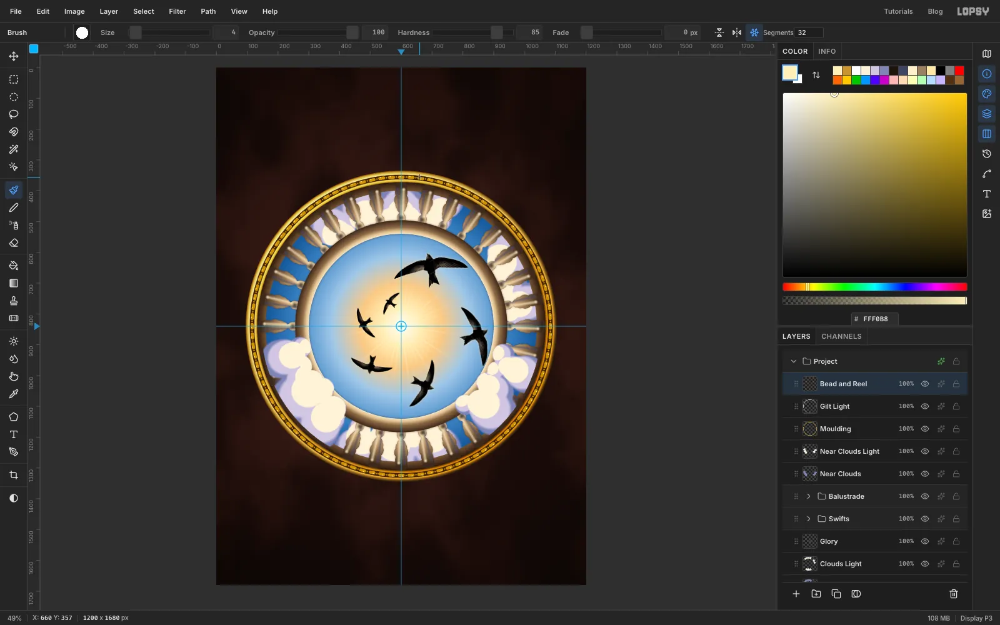

Add a layer named **Bead and Reel**. Select a circle from **108, 348** to
**1092, 1332**, [[Alt]]-drag one from **123, 363** to **1077, 1317**, fill the
thin ring with `#3A2306`, and press [[Cmd+D]].

Choose the **Brush** (**Hardness** 85) and turn **Radial Symmetry** on with
**32** segments. At twelve o'clock on that dark channel, paint three beads, one
reel between each pair, and a highlight on each bead:

1. **Beads**: `#C8952F`, **Size** 11. Click and [[Shift]]-click a short line
   about 12 px long, running along the ring. Make two more, about 32 px apart,
   going clockwise.
2. **Reels**: still `#C8952F`, **Size** 6. Click a dot halfway between each
   pair of beads.
3. **Highlights**: `#FFF0B8`, **Size** 4. Click one dot near the outer edge of
   each bead.

Symmetry turns those three beads into 96 round the whole ring. Turn it off.

## Lift the moulding off the vault

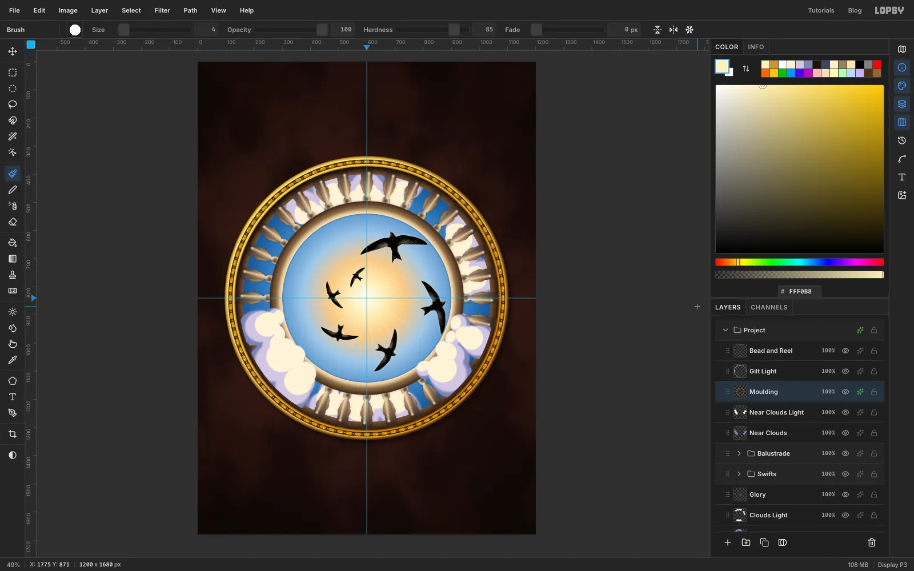

Select **Moulding** and add a **Drop Shadow** in `#0C0503` with
**Offset X** 6, **Offset Y** 10, **Blur** 22 and **Opacity** 75. The gilt ring
now stands proud of the plaster.

## Add gilded stucco rays to the vault

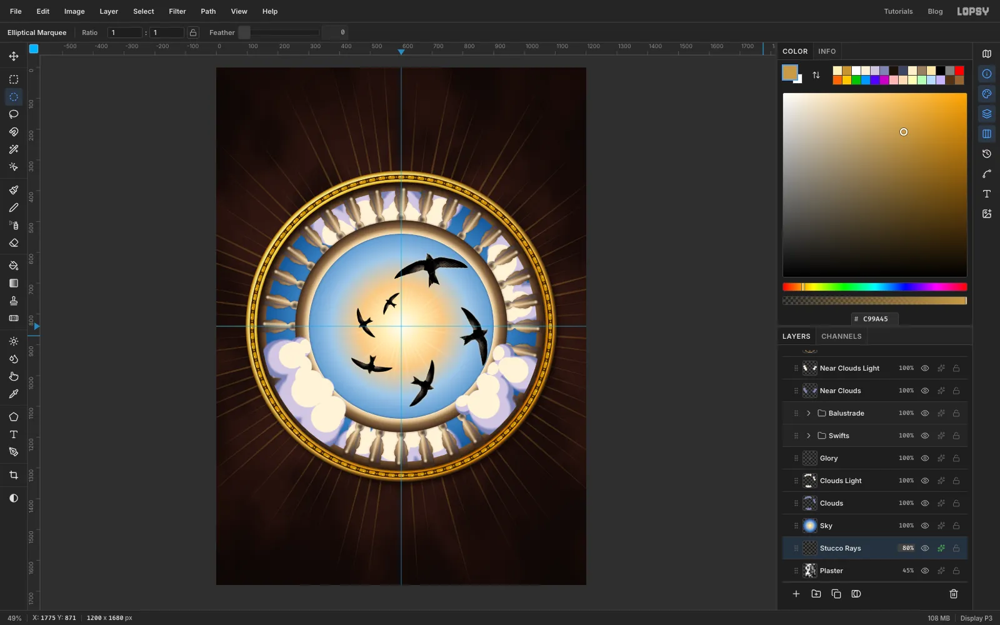

Click **Plaster** and add a layer named **Stucco Rays**, so the rays sit on
the vault under everything else. Set the foreground to `#C99A45` and open
**Sunburst** again:

- **Rays** 96, **Length** 92, **Width** 22
- **Taper** 100, so every ray comes to a point
- **Fade** 85, **Softness** 20
- **Jitter** 35, **Seed** 21
- **Opacity** 70

Click **Apply**. Clear the rays out of the oculus: select a circle from
**99, 339** to **1101, 1341** and press [[Delete]], then [[Cmd+D]].

Add a small **Drop Shadow** in `#0C0503` (**Offset** 2 / 3, **Blur** 3,
**Opacity** 60) so the rays look raised, and set the layer to **80%**
opacity.

## Frame the page with a double keyline

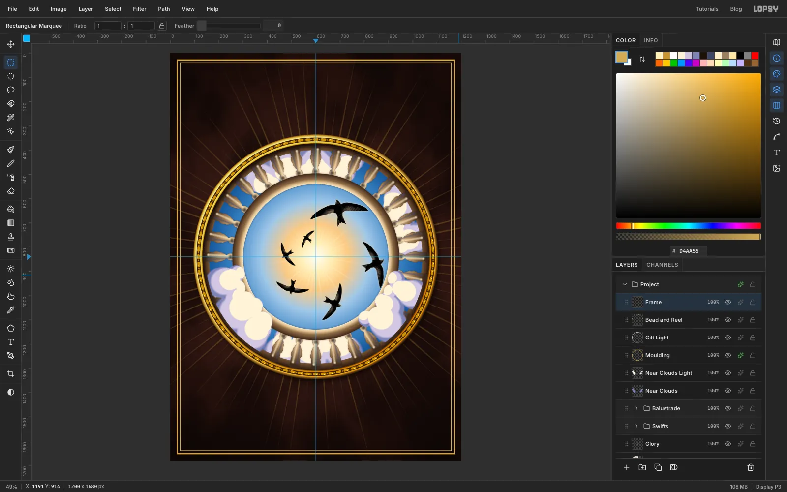

Click **Bead and Reel** and add a layer named **Frame**. Set the colour to
`#D4AA55`.

1. Draw a **Rectangular Marquee** 26 px in from every edge (26, 26 to
   1174, 1654).
2. Choose **Edit → Fill**, then **Select → Shrink…** by **5 px**, and press
   [[Delete]]. That leaves a 5 px rule.
3. Repeat with a marquee 40 px in from the edges and **Shrink** by **2 px**
   for a thin inner rule.
4. Press [[Cmd+D]].

## Set the masthead

Click **Frame** so the type lands above it. Choose the **Text** tool and set
the font to **Cinzel Decorative**, **Bold**, **96 px**, in `#EFCF7A`. Click in
an empty spot near the top-left and type **QUIET ZENITH**, then press
[[Tab]] to commit. Rename the layer **Masthead**, and in the **Text** panel set
**Letter spacing** to **4**.

## Draw the arc for the masthead

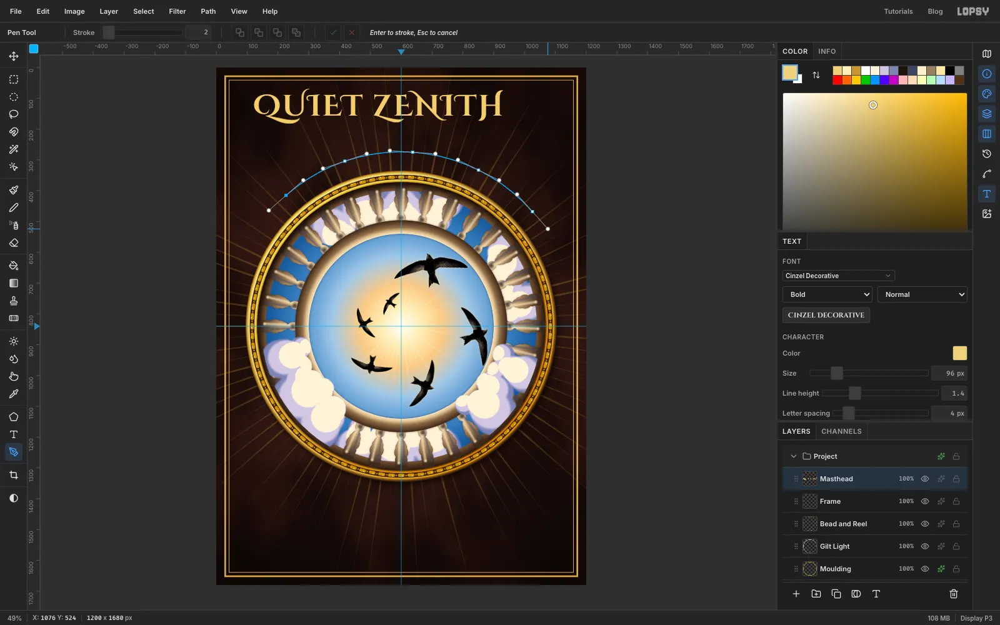

The masthead follows a circle 566 px from the oculus centre, which keeps it
about 60 px clear of the moulding all the way round.

Choose the **Pen** tool and click-drag five anchors along that circle, pulling
each anchor's handle about 75 px along the direction of the curve:

1. **230, 412**, just above the moulding at about ten o'clock
2. **422, 303**
3. **642, 276**, a little right of twelve o'clock
4. **856, 335**
5. **1030, 472**, at about two o'clock

The path runs a little past the end of the text, which is what you want. Click
the **✓** button to commit the path.

## Put the masthead on the arc

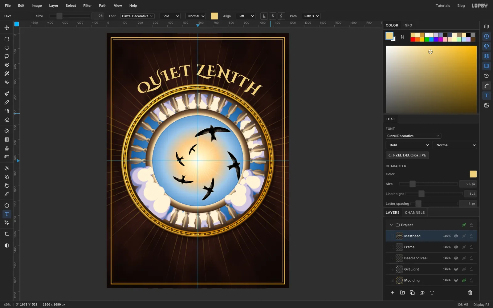

Select the **Masthead** layer, choose the **Text** tool and pick your path
from the **Path** dropdown in the options bar. The text now runs along the arc
from the path's start.

If the word isn't centred over twelve o'clock, draw a new arc that starts a
little earlier or later and pick that one instead. The Q's long swash makes
the word look heavy on the left, so I started mine about 1.5° (15 px along
the arc) later than the point that centres the letters exactly. Judge it by
eye: the Q and the H should look equally far from the moulding.

## Cut the cartouche

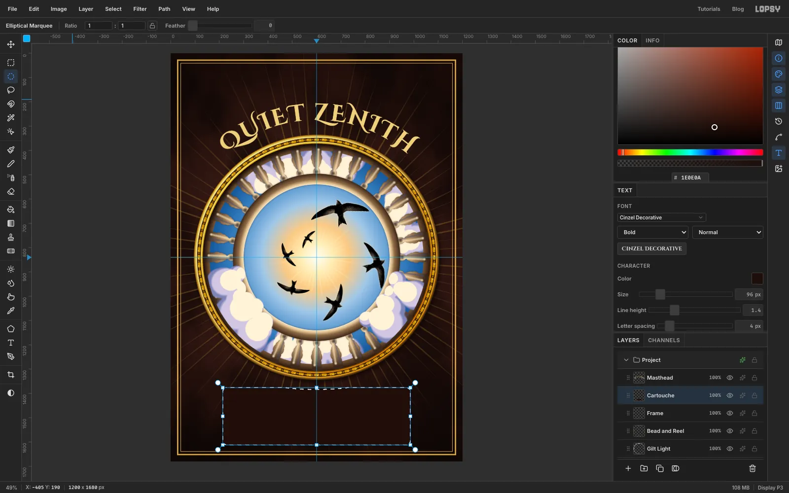

Click **Frame** and add a layer named **Cartouche**.

1. Draw a **Rectangular Marquee** from **214, 1376** to **986, 1612**.
2. Choose **Select → Shrink…** by **16 px**, then **Select → Grow…** by
   **16 px**. Growing a shrunk rectangle gives it rounded corners.
3. Hold [[Alt]] and drag a wide, shallow ellipse that dips only about 8 px
   into the middle of the top edge (roughly 300, 1220 to 900, 1384). That
   gives the panel a concave top.
4. Fill it with `#1E0E0A` and press [[Cmd+D]].

Add a **Stroke** in `#D4AA55`, **Width** 3, and a **Drop Shadow** in
`#050201` (**Offset Y** 8, **Blur** 18, **Opacity** 70).

## Paint the scrolls with mirror symmetry

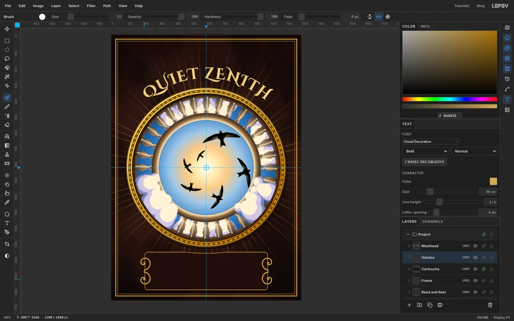

Add a layer named **Volutes**. Choose the **Brush** (**Hardness** 100,
**Size** 7, `#D4AA55`) and click **Symmetry Vertical** in the options bar.
Everything you paint on the left is mirrored across the centre guide.

At the left end of the panel, drag two spirals: one curling upward from the
middle of the panel's side, and one curling downward, each about 90 px across.
Then click a **Size 12** dot in the eye of each spiral. Turn the symmetry
off.

[[Cmd]]-click the **Volutes** thumbnail and drag a **Linear** gradient from
the top of the panel to its bottom with the gilt stops: `#FFF2B8`, `#E8BC5C`
at 35%, `#9C6A1E` at 62%, `#D9AE55` at 80% and `#FBE29A` at 100%. Press
[[Cmd+D]] and add a small **Drop Shadow** (**Offset** 2 / 3, **Blur** 3,
**Opacity** 70).

For an inner keyline, add a layer named **Keyline**. Draw a rectangle 12 px
inside the panel (226, 1388 to 974, 1600), **Shrink** and **Grow** it by
**8 px** to round the corners, and [[Alt]]-drag the same shallow ellipse 12 px
lower than before. Fill it
with `#8C6A2E`, **Shrink** by **1 px**, and press [[Delete]].

## Set the cover lines

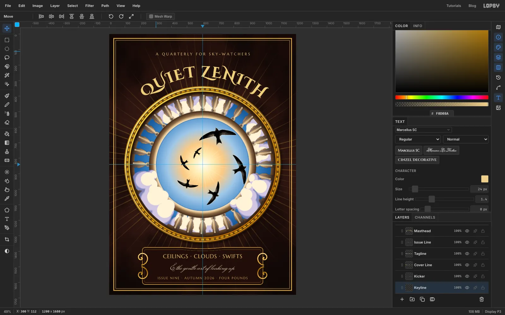

Set the type from the bottom up. A Text click within a few pixels of existing
type edits that type instead of starting a new layer, so placing the lowest
line first keeps every click clear.

Before each new line, click a non-text layer such as **Keyline**. The Text
options restyle whichever text layer is active, and the **Letter spacing** you
set carries over to the next line.

1. **Issue line**: **Marcellus SC**, **21 px**, `#D2AA66`, **Letter spacing**
   4. Type `ISSUE NINE · AUTUMN 2026 · FOUR POUNDS` just above the panel's
   bottom keyline.
2. **Tagline**: **Monsieur La Doulaise**, **52 px**, `#F4E6C6`, letter spacing
   0. Type `& the gentle art of looking up` in the middle.
3. **Cover line**: **Marcellus SC**, **36 px**, `#E6C57C`, letter spacing 2.
   Type `CEILINGS · CLOUDS · SWIFTS` about 30 px under the panel's top
   edge.
4. **Kicker**: **Marcellus SC**, **24 px**, `#F0D08A`, letter spacing 8. Type
   `A QUARTERLY FOR SKY-WATCHERS` near the top of the page, above the
   masthead.

Rename the four layers **Issue Line**, **Tagline**, **Cover Line** and
**Kicker** as you go. Centre each line with the **Move** tool's **Align center horizontally**
button, with nothing selected so it aligns to the canvas. Leave about 30 px
between the cover line and the script's tallest letters, and about 25 px
between the script's descenders and the issue line.

## Gild the masthead

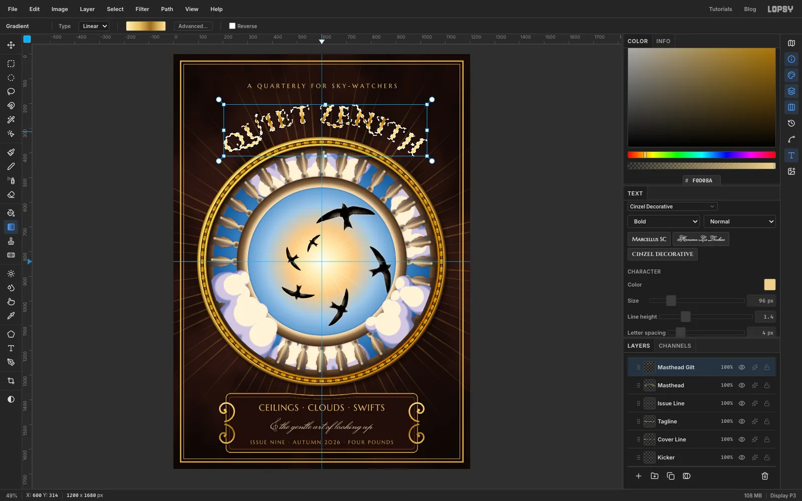

[[Cmd]]-click the **Masthead** thumbnail to select the letters, and add a layer
named **Masthead Gilt**. Drag a **Linear** gradient straight down from the top
of the letters, about 110 px long, with the same gilt stops as the scrolls.
Press [[Cmd+D]].

Add a **Drop Shadow** in `#080302` (**Offset** 3 / 6, **Blur** 8,
**Opacity** 85) and an **Outer Glow** in `#120805` (**Size** 14,
**Opacity** 65). The dark glow keeps the stucco rays from running into the
letters.

## Crack the plaster

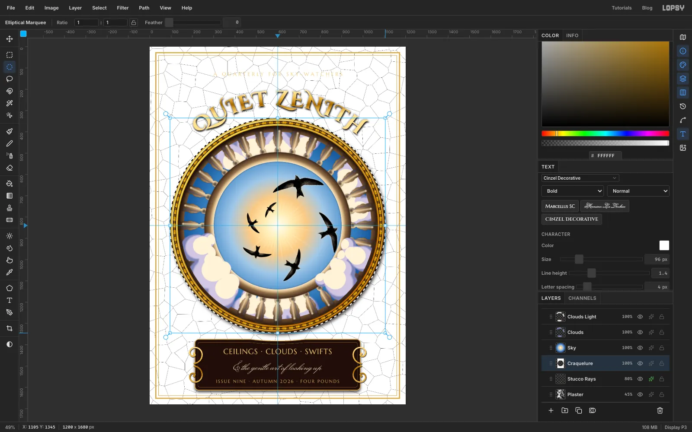

Old frescoes craze. Click **Stucco Rays** and add a layer named
**Craquelure**. Set the foreground to white, choose **Select → All**, then
**Edit → Fill**, and press [[Cmd+D]].
Choose **Filter → Voronoi…** with **Cells** 24, **Edge Width** 1 and
**Seed** 9. You get white cells with thin black edges.

The cracks belong on the vault, not in the sky. Select a circle from
**95, 335** to **1105, 1345** and press [[Delete]], then [[Cmd+D]]. Set the
layer to **Multiply** at **22%**. Because it sits under the moulding and the
cartouche, the cracks only show on the plaster.

## Add grain and a vignette

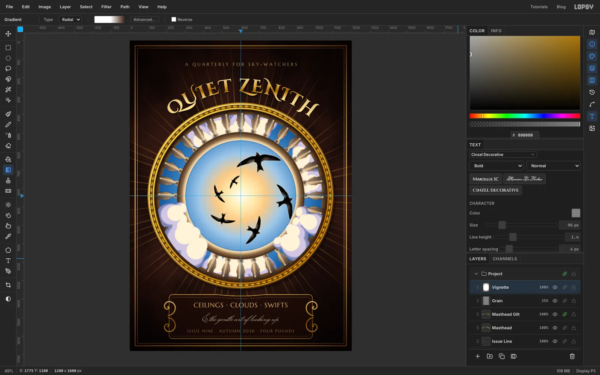

Click **Masthead Gilt** so the last two layers go on top of everything.

- **Grain**: add a layer, set the foreground to `#808080`, choose
  **Select → All** and **Edit → Fill**, press [[Cmd+D]], and run
  **Filter → Add Noise…** with **Amount** 40 and **Mono**. Set it to
  **Overlay** at **35%**.
- **Vignette**: add a layer and drag a radial gradient from the centre past
  the corners, with `#FFFFFF` at 0% and 55% and `#4A2C1E` at 100%. Set it to
  **Multiply**.

Hide the guides with **View → Show Guides**, then use
**File → Quick Export PNG** for the finished cover and **File → Save Project**
to keep the layers.
