In 1607 Claudio Monteverdi staged *L'Orfeo* in Mantua. It's the oldest opera still in the repertoire. Orpheus walks into the underworld to bring Eurydice back, and he's allowed to lead her out on one condition: he must not look back. He looks.

This tutorial makes the cover for **Underworld Tenor**, a made-up fanzine for people who still cry at early opera. The cover star is a real marble statue, Cristoforo Stati's *Orpheus* from around 1600. He's singing to the sky and playing a violin, the Baroque stand-in for a lyre. We cut him out of his museum photo and stand him in a gilt oval niche. Below the chest he dissolves into the fire of the underworld.

Baroque painters such as Caravaggio worked in *tenebrism*: a near-black room with one hard light on the subject. That's the plan here too:

- The wall goes almost black.
- A shaft of light from the upper left finds the face.
- Fire lights the statue from below.
- Everything gold is built from gradients, layer effects and an embossed copy, with no stock textures.

The document is **1200 × 1700 px**, roughly an A5 zine page.

The statue photo is free to use: [Orpheus, Cristoforo Stati, about 1600](https://commons.wikimedia.org/wiki/File:Orpheus_MET_DP246605.jpg), The Metropolitan Museum of Art, CC0. Download the 1280 px wide version.

The palette:

- Wall `#1E0B07` → `#140604`
- Fire `#F5A54A` → `#D9622A` → `#5A1410` → `#170C09`
- Frame gilt `#F6E3A6` → `#8E6224` → `#E9C877` → `#6A4616` → `#D8AF5E` → `#4E3210`
- Masthead gilt `#FBEBB4` → `#E2B65E` → `#9C6A22` → `#F2D489` → `#C8923C` → `#7A4E16`
- Pearls `#F6E7B8`, fillets `#2A1606`
- Ribbon `#F5E9CA` → `#E6D2A2` → `#C9AE74`, tails `#8A6A36` → `#5E4420`
- Script `#F0E4C8`, gold type `#C99A45`, kicker `#F2D58A`
- Deck ivory `#EBDDBF`, motto red `#7E1622`
- Wax `#A52430` → `#7E1622` → `#4E0A12`

Three habits keep things tidy:

- **New layers land directly above the active layer.** Before you add a layer, click the row it should sit on.
- **Commit transforms with [[⌘D]].** After you scale or rotate with the Move tool's handles, press [[⌘D]] to drop the selection and keep the result.
- **Effects and blend modes live behind the sparkle icon** on each layer row. Click it to open the Layer effects drawer. The opacity is the percentage on the row.

## Set up the page and guides

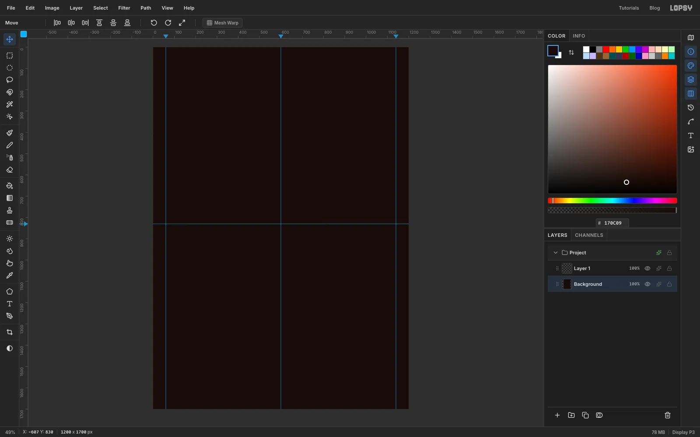

1. Create a **1200 × 1700** document.
2. A new document has an empty **Layer 1** above **Background**. Leave it where it is; it becomes the light shaft much later.
3. Click **Background**, set the foreground colour to `#170C09` and choose **Edit → Fill**. This is a near-black placeholder so you can judge the cut-out; the wall gets its final colour later.
4. Click the top ruler at **60**, **600** and **1140** to drop three vertical guides. These are the side margins and the centre line.
5. Click the left ruler at **830** to drop a horizontal guide. The oval niche will be centred where it crosses the middle guide.

## Drop in the statue

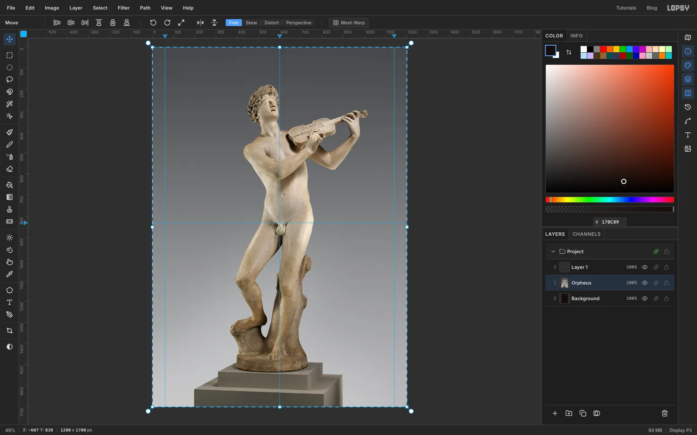

Drag the downloaded statue photo onto the canvas. Lopsy shrinks it to fit the page and puts it on a new layer. Double-click the layer name and call it **Orpheus**.

## Select the backdrop with the Magic Wand

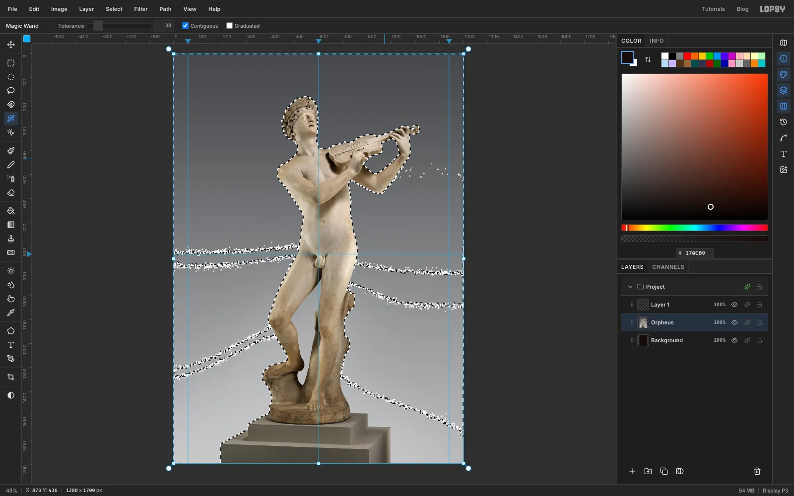

The backdrop is a smooth grey gradient, which makes the Magic Wand ([[W]]) the right tool.

1. In the options bar, set **Tolerance** to **30** and tick **Contiguous**.
2. Click the grey to the left of the statue near the top.
3. Hold [[Shift]] and click more grey to add to the selection: down the left side, down the right side, above the head, the gap between the face and the violin, and the small pocket of grey between the violin's neck and the raised right arm.

The gradient changes tone as it goes down, so you'll see a few dotted seams where one click's region stops and the next begins. The ones that matter are around the arms, and they disappear in the next step.

## Grow the selection and delete the backdrop

1. Choose **Select → Grow…**, set it to **2** and click **Apply**. Growing by 2 px swallows the thin seams and takes a sliver off the statue's grey edge.
2. Press [[Delete]], then [[⌘D]].

A few grey bands and the plinth are left at hip level and below. You're about to cut that whole area away, so leave them.

## Keep only the bust

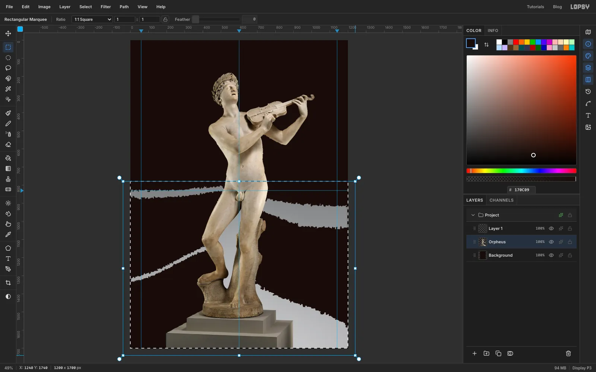

1. Press [[M]] for the Rectangular Marquee. Drag from just past the left edge of the page, a little below the navel, to past the bottom right corner.
2. Press [[Delete]], then [[⌘D]].

Only the head, arms, violin and chest are left. The fire will hide the cut edge later.

## Move and scale the bust

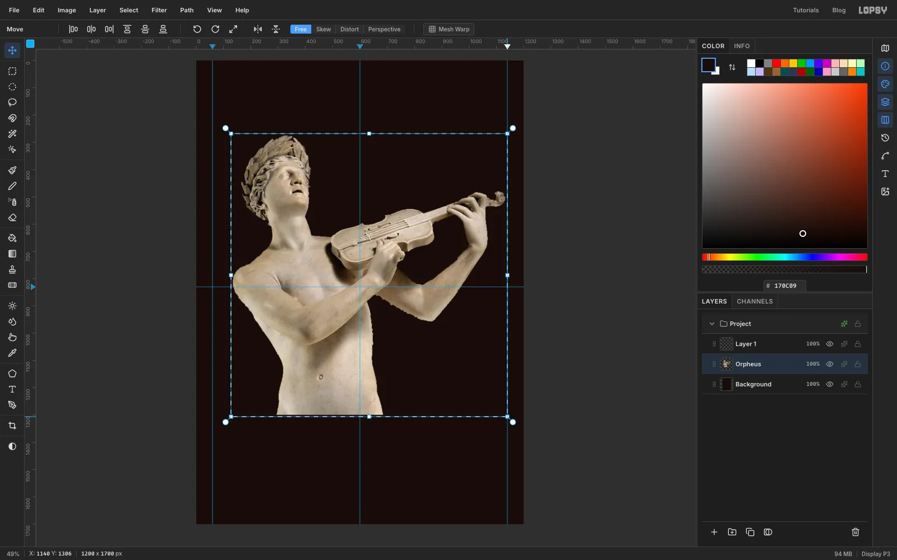

1. Press [[V]] and drag the bust left and down until the elbow sits about 130 px from the left edge and the laurel wreath about 270 px from the top.
2. Press [[M]] and draw a marquee just around the bust.
3. Press [[V]]. Hold [[⌘]] to scale evenly and drag the bottom right corner handle down and out until the violin's scroll reaches the right guide. The bust is now about 1000 px wide, roughly 1.7 times its size.
4. Press [[⌘D]] to commit the scale.

## Clean up the edges

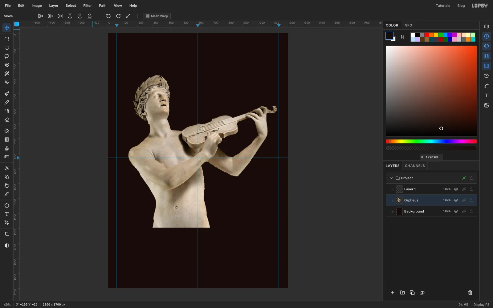

Scaling 1.7 times turns the wand's hard 1 px edge into visible steps, and a thin rim of the old grey backdrop is still clinging on. Shave it off and soften the edge:

1. `⌘`-click the **Orpheus** thumbnail to select the statue.
2. Choose **Select → Shrink…** and set it to **3**, then **Select → Feather…** and set it to **2**.
3. Choose **Select → Inverse**, press [[Delete]], then press [[⌘D]].

## Generate the fabric folds

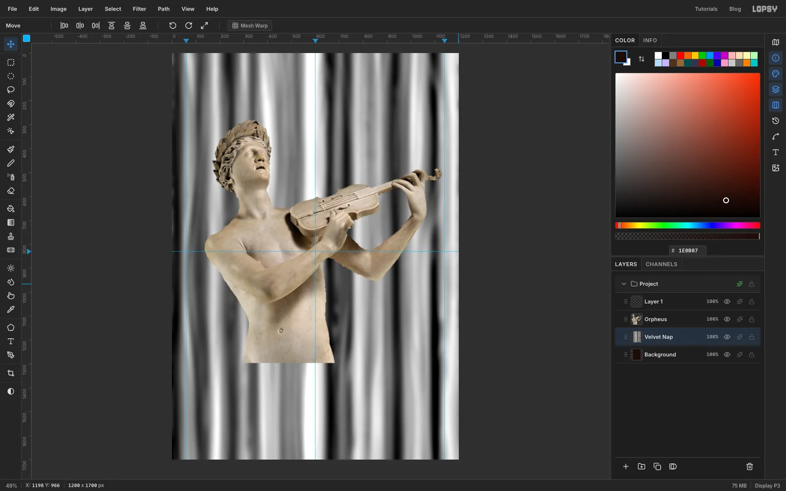

1. Click **Background**, set the foreground to `#1E0B07` and choose **Edit → Fill** again. This is the wall colour.
2. With **Background** still active, add a layer called **Velvet Nap**. It sits between the background and the statue.
3. Run **Filter → Fibers…** with **Variance** 64 and **Strength** 40.
4. Run **Filter → Gaussian Blur…** with **Radius** 30. Fibers on its own reads as wood grain; the blur turns the thin strands into broad curtain folds.
5. Run **Filter → Brightness/Contrast…** with **Contrast** 80 to bring the folds back up.

## Lay the folds over the wall

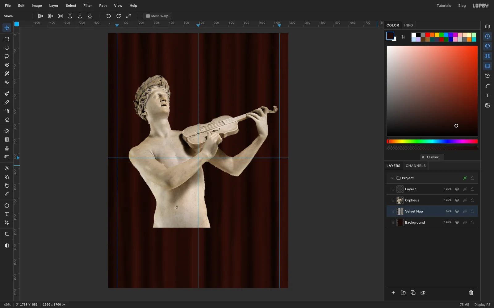

Open the layer effects drawer from the sparkle icon on **Velvet Nap**. Set **Blend** to **Overlay**, then set the layer opacity to **60%**. In Overlay, the grey folds only lighten and darken the red-brown wall, so it reads as velvet.

## Let the wall fall into darkness

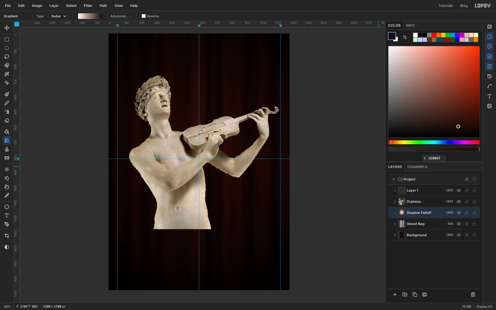

1. Add a layer called **Shadow Falloff** above **Velvet Nap**.
2. Pick the **Gradient** tool and set **Type** to **Radial**. Click **Advanced…** and set three stops: `#FFFFFF`, `#B89A8A` at 35% and `#140604`. Gradient stops stay in the editor between gradients, so delete any extras each time you start a new one.
3. Drag from a little above where the guides cross straight out to the right, past the edge of the page, about 980 px.
4. Set the layer to **Multiply**. White leaves the middle alone and the outer stops darken the wall toward the corners.

## Light the niche

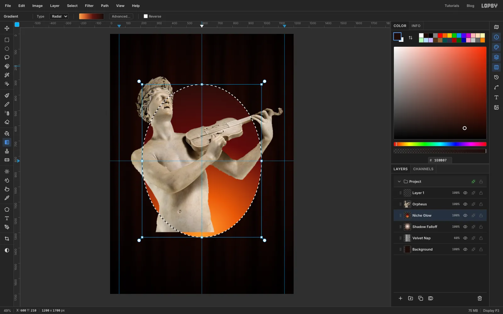

1. Click the **Elliptical Marquee**. With nothing selected, a single click on the canvas opens the exact-corners dialog. Enter X **210** to **990** and Y **330** to **1330**. That gives an oval 780 × 1000 px centred on the guide crossing.
2. With **Shadow Falloff** active, add a layer called **Niche Glow**.
3. Set a **Radial** gradient with stops `#F5A54A`, `#D9622A` at 22%, `#5A1410` at 55% and `#170C09`.
4. Drag from just inside the bottom of the oval straight up to above its top. The heat comes from below, where the underworld is.

## Add smoke to the fire

1. Keep the oval selected and add a layer called **Smoke**.
2. Run **Filter → Smoke…** with **Scale** 5 and **Turbulence** 70. It paints grey smoke inside the oval, and every run comes out different.
3. Set **Smoke** to **Overlay** at **70%** and press [[⌘D]].

## Select a ring for the frame

1. Click **Smoke** so the frame lands above it.
2. With the Elliptical Marquee, drag an oval 34 px bigger than the niche on every side, 848 × 1068 px with the same centre. The exact-corners dialog works too: X 176 to 1024, Y 296 to 1364.
3. Hold [[Alt]] and drag the niche's oval again, 210, 330 to 990, 1330, to cut the middle out. You're left with a 34 px ring.

## Gild the ring

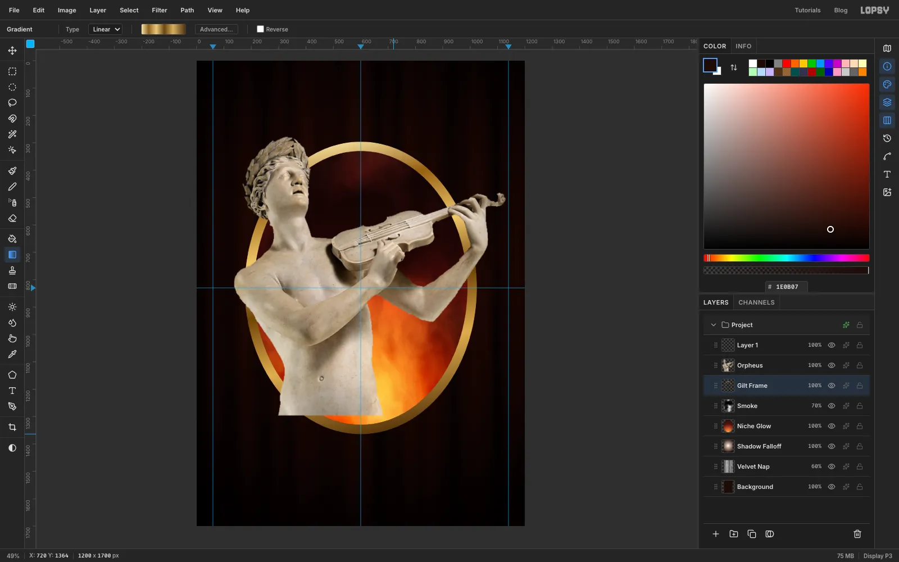

1. Add a layer called **Gilt Frame**.
2. Set a **Linear** gradient with six stops for polished metal: `#F6E3A6`, `#8E6224` at 16%, `#E9C877` at 34%, `#6A4616` at 52%, `#D8AF5E` at 72% and `#4E3210`.
3. Drag from just left of the ring's top to just right of its bottom, so the gradient runs slightly diagonally. The alternating bands read as reflections. Press [[⌘D]].

## Give the frame depth

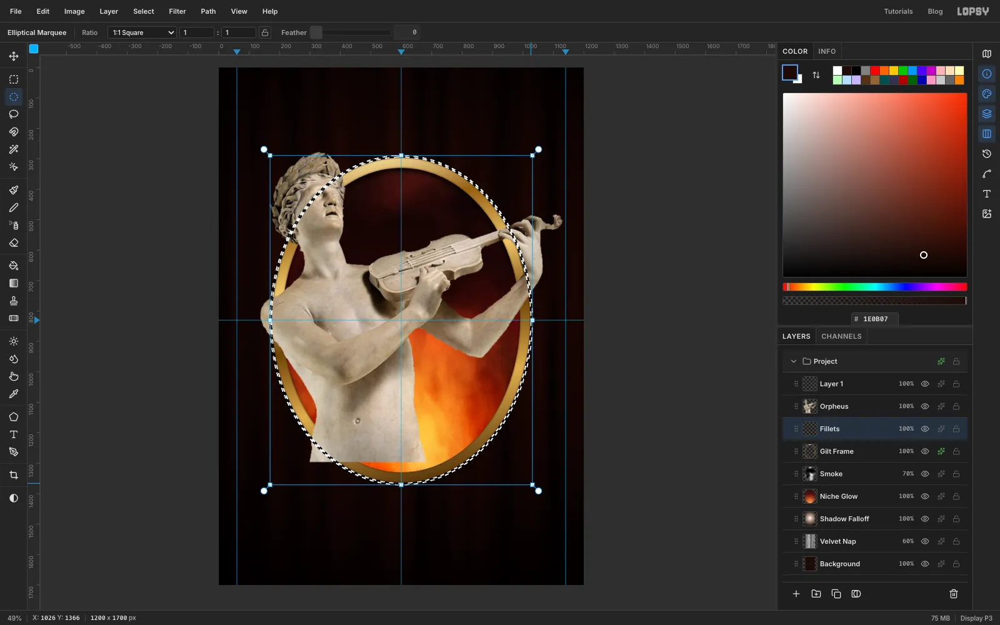

1. In **Gilt Frame**'s effects, turn on **Drop Shadow**: **Offset X** 0, **Offset Y** 12, **Blur** 22, **Opacity** 75, colour black.
2. Turn on **Inner Glow** in `#3A2208`, **Size** 7, **Spread** 25, **Opacity** 85. The dark inner glow rounds off the ring's edges like a moulding.
3. Add a layer called **Fillets**. These dark lines are the grooves that separate a carved frame from what's around it. With the Elliptical Marquee, drag four ovals, all centred on the guide crossing:
   - Drag from 207, 327 to 993, 1333 (3 px outside the niche edge).
   - Hold [[Alt]] and drag from 213, 333 to 987, 1327 to subtract the middle. That leaves a 6 px ring on the niche edge.
   - Hold [[Shift]] and drag from 169, 289 to 1031, 1371 to add an oval 7 px outside the frame.
   - Hold [[Alt]] and drag from 174, 294 to 1026, 1366 to hollow it into a second thin ring.
4. Set the foreground to `#2A1606`, choose **Edit → Fill**, and press [[⌘D]].

## Bead the frame with pearls

1. Add a layer called **Pearls**.
2. Press [[B]]. Open the brush settings and set **Size** 10, **Hardness** 80, **Opacity** 100% and **Spacing** 150%. A spacing above 100% turns a stroke into separate dots.
3. Set the foreground to `#F6E7B8`. Starting at the top, drag once round the middle of the ring until you're back where you started. The ring's centre line is an oval 814 × 1034 px around the guide crossing. Go slowly and evenly; if the beads wander off the ring, undo and try again.
4. Give **Pearls** a **Drop Shadow** of `#2A1606` with **Offset X** 2, **Offset Y** 3, **Blur** 3 and **Opacity** 80. Add an **Inner Glow** of `#7A5420` with **Size** 3 and **Opacity** 70 so each bead looks round.

## Carve the gilt with an embossed copy

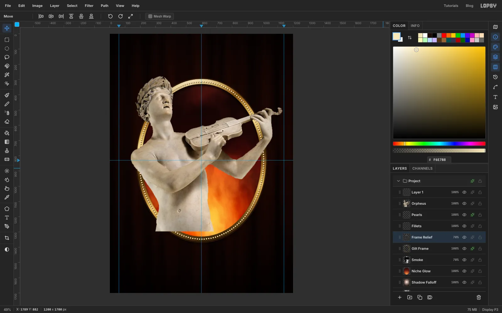

1. Click **Gilt Frame**, draw a rectangular marquee around the whole oval, and press [[⌘C]] then [[⌘V]]. The copy lands in place as a new layer. Call it **Frame Relief** and press [[⌘D]].
2. Run **Filter → Emboss…** with **Angle** 135 and **Strength** 4, then **Filter → Desaturate**.
3. Set **Frame Relief** to **Overlay** at **70%**. The grey relief only adds light and shade, so the gold stays gold.

## Turn the statue back into marble

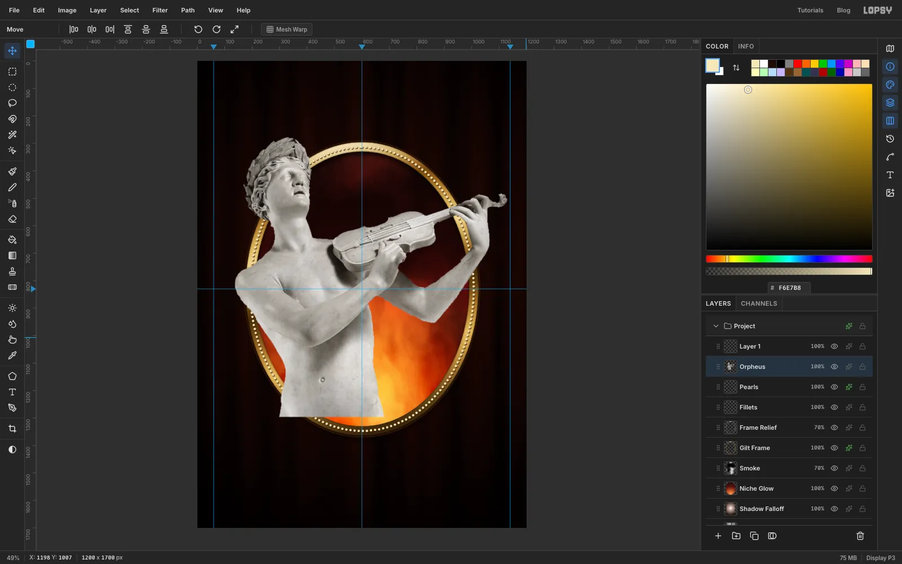

The museum photo is warm beige under gallery lights. Fire will add plenty of warmth later, so start from cool stone. Click **Orpheus** and run **Filter → Hue/Saturation…** with **Saturation** −70 and **Lightness** 5.

## Clone out the navel

The fire will climb over the lower torso, and a crisp navel poking through it looks odd. Press [[S]] for the Clone Stamp and set **Size** to 30. [[Alt]]-click clean marble just above and to the left of the navel, then paint a short stroke over the navel.

## Dodge and burn a few accents

Press [[O]] for Dodge/Burn and keep **Exposure** low, at **10**. This tool's dabs have a fairly hard edge, so strong exposures leave visible bands.

1. Set **Mode** to **Burn** and **Size** to 70. Paint a short stroke under the chin and one down the right flank, below the violin.
2. Set **Mode** to **Dodge** and **Size** to 50. Paint a short stroke across the forehead and one along the top of the left shoulder.

## Glaze the shadow side

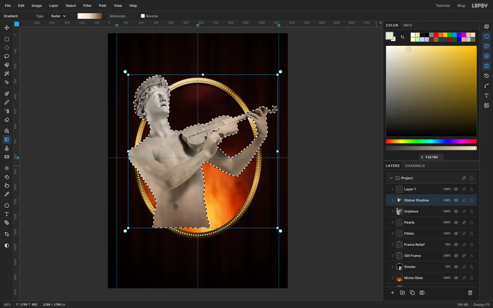

1. `⌘`-click the **Orpheus** thumbnail to select the statue's outline.
2. Add a layer called **Statue Shadow**. Set a **Radial** gradient of `#FFFFFF`, `#F0DCC4` at 50% and `#6B4430`.
3. Drag from the face toward the lower right, past the violin's body, to just beyond the right arm's elbow.
4. Set the layer to **Multiply**. Keep the selection.

## Light the statue from below

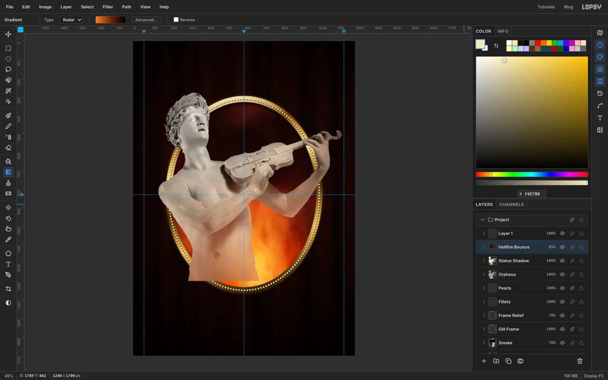

1. With the statue still selected, add a layer called **Hellfire Bounce**.
2. Set a **Radial** gradient of `#FF7A1E`, `#5A1A06` at 60% and `#000000`. Drag from the bottom of the bust, a little right of centre, straight up to the violin.
3. Set the layer to **Screen** at **85%** and press [[⌘D]]. In Screen, black does nothing, so only the orange glow shows.
4. Click **Orpheus** and open its effects. Add an **Inner Glow** of `#1A0A06`, **Size** 4, **Spread** 50, **Opacity** 60, to darken the very edge of the cut-out.
5. Add a **Drop Shadow**: **Offset X** 14, **Offset Y** 18, **Blur** 14, **Opacity** 60, black. Now the arms cast a shadow on the frame.

## Group the statue and mask its base

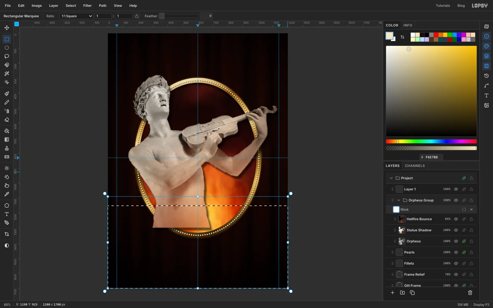

1. Click **Orpheus**, then [[Shift]]-click **Hellfire Bounce**, and choose **Layer → Group Layers**. Name the group **Orpheus Group**.
2. With the group active, click **Add Mask** at the bottom of the Layers panel. A **Mask** row appears under **Orpheus Group**; click it to edit the mask.
3. Draw a rectangular marquee from just off the left edge of the page at about y 1150 down past the bottom right corner.
4. Choose **Select → Feather…** and set it to **110**.

## Dissolve the statue into the fire

1. Set the foreground to black and choose **Edit → Fill**. A group mask only accepts fills, deletes and filters, not gradients or brushes, so a feathered fill makes the fade.
2. The left side of the torso still ends in a hard vertical edge. With the Lasso ([[L]]), draw a rough box around that lower left flank, from about the elbow down to where the fade starts. Feather it by **30** and fill it black too.
3. Press [[⌘D]], then click the **Orpheus Group** row name to leave mask editing.

## Add a little contrast to the statue

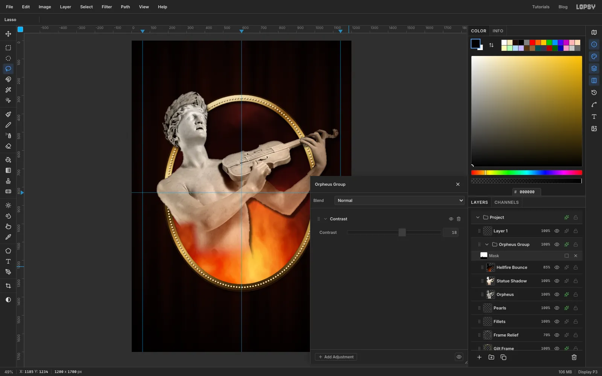

Click the sparkle icon on **Orpheus Group**. Groups have their own adjustment stack. Click **Add Adjustment**, choose **Contrast**, and set it to **18**. The adjustment applies only to the statue layers, not to the wall or the fire.

## Group the frame

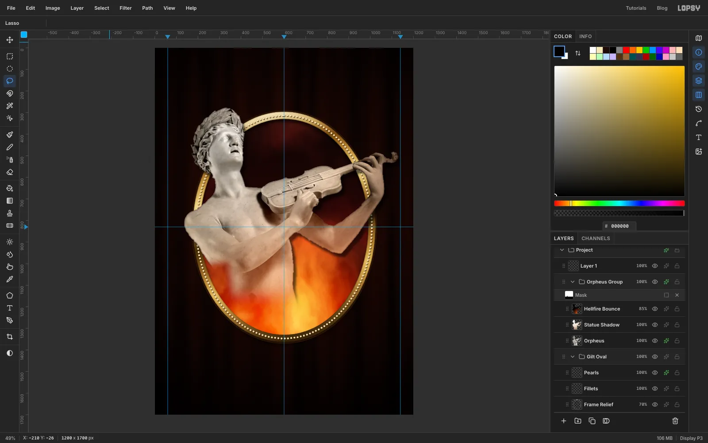

Click **Gilt Frame**, [[Shift]]-click **Pearls**, and choose **Layer → Group Layers**. Name the group **Gilt Oval**. The whole frame can now be moved or hidden as one piece, and the crest you add later goes inside it.

## Shine a shaft of light on the face

1. Rename **Layer 1** (above the group) to **Light Shaft**.
2. With the Lasso, draw a long wedge from the top left corner, about 300 px wide at the top, narrowing down onto the face and the left shoulder.
3. Fill it with `#FFE7B6` and press [[⌘D]].
4. Run **Gaussian Blur…** with **Radius** 60, then set the layer to **Screen** at **24%**.

## Spray the embers

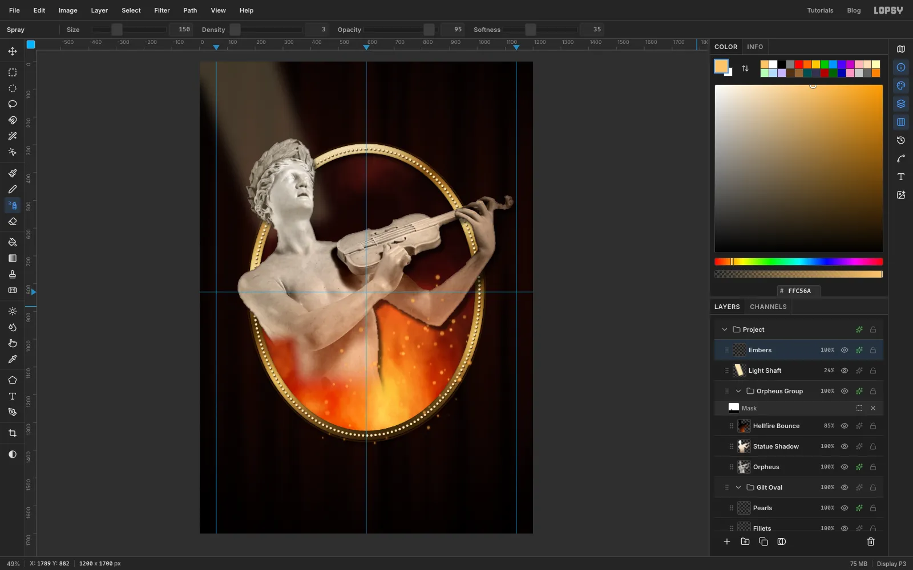

1. Add a layer called **Embers**. Press [[J]] for Spray and set **Size** 150, **Density** 3, **Opacity** 95 and **Softness** 35. Size sets the width of the spray cloud, not the size of the dots, so a big cloud with few dots gives scattered sparks.
2. Set the foreground to `#FFC56A`. Drag three slow, rising paths up through the fire: one up the middle toward the violin, one up the left, and one up the right.
3. Run **Motion Blur…** with **Angle** 90 and **Distance** 6. This stretches each spark into a short upward streak.
4. Add an **Outer Glow** of `#FF6A1A`, **Size** 10, **Opacity** 90.

## Let the flames lick up the torso

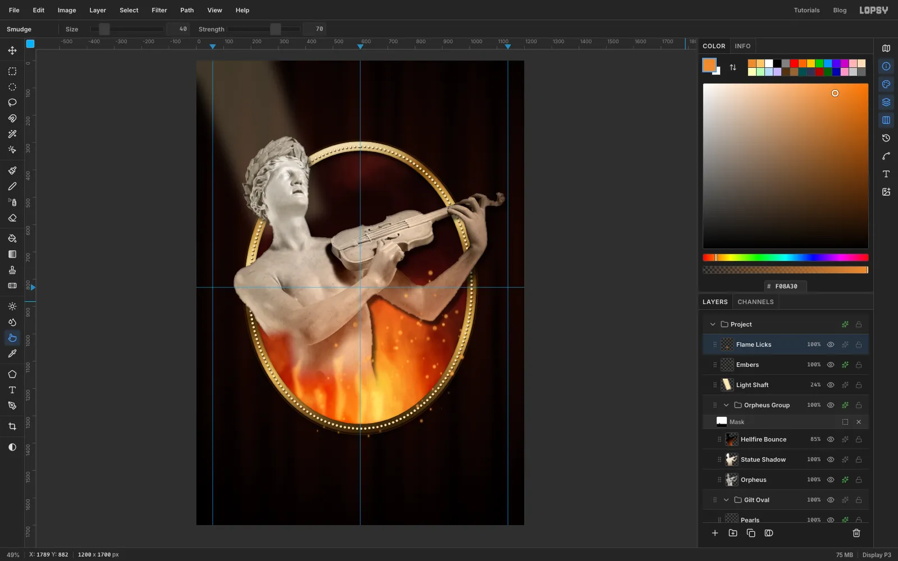

1. Add a layer called **Flame Licks**. Select the niche oval again, 4 px smaller than before, so nothing spills onto the frame.
2. Press [[B]] and set **Size** 46, **Hardness** 0, **Spacing** 10%, **Opacity** 85, in `#F08A30`. Paint six strokes straight up from the bottom of the niche, spread about 70 px apart across the lower torso, from about x 300 to x 660. Stop each one at a different height. The tallest should reach the middle of the torso.
3. Press [[R]] for Smudge, set **Size** 40 and **Strength** 70, and drag up through each stroke in a gentle S-curve. This pulls the paint into wavering tongues.
4. Press [[⌘D]], run **Gaussian Blur…** with **Radius** 6, and set the layer to **Screen**.

## Build a shell crest

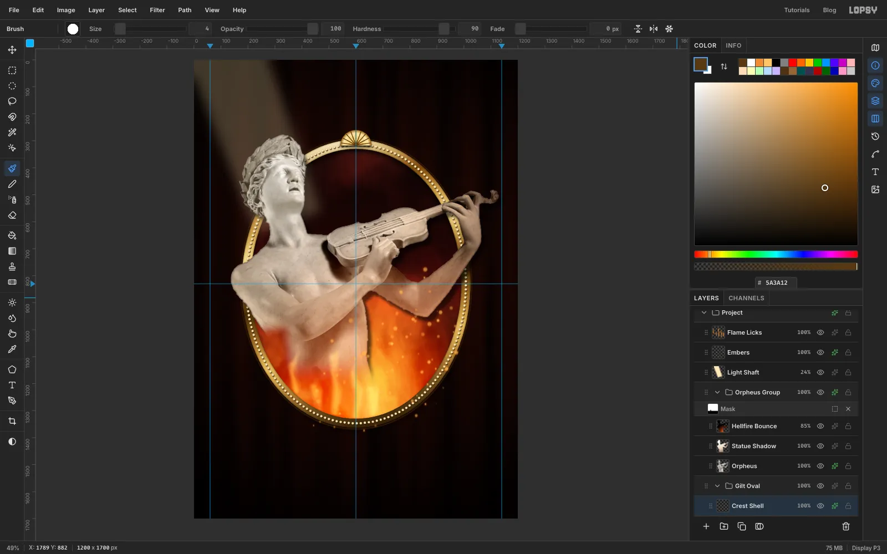

1. Expand **Gilt Oval** and click **Pearls**, so the crest lands inside the frame's group. Add a layer called **Crest Shell**.
2. Draw an elliptical marquee for a circle about 116 px across. Centre it on the middle guide, with its centre in the middle of the frame's top edge. Switch to the Rectangular Marquee, hold [[Alt]] and drag over the circle's lower half to leave a half-disc.
3. Drag a **Radial** gradient from the middle of the flat edge up to the rim, with stops `#7A5420`, `#E8C877` at 35%, `#F7E6AC` at 80% and `#9A6B28`. Press [[⌘D]].
4. Press [[B]] and set **Size** 4, **Hardness** 90, **Opacity** 100% and **Spacing** 10%, in `#5A3A12`. The flame step left the brush at 85% opacity, so check it. For each of nine ribs, click the middle of the flat edge, then [[Shift]]-click a point on the rim. Space the nine evenly round the fan.
5. Give the shell a **Drop Shadow** (Offset Y 6, Blur 10, Opacity 80) and an **Inner Glow** of `#4A2E0C` (Size 5, Spread 20, Opacity 80).

## Curl a volute

1. Add a layer called **Volute L**. Set the brush to **Size** 11, **Hardness** 85, **Opacity** 100%, in `#D9B062`.
2. Start at the left foot of the shell and drag out to the left in one stroke. Curl up and over into a spiral about 50 px across, finishing in its centre.
3. Give it a **Drop Shadow** (Offset Y 5, Blur 6, Opacity 80) and an **Inner Glow** of `#5A3A12` (Size 3, Spread 10, Opacity 80).

## Mirror the volute

1. Draw a marquee tightly around the spiral and press [[⌘C]] then [[⌘V]]. The copy lands in the same spot on a new layer. Name it **Volute R**.
2. With the Move tool, click **Flip Horizontal** in the options bar.
3. Drag the copy across so it mirrors the first one on the right of the shell, the same distance from the centre guide. Press [[⌘D]].
4. A paste carries the pixels but not the layer effects, so give **Volute R** the same **Drop Shadow** and **Inner Glow** as the left one.

## Set "Tenor" in script and tilt it

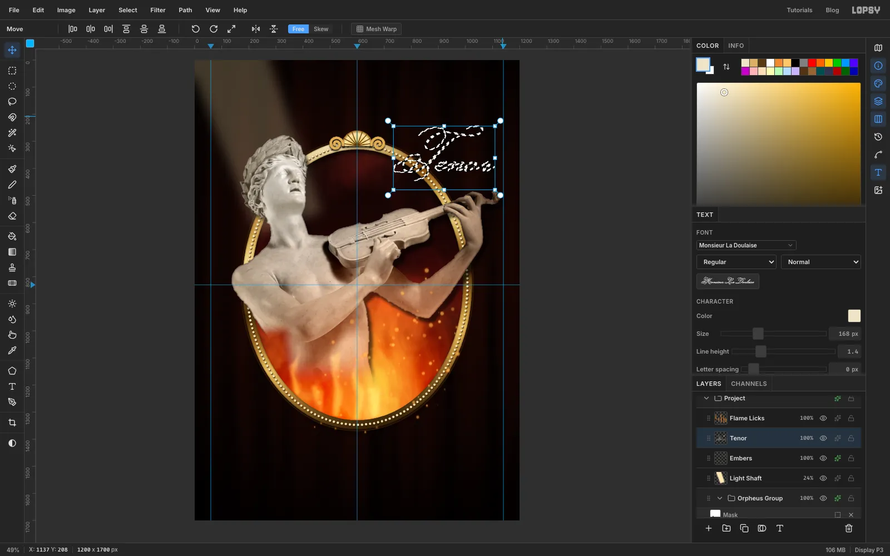

Make the lower text first. A click inside an existing text layer edits that layer instead of starting a new one.

1. Click **Embers** so the text lands above it. Press [[T]], set the font to **Monsieur La Doulaise**, **Size** 168, colour `#F0E4C8`, **Align** Left.
2. Click in the empty dark area at the upper right, type `Tenor` and press [[Tab]].
3. With the Move tool and the arrow keys, nudge it so it sits centred on the right half of the page, with the tail of the T just clear of the crest.
4. Draw a marquee around the whole word, including the T's tall swash. Press [[V]], drag the round rotation handle outside the top right corner up by about 8°, and press [[⌘D]].
5. Add a **Drop Shadow** (Offset X 4, Offset Y 8, Blur 10, Opacity 75). Add an **Outer Glow** of `#0A0302` with **Size** 18, **Spread** 25 and **Opacity** 85, so the thin script stays readable where it crosses the beaded frame.

## Set the masthead and kicker

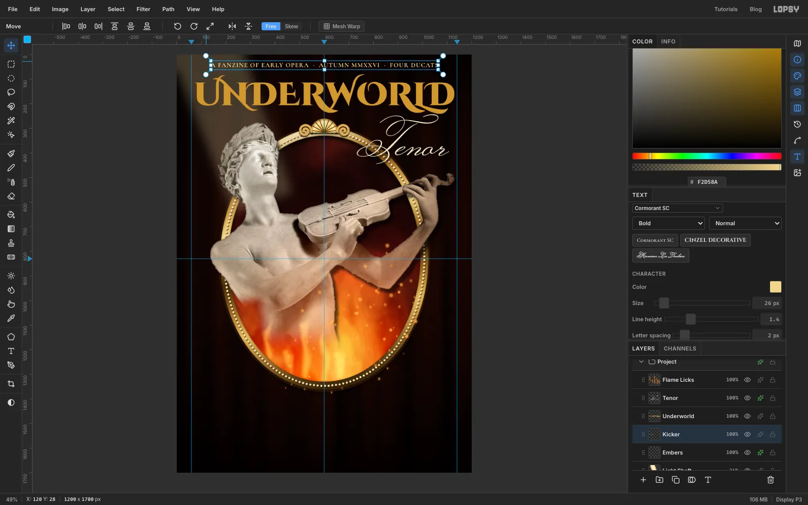

1. Click **Embers** again. Choose **Cinzel Decorative**, **Black** weight, **Size** 132, colour `#C99A45`.
2. Click near the top left margin, type `UNDERWORLD` and press [[Tab]]. Nudge it until the left and right margins match, about 78 px each, and the bottoms of the letters sit about 240 px from the top.
3. Click **Embers** once more. Choose **Cormorant SC**, **Bold**, **Size** 26, colour `#F2D58A`.
4. Click near the top, type `A FANZINE OF EARLY OPERA  ·  AUTUMN MMXXVI  ·  FOUR DUCATS` and press [[Tab]]. With the new layer active, set **Letter spacing** to 2 in the **Text** panel. Centre it over the masthead, about 42 px from the top.

## Gild the masthead

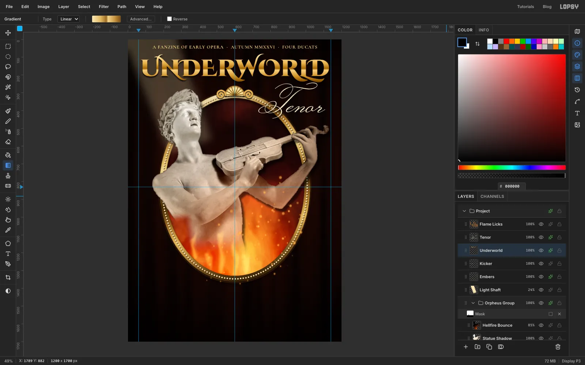

1. Click **UNDERWORLD** and click **Rasterize Layer** at the bottom of the Layers panel.
2. `⌘`-click its thumbnail to select the letters.
3. Set a **Linear** gradient with stops `#FBEBB4`, `#E2B65E` at 30%, `#9C6A22` at 50%, `#F2D489` at 56%, `#C8923C` at 80% and `#7A4E16`.
4. Drag straight down from the top of the capitals to their baseline. The dark band right next to a bright one at mid-height is what makes it read as polished metal. Press [[⌘D]].
5. Add a **Drop Shadow** (Offset Y 7, Blur 8, Opacity 85) and an **Inner Glow** of `#5A3810` (Size 3, Spread 20, Opacity 70).

## Hang the ribbon banderole

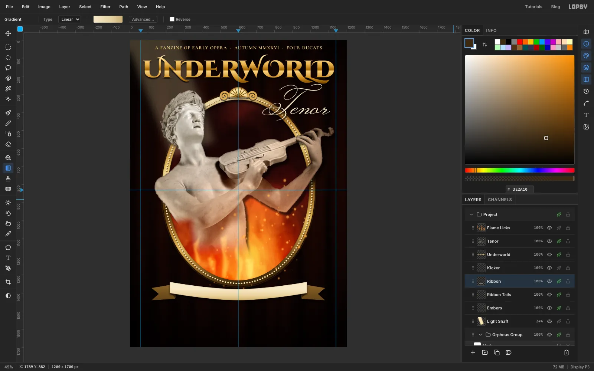

The ribbon band will run from x 220 to x 980, crossing the bottom of the frame. Its top edge sits at y 1338 at the ends and sags 40 px in the middle, and the band is 62 px tall. The tails go behind it, so draw them first.

1. Click **Embers** and add a layer called **Ribbon Tails**.
2. Press [[P]] for the Pen. For the left tail, click five corner points at about 240, 1352 → 120, 1372 → 160, 1405 (the notch) → 120, 1440 → 250, 1432, then click the first point again to close it.
3. Open the **Paths** panel from the path icon in the right-hand panel strip. Click **Path to Selection**, then **Delete Path**.
4. Drag a **Linear** gradient from `#8A6A36` to `#5E4420` top to bottom through it, and press [[⌘D]].
5. Do the same for the right tail, mirrored around the centre guide: 960, 1352 → 1080, 1372 → 1040, 1405 → 1080, 1440 → 950, 1432.
6. On the same layer, draw a small triangle where each tail tucks under the band: 220, 1398 → 254, 1430 → 254, 1398 on the left, and the mirror image at the right end. Make each one a selection, fill it with `#3E2A10` using **Edit → Fill**, and press [[⌘D]].
7. Add a layer called **Ribbon**. The band runs from just left of the frame to just right of it, about 760 px long. With the Pen:
   - Click the top left corner of the band.
   - At the middle of the top edge, about 40 px lower than the ends, press and drag about 160 px to the right to pull out curve handles.
   - Click the top right corner, then the bottom right corner 62 px below it.
   - At the middle of the bottom edge, press and drag about 160 px to the left.
   - Click the bottom left corner, then click the first point to close.
8. Make it a selection with **Path to Selection** and **Delete Path**, then drag a **Linear** gradient from `#F5E9CA` through `#E6D2A2` at 60% to `#C9AE74`, top to bottom. Press [[⌘D]].
9. Give both layers a **Drop Shadow** (Offset Y 8, Blur 12, Opacity 70). Give **Ribbon** an **Inner Glow** of `#8C6A34` (Size 6, Spread 10, Opacity 55).

## Draw a baseline for the motto

With the Pen, click just inside the ribbon's left end, 45 px below its top edge. At the middle, 45 px below the top edge there, press and drag about 160 px to the right, as you did for the ribbon's edges. Then click just inside the right end. Click the **✓ Commit path** button in the options bar. This keeps the path without stroking it.

## Set the motto on the path

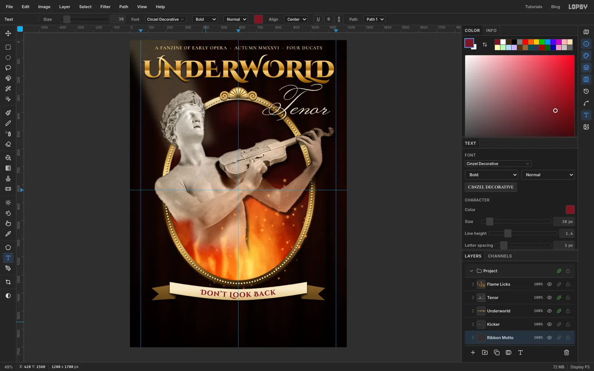

1. Click **Ribbon**. Press [[T]] and choose **Cinzel Decorative**, **Bold**, **Size** 38, colour `#7E1622`, **Align** Center.
2. Click in the empty area below the ribbon, type `Don’t Look Back` with a curly apostrophe ([[⌥⇧]]] on a Mac), and press [[Tab]]. Set **Letter spacing** to 3 in the **Text** panel.
3. In the options bar's **Path** dropdown, choose the path you just drew. The text jumps onto the curve, centred along it.
4. Check the caps sit in the middle of the band, with about the same gap above and below. If they don't, move the path's anchors up or down.
5. Click the path's row in the Paths panel to deselect it.

## Write the cover lines

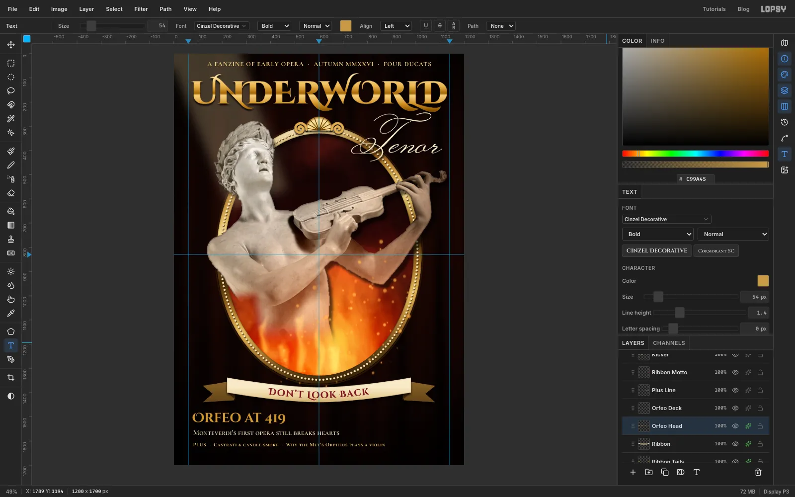

Make these from the bottom up. Before each line, click **Ribbon** first and only then change the font settings; changing them with a text layer active restyles that layer. All three start 80 px from the left edge, roughly in line with the masthead's U. Use curly apostrophes, as in the motto.

1. The PLUS line: **Cormorant SC**, **Bold**, **Size** 22, `#F2D58A`. Click about 100 px above the bottom, type `PLUS  ·  Castrati & candle-smoke  ·  Why the Met’s Orpheus plays a violin`, press [[Tab]], and set **Letter spacing** to 1 in the Text panel.
2. The deck: **Cormorant SC**, **SemiBold**, **Size** 30, `#EBDDBF`. Click about 55 px higher, type `Monteverdi’s first opera still breaks hearts`, press [[Tab]], and set **Letter spacing** back to 0.
3. The headline: **Cinzel Decorative**, **Bold**, **Size** 54, `#C99A45`. Click about 75 px above the deck and type `Orfeo at 419`. Cinzel turns lower case into small caps. Give it a **Drop Shadow** (Offset Y 4, Blur 6, Opacity 80).

## Press a wax seal

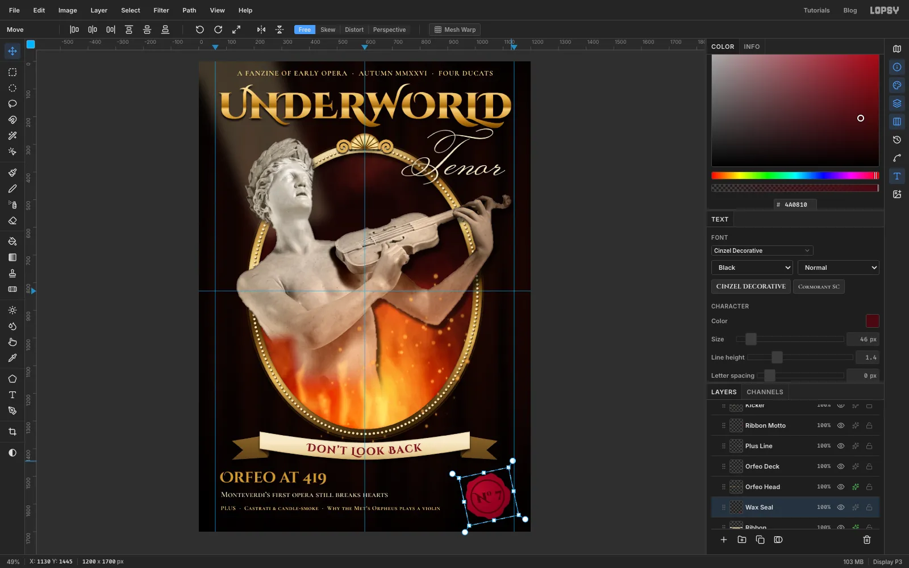

1. Click **Ribbon** and add a layer called **Wax Seal**.
2. With the Lasso, draw a slightly lumpy circle about 160 px across in the bottom right corner, level with the cover lines. Wax never sets perfectly round.
3. Drag a **Radial** gradient of `#A52430`, `#7E1622` at 70% and `#4E0A12` from just above left of its centre to its lower right edge.
4. With the Elliptical Marquee, drag a circle 124 px across centred on the seal, then hold [[Alt]] and drag a 114 px circle on the same centre. Fill the 5 px ring with `#4A0810` and press [[⌘D]].
5. Press [[T]] and choose **Cinzel Decorative**, **Black**, **Size** 46, `#4A0810`. Click inside the seal, type `Nº 7` (º is [[⌥0]] on a Mac), and press [[Tab]]. Nudge it with the arrow keys until it's centred on the seal. Click **Rasterize Layer**, then **Layer → Merge Down** to press it into the wax.
6. Draw a marquee around the seal, press [[V]], rotate it about 12° counterclockwise with a corner handle, and press [[⌘D]].

## Emboss the wax

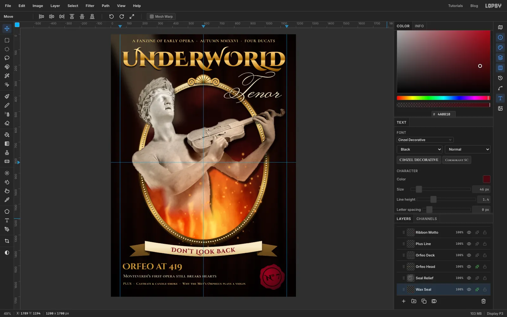

1. Draw a marquee around the seal, press [[⌘C]] and [[⌘V]], name the copy **Seal Relief**, and press [[⌘D]].
2. Run **Emboss…** with **Angle** 135 and **Strength** 20, then **Filter → Desaturate**, and set the layer to **Overlay**.
3. Click **Wax Seal** and give it a **Drop Shadow**: Offset X 3, Offset Y 8, Blur 10, Opacity 80.

## Add a film of grain

1. Click **Tenor** and add a layer called **Grain**. Only **Flame Licks** sits above it. That's fine, because the flames are in Screen mode and only inside the oval.
2. Fill it with `#808080`, then run **Add Noise…** with **Amount** 22, **Mono** and **Gaussian**.
3. Set it to **Overlay** at **40%**. Mid-grey in Overlay changes nothing, so only the noise shows. It ties the photo, the gradients and the type into one printed surface.

## Finish with a vignette

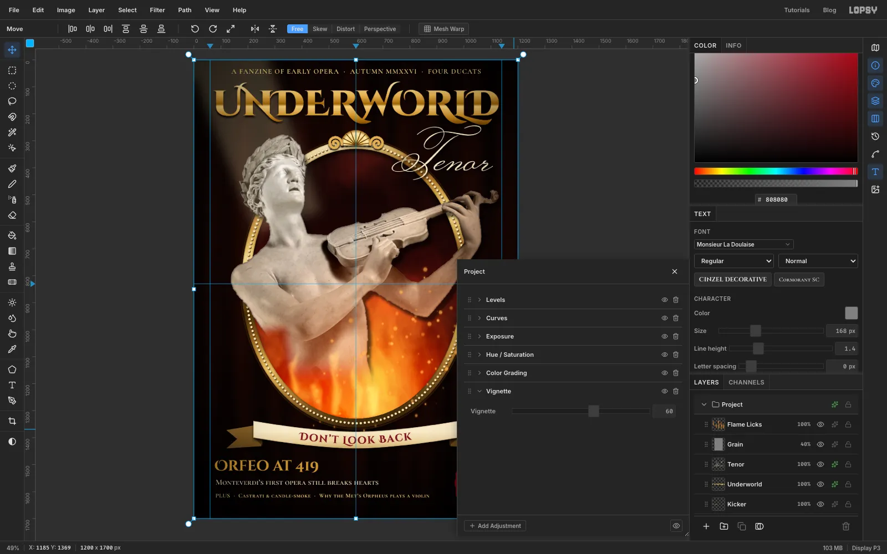

Choose **Layer → Adjustment Layer…**. Lopsy opens the adjustment stack of the **Project** group, which holds every layer. Click **Got it** if a tip appears. The stack already lists Levels, Curves, Exposure, Hue/Saturation and Color Grading at neutral settings; leave them alone. Click **Add Adjustment**, choose **Vignette**, and set it to **60**. Close the drawer to see the whole cover. The corners close in, and the light from the shaft and the fire takes over.

Save with **File → Save Project**, then **File → Quick Export PNG**.
