Baroque printed ephemera loves excess: heavy gilt frames, velvet, scrolling acanthus leaves and a painted scene held in a medallion. In this tutorial you'll make a menu in that spirit for **Rotisserie Royale**, a made-up spit-roast restaurant. It's all drawn in Lopsy, apart from one public-domain painting. If you'd rather paint the still life yourself, the [quince Baroque menu](/tutorials/baroque-restaurant-menu/) takes that route. This one leans on pattern, gilding and a curved title.

Along the way you'll use:

- **Brush symmetry** and **Define Pattern** to draw a half-drop damask.
- **Emboss** on a grey copy to give flat gold some relief.
- **Radial symmetry** to place pearls and rosette petals in one click.
- **Duplicate and Flip** to mirror an ornament.
- **Text on a path** to bend the title along a ribbon.
- **Color Grading** to warm the whole menu at the end.

The document is **1400 × 2100 px**, a tall menu card.

You'll need one image: Melchior d'Hondecoeter's [Poultry-yard with angered cock](https://commons.wikimedia.org/wiki/File:Melchior_De_Hondecoeter_-_Poultry-yard_with_angered_cock_-_Google_Art_Project.jpg), public domain, from Wikimedia Commons. Download the full-size file.

The palette:

- Velvet `#932B2D` → `#701B1E` → `#1B0406`
- Damask `#47241B` (drawn on black, then set to Screen)
- Gold `#37230D` → `#68461D` → `#835C29` → `#CCA259` → `#E3C784` → `#FCF1BE`
- Parchment `#EDE4CB` → `#D3C5A1`
- Ribbon `#9B3537` → `#7B2223` → `#4E1215`
- Dish names `#382518`
- Headings and prices `#701C1D`
- Descriptions `#4C3C2C`
- Footer band `#350A11`
- Dark strokes and fillet `#2A1408`
- Scorched edge `#835C34`
- Ribbon tails `#431113`, fold `#1F060A`
- Pearls `#EDE6D4`
- Tagline `#471717`
- Lighting `#12020A`, `#FFB45A`, `#F2A65A`

A few habits make the whole build easier:

- **Exact marquees.** With nothing selected, click once on the canvas with the Rectangular or Elliptical Marquee. A dialog opens where you type the corners (From X/Y, To X/Y). Most shapes here are placed that way. The click only opens the dialog when nothing is selected, so press [[⌘D]] before every exact marquee, even right after a fill or a delete.
- **⌘-click a thumbnail** in the Layers panel to select that layer's pixels. That's how you'll keep gradients inside a shape.
- **The sparkle icon** on a layer's row opens its effects drawer. That's also where the **Blend** mode lives. Click the percentage on the row to change its opacity.
- **New layers appear right above the active layer.** Click the layer you want to build on before you add the next one.
- **Brush settings stick.** The brush keeps its Size, Taper and Spacing until you change them. Unless a step says otherwise, use **Taper** 0 and **Spacing** 10%.
- **Text layers are named after their text.** Rename each one as you go (double-click the name), because later steps refer to them by name.
- Press [[⌘D]] to deselect, and do it often.

## Set up the guides

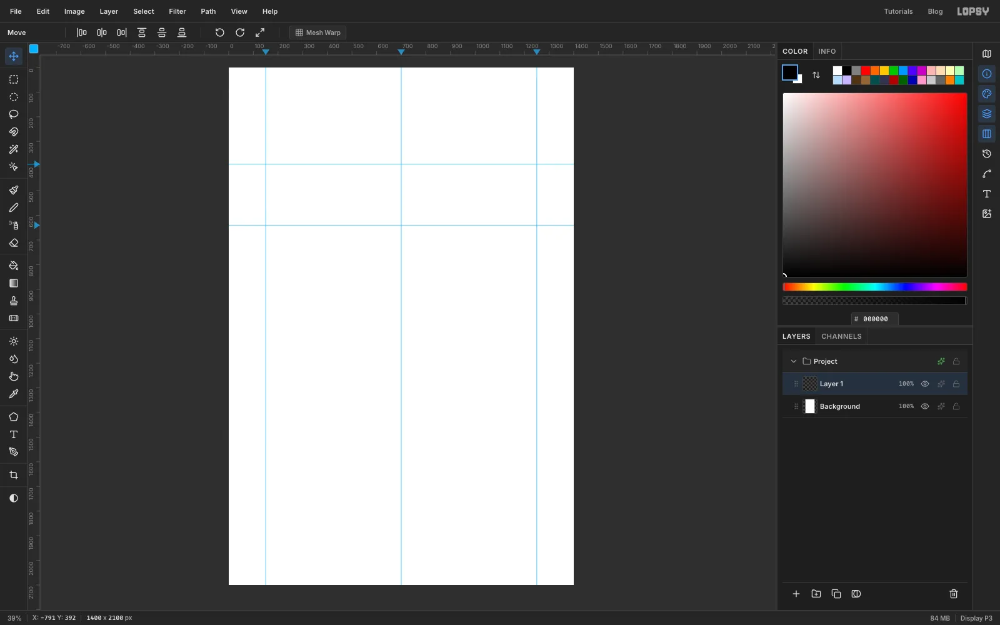

Create a **1400 × 2100** document. Click the top ruler at **150**, **700** and **1250** to drop three vertical guides: the panel edges and the centre line. Click the left ruler at **392** and **640** for two horizontal guides. The first marks the centre of the medallion and the second the top of the panel's straight sides.

## Paint the velvet

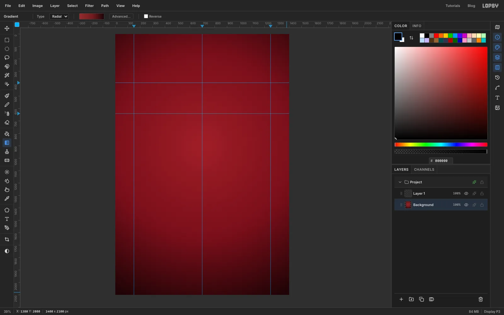

1. Click **Background** and pick the **Gradient** tool. Set **Type** to **Radial** and click **Advanced…**.
2. Set three stops: `#932B2D` on the left, `#701B1E` at 55% and `#1B0406` on the right. Click a stop and type its hex. Click the bar to add a stop.
3. Drag from a little above the middle of the page out to the bottom right corner.

## Draw one damask tile

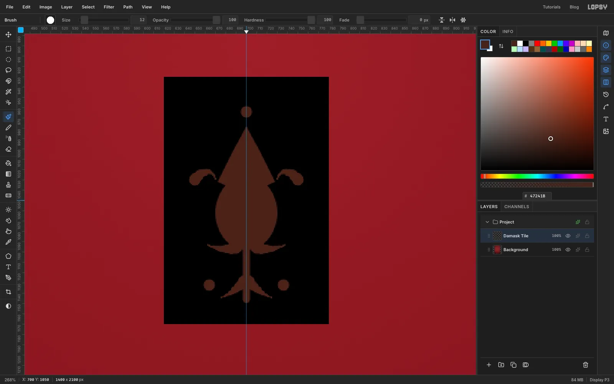

A damask is one motif repeated. Draw a single tile in the middle of the page, where the mirror line is.

1. Click **Layer 1** and rename it **Damask Tile** (double-click the name).
2. Make an exact rectangle from **620, 930** to **780, 1170** and fill it with black. **Edit → Fill** uses the foreground colour, which starts out black. Press [[⌘D]].
3. Set the foreground to `#47241B`. With the Elliptical Marquee, make an oval from **670, 1026** to **730, 1098** and fill it: that's the pomegranate. Lasso a pointed flame shape on top of it, about 65 px tall, and fill that too.
4. Press [[B]]. In the brush presets (click the brush preview in the options bar), set **Size** 12, **Hardness** 100 and **Taper** 30. Taper shrinks the stroke to nothing over that many pixels.
5. Turn on **Symmetry Vertical** in the options bar (the icon with two halves side by side). Now everything you paint on the left is mirrored on the right of the centre line.
6. Paint one C-shaped leaf from the base of the pomegranate, out and up its left side, ending in a small curl at its shoulder. The mirror adds the right-hand leaf. Paint a smaller leaf lower down the same way.
7. Set **Taper** back to 0 and paint a short stem straight down the centre line at **Size** 8. At **Size** 12, click one dot beside the bottom of the stem (the mirror makes the pair), and one exactly on the centre line above the flame.
8. Turn **Symmetry Vertical** off again.

## Turn the tile into a half-drop pattern

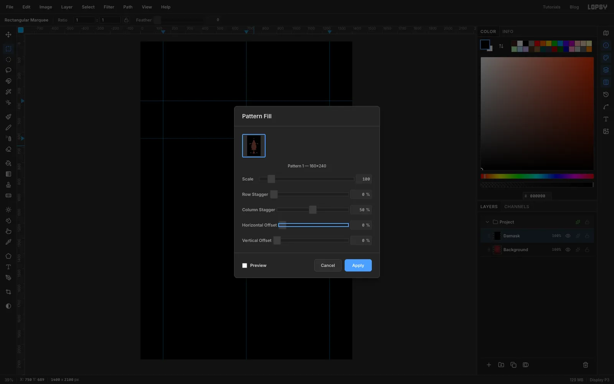

1. Make the same exact rectangle, **620, 930** to **780, 1170**, and choose **Edit → Define Pattern**. Press [[⌘D]] and delete the **Damask Tile** layer.
2. Click **Background** and add a layer called **Damask**. Set the foreground back to `#000000` and fill the layer.
3. Choose **Edit → Fill with Pattern…**, pick your new pattern and set **Column Stagger** to **50%**. Every other column drops by half a tile, which is how real damask repeats. Click **Apply**.
4. Set the layer's blend to **Screen** and its opacity to **35%**. Screen makes the black vanish, so only the motifs lighten the velvet.

## Hang the folds

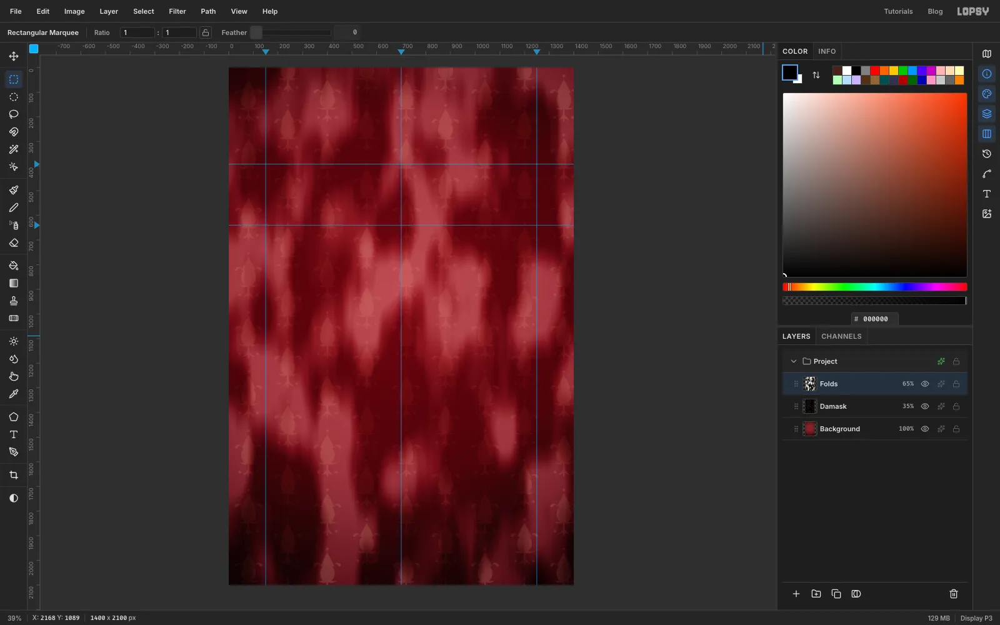

1. Add a layer called **Folds** and run **Filter → Clouds…** with **Scale** 10.
2. Run **Filter → Motion Blur…** three times with **Angle** 90 and **Distance** 100. The clouds stretch into long vertical drapes.
3. Run **Filter → Brightness/Contrast…** with **Contrast** 55.
4. Set the layer to **Soft Light** at **65%**.

## Cut the frame band

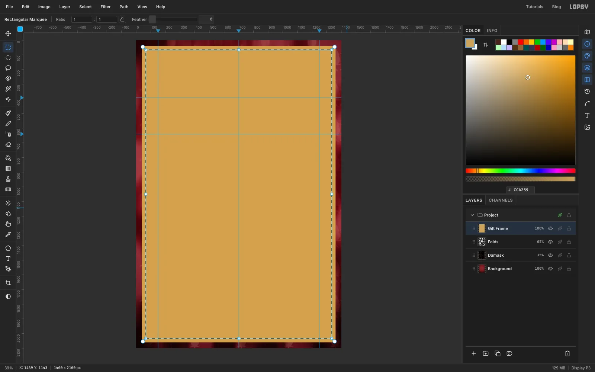

1. Add a layer called **Gilt Frame** and set the foreground to `#CCA259`.
2. Make an exact rectangle from **40, 40** to **1360, 2060**, fill it, then choose **Select → Shrink…** and enter **26**. Press [[Delete]]. You're left with a 26 px band.
3. Press [[⌘D]]. Make another rectangle from **82, 82** to **1318, 2018**, fill it, **Shrink** by **6** and press [[Delete]]. That's a thin inner fillet. Press [[⌘D]].

## Gild the frame

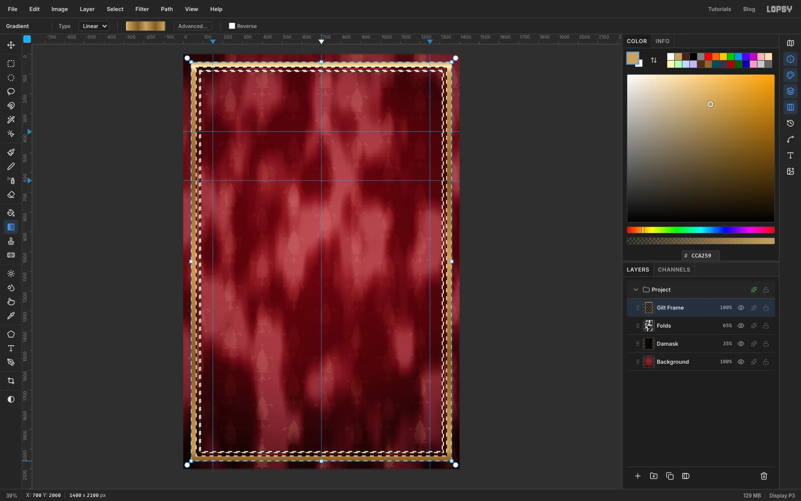

1. ⌘-click the **Gilt Frame** thumbnail to select the band.
2. Set up a **Linear** gradient that alternates gold and bronze down its length. Start with `#CCA259` at the left end. Add a pale `#FCF1BE` stop right next to it and another `#CCA259` just after that, for a thin glint along the top edge. Then add `#835C29` at about 30%, `#CCA259` at 50%, `#835C29` at 75%, `#CCA259` just before the right end, and `#835C29` at the right end. Select a leftover stop and delete it if the editor kept stops from the last gradient.
3. Drag straight down the centre line from the top of the page to the bottom. The top bar catches the light, and the sides ripple from gold to bronze. Press [[⌘D]].
4. In the effects drawer, turn on **Drop Shadow** (**Offset Y** 8, **Blur** 18, **Opacity** 85) and **Stroke** (**Width** 2, colour `#2A1408`).

Now give it relief:

1. ⌘-click the thumbnail again, then press [[⌘C]] and [[⌘V]]. The copy pastes in place on a new layer. Name it **Frame Relief**.
2. Run **Filter → Emboss…** with **Angle** 135 and **Strength** 22, then **Filter → Desaturate**. Press [[⌘D]].
3. Set **Frame Relief** to **Hard Light**. Mid-grey is invisible in Hard Light, so only the embossed highlights and shadows show on the gold.

> **Tip:** Don't skip Desaturate. An embossed *gold* copy on Hard Light pushes the gold towards orange plastic.

## Add corner rosettes

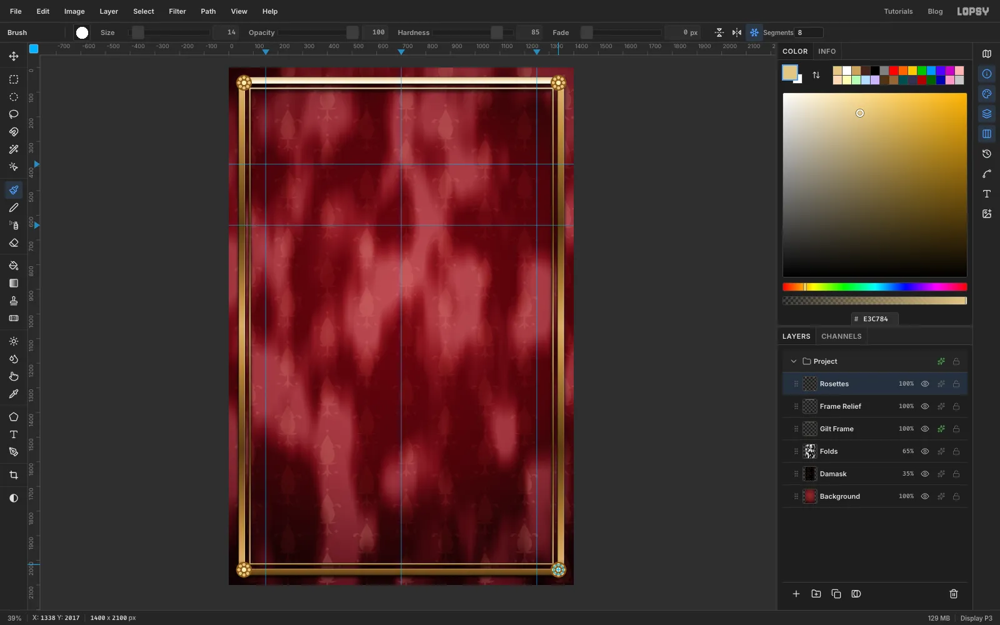

1. Add a layer called **Rosettes** and set the foreground to `#835C29`. Fill four exact circles, each 64 px across and centred where the band meets the inner fillet: **30, 30** to **94, 94** (top left), **1306, 30** to **1370, 94** (top right), **30, 2006** to **94, 2070** (bottom left) and **1306, 2006** to **1370, 2070** (bottom right). Press [[⌘D]] after each fill.
2. Switch to `#FCF1BE` and fill an 18 px circle in the middle of each one, for the boss. The top left is **53, 53** to **71, 71**, and the others are the same 9 px either side of their centres.
3. Press [[B]], set **Size** 14 and **Hardness** 85, and set the foreground to `#E3C784`.
4. Click the **Radial Symmetry** button (the snowflake) and set **Segments** to **8**.
5. For each corner, ⌘-click the rosette's centre to move the symmetry centre there, then click once about 21 px above it. One click paints all eight petals.
6. Turn Radial Symmetry off. Give the layer **Drop Shadow** (**Offset Y** 4, **Blur** 8, **Opacity** 85) and **Stroke** (**Width** 2, `#2A1408`).
7. Make a relief layer called **Rosette Relief** the same way as for the frame: copy, paste in place, **Emboss** at **Strength** 20, **Desaturate**, **Hard Light**.

## Lay down the parchment panel

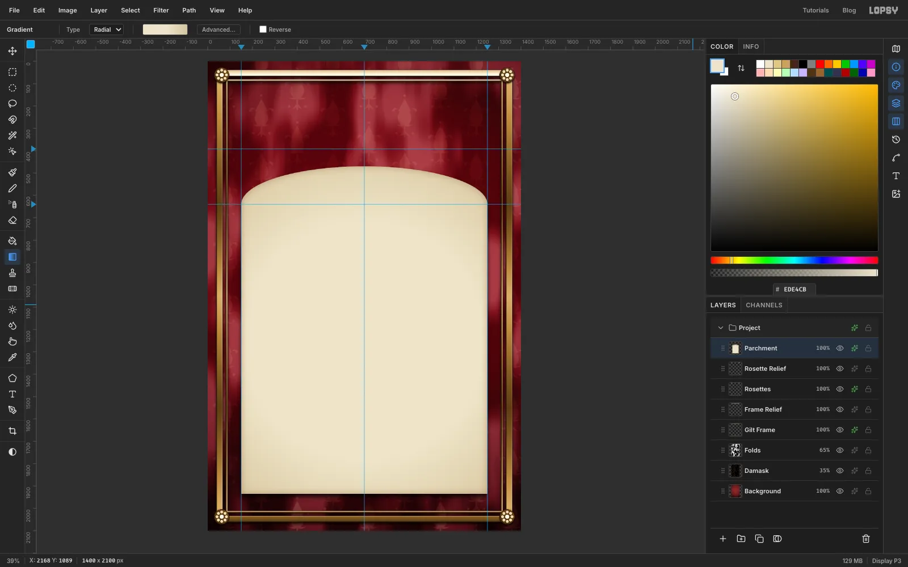

1. Add a layer called **Parchment** and set the foreground to `#EDE4CB`.
2. Fill an exact rectangle from **150, 640** to **1250, 1935**. Press [[⌘D]], then fill an exact ellipse from **150, 470** to **1250, 810**. Together they make a rectangle with an arched top. Press [[⌘D]].
3. ⌘-click the thumbnail. Drag a **Radial** gradient with stops `#EDE4CB`, `#EDE4CB` at 55% and `#D3C5A1`, from the centre of the panel to its bottom right corner. The edges go a little darker, like old paper.
4. Still selected, run **Filter → Add Noise…** with **Amount** 4 and **Mono**. Press [[⌘D]].
5. Turn on **Inner Glow** (**Size** 45, **Opacity** 45, colour `#835C34`) for a scorched edge, and **Drop Shadow** (**Offset Y** 14, **Blur** 30, **Opacity** 85).

## Rule the panel

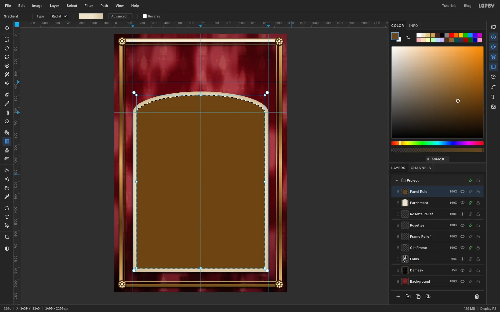

1. Add a layer called **Panel Rule** and ⌘-click the **Parchment** thumbnail.
2. **Select → Shrink…** by **26** and fill with `#68461D`.
3. **Shrink** again by **3** and press [[Delete]]. A 3 px rule now follows the arch. Press [[⌘D]].

## Add the footer band

1. Add a layer called **Footer Band**. Fill an exact rectangle from **88, 1935** to **1312, 2012** with `#350A11` and set the layer to **70%**. The damask still shows faintly, but it's quiet enough behind the small gold type. Press [[⌘D]].
2. Add a layer called **Footer Fillet** and fill a 2 px strip from **88, 1941** to **1312, 1943** with `#CCA259`. Press [[⌘D]].

## Drop in the painting

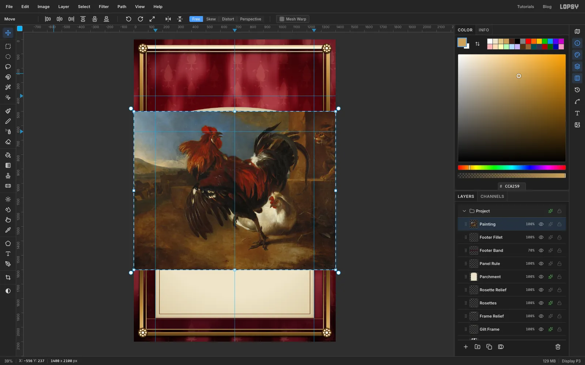

Drag the downloaded painting from your file browser onto the canvas. It lands on a new layer, shrunk to fit the page width and selected, with the Move tool active. Rename the layer **Painting**.

## Scale it down

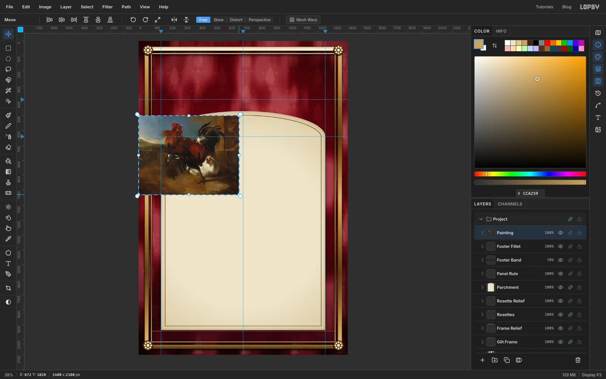

Hold [[⌘]] and drag the bottom right corner handle up and to the left until the painting is about **670 px** wide, just under half its dropped width. The top left corner stays put, so the right edge ends near 670 on the top ruler. ⌘ keeps the proportions. Press [[⌘D]] to commit.

Then drag the painting with the Move tool until the rooster's body sits on the crossing of the centre guide and the **392** guide.

## Cut it into a circle

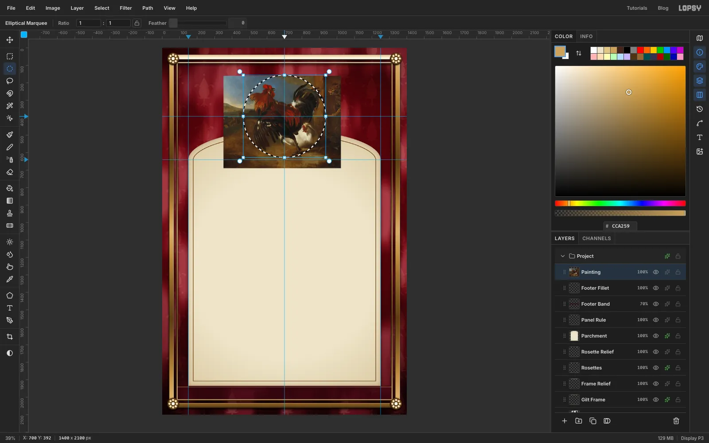

Make an exact ellipse from **464, 156** to **936, 628**. That's a circle 472 px across, centred on the guides. Check that the comb and the tail both sit inside it. If they don't, press [[⌘D]], nudge the painting with the arrow keys, and make the circle again. Don't drag the painting while the circle is active, because that would move only the pixels inside it.

## Clear everything outside

Choose **Select → Inverse** and press [[Delete]], then [[⌘D]]. Run **Filter → Unsharp Mask…** with **Radius** 2 and **Amount** 0.8 to crisp the brushwork after the scale.

## Gild the ring and string the pearls

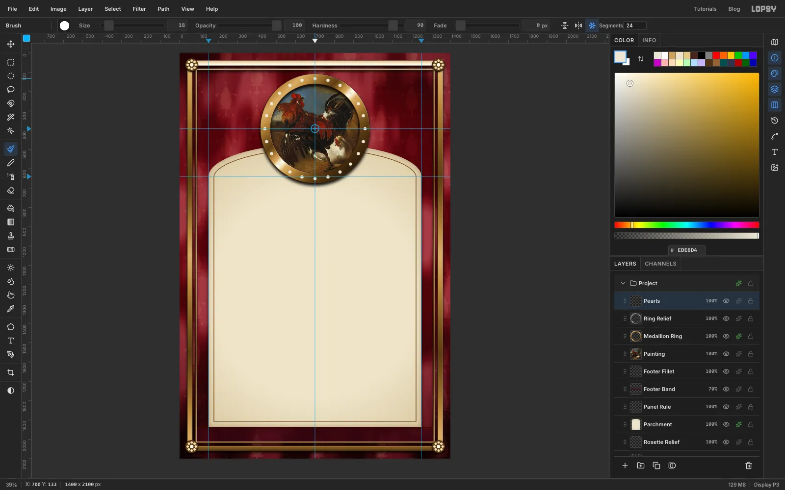

1. Add a layer called **Medallion Ring**. Fill an exact circle from **418, 110** to **982, 674** with `#CCA259`. Press [[⌘D]], make a circle from **468, 160** to **932, 624** and press [[Delete]]. The ring overlaps the painting by 4 px, so there's no gap.
2. ⌘-click the thumbnail and drag a **Linear** gradient from the ring's top left to its bottom right. Use stops `#68461D`, `#CCA259` at 20%, `#835C29` at 38%, `#CCA259` at 47%, `#FCF1BE` at 50%, `#CCA259` at 54%, `#835C29` at 72% and `#37230D`.
3. Give it a **Drop Shadow** (**Offset Y** 12, **Blur** 22, **Opacity** 90) and a **Stroke** (**Width** 2, `#2A1408`). Press [[⌘D]] first, then make a **Ring Relief** layer with Emboss **Strength** 22, Desaturate and Hard Light, as before.
4. Add a layer called **Pearls**. Set the brush to **Size** 18, **Hardness** 90 and colour `#EDE6D4`.
5. Turn on **Radial Symmetry** with **24** segments. ⌘-click the centre of the medallion, then click once in the middle of the ring band, straight above it.
6. Turn symmetry off. Add a small **Drop Shadow** (**Offset Y** 2, **Blur** 3) and a relief layer called **Pearl Relief** with **Strength** 30, so each pearl gets a lit edge.

## Add the fillets

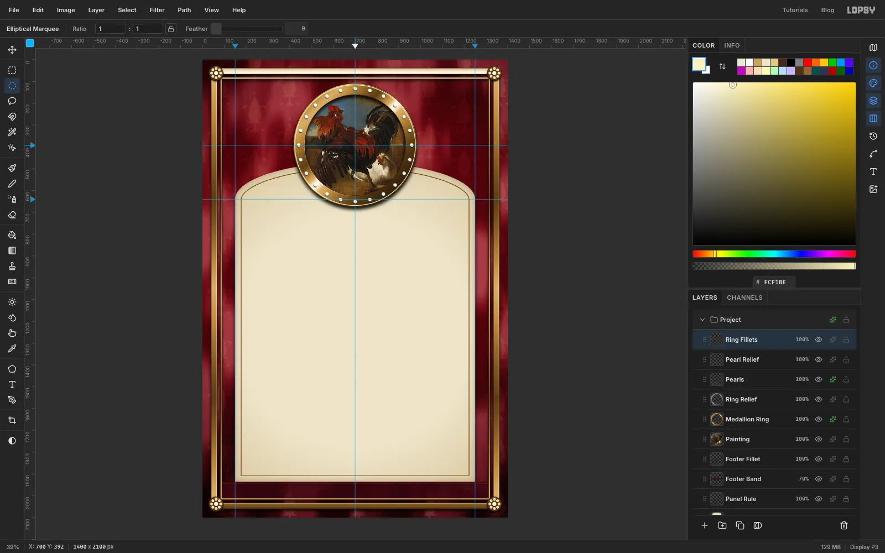

Add a layer called **Ring Fillets**.

1. Fill a circle from **468, 160** to **932, 624** with `#2A1408`, then delete a circle 8 px smaller (**472, 164** to **928, 620**). That's a dark line where the gold meets the painting.
2. Fill a circle from **422, 114** to **978, 670** with `#FCF1BE`, then delete a circle from **425, 117** to **975, 667**. That's a bright line near the outer edge. Press [[⌘D]] between each fill and delete.

## Brush the scrolls

Add a layer called **Scroll Left** and set the foreground to `#CCA259`. You only draw the left side; the right side comes from a copy.

1. Set the brush to **Size** 38, **Hardness** 100 and **Taper** 720.
2. Press just off the ring at its lower left. Sweep out to the left almost to the frame with a slight dip, up past the 392 guide, and curl into a tight spiral level with the top of the painting. Taper counts from where you press, so the stroke is thick at the medallion and thins into the curl.
3. Set **Size** 19 and **Taper** 450. Paint a second, smaller scroll from the same spot, a short hook that curls up into a little spiral just above the panel's shoulder.

## Add acanthus leaves

With the Lasso, draw five leaves along the scrolls and fill each one with **Edit → Fill**. Give each leaf three or four rounded lobes down its sides and let the tip curl slightly. Put one in the crook of the big scroll, one dangling from its outside, one flicking up from the top of the spiral, and two along the lower scroll. Press [[⌘D]].

## Gild the scroll

1. ⌘-click the thumbnail and drag the ring's gold gradient across the ornament from its top left to its bottom right. Press [[⌘D]].
2. Make a relief layer (Emboss **Strength** 18, Desaturate, Hard Light). With it active, choose **Layer → Merge Down** to bake the relief into **Scroll Left**.
3. Set the brush to **Size** 2.6, **Taper** 0 and colour `#37230D`. For each leaf, click at its base and Shift-click about halfway to the tip to draw a vein. Stop short of the tip, or the vein pokes out past the curled end.
4. Add a soft **Drop Shadow** (**Offset Y** 5, **Blur** 14, **Opacity** 70).

## Duplicate and flip

1. Choose **Layer → Duplicate Layer**, click the copy's row and rename it **Scroll Right**.
2. Choose **Image → Flip Horizontal**. The copy mirrors in place, over the original.

## Mirror it into place

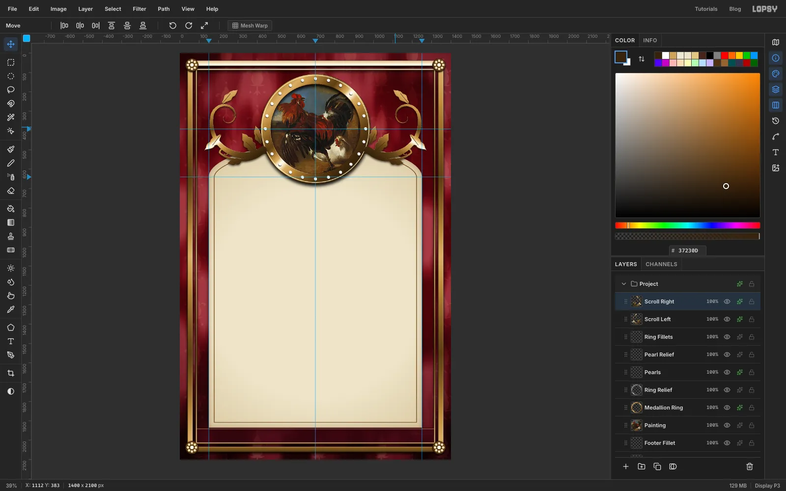

1. Click the top ruler right where the left scroll's outermost curl ends (about 127). Click it again at 1400 minus that number (about 1273).
2. With the Move tool, drag **Scroll Right** across until its outer curl touches the right-hand guide and its top lines up with the top of the left scroll. Finish with the arrow keys ([[Shift]] moves 10 px at a time).
3. Click each of the two guides on the ruler again to remove them.

## Make the ribbon

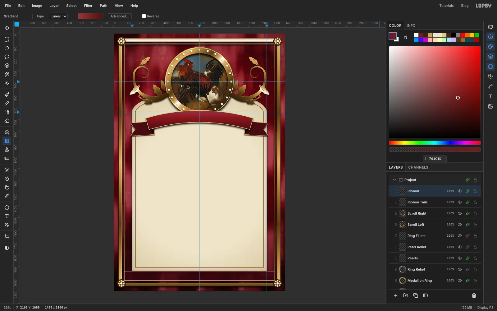

1. Add a layer called **Ribbon Tails**. With the Lasso, draw a swallowtail on the left: a band about 110 px tall, with its top edge at about y 720 and its bottom at about y 830, running from x 330 out to x 140. Cut a V-notch about 40 px deep into its outer end. Fill it with `#431113`. Draw the mirror image on the right, from x 1070 out to x 1260, and fill it too.
2. Lasso a small triangle where each tail tucks behind the ribbon and fill it with `#1F060A`. That's the fold.
3. Give the tails a **Drop Shadow** (**Offset Y** 6, **Blur** 10, **Opacity** 80) and a **Stroke** (**Width** 3, `#CCA259`).
4. Add a layer called **Ribbon**. The arched band is cut from two huge circles, and the exact-corners dialog happily takes corners off the canvas. Fill an exact ellipse from **-850, 625** to **2250, 3725** with any colour, since the gradient replaces it.
5. Press [[⌘D]], make an ellipse from **-750, 725** to **2150, 3625**, and press [[Delete]]. You're left with a 100 px band whose top edge peaks at y 625, overlapping the bottom of the medallion by about 50 px.
6. Trim the ends: press [[⌘D]] and delete a rectangle from **0, 0** to **262, 2100**, then [[⌘D]] again and delete one from **1137, 0** to **1400, 2100**.
7. ⌘-click the thumbnail and drag a **Linear** gradient straight down across the band, from `#9B3537` through `#7B2223` at 45% to `#4E1215`. Press [[⌘D]].
8. Add a **Drop Shadow** (**Offset Y** 10, **Blur** 18, **Opacity** 90) and a **Stroke** of **Width** 4 in `#E3C784`. Click **inside** under Stroke so the gold edge stays on the ribbon.

## Draw the title's path

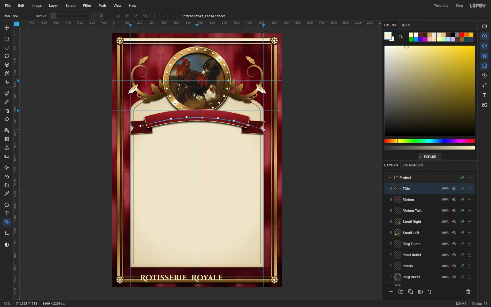

1. With **Ribbon** active, press [[T]]. Set the font to **Cinzel Decorative**, weight **Bold**, size **60**, colour `#FCF1BE`, and **Letter spacing** 2 in the Text panel.
2. Click in the empty space near the bottom of the page and type `Rotisserie  Royale` with two spaces between the words, so the gap holds its own against the wide letter spacing. Press [[Tab]] and rename the layer **Title**. Cinzel's lowercase letters are small capitals, so only the R's stand tall.
3. Press [[P]] for the Pen. The text will start at the path's first anchor. The straight title is about 660 px wide, so put the first anchor half that width left of the centre guide, at about x 366, and about 20 px below the ribbon's centre line.
4. Draw a three-point arc that follows the ribbon's curve: the left anchor, one on the centre guide, and one past the right end of the band. Click-drag each point along the curve so the handles pull out sideways.
5. Click the ✓ (**Commit path**) in the options bar. Enter would stroke the path onto the active layer instead.

## Bend the title onto the ribbon

Click the **Title** layer, press [[T]] and choose your path in the options bar's **Path** dropdown. The text jumps onto the arc. Check that the space at each end of the ribbon is equal. If it isn't, redraw the path a few pixels earlier or later. Then click the path's row in the Paths panel to hide its outline, and give the title a small **Drop Shadow** (**Offset Y** 3, **Blur** 4, **Opacity** 90).

## Set the footer and the desserts

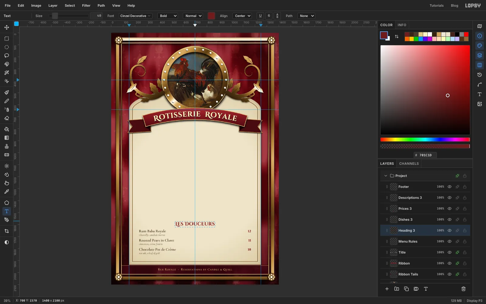

Add an empty layer called **Menu Rules** above **Title**. Before each new text, click this layer, so you never restyle a text layer by accident.

Work from the bottom of the page upwards. Text only gets a new layer when you click outside every other text box, and those boxes reach down from where you clicked.

Every text setting carries over to the next text, so set all of them each time: font, weight, style (Normal or Italic), size and colour in the options bar; **Line height**, **Letter spacing** and alignment in the Text panel.

**Footer.** Set **Cormorant SC**, **SemiBold**, Normal, size **26**, colour `#E3C784`, **Line height** 1.25, **Letter spacing** 2, **Align center**. Click on the centre guide at y **1958**, about 20 px into the footer band, and type `Rue Royale  ·  Reservations by Candle & Quill`. Rename the layer **Footer**.
Each column of a course is one text layer, with a blank line between dishes. For the desserts:

1. **Descriptions** first: **Cormorant Garamond**, **Regular**, **Italic**, size **23**, `#4C3C2C`, **Line height** 1.65, **Letter spacing** 0, **Align left**. Click at **232, 1667** and type the three descriptions (listed in the next step) with a blank line between each.
2. **Prices** next: **Libre Caslon Text**, **Bold**, Normal, size **25.6**, `#701C1D`, **Line height** 1.5, **Letter spacing** 0, **Align right**. Click at **1168, 1639** and type `12`, `11` and `10`, again with blank lines between.
3. **Dish names** last: **Cormorant Garamond**, **SemiBold**, Normal, size **32**, `#382518`, **Line height** 1.2, **Letter spacing** 0, **Align left**. Click at **232, 1635**.
4. The odd-looking sizes keep everything on one rhythm: 1.65 × 23, 1.5 × 25.6 and 1.2 × 32 all come to about 38 px a line. With the Move tool, nudge the prices up or down with the arrow keys until they share the dish names' baseline.
5. **Heading:** **Cinzel Decorative**, **Bold**, Normal, size **40**, `#701C1D`, **Line height** 1.25, **Letter spacing** 1, **Align center**. Click on the centre guide at y **1570** and type `Les Douceurs`.

Rename the layers as you go: **Descriptions 3**, **Prices 3**, **Dishes 3** and **Heading 3**.

> **Tip:** Libre Caslon's figures are lining numerals. Cormorant's old-style figures make 11 and 10 look like Roman numerals at menu size.

## Set the roasts, the starters and the tagline

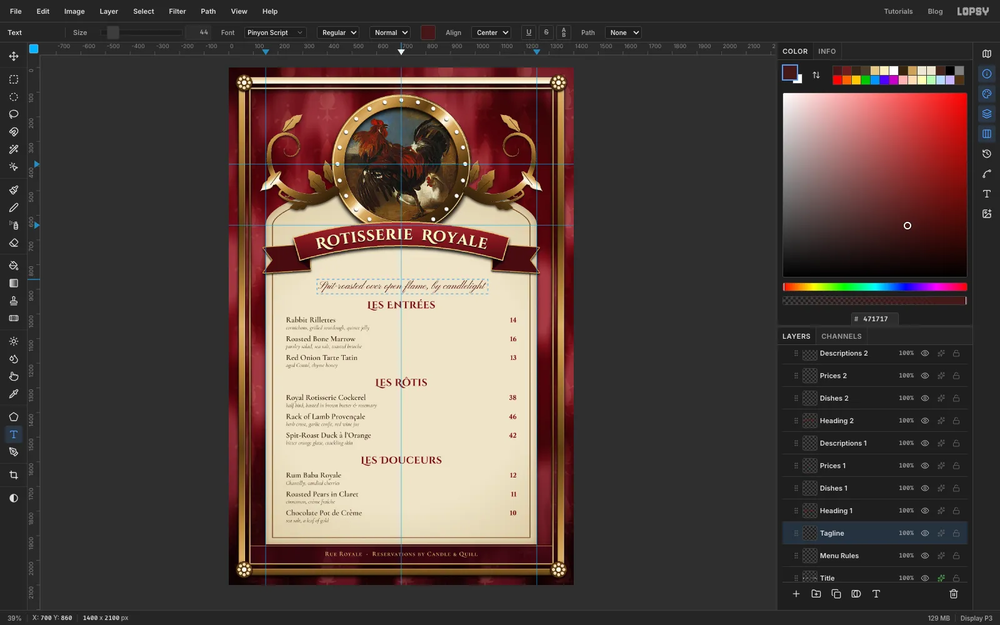

Repeat the four layers for each course, always working upwards. Each course sits 315 px above the one below it:

- **Les Rôtis:** heading at y **1255**, dish names at **232, 1320**, descriptions at **232, 1352**, prices at **1168, 1324**.
- **Les Entrées:** heading at y **940**, dish names at **232, 1005**, descriptions at **232, 1037**, prices at **1168, 1009**.

Finish with the tagline: **Pinyon Script**, **Regular**, Normal, size **44**, `#471717`, **Letter spacing** 0, **Align center**. Click on the centre guide at y **860** and type `Spit-roasted over open flame, by candlelight`.

The dishes, with their prices and descriptions:

- **Les Entrées:** Rabbit Rillettes, 14, *cornichons, grilled sourdough, quince jelly*. Roasted Bone Marrow, 16, *parsley salad, sea salt, toasted brioche*. Red Onion Tarte Tatin, 13, *aged Comté, thyme honey*.
- **Les Rôtis:** Royal Rotisserie Cockerel, 38, *half bird, basted in brown butter & rosemary*. Rack of Lamb Provençale, 46, *herb crust, garlic confit, red wine jus*. Spit-Roast Duck à l'Orange, 42, *bitter orange glaze, crackling skin*.
- **Les Douceurs:** Rum Baba Royale, 12, *Chantilly, candied cherries*. Roasted Pears in Claret, 11, *cinnamon, crème fraîche*. Chocolate Pot de Crème, 10, *sea salt, a leaf of gold*.

## Rule the headings

1. Click **Menu Rules** and set the brush to **Size** 3, **Hardness** 100, **Taper** 0, colour `#68461D`. Turn on **Symmetry Vertical**.
2. For each heading, click at x 248 level with the middle of the heading, then Shift-click about 28 px short of the heading's first letter. The mirror draws the right-hand rule for you.
3. At **Size** 9, click a dot at each end of the rule.
4. Turn symmetry off.

## Add dotted leaders

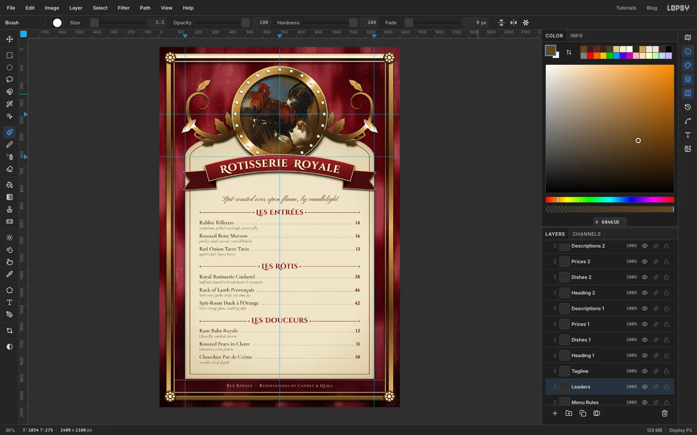

1. Click **Menu Rules** and add a layer called **Leaders**. In the brush presets set **Size** 3.5 and **Spacing** 200%, the maximum. The dabs separate into dots.
2. For each dish, click 9 px left of the price, on the dish name's baseline, then Shift-click 14 px right of the end of the name. Starting at the price keeps the last dot the same distance from every figure.
3. Set **Spacing** back to 10% when you're done.

## Light it by candle

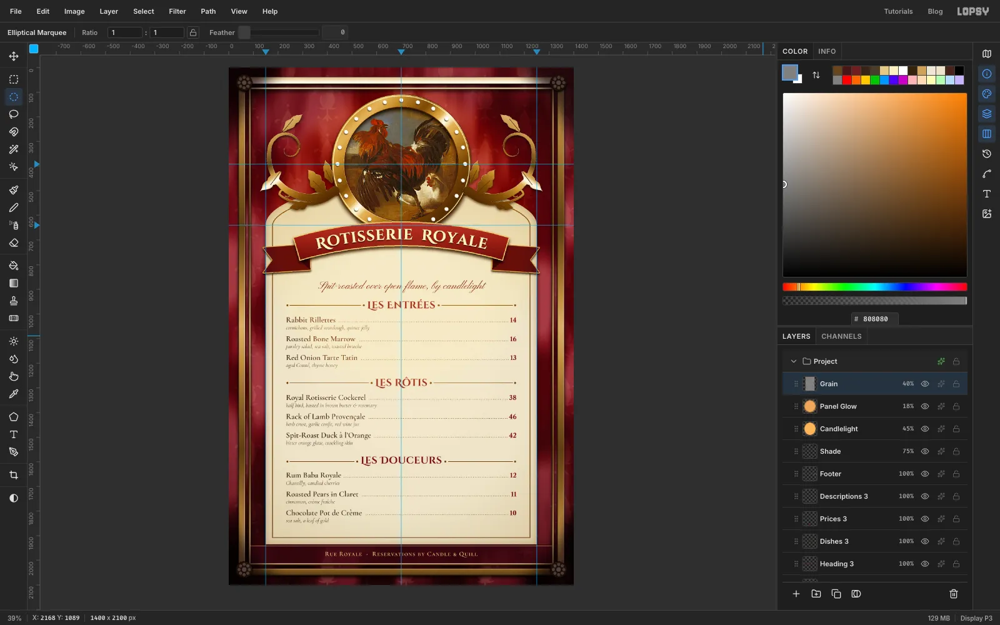

Click the top layer in the panel, so these go above everything.

1. **Shade:** add a layer called **Shade** and fill it with `#12020A`. Make an exact ellipse from **-170, -220** to **1570, 2320**, **Select → Feather…** by **240** and press [[Delete]]. Set it to **Multiply** at **75%**.
2. **Candlelight:** add a layer called **Candlelight**, make an ellipse from **160, 80** to **1240, 1300**, feather it **260** and fill it with `#FFB45A`. Set it to **Soft Light** at **45%**.
3. **Panel Glow:** add a layer called **Panel Glow**, make an ellipse from **300, 720** to **1100, 1560**, feather it **200** and fill it with `#F2A65A`. Set it to **Screen** at **18%**.
4. **Grain:** add a layer called **Grain**, fill it with `#808080`, run **Add Noise…** at **30** with **Mono**, and set it to **Overlay** at **40%**.

## Group the layers

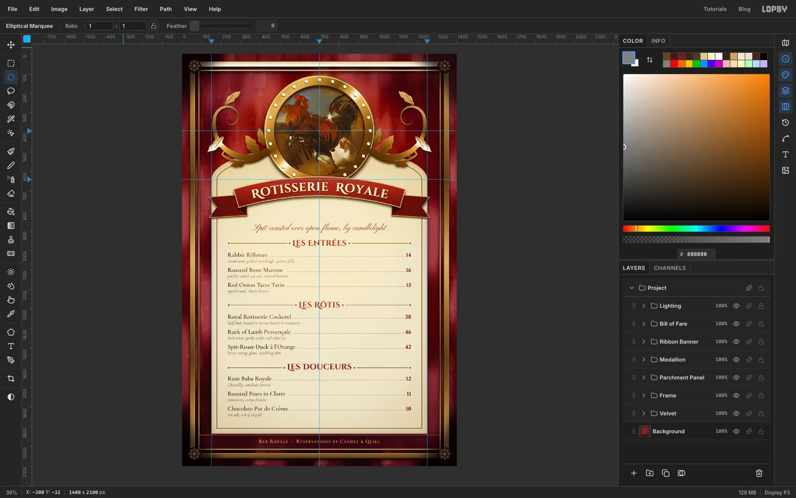

Click the first layer of each set, Shift-click the last, and choose **Layer → Group Layers**. Then rename the group:

- **Velvet**: Damask and Folds
- **Frame**: Gilt Frame up to the rosette relief
- **Parchment Panel**: Parchment up to Footer Fillet
- **Medallion**: Painting up to Scroll Right
- **Ribbon Banner**: Ribbon Tails, Ribbon and Title
- **Bill of Fare**: Menu Rules, Leaders and all the type
- **Lighting**: Shade, Candlelight, Panel Glow and Grain

New groups blend straight through at 100%, so the Multiply and Soft Light layers still reach everything below. You can now click **Medallion** and drag the whole medallion, scrolls and all, with the Move tool.

## Grade the whole menu

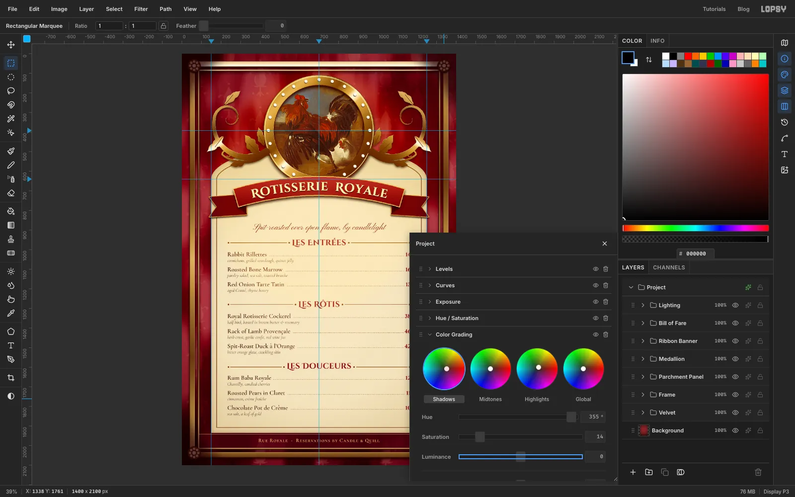

Click the sparkle icon on the **Project** row to open its adjustments, and expand **Color Grading**.

1. Click **Highlights** under the wheels and set **Hue** 40, **Saturation** 10. The lights go slightly amber.
2. Click **Shadows** and set **Hue** 355, **Saturation** 14. The darks go towards oxblood.

Keep both small. The candlelight already does most of the warming.

Save the project with **File → Save Project** and export with **File → Quick Export PNG**.
