In the 1630s, Haarlem painters such as Willem Claesz Heda made a speciality of the *banketje*, the "little banquet": a table of oysters, a lemon half peeled, a tall glass of wine and tipped silver, all lit from one window against a dark wall. Oysters meant luxury, and the unfinished meal hinted that pleasure doesn't last.

This tutorial builds that scene as the cover of **BANKET**, a made-up food quarterly. The issue is *The Oyster Months*, named for the old rule that you only eat oysters when the month has an R in it. It's a photomontage. Everything on the table is a real object, photographed by a museum or a diner, then cut out and relit in Lopsy until they share one room.

The tricky part is that none of these photos were lit alike. Here's how the tutorial gets around that:

- **Hard Light** lets glass shot on grey sit over a dark wall, with the masthead still showing through it.
- Selections made from a layer's own thumbnail clip **Multiply** shading to each object.
- A shared group grade and a warm glaze over everything pull the photos together.

The document is **1600 × 2080 px**, a magazine page at about 190 dpi.

The photos are all free to use, from Wikimedia Commons:

- [Roemer glass](https://commons.wikimedia.org/wiki/File:Roemer_MET_DP-1725-023.jpg), The Metropolitan Museum of Art, CC0
- [Silver shell tazza](https://commons.wikimedia.org/wiki/File:Tazza_(drinkschaal_op_voet)_Coupe_van_gedreven_zilver,_BK-NM-12985.jpg), Rijksmuseum, CC0
- [Plate of oysters](https://commons.wikimedia.org/wiki/File:Plate_of_6_oysters_-_La_Petite_Plage_2025-03-25.jpg), CC0
- [Pewter plate](https://commons.wikimedia.org/wiki/File:Plate_by_John_Will,_New_York_City,_c._1765,_pewter_-_Albany_Institute_of_History_and_Art_-_DSC08000.JPG), Albany Institute of History and Art, CC0
- [Lemon](https://commons.wikimedia.org/wiki/File:Lemon_with_white_background.jpg), CC0
- [Half lemon](https://commons.wikimedia.org/wiki/File:Shiny_half_lemon_(21588021708).jpg), CC0
- [Knife, 1601](https://commons.wikimedia.org/wiki/File:Mes_Margaretha_de_Raet,_Anno_1601._Den_7_octobris.,_BK-1962-39.jpg), Rijksmuseum, CC0

For the layout and light, look at Heda's [Still Life with Oysters, a Silver Tazza, and Glassware](https://commons.wikimedia.org/wiki/File:Still_Life_with_Oysters,_a_Silver_Tazza,_and_Glassware_MET_DP120415.jpg).

Before you start, crop the photos in any image viewer so each object nearly fills its frame, because Lopsy shrinks a paste that's larger than the page. The sizes used here were:

- Glass: about 900 × 1600
- Tazza: about 1500 × 1500
- Pewter plate: about 1500 × 1340
- Lemon: about 1300 × 940
- Half lemon: about 1000 × 940
- Knife: about 370 × 1400
- Oysters: cut four from the photo, with the long side about 1100

The palette:

- Wall `#6A5933` → `#3C3119` → `#191409` → `#0C0A05`
- Table `#6A261C` → `#451510` → `#3C110C`
- Cloth `#55180F` → `#2C0A07` → `#100303`
- Masthead `#FCEDBE` → `#ECCB84` → `#C89E52`
- Cream type `#F2E4C0`, `#EADFC2`, `#E6D3A4`
- Gold type `#D2AC62`
- Wine `#B99E4A` → `#E6D484` → `#CDB25C`

Two habits save trouble throughout:

- **[[V]] then a handle.** Only the Move tool transforms pixels. Draw a marquee around the object with [[M]], press [[V]], then use the handles. `⌘`-drag a corner to scale evenly, and drag the circles outside the corners to rotate.
- **Paste leaves things armed.** Every paste selects the pasted pixels and switches to the Move tool, so press [[⌘D]] before you do anything else. Also press [[⌘D]] to commit each transform. Enter does not commit one.

## Paint the wall

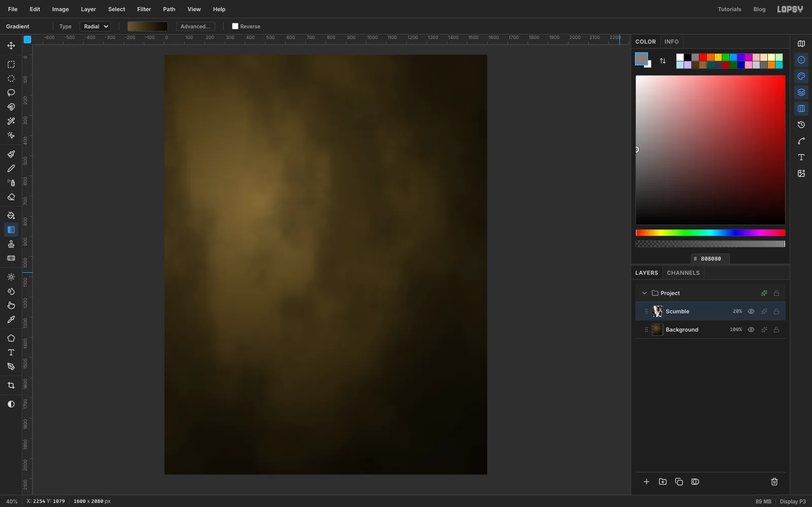

1. Create a **1600 × 2080** document. Delete **Layer 1** and click **Background**.
2. Pick the **Gradient** tool and set **Type** to **Radial**. Click **Advanced…** and set the stops to `#6A5933`, `#3C3119` at 40%, `#191409` at 78% and `#0C0A05`. Click the handle row to add a stop, drag it to its position, and type its hex. Stops stay in the editor between gradients, so delete any extras each time you start a new one.
3. Drag from a point left of centre, a third of the way down, out to the lower right corner. That's your window light.
4. Add a layer called **Scumble**. Set the foreground to `#808080` and choose **Edit → Fill**, then run **Filter → Clouds…** and **Filter → Add Noise…** with **Amount** 18.
5. Click the sparkle icon on the layer's row and set its **Blend** to **Overlay**, which is where every blend mode in this tutorial lives. Click the percentage on the row and set the opacity to **20%**. Old walls look scrubbed and uneven rather than flat.

## Lay the table

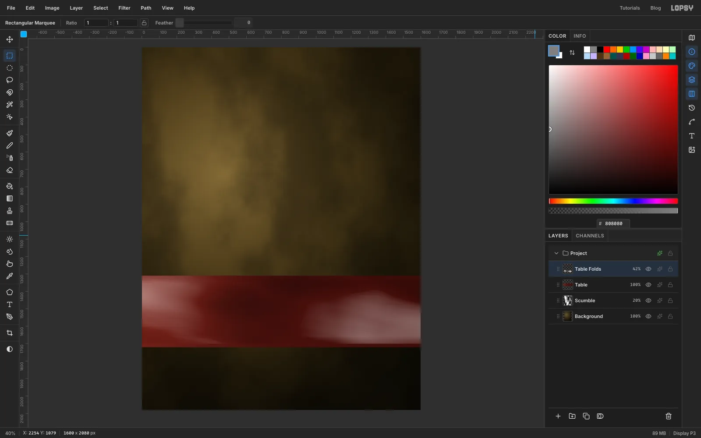

1. Add a layer called **Table** and press [[M]]. With nothing selected, click once on the canvas to open the exact-corners dialog, and enter X 0 to 1600, Y 1310 to 1720.
2. Set a **Linear** gradient to `#6A261C`, `#451510` at 45% and `#3C110C`, then drag from the left end of the band to the lower right. Press [[⌘D]].
3. Add a layer called **Table Folds** and use the dialog again for X 0 to 1600, Y 1310 to 1700. Fill it with `#808080`, then run **Clouds…** followed by **Motion Blur…** with **Angle** 12 and **Distance** 420. Press [[⌘D]].
4. Set the layer to **Hard Light** at **42%**. Mid-grey does nothing in this mode, so only the light and dark smears show.

## Hang the cloth

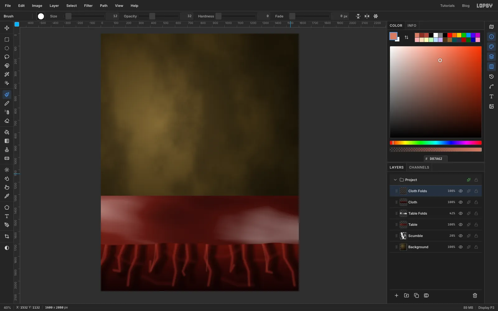

1. Add a layer called **Cloth**. With the Lasso ([[L]]), draw around the area below the table with a very slightly wavy top edge at the table's front, about 380 px above the bottom of the page.
2. Drag a vertical **Linear** gradient through it, from `#55180F` through `#2C0A07` to `#100303`. Press [[⌘D]].
3. Add a layer called **Cloth Folds**, and lasso the same shape again so you can't paint above the table edge.
4. Press [[B]] and paint about eleven fold valleys from the table edge downward, at **Size** 96, **Hardness** 15, **Opacity** 62, in `#090201`. Space them unevenly, let them lean outward from the centre as they fall, and stop some of them well before the bottom.
5. Paint a lit ridge just to the left of each valley, at **Size** 34, **Hardness** 0, **Opacity** 40, in `#B4483A`.
6. Straight folds look like curtain stripes, so paint six short sagging strokes across pairs of neighbouring folds at **Size** 50, **Opacity** 16, in `#8E3024`.
7. Add a few thin highlights near the top of every third ridge at **Size** 12, **Opacity** 32, in `#D87A62`.
8. Press [[⌘D]] and run **Filter → Gaussian Blur…** with **Radius** 10.

## Bend the light around the edge

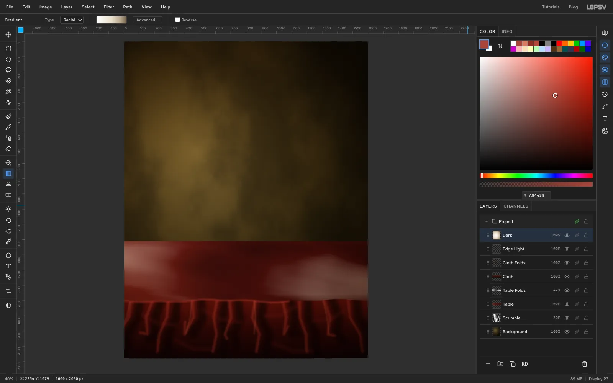

1. Add a layer called **Edge Light**. With the Brush at **Size** 26, **Hardness** 0, **Opacity** 42 and colour `#A84438`, paint along the table edge from the left for about two-thirds of the width. Stop there, because that end is furthest from the window.
2. Add a layer called **Dark**. Drag a **Radial** gradient from the middle of the page to the bottom right corner, with stops `#FFFFFF`, `#E8DECA` at 50%, `#B4A288` at 82% and `#6E5E48`.
3. Set **Dark** to **Multiply**. This is the only layer here that shades the room itself. The objects get their own shading later, and it needs to stay under the masthead so the gold keeps its strength.

## Set the masthead

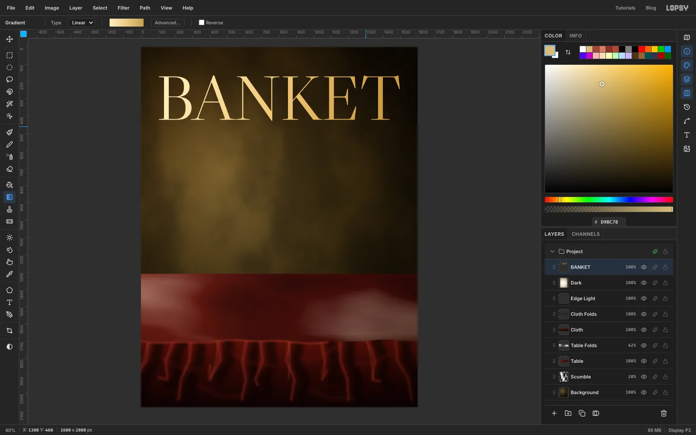

1. With **Dark** active, press [[T]]. Set the font to **Libre Caslon Display** and **Size** to **362**, set the colour to `#D9BC78`, then click about 90 px from the left and 40 px from the top, and type `BANKET`. Press [[Tab]] to commit.
2. Text sits below where you click, so the letters land about 165 px from the top. Check the left and right margins match, at about 104 px, and press the arrow keys with the Move tool ([[V]]) if they don't.
3. Click **Rasterize Layer** at the bottom of the Layers panel, because you'll be cutting into these letters later.
4. `⌘`-click the layer's thumbnail to select the letters. Drag a **Linear** gradient diagonally across them with stops `#FCEDBE`, `#ECCB84` at 50% and `#C89E52`. Press [[⌘D]].

## Put the shadows down first

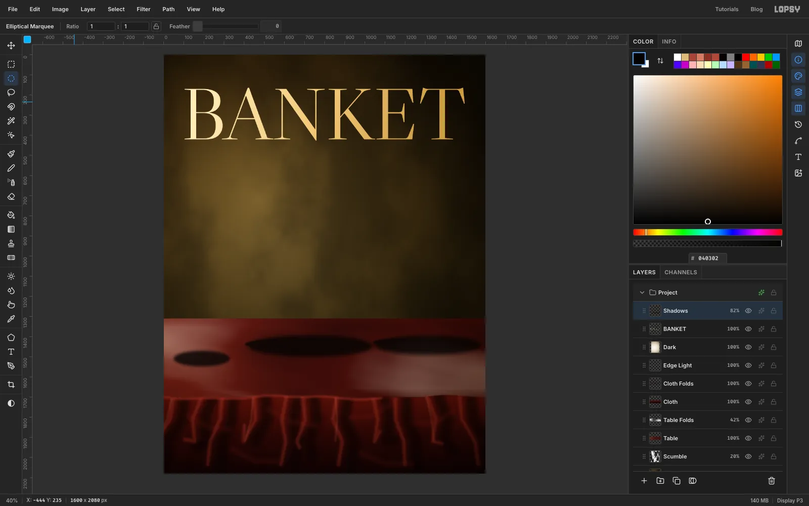

Shadows go under the objects, so it's easier to lay them before the objects arrive.

1. Add a layer called **Shadows** above **BANKET**.
2. Click the **Elliptical Marquee** in the toolbox. With nothing selected, click once on the canvas and the exact-corners dialog opens, which is the easiest way to place these. Each ellipse gets **Select → Feather…** and then **Edit → Fill** in `#040302`, and the fill leaves the selection live, so press [[⌘D]] before the next click.
3. Make the five ellipses listed below. They lean to the right, because the light comes from the left.
4. Press [[⌘D]] and set the layer to **82%** opacity.

The ellipses:

- The cone, at the far left of the table: X 50 to 330, Y 1470 to 1548, **Feather** 14.
- The glass, a cast shadow: X 420 to 1040, Y 1392 to 1500, **Feather** 20.
- The glass, a tight contact shadow: X 404 to 850, Y 1412 to 1462, **Feather** 6.
- The tazza, a cast shadow: X 1050 to 1580, Y 1392 to 1490, **Feather** 20.
- The tazza, a tight contact shadow: X 1040 to 1350, Y 1408 to 1450, **Feather** 6.

## Paste the silver tazza

With **Shadows** active, paste your tazza crop with [[⌘V]]. It lands in the top left corner on a new layer. Name it **Tazza** and press [[⌘D]].

## Select the backdrop with the wand

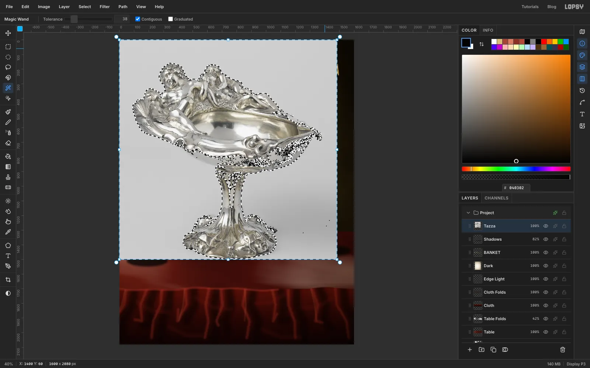

This backdrop is an even grey, so let the Magic Wand ([[W]]) find it.

1. Set **Tolerance** to **38** with **Contiguous** on, and click a corner of the grey.
2. `Shift`-click the other three corners to add them.

Look closely at the ants. The figures on top are selected beautifully, but polished silver reflects the backdrop, so the selection has leaked into the stem and the underside of the bowl.

## Take the silver back out of the selection

Press [[L]] and hold `Alt` as you drag to subtract from the selection. Trace just inside the silhouette, from the underside of the bowl, down the stem, around the foot and back up the other side. Include the curled tip at the right end of the bowl too. Keep the line tight against the edge where the grey touches the silver. Anything left selected there will bite a hole in the rim.

## Delete the backdrop and trim the fringe

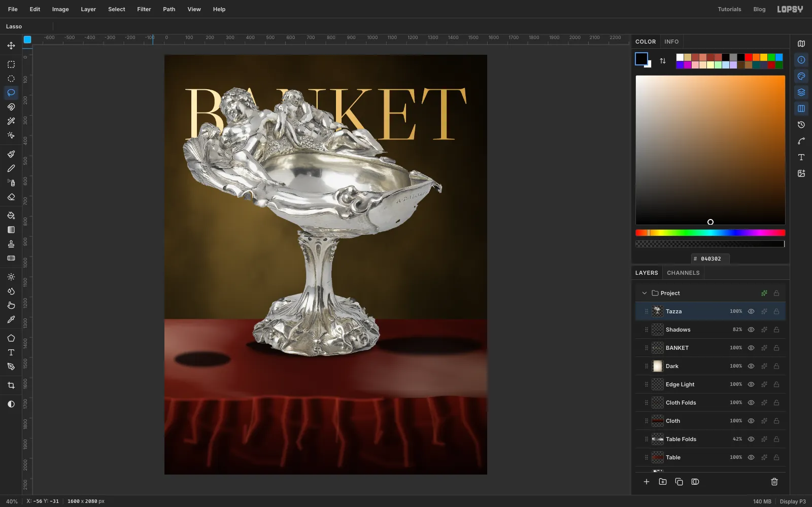

1. Press [[Delete]], then [[⌘D]].
2. A wand leaves a thin rim of backdrop that glows against a dark wall, so `⌘`-click the **Tazza** thumbnail.
3. Choose **Select → Shrink…** with 2, then **Select → Feather…** with 1, then **Select → Inverse**. Press [[Delete]] and [[⌘D]].

## Scale and place it

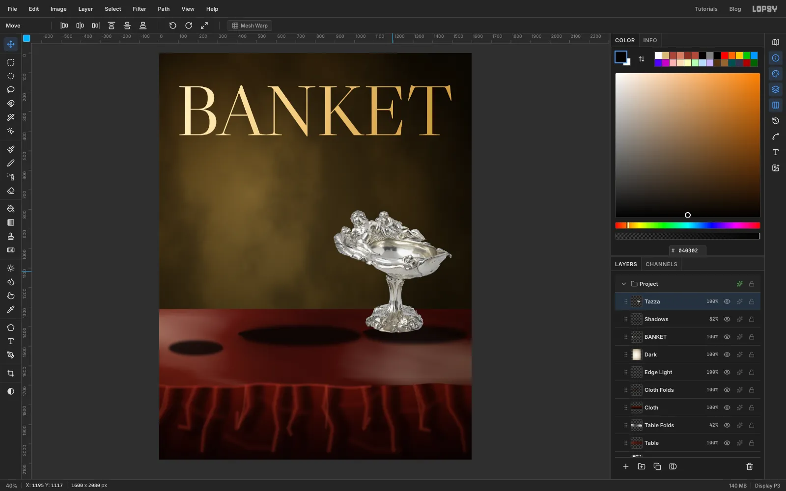

1. Marquee around the tazza ([[M]]), press [[V]], then `⌘`-drag the bottom right corner up and in until it's about **47%** of its size. Press [[⌘D]].
2. Marquee it again, press [[V]], and drag it into place, with its right tip on the 104 px margin and its foot just below the back edge of the table, over the shadow you made. Press [[⌘D]].

## Move the silver into the room

1. `⌘`-click the **Tazza** thumbnail and add a layer called **Tazza Shade**. The selection stays live and clips what follows.
2. Drag a **Radial** gradient from the upper left of the bowl to the lower right of the foot, with stops `#FFFFFF`, `#BEBAAE` at 45% and `#3A3832`. Set the layer to **Multiply**.
3. Add a layer called **Tazza Warm**. Polished silver mirrors whatever is around it, so with the Brush at **Hardness** 0, paint across the foot at **Size** 90, **Opacity** 55, in the cloth's red, `#B02A18`.
4. Paint across the left of the bowl at **Size** 120, **Opacity** 40, in `#C89038`.
5. Press [[⌘D]] and set the layer to **Overlay** at **38%**.

## Cut out the glass

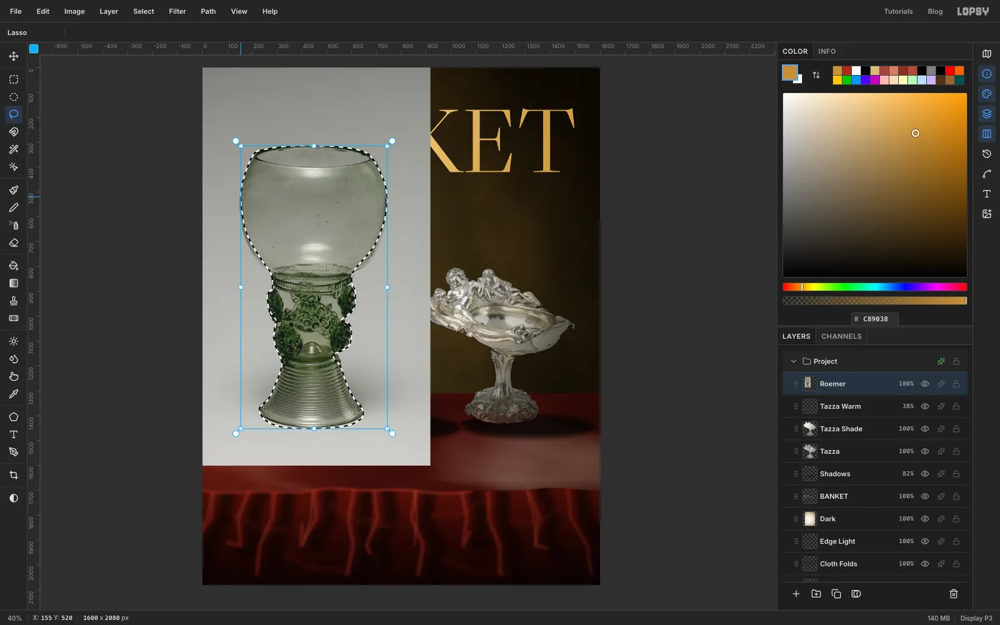

1. Click **Tazza Warm**, paste the roemer crop with [[⌘V]], name the layer **Roemer** and press [[⌘D]].
2. A wand can't help here, because the glass is the same grey as the backdrop. Lasso ([[L]]) around the outline by hand. Take your time on the knobbly prunts on the stem.

## Clean the prunts and place the glass

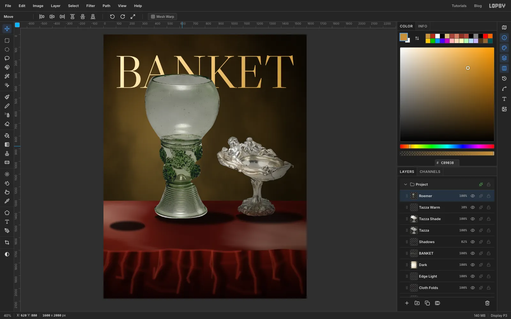

1. Choose **Select → Inverse**, press [[Delete]] and press [[⌘D]].
2. Slivers of backdrop will remain between the prunts, and these will show as pale slips later. `⌘`-click the **Roemer** thumbnail, then choose **Select → Shrink…** with 7 and **Select → Inverse**.
3. Press [[M]], then hold `Shift` + `Alt` and drag a rectangle across the stem only, from below the bowl to above the ribbed foot. That keeps just the stem's fringe selected, leaving the bowl and foot alone. Press [[Delete]] and [[⌘D]].
4. Marquee the glass, press [[V]], and drag it so it sits left of centre, with its foot on the contact shadow. Its rim should overlap the bottom of the masthead. Press [[⌘D]].

## Turn the glass transparent

Set **Roemer** to **Hard Light** at **86%**. In this mode, anything lighter than mid-grey lightens what's below and anything darker darkens it. A grey backdrop inside the glass is close to neutral, so the wall and the masthead appear through it, and only the glass's own highlights and dark lines are left. This one setting does most of the work on the whole cover.

## Bend the letters through the bowl

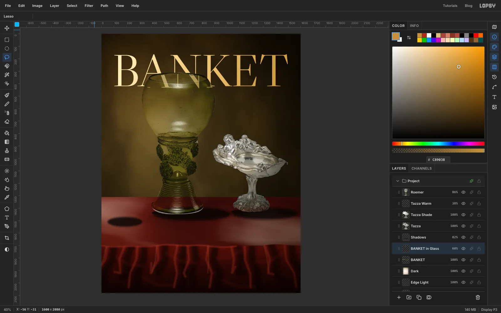

Real glass moves whatever you see through it.

1. Click the **BANKET** row and lasso the part of the bowl that overlaps the letters, staying on the bowl's outline.
2. Press [[⌘X]] then [[⌘V]]. The letters come back in place on their own layer directly above **BANKET**. Name it **BANKET in Glass** and press [[⌘D]].
3. Marquee the piece, press [[V]], and drag it about 26 px right and 10 px down. Press [[⌘D]].
4. Some of it now pokes out past the bowl, so lasso the same outline, choose **Select → Inverse**, press [[Delete]] and press [[⌘D]].
5. Set the layer's opacity to **60%**.

## Pour the wine

1. Click **Roemer** and add a layer called **Wine**. Lasso the lower half of the bowl, just inside the glass wall, with a shallow curve along the top about halfway down the bowl. Stop where the bowl meets the collar.
2. Choose **Select → Feather…** with 3.
3. Drag a **Linear** gradient from one side of the wine to the other, with stops `#B99E4A`, `#E6D484` at 50% and `#CDB25C`. White wine is pale and a little green, so stay away from orange. Press [[⌘D]].
4. Set the layer to **Multiply**.

## Add the surface and the light inside

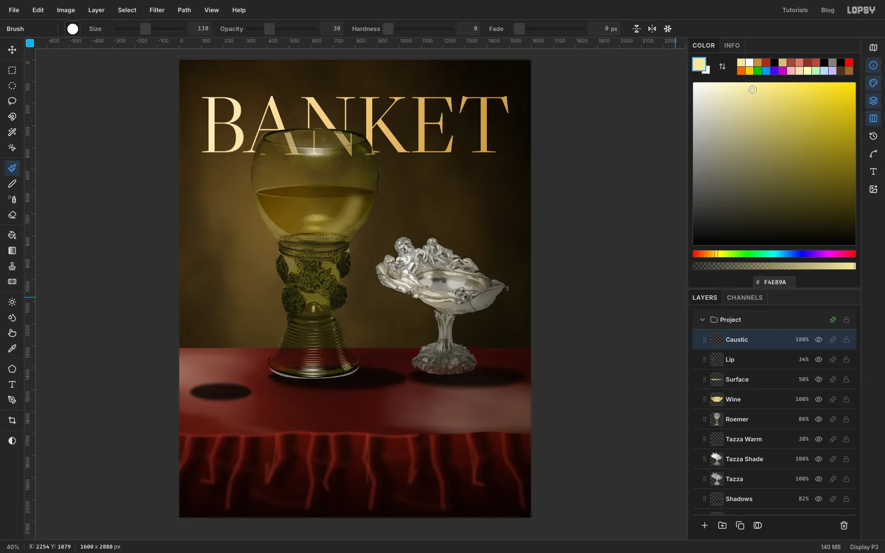

1. Add a layer called **Surface**. Use the Elliptical Marquee to draw a flat ellipse across the wine level, about 530 px wide and 56 px tall.
2. Drag a **Linear** gradient from left to right, with stops `#D2C68A`, `#9C9050` at 55% and `#5A5226`. Press [[⌘D]] and set the layer to **Multiply** at **50%**.
3. Add a layer called **Lip**. Draw the same ellipse a couple of pixels larger and drag a left-to-right gradient of `#F6EEC4`, `#6E6028` at 50% and `#3A3212`.
4. Choose **Select → Shrink…** with 3, press [[Delete]] and press [[⌘D]], which leaves only a thin ring. Set it to **34%**.
5. Add a layer called **Caustic**. Glass focuses light on the side away from the window, so paint one soft curve in the lower right of the wine with **Size** 130, **Hardness** 0, **Opacity** 30, in `#F4E89A`. Set the layer to **Screen**.

## Reflect the window

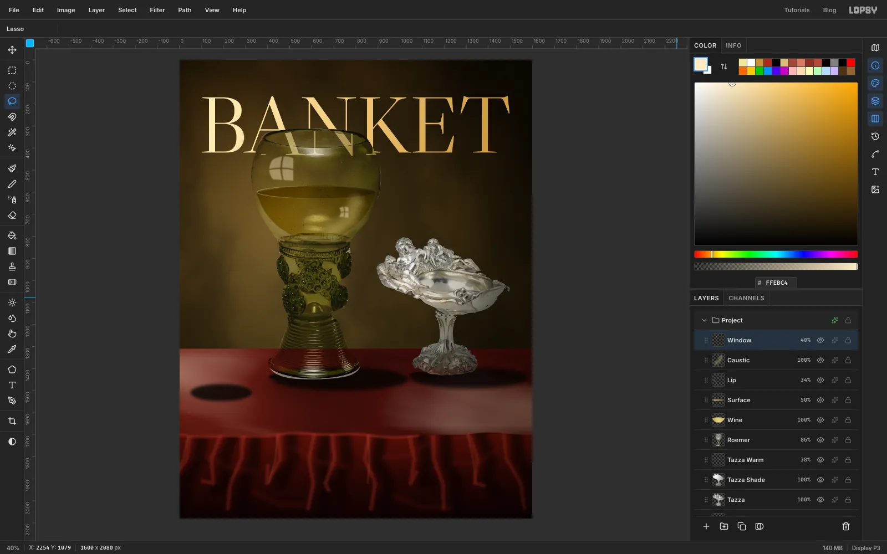

Every glass in a Dutch still life has this: the painter's studio window, bent around the bowl.

1. Add a layer called **Window** and set the colour to `#FFEBC4`.
2. With the Lasso, draw four small panes with slightly bowed sides in the upper left of the bowl, about 90 px across in total, leaving a thin bar between them. Fill each with **Edit → Fill** and leave the selection until you start the next pane.
3. Do the same at about half that size in the lower right of the wine, where the window comes through small and upside down.
4. Press [[⌘D]] and run **Gaussian Blur…** with **Radius** 6. Set the layer to **Screen** at **40%**.

## Add a few sparks

Add a layer called **Glints** and paint in white. Be sparing, because too many look like digital specks.

1. Click five spots on the prunts, with the Brush at **Size** 8, **Hardness** 20, **Opacity** 55.
2. Paint one stroke along the front edge of the foot at **Size** 6, **Hardness** 40, **Opacity** 60. It pulls the foot away from the dark table.

## Set a page of type

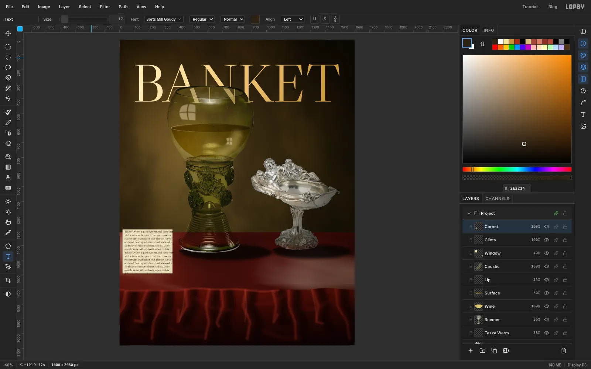

Dutch painters loved a cone of pepper twisted from a printed page.

1. Add a layer called **Cornet**, marquee a rectangle about 340 × 300 px at the left of the table, fill it with `#E8DDBE` and press [[⌘D]].
2. Press [[T]], with **Sorts Mill Goudy** at **Size** 17 in `#2E2214`, and click just inside the top left of the rectangle. Paste or type about thirteen lines of any old recipe text, and press [[Tab]].
3. Click **Rasterize Layer**, then choose **Layer → Merge Down** to print the type onto the paper.

## Roll the page into a cone

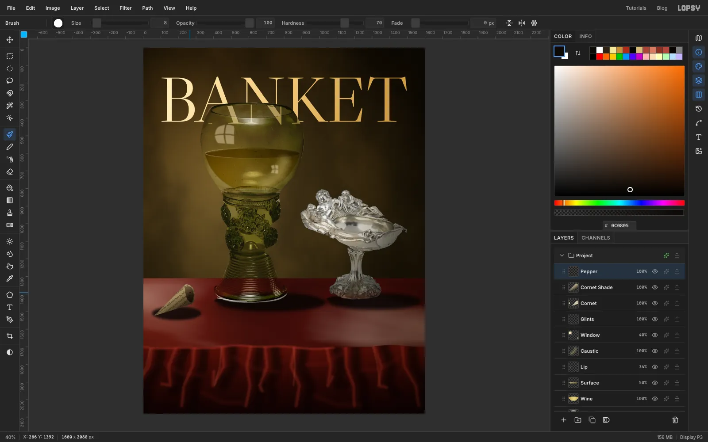

1. Marquee the page, press [[V]], rotate it about **38°** counter-clockwise and press [[⌘D]].
2. Lasso a long cone with its point at the lower left and a rounded open end at the upper right, about 240 px long. Choose **Select → Inverse**, press [[Delete]] and press [[⌘D]].
3. `⌘`-click the **Cornet** thumbnail and add a layer called **Cornet Shade**. Drag a **Linear** gradient across the cone's width, from `#D8CEB4` on the lit top edge through `#A89C80` at 45% to `#3E3424`. Press [[⌘D]] and set it to **Multiply**.
4. Add a layer called **Pepper**. Lasso the mouth of the cone and drag a gradient across it from `#6A5A3E` through `#241A0E` at 55% to `#0E0A05`. The lighter side is the inside of the paper.
5. With the Brush at **Size** 8, **Hardness** 70, **Opacity** 100, in `#0C0805`, click a few peppercorns into the mouth. Press [[⌘D]].

## Paste the pewter plate

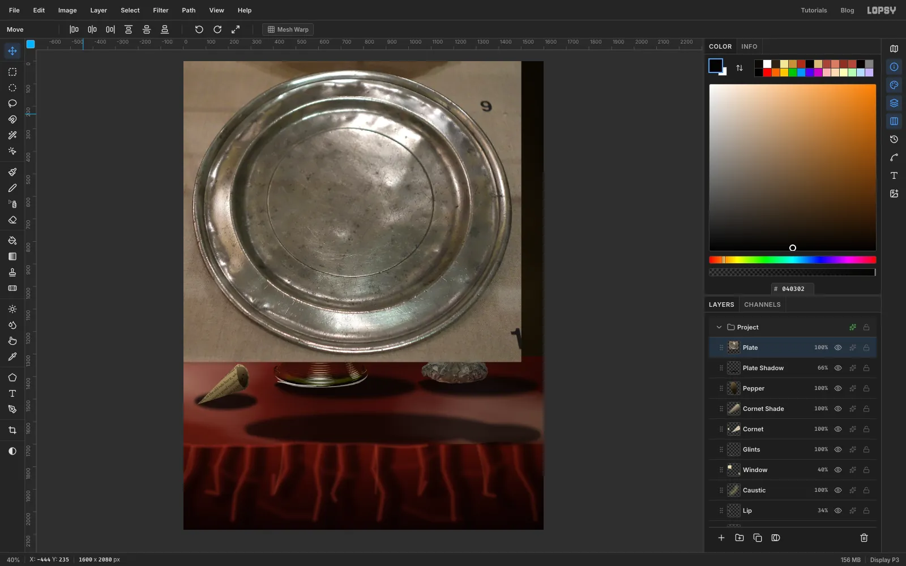

1. Click **Pepper** and add a layer called **Plate Shadow**. With the Elliptical Marquee's exact-corners dialog, make the three ellipses listed below, feathered and filled with `#040302` as before.
2. Press [[⌘D]] and set the layer to **66%**.
3. Paste the plate crop, name the layer **Plate** and press [[⌘D]].

The ellipses:

- Under the plate: X 270 to 1380, Y 1560 to 1702, **Feather** 18.
- A tight contact shadow: X 280 to 1290, Y 1610 to 1684, **Feather** 7.
- Under the lemon, to come: X 1230 to 1590, Y 1610 to 1706, **Feather** 16.

## Foreshorten the plate

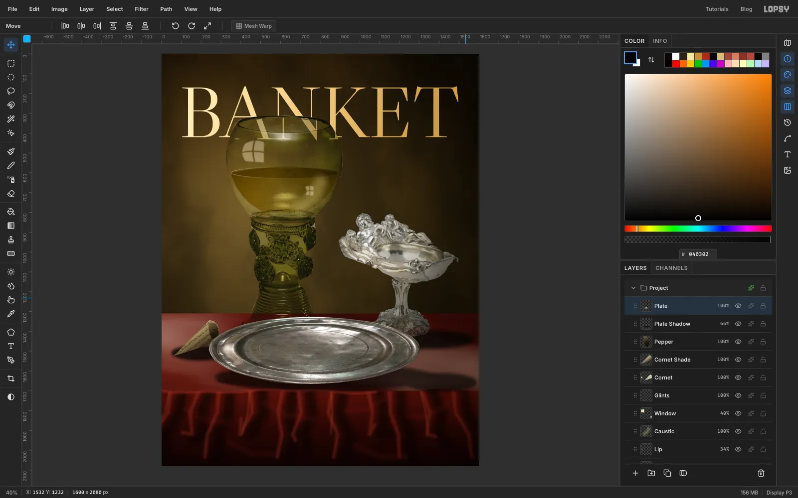

1. Lasso around the rim, then choose **Select → Inverse**, press [[Delete]] and press [[⌘D]].
2. Marquee the plate, press [[V]], and `⌘`-drag a corner until it's about **75%** of its size. Press [[⌘D]].
3. Marquee it again and drag the bottom middle handle up until it's about **36%** of its height. A round plate seen from low down is a very flat ellipse. Press [[⌘D]].
4. Marquee it once more, press [[V]], and drag it to the centre of the table. Press [[⌘D]].
5. Run **Filter → Hue/Saturation…** with **Saturation** −25.

A painted gradient ellipse can't match this plate. The dents and scratches are what make the surface look like old metal.

## Shade the plate

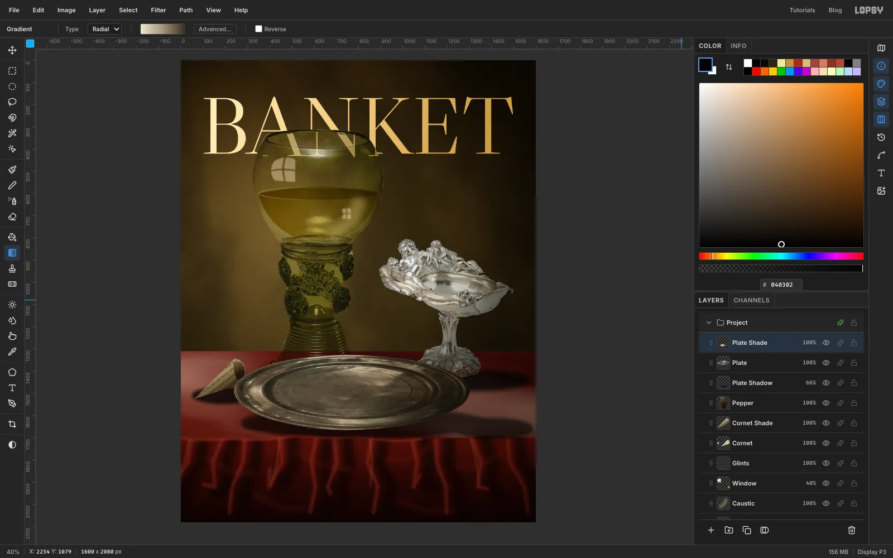

`⌘`-click the **Plate** thumbnail and add a layer called **Plate Shade**. Drag a **Radial** gradient from the upper left of the plate to its right rim, with stops `#EFE6D0`, `#A5967A` at 50% and `#3C3222`. Press [[⌘D]] and set the layer to **Multiply**.

## Cut the first oyster

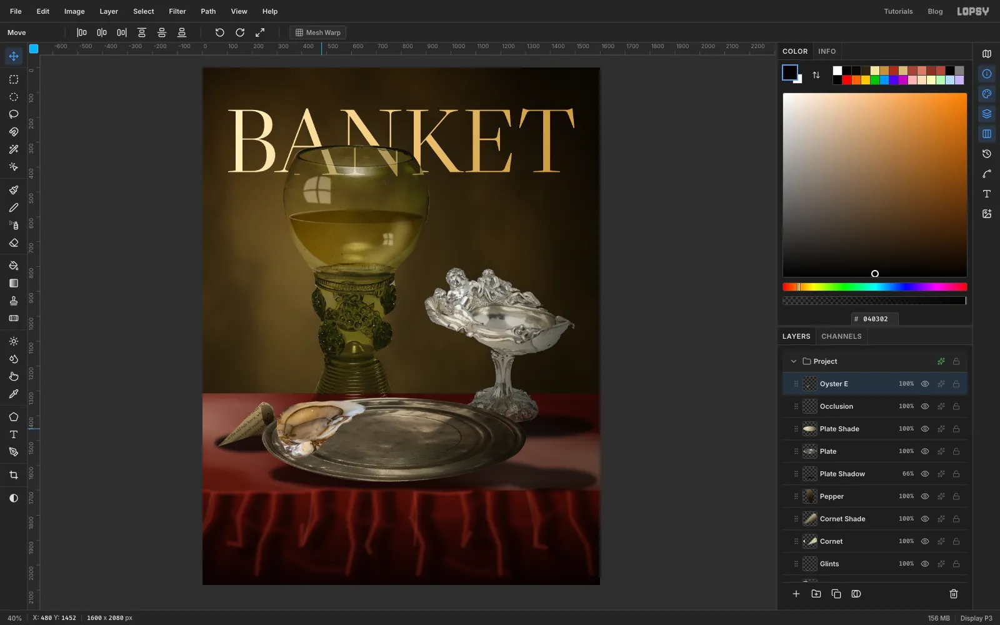

1. With **Plate Shade** active, add an empty layer called **Occlusion**. You'll paint on it once the oysters are placed.
2. Paste an oyster and name it **Oyster E**. Press [[⌘D]], lasso around the shell, then choose **Select → Inverse**, press [[Delete]] and press [[⌘D]].
3. The shell's pale edge melts into the white plate in the photo, so pull the outline in a little: `⌘`-click the thumbnail, then **Shrink** 5, **Feather** 2, **Inverse**, [[Delete]], [[⌘D]].
4. Marquee it, press [[V]], and drag it to the middle of the page so nothing crosses the canvas edge when you rotate. Press [[⌘D]].
5. Marquee it, press [[V]], and `⌘`-drag a corner to scale it to **37%**. Press [[⌘D]].
6. Marquee it again and drag the bottom handle up to **62%** of its height. Press [[⌘D]].
7. Marquee it again and rotate it about 10° counter-clockwise. Press [[⌘D]].
8. Marquee it once more, press [[V]], and drag it onto the left side of the plate. Press [[⌘D]].

The letters in the layer names come from lettering the photo's six shells A to F, which is why they skip.

## Add the two oysters behind it

Repeat the whole recipe for two more oysters, keeping each new paste above the last:

- **Oyster B**: scale to 37%, height to 70%, rotate 5° clockwise, and place at the back of the plate.
- **Oyster D**: scale to 37%, height to 75%, rotate 70° clockwise, and place on the right.

Click each of the three in turn and run **Gaussian Blur…** with **Radius** 2. It's a small amount of depth of field, so the eye goes to the front.

## Place the hero oyster

Click **Oyster D**, then cut a fourth oyster, **Oyster C**, the plumpest one, in the same way. Use a larger scale: **47%**, height to **72%**, then rotate about **80°** counter-clockwise, and place it front and centre. Keep the whole shell inside the plate's rim. No blur on this one.

## Model the hero shell

The photo was lit from above, but our light comes from the upper left.

1. `⌘`-click the **Oyster C** thumbnail and add a layer called **Oyster Shade**.
2. With the Brush at **Size** 130, **Hardness** 0, **Opacity** 42 in `#3A2A1C`, paint one stroke down the right side and along the bottom of the shell. Press [[⌘D]] and set the layer to **Multiply**.
3. Click the **Occlusion** layer. With **Size** 44, **Hardness** 0, **Opacity** 75 in `#050403`, paint a tight dark line on the plate under the lower right edge of each oyster. This makes them sit on the plate, not float over it.

## Bring in the lemon

1. Click **Oyster Shade** and paste the lemon. Name it **Lemon**, press [[⌘D]], lasso around the fruit and leave out its shadow. Choose **Select → Inverse**, press [[Delete]] and press [[⌘D]].
2. Run **Filter → Hue/Saturation…** with **Hue** 9, **Saturation** −18, **Lightness** 2. That shifts the photo's orange toward lemon yellow.
3. Move it to the middle of the page and scale it to **29%**, then rotate it about 14° counter-clockwise, then move it to the right of the plate. Use [[⌘D]] between steps.

## Shade the lemon

`⌘`-click the **Lemon** thumbnail and add a layer called **Lemon Shade**. Drag a **Radial** gradient from the upper left of the fruit past its lower right, with stops `#FFFFFF`, `#CDB084` at 50% and `#3A2810`. Press [[⌘D]] and set the layer to **Multiply**.

## Draw the rind spiral

A spiral of peel is two sets of shapes: the outside of the rind, facing you, and the inside of the rind, going around the back.

Start the spiral under where the half lemon will go, and let each turn lean slightly further right as it drops past the table edge. Each crescent is about 130 px wide and 50 px tall.

1. Add a layer called **Peel Back**. Lasso two narrow crescents, one under the other, curving down to the left. Fill each with a **Linear** gradient dragged across its width, with stops `#4A3C22`, `#B8AC8A` at 50% and `#54452A`. That's the inside of the rind. Press [[⌘D]].
2. Add a layer called **Peel Front**. Lasso two more crescents that curve the other way, and overlap the ends of the back pieces so the ribbon appears to wind around. Fill each with a gradient from `#6E5E44` through `#FFFFFF` at 42% and `#E4D8BE` at 70% to `#4A3C24`.
3. Press [[⌘D]].

## Cut real rind into the ribbon

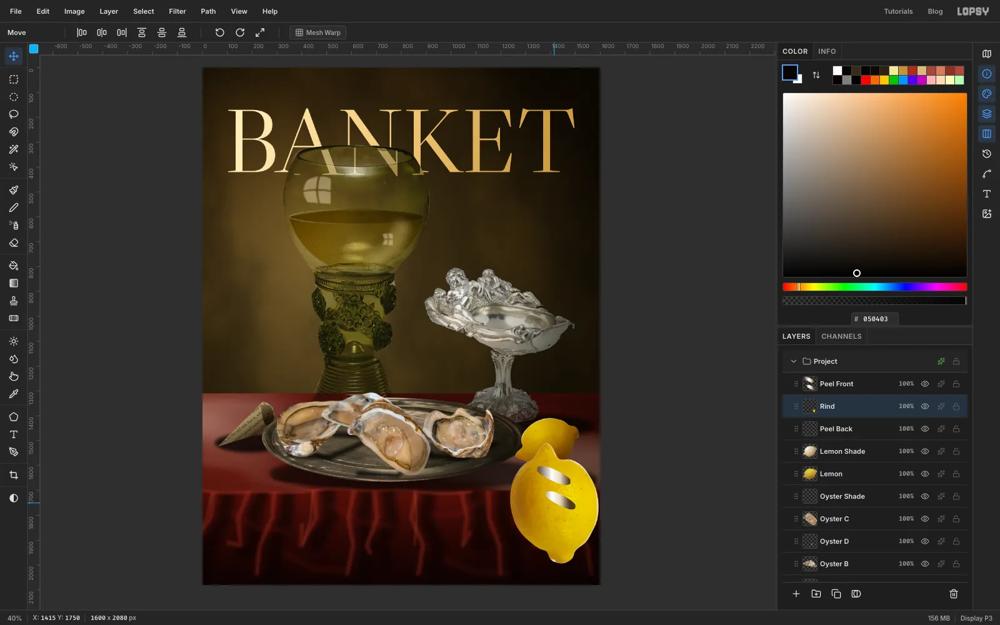

Those front shapes are only shading so far. The rind itself comes from the lemon photo.

1. Click **Peel Back** and paste the lemon again. Name it **Rind** and press [[⌘D]], then cut it out the same way as before.
2. Run **Hue/Saturation…** with **Hue** 9, **Saturation** −12, **Lightness** 2.
3. Move it to the middle of the page and scale it to **52%**. Rotate it **90°** clockwise, and drag it down over the spiral.

## Trim the rind to shape

1. With **Rind** still active, `⌘`-click the **Peel Front** thumbnail. The selection comes from that layer, but the active layer doesn't change.
2. Choose **Select → Feather…** with 1, then **Select → Inverse**, press [[Delete]] and press [[⌘D]].
3. Click **Peel Front** and set it to **Multiply**. Its white-to-brown gradients now shade the pores, so the ribbon looks curved.

## Add the cut half

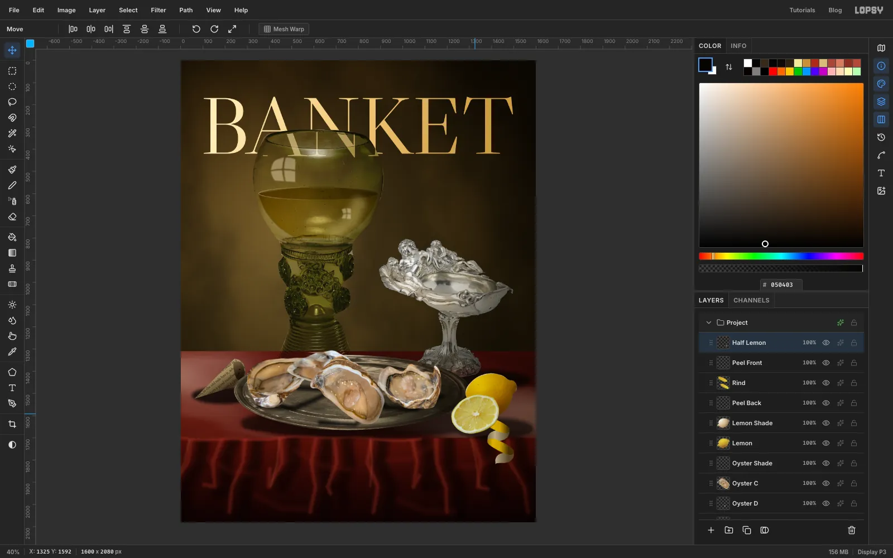

1. With **Peel Front** active, paste the half lemon and name it **Half Lemon**. Press [[⌘D]], lasso around the rim, then choose **Select → Inverse**, press [[Delete]] and press [[⌘D]].
2. Run **Hue/Saturation…** with **Hue** 6, **Saturation** −12.
3. Move it to the middle of the page. Scale it to **24%**, drag the bottom handle up to **82%** of its height, and rotate it about 18° counter-clockwise. Use [[⌘D]] and a new marquee between steps.
4. Drag it to lean against the whole lemon, hiding the point where the rind begins.

## Lay down the knife

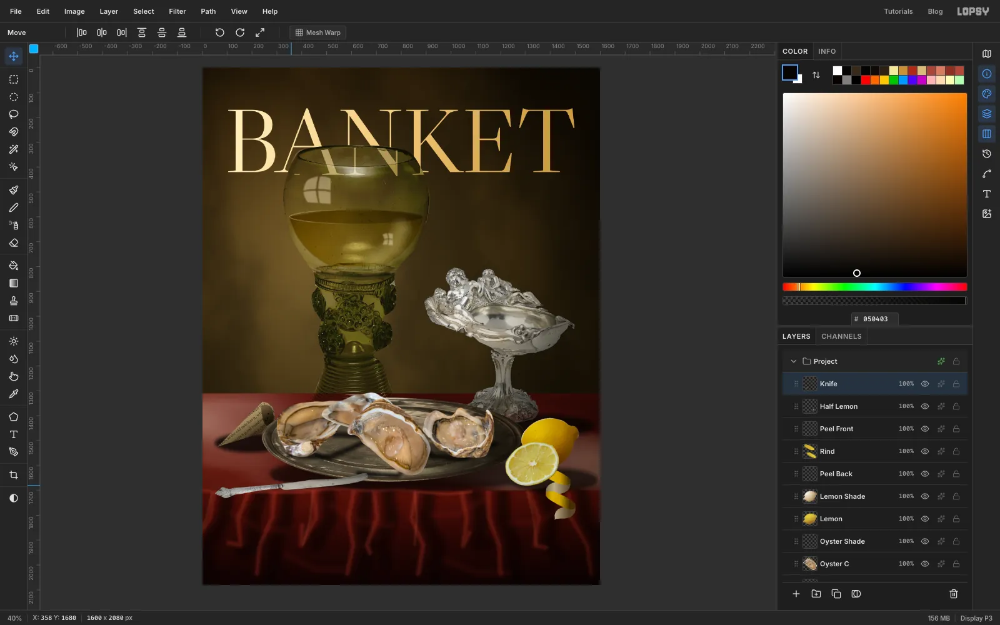

1. Click **Half Lemon**, paste the knife, name it **Knife** and press [[⌘D]]. Lasso around it, then choose **Select → Inverse**, press [[Delete]] and press [[⌘D]].
2. Run **Hue/Saturation…** with **Saturation** −85, **Lightness** −4. This blade is gilt in the photo, and a gold knife would compete with the masthead.
3. Move it to the middle of the page and scale it to **46%**, then rotate it **98°** counter-clockwise so the handle points left and slightly down. Then drag the bottom handle up to **70%** of its height.
4. Drag it to the front left of the table, with its tip almost at the plate and its handle hanging out over the edge. It's the one strong diagonal in a very horizontal picture.

## Seat everything with soft shadows

Click each layer, open its effects (the sparkle icon on its row) and turn on **Drop Shadow**. Keep them soft, because hard offset shadows look pasted on.

- **Oyster E**, **Oyster B**, **Oyster D**: **Offset X** 5, **Offset Y** 7, **Blur** 14, **Opacity** 72
- **Oyster C**: **Offset X** 6, **Offset Y** 8, **Blur** 16, **Opacity** 78
- **Lemon**: **Offset X** 14, **Offset Y** 10, **Blur** 18, **Opacity** 66
- **Rind**: **Offset X** 14, **Offset Y** 16, **Blur** 12, **Opacity** 66
- **Peel Back**: **Offset X** 12, **Offset Y** 14, **Blur** 10, **Opacity** 56
- **Half Lemon**: **Offset X** 8, **Offset Y** 10, **Blur** 12, **Opacity** 72
- **Knife**: **Offset X** 7, **Offset Y** 12, **Blur** 8, **Opacity** 74

## Grade the oysters together

The oysters were photographed in bright daylight on a restaurant table, and they still look it.

1. Click **Oyster E**, then `Shift`-click **Oyster Shade** to select the five layers.
2. Choose **Layer → Group Layers** and name the group **Oysters**.
3. Open the group's effects and use **Add Adjustment** for each of these: **Exposure** −0.32, **Saturation & Vibrance** with **Saturation** −22, and **Contrast** 14.

## Glaze the whole picture

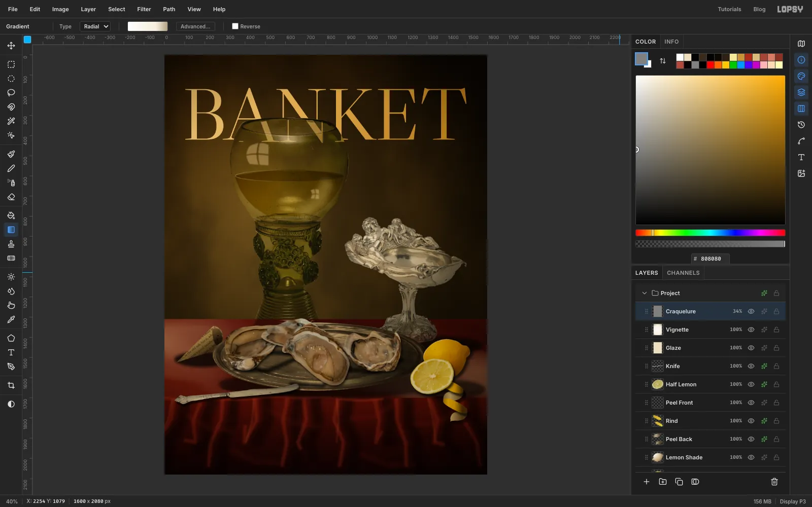

Old Master paintings have one varnish over everything, and that's what finally makes these separate photos read as one picture.

1. Click **Knife** and add a layer called **Glaze**. Fill it with `#EEDFC0` and set it to **Multiply**.
2. Add a layer called **Vignette**. Drag a **Radial** gradient from the middle of the page to the bottom right corner, with stops `#FFFFFF`, `#F6EEDD` at 72% and `#B2A284`. Set it to **Multiply**.
3. Add a layer called **Craquelure**. Fill it with `#808080`, run **Add Noise…** with **Amount** 22, then **Filter → Emboss…** with **Angle** 135 and **Strength** 30. Set it to **Overlay** at **34%**. Up close, it's a fine painted tooth over everything.

## Set the cover lines

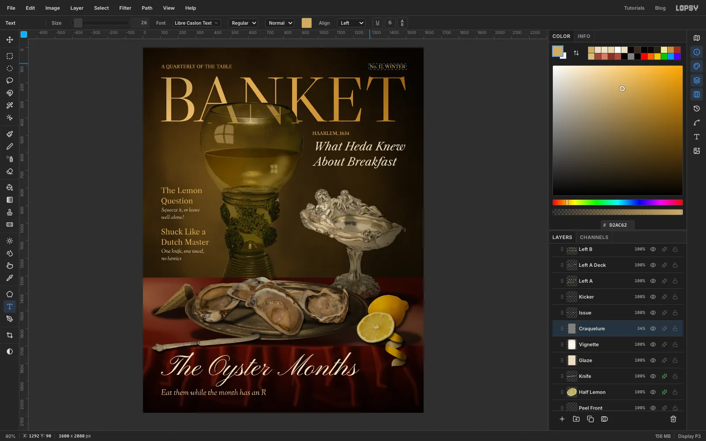

Keep the type above the glaze so it stays crisp, as printed ink over a painting would. A text click inside an existing text layer edits that layer, so work from the bottom of each column upward. Click **Craquelure** before each new line so the options don't restyle the previous one, and set the options bar's style dropdown back from **Italic** to **Normal** after the italics.

Press [[T]], then click, type and press [[Tab]] for each line:

- `Eat them while the month has an R`: **Sorts Mill Goudy** Italic, **44**, `#E6D3A4`, on the left margin near the bottom.
- `The Oyster Months`: **Pinyon Script**, **166**, `#F2E4C0`, on the left margin, just below the table's front edge. Check that the *y*'s tail clears the line below, and the capital *T* clears the knife handle.
- `What Heda Knew`, a line break, then `About Breakfast`: **Libre Caslon Text** Italic, **62**, `#EADFC2`, with its right edge on the 104 px margin, just under the masthead.
- `HAARLEM, 1634`: **Libre Caslon Text**, **26**, `#D2AC62`, just above it and aligned to its left edge.
- The left column sits beside the stem on the 104 px margin, from level with the bottom of the bowl to just above the table. Working bottom-up:
- `One knife, one towel,` / `no heroics`: **Sorts Mill Goudy** Italic, **30**, `#EADFC2`.
- `Shuck Like a` / `Dutch Master`: **Libre Caslon Text**, **42**, `#D2AC62`.
- `Squeeze it, or leave` / `well alone?`: **Sorts Mill Goudy** Italic, **30**, `#EADFC2`.
- `The Lemon` / `Question`: **Libre Caslon Text**, **42**, `#D2AC62`.
- `A QUARTERLY OF THE TABLE`: **Libre Caslon Text**, **26**, `#D2AC62`, at the top left.
- `No. 17, WINTER`: the same, at the top, with its right edge on the margin.

## Finish with a barcode

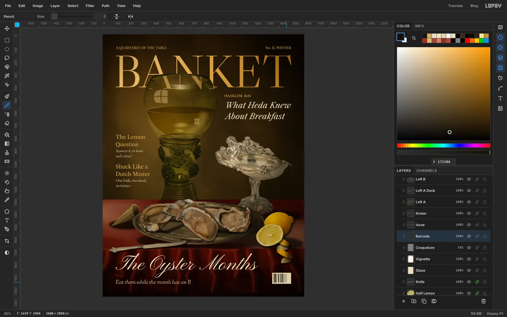

A barcode makes it read as a real magazine straight away. Keep it ivory, because pure white would be the brightest thing on the page.

1. Click **Craquelure** and add a layer called **Barcode**. Marquee a label 150 × 88 px at the lower right, with its right edge on the margin and its bottom level with the bottom of *Eat them while the month has an R*. Fill it with `#DDD0AE` and press [[⌘D]].
2. Set the colour to `#17120A` and press [[N]] for the Pencil. For each bar, set **Size** to 2, 4 or 6, click near the top of the label and `Shift`-click near the bottom. Space about thirteen bars unevenly across the label.
3. Export with **File → Quick Export PNG**, and save the project with **File → Save Project**.

Try swapping in your own table. Any cheap object photographed on a plain backdrop can join this scene, as long as you shade it and give it a contact shadow. It's the shared light that makes them belong together.
