Baroque still-life painters loved a dark room and a single light. A candle picks out a few rich things on a table, such as fruit, silver and a heavy curtain, and everything else falls away into shadow. Painters call that strong light and dark *chiaroscuro*. It also happens to be a very good way to paint a birthday cake.

In this tutorial you'll make **Tiered Torte**, a 1500 × 2100 px birthday card (a 5 × 7 in card at 300 dpi). It's a candle-lit still life of a three-tier cake on a gold stand, set inside a gilt frame with script lettering. Nothing is imported. Every object is built from selections, gradients and a little brush work, and one tier is painted once and then copied and scaled for the other two.

Along the way you'll use:

- **radial and linear gradients** with transparent stops, for shading, light and shadow
- the **grid** with **Snap**, and the Move tool's **Perspective** mode, to lay a tiled ledge
- the **Lasso** and both **marquees** with add and subtract
- the **Brush** for velvet folds and piped icing, plus **Oil Paint**, **Hue/Saturation**, **Texture** and **Add Noise**
- **groups**: duplicating a group, scaling it with [[Cmd]]-drag and dragging rows in and out of groups
- [[Alt]]-drag with the **Move** tool to copy a grape into a bunch
- **Select → All** and **Select → Shrink** for a frame moulding
- the **Shape** tool, text in **Pinyon Script** and **Cinzel**, and loading text as a selection to gild it
- **Multiply**, **Screen** and **Overlay** layers, and **Color Grading** on the whole picture

The palette:

- Wall `#7A5320` → `#3A260F` → `#120C07` → `#070504`
- Marble `#7C6C4E` / `#3E382C`, tile `#16130E`, vein `#8C7A58`
- Velvet `#0B3331`, fold light `#27857B`, sheen `#86D8C6`
- Gold `#3E2906` → `#B4842A` → `#FFE9A8` → `#C9962F` → `#6A4710` → `#281903`
- Icing `#F0E3C4` / `#DCCBA4`, bead `#FBF3E0`
- Ribbon `#1E0716` → `#6B1F4A` → `#9A4A72` → `#4A1436` → `#14040E`
- Flame `#FFB733`, flame core `#FFF8DC`, glow `#FF8A1F`
- Silver `#1E1E1C` → `#8C8A80` → `#B8B4A6` → `#F6EFD8` → `#6A665C` → `#141412`
- Lemon `#FFF4A8` → `#EFCB3A` → `#B88A14` → `#5E4208`, pith `#F3E8BE`
- Grape `#9A90C4` → `#54407E` → `#281844` → `#0D0718`
- Script gold `#E9C873`, plaque `#120F0A`

> **Tip:** Positions are written as `x, y` in document pixels. The status bar at the bottom of the window shows where the cursor is, so you can hover to find a spot. You don't need to hit them exactly. Key names are Mac keys. On Windows and Linux, use Ctrl for Cmd. The same six-stop gold ramp is used for the stand, the tassel and more, so it's listed once in the palette above and called "the gold ramp" from here on. Its six stops sit at 0, 20, 36, 52, 80 and 100%. A marquee drags from corner to corner, so when a shape is given as a size "centred on" a point, start the drag half its width to the left of that point and half its height above it. To set gradient stops, pick the **Gradient** tool and click **Advanced…**: click under the bar to add a stop, drag stops to move them, and type a hex into the colour picker for each one.

## Paint a dark wall and a marble ledge

Choose **File → New**, set the size to **1500 × 2100** px and click **Create**. Rename `Layer 1` to `Ground` (double-click its name).

Pick the **Gradient** tool, set **Type** to **Radial** and click **Advanced…**. Set four stops: `#7A5320` at the left, `#3A260F` at about 30%, `#120C07` at about 70% and `#070504` at the right. Drag from **750, 720** straight down to about **750, 1750**. That puts a warm patch on the wall where the candles will be, and leaves the corners nearly black.

Click **Add Layer** and name it `Ledge top`. With the **Rectangular Marquee** (**M**), drag a strip right across the canvas from **0, 1600** to **1500, 1840**. Switch the gradient to **Linear**, set its stops to `#7C6C4E`, `#4A4030` at 45% and `#1C1810`, and drag from the top left of the strip to its bottom right. Press [[Cmd+D]].

Add a layer called `Ledge front`. Marquee everything below the strip, from **0, 1840** to the bottom right corner. Set the stops to `#3E382C`, `#221F18` in the middle and `#0C0B08`, and drag from the top of the selection down to the bottom. While it's still selected, choose **Filter → Texture…**, click **Rough**, and set **Amount** `8`, **Size** `110` and **Detail** `70`. That gives a soft cloudy marble. Click **Apply**, then deselect.

Give the ledge a lit front edge: marquee a thin strip about 10 px tall along the join at **y 1840**, and fill it with `#B5A583` (**Edit → Fill** uses the foreground colour). Press [[Cmd+D]], or the brush will only paint inside that strip.

Last, the veins. Pick the **Brush** (**B**), set **Size** `4`, **Hardness** `30`, **Opacity** `40` and the colour `#8C7A58`, and draw four wandering lines that run diagonally down the marble. Drop to **Size** `2`, **Opacity** `55` and add a couple of thinner branches.

## Snap a checker of tiles to the grid

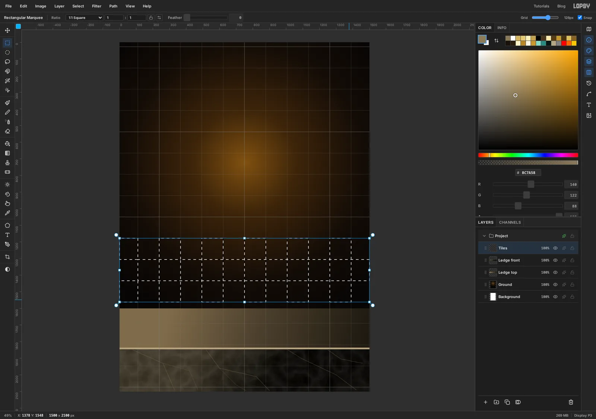

The ledge top will be tiled, and the easiest way to draw tiles in perspective is to draw them flat first.

Add a layer called `Tiles`. Choose **View → Show Grid**. A **Grid** slider appears at the right of the options bar: drag it until it reads **128px**, and make sure **Snap** next to it is ticked.

With the Rectangular Marquee, drag roughly across one grid square in the row that starts at **y 1178**. The marquee snaps to the square. Now hold [[Shift]] and drag across every other square in that row, then the alternate squares in the next two rows down, to build a checkerboard three rows deep. The narrow part-squares at the two sides count too.

Set the foreground to `#16130E`, choose **Edit → Fill** and press [[Cmd+D]].

## Lay the tiles down in perspective

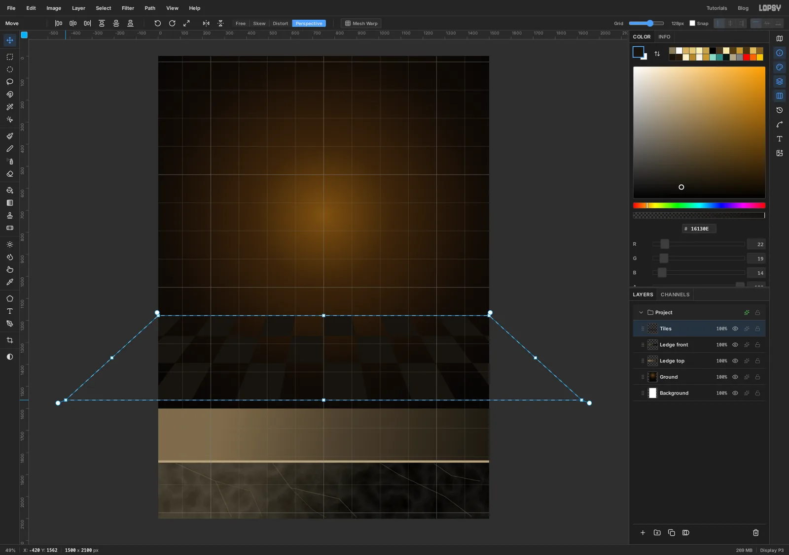

Untick **Snap** in the options bar so the next drags move freely. Marquee the whole checker, from **0, 1178** to **1500, 1562**.

Press **V** for the **Move** tool and click **Perspective** in the options bar. Drag the bottom-left corner handle straight out to the left, about 420 px past the edge of the canvas. The bottom-right corner mirrors it, and the tiles fan out toward you.

Click **Free** to go back to ordinary scaling. Drag the top-middle handle down to about **y 1322** to squash the floor flat, then drag inside the box to slide it down until its top edge sits on the top of the ledge at **y 1600**. Press [[Cmd+D]].

Turn the grid off again with **View → Show Grid**. Click the opacity value on the `Tiles` row and set it to `70%` so the marble shows through.

## Hang a velvet drape

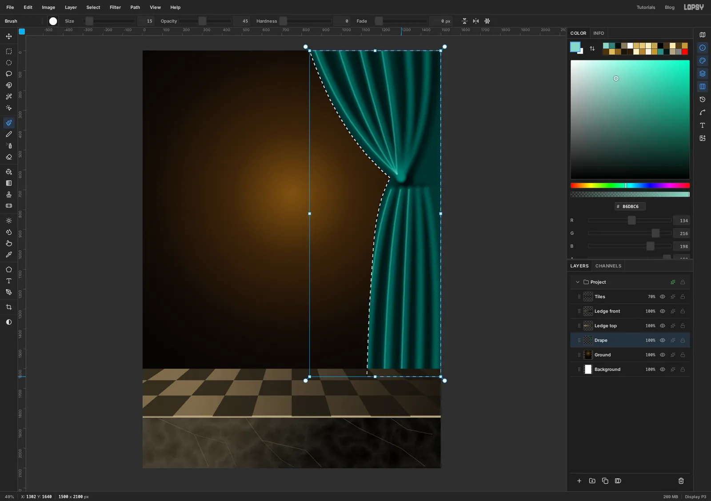

Click `Ground`, then **Add Layer** and name the new layer `Drape`. It lands just above the wall and behind the ledge.

Pick the **Lasso** (**L**) and draw the curtain's outline. Start on the top edge at about **840, 0** and sweep down and to the right in a curve to a pinch point at **1245, 640**. Carry on down, bulging left a little, to about **1128, 1640**, then run along the bottom to the right edge, up the edge and back along the top. Fill it with `#0B3331`. Keep the selection, so the brush stays inside it.

Paint the folds with the **Brush** at **Hardness** `0`:

1. **Size** `110`, **Opacity** `70`, colour `#020D0C`. Draw six shadow strokes from the top edge down to the pinch, and four more from the pinch down to the floor. Space them unevenly.
2. **Size** `64`, **Opacity** `55`, colour `#27857B`. Draw a ridge of light between each pair of shadows.
3. **Size** `15`, **Opacity** `45`, colour `#86D8C6`. Add a thin line of sheen along the left side of most ridges.

Press [[Cmd+D]]. Choose **Filter → Hue/Saturation…** and set **Saturation** `-34` and **Lightness** `-12` to calm the colour. Then run **Filter → Oil Paint…** with **Radius** `4`, which melts the strokes into each other.

## Tie it back with a gold tassel

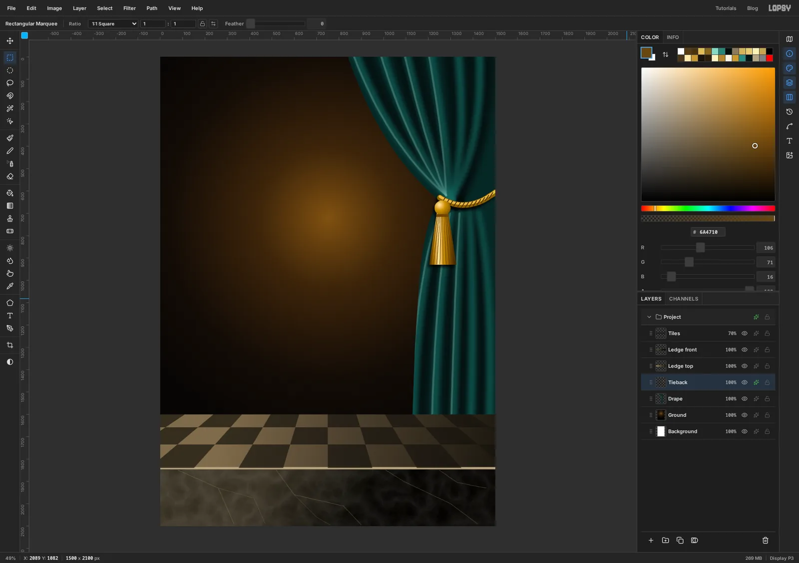

Add a layer called `Tieback`.

For the cord, use the Brush at **Hardness** `80`, **Opacity** `100`. With **Size** `28` and `#8A621B`, draw a sagging line from just right of the pinch to the right edge at about **1500, 606**. With **Size** `13` and `#E3BC58`, draw a highlight along its upper half. Then with **Size** `5` and `#4D3309`, add the twist: click just below the cord, hold [[Shift]] and click just above it a little to the right, and repeat along its length. Shift-click draws a straight line from the last click.

For the tassel's skirt, lasso a tall trapezoid from **1238, 700** and **1290, 700** at the top to **1326, 930** and **1204, 930** at the bottom. Load the gold ramp into a **Linear** gradient and drag across the skirt from left to right. Deselect. With the Brush at **Size** `3` and `#5A3C0D`, rule nine strands from the top to the bottom with click and Shift-click.

For the head, pick the **Elliptical Marquee** and drag a ball about 72 px across centred on **1264, 676**. Use a **Radial** gradient of `#FFE9A8`, `#C9962F` at 35% and `#4D3309`, dragged from the upper left of the ball to just past its lower right. Marquee a small collar under it, about 56 × 12 px, and fill it with `#6A4710`.

Open the layer's effects drawer (the **✦** button on its row), tick **Drop Shadow** and set **Offset X** `-8`, **Offset Y** `12`, **Blur** `14` and **Opacity** `70`. The shadow falls to the left, away from where the candles will be.

## Turn a gilded cake stand

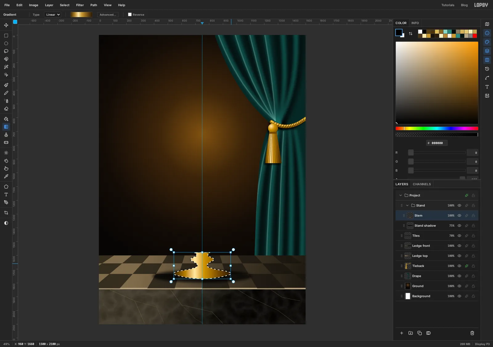

[[Cmd]]-click the top ruler near the middle. Holding Cmd snaps the new guide to exactly half way, **750**, and the whole cake will be built around it.

Click `Tiles`, then click **New Group** and name the group `Stand`.

Add a layer called `Stand shadow`. With the Elliptical Marquee, drag a wide, flat ellipse from **390, 1706** to **1110, 1798**. Set the foreground to black, choose **Edit → Fill** and deselect. Run **Filter → Gaussian Blur…** at **Radius** `26` and set the layer to `75%`.

Add a layer called `Stem`. With the Lasso, draw the outline of a turned pedestal in one loop, keeping the two sides as even as you can either side of the guide: a neck about 110 px wide at **y 1578**, a round bead at about **y 1630**, a thin waist at **y 1670**, and a foot that flares out to about 410 px wide at **y 1738** with a gently rounded underside. Drag a **Linear** gradient with the gold ramp across it, from the left edge of the foot to the right. Deselect.

Add a layer called `Plate`. Drag an ellipse from **346, 1508** to **1154, 1644**. Set the gradient stops to `#2E1D05`, `#8A621B` at 30%, `#D9B050` at 45%, `#5A3C0D` at 70% and `#1C1202`, and drag across it. That is the underside of the plate. Now drag a second ellipse of nearly the same size 20 px higher, from **346, 1490** to **1154, 1622**, and drag the gold ramp across it. The sliver of the darker ellipse left showing below reads as the plate's rim.

## Start a group for the cake

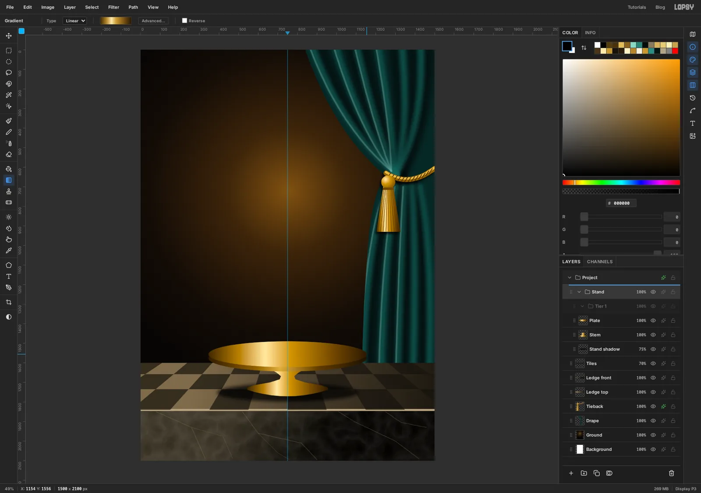

Each tier of the cake gets its own group, so it can be copied and scaled as one thing.

Click the `Stand` group's row, then click **New Group** and name it `Tier 1`. A new group made while a group is selected lands inside that group. To pull it out, drag the grip at the left of the `Tier 1` row up over the top edge of the `Stand` row and a little to the left. When the blue line sits above `Stand` and lines up with the outer rows, let go. `Tier 1` now sits above `Stand` at the top level.

> **Tip:** You'll do this a few more times. A new layer or group goes inside the selected group. Drag it up and left to move it out.

## Build the bottom tier

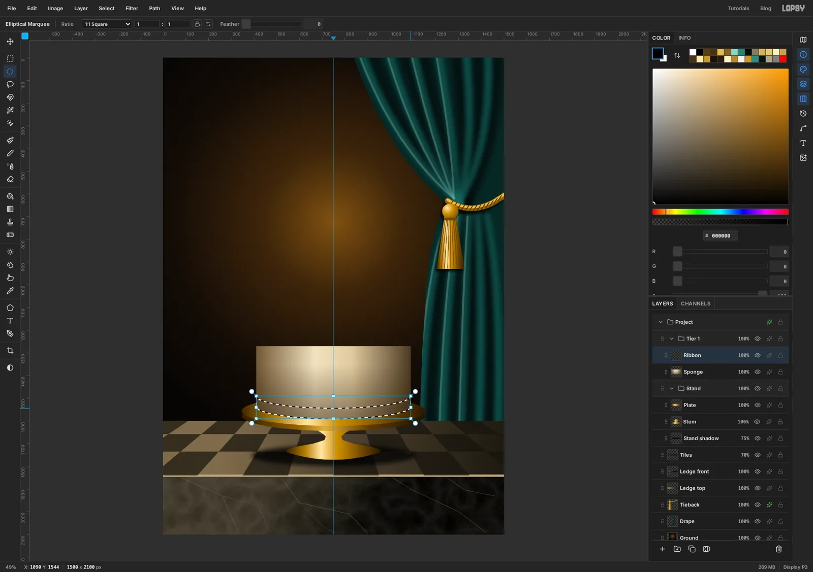

Click the `Tier 1` group and add a layer called `Sponge`.

The side of a round cake is a rectangle with a curved bottom. Marquee a rectangle from **410, 1270** to **1090, 1536**. Then pick the Elliptical Marquee, hold [[Shift]] and drag an ellipse from **410, 1482** to **1090, 1590**. It joins on as the rounded base.

Set a **Linear** gradient to `#6E5A3A`, `#F0E3C4` at 38%, `#DCCBA4` at 62% and `#4A3B24`, and drag across the selection from left to right. The cake is lit from above and in front, so both sides fall into shadow. To darken it toward the bottom, set the stops to `#2B1D0A` fully transparent at the left and at 25%, and `#2B1D0A` at 50% opacity at the right (the **Opacity** slider is under the colour in the editor's picker). Drag from the top of the tier to the bottom.

Add a layer called `Ribbon`. Marquee a strip from **410, 1490** to **1090, 1536**, Shift-add the same base ellipse as before, then hold [[Alt]] and drag an ellipse of the same size 46 px higher, from **410, 1436** to **1090, 1544**. Alt subtracts, which scoops the top of the strip into a matching curve. Fill the band with a **Linear** gradient of `#1E0716`, `#6B1F4A` at 30%, `#9A4A72` at 45%, `#4A1436` at 65% and `#14040E`, dragged from left to right. Deselect.

Add a layer called `Top`. Drag an ellipse from **410, 1216** to **1090, 1324** and fill it with a **Linear** gradient of `#E9D9B2`, `#FFF4D2` at 45% and `#C4AE82`, dragged from left to right. Press [[Cmd+D]].

## Pipe the swags

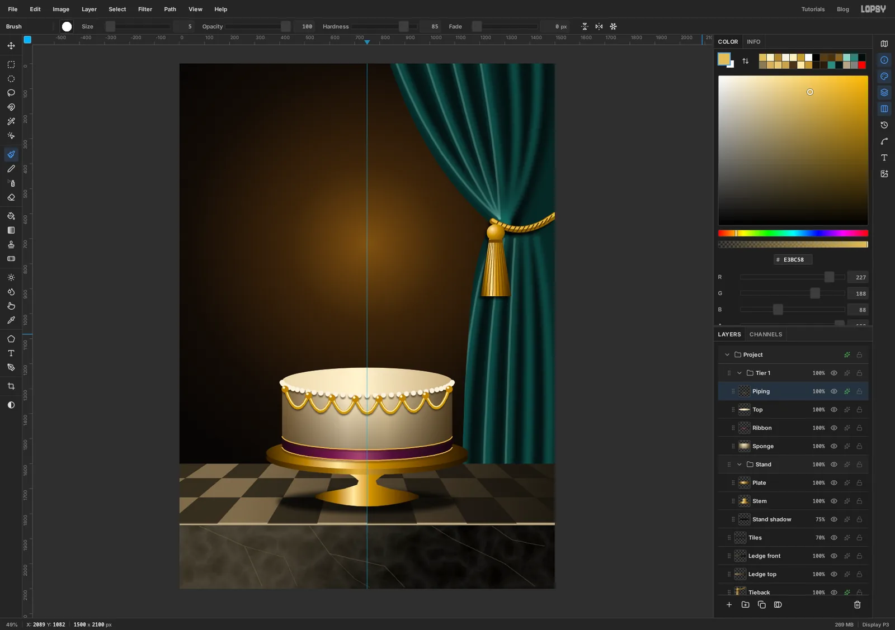

Add a layer called `Piping`. All of it is done with the Brush at **Hardness** `85`, **Opacity** `100`.

1. **Size** `14`, colour `#C9992F`. Draw seven swags hanging from the front rim, evenly spaced from the left edge to the right, each dipping about 100 px.
2. **Size** `5`, colour `#FFF0B8`. Draw a highlight along the upper edge of each swag.
3. **Size** `22`, colour `#FBF3E0`. Click a row of beads along the front rim, about one every 30 px.
4. **Size** `30`, colour `#B8862B`. Click a gold ball where each pair of swags meets, and one at each end.
5. **Size** `11`, colour `#FFF3C4`. Click a small highlight on the upper left of each ball.
6. **Size** `5`, colour `#E3BC58`. Trace the top and bottom edges of the ribbon.

Open the layer's effects drawer, tick **Drop Shadow** and set **Offset X** `0`, **Offset Y** `7`, **Blur** `7`, **Opacity** `60` and the colour to `#2E2008`. The icing lifts off the cake.

## Copy the tier and scale it

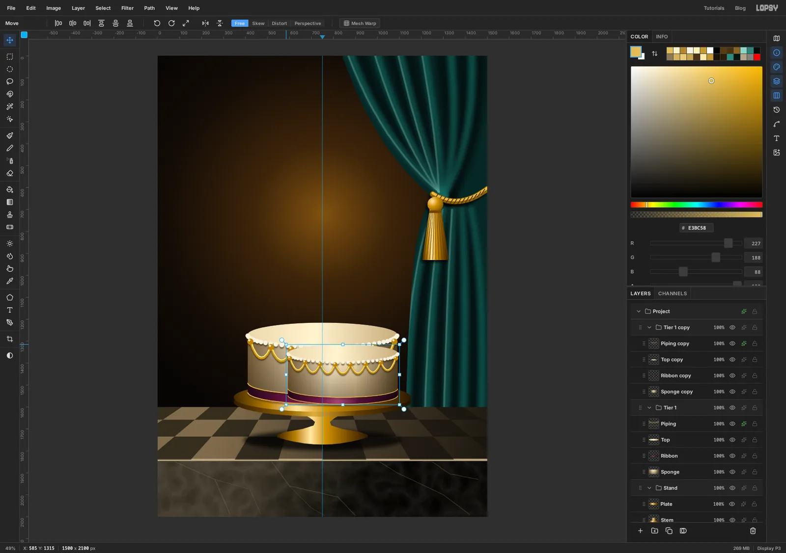

Click the `Tier 1` group and choose **Layer → Duplicate Layer**. The copy, `Tier 1 copy`, sits exactly on top of the original.

Press **V**. With a group selected and no marquee, the Move tool's handles frame everything in the group. Hold [[Cmd]] to keep the proportions and drag the top-left corner handle in toward the middle until the copy is about three-quarters of its size, roughly 515 px wide. Press [[Cmd+D]] to commit.

Drag inside the copy to move it up. Centre it on the guide and let its ribbon sit just inside the rim of the first tier's top, with the bottom of the ribbon at about **y 1300**. Rename the group `Tier 2`.

## Stack the third tier

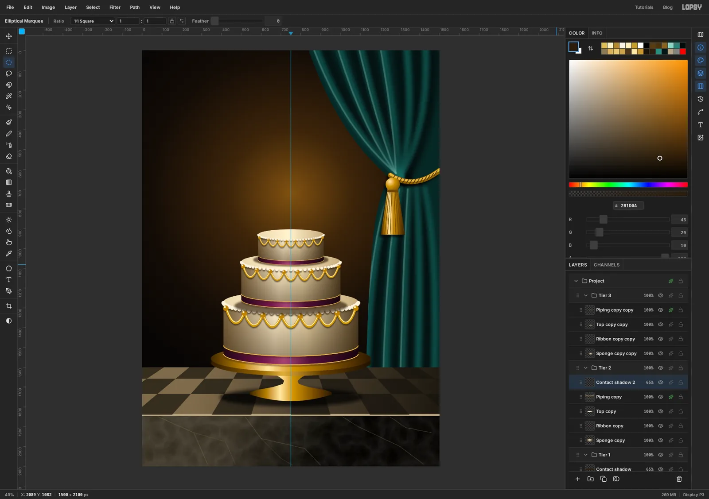

Do it again. Duplicate `Tier 2`, Cmd-drag a corner until the copy is about two-thirds of the size, roughly 340 px wide, commit, and move it up to sit on the second tier with its base at about **y 1084**. Rename it `Tier 3`.

Each upper tier needs to shade the one below. Open the `Tier 1` group, click its `Piping` layer and add a layer called `Contact shadow`. Drag an ellipse from **465, 1244** to **1035, 1336**, fill it with `#2B1D0A`, deselect and blur it at **Radius** `14`. In its effects drawer set the blend mode to **Multiply**, and set the layer to `65%`.

Do the same inside `Tier 2`. Click `Piping copy`, add a layer called `Contact shadow 2`, and drag a smaller ellipse from **560, 1025** to **940, 1089**. Fill it, deselect, blur it at **Radius** `11`, and set it to **Multiply** at `65%`.

## Stand five candles

Click the `Tier 3` group, click **New Group**, name it `Candles` and drag it out above `Tier 3`.

Add a layer called `Candle shadows`. With the Elliptical Marquee, drag five small flat ellipses, about 36 × 12 px, on the top of the cake at **x 652, 700, 750, 800** and **848**, around **y 930** to **940**, holding [[Shift]] from the second one on. Put the outer ones a few pixels higher than the inner ones so they follow the curve of the cake. Fill with `#2B1D0A`, deselect, blur at **Radius** `3` and set the layer to `70%`.

Add a layer called `Tapers`. Set a **Linear** gradient to `#8E7A52`, `#FFF7E0` at 40%, `#DCCB9E` at 65% and `#6E5B38`. For each candle, marquee a strip 18 px wide standing on its shadow, then drag the gradient across it. Make them about **118, 158, 186, 150** and **112** px tall from left to right, with the tallest in the middle.

Real candles never stand quite straight. Marquee the second candle, press **V**, and drag the round rotation handle just outside a corner of the box to tip it a couple of degrees to the left. Press [[Cmd+D]]. Tip the fifth one a couple of degrees to the right.

For the wicks, pick the **Pencil** (**N**) at **Size** `3` with `#1A120A`. Click the top of a candle, then Shift-click about 12 px above it. Do the same for the other four.

## Light the candles and the room

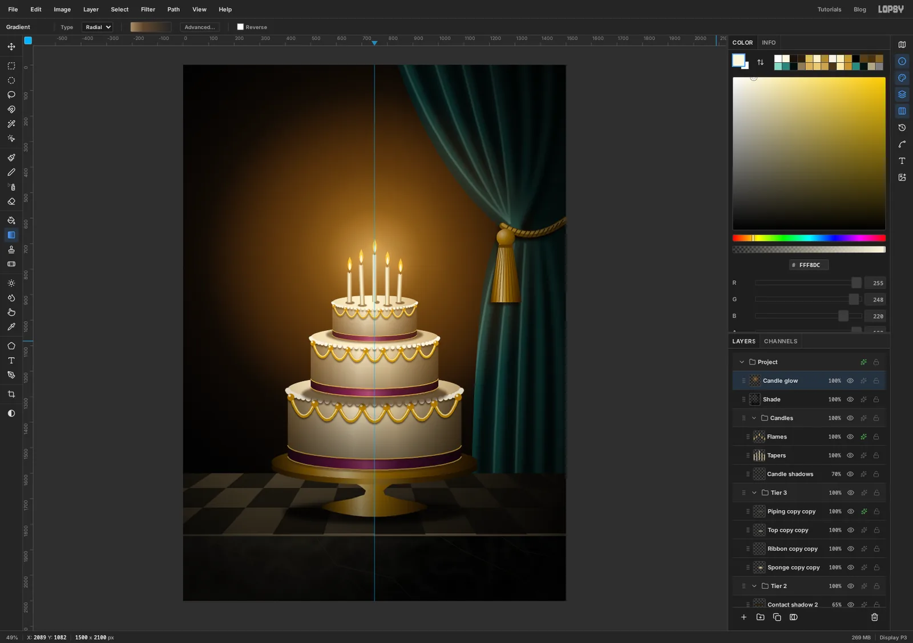

Add a layer called `Flames`. With the Lasso, draw a teardrop about 28 px wide and 56 px tall over each wick and fill it with `#FFB733`. Draw a smaller teardrop inside each, about 14 × 32 px, and fill it with `#FFF8DC`. Press [[Cmd+D]]. Open the effects drawer, tick **Outer Glow** and set **Size** `50`, **Opacity** `90` and the colour to `#FF8A1F`.

Now the chiaroscuro. Add a layer called `Shade` and drag it out of the `Candles` group so it sits above it. Set a **Radial** gradient with four black stops: fully transparent at the left and at 36%, 50% opacity at 70%, and 86% opacity at the right. Drag from **750, 800** down past the bottom of the canvas. Then switch to **Linear**, set the stops to black from fully transparent to 55% opacity, and drag from the inner edge of the drape at about **1040, 900** to the right edge. Set the layer's blend mode to **Multiply**. Everything away from the flames goes dark.

Add a layer called `Candle glow` above `Shade`. Set a **Radial** gradient to `#FFD08A` at 62% opacity, `#FF9E3D` at 28% opacity a third of the way along, and `#FF7A1A` fully transparent at the right. Drag from **750, 760** down to about **750, 1420**, and set the blend mode to **Screen**. The top of the cake and the wall behind it now look lit by the candles.

## Set a silver goblet on the ledge

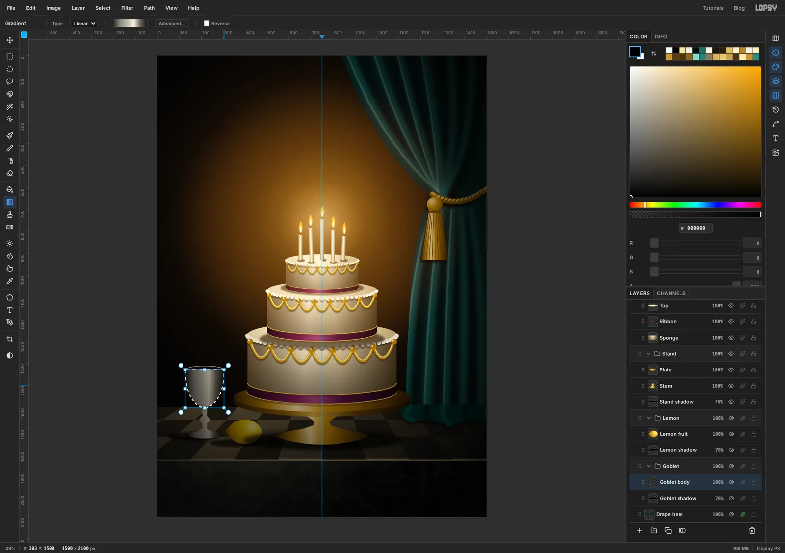

The left of the picture is empty, and the drape stops dead at the ledge. Fix the drape first. Click `Tiles` and add a layer called `Drape hem`. Lasso a low, scalloped puddle of cloth along the back of the ledge, from **1128, 1590** to the right edge, dipping to about **y 1690**, and fill it with `#0A2E2C`. With a soft Brush (**Hardness** `0`), add two highlights at **Size** `40`, **Opacity** `45`, `#1F6E66` and two troughs at **Size** `46`, **Opacity** `60`, `#020D0C`. Give the layer a **Drop Shadow** with **Offset Y** `10`, **Blur** `16`, **Opacity** `75`.

Click **New Group** and name it `Goblet`. Inside it, add a layer called `Goblet shadow`. Drag a flat ellipse about 240 × 40 px centred on **165, 1734**, a little left of where the goblet will stand, and fill it with black. Deselect, blur it at **Radius** `14` and set the layer to `70%`.

Add a layer called `Goblet body`. Lasso the stem and foot as one shape, centred on **x 215**: a stem about 22 px wide from **y 1598**, a small knop at **y 1658**, and a foot 160 px wide at **y 1730** with a rounded underside. Set a **Linear** gradient to `#1E1E1C`, `#8C8A80` at 22%, `#B8B4A6` at 40%, `#F6EFD8` at 62%, `#6A665C` at 80% and `#141412`, and drag across the foot. Because the bright stop sits right of centre, the silver looks lit from the candle side.

Lasso the bowl: a U shape 176 px wide, from a flat rim at **y 1430** down to a rounded bottom at **y 1604**. Pick the **Gradient** tool again and drag the same silver across it.

Finish the rim. Drag an ellipse about 176 × 34 px centred on **215, 1430** and fill it with `#14110D`, then a slightly smaller one just below centre, about 156 × 22 px, filled with wine red `#4A0F1C`. Press [[Cmd+D]]. With the Brush at **Size** `4`, **Hardness** `70`, **Opacity** `90` and `#F6EFD8`, trace the front lip. Then take a soft Brush at **Size** `22`, **Opacity** `60` with `#FFDFA0`, and draw one stroke down the right side of the bowl for the reflected candlelight. (The lemon in the screenshot arrives in the next step.)

## Peel a lemon

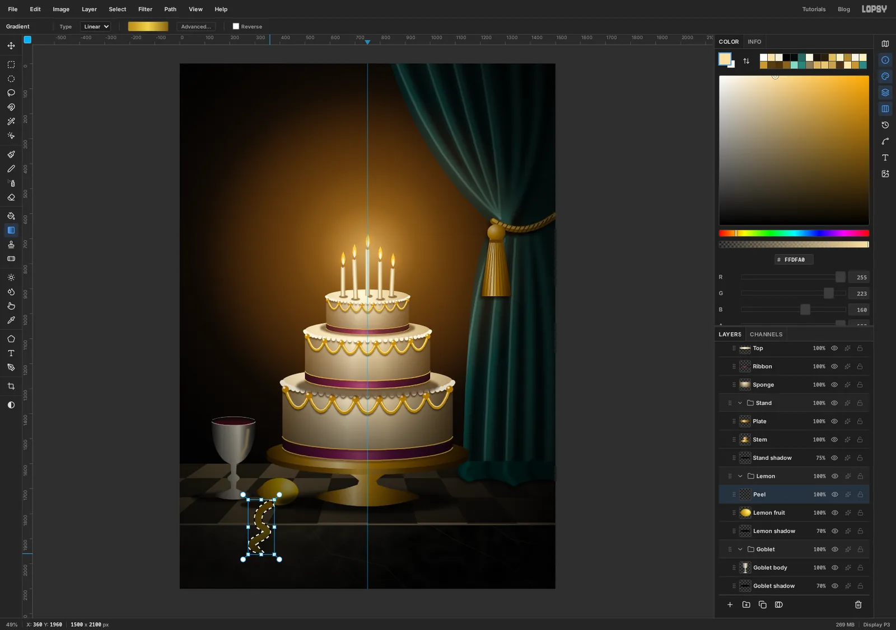

A half-peeled lemon with the peel hanging off the table turns up again and again in baroque still lifes. It gave painters a chance to show off.

Click the `Goblet` group, click **New Group**, name it `Lemon` and drag it out above `Goblet`. Add a layer called `Lemon shadow`. Drag a flat ellipse about 220 × 36 px centred on **350, 1764**, fill it with black, deselect, blur it at **Radius** `12` and set the layer to `70%`.

Add `Lemon fruit`. Lasso an oval about 152 × 110 px centred on **398, 1712**, with a small nipple poking out at its left end. Set a **Radial** gradient to `#FFF4A8`, `#EFCB3A` at 30%, `#B88A14` at 75% and `#5E4208`, and drag from the upper right of the lemon, the side facing the candles, to its lower left. With the selection still active, run **Filter → Add Noise…** at **Amount** `6` for the pores in the skin. Deselect.

Add a layer called `Peel`. Lasso a ribbon about 30 px wide that leaves the underside of the lemon, runs to the edge of the ledge at about **318, 1846**, then makes two S-turns down the front of the marble and tapers to a point at about **y 1960**. Fill it with a **Linear** gradient of `#B88A14`, `#F2D048` in the middle and `#8A6410`, dragged diagonally along it. Deselect.

Where the ribbon turns back on itself you'd see the white pith inside. Lasso those two stretches, a little narrower than the ribbon, and fill them with `#F3E8BE`. Add a **Drop Shadow** with **Offset X** `-8`, **Offset Y** `8`, **Blur** `10`, **Opacity** `70`.

## Copy one grape into a bunch

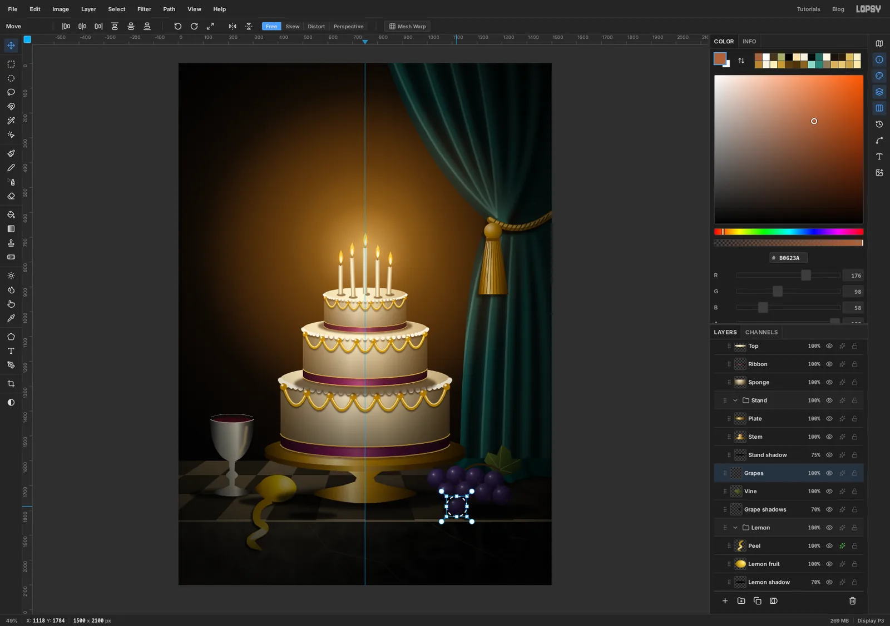

Click the `Lemon` group and add a layer called `Grape shadows`, then drag it out above `Lemon`. Drag an ellipse about 380 × 60 px centred on **1250, 1800**. Shift-add a rounder one about 115 × 110 px on the marble front below it, around **1272, 1905**, and a small flat one around **540, 1821** for two stray grapes. Fill with black, deselect, blur at **Radius** `16` and set the layer to `70%`.

Add a layer called `Vine`. Lasso a five-pointed vine leaf about 150 px across around **1300, 1600** and fill it with a **Linear** gradient of `#6E7C34`, `#3E4E1E` and `#18220C`. Press [[Cmd+D]]. With the Brush at **Size** `3`, **Opacity** `70` and `#A8B060`, rule four veins from the base of the leaf to its tips using click and Shift-click. At **Size** `9`, **Opacity** `100` with `#4A3418`, draw a stem curving from **1150, 1640** up to the leaf.

Add a layer called `Grapes` and paint just one. Drag a circle 80 px across centred on **1040, 1672**. Set a **Radial** gradient to `#9A90C4`, `#54407E` at 14%, `#281844` at 50% and `#0D0718`, and drag from a little up and left of the grape's centre to just past its lower-right edge. Deselect. With the Brush at **Size** `8`, **Hardness** `60`, **Opacity** `90` and white, click once on the upper left for a highlight. With a soft Brush at **Size** `20`, **Opacity** `35` and `#B0623A`, click once on the lower right for warm light bouncing off the table.

Drag a circle round the grape again, a touch larger this time. Press **V**, hold [[Alt]] and drag the grape to a new spot. Alt-drag leaves a copy behind. Keep going: build rows of four, four, three and two, each row lower and overlapping the last, then hang one more over the edge of the ledge. Carry the last two copies across the ledge and drop them in front of the left end of the stand's foot as strays. Press [[Cmd+D]].

## Build a gilt frame

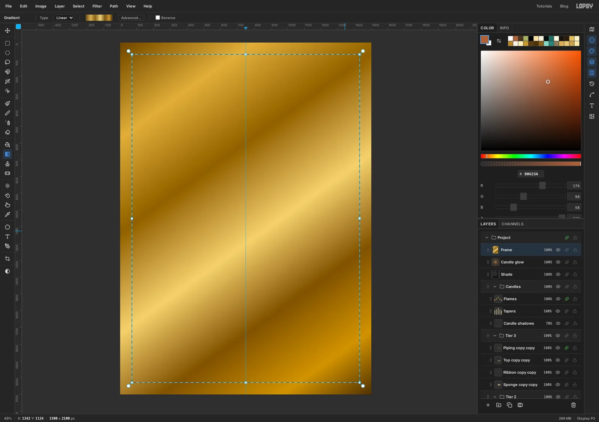

Click `Candle glow` and add a layer called `Frame`, so it sits on top of the lighting.

Press [[Cmd+A]] to select the whole canvas. Set a **Linear** gradient with seven stops: `#6A4710`, `#D9B050` at 18%, `#8A621B` at 36%, `#F0D27A` at 55%, `#7A5417` at 72%, `#C9962F` at 88% and `#4D3309`. Drag from the top-left corner to the bottom-right. The bands of light and dark gold will read as a sheen running round the frame.

Choose **Select → Shrink…**, enter `70` and click **Apply**. Press [[Delete]] to cut the middle out, then [[Cmd+D]]. You're left with a moulding 70 px wide.

Bright gold looks new. Run **Filter → Hue/Saturation…** with **Saturation** `-28` and **Lightness** `-14` to age it.

## Cut the moulding's ridges

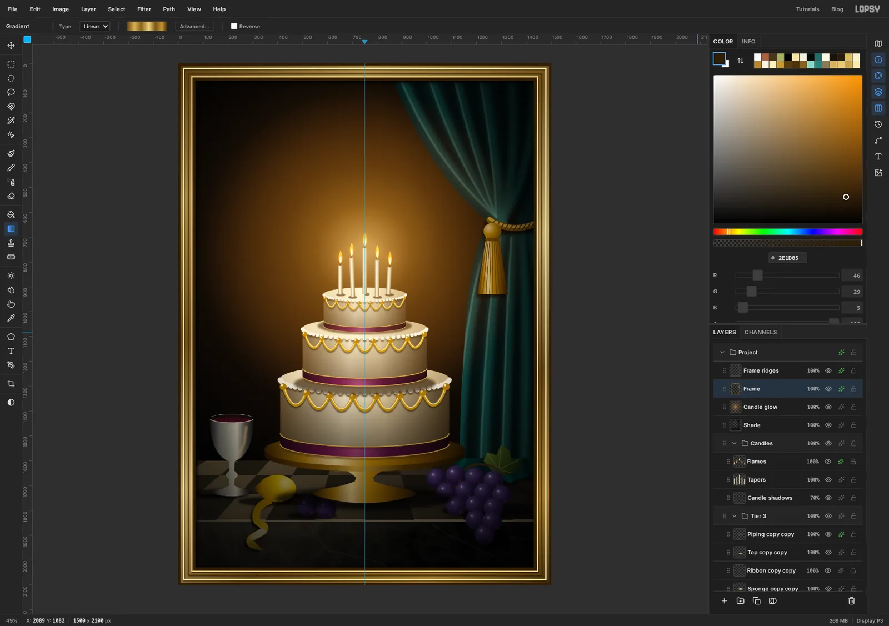

A real frame moulding steps in and out. Add a layer called `Frame ridges` and draw five thin lines round the frame, working from the outside in. Each line is the same five moves:

1. Press [[Cmd+A]].
2. Choose **Select → Shrink…** by the line's inset (skip this for the first line).
3. Set the foreground colour and choose **Edit → Fill**.
4. Choose **Select → Shrink…** by the line's width.
5. Press [[Delete]].

The five lines:

- Inset `0`, width `8`, colour `#2E1D05`
- Inset `18`, width `6`, colour `#FFEBB0`
- Inset `38`, width `4`, colour `#5A3C0D`
- Inset `52`, width `5`, colour `#F6D98A`
- Inset `60`, width `10`, colour `#2E1D05`

Press [[Cmd+D]]. Give `Frame ridges` a **Drop Shadow** with **Offset X** `2`, **Offset Y** `3`, **Blur** `4`, **Opacity** `60`. Then give `Frame` itself a **Drop Shadow** with **Offset X** `6`, **Offset Y** `10`, **Blur** `22`, **Opacity** `85`, so the frame casts a shadow onto the painting and looks like it stands in front of it.

## Carve the corner scrolls

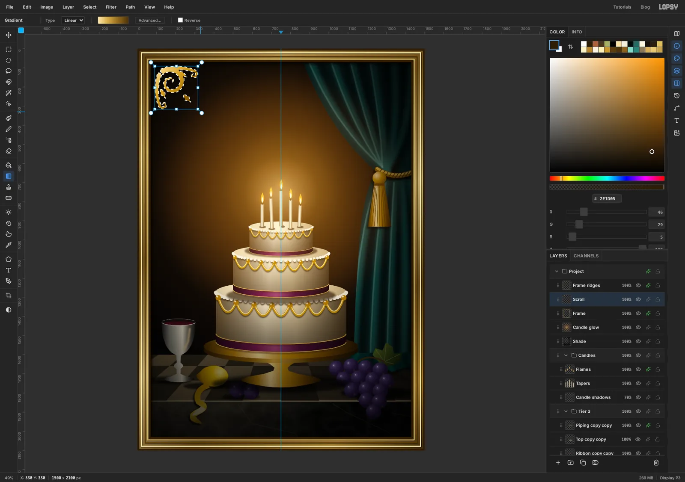

Click `Frame` and add a layer called `Scroll`.

The scroll is one selection made of several lasso shapes. With the Lasso, draw a fat C-scroll in the top-left corner: start about 30 px wide near the corner, wind one and a half turns inward around **176, 176**, and taper to a point. Hold [[Shift]] and add an arm that sweeps right along the top to about **x 300** and ends in a small curl, then a matching arm down the left side. Shift-add three small diamond-shaped leaves in the gaps.

Fill the selection with a **Linear** gradient of `#FFE9A8`, `#D2A440` at 35%, `#8A621B` at 70% and `#4D3309`, dragged diagonally from the corner toward the middle of the canvas. Deselect. In the effects drawer tick **Drop Shadow** (**Offset X** `4`, **Offset Y** `6`, **Blur** `7`, **Opacity** `80`) and **Inner Glow** (**Size** `5`, **Opacity** `70`, colour `#FFF3C4`). The glow puts a pale bevel on every edge.

For the other corner, choose **Layer → Duplicate Layer**. Marquee a box round the scroll, press **V** and click **Flip Horizontal** in the options bar. Press [[Cmd+D]], then drag `Scroll copy` straight across to the top-right corner. Use the arrow keys to nudge it until it sits as far from the right edge as the first one is from the left.

## Letter Happy Birthday

Click `Frame ridges` first. When a text layer is selected, changing the font or size restyles that layer, so always click a layer that isn't text before you set up new type.

Pick the **Text** tool (**T**), choose **Pinyon Script**, set the size to `175` and the foreground to `#E9C873`. Click an empty spot in the middle of the canvas, type `Happy` and press [[Tab]] to commit. Click `Frame ridges` again, click another empty spot lower down, type `Birthday` and press [[Tab]]. If you click inside the first word's box you'll edit that word instead.

Press **V** and drag each word into place. Put `Happy` so its H starts at about **x 425** with the tops of the letters at **y 140**. Put `Birthday` about 210 px lower, starting at about **x 420**.

With each word selected, drag the rotation handle just outside a corner to tilt it about 3° uphill. Text stays editable after you rotate it.

Tilting swings the tail of the y into the drape, as in the screenshot. With each word selected in turn, press [[Shift+←]] three times to nudge it 30 px left. That keeps the script clear of both scrolls, off the bright folds of the drape, and leaves about 100 px of dark wall between the tail of the y and the tallest flame.

Give both words a **Drop Shadow** with **Offset X** `2`, **Offset Y** `5`, **Blur** `12`, **Opacity** `80`.

## Gild the lettering

Flat yellow type looks printed. A gradient over it looks like gold leaf.

Click `Happy`, the top layer, and add a layer called `Gilding`. [[Cmd]]-click the thumbnail of `Happy` in the Layers panel to load its letters as a selection, then [[Shift+Cmd]]-click the thumbnail of `Birthday` to add those too. Click the `Gilding` row so you paint on the new layer.

Set a **Linear** gradient to `#FFF6D0`, `#F0CD72` at 30%, `#B98A2C` at 55%, `#F3D888` at 75% and `#8A621B`. Drag from the top of `Happy` down to the bottom of `Birthday`. Press [[Cmd+D]].

## Engrave the plaque

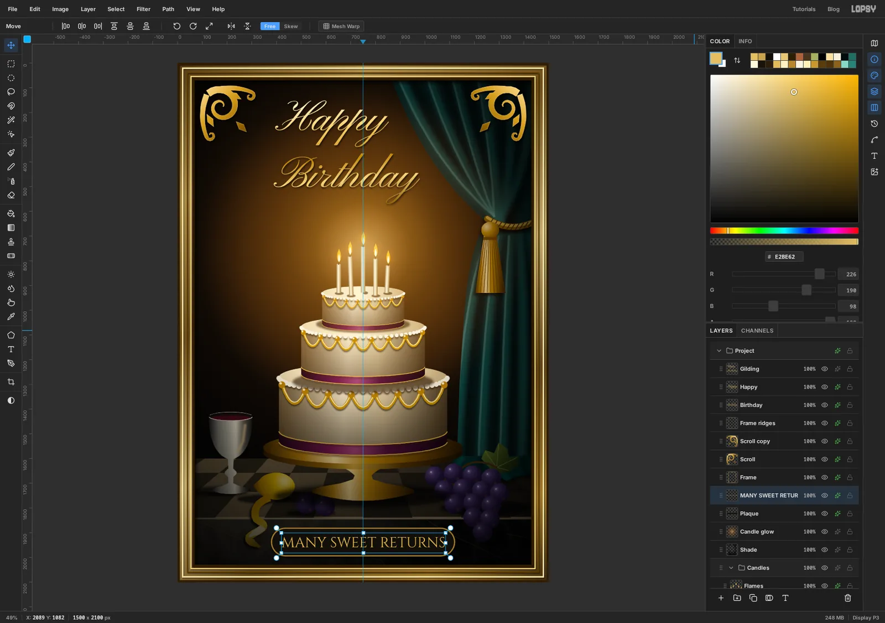

Click `Candle glow` and add a layer called `Plaque`.

Pick the **Shape** tool (**U**). In the options bar choose **Rectangle** and set **Corner Radius** to `56`. Click the fill swatch and enter `#120F0A`. Click the stroke swatch and enter `#C9A24B`, then set **Width** to `5`. A shape grows from its centre, so press on the guide at **750, 1938** and drag out to about **1120, 1994**. With the corner radius at half the height, the rectangle becomes a pill.

In the plaque's effects drawer tick **Inner Glow** (**Size** `16`, **Opacity** `70`, colour black) to hollow it out, and **Drop Shadow** (**Offset Y** `5`, **Blur** `10`, **Opacity** `80`).

Click the `Plaque` row, then pick the Text tool, choose **Cinzel**, size `58`, colour `#E2BE62`. Click an empty spot, type `MANY SWEET RETURNS` and press [[Tab]]. Drag it into the plaque with the Move tool. Seat it carefully: leave the same gap at the left and right ends, about 44 px, and the same gap above and below the capitals, about 38 px. Give it a **Drop Shadow** with **Offset X** `0`, **Offset Y** `3`, **Blur** `2`, **Opacity** `95`. A tight dark shadow makes the letters look cut into the plaque.

## Crackle the varnish and grade the colour

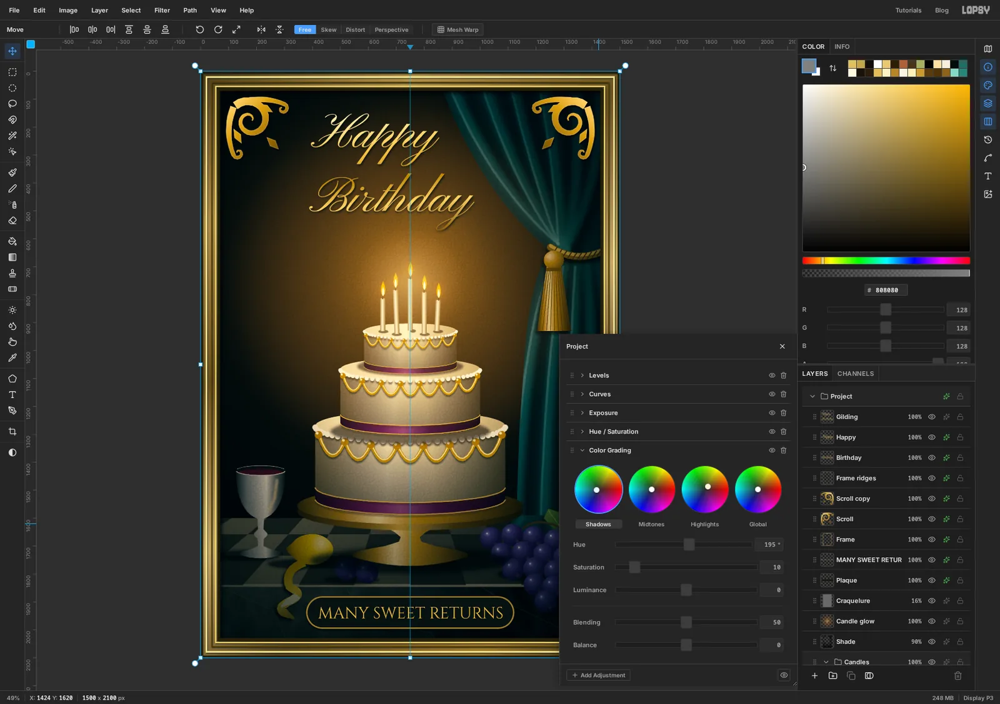

Old paintings are covered in fine cracks. Click `Candle glow` and add a layer called `Craquelure`. Press [[Cmd+A]], fill with mid grey `#808080` and deselect. Choose **Filter → Texture…**, click **Cells** and **Relief**, and set **Amount** `40`, **Size** `13`, **Detail** `60` and **Contrast** `20`. Set the blend mode to **Overlay** and the layer to `16%`. It sits under the frame, the plaque and the script, so only the painting cracks.

Now tie the colours together. Choose **Layer → Adjustment Layer…**. Lopsy keeps adjustments on a group, so this shows a short note (click **Got it**) and opens the adjustments panel for the whole `Project` group. Expand **Color Grading**. Click **Shadows** and set **Hue** `195`, **Saturation** `10`, which pushes the darks toward the teal of the drape. Click **Highlights** and set **Hue** `42`, **Saturation** `16` to warm the lights. Close the panel.

If the goblet and fruit feel too buried, click the `Shade` layer and set it to `90%`.

Choose **File → Save Project** to keep an editable `.lopsy` file, and **File → Quick Export PNG** for the card itself.
