A stencil print in several colours is really several prints. You cut one plate per ink, spray them one after another, and the colours mix wherever two inks land on top of each other. This tutorial makes that process into a poster. You'll spray a Bauhaus kite from four inks, then cut the four plates that would print it and lay them out underneath, like a contact sheet of the job.

The Bauhaus part is the vocabulary: a circle, a triangle and a square, the three primaries plus black, lowercase geometric type, and a strict grid. The stencil part is in the details. The plates have **bridges** that hold loose centres in place, **registration holes** to line them up, and **overspray** where paint drifted past the cut.

Along the way you'll use:

- **guides**, **Snap to Guides**, and the **grid** with **Snap** at 4 px
- four ink layers in **Multiply**, so overlapping inks mix like real overprints
- the **Pen** tool with **Path to Selection** for exact triangles, and an open Pen path stroked with **Enter**
- **Cmd-click** on a thumbnail to load a layer's shape as a selection, then **Delete** to cut through other layers
- **Shift**, **Alt** and **Shift+Alt** marquee drags to add, subtract and intersect
- **Select → Grow**, **Shrink** and **Feather**
- the **Spray** tool, **Gaussian Blur** and **Add Noise** for a sprayed finish
- copy and paste, a **Cmd-drag scale** to one fifth, a Move-tool drag, and two small **rotations**
- **Drop Shadow** and **Inner Glow** on the boards
- live text in **Poppins**, **Space Mono** and **Stardos Stencil**, including a text layer rotated 90°
- **Group Layers**, plus a quick undo and redo check

The palette is three primaries and black on warm paper, with a grey board for the plates:

- Paper `#E9E4D8`, print sheet `#F7F4EC`
- Yellow `#F0BE2C`, red `#D2352A`, blue `#1F4F9E`, key `#1C1C1A`
- Board `#8F8B82`, board shade `#2E2C28`
- Grain `#808080` (on an Overlay layer)

> **Tip:** The early steps give exact positions, because the plates later have to match the print. The status bar at the bottom of the window shows the pointer's X and Y while you work. For a selection with exact corners, click once with a marquee tool, without dragging, while nothing is selected. A dialog opens where you can type the corners. If you'd rather not measure, open the project with the **Follow along** button and work over it.

## Set up the paper and guides

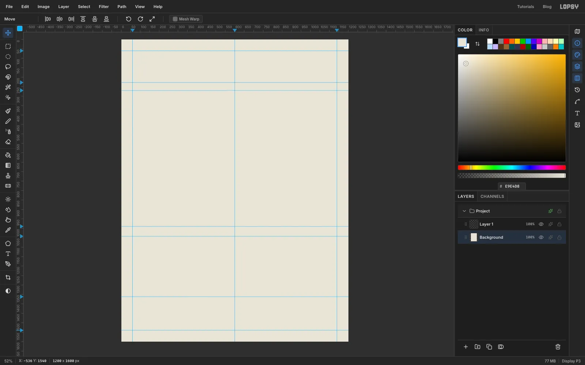

Open [Lopsy](/). In the **New Document** dialog, set **Width** to `1200` and **Height** to `1600`, choose a **White** background and click **Create**.

1. Select **Background**, set the foreground colour to `#E9E4D8` and choose **Edit → Fill**. With nothing selected it fills the whole layer.
2. Click the top ruler at `60`, `600` and `1140` for the side margins and the centre line.
3. Click the left ruler at `60`, `228`, `270`, `990`, `1042`, `1362` and `1540`. From the top, those are the top margin, the header rule, the top and bottom of the print, the top and bottom of the plates, and the bottom margin.

## Lay down the print sheet

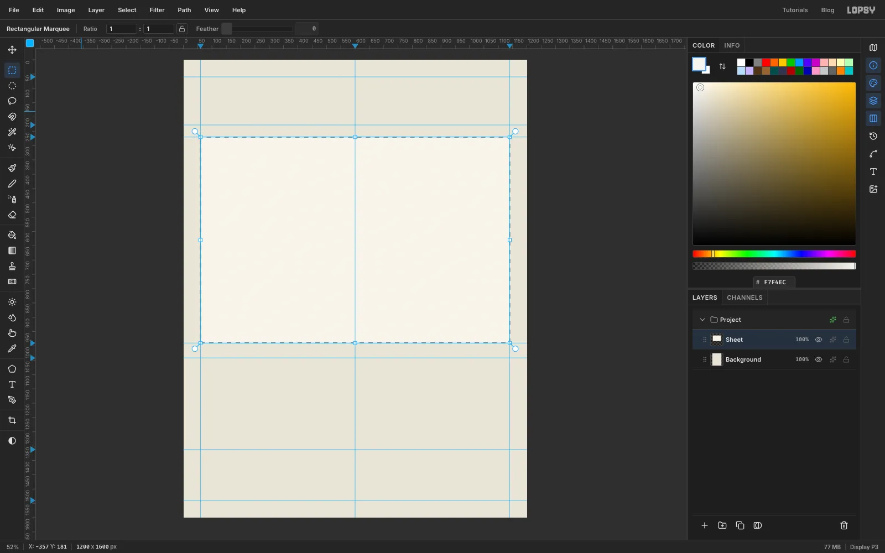

The print is a lighter sheet of paper lying on the page. Rename **Layer 1** to `Sheet` by double-clicking its name.

Pick the **Rectangular Marquee** ([[M]]) and drag from near the `60, 270` guide crossing to near `1140, 990`. **Snap to Guides** is on by default, so both corners land exactly on the guides. Set the foreground to `#F7F4EC`, choose **Edit → Fill** and deselect with [[Cmd+D]].

Open the layer's effects with the **✦** button on its row, tick **Drop Shadow** and set **Offset X** `0`, **Offset Y** `8`, **Blur** `22` and **Opacity** `28`. Close the drawer.

## Draw the kite on four ink layers

Each ink gets its own layer. Click **Add Layer** four times and name the new layers `Yellow`, `Red`, `Blue` and `Key`, from the bottom up. "Key" is the printer's name for black. Open each layer's effects and set its blend mode to **Multiply**. Multiply mixes colours the way ink does, so wherever two inks overlap you'll get a darker mix instead of one hiding the other.

The kite is four triangles that meet where the spars cross. Its corners are at about:

- top `553, 363`
- left `348, 520`
- right `692, 580`
- bottom `461, 885`
- spars crossing `520, 550`

For each triangle, select its layer and pick the **Pen** tool ([[P]]). Click its three corners, then click the first corner again to close the path. In the **Paths** panel, click **Path to Selection**, then **Delete Path**. Fill with the layer's colour and deselect.

- **Red:** top, left, crossing
- **Blue:** top, crossing, right
- **Yellow:** left, bottom, crossing
- **Key:** crossing, right, bottom

## Cut the spars through every ink

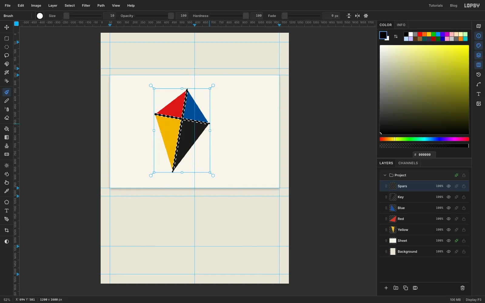

The spars are thin gaps that show the paper through all four inks. Add a layer called `Spars`. Pick the **Brush** ([[B]]), open the brush presets with the tip thumbnail in the options bar, choose **Hard Round** and set **Size** to `10`.

Click the kite's top tip, then hold [[Shift]] and click its bottom tip. That paints a straight line between the two clicks. Do the same from the left tip to the right tip.

Now **Cmd-click** the `Spars` thumbnail in the Layers panel. The two lines become a selection. Select each ink layer in turn, `Yellow`, `Red`, `Blue` and `Key`, and press [[Delete]] on each. Deselect, then delete the `Spars` layer with the bin button.

> **Tip:** Press [[Cmd+Z]] five times. The first undo brings back the `Spars` layer, and each of the next four fills the gap back into one ink. Then press [[Cmd+Shift+Z]] five times to cut them again. The result should match exactly.

## Add the sun and its bridged ring

Select `Yellow`. Click once with the **Elliptical Marquee** and enter the corners `620, 340` and `920, 640`. That's a 300 px circle centred at `770, 490`. Fill with yellow and deselect. Where the sun overlaps the blue triangle it turns green, and over the black it stays black. That's Multiply at work.

Select `Red` and make a bigger circle the same way, from `572, 292` to `968, 688`. Fill it red. Choose **Select → Shrink…**, enter `22` and press [[Delete]] to clear the middle. You're left with a red ring.

A real stencil can't cut a ring, because the middle would fall out. It keeps thin **bridges** instead. Deselect, then click once with the **Rectangular Marquee** and enter `765, 284` to `775, 696`. That's a 10 px bar straight down through the sun's centre. Zoom in, hold [[Shift]] and drag a matching bar across, from `564, 485` to `976, 495`. Press [[Delete]] and deselect. The ring now has four gaps.

## Tie on the tail and bowties

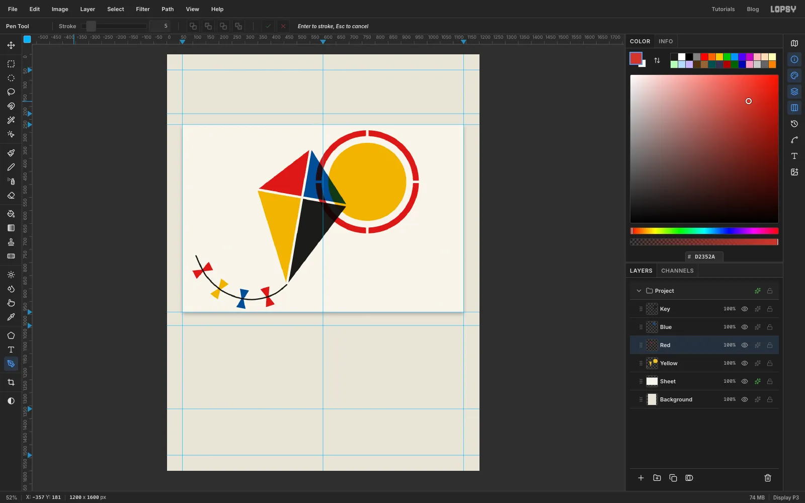

Select `Key` and set the foreground to `#1C1C1A`. Pick the **Pen** tool and set **Stroke** to `5` in the options bar.

Start at the kite's bottom tip, `461, 885`. For each point, press and drag about 40 px in the direction the curve is heading, which pulls out a smooth handle:

1. down and left to about `405, 925`
2. along the bottom to `315, 942`
3. curving up through `222, 914` and `152, 852`
4. ending at `112, 774`

Press [[Enter]]. The path is stroked with the foreground colour. Delete the path in the **Paths** panel.

The bowties sit across the string, with their knots on it at about:

- `387, 931` in **red**, on the `Red` layer
- `291, 939` in **blue**, on `Blue`
- `203, 902` in **yellow**, on `Yellow`
- `138, 830` in **red** again

Each one is a closed six-point **Pen** shape, about 72 px wide and 36 px tall. Picture a line through the knot at right angles to the string. The two wing tips on one side sit 36 px out along that line and 18 px either side of it, and the other two mirror them. Between each pair of tips, click a point 4 px from the knot, so the bowtie pinches to an 8 px waist on the string. Go round the six points in order and click the first one again to close the shape. Then use **Path to Selection**, fill with the layer's colour and deselect.

## Add the hill, the flyer and the string

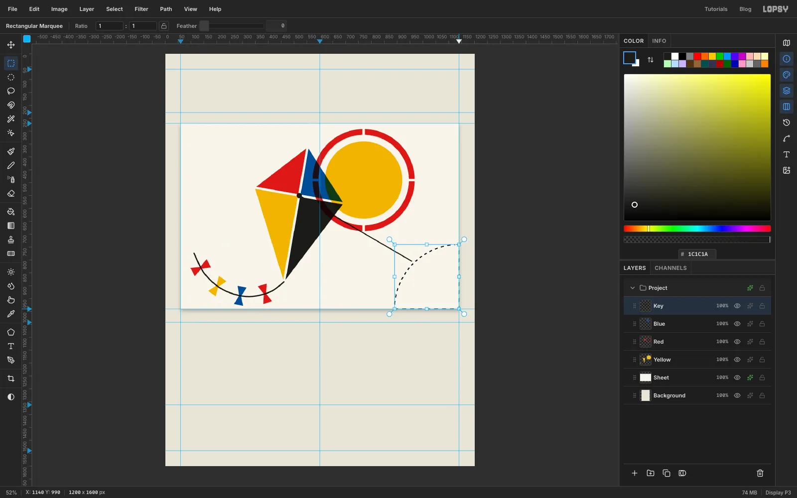

Stay on `Key`. Pick the **Brush** again with **Size** `5`. Click where the spars cross, then [[Shift]]-click at `957, 805`. This is the line from the kite to the person flying it. Click once with the **Elliptical Marquee** and enter `510, 540` to `530, 560` for a 20 px circle on the spars' crossing. Fill it black for the bridle knot.

The hill is a quarter of a circle in the sheet's corner. With the **Elliptical Marquee**, drag from `890, 740` to `1390, 1240`. That's a 500 px circle centred on the sheet's bottom-right corner. It's fine for it to run off the canvas. Then hold [[Shift+Alt]] and drag a rectangle over the whole sheet. **Shift+Alt** keeps only the overlap, so the selection becomes a quarter-disc inside the sheet. Fill it black and deselect.

Select `Red`, deselect, and make a 36 px circle from `939, 787` to `975, 823`, at the end of the string, for the flyer. It sits half on the hill. Fill it red.

## Add speed lines

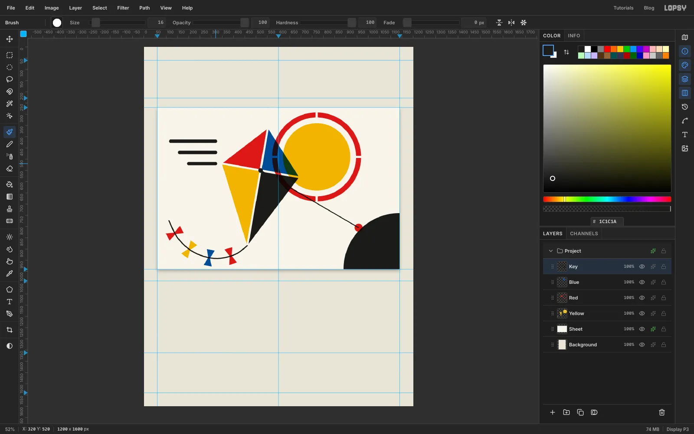

Back on `Key`, set the **Brush** to **Size** `16`. Draw three straight lines with a click and a [[Shift]]-click. They all end at `x 320`, each a little shorter:

- `120, 420` to `320, 420`
- `160, 470` to `320, 470`
- `200, 520` to `320, 520`

Rounded ends and a shrinking stack read as motion, which is why this is a kinetic kite.

## Spray each ink

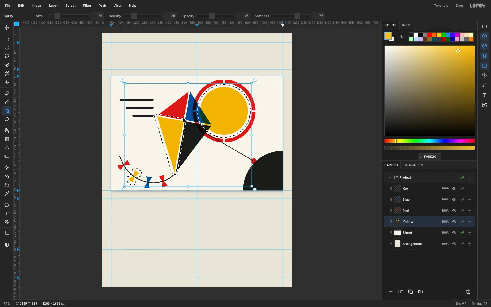

So far everything is crisp, like vector art. A sprayed stencil has soft edges and a haze of droplets just past the cut. Do this for each ink layer in turn, starting with `Yellow`:

1. Choose **Filter → Gaussian Blur…** with **Radius** `1.5`. That softens the edges a little.
2. **Cmd-click** the layer's thumbnail to select its shapes.
3. Choose **Select → Grow…** `16`, then **Select → Feather…** `8`.
4. Hold [[Shift+Alt]] and drag a rectangle over the sheet, so the haze can't land outside the print.
5. Pick the **Spray** tool ([[J]]). Set **Size** `70`, **Density** `26` and **Opacity** `40`, leave **Softness** at `70`, and set the foreground to the layer's ink.
6. Sweep back and forth across the whole selection. Only the band around each shape picks up droplets. Inside the shapes they land on solid ink and vanish.
7. Deselect and choose **Filter → Add Noise…** with **Amount** `14`, **Mono** and **Gaussian**. That gives the solid ink a sprayed grain.

## Add paper grain

Select `Key` and add a layer called `Grain`. Select the sheet with the exact-corners dialog (`60, 270` to `1140, 990`), fill it with `#808080` and deselect.

Run **Add Noise** with **Amount** `30`, **Mono** and **Gaussian**. Set the layer's blend mode to **Overlay** and its opacity to `35%`. On Overlay, mid-grey disappears, and only the noise is left to texture the paper and the ink.

## Add registration marks

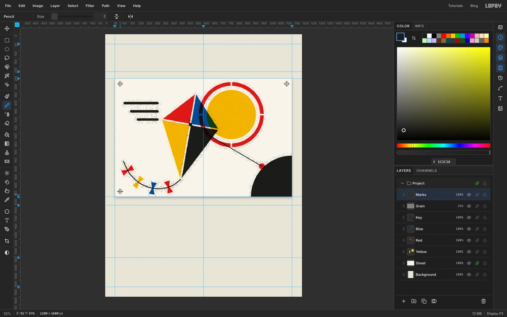

Printers line up each plate with **registration marks**. Add a layer called `Marks` above `Grain`.

Pick the **Shape** tool ([[U]]), choose **Ellipse**, remove the fill and set a `#1C1C1A` stroke of **Width** `2`. Click once at `92, 302`. A **Shape Size** dialog opens, where you enter `22` × `22`. Repeat at `1108, 302` and `92, 958`. The bottom-right corner would be under the hill, so it doesn't get a mark.

Pick the **Pencil** ([[N]]) at **Size** `2`. Through each circle, draw a 36 px horizontal and a 36 px vertical line with a click and a [[Shift]]-click.

## Lay out four boards

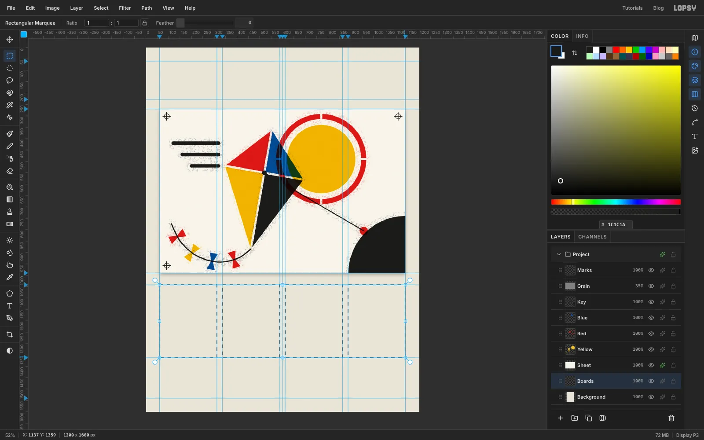

The plates are four boards, 252 px wide with 24 px gutters. Add guides at `312`, `336`, `588`, `612`, `864` and `888` on the top ruler.

Select **Background** and add a layer called `Boards`, so the boards sit under the print. With the **Rectangular Marquee**, drag the first board between the guides from `60, 1042` to `312, 1362`. Hold [[Shift]] and add the other three: `336`–`588`, `612`–`864` and `888`–`1140`, all from `1042` to `1362`. Fill with `#8F8B82` and deselect.

## Shrink a copy of the yellow ink

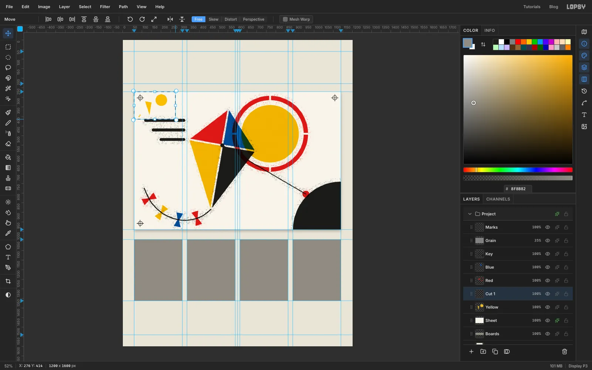

Each plate is cut from a copy of its ink at 1:5 scale. Start with yellow.

1. Select `Yellow`, select the sheet with the exact-corners dialog, and press [[Cmd+C]] then [[Cmd+V]]. The copy lands in place on a new layer. Rename it `Cut 1`.
2. Deselect, then select the sheet rectangle again with the exact-corners dialog. Pick the **Move** tool ([[V]]).
3. Hold [[Cmd]] and drag the bottom-right corner handle up and to the left. **Cmd** keeps the proportions, and the top-left corner stays put. Stop when the box is 216 × 144 px, with its bottom-right corner at `276, 414`. Zoom in on that corner if you need to land it exactly.
4. Press [[Cmd+D]] to commit the scale.

## Move the copy onto plate 1

Draw a marquee around the small copy, from `60, 270` to `276, 414`. With the **Move** tool, drag it down so its top-left corner sits at `78, 1082`. That's 18 px in from the board's left edge and 40 px below its top. Move drags don't snap to guides, so get close, then nudge with the arrow keys to land it exactly. Press [[Cmd+D]].

## Dust the board with overspray

A used plate has paint around every hole. **Cmd-click** the `Cut 1` thumbnail, choose **Select → Grow…** `7`, and select `Boards`. With the **Spray** tool at **Size** `46`, **Density** `40` and **Opacity** `45`, and yellow as the foreground, zigzag over the cut area.

## Cut the plate, then the other three

**Cmd-click** the `Cut 1` thumbnail again and choose **Select → Grow…** `1`. The extra pixel keeps thin parts like the string open once they're scaled down. Select `Boards`, press [[Delete]], deselect, and delete the `Cut 1` layer. The yellow shapes are now holes, and the paper shows through.

Repeat everything from **Shrink a copy of the yellow ink** to here for each of the other inks. Name the copies `Cut 2`, `Cut 3` and `Cut 4`, and spray each board with its own ink:

- **Plate 2:** the `Red` layer, with its copy's top-left corner at `354, 1082`
- **Plate 3:** the `Blue` layer, at `630, 1082`
- **Plate 4:** the `Key` layer, at `906, 1082`

The red ring needs its bridges at the small size too. After you move the red copy onto plate 2, drag a 5 px bar down through the small ring's centre (about `496, 1126`), [[Shift]]-add a 5 px bar across, and press [[Delete]] on `Cut 2` before you spray and cut.

## Punch the registration holes

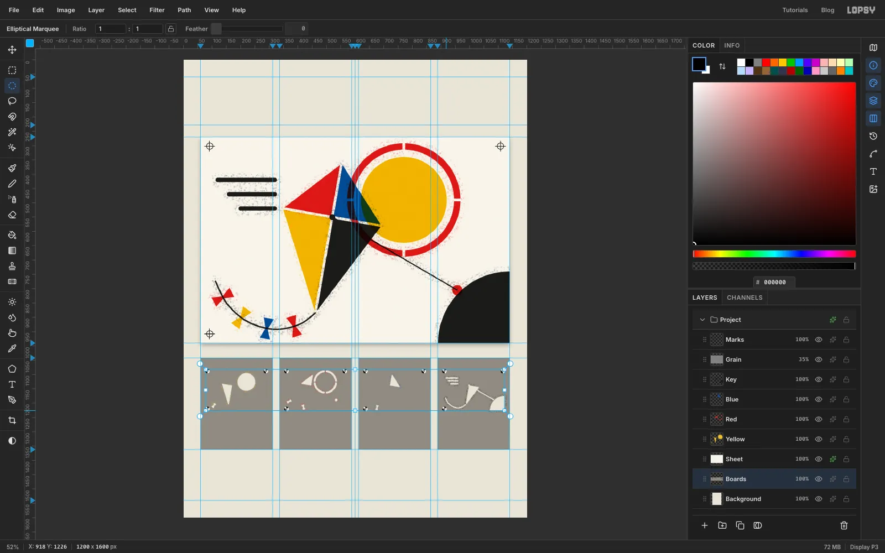

Each plate needs holes where the print has its crosshairs, scaled by the same 1:5. On plate 1 they're at `84, 1088`, `288, 1088` and `84, 1220`. On the other plates, add 276, 552 and 828 to the x values.

With `Boards` selected, Shift-add a 12 px circle at each spot with the **Elliptical Marquee**. Press [[Delete]] and deselect. Then pick the **Pencil** at **Size** `1` with `#2E2C28`, and scratch four short ticks around each hole, like a cross with its middle punched out.

## Cut a stencil number into each board

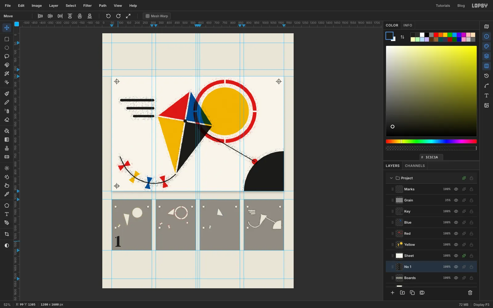

With `Boards` selected, pick the **Text** tool ([[T]]). Choose **Stardos Stencil**, **Bold**, size `96` and `#1C1C1A`, click in empty space and type `1`. Press [[Tab]] to finish, then click **Rasterize Layer** at the bottom of the Layers panel.

Move the number to the bottom-left of plate 1, 22 px in from the edge, with its foot on the line `y 1338`. **Cmd-click** its thumbnail, select `Boards`, press [[Delete]] and delete the number layer. Do the same for `2`, `3` and `4`.

## Label each plate with its ink

On `Boards`, make a 116 × 42 px tab at the bottom-right of each plate, from 118 px to 234 px in from its left edge and from `y 1296` to `1338`. Fill each with its plate's ink.

Select `Boards`, so each label is created directly above it. Type each label in **Space Mono**, **Bold**, size `20`: `yellow` in `#1C1C1A`, and `red`, `blue` and `key` in `#F7F4EC`. Rasterize it, centre it on its tab, and choose **Layer → Merge Down** to bake it into the board. The tab's bottom edge lines up with the foot of the stencil number beside it.

## Knock two plates askew

Plates on a bench never sit perfectly straight. Draw a marquee a few pixels outside plate 2. With the **Move** tool, drag the white circle handle beyond the top-right corner a little counter-clockwise, about 1.5°. Press [[Cmd+D]].

Do the same for plate 3, about 1° clockwise. Keep the turns small so no corner pokes past its gutter.

## Give the boards thickness

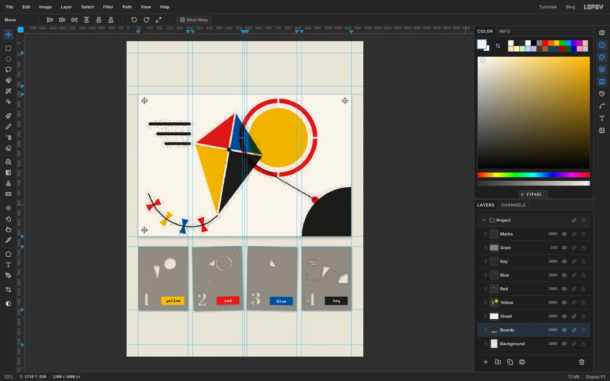

Open the effects for `Boards`. Tick **Drop Shadow** and set **Offset X** `3`, **Offset Y** `7`, **Blur** `12` and **Opacity** `40`. Tick **Inner Glow** and set **Size** `3`, **Opacity** `50` and the colour to `#2E2C28`. The glow darkens the edge of every hole, so the cuts look like they go through card.

## Set the title and dot the i's in red

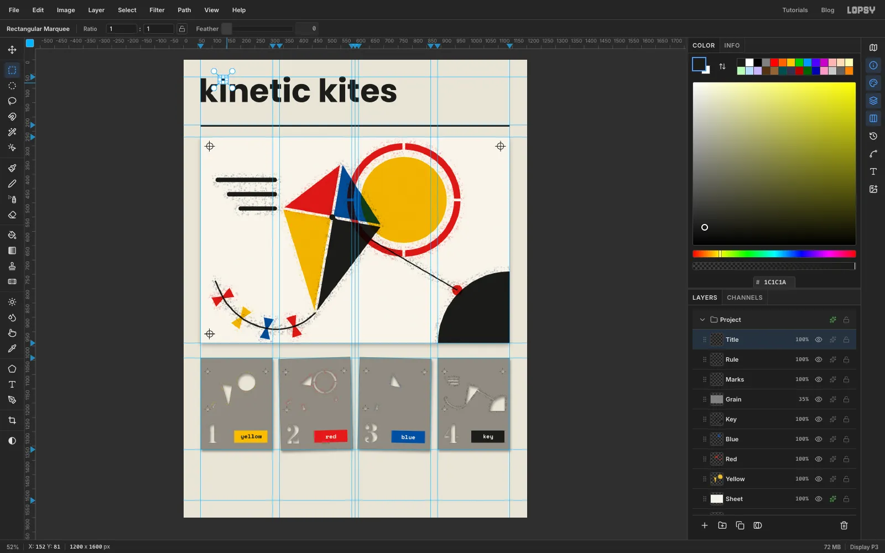

Select `Marks` and add a layer called `Rule`. Use the exact-corners dialog for a 6 px bar from `60, 228` to `1140, 234`, and fill it with `#1C1C1A`.

Type `kinetic kites` in **Poppins**, **Bold**, size `112`, `#1C1C1A`, and rename the layer `Title`. Rasterize it and move it so its left edge is on the `60` guide, with the tops of the k's at `y 58`. That puts the baseline at `148`, the same line the shapes in the next steps stand on. The tall letters poke 2 px above the margin, which reads as optically aligned.

**Cmd-click** the title's thumbnail. Then, with the **Rectangular Marquee**, hold [[Shift+Alt]] and drag a small box around the dot of the first i. Only the dot stays selected. Fill it with red and deselect. Repeat for the other two i's.

## Add the subtitle

Type `a stencil set in four plates · spray light to dark` in **Space Mono**, size `22`, and name the layer `Subtitle`. Rasterize it and place it on the `60` guide, with its top at `y 172`. That leaves the same space above the rule as there is between the rule and the print.

## Draw the circle, triangle and square on the grid

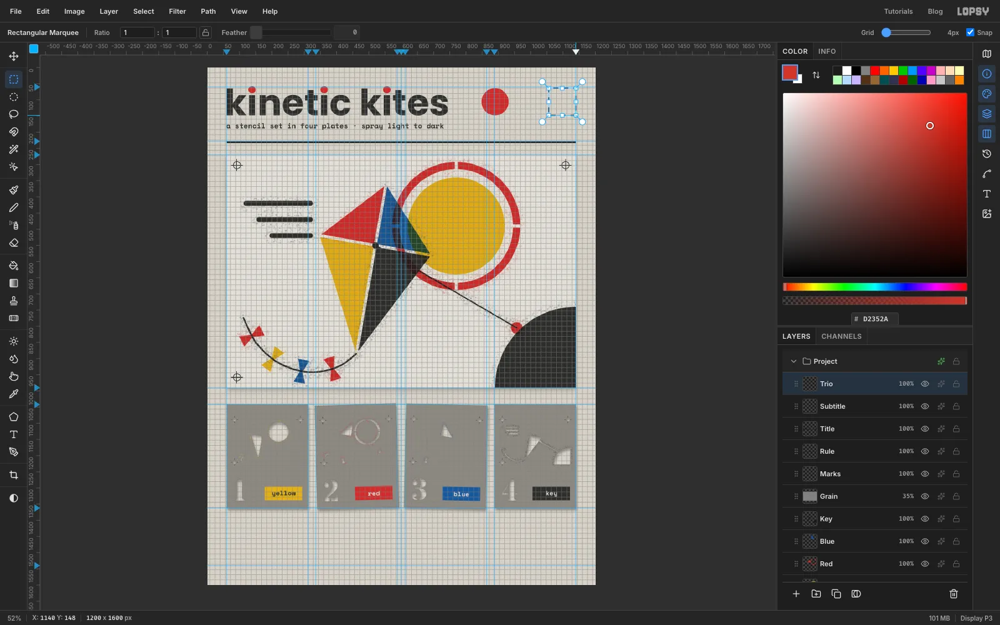

Add a layer called `Trio`. Choose **View → Show Grid**, drag the **Grid** slider in the options bar all the way left to **4px**, and make sure **Snap** is ticked. Then turn off **View → Snap to Guides**. Otherwise the plate guides at `864` and `888` pull the circle's corner and squash it into an oval.

Each shape is 84 px, from `y 64` to the title's baseline at `148`, with 20 px between them:

1. **Circle:** drag the **Elliptical Marquee** from `848, 64` to `932, 148` and fill it red.
2. **Square:** drag the **Rectangular Marquee** from `1056, 64` to `1140, 148` and fill it blue.
3. **Triangle:** the **Pen** ignores the grid, so watch the status bar as you click `952, 148`, `994, 64` and `1036, 148`. Close the path, then use **Path to Selection** and fill it yellow.

Turn the grid off and **Snap to Guides** back on.

## Rotate a line of text into the margin

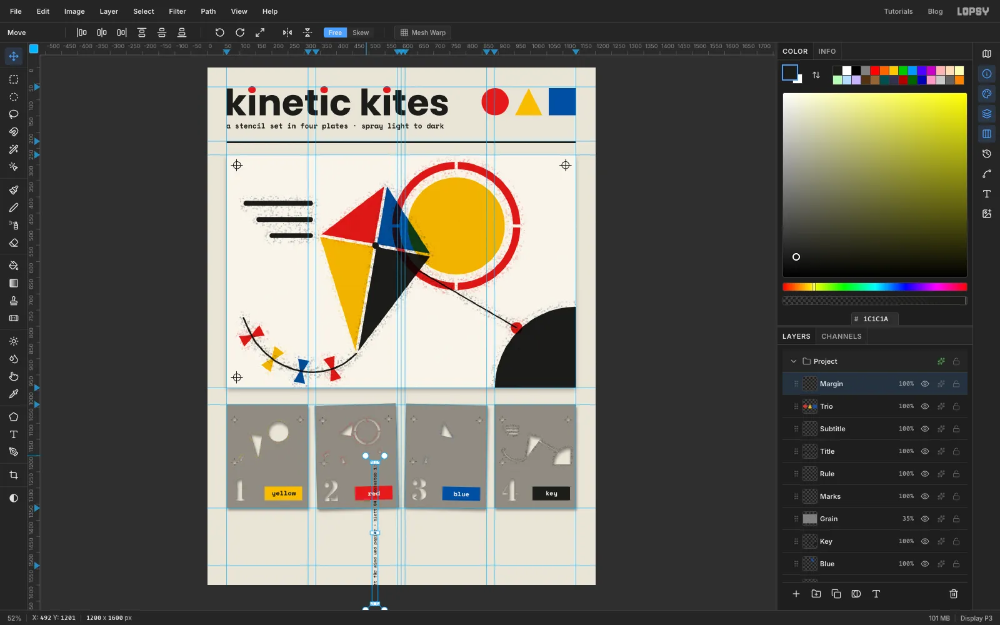

Type `werkstatt für wind und papier · blatt 04 · massstab 1:5` in **Space Mono**, size `13`, in an empty part of the canvas, and name the layer `Margin`. Leave it as live text.

With the **Move** tool, the text layer shows its own handles. Hold [[Cmd]] and drag the top-right rotation handle counter-clockwise. **Cmd** snaps to 15° steps, so stop at 90°. Move the text into the left margin, centred on the print, about 30 px from the page edge. It now reads from bottom to top.

## Add the captions and the footer

Type two captions in **Space Mono**, size `14`, rasterize them and put both on the `60` guide:

- `fig. 5  the pull: four plates, sprayed light to dark`, 16 px under the print. Name it `Caption 5`.
- `fig. 1–4  the plates, one per ink`, 16 px under the plates. Name it `Caption 1-4`.

Select `Rule` and pick the **Pencil** at **Size** `2` with `#1C1C1A`. Click `60, 1412` and [[Shift]]-click `1140, 1412` for the footer rule.

Type the plate notes in **Space Mono**, size `15`, as four lines:

- plates: 0.5 mm board, cut at 1:5
- line the punched holes up with the marks
- bridges hold the ring's centre in place
- spray thin coats from 25 cm, light to dark

Name the layer `Notes`, rasterize it and place it at `60, 1430`.

The **overprint test** shows what Multiply does, so it goes on the real ink layers. Make three 72 px circles with the exact-corners dialog: yellow on `Yellow` from `1008, 1450` to `1080, 1522`, red on `Red` from `1068, 1450` to `1140, 1522`, and blue on `Blue` from `1038, 1468` to `1110, 1540`. The red one touches the right margin. Draw a marquee around the three and run **Add Noise** (`14`, **Mono**, **Gaussian**) on each of the three layers, so they match the print. Finally type `overprint test` in **Space Mono**, size `14`, name it `Overprint`, and right-align it to the `1140` guide at `y 1430`.

## Group the layers and check undo

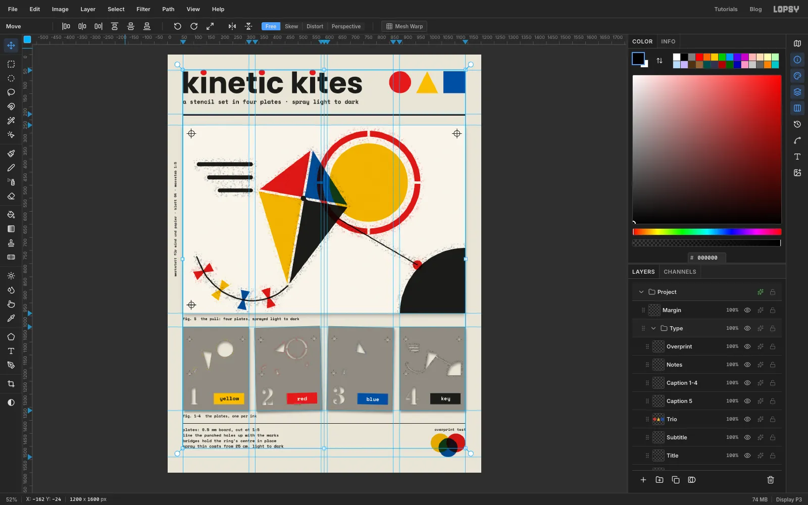

Click `Sheet`, then [[Shift]]-click `Marks` to select everything from the sheet up to the marks. Choose **Layer → Group Layers** and name the group `Pull`. Do the same from `Rule` up to `Overprint` and call it `Type`. The live `Margin` text sits above them and can stay outside both groups. The overprint circles live on the ink layers, so they belong to `Pull` too.

Select the `Pull` group, pick the **Move** tool and press [[Shift+→]] three times. The whole print moves 30 px, overprint circles included. Press [[Cmd+Z]] three times to put it back. Each press of [[Shift+→]] is its own step, so it takes three undos.

Save with **File → Save Project**, and export with **File → Quick Export PNG**.
