**Bauhaus** graphic design, from the German art school that ran from 1919 to 1933, builds a page from a few plain parts: flat primary colours, circles, squares and triangles, strong diagonals, and sans-serif type, often all lowercase. Joost Schmidt's poster for the 1923 Bauhaus exhibition is a famous example. It's built from circles, squares and blocks on a tilted cross. Wassily Kandinsky, who taught at the school, even ran a questionnaire asking which colour belongs to which shape. His own answer was a **yellow triangle, a red square and a blue circle**.

In this tutorial you'll use those ideas to design a menu for **Fig & Xérès**, an imaginary sherry and tapas bar in Jerez. ("Xérès" is the old French name for Jerez, where sherry comes from.) The menu is 1200 × 1800 px. It has:

- a hero picture: a black bar on a 30° diagonal, a copita sherry glass and a halved fig, all built from simple selections
- a title in large lowercase type, with the ampersand coloured separately
- three menu columns headed by Kandinsky's triangle, square and circle, with right-aligned prices
- a key of sherry colours from dry to sweet, an event strip and a footer

The tools you'll use:

- the **Rectangular** and **Elliptical Marquee**, the **Lasso**, **Edit → Fill** and **Select → Shrink / Grow / Inverse**
- the **Move** tool's rotate handle, **Duplicate Layer** and **Merge Down**
- the **Pencil**, the **Spray**, and the **Brush** with Scatter and **Radial Symmetry**
- a **layer mask**, the **Halftone** and **Fibers** filters, and the **Multiply** blend mode
- the **Shape** tool, the **Stroke** layer effect, **groups** and **guides**
- the **Text** tool, including colouring a single character

The only font is **Jost**, a free Google Font in Lopsy's font picker. It's a close cousin of Futura, the geometric typeface designed in the Bauhaus years.

The palette:

- Paper `#EEE7D8`, ink `#1C1B19`
- Bauhaus red `#C73A2C`, yellow `#EDB723`, blue `#21539E`
- Fig blush `#E8A39A`, shadow blue `#5F7FB8`
- Sherries `#EEDF92` → `#E0C25E` → `#C98A34` → `#A35E28` → `#7A3B19` → `#2E1A10` (fino to pedro ximénez)

> **Tip:** Positions are written as `x, y` in document pixels. The status bar at the bottom left shows the cursor's position, so you can find them as you go. A click with a marquee tool, without dragging, opens a small dialog where you can type the exact corners, which is handy for the bars and rules. Key names are Mac keys. On Windows and Linux, use Ctrl for Cmd.

## Set up the paper and guides

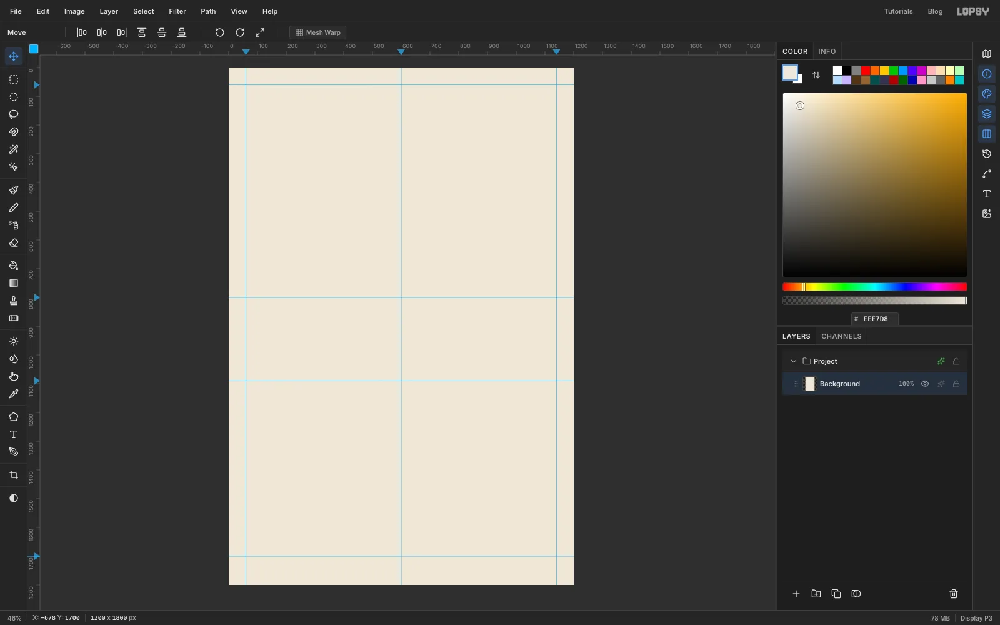

1. Open [Lopsy](/). In the **New Document** dialog, set **Width** to `1200` and **Height** to `1800`, then click **Create**.
2. Delete the empty `Layer 1` with the bin button at the bottom of the Layers panel.
3. Click `Background`. Type `EEE7D8` in the Color panel's hex field and choose **Edit → Fill**.
4. Click the top ruler at **60**, **600** and **1140** to drop vertical guides: the two side margins and the centre line.
5. Click the left ruler at **60**, **800**, **1090** and **1700**. These mark the top margin, the bottom of the picture, the top of the menu and the top of the footer.

## Draw the black bar and rotate it

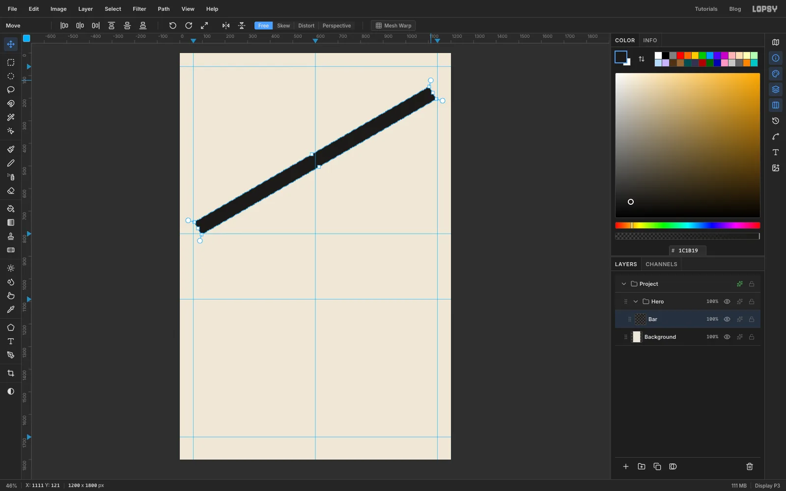

The diagonal bar gives the page its energy. You'll draw it level, then tilt it.

1. Click **New Group** (the folder button under the Layers panel) and name the group `Hero` by double-clicking its name. Click **Add Layer** (+) and name the layer `Bar`.
2. Pick the **Rectangular Marquee** ([[M]]) and click once on the canvas without dragging. In the dialog that opens, enter `0, 444` for the first corner and `1200, 508` for the second. That's a 64 px strip right across the canvas.
3. Set the colour to `#1C1B19` and choose **Edit → Fill**.
4. Switch to the **Move** tool ([[V]]). Move the pointer just outside the top-right corner handle until it turns into a curved arrow. Hold [[Cmd]] so the angle snaps in 15° steps, and drag up until the bar tilts **30°**, rising to the right.
5. Press **Enter** to apply, then [[Cmd+D]] to deselect.

## Make the bar bleed off both edges

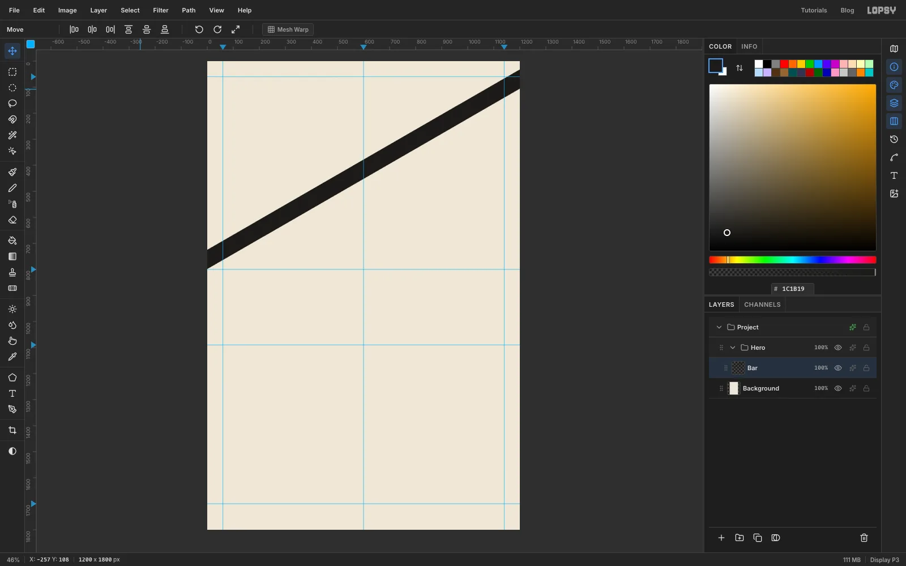

The rotated bar is now too short to reach the edges. Make it longer with a copy.

1. With the **Move** tool, drag the bar up and to the right, about 120 px across and 130 px up, until its top end runs off the right edge of the canvas.
2. Click **Duplicate Layer** under the Layers panel, then click the `Bar copy` row so the next drag moves only the copy.
3. Drag the copy back down and to the left along the bar's own slope, about 260 px across and 150 px down, until its lower end runs off the left edge. The two pieces overlap in the middle and line up exactly, because the copy travelled along the bar.
4. Choose **Layer → Merge Down**. You now have one long bar that leaves the page at about y 760 on the left and near the top on the right.

> **Tip:** Merge Down trims anything that hangs past the canvas edge, so get the bar where you want it before you merge.

## Add a thin red line

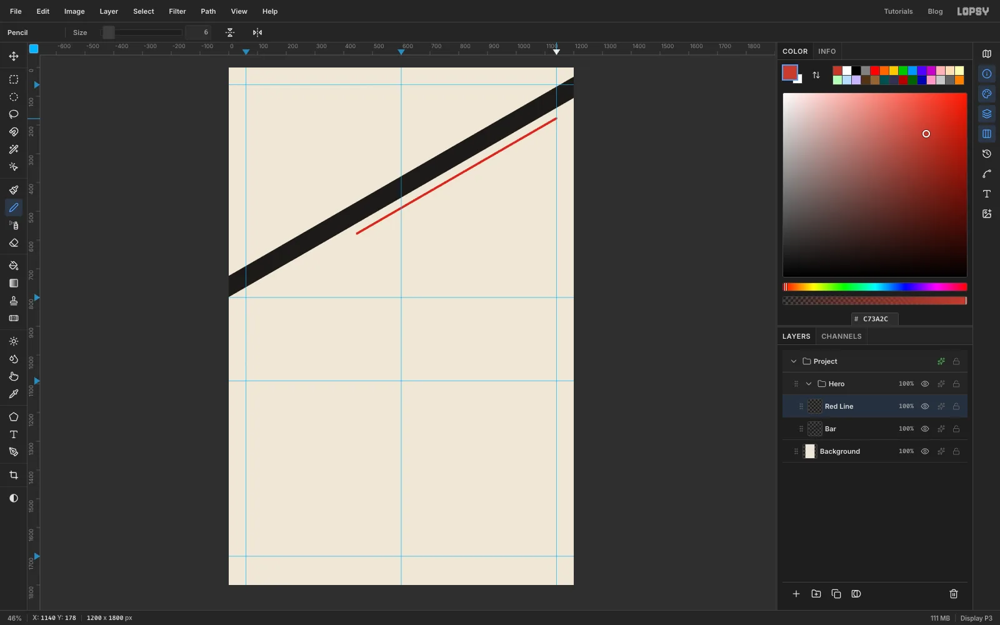

1. Click **Add Layer** and name it `Red Line`.
2. Pick the **Pencil** ([[N]]), set **Size** to `6` and the colour to `#C73A2C`.
3. Click at about `446, 578`, then **Shift-click** at `1140, 178`. Shift-click draws a straight line from the last point, so you get a line parallel to the bar, 64 px below it, that stops on the right margin guide.

## Select the fig's teardrop shape

A halved fig is a teardrop: a circle with a point at the top. You'll build it from two selections.

1. Click **Add Layer** and name it `Fig Skin`.
2. With the **Elliptical Marquee**, hold [[Shift]] and drag a circle from `564, 184` to `1036, 656`. That's a circle 472 px across, centred on `800, 420`.
3. Pick the **Lasso** ([[L]]) and hold [[Shift]] to add to the selection. The Lasso is freehand, so drag slowly in straight strokes: start at the tip, `800, 70`, go down to the circle's right edge where it starts to curve away (about `974, 261`), across through the middle of the circle, up to the matching point on the left (about `626, 261`), and back to the tip.

The two side points are where a straight line from the tip just touches the circle. If you land near them, the sides flow smoothly into the curve. Any wobble inside the circle doesn't matter, because the circle already covers it.

## Fill the skin, pith and flesh rings

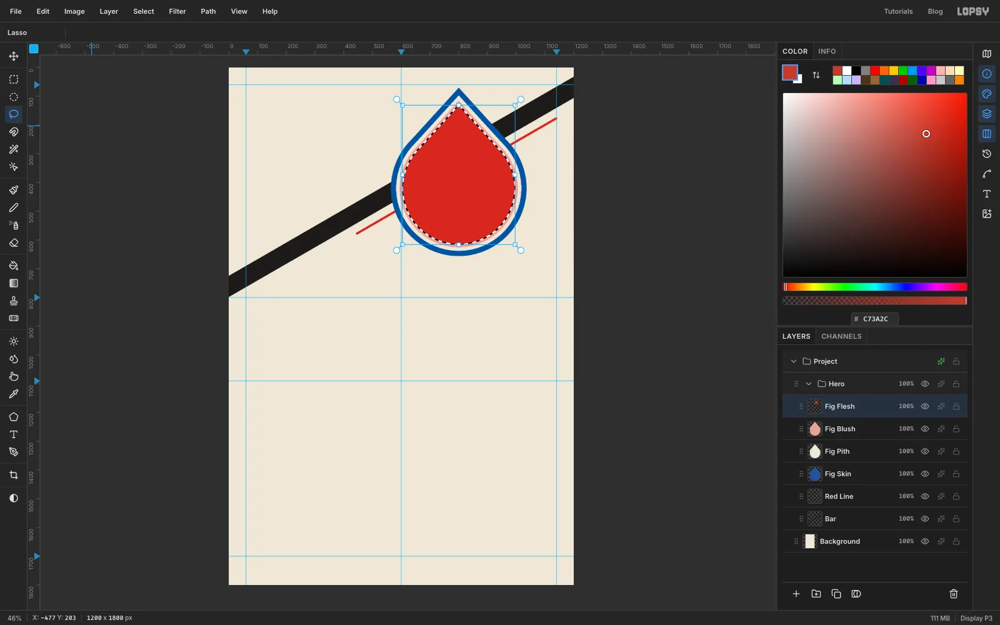

Each ring is the same teardrop, shrunk a little and filled on its own layer.

1. Fill the selection with `#21539E` (**Edit → Fill**). That's the skin.
2. Add a layer named `Fig Pith`. Choose **Select → Shrink…**, enter `18` and click **Apply**. Fill it with the paper colour `#EEE7D8`.
3. Add a layer named `Fig Blush`. Shrink by `12` and fill with `#E8A39A`.
4. Add a layer named `Fig Flesh`. Shrink by `10` and fill with `#C73A2C`.

Keep the selection: it will keep the seeds inside the flesh.

## Speckle the seeds and start the fibres

1. Add a layer named `Fig Seeds` and shrink the selection by `22`. Set the colour to `#EDB723`.
2. Pick the **Spray** ([[J]]). Set **Size** to `60`, **Density** to `8` and **Softness** to `0`. Drag a slow spiral from near the centre of the fig out to the edge of the selection for a fine speckle.
3. Pick the **Brush** ([[B]]) and click the brush preview at the left of the options bar to open the brush settings. On the **Shape** tab, set **Size** to `9`, **Hardness** to `100` and **Spacing** to `260`. On the **Dynamics** tab, set **Scatter** to `160` and **Size Jitter** to `45`. Drag the same kind of spiral again. Each dab lands as a separate round seed.
4. For the fibres, set **Scatter** and **Size Jitter** back to `0`. On the **Shape** tab, set **Spacing** to `25`, **Size** to `4` and **Taper** to `60`, so each stroke starts thin.
5. Turn on **Radial Symmetry** (the snowflake button in the options bar) and set **Segments** to `20`. [[Cmd]]-click the middle of the fig (`800, 420`) to move the symmetry centre there.
6. Drag one short stroke straight outwards, from about 60 px out from the centre to about 130 px out. Lopsy repeats it 20 times around the fig.

## Finish the fibres

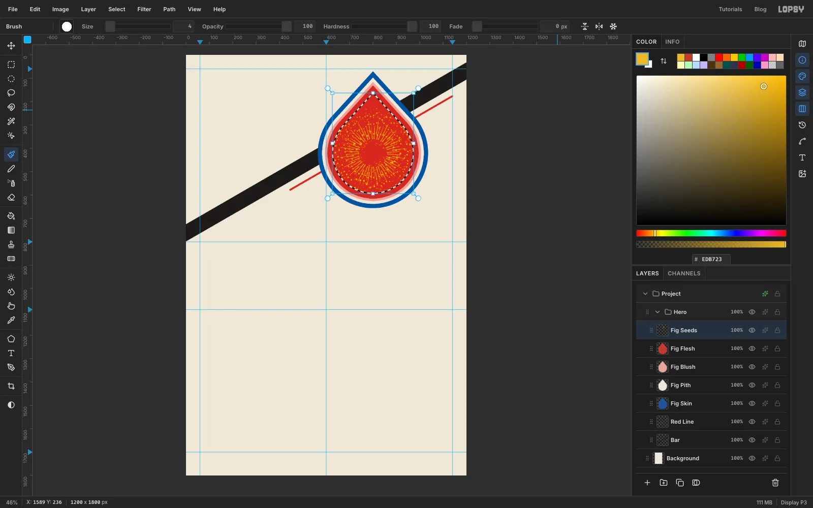

1. Drag two more short strokes outwards, each at a slightly different angle from the first: one from about 85 px out to 155 px, and one from 60 px to 110 px. Different lengths keep the pattern from looking mechanical.
2. Turn **Radial Symmetry** off again, and set **Taper** back to `0`.

## Cut the hollow and add the stem

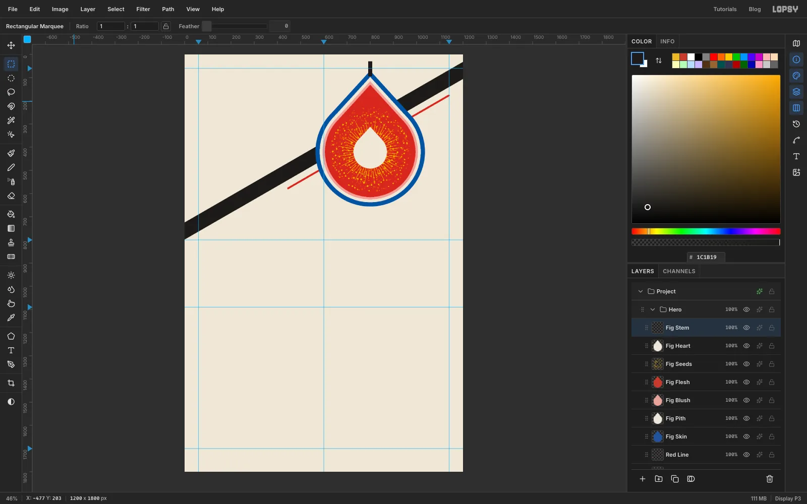

1. Add a layer named `Fig Heart`. Shrink the selection by `124`. That leaves a small teardrop in the middle. Fill it with the paper colour `#EEE7D8` and press [[Cmd+D]].
2. Add a layer named `Fig Stem`. With the **Rectangular Marquee**, draw a small upright rectangle across the tip of the fig, about 18 px wide and 64 px tall (`791, 30` to `809, 94`). Fill it with `#1C1B19` and deselect.

## Merge the fig and tilt it

1. With `Fig Stem` selected, choose **Layer → Merge Down** six times, until all the fig layers have become one. Rename it `Fig`.
2. With the **Rectangular Marquee**, draw a box just around the fig. The Move tool rotates a selection around its centre, so a snug box makes the fig turn on the spot.
3. With the **Move** tool, drag from just outside a corner handle to rotate the fig **15° clockwise**, holding [[Cmd]] to snap. Press **Enter**, then [[Cmd+D]].

The slight tilt keeps the fig from looking stiff next to the upright glass.

## Select the copita glass

A **copita** is the traditional sherry glass. It's a tulip shape that narrows towards the rim. You'll build it from an ellipse and a four-sided shape.

1. Click `Red Line`, then **Add Layer** and name the new layer `Glass`.
2. With the **Elliptical Marquee**, drag from `165, 220` to `355, 540`. The bottom half of this ellipse is the round base of the bowl.
3. With the **Lasso**, hold [[Shift]] and drag four straight sides for the top of the bowl: from `205, 150` across to `315, 150`, out and down to `355, 380` on the ellipse's right edge, across to `165, 380` on its left edge, and back up to the start. It narrows towards the top.

## Outline the glass and mark the sherry level

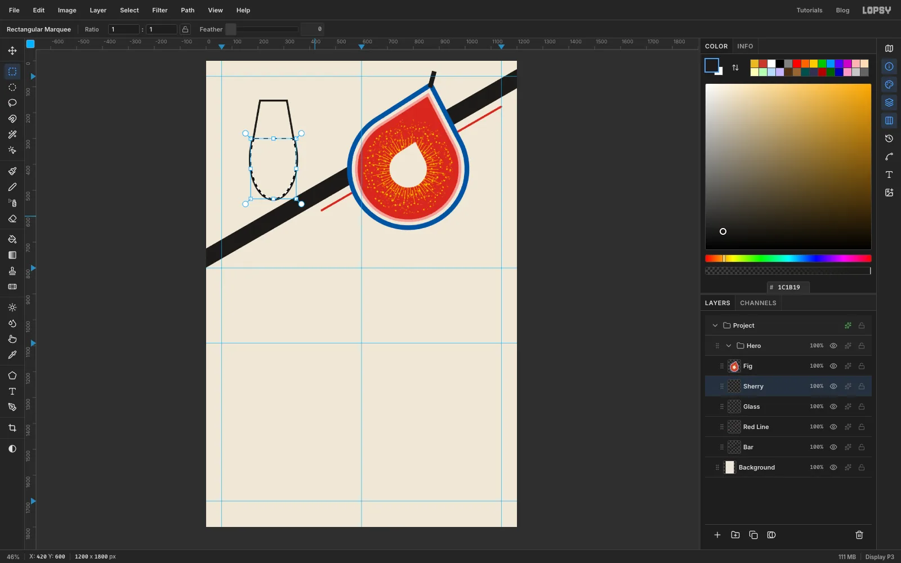

1. Fill the selection with `#1C1B19`.
2. Choose **Select → Shrink…** and shrink by `7`. Press **Delete** ([[Backspace]]). Only a 7 px black outline is left.
3. Add a layer named `Sherry`. The shrunken selection is still active.
4. With the **Rectangular Marquee**, hold [[Shift+Option]] and drag a box from `100, 300` to well below the glass. Shift and Option together *intersect*, so only the inside of the glass below y 300 stays selected. That's the level of the sherry.

## Pour the sherry and add the stem and foot

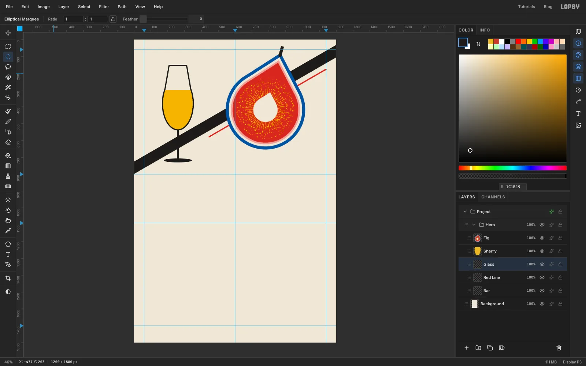

1. Fill the selection with `#EDB723` and deselect.
2. Click the `Glass` layer. With the **Rectangular Marquee**, draw a narrow upright rectangle from `254, 530` to `266, 716` and fill it with `#1C1B19`. That's the stem.
3. With the **Elliptical Marquee**, drag from `176, 706` to `344, 730` and fill it the same. That's the foot. Deselect.

The stem now runs straight across the black bar, and the two blacks run together. You'll fix that next.

## Select a halo around the glass

1. Click the `Bar` layer and click **Add Mask** under the Layers panel. A white mask appears under the layer.
2. Hold [[Cmd]] and click the `Glass` layer's thumbnail. This selects everything on that layer: the outline, the stem and the foot.
3. Choose **Select → Grow…**, enter `14` and click **Apply**. The selection now sits 14 px outside the glass all the way round.

## Knock the bar out behind the glass

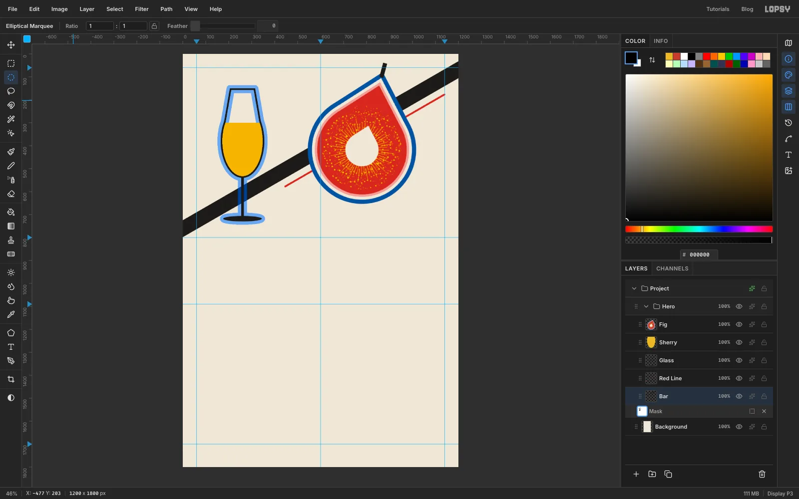

1. Click the mask thumbnail under `Bar` so you're painting on the mask.
2. Set the colour to black (`#000000`) and choose **Edit → Fill**, then deselect.

Black in a mask hides the layer. While you're editing a mask, Lopsy tints the hidden area light blue so you can see it. Click the `Bar` row's name to stop editing the mask, and the blue becomes a paper-coloured gap around the glass. This old print trick makes the glass sit clearly *in front of* the bar.

## Make a halftone field for the shadow

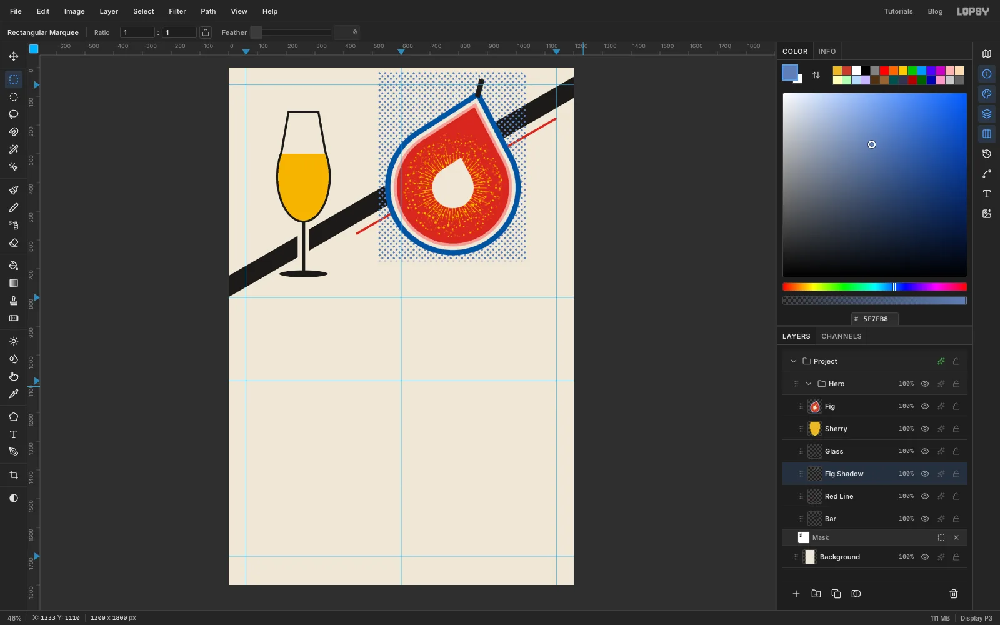

1. Click `Red Line` and add a layer named `Fig Shadow`.
2. Draw a rectangle a little bigger than the fig all round, about `524, 18` to `1035, 673`, and fill it with `#5F7FB8`.
3. Deselect, then choose **Filter → Halftone…**. Set **Dot Size** to `14`, **Angle** to `45` and **Softness** to `0`, then click **Apply**.

Halftoning a flat field, rather than the fig shape itself, gives every dot the same size, including the ones along the edge.

## Cut the dots to the fig and offset them

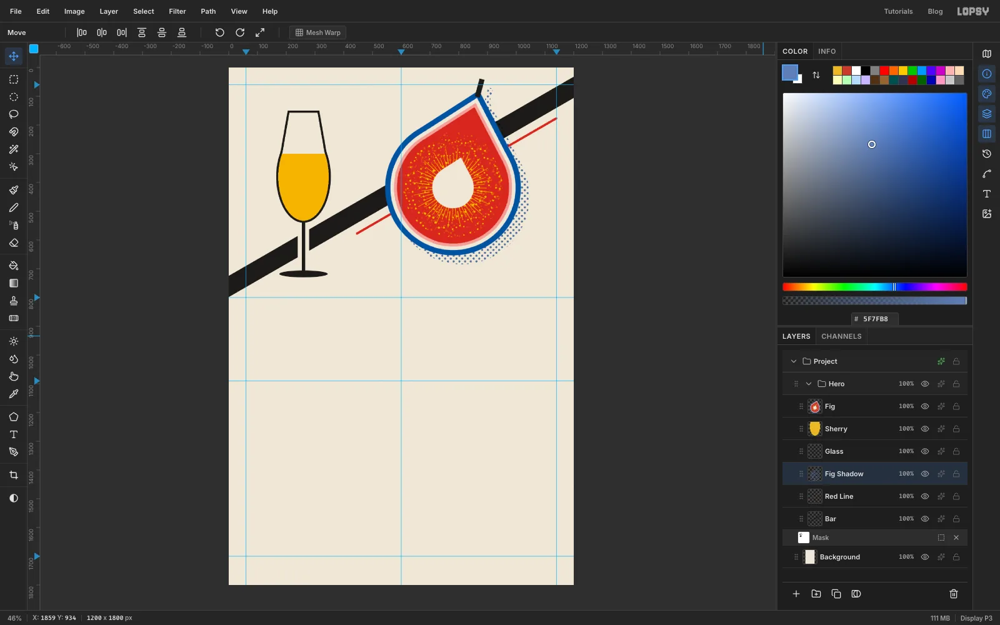

1. Hold [[Cmd]] and click the `Fig` thumbnail to select the fig's shape.
2. Choose **Select → Inverse** and press **Delete**. Only the fig-shaped patch of dots is left. Deselect.
3. With the **Move** tool, drag the dots **30 px right and 30 px down**.
4. Click the sparkle button on the `Fig Shadow` row to open its effects drawer, and set **Blend** to **Multiply**. Where the dots cross the black bar, they disappear into the black.

## Set the title and colour the ampersand

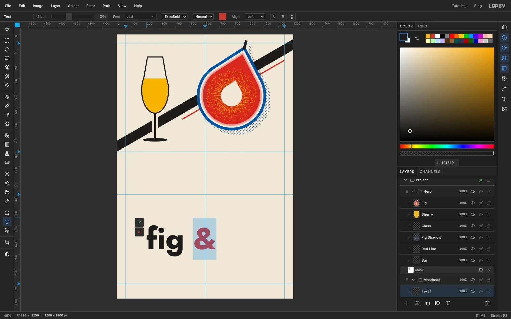

1. Collapse `Hero`. Click `Background`, then **New Group** and name the group `Masthead`. Add a layer inside it named `Rules`.
2. Pick the **Text** tool ([[T]]). Choose **Jost** in the font picker, **ExtraBold** for the weight and **Size** `204`, and set the colour to `#1C1B19`.
3. Click in an empty part of the canvas and type `fig &`.
4. Press [[Shift+Left]] once to select the ampersand. Click the **Text color** swatch in the options bar and type `C73A2C`. Only the ampersand turns red.
5. Press [[Tab]] to finish, then name the layer `Title`.
6. With the **Move** tool, move it so the top of the f sits at **y 834** and its left edge at **x 60**.

> **Tip:** Two habits make text much easier. First, before starting new text, click a plain image layer such as `Rules`. Then your font choices apply to the new text instead of changing the last text layer. Second, start each new piece of text in an empty area and move it into place afterwards, because a click inside an existing line of text edits that text.

## Set xérès on the same baseline

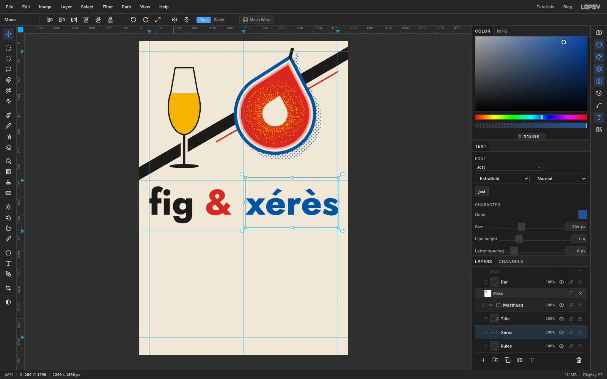

Setting the second word as its own layer lets you balance the spaces around the ampersand.

1. Click `Rules`, then type `xérès` in empty space with the same settings, in `#21539E`. Name it `Xeres`.
2. Move it so its right edge sits on the **1140** guide and the foot of its x sits on the same line as the foot of the f. Zoom in to check. The accents make the word's box taller, so line up the letters, not the boxes.
3. Check the gaps on either side of the red ampersand. They should look the same, about 81 px each. If they don't, nudge `Title` sideways and keep `Xeres` on the margin.

## Add the tagline, date and rule

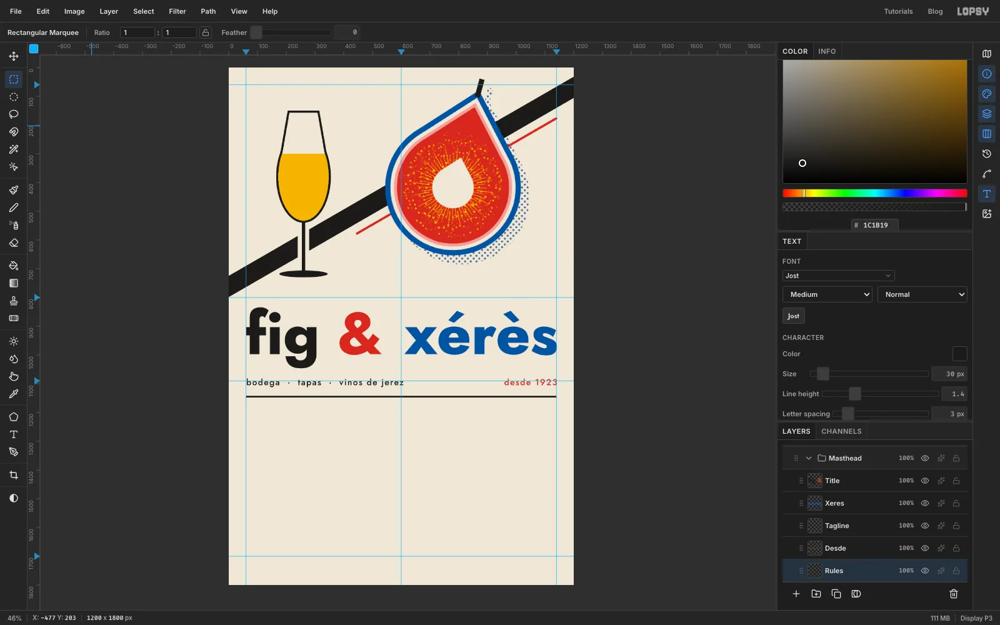

1. Click `Rules` and type `bodega · tapas · vinos de jerez` in Jost **Medium**, Size `30`, with two spaces on each side of each dot. In the Text panel, set **Letter spacing** to `3`. Place it at the left margin, about 36 px below the bottom of the g.
2. Click `Rules` and type `desde 1923` the same way, in `#C73A2C`. Put its right edge on the 1140 guide, with its baseline level with the tagline's.
3. Click `Rules`. Click once with the **Rectangular Marquee** and enter the corners `60, 1142` and `1140, 1148`. Fill it with `#1C1B19` for a 6 px rule that stops exactly on the margins.

## Draw the Kandinsky icons with the Shape tool

Each column gets one of Kandinsky's shapes: a yellow triangle for the sherries, a red square for the tapas and a blue circle for the sweets. The columns are 320 px wide and start at x **60**, **440** and **820**, with 60 px between them.

1. Collapse `Masthead`, click `Background`, make a **New Group** named `Jerez`, and add a layer inside it named `Jerez Icon`.
2. Pick the **Shape** tool ([[U]]). Set **Shape** to **Polygon**, **Output** to **Pixels** and **Sides** to `3`. Click the **Fill** swatch and type `EDB723`. If a stroke is set, click its swatch and choose **Remove stroke**.
3. Shapes draw out from the centre. Start at `87, 1176` and drag diagonally down and right until the triangle is 60 px wide (52 px tall).
4. With the **Move** tool, nudge it with the arrow keys until its flat base sits on **y 1201**. A triangle has less ink than a square, so making it a little wider than the 52 px square and circle keeps the three icons looking the same size.

## Set the sherry list and prices

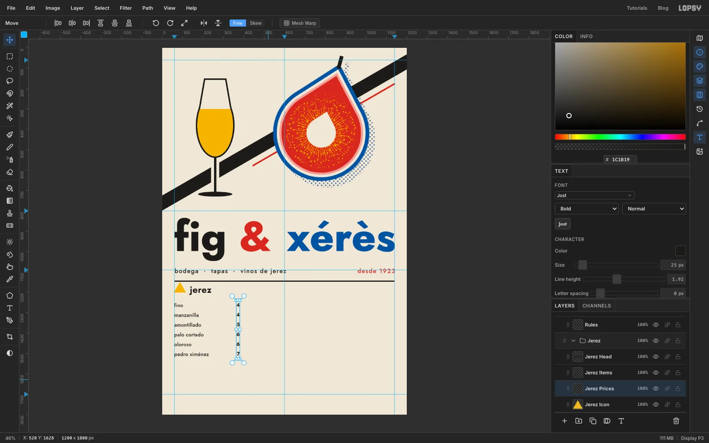

1. Click `Jerez Icon` and type `jerez` in Jost **Bold**, Size `44`, letter spacing `1`. Name it `Jerez Head`. Put its left edge at x **132** and its baseline on y **1201**, level with the base of the triangle. The j's tail hangs below.
2. Click `Jerez Icon` and type the six sherries, pressing **Return** after each one: `fino`, `manzanilla`, `amontillado`, `palo cortado`, `oloroso`, `pedro ximénez`. Use Jost **Medium**, Size `25`. In the Text panel, set **Line height** to `1.92` (48 px from line to line) and **Letter spacing** to `0.5`. Name it `Jerez Items` and move it to the left margin, with the top of the f at y **1252**.
3. Click `Jerez Icon`. With the **Text** tool, **drag** a box 320 px wide in empty space, then type the prices one per line: `4`, `4`, `5`, `6`, `6`, `7`. Use Jost **Bold**, Size `25` and line height `1.92`. When you're done, set **Align** to **Right** in the options bar. Name it `Jerez Prices`.
4. Move the prices so the numbers' right edges sit at x **380** and each number shares a baseline with its sherry.

A dragged text box is *area text*, so **Align Right** lines the numbers up on their right edges, including two-digit prices like 11 later on.

## Key the sherries by colour

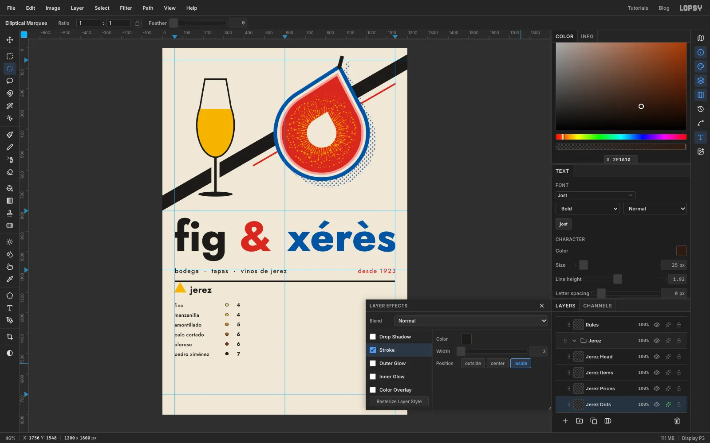

Sherry runs from pale, bone-dry fino to almost black, syrupy pedro ximénez. A dot of each wine's colour turns the list into a small chart.

1. Click `Jerez Icon` and add a layer named `Jerez Dots`.
2. For each line, use the **Elliptical Marquee** to draw a 16 px circle centred at x **316**, level with the middle of the lowercase letters, and fill it with that sherry's colour. From top to bottom: `#EEDF92`, `#E0C25E`, `#C98A34`, `#A35E28`, `#7A3B19`, `#2E1A10`.
3. Deselect. Click the sparkle button on the `Jerez Dots` row to open its effects drawer. Tick **Stroke**, set **Width** to `2`, the colour to `#1C1B19` and **Position** to **inside**. The thin ring keeps the pale fino dot visible on the paper.

## Label the key and build the tapas column

1. Click `Jerez Dots` and type `de seco a dulce` ("dry to sweet") in Jost Regular **Italic**, Size `22`, letter spacing `1`. Put its right edge just under the dots, at about x 324, about 26 px below the list.
2. Add a layer named `Jerez Rule`. With the **Pencil** at Size `3` in `#1C1B19`, click at `60, 1224` and Shift-click at `380, 1224` to draw a rule under the heading.
3. Collapse `Jerez`, click `Background` and make a **New Group** named `Tapas`, with a layer `Tapas Icon`.
4. With the **Shape** tool, set **Shape** to **Rectangle** and the fill to `C73A2C`, and drag from `466, 1176` until the square is 52 px wide.
5. Add the heading `tapas` the same way as `jerez`, starting at x 512. Add the dishes at x 440: `higos con jamón`, `almendras fritas`, `manchego curado`, `croquetas`, `gambas al ajillo`, `pimientos de padrón`. Add the prices `8`, `4`, `7`, `7`, `11`, `6` in Bold `#C73A2C`, right-aligned at x 760.
6. For the rule, click the `Jerez Rule` layer and draw a marquee around the rule. Press [[Cmd+C]], click `Tapas Icon` and press [[Cmd+V]]. The copy is pasted in place as a new layer. Name it `Tapas Rule` and, with the **Move** tool, nudge it right with [[Shift]] and the arrow keys until it runs from x 440 to 760.

In the screenshot, the whole tapas column has landed 30 px to the right of x 440. It's an easy slip, and the next step shows the quick fix.

## Move the whole column with its group

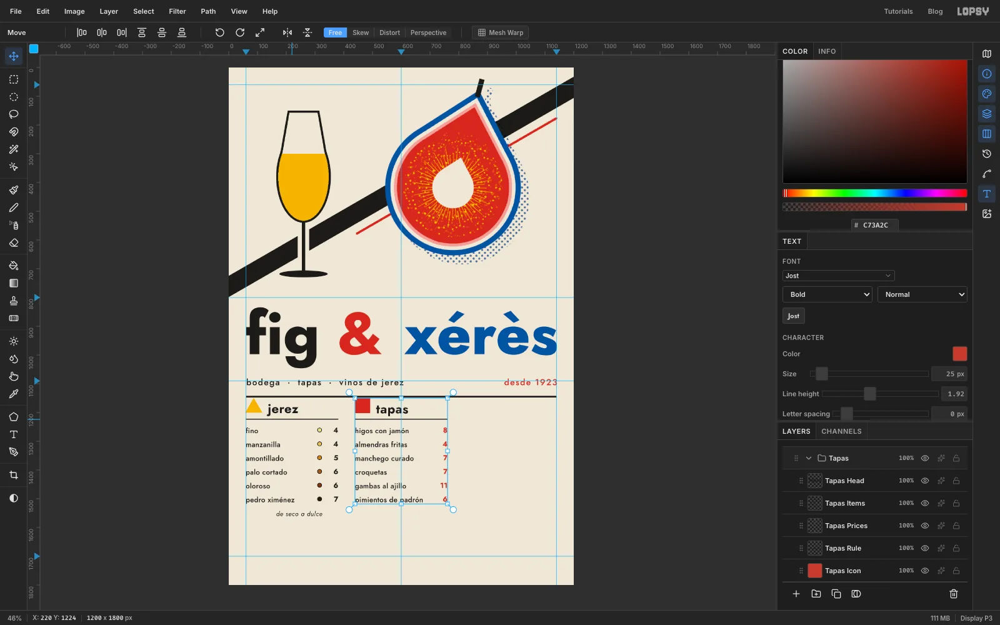

If a column sits off its line, don't move its layers one by one.

1. Click the `Tapas` **group** row and deselect.
2. With the **Move** tool, nudge it with [[Shift]] and the arrow keys. Each press moves 10 px.

Every layer in the group moves together: the icon, heading, list, prices and rule.

## Add the sweets column

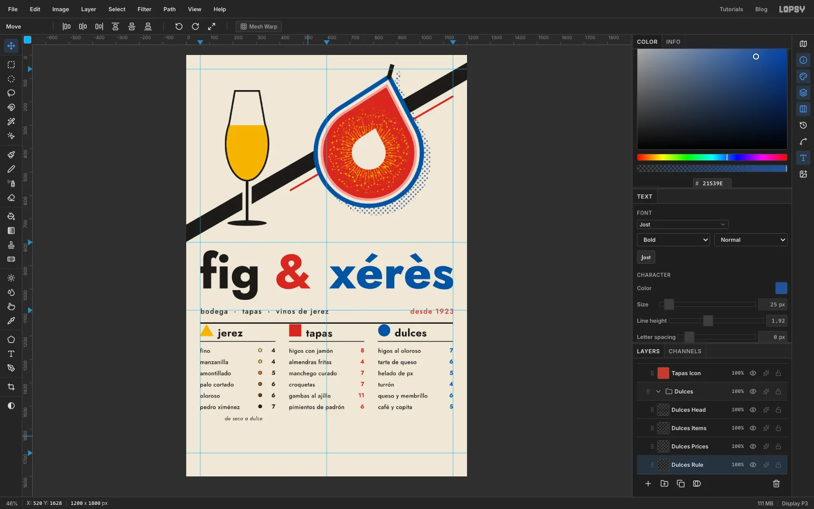

1. Collapse `Tapas`, click `Background` and make a group named `Dulces` with a layer `Dulces Icon`.
2. With the **Shape** tool, set **Shape** to **Ellipse** and the fill to `21539E`, and drag from `846, 1176` until the circle is 52 px across.
3. Add the heading `dulces` at x 892 and the sweets at x 820: `higos al oloroso`, `tarta de queso`, `helado de px`, `turrón`, `queso y membrillo`, `café y copita`. Add the prices `7`, `6`, `5`, `4`, `6`, `5` in Bold `#21539E`, right-aligned at x 1140.
4. Click `Dulces Icon` and press [[Cmd+V]] again. The rule is still on the clipboard. Name it `Dulces Rule` and nudge it right the same way until it runs from x 820 to 1140.

## Add the event strip and footer

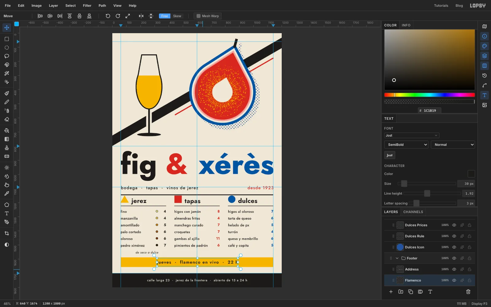

1. Collapse `Dulces`, click `Background` and make a group named `Footer`.
2. Add a layer named `Band`. Draw a rectangle across the full width from `0, 1700` to the bottom of the canvas, and fill it with `#1C1B19`.
3. Add a layer named `Strip`. Draw a rectangle from `60, 1588` to `1140, 1656` and fill it with `#EDB723`.
4. Click `Strip`, then type `calle larga 23 · jerez de la frontera · abierto de 13 a 24 h` in Jost Medium, Size `22`, letter spacing `2`, colour `#EEE7D8`. Name it `Address`. Centre it across the page on the 600 guide, and vertically in the black band. Centre by eye on the lowercase letters, not on the tall letters.
5. Click `Strip` and type `jueves · flamenco en vivo · 22 h` in Jost **SemiBold**, Size `30`, letter spacing `3`, in `#1C1B19`. Name it `Flamenco` and centre it in the yellow strip the same way.

## Add a paper texture

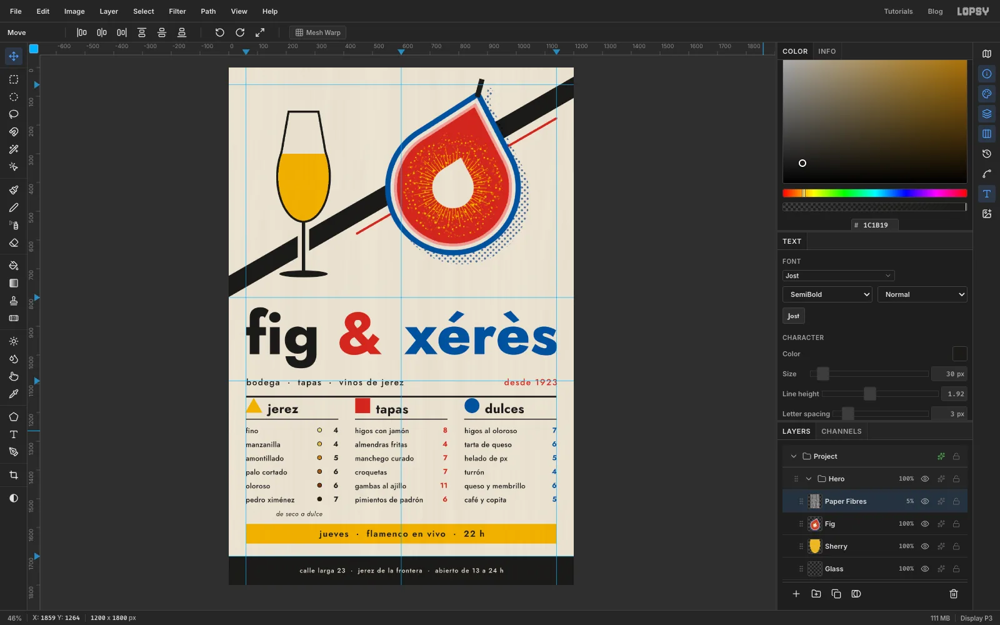

1. Expand `Hero`, click `Fig` (its top layer) and add a layer named `Paper Fibres`. `Hero` is the top group, so this layer sits over everything.
2. Choose **Filter → Fibers…**, set **Variance** to `24` and **Strength** to `10`, and click **Apply**. The layer fills with grey streaks.
3. Set the layer to **Multiply** and its opacity to **5%**. That's just enough for a hint of printed paper without muddying the flat colours.

Save the project with **File → Save Project**. Then use **File → Quick Export PNG** for the finished menu.
