Blueprints are the working drawings engineers used before computers. They are
white lines on a deep blue ground, with dimension arrows, centre marks and tidy
little hand-lettered notes. Turn one into an embroidered patch and you get
something that looks like a souvenir from a workshop that never existed.

In this tutorial you'll make **Clockwork Kiwi**, an 1800 × 1800 px iron-on patch
for an imaginary maker, **Auckland Automata Works**. It's a picture of the
patch lying on a khaki canvas bag. The finished patch has:

- a die-cut **gear-shaped** edge in white satin stitch, made with the Sunburst filter
- a navy twill field with a **blueprint grid** you make from a tiny pattern tile
- a **kiwi** traced with the Pen from a 19th-century lithograph, with mechanical legs
- three **brass gears** showing through its body, and a wind-up key in its back
- hatching, centre marks, a dimension line, callouts and a **Detail A** inset
- the title and maker's name **arched** around a band, on paths

The kiwi is traced from a public-domain plate of a little spotted kiwi by
John Gerrard Keulemans, published between 1875 and 1878,
[Apteryx owenii 0.jpg](https://commons.wikimedia.org/wiki/File:Apteryx_owenii_0.jpg)
on Wikimedia Commons. Download it before you start. The 1237 px wide version
is the one used here. Any side-on kiwi photo will work, but your outline will
differ from mine.

The tools you'll use:

- **Filter → Sunburst**, **Add Noise**, **Motion Blur**, **Radial Blur** and **Gaussian Blur**
- the **Elliptical** and **Rectangular Marquee**, the **Lasso**, **Grow**, **Shrink**, **Inverse** and the **Magic Wand**
- **Edit → Define Pattern** and **Fill with Pattern**
- the **Pen**, **Pencil**, **Brush** and **Gradient**, with [[Shift]]-click straight lines
- **Copy**, **Paste**, and the **Move** tool's scale and rotate handles
- the **Text** tool on paths, with **Syncopate**, **Architects Daughter** and **Share Tech Mono** from the font picker
- **Drop Shadow**, **Inner Glow** and **Stroke**, and the **Overlay**, **Multiply** and **Soft Light** blend modes
- **New Group** and collapsed groups

The palette:

- Canvas `#9E8A5E`, patch shadow `#20170A`
- Satin edge `#E4ECF1`, thread white `#EEF4F8`, satin shading `#7F93A6`, edge line `#5D6F80`
- Field navy `#1A3F72`, grid blue `#8DB6E6`, pale drafting blue `#CFE3F8`, deep navy `#0B2245`, Detail A ground `#163D70`
- Brass `#D19A45`, brass shadow `#7A4B17`

> **Tip:** Positions are written as `x, y` in document pixels from the top-left corner. Watch the status bar at the bottom left as you drag. Almost every circle here is drawn from its centre and a radius. For the patch itself, the centre is always **900, 900**. For exact circles, **click once** with the Elliptical Marquee and type the **From** and **To** corners into the dialog: a radius of 800 is `100, 100` to `1700, 1700`. The dialog only opens when nothing is selected, so press [[Cmd+D]] first. Key names are Mac keys. On Windows and Linux, use Ctrl for Cmd, with one exception: to scale proportionally by dragging a corner handle, hold the Windows (Super) key instead.

> **Tip:** A [[Shift]]-click with the Pencil or Brush draws a straight line from the end of your *previous* stroke. To draw several lines that start from the same point, like whiskers or toes, click that point again before each [[Shift]]-click.

> **Tip:** Filter dialogs reset to their defaults every time they open, so set every value listed in a step, even when it repeats one from earlier.

## Weave the canvas backdrop

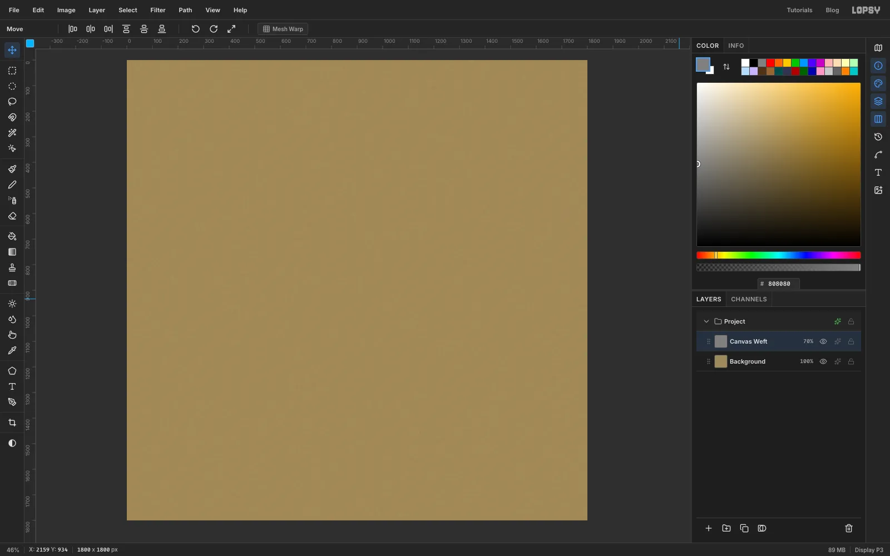

Open [Lopsy](/). In the **New Document** dialog, set **Width** and **Height** to `1800` and click **Create**. Delete the empty `Layer 1` with the bin button at the bottom of the Layers panel.

1. Click **Background**, set the foreground to `#9E8A5E` and choose **Edit → Fill**.
2. **Filter → Add Noise…**: **Amount** `30`, **Mono**, **Gaussian**.
3. **Filter → Motion Blur…**: **Angle** `0`, **Distance** `12`. The specks become horizontal threads.
4. Add a layer named `Canvas Weft`. Fill it with `#808080`, add noise (**Amount** `40`, **Mono**, **Gaussian**) and run Motion Blur at **Angle** `90`, **Distance** `12`.
5. Set its blend mode to **Overlay** and its opacity to **70%**.

The grey layer disappears in Overlay mode, so only its vertical streaks are left, crossing the horizontal ones. That reads as a woven fabric.

## Cut gear teeth with Sunburst

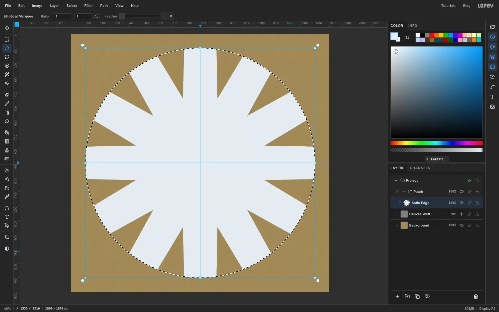

1. Click the top ruler at **900** and the left ruler at **900** to drop a guide through the centre in each direction.
2. Click `Canvas Weft`, click the **New Group** button and name the group `Patch`. With the group selected, add a layer named `Satin Edge`. It goes inside the group.
3. Draw a circle of radius 800: click once with the **Elliptical Marquee** and enter `100, 100` to `1700, 1700`.
4. Set the foreground to `#E4ECF1` and choose **Filter → Sunburst…**. Set **Rays** `12`, **Width** `44`, **Taper** `58` and **Length** `150`. Leave **Center X** and **Center Y** at `50`. Click **Apply**.

A **Taper** of 50 makes parallel-sided beams. A little more than 50 makes each beam narrow slightly towards its tip, like a real gear tooth. The marquee trims the beams to the length of the teeth.

## Fill the hub and round the corners

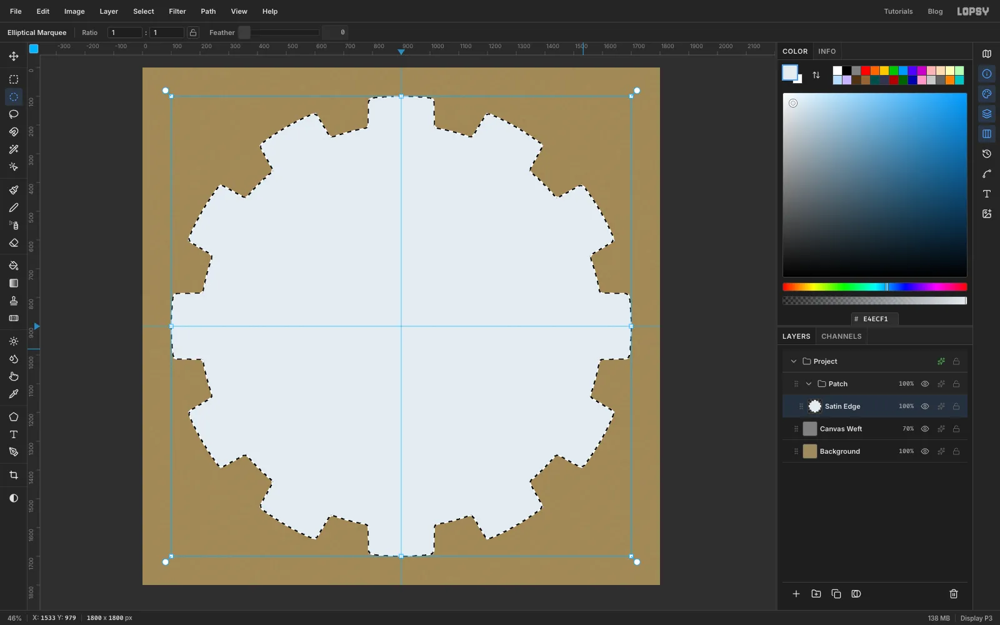

1. Select a circle of radius 700 (`200, 200` to `1600, 1600`) and choose **Edit → Fill**. You now have a gear blank. Press [[Cmd+D]].
2. [[Cmd]]-click the `Satin Edge` thumbnail to select its pixels.
3. Choose **Select → Shrink…** `14`, then **Select → Grow…** `28`, then **Select → Shrink…** `14` again.
4. Choose **Edit → Fill**, then **Select → Inverse**, press [[Delete]] and deselect.

Shrinking then growing rounds off the outside corners of the teeth. Growing then shrinking fills in the inside corners between them. The Fill adds the filled-in corners. Inverse and Delete trim away the sharp tips.

## Give the edge a satin texture

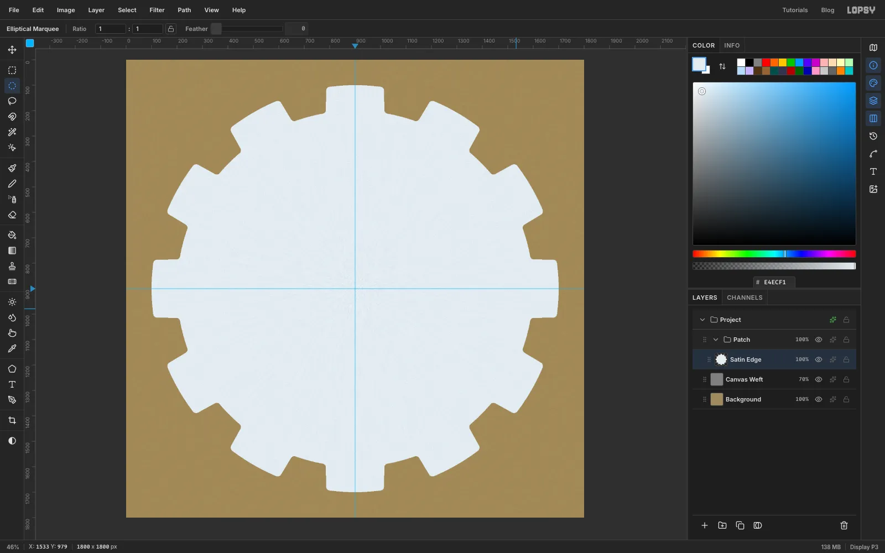

1. [[Cmd]]-click the `Satin Edge` thumbnail again.
2. **Filter → Add Noise…**: **Amount** `70`, **Mono**, **Gaussian**.
3. **Filter → Radial Blur…**: **Amount** `6`. Deselect.

Radial Blur spins around the centre of the canvas, which is also the centre of the gear. The noise is smeared into short arcs that run around the patch, the way satin stitches wrap a merrowed edge.

## Lay down the twill field

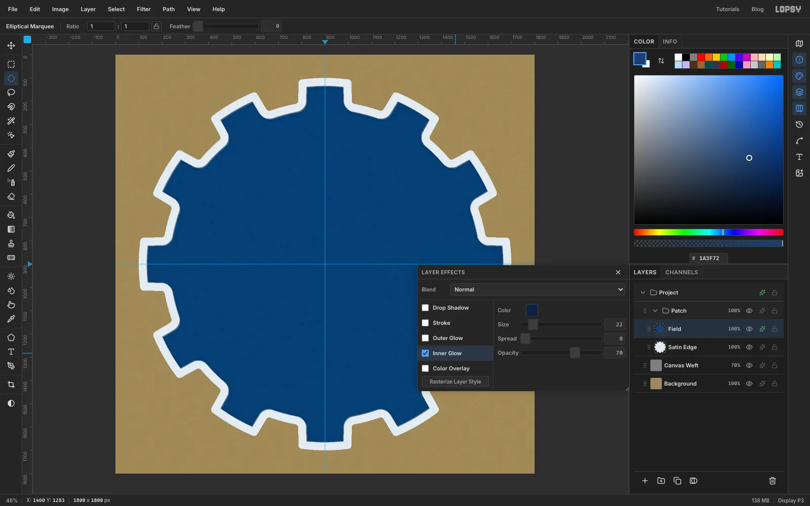

1. With `Satin Edge` selected, add a layer named `Field`. [[Cmd]]-click the `Satin Edge` thumbnail and choose **Select → Shrink…** `34`.
2. Fill with `#1A3F72`. Add noise (**Amount** `40`, **Mono**, **Gaussian**), then Motion Blur at **Angle** `45`, **Distance** `14`. Deselect.
3. Open the layer's effects (the ✦ button on its row) and turn on **Inner Glow**: **Size** `22`, **Spread** `0`, **Opacity** `70`, colour `#0B2245`.

The 45° streaks are the diagonal ribs of twill fabric. The dark inner glow makes the field look sunk below the raised satin edge.

## Draw a grid tile

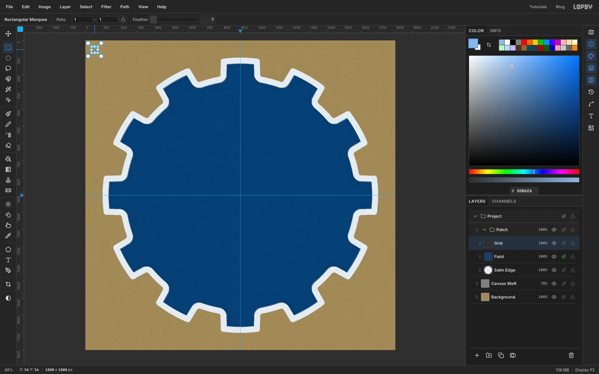

A blueprint needs a grid, and a pattern is the easiest way to get a perfect one.

1. Close the effects drawer. With `Field` selected, add a layer named `Grid`.
2. Pick the **Pencil**, set **Size** `2` and the foreground to `#8DB6E6`.
3. Zoom in on the top-left corner of the canvas. Click at `36, 36` and [[Shift]]-click at `71, 36` for a line along the top of the tile. Click at `36, 37` and [[Shift]]-click at `36, 71` for its left side.
4. Click once with the **Rectangular Marquee** and enter `36, 36` to `72, 72`.
5. Choose **Edit → Define Pattern**, then press [[Delete]] to clear the tile and deselect.

The tile is 36 px because 900 divides by 36 exactly, so a grid line will run straight through the centre of the patch.

## Fill the field with the grid

1. With nothing selected, choose **Edit → Fill with Pattern…**, pick your tile and click **Apply**. The grid covers the whole layer.
2. Select a circle of radius 552 (`348, 348` to `1452, 1452`). Choose **Select → Inverse**, press [[Delete]] and deselect.
3. Set the `Grid` layer's opacity to **40%**.

## Stitch two rings

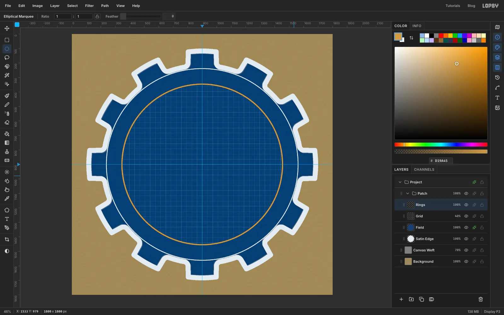

Add a layer named `Rings`. Make the outer ring first, because each ring deletes everything inside it on this layer.

1. Select a circle of radius 664 (`236, 236` to `1564, 1564`), fill it with `#EEF4F8`, choose **Select → Shrink…** `5` and press [[Delete]].
2. Select a circle of radius 558 (`342, 342` to `1458, 1458`), fill it with `#D19A45`, shrink by `8` and press [[Delete]]. Deselect.

The gap between the two rings is the band for the title. The brass ring frames the drawing.

## Bring in the reference plate

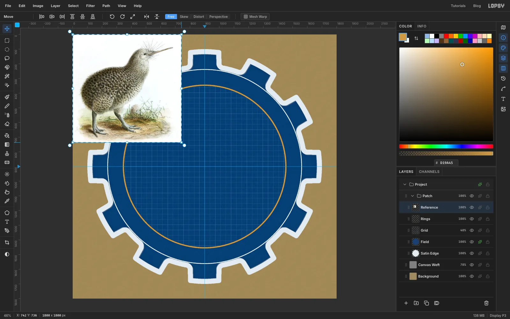

1. Click `Rings` so the photo lands above it, then drag the downloaded kiwi plate onto the canvas. It arrives at full size in the top-left corner, already selected. Rename the layer `Reference`.
2. Hold [[Cmd]] and drag the bottom-right corner handle up and to the left until the image is about **742 px** wide. That's 60% of its size. Press [[Cmd+D]] to commit.

Holding Cmd keeps the proportions while you scale.

## Place the reference and fade it

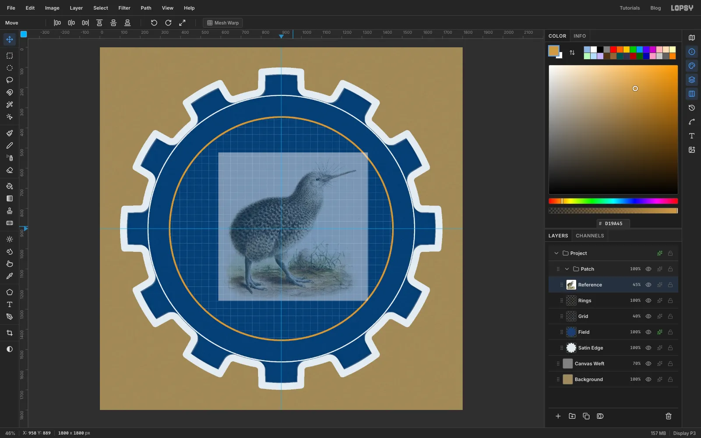

1. With the **Move** tool, drag the plate so its top-left corner is at about `588, 522`. The bird should sit a little right of centre, with room for a key behind its back.
2. Lower the layer's opacity to **45%**, so your white lines will show clearly over it.

## Trace the body with the Pen

1. Add a layer named `Kiwi Lines` and set the foreground to `#EEF4F8`.
2. Pick the **Pen**. Start at the crown of the head and work round the bird clockwise, over the head, down the front of the neck and chest, along the belly and up over the rump and back. **Press and drag** a little along the outline at each anchor, so the curve stays smooth. About 20 anchors is plenty.
3. Where the bill meets the head, at the forehead and at the chin, **click** without dragging to make two sharp corners.
4. Leave out the legs, the bristles and the grass. Close the path by clicking on the first anchor.
5. Set the Pen's **Stroke** to `7` and press [[Enter]]. The path is stroked in white thread.
6. Open the **Paths** panel and delete the path, so its blue outline doesn't get in the way.

## Draw a longer, curved bill

Kiwis have a long bill that curves gently downward, so draw it a bit longer than the plate shows.

1. With the **Pen** and **Stroke** `7`, press at the top of the bill base, about `1108, 640`, and drag up and to the right to about `1156, 619`. Then click at the tip, about `1293, 606`. Press [[Enter]]. Delete the path.
2. Do the same for the lower edge: press at about `1116, 668`, drag to about `1174, 648`, click at `1291, 611` and press [[Enter]]. Delete the path.

Dragging the first handle higher than the straight line makes the bill bow upward and then droop to the tip.

## Add feathers, an eye and whiskers

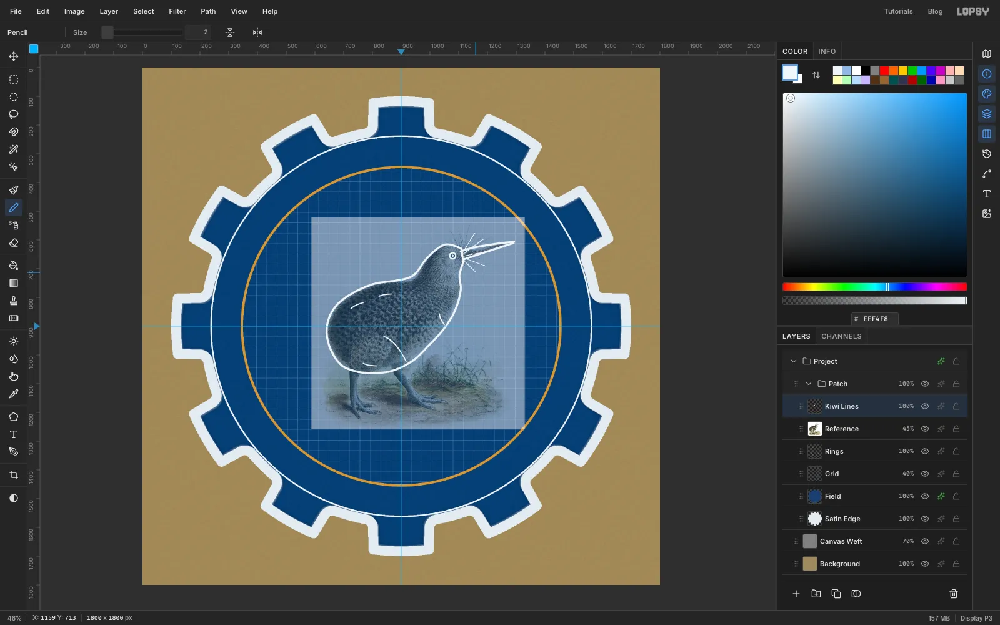

1. **Feathers:** with the **Pen** at **Stroke** `4`, draw five short two-anchor curves inside the body. Put two along the back, one near the belly, one on the chest, and a longer one from the middle of the body down to the front leg for the thigh. Press, drag a little sideways, click the end, then press [[Enter]]. Delete each path when you've stroked it.
2. **Eye:** select a circle of radius 13 around the eye in the plate (centre about `1079, 655`). Fill it, shrink by `5` and press [[Delete]]. Then fill a circle of radius 4 at the same centre.
3. **Whiskers:** with the **Pencil** at **Size** `2`, draw five whiskers fanning up, forward and down from the base of the bill. For each one, click at the base of the bill, then [[Shift]]-click where the whisker ends.

## Build mechanical legs

This kiwi is a machine, so its legs are jointed rods.

1. Add a layer named `Legs`. Pick the **Pencil** at **Size** `7`.
2. For each leg, click at the hip just inside the belly, [[Shift]]-click at the knee, then [[Shift]]-click at the ankle. Follow the legs in the plate. Put the left hip at `756, 1009`, because a gear will sit there.
3. Set **Size** `6` and draw the toes: three fanning forward from each ankle and a short hind toe pointing back. Click the ankle again before each toe's [[Shift]]-click.
4. Set **Size** `5` and add a short claw tick angled down at the end of each forward toe.
5. Make a pivot at each hip, knee and ankle: select a circle of radius 15, fill it, shrink by `6` and press [[Delete]].

## Make the main gear

The gears use the same Sunburst trick as the patch, but much smaller.

1. Click `Legs`, make a **New Group** named `Clockwork` and add a layer inside it named `Gear Main`.
2. Select a circle of radius 84 around `810, 918`, that is `726, 834` to `894, 1002`. Set the foreground to `#D19A45`.
3. **Filter → Sunburst…**: **Rays** `14`, **Width** `76`, **Taper** `58`, **Length** `8`, **Center X** `45`, **Center Y** `51`.
4. Fill a circle of radius 70 at the same centre. Then select a radius-12 circle and press [[Delete]] to punch the hub.
5. Punch five windows of radius 15, centred at `810, 874`, `852, 904`, `836, 954`, `784, 954` and `768, 904`. They're spaced evenly around a circle 44 px from the centre. Deselect.

> **Tip:** The beam width depends on **Length**. Long rays make fat beams that fill a small circle completely. Keep Length just long enough to reach past the marquee. **Center X** and **Y** are whole percentages of the canvas, so put gear centres on multiples of 18 px.

## Add the pinion and crank, and mesh them

Make two more gears with the same recipe: tip circle, Sunburst, fill the root circle, delete the hub. Give each its own layer inside `Clockwork`.

1. Add a layer named `Gear Pinion`. Select the tip circle `868, 814` to `968, 914`. Run Sunburst with **Rays** `9`, **Width** `71`, **Taper** `58`, **Length** `5`, **Center X** `51`, **Center Y** `48`. Fill the root circle `878, 824` to `958, 904`, then delete the hub `909, 855` to `927, 873`.
2. Add a layer named `Gear Crank`. Tip circle `718, 970` to `794, 1046`. Sunburst **Rays** `8`, **Width** `45`, **Taper** `58`, **Length** `5`, **Rotation** `8`, **Center X** `42`, **Center Y** `56`. Root circle `727, 979` to `785, 1037`, hub `748, 1000` to `764, 1016`. It sits on the left hip.
3. The pinion's teeth hit the big gear's teeth. Click `Gear Pinion`, press [[Cmd+D]], and with the **Rectangular Marquee** draw a square just around it, from `864, 810` to `972, 918`.
4. With the **Move** tool, drag from just outside the top-right corner to rotate it about **13°** clockwise, so its teeth drop between the big gear's teeth. Press [[Cmd+D]] to commit.

## Build the wind-up key

Build the key lying flat. You'll turn it afterwards.

1. Add a layer named `Key`. Press [[Cmd+D]], pick the **Rectangular Marquee** and drag the shaft from `614, 805` to `694, 819`.
2. Hold [[Shift]] and drag a collar across it, from `650, 797` to `662, 827`. Holding Shift adds to the selection.
3. Switch to the **Elliptical Marquee**. Hold [[Shift]] and drag the two lobes of the bow, from `540, 746` to `608, 814` and from `540, 810` to `608, 878`. Then add a round boss where the bow meets the shaft, from `582, 794` to `618, 830`. Zoom in so you can land the corners exactly.
4. Fill with `#D19A45` and deselect.
5. Drag a circle from `555, 763` to `581, 789`, [[Shift]]-drag a second from `555, 835` to `581, 861`, and press [[Delete]] for the two holes in the bow. Deselect.

## Turn the key into the back

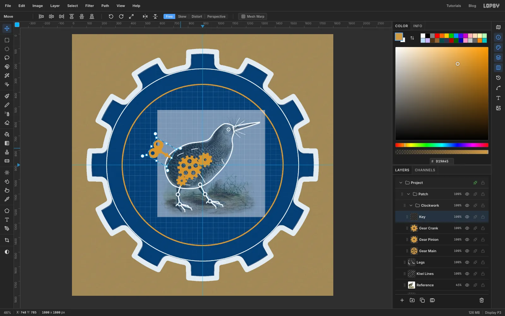

1. With the **Rectangular Marquee**, draw a box a few pixels bigger than the key all round.
2. With the **Move** tool, drag just outside a corner to rotate it **30°** clockwise, so the bow rises up and to the left. Press [[Cmd+D]].
3. Drag the key so the end of its shaft just touches the kiwi's back, at about `706, 806`.

## Give the brass a satin finish

Do this to `Gear Main`, `Gear Pinion`, `Gear Crank` and `Key` in turn:

1. [[Cmd]]-click the thumbnail, add noise (**Amount** `45`, **Mono**, **Gaussian**) and run Motion Blur at **Distance** `9`. Give each part its own **Angle**: `30`, `120`, `60` and `120`. Deselect.
2. Add a **Stroke** effect, **Width** `3`, colour `#7A4B17`.
3. Add a **Drop Shadow**: **Opacity** `70`, **Offset X** `3`, **Offset Y** `4`, **Blur** `3`, colour `#0B2245`.

Changing the angle from part to part makes neighbouring gears catch the light differently, like satin-stitched fills laid in different directions.

## Select the inside of the body

1. Hide the `Reference` layer with its eye button. You're done tracing.
2. Click `Reference` and add a layer named `Hatching`.
3. With the **Pencil**, **Size** `2`, colour `#CFE3F8`, draw one diagonal in an empty corner of the canvas: click at `60, 84` and [[Shift]]-click at `84, 60`. Click once with the **Rectangular Marquee**, enter `60, 60` to `84, 84`, choose **Edit → Define Pattern**, press [[Delete]] and deselect.
4. Click `Kiwi Lines`, pick the **Magic Wand** with **Contiguous** on, and click anywhere inside the body. The wand reads only the active layer, so it fills the whole inside of the outline and ignores the gears.

## Hatch the body

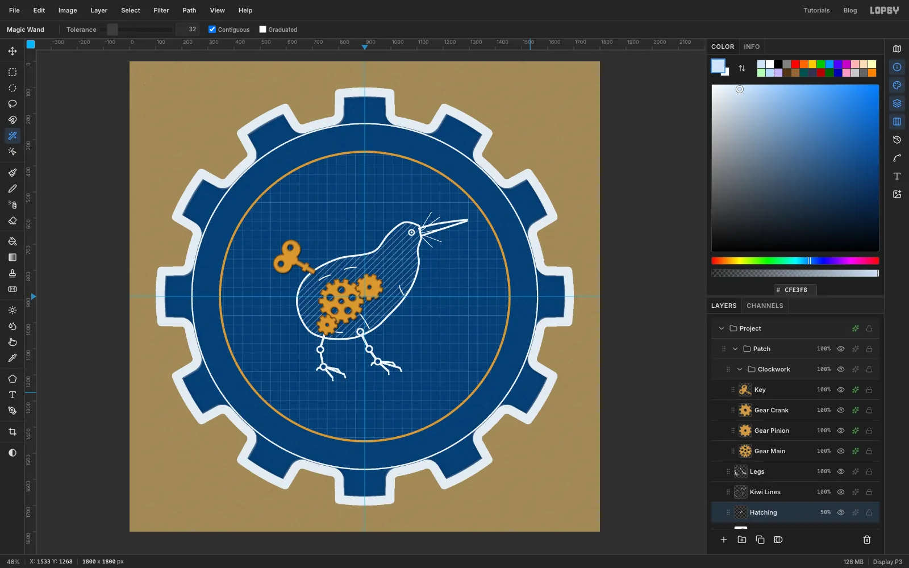

Click `Hatching`. The selection stays. Choose **Edit → Fill with Pattern…**, pick the diagonal tile and click **Apply**. Deselect and set the layer to **50%** opacity.

On a real blueprint, hatching means "this has been cut open". Here it tells you you're looking at a cross-section through the clockwork bird.

## Add centre marks, a hidden rod and a dimension

1. Collapse the `Clockwork` group, click its row and make a **New Group** named `Drafting Notes`. Add a layer inside it named `Drafting`.
2. **Centre marks:** **Pencil** **Size** `2`, `#CFE3F8`. Draw a horizontal and a vertical line through each gear's centre, reaching about 16 px past its teeth.
3. **Hidden rod:** pick the **Brush** and open the brush settings. Set **Size** `5`, **Hardness** `100` and **Spacing** `260`. Click the pinion's centre and [[Shift]]-click the base of the bill, about `1111, 655`. The wide spacing turns the line into dots. Set **Spacing** back to `10` afterwards.
4. **Dimension:** with the **Pencil** at **Size** `3`, draw an extension line straight down from the rump (`641, 930` to `641, 1286`) and one from the bill tip (`1293, 628` to `1293, 1286`). Join them with a dimension line at **y = 1270**.
5. **Arrowheads:** zoom in on each end of the dimension line. With the **Lasso**, draw a small triangle whose point touches the extension line and whose base sits on the dimension line about 26 px in, roughly 17 px tall. Hold [[Shift]] while you draw the second one at the other end, then fill both with `#CFE3F8` and deselect.
6. **Leaders:** with the **Pencil** at **Size** `3`, draw a line from `1078, 1050` to the edge of the main gear at `888, 956`, and one from `1160, 545` to the top of the bill at `1188, 614`. Fill a radius 6 dot at the gear end and the bill end.

## Letter the callouts

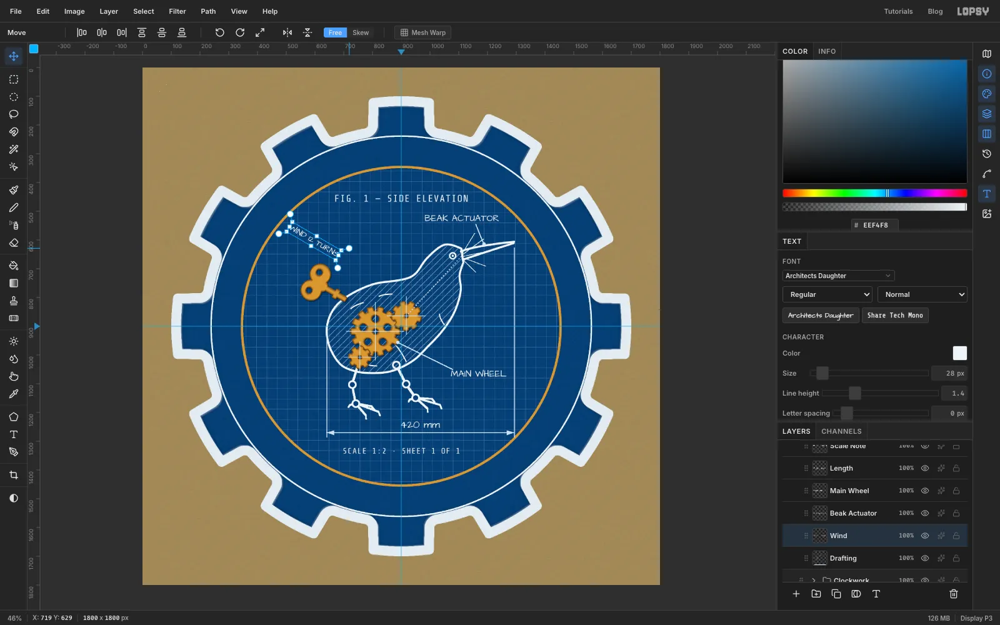

Each label is its own text layer. Click `Drafting` before you start each one, click with the **Text** tool in an empty part of the canvas, type, press [[Tab]], then nudge it into place with the **Move** tool and arrow keys. Set **Letter spacing** for every label, because it carries over from the last one. Rename each layer with the name in brackets, so you can find it later.

1. `FIG. 1 — SIDE ELEVATION` (`Fig Caption`) in **Share Tech Mono**, **Size** `34`, `#EEF4F8`, letter spacing `2`, centred at `900, 454`.
2. `SCALE 1:2 · SHEET 1 OF 1` (`Scale Note`) in Share Tech Mono **28**, spacing `2`, centred at `900, 1332`.
3. `420 mm` (`Length`) in **Architects Daughter** **36**, spacing `0`, centred on the dimension line just above it, at `966, 1242`.
4. `MAIN WHEEL` (`Main Wheel`) in Architects Daughter **32** at the end of its leader, centred at `1168, 1062`, and `BEAK ACTUATOR` (`Beak Actuator`) above the bill, centred at `1110, 522`.
5. `WIND 12 TURNS` (`Wind`) in Architects Daughter **28**, centred at about `596, 600`. Rotate it **30°** clockwise with its own corner handle so it runs parallel to the key.

## Check the callouts

Every label needs a little air. Look at each one and make sure none touches a line it doesn't belong to. The bottom of `420 mm` should clear the toes, and `WIND 12 TURNS` should float clear of the key.

## Copy the pinion for Detail A

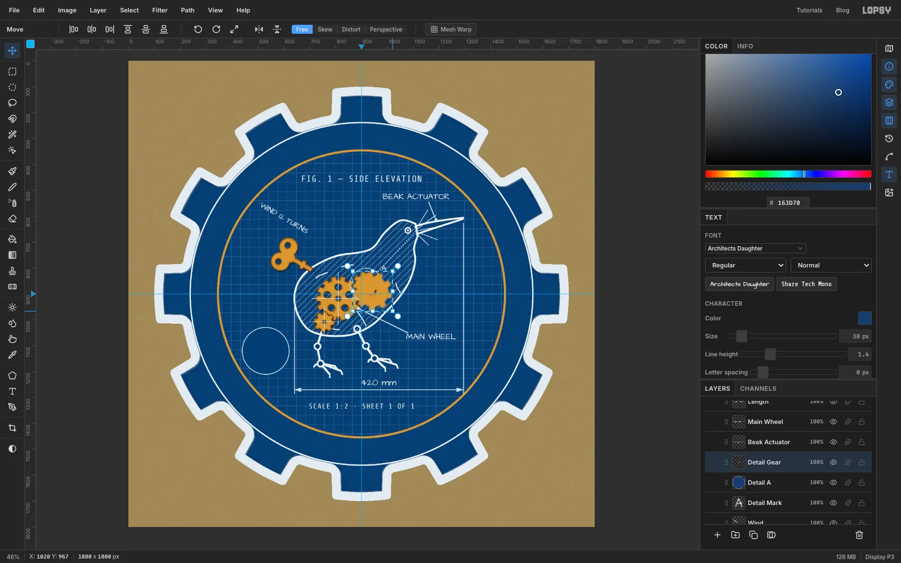

Blueprints enlarge small parts in a round "detail" view. The lower left of the drawing is empty, so it goes there.

1. On `Drafting`, ring the pinion: select a radius 64 circle around it (`854, 800` to `982, 928`), fill it with `#CFE3F8`, shrink by `2` and press [[Delete]]. Add an `A` in Architects Daughter **30**, `#EEF4F8`, just above its top-right edge, centred at about `986, 800`.
2. Add a layer named `Detail A`. Fill a radius 92 circle at `530, 1120` with `#CFE3F8`, shrink by `3` and press [[Delete]]. Then fill a radius 89 circle at the same centre with `#163D70`.
3. Click `Gear Pinion`. With the **Rectangular Marquee**, draw a box just around it (`864, 810` to `972, 918`) and press [[Cmd+C]]. Click `Detail A` and press [[Cmd+V]]. The copy is pasted in place, above `Detail A`. Rename it `Detail Gear`.
4. Press [[Cmd+D]] and draw the same box around the copy. With the **Move** tool, [[Cmd]]-drag its bottom-right corner handle out until it is **1.5 times** as wide. Press [[Cmd+D]].

## Finish the detail view

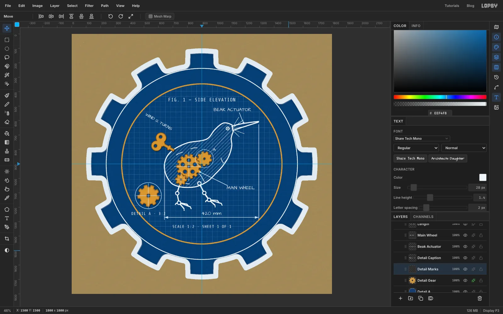

1. Drag `Detail Gear` into the middle of the bubble.
2. Scaling softened its stitches, so [[Cmd]]-click the thumbnail and re-stitch it: noise **Amount** `45`, **Mono**, **Gaussian**, then Motion Blur **Angle** `60`, **Distance** `9`. Give it the same Stroke and Drop Shadow as the other gears.
3. Add a layer named `Detail Marks`. With the **Pencil** at **Size** `2` and the foreground set back to `#CFE3F8`, draw a crosshair through the centre of the bubble.
4. Caption it `DETAIL A · 3:2` in Share Tech Mono **28**, `#EEF4F8`, spacing `2`, centred about 30 px below the bubble.

## Draw an arc for the title

1. Collapse `Drafting Notes`, click its row and make a **New Group** named `Lettering`. Add a layer inside it named `Title Anchor`. New text needs a normal layer to start from.
2. With the **Pen**, draw a half circle of radius 590. Press at `310, 900` and drag straight up to `310, 574`. Press at the top, `900, 310`, and drag right to `1226, 310`. Press at `1490, 900` and drag straight down to `1490, 1226`.
3. Click the **✓** (Commit path) button in the options bar. Don't press Enter, which would stroke it.

The radius puts the letters' baseline a little inside the middle of the band. The capitals then rise to fill it evenly.

## Put the title on the path

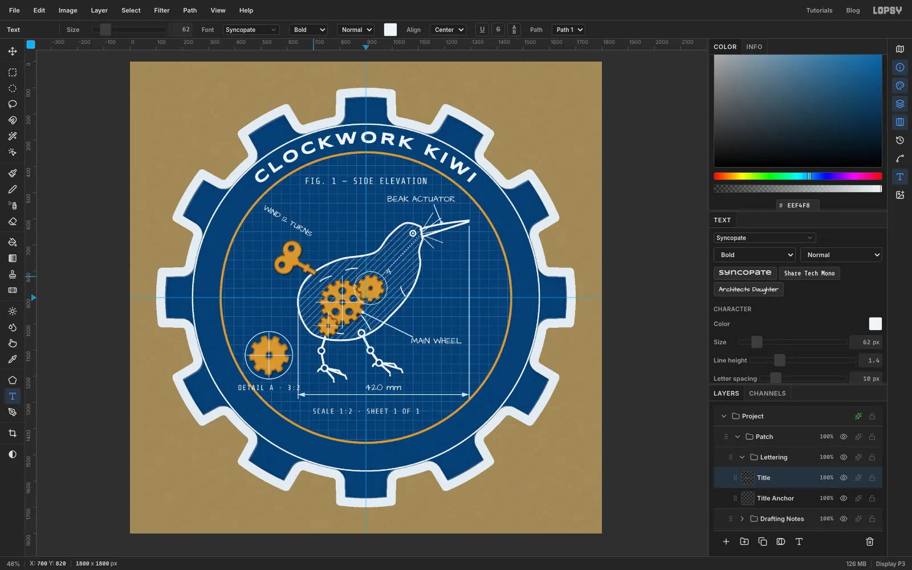

1. With `Title Anchor` selected, pick the **Text** tool. Choose **Syncopate**, weight **Bold**, **Size** `62`, colour `#EEF4F8`.
2. Click in an empty spot, type `CLOCKWORK KIWI` and press [[Tab]]. Rename the layer `Title` and set **Letter spacing** to `10`.
3. In the options bar, choose your path (for example `Path 1`) in the **Path** menu, then set the alignment to **Center**.
4. Click the path's row in the Paths panel to deselect it and hide the outline.

Check the seating: the gap from the brass ring to the bottom of the letters should match the gap from the tops of the letters to the white ring.

## Set the maker's name and the screws

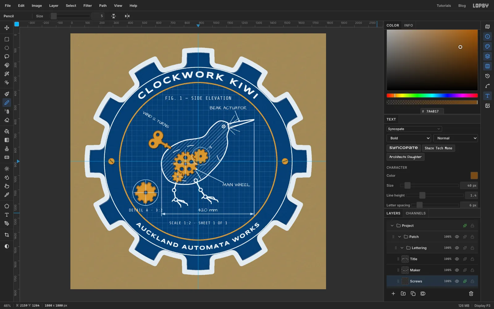

1. Click `Title Anchor`. Draw the bottom arc the same way, but with radius 623 and running through the bottom. Press at `277, 900` and drag down to `277, 1244`. Press at `900, 1523` and drag right to `1244, 1523`. Press at `1523, 900` and drag up to `1523, 556`. Click **✓**.
2. Type `AUCKLAND AUTOMATA WORKS` in Syncopate Bold **40**, `#EEF4F8`, letter spacing `6`. Rename the layer `Maker` and put it on the new path, centred. The path runs left to right through the bottom, so the letters stand upright and hang inward from the path. That's why this radius is bigger than the top one.
3. Add a layer named `Screws`. Fill radius 22 circles at `289, 900` and `1511, 900` with brass. Draw a slot across each with a **Size** `5` Pencil in `#7A4B17`, at different angles. Give the layer an **Inner Glow** (**Size** `8`, **Spread** `0`, **Opacity** `80`, `#7A4B17`) and the brass Drop Shadow.

## Raise the thread

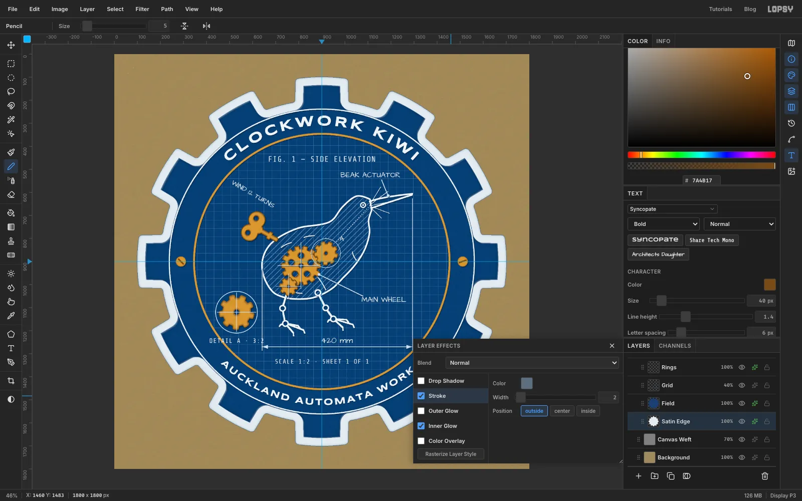

Embroidery stands up off the fabric, so the main thread layers get a small shadow. The thin callouts stay flat, as fine lettering would be stitched.

1. Add a **Drop Shadow** to `Kiwi Lines`, `Legs`, `Drafting`, `Rings`, `Title` and `Maker`: **Opacity** `75`, **Offset X** `2`, **Offset Y** `3`, **Blur** `2`, colour `#0B2245`.
2. On `Satin Edge`, add an **Inner Glow** (**Size** `14`, **Spread** `0`, **Opacity** `60`, `#7F93A6`) for the roll of the satin. Add a **Stroke** (**Width** `2`, `#5D6F80`) for the heat-cut edge.

## Cast the patch's shadow

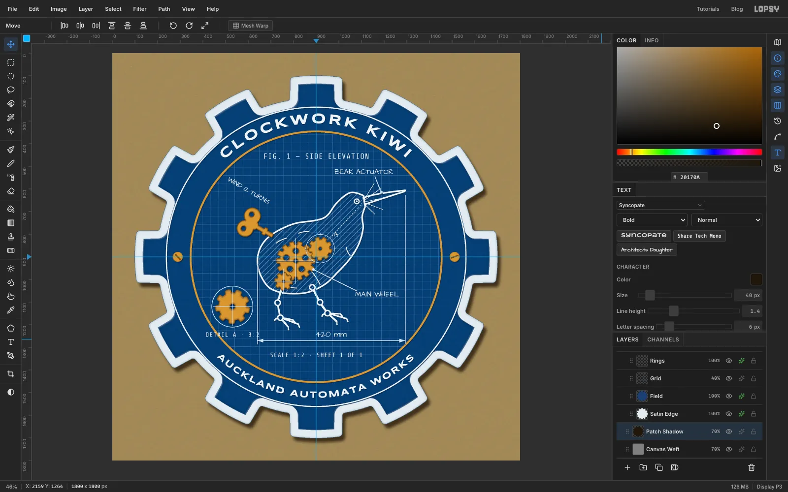

1. Click `Canvas Weft` and add a layer named `Patch Shadow`. It lands just under the `Patch` group.
2. [[Cmd]]-click the `Satin Edge` thumbnail, fill with `#20170A` and deselect.
3. **Filter → Gaussian Blur…**: **Radius** `18`.
4. With the **Move** tool, nudge it 14 px right and 20 px down. Each [[Shift]]+arrow press moves it 10 px, and each plain arrow press moves it 1 px.
5. Set it to **Multiply** at **70%**.

## Light the patch and make a ridge tile

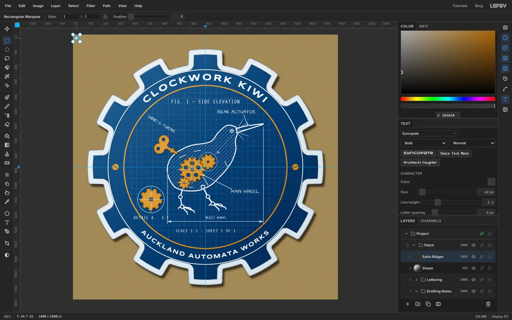

1. Collapse `Lettering`, click its row and add a layer named `Sheen`. It lands at the top of the `Patch` group.
2. [[Cmd]]-click the `Satin Edge` thumbnail. Pick the **Gradient** tool, choose **Linear**, click **Advanced…** and set the two stops to `#FFFFFF` and `#000000`. Click **Done**, then drag from `330, 330` to `1470, 1470`. Deselect and set the layer to **Soft Light** at **45%**.
3. Real satin stitch catches the light in fine diagonal ridges, so draw them as a tiny tile. Add a layer named `Satin Ridges`. Click once with the Rectangular Marquee, enter `20, 20` to `28, 28`, fill with `#808080` and deselect.
4. With the **Pencil** at **Size** `1`, draw a light diagonal across the tile in `#E6E6E6`, from `20, 27` to `27, 20`. Then add two short dark diagonals in `#3A3A3A`, one in each of the other corners: `24, 27` to `27, 24`, and `20, 23` to `23, 20`.
5. Select `20, 20` to `28, 28` again, choose **Edit → Define Pattern** and press [[Delete]].
6. [[Cmd]]-click the `Satin Edge` thumbnail, choose **Edit → Fill with Pattern…** with the new tile, deselect, and set the layer to **Overlay** at **30%**.

## Add stitch grain

1. With `Satin Ridges` selected, add a layer named `Stitch Grain`. [[Cmd]]-click the `Satin Edge` thumbnail, fill with `#808080`, add noise (**Amount** `60`, **Mono**, **Gaussian**) and run Motion Blur at **Angle** `45`, **Distance** `6`. Deselect and set it to **Overlay** at **35%**.
2. Save with **File → Save Project**, then **File → Quick Export PNG**.

Zoom out and squint. The white satin edge should read first, then the title, then the kiwi. The brass parts should be the only warm colour inside the patch. If anything competes with the kiwi, it's usually a callout that's too big or too bright.
