Blueprints suit anything that flies. A gliding club's whole pitch is "this is
safe, and it's beautifully engineered", and a drafting sheet says both at once.
In this tutorial you'll mock up a desktop landing page for **Greyfield Soaring
School**, an invented gliding club on the English downs. It's set out like a
blueprint: a Prussian-blue ground with a fine grid, white technical linework,
pencil notes, and one safety orange kept for the things people should click.

The hero is a **plan view** of a sailplane (looking straight down on it),
drawn with the Pen tool and tipped a few degrees as if it's turning in a
thermal. Under it, a small cross-section shows the two ways a glider stays up:
air pushed up a hillside (*ridge lift*) and rising bubbles of warm air
(*thermals*). Further down, there are course cards and a stats band. A real
photograph of a glider is retouched and turned into a cyanotype print, next to
a wind rose and today's flying conditions. A drafting title block closes the
page.

The page is 1440 px wide, the usual desktop design width, and 2040 px tall.

Along the way you'll use:

- the **Gradient** tool, **Add Noise**, ruler **guides**, **Define Pattern** and **Fill with Pattern**
- the **Shape** tool's click-to-size dialog for buttons, cards and rings
- the **Pen** tool: closed and open paths, [[Enter]] to stroke, and the Paths panel's **Path to Selection**
- the **Magic Wand** with [[Shift]] to add, **Grow**, and the **Pencil** and **Brush** with [[Shift]]-click lines
- **New Group**, rotating a whole group with the Move tool, arrow-key nudges, and **Undo**/**Redo**
- **Show Grid** with snapping, **Copy**, **Paste**, Move drags and **Merge Down**
- dropping in a photo, scaling it with [[Cmd]] held, the **Clone Stamp** and **Healing Brush**
- **Desaturate** and a **Gradient Map** adjustment on a group, **Select → Inverse**
- **layer masks** painted with the **Chalk** brush and filled with a gradient
- the **Drop Shadow** effect
- text in **Space Grotesk**, **IBM Plex Mono** and **Reenie Beanie**, including right-aligned multi-line text

The palette:

- Blueprint ground `#0F4673` → `#0A2F52`, panels `#071F36`
- Line white `#EAF4FF`, cyan `#8CCBF0`, grid `#A9D6F5`, rules `#3F80AD`
- Safety orange `#FF7A3D` (buttons and prices), label orange `#FF9C6B`
- Pencil notes `#DCE8F4`, wind-rose star `#8FB4DC`, footer grey `#7FA6C8`
- Cyanotype `#04182C` → `#0C3358` → `#1A4C7C` → `#8DB5D8` → `#F4F9FF`
- Shadow `#020B16`, grain grey `#808080`

Positions are given in document pixels, written as `x, y`, wherever things
need to line up. Watch **X** and **Y** in the status bar as you move the
pointer. To land on an exact spot, zoom in with [[Cmd+=]], or click with the
**Shape** tool and type the size. Freehand parts only need to be close.

One habit saves a lot of grief with text: before you start a new piece of
text, click a non-text layer in the group you're working in (the steps say
which). If the last text layer is still active, changing the font, size or
colour restyles *that* layer instead of setting up the new one.

Lopsy names each text layer after its text. I renamed layers as I went
(double-click a name), so the screenshots show names like `Headline` and
`Card 01 Title`. Yours can keep the default names.

## Set up the page and guides

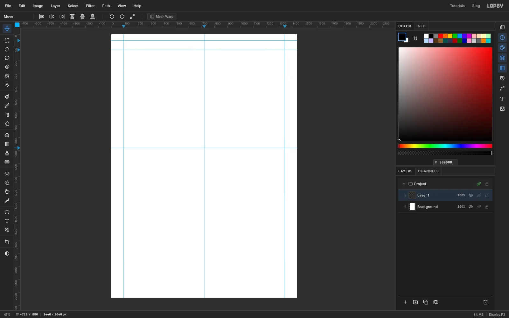

1. Choose **File → New**, set **Width** `1440`, **Height** `2040`, **Pixels**, and click **Create**.
2. Click the top ruler at `x 96`, `720` and `1344` to drop three vertical guides. The outer two are the page margins and the middle one is the centre.
3. Click the left ruler at `y 48` (the bottom of the browser bar), `y 120` (the bottom of the nav) and `y 880` (the bottom of the hero).

## Fill the blueprint ground

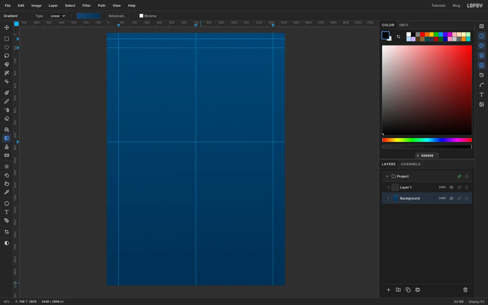

1. Click **Background** in the Layers panel and pick the **Gradient** tool. Leave **Type** on **Linear**.
2. Click **Advanced…** to open the Gradient Editor. Click the left stop and type `#0F4673` into the **Hex color** field. Click the right stop and make it `#0A2F52`. Click **Done**.
3. Drag from the top of the page straight down to the bottom. The page darkens slightly as you scroll, which makes the top feel lit.

## Add paper grain

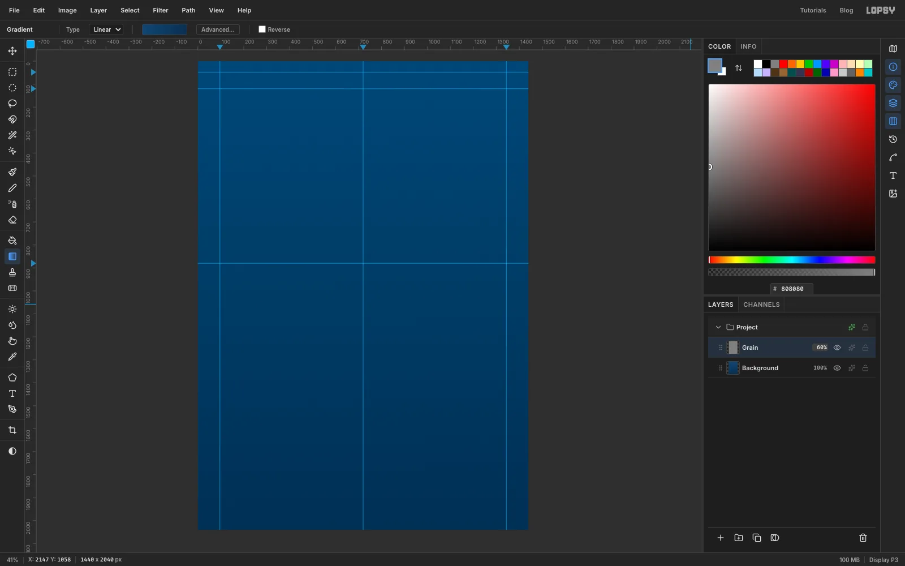

1. Double-click **Layer 1** and rename it `Grain`. Choose **Select → All**, set the foreground to `#808080` and choose **Edit → Fill**. Press [[Cmd+D]].
2. Choose **Filter → Add Noise…** with **Amount** `22` and click **Mono** and **Gaussian**. Click **Apply**.
3. Click the ✦ button on the layer's row to open the effects drawer and set the blend mode to **Overlay**. Close the drawer, click the opacity on the row and set it to `60%`. Grey vanishes in Overlay, so only the speckle shows.

## Make the drafting grid

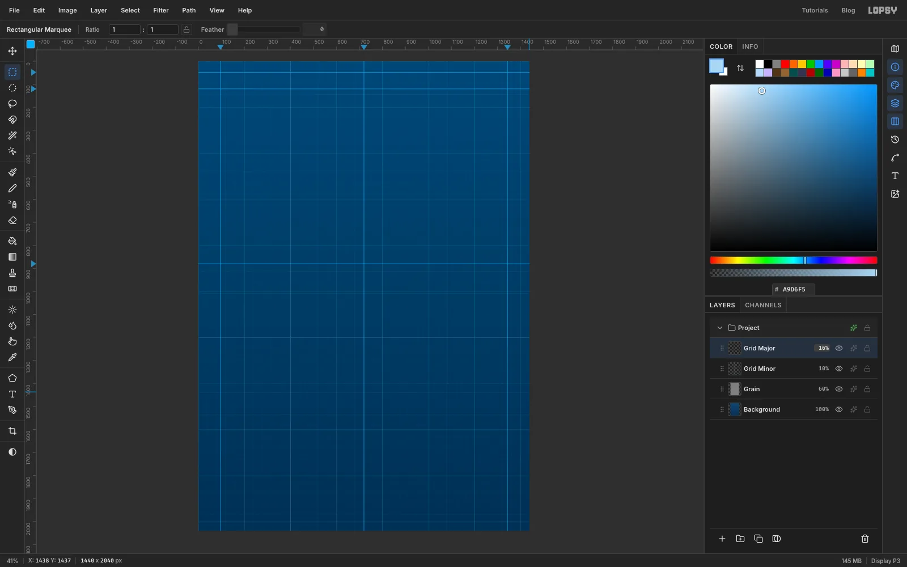

The grid comes from two pattern tiles drawn in the top-left corner, because pattern fills start from the document's top-left corner.

1. Click **Add Layer** and name it `Tile`. Set the foreground to `#A9D6F5`.
2. With the **Rectangular Marquee**, select a 40 × 40 square in the very top-left corner. Zoom in so the corner fills the window first.
3. Pick the **Pencil** at **Size** `1`. Click just left of the canvas on the top edge and [[Shift]]-click past the square on the same edge, then do the same down the left edge. The selection keeps both lines inside the tile.
4. Choose **Edit → Define Pattern**. Press [[Cmd+A]], then [[Delete]].
5. Repeat with a 200 × 200 square and the **Pencil** at **Size** `2`, and choose **Define Pattern** again. Then delete the `Tile` layer with the trash button.
6. Add a layer called `Grid Minor`. Choose **Edit → Fill with Pattern…**, pick the 40 px pattern and click **Apply**. Set the layer to `10%`.
7. Add a layer called `Grid Major`, fill it with the 200 px pattern the same way, and set it to `16%`.

## Draw the browser bar

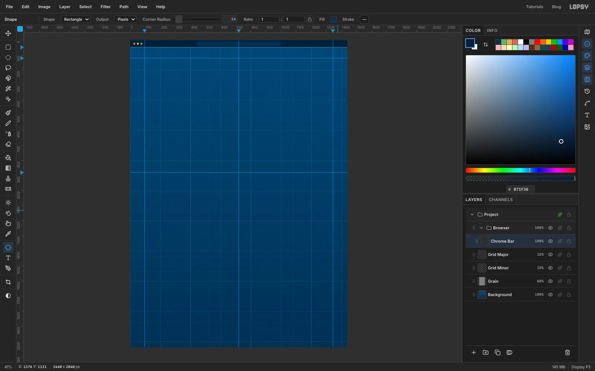

Framing the page in a browser bar makes it read as a website straight away.

1. With `Grid Major` selected, click **New Group** at the bottom of the Layers panel and rename it `Browser`. Click **Add Layer** (the layer goes inside the group) and name it `Chrome Bar`.
2. Marquee from the top-left corner across to the right edge, down to the `y 48` guide. Fill it with `#071F36` and deselect.
3. Pick the **Shape** tool and set **Shape** to **Ellipse**. Click the **Fill** swatch and type `#E0645A` in its **Hex** field. If there's a stroke swatch, open it and click **Remove stroke**.
4. Click once at `x 28`, `y 24` without dragging. The **Shape Size** dialog opens. Enter `14` × `14` and click **Create**. The shape is centred on the point you clicked, so every Shape position in this tutorial is a centre. Make two more dots at `x 52` in `#E3B04B` and at `x 76` in `#5FB66A`.
5. Switch **Shape** to **Rectangle**, set **Corner Radius** to `14` and the fill to `#0F3150`. Click at `x 720`, `y 24` and create a `560` × `28` rectangle. That's the address field.
6. Pick the **Text** tool. Set **IBM Plex Mono**, **Regular**, size `14`, colour `#8CCBF0`, click in an empty spot and type `greyfieldsoaring.co.uk`. Press [[Tab]] to finish. With the **Move** tool, drag it into the middle of the address field.
7. Click the arrow on the `Browser` group's row to collapse it.

## Build the navigation bar

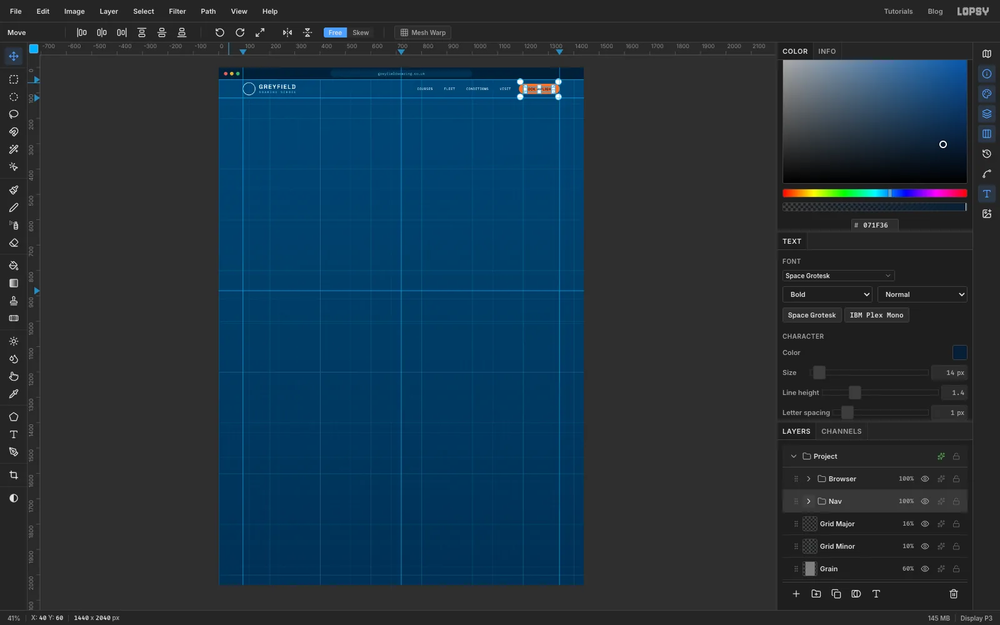

1. Click `Grid Major` and add a group called `Nav`. Inside it, add a layer called `Nav Rule`.
2. Set the colour to `#3F80AD` and pick the **Pencil** at **Size** `1`. Click at the left edge on the `y 120` guide and [[Shift]]-click at the right edge. That's the hairline under the nav.
3. Add a layer called `Nav Button`. With the **Shape** tool on **Rectangle**, **Corner Radius** `20` and fill `#FF7A3D`, click at `x 1264`, `y 84` and make it `160` × `40`.
4. Add a layer called `Logo Ring`. Switch to **Ellipse**, click **Remove fill** in the fill popover, and give it a `#EAF4FF` stroke with **Width** `2`. Click at `x 120`, `y 84` and make it `48` × `48`. The logo goes inside later.
5. Click `Logo Ring` so new text lands in this group without restyling anything. With the **Text** tool, set **Space Grotesk**, **Bold**, size `24`, colour `#EAF4FF`, and type `GREYFIELD`. In the **Text** panel set **Letter spacing** to `3`. Move it so it starts at `x 160` with its top at `y 67`.
6. Click `Logo Ring` again. Type `SOARING SCHOOL` in **IBM Plex Mono**, **Medium**, size `11`, colour `#8CCBF0`, letter spacing `4`, and put it under the wordmark at `x 161`, `y 93`.
7. Click `Logo Ring`. Type `COURSES     FLEET     CONDITIONS     VISIT` (five spaces between the words) in IBM Plex Mono Medium `13`, `#EAF4FF`, letter spacing `1`. Move it so it ends at `x 1150` and is centred on `y 84`.
8. Click `Nav Button`. Type `BOOK A FLIGHT` in Space Grotesk Bold `14`, `#071F36`, letter spacing `1`, and centre it on the orange pill. Collapse the `Nav` group.

## Draw the hero buttons

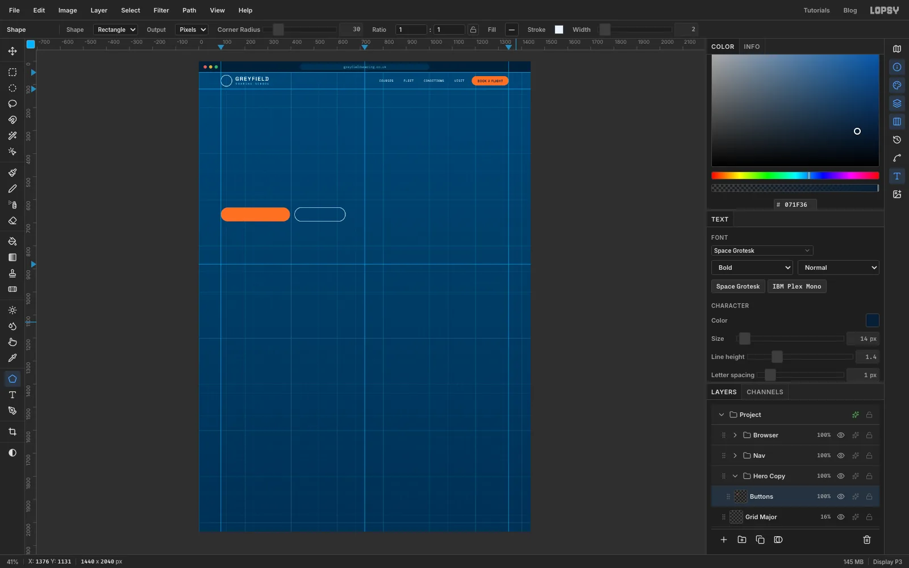

1. Click `Grid Major`, add a group called `Hero Copy`, and inside it a layer called `Buttons`.
2. With the **Shape** tool on **Rectangle**, **Corner Radius** `30`, fill `#FF7A3D` and no stroke, click at `x 246`, `y 664` and make it `300` × `60`.
3. Remove the fill, add a `#EAF4FF` stroke at **Width** `2`, and click at `x 526`, `y 664` for a `220` × `60` outlined button.

## Set the hero type

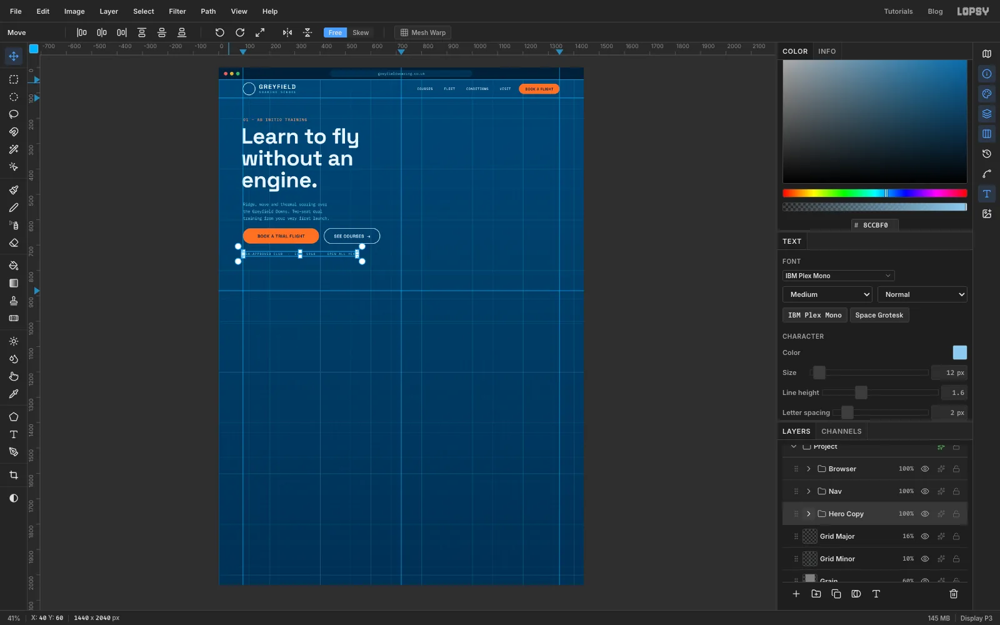

Click `Buttons` before each new piece of text, so the new layer lands in the group and nothing gets restyled.

1. **Eyebrow:** `01 — AB INITIO TRAINING` in IBM Plex Mono Medium `15`, `#FF9C6B`, letter spacing `2`. Its top-left goes at `x 98`, `y 200`. *Ab initio* is what gliding clubs call training from scratch.
2. **Headline:** type `Learn to fly`, press [[Enter]], `without an`, [[Enter]], `engine.` in Space Grotesk Bold `86`, `#EAF4FF`. Set **Letter spacing** to `-1` and **Line height** to `1.0`, so the three lines stack tightly. Line its left edge up with the eyebrow, top at `y 240`.
3. **Intro:** at `x 98`, three lines, `Ridge, wave and thermal soaring over` / `the Greyfield Downs. Two-seat dual` / `training from your very first launch.`, in IBM Plex Mono Regular `17`, `#8CCBF0`, **Line height** `1.6`, starting at `y 532`.
4. **Button labels:** `BOOK A TRIAL FLIGHT` in Space Grotesk Bold `17`, `#071F36`, letter spacing `1`, centred on the orange button. Then `SEE COURSES  →` in the same style in `#EAF4FF`, centred on the outlined one.
5. **Trust line:** `BGA-APPROVED CLUB  ·  EST. 1964  ·  OPEN ALL YEAR` in IBM Plex Mono Medium `12`, `#8CCBF0`, letter spacing `2`, at `x 98`, `y 730`. Collapse the group.

## Pen the wings

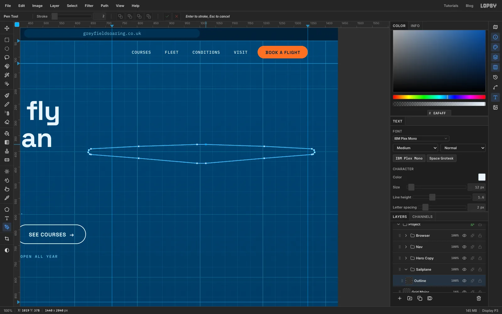

The sailplane is drawn nose-up, centred on `x 1005`, `y 450`, then rotated later. Zoom to 100% (**View → Actual Size**, [[Cmd+1]]) and scroll so that area fills the window.

1. Click `Grid Major` and add a group called `Sailplane`, with a layer called `Outline` inside it. Set the colour to `#EAF4FF`.
2. Pick the **Pen** tool and set **Stroke** to `2` in the options bar.
3. Click these points in order to draw both wings as one shape running straight through where the fuselage will be. Start at the right wing root:
   - Leading edge: `1019, 378` → `1205, 384` → `1357, 392`
   - Rounded tip: `1364, 396` → `1366, 403` → `1361, 409` → `1357, 410`
   - Trailing edge back in: `1205, 422` → `1019, 438`
   - Then the same points mirrored around `x 1005` for the left wing: `991, 438` → `805, 422` → `653, 410` → round the tip → `653, 392` → `805, 384` → `991, 378`
4. Click the first point again to close the shape, then press [[Enter]] to stroke it. Glider wings taper gently and stay straight. Long and thin is what makes them glide so well.

## Clear a space for the fuselage

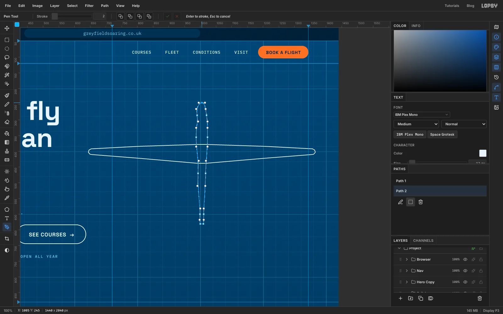

The fuselage sits on top of the wings, so the wing lines inside it have to go.

1. In the **Paths** panel, click the wing path so it's no longer highlighted. If a path stays selected, the next Pen click edits it instead of starting a new one.
2. Draw the fuselage as a smooth closed path. Drag at each point (instead of clicking) to pull out curve handles, always dragging in the direction the outline is heading:
   - The nose at `1005, 245`, dragging a little to the right.
   - Down the right side: `1020, 285` dragging down, `1023, 355` dragging down, `1017, 470` dragging down, `1011, 600` dragging down.
   - Click (don't drag) `1010, 631` and `1000, 631` for the square tail end.
   - Back up the left side through `999, 600`, `993, 470`, `987, 355` and `990, 285`, dragging upward each time.
   - Click the nose point to close the path.
3. In the **Paths** panel, click **Path to Selection**. Press [[Delete]] to clear the wing lines inside the fuselage and press [[Cmd+D]].
4. With the **Pen** still active and the fuselage path still selected, press [[Enter]] to stroke it.

## Add the T-tail

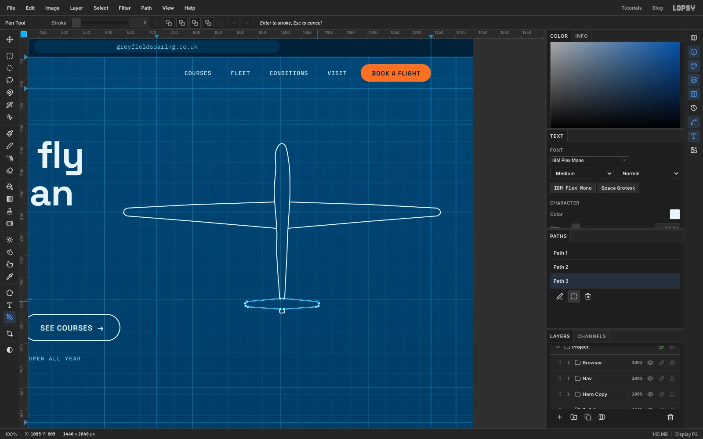

The tailplane sits on top of the fin, so it gets the same treatment.

1. Deselect the fuselage path in the **Paths** panel.
2. The tailplane is a slim bar about 160 px across with rounded tips, sitting across the end of the fuselage. Starting at the right tip, click `1085, 605`, `1089, 609`, `1088, 615` and `1083, 617`, then go along the trailing edge to `1009, 622`. Mirror the same points around `x 1005` for the left half (`1001, 622`, `927, 617`, `922, 615`, `921, 609`, `925, 605`), then finish along the leading edge with `1001, 598` and `1009, 598`. Close the path on the first point.
3. Click **Path to Selection**, press [[Delete]] and [[Cmd+D]], then press [[Enter]] to stroke the tail.

## Tint the airframe

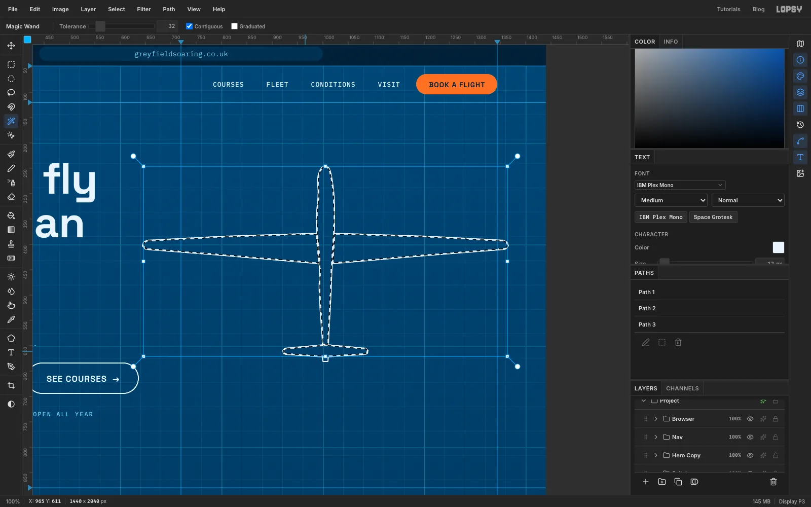

1. In the **Paths** panel, deselect the tail path. Pick the **Magic Wand**.
2. Click inside the right wing. Then [[Shift]]-click inside the left wing, the fuselage and the tailplane, adding each area to the selection.
3. Choose **Select → Grow…** with `1`, so the tint tucks under the outline.
4. Add a layer called `Tint`, set the colour to `#8CCBF0` and fill. Press [[Cmd+D]].
5. Set `Tint` to `22%`. At that strength it can sit above `Outline` without dulling the white lines.

## Draw the canopy and control surfaces

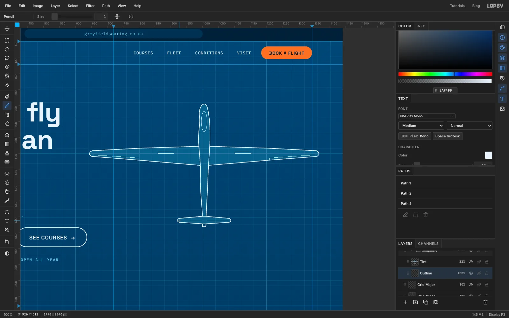

1. Click `Outline`. With the **Shape** tool on **Ellipse**, no fill and a `#EAF4FF` stroke at **Width** `1`, click at `1005, 300` and make it `18` × `64`. That's the canopy.
2. Pick the **Pencil** at **Size** `1`, colour `#EAF4FF`. Draw each line with a click and a [[Shift]]-click:
   - **Ailerons** (the hinged flaps near each tip): `1210, 415` to `1352, 405`, plus a short end line from `1210, 415` to `1210, 421`.
   - **Airbrake slot** on top of the wing: four [[Shift]]-click lines boxing `1101, 395` to `1151, 401`.
   - **Elevator hinge** across the tailplane: `1013, 612` to `1084, 612`.
3. Repeat each one mirrored on the left side.

## Add centrelines and the span dimension

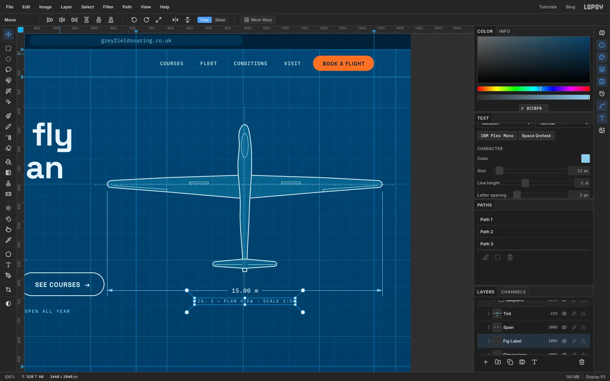

1. Add a layer called `Centrelines` and set the colour to `#8CCBF0`. Pick the **Brush**, open the **Brushes** panel from the brush tip in the options bar, pick **Hard Round** and set **Size** `3`, **Spacing** `300`, **Hardness** `100`. At 300% spacing the dabs separate into dots. Close the panel.
2. Click at `1005, 200` and [[Shift]]-click at `1005, 672` for the fuselage centreline. Then click at `613, 403` and [[Shift]]-click at `1397, 403` across the wings. Set the layer to `70%`.
3. Add a layer called `Dimensions`. With a **Size** `1` **Pencil** in `#8CCBF0`, draw extension lines straight down from each wingtip, at `x 644` and `x 1366`, from `y 420` to `y 694`. Then draw the dimension line across at `y 680` between them.
4. Make each arrowhead with the **Lasso**: drag a small sliver of a triangle pointing at the extension line, fill it with `#8CCBF0` and deselect.
5. Type `15.00 m` in IBM Plex Mono Medium `15`, `#EAF4FF`, and centre it on the dimension line. Click `Dimensions`, marquee a box slightly bigger than the text and press [[Delete]] to break the line around it. Press [[Cmd+D]].
6. Type `FIG. 1 — PLAN VIEW · SCALE 1:50` in IBM Plex Mono Medium `11`, `#8CCBF0`, letter spacing `2`, centred under the line.

## Tip the drawing into a turn

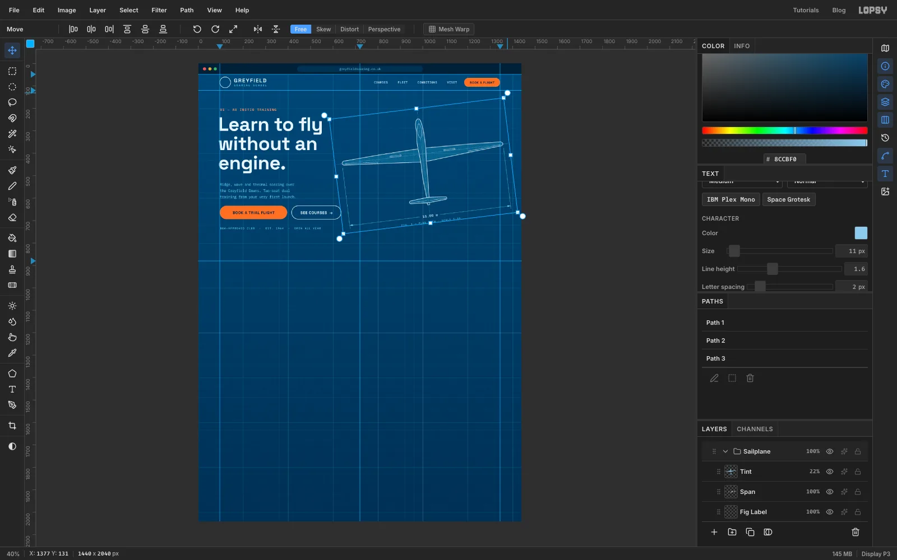

1. Press [[Cmd+D]] to make sure nothing is selected, and click the `Sailplane` group's row.
2. Pick the **Move** tool. Its handles frame everything in the group. Drag the round rotation handle off the top-right corner about **7° anticlockwise**, so the right wingtip ends up roughly 90 px higher than the left.
3. Press [[Cmd+D]] to apply it. Try [[Cmd+Z]]: the drawing snaps back upright. [[Cmd+Shift+Z]] puts the turn back.
4. With the group still selected, press [[Shift+↑]] three times to lift the whole drawing 30 px. Collapse the group.

## Draw the ridge

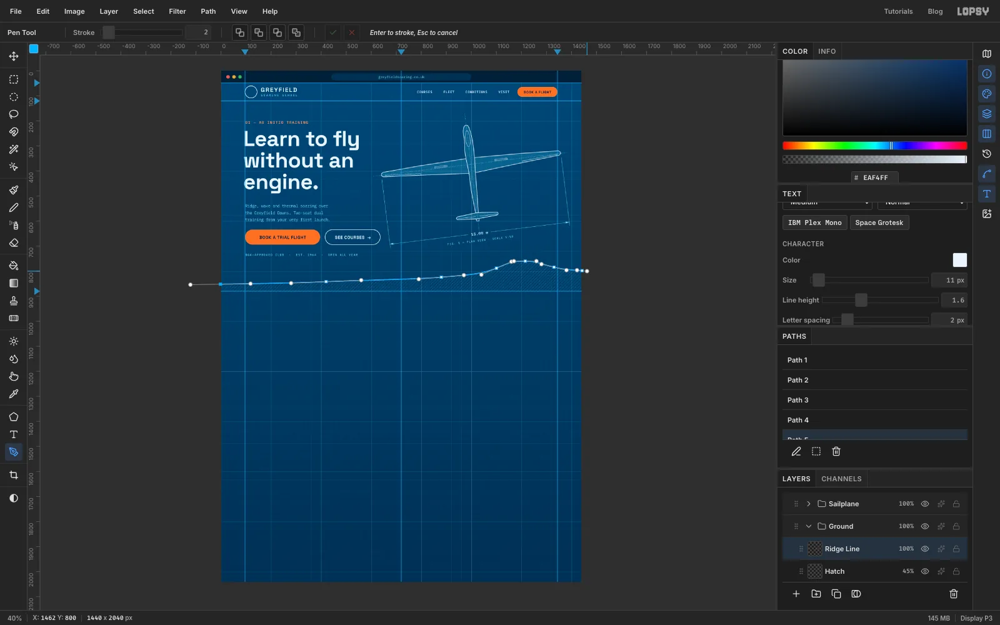

1. Click `Grid Major` and add a group called `Ground`. Inside it, add a layer called `Hatch Tile`.
2. Zoom into the top-left corner. With a **Size** `1` **Pencil** in `#8CCBF0`, click at `0, 11` and [[Shift]]-click at `11, 0`. With the **Rectangular Marquee**, select `0, 0` to `12, 12`, choose **Define Pattern** and deselect. Delete the `Hatch Tile` layer.
3. Add a layer called `Hatch` and fit the page to the window ([[Cmd+0]]). With the **Pen**, drag smooth points along a long, low ridge:
   - Just off the left edge at `-2, 852`, then `420, 842`, dragging right each time.
   - `880, 824`, dragging right and slightly up.
   - `1100, 788`, dragging up and right.
   - The crest at `1215, 760`, dragging flat.
   - `1330, 784` down the far side, then `1442, 798` past the edge.
   - Click `1442, 882` and `-2, 882` to close it along the bottom, then click the first point.
4. Click **Path to Selection**, choose **Edit → Fill with Pattern…** with the diagonal tile, and deselect. Set the layer to `45%`.
5. Add a layer called `Ridge Line`. Deselect the path in the **Paths** panel and draw the same ridge again with the **Pen**, but this time stop at the right edge without closing it. Set **Stroke** to `2`, colour `#EAF4FF`, and press [[Enter]].

## Show the lift

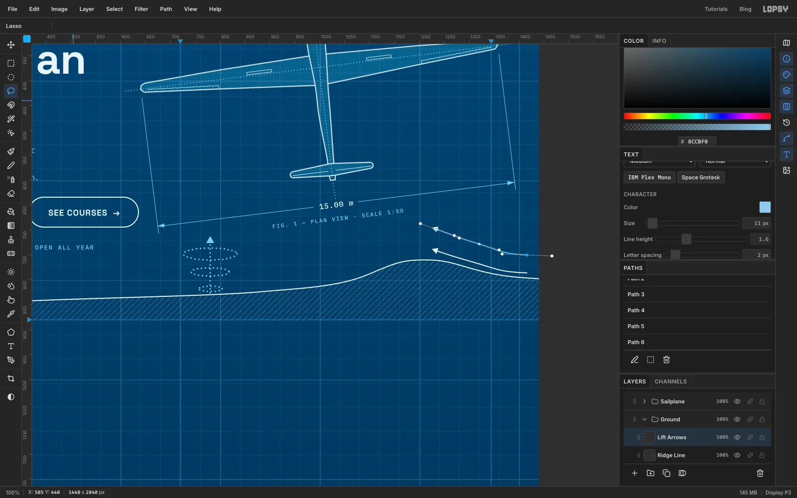

The wind blows from the east today, so it hits the right-hand slope and is forced upward. That's ridge lift.

1. Add a layer called `Lift Arrows`, colour `#EAF4FF`. In the **Paths** panel, click the ridge path to deselect it. With the **Pen** at **Stroke** `2`, drag three smooth points: from `1416, 786`, through `1320, 768`, to `1236, 742`, curving up the slope. Press [[Enter]]. Deselect that path in the **Paths** panel too, then draw a second arrow about 36 px higher.
2. Fill a small **Lasso** triangle at the top-left end of each line for the arrowheads.
3. For the thermal, set the colour to `#8CCBF0` and pick the **Brush** with **Hard Round** at **Size** `4`, **Spacing** `260`. Over the field at `x 780`, drag three flat rings, wider as they rise: about 48 px wide at `y 818`, 76 px at `y 784` and 108 px at `y 748`.
4. Draw a dotted line straight up the middle from `y 826` to `y 728` with a click and a [[Shift]]-click. Finish it with a small filled triangle.

## Write the pencil notes

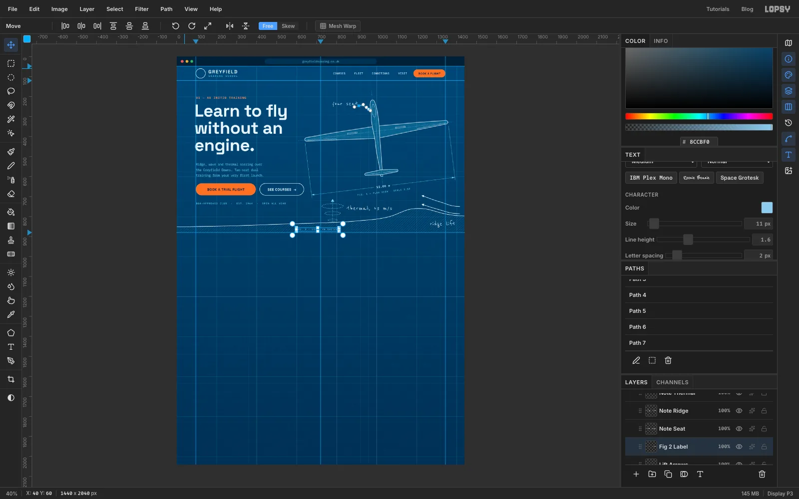

Handwritten notes make the drawing feel like a working sheet rather than clip art.

1. Click `Lift Arrows`. With the **Text** tool, set **Reenie Beanie**, size `36`, colour `#DCE8F4`, and type `thermal, +3 m/s`. Put it to the right of the rings at about `x 850`, `y 744`.
2. Type `ridge lift` and tuck it under the ridge, near the right edge at `x 1268`, `y 818`.
3. Type `your seat` and place it to the left of the nose, ending around `x 905`, `y 224`.
4. Click `Lift Arrows` and deselect the last arrow path in the **Paths** panel. With the **Pen** at **Stroke** `2` in `#DCE8F4`, drag two points from the end of the note curving down to the canopy, and press [[Enter]]. Add a tiny triangle at the tip.
5. Add `FIG. 2 — LIFT, IN SECTION` in IBM Plex Mono Medium `11`, `#8CCBF0`, letter spacing `2`, at `x 600`, `y 860`. Collapse `Ground`.

## Add the stats band

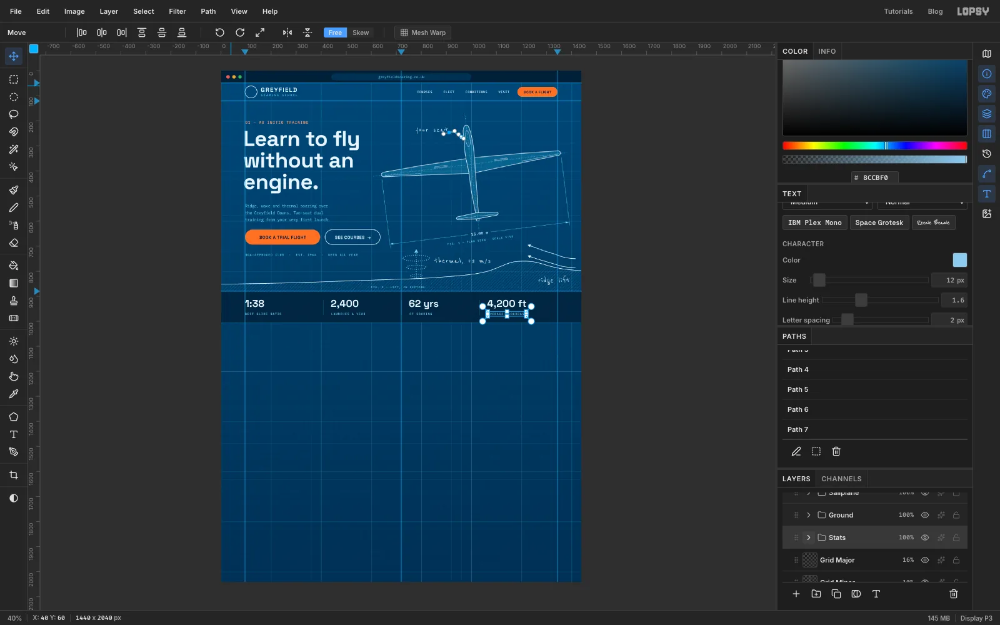

1. Click `Grid Major` and add a group called `Stats`, with a layer called `Stats Band`.
2. Marquee from the left edge at `y 882` to the right edge at `y 1006`, fill it with `#071F36` and deselect. Set the layer to `80%`, so the grid shows through faintly.
3. Add a layer called `Stats Rules`. With a **Size** `1` **Pencil** in `#3F80AD`, draw a hairline across at `y 1005`, plus short dividers at `x 408`, `720` and `1032` from `y 914` to `y 976`. That gives four equal 312 px columns.
4. Click `Stats Rules` before each piece of text in this section. Type the four values in Space Grotesk Bold `40`, `#EAF4FF`, tops at `y 914`: `1:38` at `x 96`, `2,400` at `x 440`, `62 yrs` at `x 752` and `4,200 ft` at `x 1064`. Each starts 32 px after its divider.
5. Under each value, at `y 966`, type its label in IBM Plex Mono Medium `12`, `#8CCBF0`, letter spacing `2`: `BEST GLIDE RATIO`, `LAUNCHES A YEAR`, `OF SOARING` and `AVERAGE CLOUDBASE`. Collapse the group.

## Draw the first course card

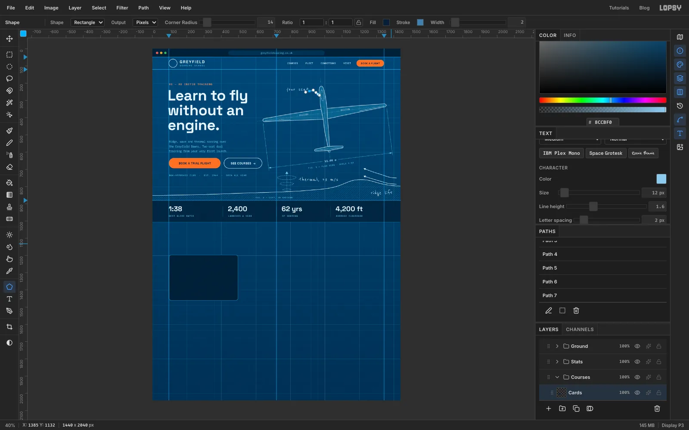

1. Click `Grid Major` and add a group called `Courses`, with a layer called `Cards`.
2. With the **Shape** tool on **Rectangle**, **Corner Radius** `14`, fill `#071F36`, and a `#3F80AD` stroke at **Width** `2`, click at `297, 1329` and make it `400` × `264`.

## Copy the card with grid snapping

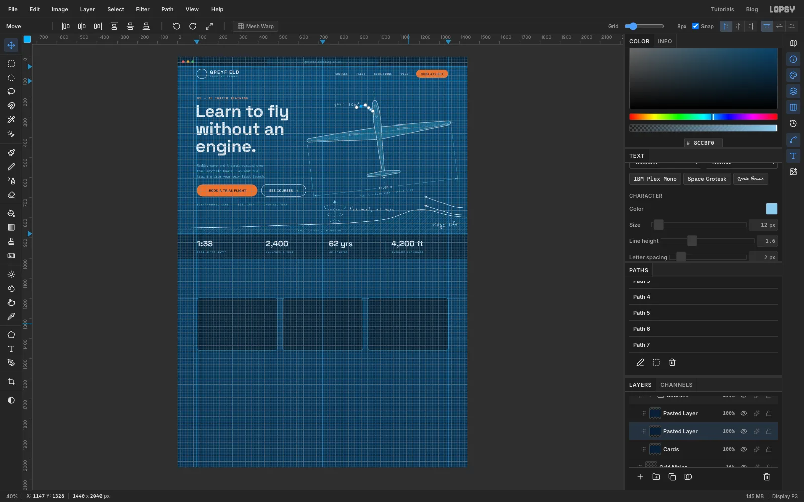

Snapping guarantees the copies land exactly in line with the first card.

1. Choose **View → Show Grid**. In the options bar, set the grid slider to **8px** and leave **Snap** ticked. The card's edges already sit on grid lines.
2. [[Cmd]]-click the `Cards` thumbnail to select the card, then press [[Cmd+C]] and [[Cmd+V]]. The copy pastes in place on a new layer. Press [[Cmd+D]].
3. With the **Move** tool, drag the copy to the right until its left edge snaps to `x 520`. Keep the drag level; the snap holds it on the same row.
4. Click `Cards` again and repeat, dragging the second copy to `x 944`.
5. Turn **Show Grid** off. Click the top copy and choose **Layer → Merge Down** twice, so all three cards are back on `Cards`.

## Draw the card icons

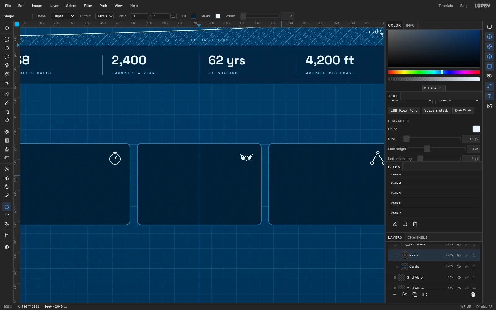

Keep all three icons inside the same 40 px box, in the same 2 px white line, and they'll read as a set.

1. Add a layer called `Icons` and zoom to 100% over the cards.
2. **Stopwatch** (Trial Lesson): an unfilled `#EAF4FF` **Ellipse** with stroke **Width** `2`, `34` × `34`, at `449, 1248`. With a **Size** `2` **Pencil**, add a hand from the centre up and to the right, and a short crown on top.
3. **Pilot's wings** (Learn to Solo): a `14` × `14` ring at `873, 1245`. On each side, draw four short feather strokes angled slightly upward and getting shorter towards the bottom.
4. **Triangle task** (Cross-Country): with the same **Size** `2` **Pencil**, click and [[Shift]]-click a triangle about 38 px wide around `1297, 1245`. Then put a small `9` × `9` ring with a dark `#071F36` fill and white **Width** `2` stroke on each corner. Cross-country pilots fly triangles between turnpoints.

## Write the card copy

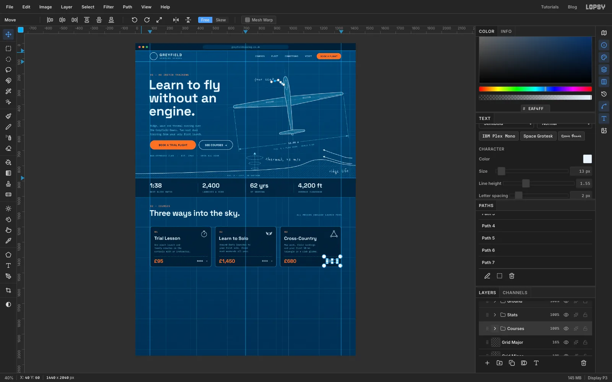

1. Add a layer called `Card Rules`. Pick the **Brush** with **Hard Round**, **Size** `2`, **Spacing** `300` in `#3F80AD`, draw a line across each card 196 px below its top, 28 px in from each side.
2. Type the section label `02 — COURSES` in IBM Plex Mono Medium `15`, `#FF9C6B`, at `x 98`, `y 1058`. Click `Card Rules` again and, under the label, type `Three ways into the sky.` in Space Grotesk Bold `52`, `#EAF4FF`, letter spacing `-1`.
3. Type `ALL PRICES INCLUDE LAUNCH FEES` in IBM Plex Mono Medium `13`, `#8CCBF0`, and line its right edge up with the `x 1344` guide, sitting on the heading's baseline.
4. In each card, 28 px in from the left (click `Card Rules` before each one):
   - The number (`01`, `02`, `03`) in IBM Plex Mono SemiBold `14`, `#FF9C6B`, near the top.
   - The title in Space Grotesk Bold `30`, `#EAF4FF`: `Trial Lesson`, `Learn to Solo`, `Cross-Country`.
   - Three lines of description in IBM Plex Mono Regular `14`, `#8CCBF0`, **Line height** `1.55`:
     - `One winch launch and` / `twenty minutes on the` / `controls with an instructor.`
     - `Around forty launches to` / `your first solo, flown` / `most weekends all year.`
     - `Map work, field landings` / `and your first 50 km` / `triangle in a club glider.`
   - The price below the dotted rule in Space Grotesk Bold `32`, `#FF7A3D`: `£95`, `£1,450`, `£680`.
   - `BOOK  →` in IBM Plex Mono SemiBold `13`, `#EAF4FF`, letter spacing `2`, right-aligned to the card's inner edge and centred on the price's capitals.
5. Collapse the group.

## Bring in the photo

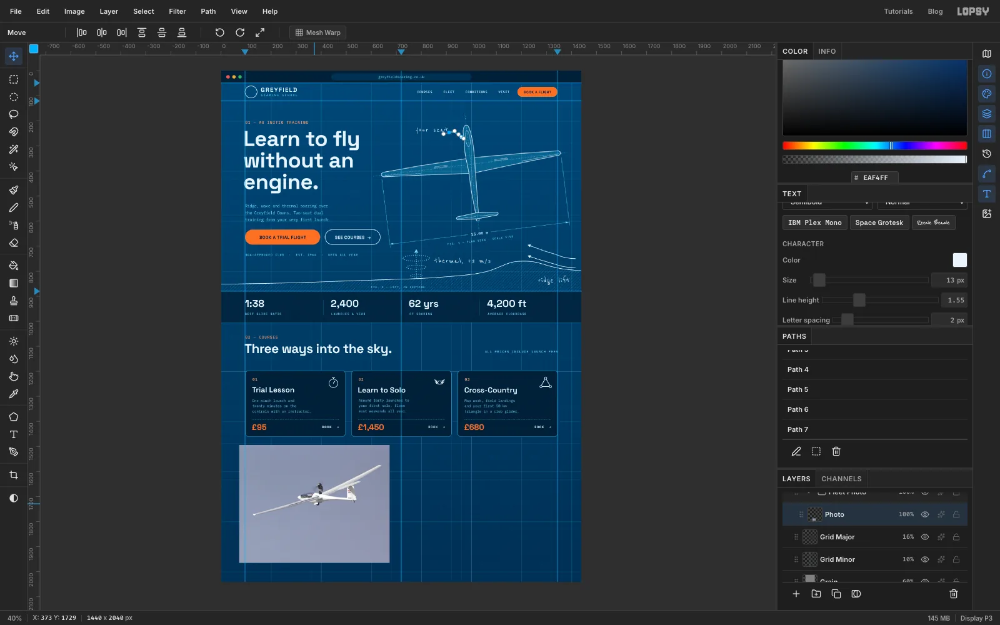

The photo is NASA's public-domain shot of a PIK-20E sailplane over Edwards, California, [Pik20E NASA.jpg on Wikimedia Commons](https://commons.wikimedia.org/wiki/File:Pik20E_NASA.jpg). I used a 1200 px wide copy.

1. Click `Grid Major` and add a group called `Fleet Photo`.
2. Drag the photo file onto the canvas. It lands as a new layer in the top-left corner, already selected, with the Move tool active. Rename it `Photo`.
3. Hold [[Cmd]] and drag the bottom-right handle up and left until the photo is half its size, 600 px wide.
4. Drag the photo down into the empty area at the bottom left, so its top-left corner is at about `73, 1494`. Press [[Cmd+D]].

## Retouch the motor-glider into a glider

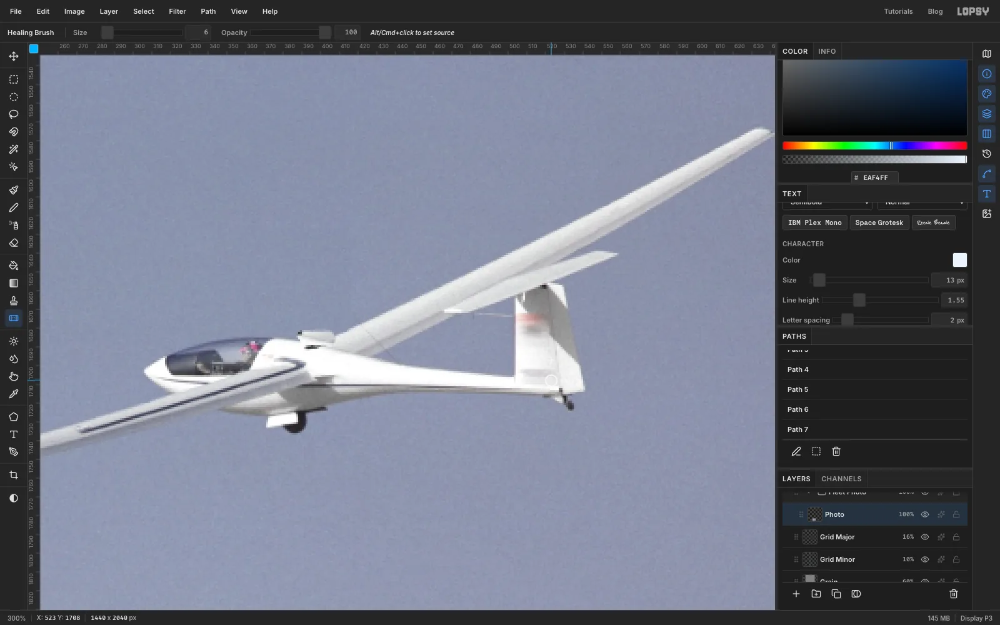

This particular glider has a small engine on a mast behind the cockpit, and NASA lettering on the tail. A gliding school's own glider would have neither.

1. Zoom to 300% over the cockpit and tail.
2. Pick the **Clone Stamp** at **Size** `12`. [[Alt]]-click in clear sky up and to the left of the engine to set the source. Then paint over the propeller and mast. The source follows your brush at a fixed offset, so start on the mast and keep the source in clear sky. The sky is even, so it blends straight in.
3. Drop to **Size** `6`. [[Alt]]-click on the fuselage just behind the mast, and paint over the dark stub where the mast meets the fuselage.
4. Pick the **Healing Brush** at **Size** `6`. [[Alt]]-click on clean white fin just below the lettering, then paint across the NASA logo. Do two passes, top half then bottom half, re-sampling just below each time. Heal the small registration number further down the same way. The Healing Brush matches the fin's tone, so you don't get a flat patch.

## Crop the photo to its frame

1. With the **Rectangular Marquee**, select from `104, 1544` to `664, 1804`, a 560 × 260 window.
2. Choose **Select → Inverse** and press [[Delete]]. Press [[Cmd+D]].

## Turn it into a cyanotype

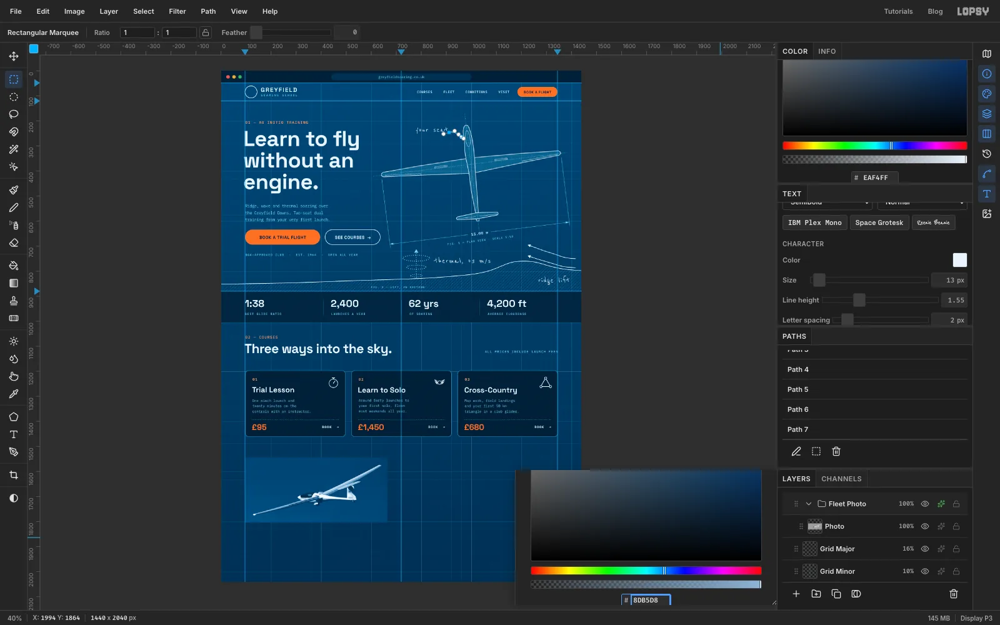

Real cyanotype prints are deep Prussian blue where light hit the paper, and paper white where it didn't. A **Gradient Map** on the group recreates that.

1. With `Photo` selected, choose **Filter → Desaturate**.
2. Click the `Fleet Photo` group's row and open its drawer with the ✦ button. Click **Add Adjustment** and choose **Gradient Map**.
3. Click the left stop and set it to `#04182C`, and the right stop to `#F4F9FF`.
4. Click the bar to add three more stops, and set each one's colour: `#0C3358` at about 55%, `#1A4C7C` at about 64%, and `#8DB5D8` at about 82%. The drawer is short, so scroll it up to see the bar after you pick a colour. The sky falls in the 55–64% band, so it goes deep blue, while the glider stays near white.
5. Close the drawer.

## Frame the print

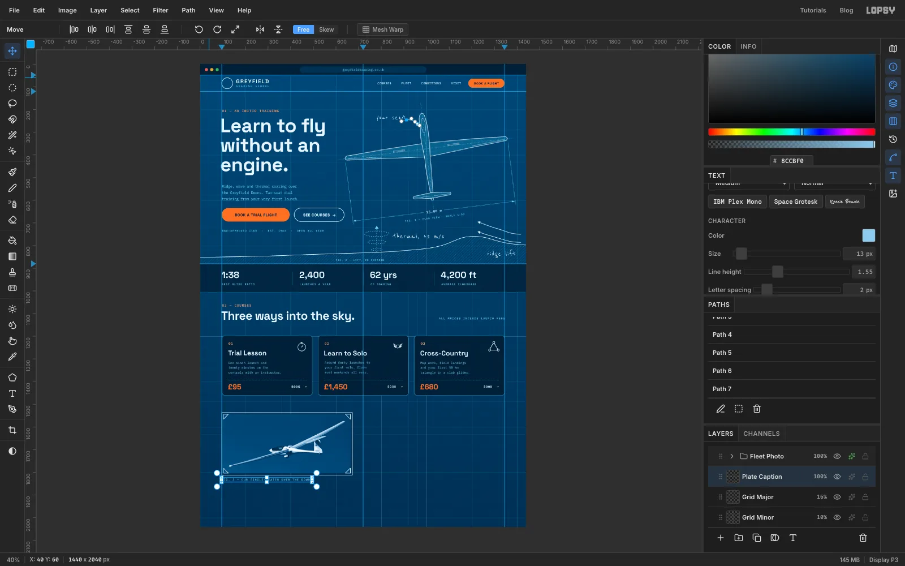

1. Add a layer called `Photo Frame` inside the group. With the **Shape** tool on **Rectangle**, no fill, a `#EAF4FF` stroke at **Width** `2` and **Corner Radius** `0`, click at `384, 1674` and make it `576` × `276`. That leaves 8 px of air around the print.
2. With a **Size** `2` **Pencil**, draw a small triangle in each corner of the photo, 22 px along each edge, like album photo corners.
3. Collapse the group and click `Grid Major`, so the caption sits outside the group and the Gradient Map doesn't dim it. Type `FIG. 3 — OUR SINGLE-SEATER OVER THE DOWNS` in IBM Plex Mono Medium `13`, `#8CCBF0`, letter spacing `2`, at `x 96`, `y 1828`.

## Draw the wind rose

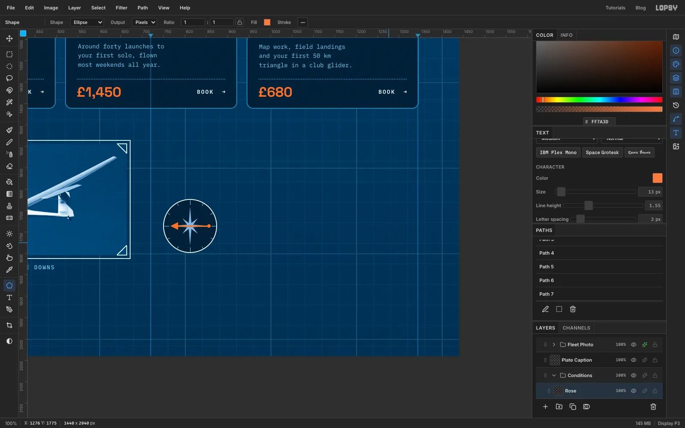

1. Click `Grid Major` and add a group called `Conditions` with a layer called `Rose`, and zoom to 100% over the space right of the photo.
2. With the **Shape** tool on **Ellipse**, fill `#071F36` and a `#EAF4FF` stroke at **Width** `2`, click at `812, 1736` and make it `124` × `124`.
3. With the **Lasso**, click out an eight-point star centred on the circle and fill it with `#8FB4DC`. Make the four main points about 46 px long and the four diagonal ones about 26 px. If your lasso drags freehand, drag from point to point in straight lines.
4. With a **Size** `1` **Pencil** in `#8CCBF0`, draw a short tick on the rim every 30°, longer at north, east, south and west.
5. Set the colour to `#FF7A3D` and the **Pencil** to **Size** `3`. Draw the wind arrow from the east side of the circle straight across towards the west. Lasso-fill an arrowhead on the west end. Then switch to the **Shape** tool (**Ellipse**, fill `#FF7A3D`, no stroke) and click an `8` × `8` dot on the east end. Wind is named for where it comes *from*, so this arrow reads "from the east".

## Fill in today's conditions

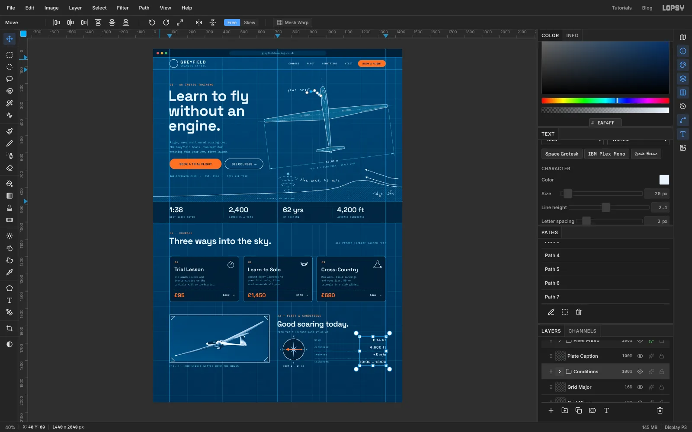

1. Click `Rose` before each piece of text in this section. Type `N`, `E`, `S` and `W` in IBM Plex Mono SemiBold `12` just outside the rose: `N` in white and the rest in `#8CCBF0`. Under the rose, at `y 1828`, type `FROM E · 14 KT` in IBM Plex Mono SemiBold `11`, `#DCE8F4`, letter spacing `2`. It lines up with the photo caption.
2. Add a layer called `Readout Rules`. Pick the **Brush** with **Hard Round**, **Size** `2`, **Spacing** `300` in `#3F80AD`, draw three lines from `x 932` to `x 1344` at `y 1704`, `1746` and `1788`.
3. Type `03 — FLEET & CONDITIONS` in IBM Plex Mono Medium `15`, `#FF9C6B`, at `x 720`, `y 1536`. Its top lines up with the top of the photo frame. From here on, click `Readout Rules` before each new text. Below the label, type `Good soaring today.` in Space Grotesk Bold `44`, `#EAF4FF`, letter spacing `-1`, at `y 1572`, and `FROM THE CLUBHOUSE MAST AT 09:40` in IBM Plex Mono Medium `12`, `#8CCBF0`, at `y 1632`.
4. For the labels, type `WIND`, `CLOUDBASE`, `THERMALS`, `LAUNCHING` on four lines, pressing [[Enter]] between them. Use IBM Plex Mono Medium `12`, `#8CCBF0`, letter spacing `2`, with **Line height** `3.5`. Place it at `x 933`, `y 1678`.
5. For the values, set **Align** to **Right** in the Text options before you click, then type `E 14 kt`, `4,600 ft`, `+3 m/s`, `10:00 – 18:00` on four lines. Use Space Grotesk Bold `20`, `#EAF4FF`, with **Line height** `2.1`. Both line heights work out to 42 px, so labels and values share baselines. Move it so its right edge sits on the `x 1344` guide and the last line lines up with `LAUNCHING`. Set **Align** back to **Left**, then collapse the group.

## Build the title-block footer

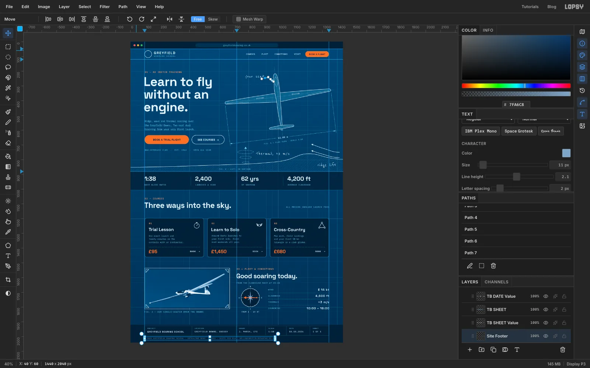

Every engineering drawing ends with a title block, so this page does too.

1. Click `Grid Major` and add a group called `Footer`, with a layer called `Footer Band`. Marquee from `y 1920` to the bottom of the page across its full width, fill it with `#071F36`, and deselect.
2. Add a layer called `Title Block`. With the **Shape** tool on **Rectangle**, no fill, a `#3F80AD` stroke at **Width** `1` and no corner radius, click at `720, 1960` and make it `1248` × `64`.
3. With a **Size** `1` **Pencil** in the same colour, draw cell dividers from `y 1929` to `y 1991` at `x 416`, `716`, `916`, `1056` and `1216`.
4. Click `Title Block` before each piece of text. In each cell, 20 px in from its left line, type a label at `y 1941` in IBM Plex Mono Medium `10`, `#8CCBF0`, letter spacing `2`. Then type the value under it at `y 1962` in IBM Plex Mono Medium `13`, `#EAF4FF`. The project name is in Space Grotesk Bold `15`.
   - `PROJECT`: `GREYFIELD SOARING SCHOOL`
   - `LOCATION`: `GREYFIELD DOWNS, SUSSEX`
   - `DRAWN`: `J. MARSH, CFI`
   - `SCALE`: `1:50`
   - `DATE`: `18.10.2026`
   - `SHEET`: `1 OF 1`
5. Under the block, at `x 96`, `y 2008`, add a small site footer in IBM Plex Mono `11`, `#7FA6C8`: `© 2026 GREYFIELD SOARING SCHOOL · DITCHLING ROAD, SUSSEX · 01273 555 014 · HELLO@GREYFIELDSOARING.CO.UK`.
6. Collapse the group.

## Shrink the drawing into a logo

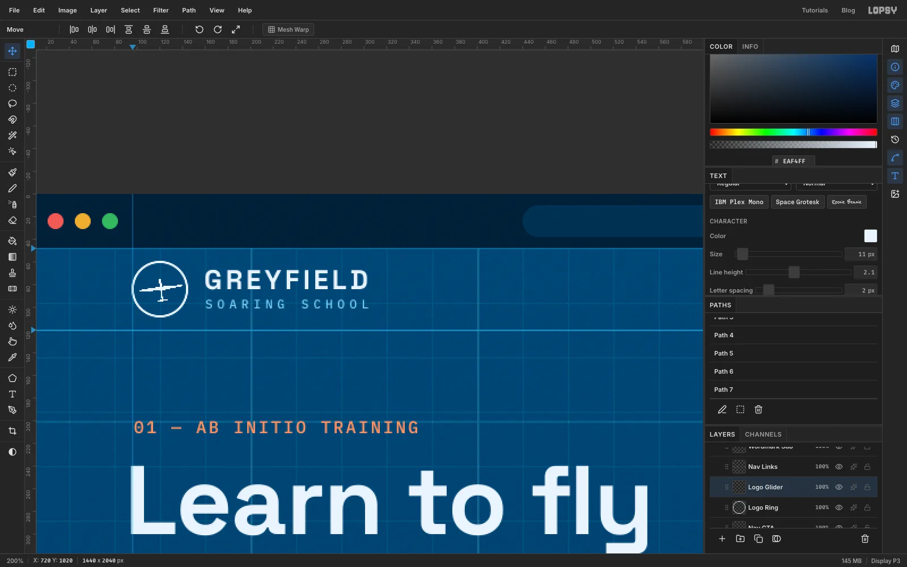

The logo is the hero drawing's own silhouette, so the brand and the page match.

1. Expand the `Nav` and `Sailplane` groups. Click `Logo Ring` and add a layer called `Logo Glider`.
2. [[Cmd]]-click the `Tint` thumbnail to select the airframe. Then [[Cmd+Shift]]-click the `Outline` thumbnail to add the outline to the selection. Choose **Select → Grow…** with `2` and fill with `#EAF4FF`. Press [[Cmd+D]].
3. [[Cmd]]-click the `Logo Glider` thumbnail. With the **Move** tool, hold [[Cmd]] and drag the bottom-right handle up and left until the silhouette is about 38 px wide.
4. Press [[Cmd+D]]. With the **Move** tool, drag the silhouette up into the ring, then nudge it with the arrow keys until it's centred. Collapse the groups.

## Add shadows and brushed print edges

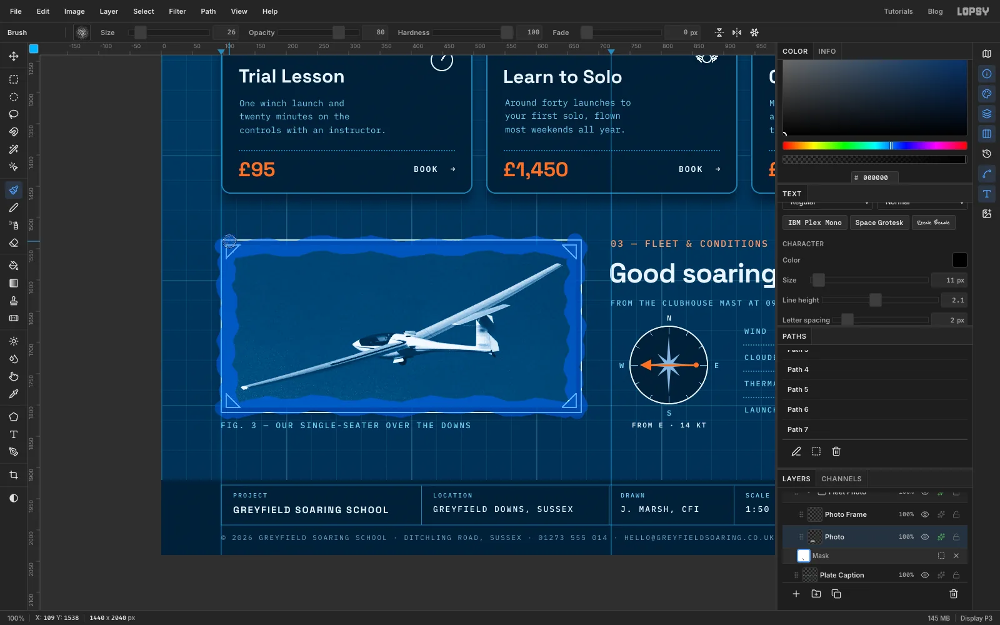

Cyanotypes are hand-coated, so their edges are ragged brush marks, not clean cuts. A layer mask does that without touching the photo.

1. Click `Cards` and open its drawer. Tick **Drop Shadow** and set **Offset X** `0`, **Offset Y** `14`, **Blur** `26`, **Opacity** `55` and colour `#020B16`. Close the drawer.
2. Click `Photo` and give it a **Drop Shadow** of `0`, `12`, blur `22`, `50%` in the same colour. Run **Filter → Add Noise…** at `10`, **Mono**, **Gaussian** for a little print grain.
3. Click **Add Mask**, then click the mask thumbnail (**Edit mask for Photo**) so you paint on the mask.
4. Set the colour to black. Pick the **Brush**, open the **Brushes** panel from the brush tip and pick **Chalk** on its **Presets** tab. Set **Size** to `26` and keep its other settings. Drag along each edge of the photo with a slightly wobbly hand, half on and half off the print.
5. Click the mask thumbnail again to go back to the photo.

## Fade the hatching in

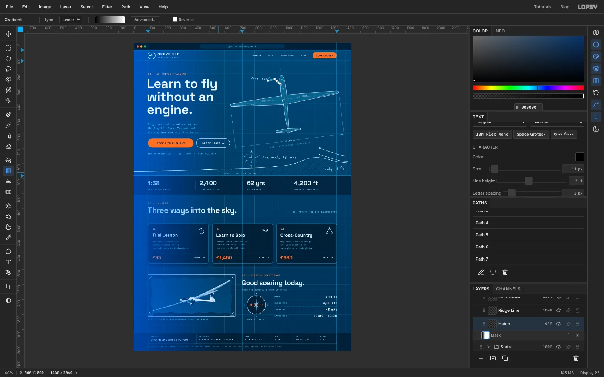

1. Expand `Ground` and click `Hatch`. Click **Add Mask**, then click the mask thumbnail to edit it.
2. Pick the **Gradient** tool and set it to black → white in the Gradient Editor. Drag from `x 40` to `x 560` along the hatching. The hatch now fades in from the left, so it doesn't fight the hero copy.
3. Click the mask thumbnail to leave mask editing.
4. Choose **File → Save Project** to keep the layered file, and **File → Quick Export PNG** for the finished mockup.
