Tattoo flash is a sheet of ready-to-go designs that hangs on a shop wall.
American traditional flash has a recognisable recipe: one big centrepiece,
smaller "fillers" around it, heavy black outlines, flat colour, and banners
with a motto. Blueprints have their own recipe: white lines on Prussian blue
paper, a grid, dash-dot centre lines, dimension arrows and a title block in
the corner.

In this tutorial you'll combine the two into a flash sheet called **Vacuum
Electronics**: radio valves drawn as tattoos, then annotated like an
engineer's drawing. The centrepiece is a 1920s 201-A triode with a glowing
filament and an "ALWAYS WARM" banner (valve radios have to warm up). The
fillers are a Nixie tube, a magic-eye tuning tube, an "OHM SWEET OHM" heart,
a nautical star and an atom.

Every tattoo piece uses the same outline trick: fill the colours on one layer,
**⌘-click** its thumbnail to select its shape, **Grow** the selection and fill
it with ink on a layer underneath. You'll also use **Sunburst** with a
**layer mask**, **Fill with Pattern**, **Outer Glow**, **radial symmetry**,
type on a **Pen path**, and rotate, scale and flip copies with the Move tool.

One habit to build before you start: while a text layer is selected, the
Text options restyle *that* layer. Click a plain layer before you set up new
type.

The canvas is 1800 × 2400. The reference photo of a Premier X-201A triode is
by Joe Haupt on Wikimedia Commons (CC BY-SA 2.0). It's only used for
proportions, so any photo of an old radio valve will do. The fonts are
**Sancreek**, **Architects Daughter** and **Stardos Stencil**, all in the
font browser. You'll make about 70 layers, so name each one as you go.

The palette:

- Paper `#22508C` → `#173B6E`, edge wear `#08152B`
- Chalk `#EEF4F8`, ink `#0E1729`
- Flash red `#B8432F` / `#8A2F24` / `#DE7457`
- Mustard `#E2AE3E`, cream `#F2E7CC`, banner tails `#D9C9A2` / `#9E8A62`
- Glass `#A8D0E4`, steel `#C9D2DA` / `#8FA3B5`, Nixie glass `#23395A`
- Glow orange `#FF9A42`, filament `#FFD98A`
- Magic eye `#1E5A45` / `#7FEBB0`, cap grey `#5D6B82`, highlight coral `#F2A08A`
- Crease shadow `#0A1830`

## Set up the sheet and paper colour

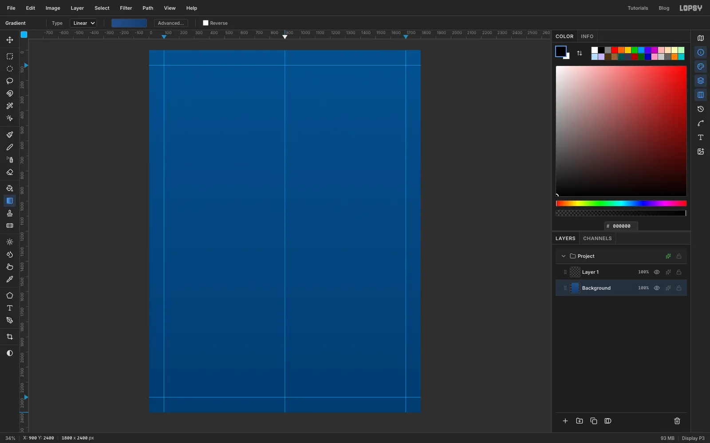

Choose **File → New**, make a **1800 × 2400** document and click **Create**.

Click the top ruler at **100**, **900** and **1700** to drop three vertical
guides: the two side margins and the centre line. Click the left ruler at
**100** and **2300** for the top and bottom margins.

Select **Background**. Pick the **Gradient** tool, set **Type** to
**Linear**, click **Advanced…** and set the left stop to `#22508C` and the
right stop to `#173B6E`. Drag from the top edge of the canvas straight down
to the bottom edge.

## Mottle the paper with Clouds

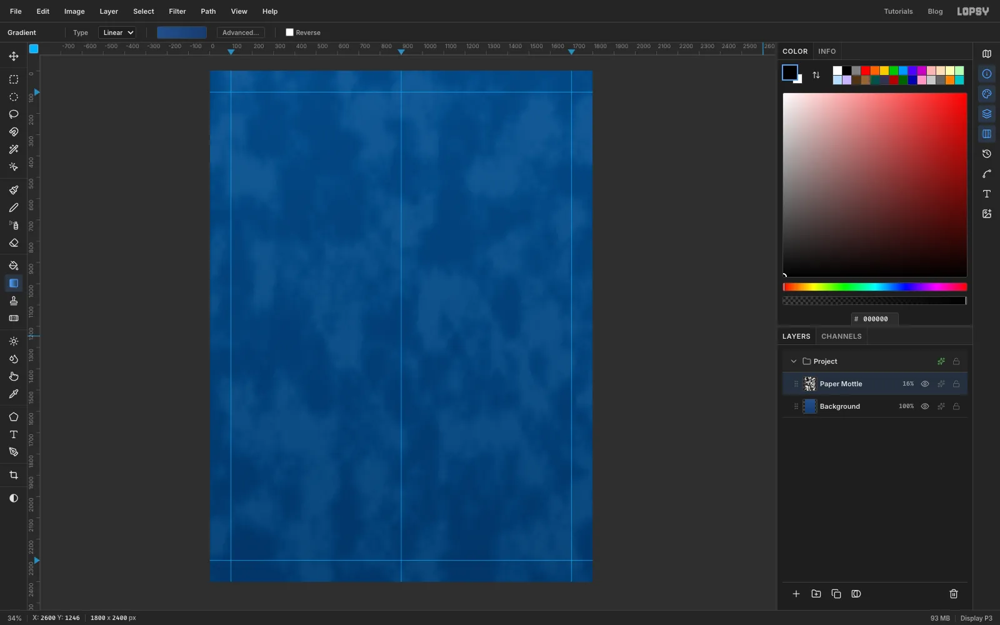

Rename **Layer 1** to **Paper Mottle**. Choose **Filter → Clouds…**, set
**Scale** to **14** and click **Apply**.

Open the layer's effects (the ✦ button on its row), set the blend mode to
**Soft Light** and close the drawer. Then lower the layer's opacity to
**16%**. The paper now has the uneven exposure of a real blueprint.

## Tile a blueprint grid

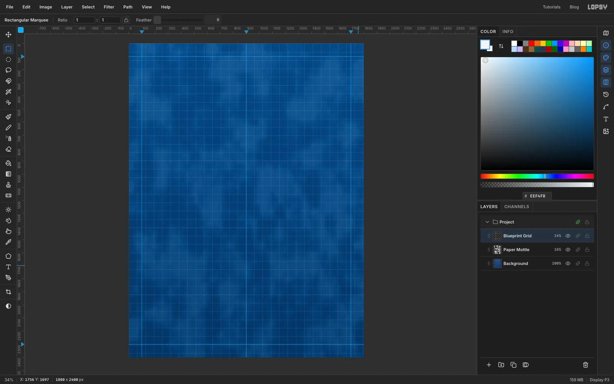

Add a layer called **Tile** and set the foreground to chalk `#EEF4F8`.

With the **Rectangular Marquee** and nothing selected, click once on the
canvas. The **Rectangular Selection** dialog opens: enter From **0, 0** To
**64, 2** and click **Select**, then choose **Edit → Fill**. Do the same for
From **0, 0** To **2, 64**. That's one grid cell with a line along its top and
left edges.

Select From **0, 0** To **64, 64** and choose **Edit → Define Pattern**.
Deselect with [[⌘D]] and delete the **Tile** layer.

Add a layer called **Blueprint Grid**, choose **Edit → Fill with Pattern…**,
pick the new pattern and click **Apply**. Lower the layer to **14%**.

## Burst rays behind the centrepiece

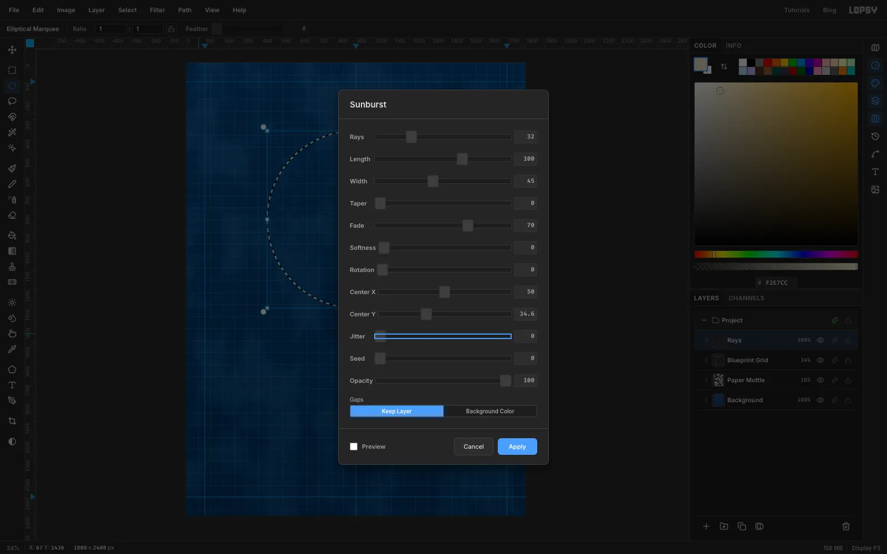

Add a layer called **Rays** and set the foreground to cream `#F2E7CC`.

Pick the **Elliptical Marquee** and click once on the canvas. Enter From
**430, 360** To **1370, 1300** for a circle centred where the triode will go.

Choose **Filter → Sunburst…** and set **Rays** **32**, **Width** **45**,
**Fade** **70** and **Center Y** **34.6** (that's 830 px down, the middle of
the circle). Leave **Center X** at 50 and click **Apply**. Deselect.

## Fade the ray tips with a layer mask

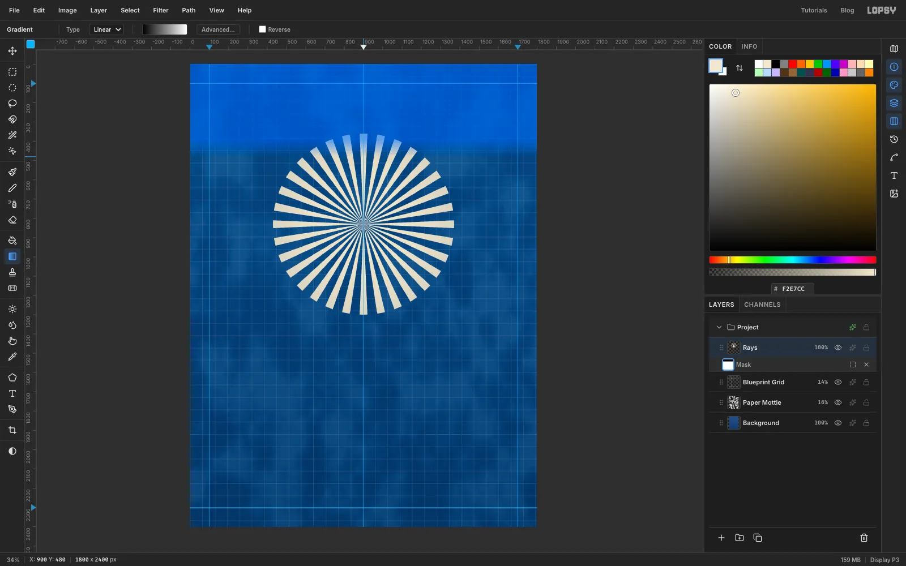

The rays mustn't run up into the title. Click **Add Mask** at the bottom of
the Layers panel, then click the new mask thumbnail to edit it. The canvas
shows masked areas in blue.

Pick the **Gradient** tool and set its stops to black `#000000` on the left
and white `#FFFFFF` on the right in **Advanced…**. Drag from about **y 390**
(just under where the header will end) straight down to about **y 480**.
Everything above that band is now hidden, and the rays fade in below it.

Click the **Rays** name to leave the mask, and set the layer to **30%**.

## Open a reference photo

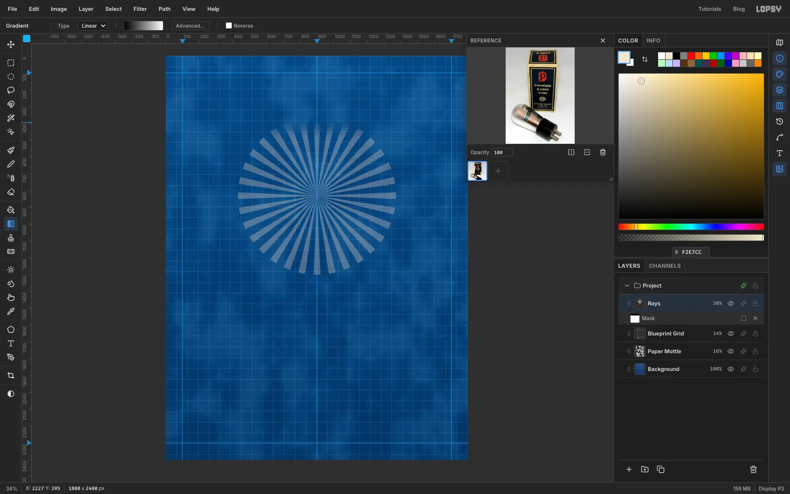

Click **Reference** on the panel toolbar, click the drop zone and choose a
photo of an old radio valve. The drawer floats next to the canvas so you can
check proportions while you draw: the 201-A has a round-topped glass
envelope with straight sides, a short dark base and two or four stubby pins.

You'll draw a flat tattoo version of it, so you won't trace anything.

## Select the glass envelope

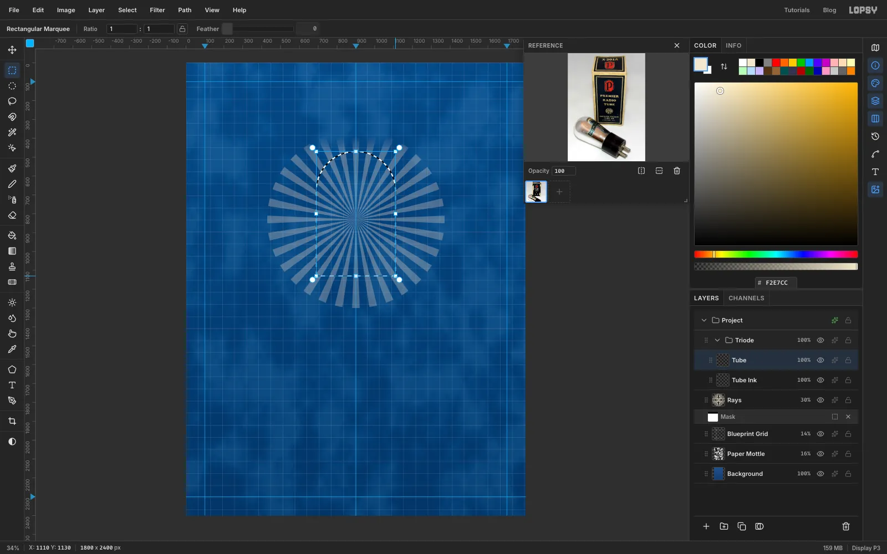

Click **New Group** and name it **Triode**. Inside it, click **Add Layer**
twice and name the layers **Tube Ink** (bottom) and **Tube** (top).

Turn off **View → Snap to Guides**. Small selections near the centre guide
would otherwise snap onto it.

With the **Elliptical Marquee**, click and enter From **690, 470** To
**1110, 890**. Switch to the **Rectangular Marquee**, hold [[Shift]] and drag
from **690, 680** down to **1110, 1130**. Shift adds the rectangle to the
circle, giving you a bullet shape.

## Fill the glass, base and pins

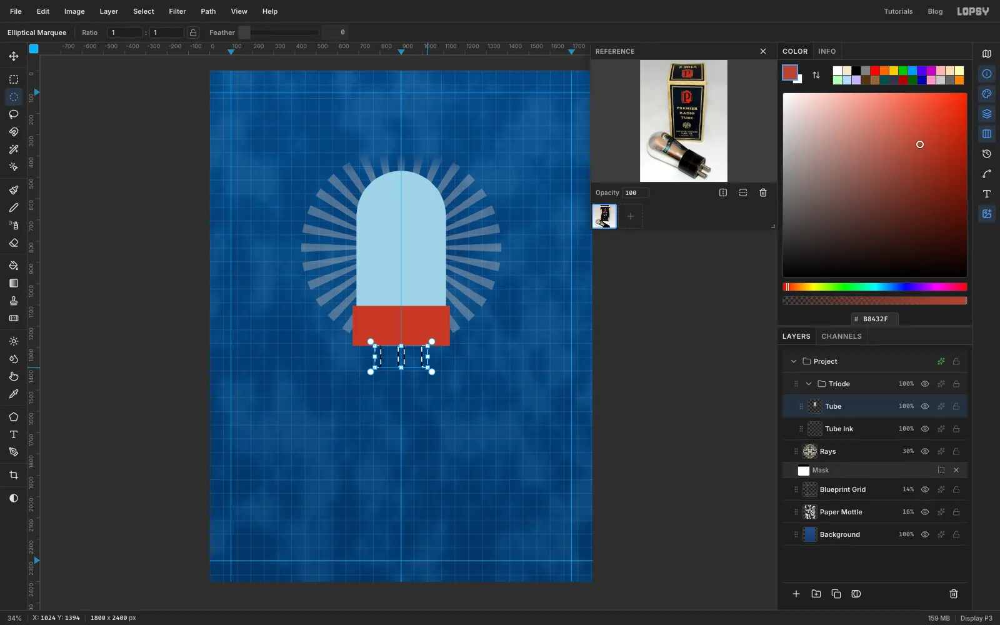

On **Tube**, choose **Edit → Fill** with glass `#A8D0E4`.

Deselect, click with the **Rectangular Marquee** and enter From **672, 1104**
To **1128, 1292** for the base. Fill it with flash red `#B8432F`.

For the pins, deselect and select a 28 px-wide strip from **776, 1292** to
**804, 1380**. Shift-drag two more strips, from **886** to **914** and from
**996** to **1024** across, over the same height. Switch to the **Elliptical
Marquee** and Shift-drag a 28 px circle over the bottom of each strip for a
rounded tip. Fill them with steel `#C9D2DA` and deselect.

## Grow the silhouette into an outline

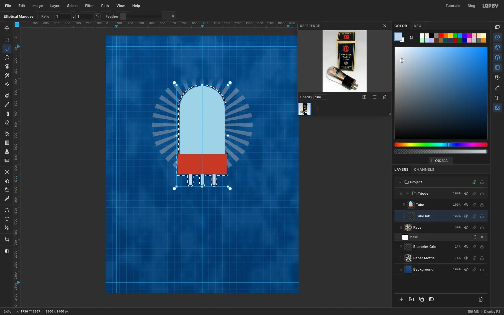

Hold [[⌘]] and click the **Tube** thumbnail in the Layers panel. That loads
the tube's whole shape as a selection.

Choose **Select → Grow…**, enter **12** and click **Apply**. The selection
now sits a fat line-width outside the drawing.

## Fill the ink outline

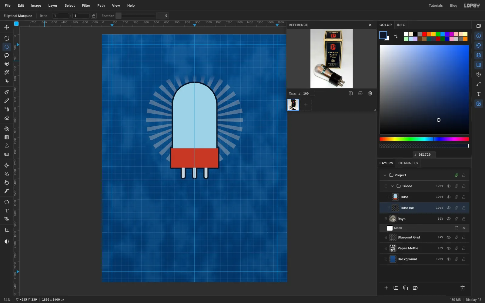

Click **Tube Ink** and fill the grown selection with ink `#0E1729`. Because
the ink sits on the layer *under* the colours, only a 12 px border shows. You
get a clean outline with no stroke to draw. Deselect.

You'll outline every other piece on the sheet the same way.

## Warm up the glass

Click **Tube** and add a layer called **Glass Glow**, so it sits above the
glass. Select the bullet shape again (the circle plus the Shift-added
rectangle, as before).

Set a **Radial** gradient from glow orange `#FF9A42` at full opacity to the
same orange at 0% opacity. Drag from the middle of the glass, around
**900, 820**, about 300 px downwards. Deselect and set the layer to **70%**.

## Draw the electrodes

Add two layers above **Glass Glow**: **Electrode Ink**, then **Electrodes**.

On **Electrodes**, use exact-corner selections and **Edit → Fill**:

- the mica spacer, a thin strip from **766, 552** to **1034, 574**, in chalk `#EEF4F8`;
- the plate, from **796, 610** to **1004, 1000**, in dark steel `#8FA3B5`;
- in steel `#C9D2DA`, two support rods from the plate down to the base (**836, 1000** to **848, 1108** and **952, 1000** to **964, 1108**) and two short posts up to the mica (**846, 574** to **856, 610** and **944, 574** to **954, 610**), Shift-adding each to the selection;
- a slot down the middle of the plate, from **870, 646** to **930, 966**, in ink.

⌘-click the **Electrodes** thumbnail, **Grow** by **6**, click **Electrode
Ink** and fill with ink.

## Light the filament

Add a layer called **Filament**. Pick the **Pencil**, set **Size** to **7**
and the colour to `#FFD98A`.

Click near the bottom left of the slot, then [[Shift]]-click at the top
centre and again at the bottom right. Shift-click draws straight lines, so
you get a thin inverted V.

Open the layer's effects and turn on **Outer Glow**: **Size** 34, **Spread**
20, **Opacity** 95, colour `#FF9A42`.

## Wind the grid coil

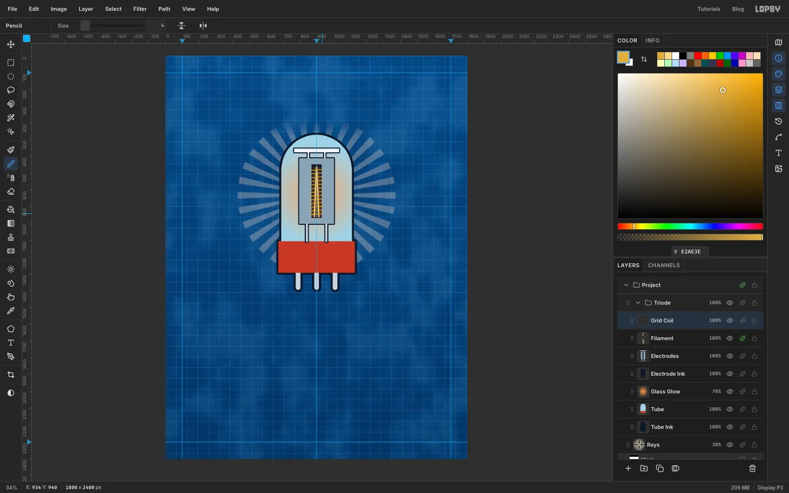

Add a layer called **Grid Coil**. Set the Pencil **Size** to **4** and the
colour to mustard `#E2AE3E`.

Draw short, very slightly slanted rungs across the slot: click just left of
the slot, Shift-click just right of it, then move down about 22 px and repeat
all the way down. This is the valve's control grid, wrapped around the
filament.

## Add a glass highlight

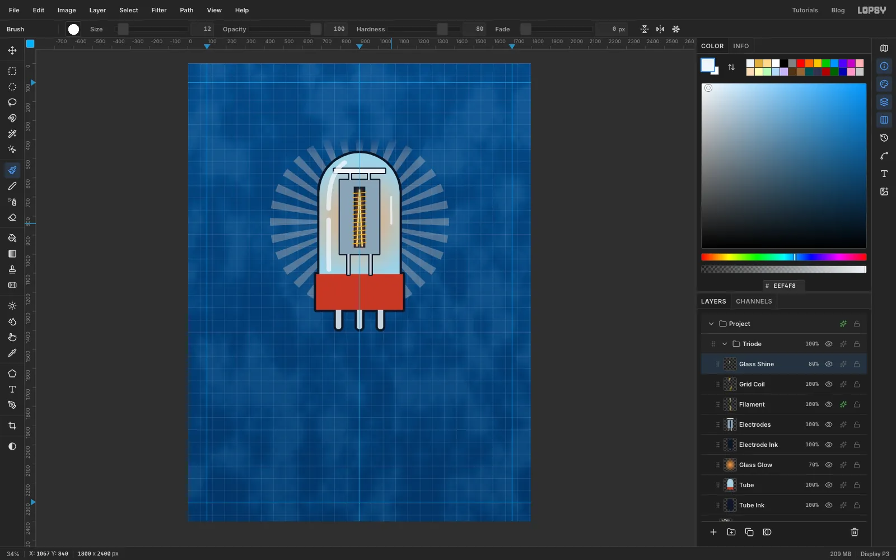

Add a layer called **Glass Shine**. Pick the **Brush** at **Size 26** with
chalk `#EEF4F8`.

Paint one curved stroke that starts on the dome near the top left and runs
down the left side of the glass. Leave a small gap and continue the stroke
down to just above the base. Switch to **Size 12** and add a short stroke
down the right side. Set the layer to **80%**.

## Shade the base

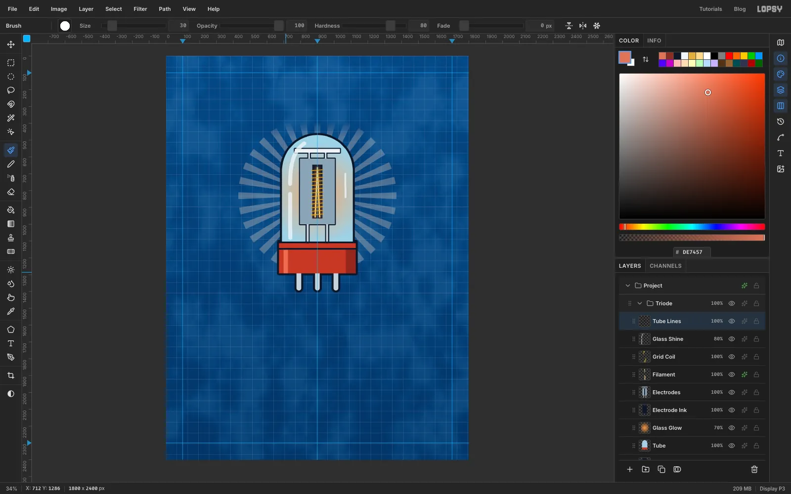

Add a layer called **Tube Lines**. With the Pencil at **Size 10** and ink,
Shift-click two horizontal lines across the top of the base, one along the
glass joint and one about 40 px lower. They read as the rim of the base.

Select the base below the lower line with the Rectangular Marquee. Painting
stays inside the selection. With the **Brush** at **Size 70**, paint one
vertical stroke of `#8A2F24` down the right edge. At **Size 30**, paint one
stroke of `#DE7457` down the left edge. Deselect.

## Lasso the ribbon banner

Add two layers above **Tube Lines**: **Banner Ink**, then **Banner**.

On **Banner**, use the **Lasso** to draw the two tails, which hang a little
lower than the band: a rectangle off each end with a V notch cut into its
outer edge. Hold [[Shift]] while you draw the second tail to add it. Fill
with `#D9C9A2`. Lasso a small triangle where each tail tucks under the band
and fill it with the darker `#9E8A62` for the fold.

Now lasso the band itself: a strip about 90 px tall from **x 610** to
**x 1190** that sags about 20 px in the middle.

## Outline the banner

Fill the band with cream `#F2E7CC` and deselect.

Outline it the usual way: ⌘-click **Banner**, **Grow** by **8**, and fill
ink on **Banner Ink**. Then click **Banner** again. With the Pencil at
**Size 7** in ink, Shift-click a short line down each end of the band where
it meets the tails.

Choose **Layer → Merge Down** and rename the result **Banner**, so the
banner and its outline become one layer you can copy later.

## Draw a curved baseline with the Pen

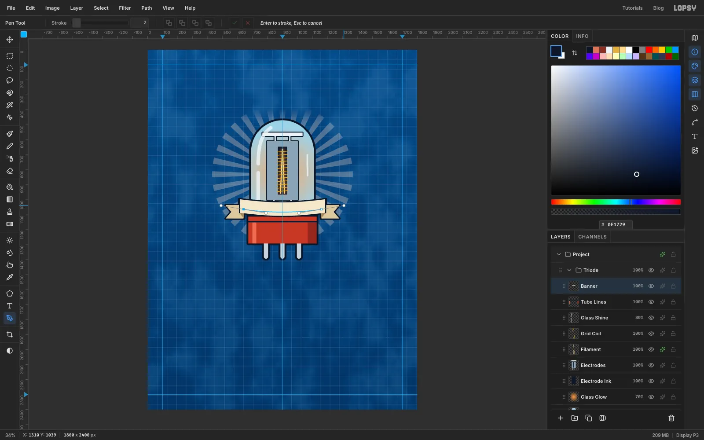

Pick the **Pen** tool. Press near the left end of the band (about
**640, 1064**) and drag down and to the right before releasing. That sets the
handle that bends the curve. Press near the right end (about **1160, 1064**)
and drag up and to the right.

The path should sag through the middle of the band, matching its curve.
Click the **✓** (Commit path) button in the options bar.

## Set the motto on the path

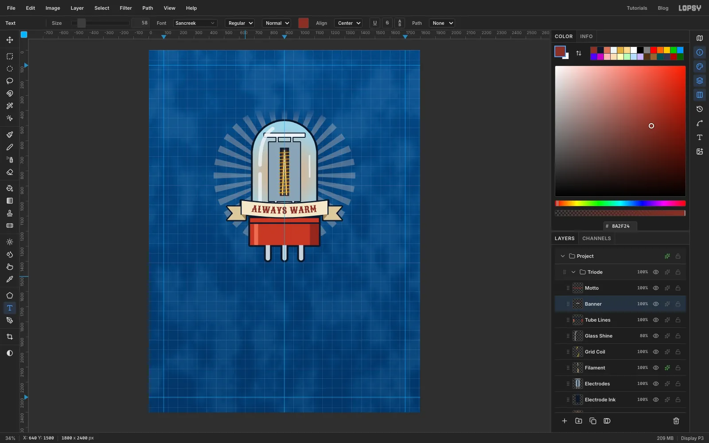

Pick the **Text** tool. Choose **Sancreek** at **Size 58** and colour
`#8A2F24`. Click in an empty part of the canvas, type **ALWAYS WARM** and
press [[Tab]] to commit. Rename the layer **Motto**.

With **Motto** selected, choose your new path in the options bar's **Path**
list, and the type jumps onto the curve. In the **Text** panel, set
**Letter spacing** to **4** and click **Align center**.

Letter spacing carries over to the next text you type. Select a raster layer
(**Banner** is fine) and set **Letter spacing** back to **0** before you
close the Text panel.

## Draw a lightning bolt

Collapse the **Triode** group and click **Rays**, so new layers go between
the rays and the triode. Add **Bolt Ink**, then **Bolt**.

With the **Lasso**, draw a classic zigzag bolt about 140 px wide and 380 px
tall to the left of the glass. Start at the top right, cut down-left to a
step, jog right, then run down to a sharp point at the bottom left. Fill it
with mustard `#E2AE3E`.

Outline it: ⌘-click **Bolt**, **Grow** by **9**, fill ink on **Bolt Ink**.
Then select **Bolt**, choose **Layer → Merge Down** and name the result
**Bolt L**.

## Duplicate and flip the bolt

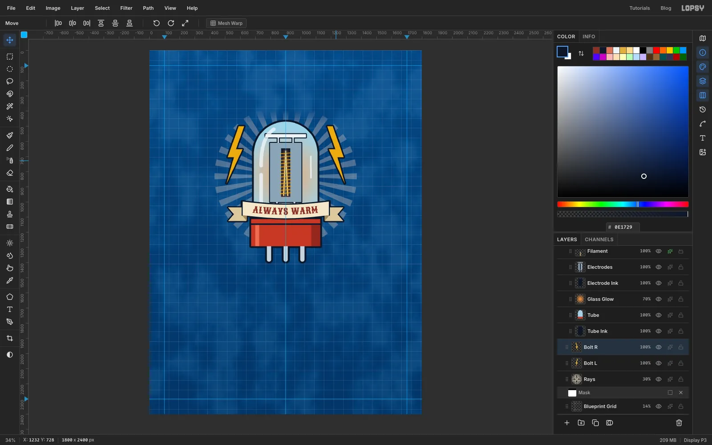

Choose **Layer → Duplicate Layer** and rename the copy **Bolt R**. Choose
**Image → Flip Horizontal**. The bolt flips in place.

Pick the **Move** tool and drag **Bolt R** straight across to the right of
the glass, the same distance from the centre guide as **Bolt L**.

## Try the triode lower

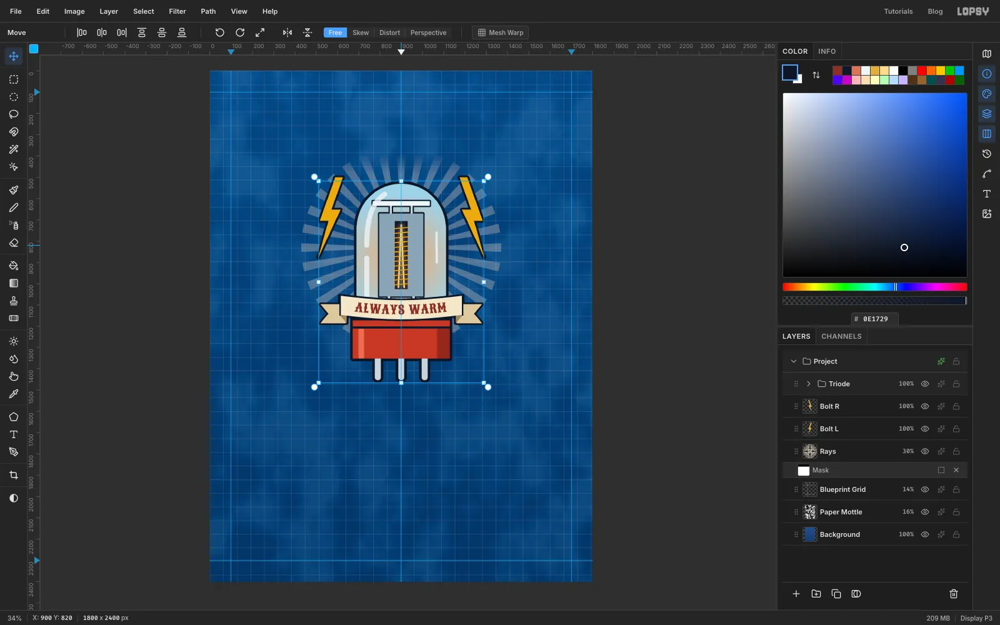

Because the valve is built inside **Triode**, you can try a different
placement in one move. Click the **Triode** group's row and drag down on the
canvas with the **Move** tool. Glass, electrodes, glow, banner and the motto
on its path all travel together.

Lower down, the glass drifts off the centre of the rays and the base crowds
the space for the bottom row. Press [[⌘Z]] to put it back where it was.

## Build the Nixie tube

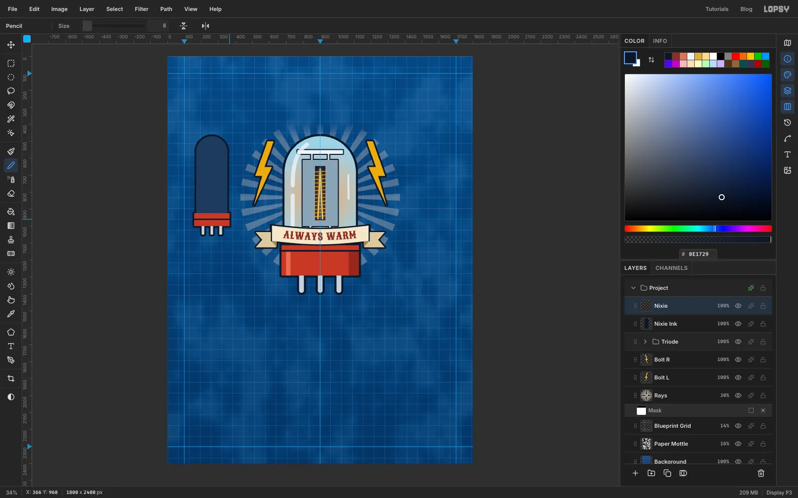

Click the **Triode** row and add **Nixie Ink**, then **Nixie**.

On **Nixie**, select a circle from **170, 470** to **354, 654** and Shift-add
a rectangle from **170, 562** down to **354, 930**. Fill it with smoky
`#23395A`. Select the base from **158, 924** to **366, 1000** and fill it
with flash red. Add three 16 px pins below the base in steel.

Outline it with **Grow 10** on **Nixie Ink**. Click **Nixie** again, set the
Pencil to **Size 8** in ink and Shift-click a seam across the middle of the
base.

The Nixie and the sparkles later on stay as loose layers rather than groups:
each is one small piece you won't need to move as a unit.

## Light the Nixie numeral

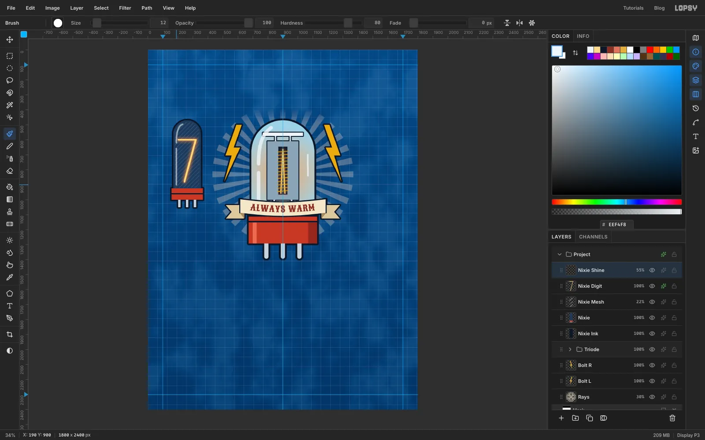

Add **Nixie Mesh**. Select a circle from **180, 480** to **344, 644** and
Shift-add a rectangle from **180, 562** to **344, 920**: the glass shape,
10 px inside its outline. With the Pencil at **Size 2** in chalk, Shift-click diagonal
lines about 26 px apart across the glass. The selection keeps them inside it.
Deselect and set the layer to **22%**.

Add **Nixie Digit**. With the Pencil at **Size 10** and `#FFD98A`, click,
Shift-click and Shift-click to draw a **7**: across the top, then a long
diagonal down. Give it **Outer Glow** at **Size** 30, **Spread** 25,
**Opacity** 100 in `#FF9A42`.

Add **Nixie Shine** and brush a thin chalk highlight down the left of the
glass at **Size 12**. Set it to **55%**.

## Cut the magic eye's shadow wedge

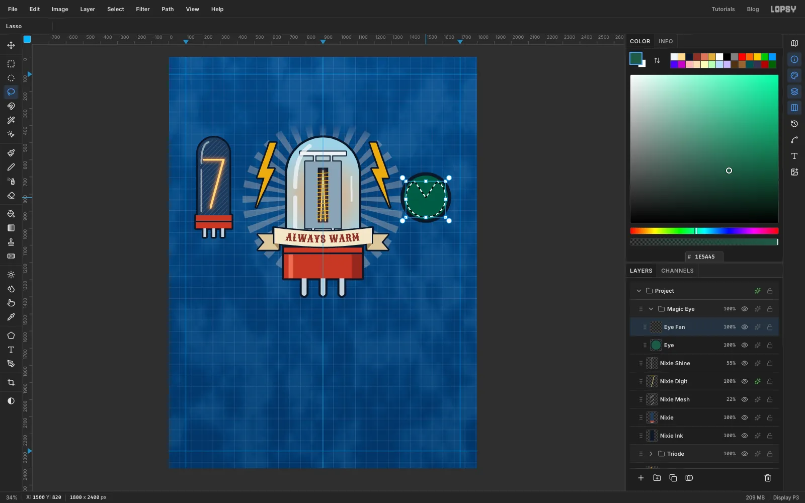

Click **New Group** and name it **Magic Eye**. Add a layer called **Eye**.
Fill a circle from **1352, 672** to **1648, 968** with ink. Fill a slightly
smaller circle, 20 px in on every side, with dark green `#1E5A45`.

Add a layer called **Eye Fan**. Select a circle from **1384, 704** to **1616, 936**, 32 px inside the ink ring.
Then pick the **Lasso**, hold [[⌥]] and draw a narrow pie wedge from the
centre out past the top of the circle. ⌥ subtracts it. This is the
shadow wedge that opens and closes on a real tuning eye.

## Fill the fan and tick the dial

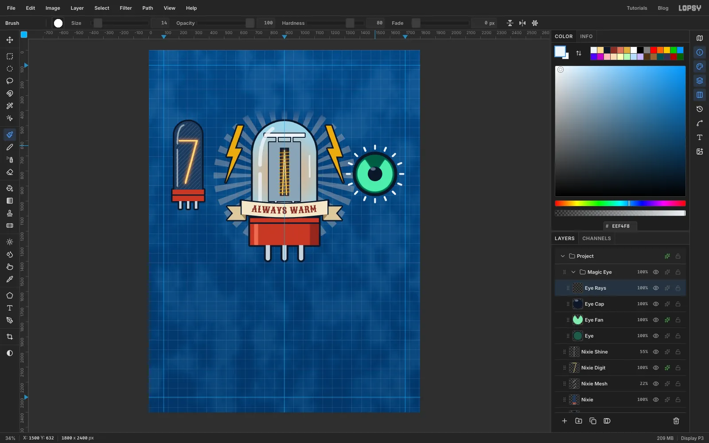

Fill the fan with mint `#7FEBB0`, deselect and give it a subtle **Outer
Glow** (Size 16, Spread 10, Opacity 70) in the same mint.

Add **Eye Cap**. Fill a 96 px circle at the centre with ink and a small oval
near its top left with `#5D6B82` as a highlight.

Add **Eye Rays**. Pick the **Brush**, click **Radial Symmetry** in its
options bar and set **Segments** to **16**. [[⌘]]-click the centre of the eye
to move the symmetry centre there. With the Brush at **Size 14** in chalk,
drag one short stroke straight up above the ring. All 16 tick marks appear at
once. Turn **Radial Symmetry** off again.

## Draw the heart

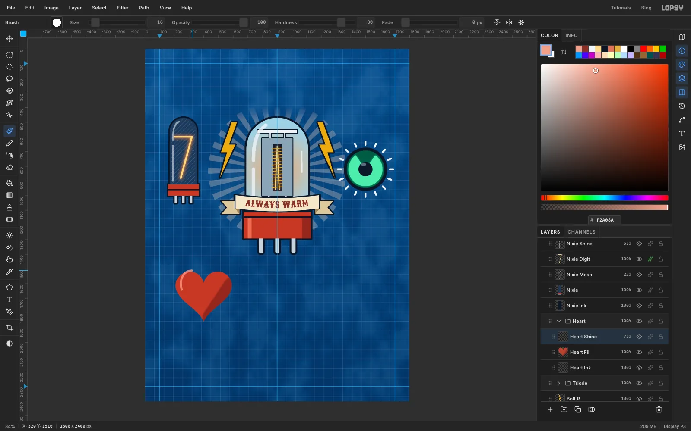

Collapse the groups, click the **Triode** row and click **New Group**. Name
it **Heart** and add **Heart Ink** and **Heart Fill**.

On **Heart Fill**, use the **Lasso** to draw a heart about 380 px wide with
its centre around **400, 1660**, and fill it with flash red. Keep the selection
active. With the Brush at **Size 150** in `#8A2F24`, sweep one stroke down
the right side. The selection keeps the shading inside the heart. Deselect.

Add **Heart Shine** and brush a thin curved highlight at **Size 16** in coral
`#F2A08A` round the upper left lobe. Set the layer to **75%**.

## Rotate a bolt through the heart

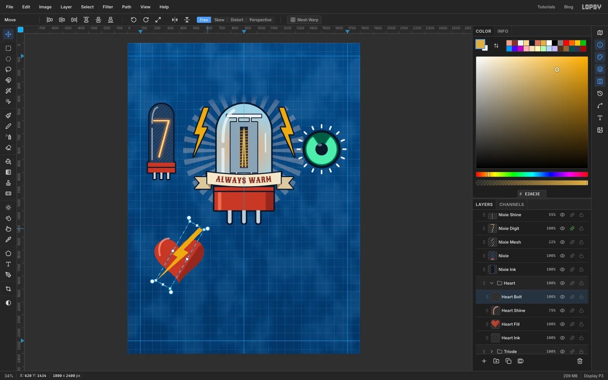

Add a layer called **Heart Bolt** and lasso a tall, thin bolt (about 140 ×
520 px) standing upright over the heart. Fill it with mustard.

Draw a Rectangular Marquee around the bolt, switch to the **Move** tool and
hover just outside a corner handle until the cursor becomes a curved arrow.
Hold [[⌘]] to snap to 15° steps and drag the corner round by two steps, to
**30°**. Press [[Enter]] to commit.

## Outline the heart and bolt together

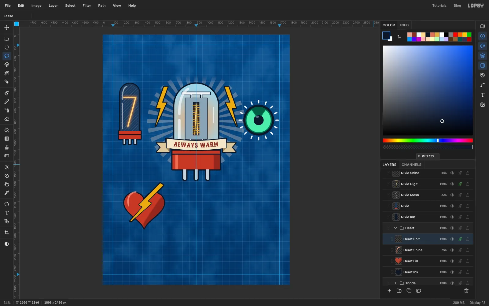

Lasso the bolt's bottom tip, below where the banner will cross the heart,
and press [[Delete]]. Deselect.

⌘-click the **Heart Bolt** thumbnail. Then pick the **Lasso**, hold
[[Shift]] and trace the heart's outline to add it to the selection. **Grow**
by **10**, click **Heart Ink** and fill with ink.

The bolt also needs its own edge where it crosses the heart. Open **Heart
Bolt**'s effects and turn on **Stroke** at **Width 6** in ink.

## Paste a copy of the banner

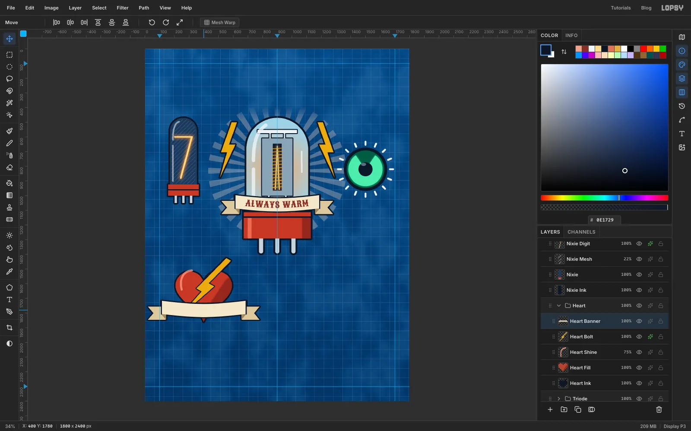

Expand **Triode** and click **Banner**. Draw a Rectangular Marquee around the
banner and its tails, and press [[⌘C]]. Deselect, collapse **Triode**, expand
**Heart** and click **Heart Bolt**.

Press [[⌘V]]. The copy lands on a new layer directly above **Heart Bolt**.
Rename it **Heart Banner**, deselect, and drag it with the **Move** tool down
over the lower part of the heart.

## Scale the banner to fit

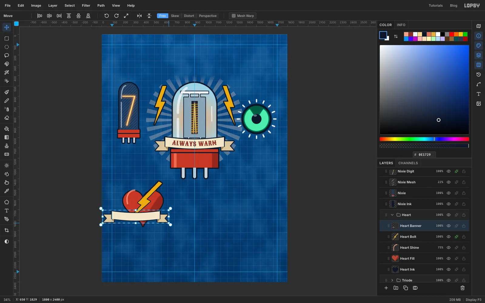

The full-size banner overhangs the heart. Draw a marquee around the pasted
banner, then with the **Move** tool hold [[⌘]] and drag the bottom-right
corner handle inwards. ⌘ keeps the proportions. Stop when the tails sit just
inside the heart's edges (about 82% of the original width) and press
[[Enter]].

Nudge the banner with the arrow keys until it's centred on the heart.

## Letter the heart's banner

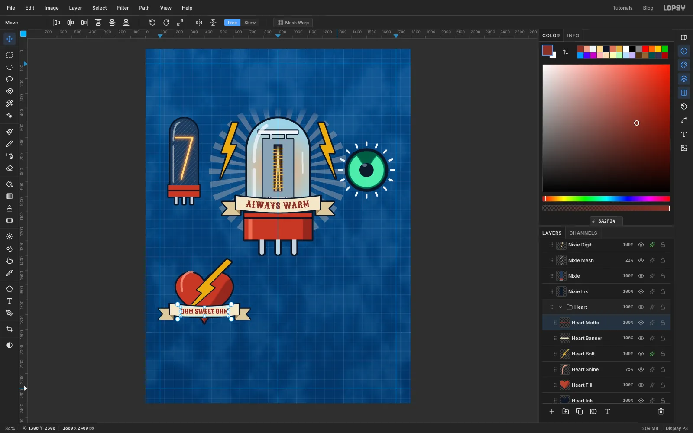

With the **Text** tool, choose **Sancreek** at **Size 44** in `#8A2F24`.
Click in empty canvas, type **OHM SWEET OHM** and press [[Tab]]. Rename it
**Heart Motto**.

Switch to the **Move** tool and nudge the text onto the banner with the arrow
keys ([[Shift]] moves 10 px at a time). Centre it left to right, and leave
the same space above the capitals as below them.

## Split a nautical star

Collapse **Heart**, click its row and add a **New Group** called **Star**
with **Star Ink** and **Star Fill** inside it.

On **Star Fill**, lasso a five-point star centred on **900, 1716**, with
points about 175 px from the centre, and fill it with flash red.

For the two-tone points, lasso a thin triangle from the centre to each tip
and back along the tip's left edge. Hold [[Shift]] to add each one. Fill them
with cream `#F2E7CC`.

Outline the star with **Grow 9** on **Star Ink**. Then click **Star Fill**,
and with the Pencil at **Size 6** in ink, draw a spoke from the centre to each
outer point.

## Draw one orbit ring

Collapse **Star**, click its row and add a **New Group** called **Atom**
with a layer called **Orbit A** inside it.

Use exact-corner ellipses centred on **1400, 1660**:

1. 480 × 164, filled with ink;
2. 460 × 144, filled with mustard;
3. 432 × 116, filled with ink;
4. 412 × 96, then press [[Delete]].

That's a mustard ring with an ink line on both edges.

## Rotate copies of the orbit

Choose **Layer → Duplicate Layer** and rename the copy **Orbit B**. Draw a
marquee around the ring, switch to the **Move** tool, then hold [[⌘]] and drag a corner rotation handle
round **60°** (four 15° steps). Press [[Enter]].

Click **Orbit A** again, duplicate it as **Orbit C** and rotate it **−60°**.

## Add the nucleus and electrons

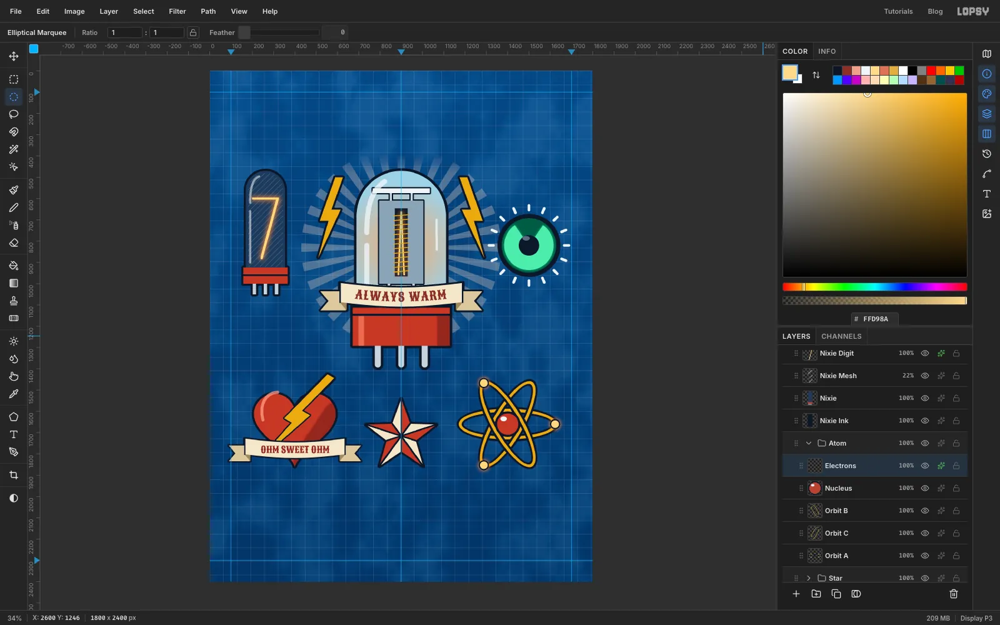

Click **Orbit B**, the top orbit layer, so the next layers go above all
three rings. Add **Nucleus**: an ink circle 120 px across with a red circle
inside it and a small chalk highlight.

Add **Electrons**. Select three 36 px circles on the tips of different
orbits, adding with [[Shift]]. Fill with `#FFD98A`, then turn on **Stroke**
(Width 6, ink) and **Outer Glow** (Size 22, Spread 15, Opacity 90, orange).

## Scatter sparkle fillers

Collapse **Atom**, click its row and add **Sparkles Ink** and **Sparkles**.

Lasso three four-point sparkles with concave sides in the empty space below
the Nixie: a big one, a medium one and a small one, adding with [[Shift]].
Fill them with mustard, outline them with **Grow 7** on **Sparkles Ink**,
then select **Sparkles**, **Merge Down** and rename the layer **Sparkles L**.

## Copy, flip and turn the sparkles

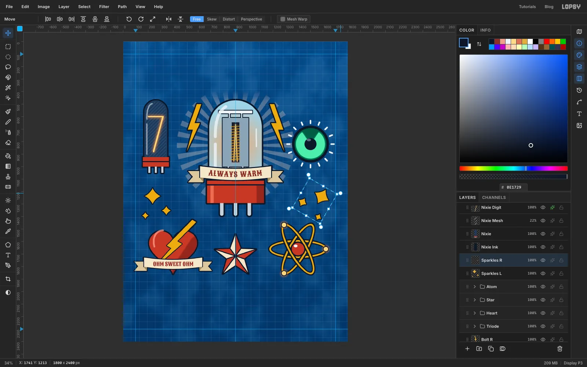

Marquee the cluster, press [[⌘C]], deselect and press [[⌘V]]. Rename the
paste **Sparkles R** and deselect.

Choose **Image → Flip Horizontal**, then drag the copy across with the
**Move** tool into the gap above the atom. An exact mirror looks mechanical,
so draw a marquee round it and ⌘-rotate it **30°**. Press [[Enter]].

## Letter the title

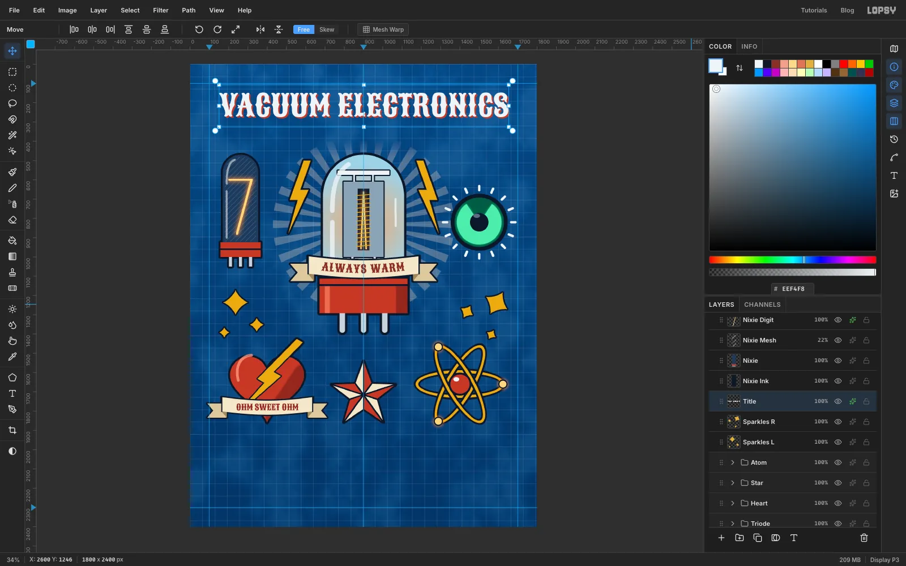

Click **Sparkles R** so no text layer is selected. With the **Text** tool,
choose **Sancreek** at **Size 156** in chalk, click in empty canvas and type
**VACUUM ELECTRONICS**. Press [[Tab]] and rename it **Title**. At that size
it fills the width between the margin guides. Nudge it until it's centred on
the centre guide, around **y 210**.

Give it a hard **Drop Shadow** in flash red `#B8432F`: **Offset X** 7,
**Offset Y** 7, **Blur** 0, **Opacity** 100. This is the classic
flash-lettering shadow.

## Add the subtitle and header rules

Click **Sparkles R** again and type the subtitle in **Architects Daughter**
at **Size 40**: **flash sheet no. 7 · valves, tubes & other glowing things**.
Rename it **Subtitle** and centre it under the title.

Add a layer called **Header Rules**. With the Pencil at **Size 4** in chalk,
Shift-click a double rule across the top margin (at **y 100** and **y 116**)
and a single rule under the subtitle at **y 384**.

## Draw the construction lines

Add a layer called **Construction**. With the Pencil at **Size 3** in chalk:

- Draw a dash-dot centre line down the triode's centre guide: alternate a
  34 px dash, a 12 px gap, a dot and
  another 12 px gap. Stop at the top of the banner and start
  again below it, so the line never crosses the motto.
- Draw small crosshairs on the centres of the magic eye, the star and the atom.
- Under the triode, draw extension lines down from the base's corners at
  **x 672** and **x 1128** (from **y 1306** to **y 1440**) and a dimension
  line between them at **y 1424**.
- Above the magic eye, draw extension lines at **x 1352** and **x 1648**
  (from **y 572** to **y 720**) and a dimension line at **y 590**.
- Beside the Nixie, draw short ticks at **y 460** and **y 1060** and a
  vertical dimension line at **x 128** between them. Leave a gap from
  **y 686** to **y 834** for a label.

Set the layer to **70%**. Add **Arrowheads** and lasso a small triangle on
each end of each dimension line, pointing outwards, adding with [[Shift]].
Fill them with chalk.

## Label each figure

Click **Header Rules** before each label. In **Architects Daughter** at
**Size 30** in chalk, type each caption in empty canvas, press [[Tab]],
rename it (**Fig 1** to **Fig 6**), then nudge it into place with the Move
tool:

- **FIG. 1 — 201-A TRIODE, 1-3/4 IN. BASE** just under the triode's dimension line;
- **FIG. 2 — NUMERAL** and **FIG. 3 — MAGIC EYE** on one shared line under the Nixie and the eye;
- **FIG. 4 — OHM SWEET OHM**, **FIG. 5 — NAUTICAL STAR** and **FIG. 6 — ELECTRON** on one line, about 50 px under the bottom row.

At **Size 26**, add **Ø 2-1/4 IN.** centred above the magic eye's dimension
line and name it **Eye Dim**.

## Turn the height label sideways

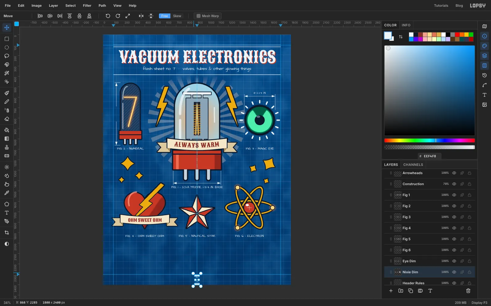

Click **Header Rules**, type **4-1/2 IN.** at **Size 24** and name it
**Nixie Dim**. Draw a marquee around it, then with the
**Move** tool ⌘-drag a corner rotation handle **−90°** so it reads bottom to
top. Press [[Enter]] and nudge it into the gap you left in the Nixie's
height line. The text stays editable after rotating.

## Rule the title block

Add a layer called **Title Block**. With the Pencil at **Size 4** in chalk,
Shift-click a rectangle from the left to the right margin, from **y 2010**
down to the bottom margin. Split it with a vertical line at **x 1120**.

Right of that line, Shift-click horizontal lines at **y 2107** and
**y 2203**, and a vertical line at **x 1410** from **y 2107** down to the
bottom. That leaves one cell across the top and four below it.

## Letter the title block

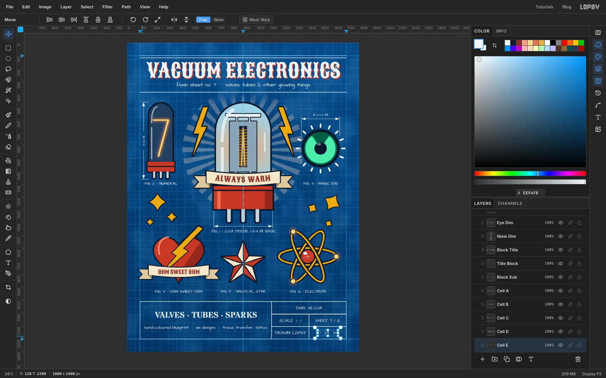

Click **Header Rules**. In the left cell, type **VALVES · TUBES · SPARKS** in
**Stardos Stencil**, weight **Bold**, at **Size 64**, and name it
**Block Title**. Under it, at **Size 32** in Architects Daughter, type
**hand-coloured blueprint · six designs · trace, transfer, tattoo** and name
it **Block Sub**.

Fill the cells at **Size 32**, clicking **Header Rules** before each one:
**DWG. VE-201A**, **SCALE 1 : 1**, **SHEET 7 / 12**, **DRAWN: LOPSY** and
the date. Name them **Cell A** to **Cell E** and centre each one in its cell.

## Add a vertical margin note

Click **Header Rules** and, at **Size 26**, type **TRACE ONLY · NOT TO
SCALE FOR SKIN · REV. B**. Name it **Margin Note**.
Rotate it **−90°** with a marquee and a ⌘-drag on a corner handle, the same
way as the height label. Press [[Enter]] and centre it in the left margin,
halfway down the sheet.

## Age the edges and finish

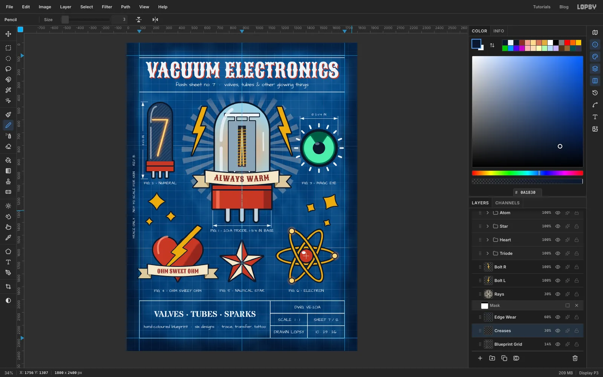

Click **Blueprint Grid** and add a layer called **Edge Wear**. With the
**Lasso**, draw a slightly wobbly rectangle just inside the margins. Choose
**Select → Inverse**, then **Select → Feather…** at **63**, and fill with
`#08152B`. Deselect, set the blend mode to **Multiply** and the opacity to
**60%**. The edges darken unevenly, like a print that has been handled.

Add a layer called **Creases**. With the Pencil at **Size 3**, Shift-click a
chalk line across the full width at **y 800** and **y 1600**. Add a dark
`#0A1830` line 4 px below each one. Choose **Filter → Gaussian Blur…** at
**1.5** and set the layer to **30%**. The sheet now looks folded in thirds.

Deselect, hide the guides with **View → Show Guides**, and choose **File →
Quick Export PNG**. Save the project with **File → Save Project** too, so the
banners, curved type and labels stay editable.
