Before photocopiers, engineers copied their drawings as **cyanotypes**. The drawing was pressed against paper coated with iron salts and left in the sun. Wherever the ink blocked the light, the paper stayed white, and everything else turned a deep Prussian blue. That's where the white-on-blue blueprint look comes from, along with its little imperfections:

- blotchy, streaky blue where the coating went on unevenly
- a darker edge where the sheet got more sun
- white lines that bleed very slightly into the blue
- a ruled border, a title block in the corner, and notes added later in coloured pencil

This invitation uses all of that for a happy occasion. The Friends of Alderbrook Mill are re-commissioning their restored 1827 overshot waterwheel. The card is 2100 × 1500 px (7 × 5 inches at 300 dpi). The left side is a technical drawing of the wheel. The right column holds the invitation, a cyanotype photo of the wheel "as found", the date and an engineering title block.

You'll need one photo from Wikimedia Commons: **Peirce Mill Water Wheel.jpg** by Bonnachoven, released under **CC0** (public domain). It shows a wooden wheel against a stone mill wall. Download any version wider than 2100 px. Lopsy fits it to the card when you drop it in.

The tools you'll use:

- the **Shape** tool's click-to-size dialog for exact circles and rectangles
- the **Brush** with **Radial Symmetry**, and a custom **dash-dot brush** made with **Edit → Define Brush…**
- the **Pencil**, with [[Shift]]-click for straight lines
- the **Pen** tool for curves and triangles, and **Path to Selection**
- the **Rectangular** and **Elliptical Marquee** exact-corners dialogs, **Select → Feather / Inverse**, and [[Shift]]-drag to add to a selection
- **Edit → Define Pattern** and **Fill with Pattern…** for the grid and the earth hatching
- **Clouds**, **Fibers**, **Gaussian Blur**, **Add Noise**, **Desaturate** and **Brightness/Contrast**
- the **Move** tool's scale and rotate handles and its **Rotate 90°** buttons, **Duplicate Layer** and **Merge Down**
- live text in four Google fonts: **League Gothic**, **Cormorant Garamond**, **Overpass Mono** and **Reenie Beanie**
- layer effects (**Stroke** and **Outer Glow**), and the **Soft Light**, **Multiply**, **Overlay** and **Screen** blend modes
- groups, and the root group's **Color Grading** and **Hue / Saturation** adjustments

The palette is cyanotype blue, white line and one red pencil:

- Prussian paper `#2B457A`, edge burn `#15254C`, photo backing `#0C2B57`
- Line white `#DFE9F3`
- Water `#B2D5FB`, hatch `#D3E3FC`
- Red pencil `#FF6B4A`
- Grain grey `#808080` (only for the noise layer)

> **Tip:** On a wide-gamut (Display P3) screen, Lopsy reads typed hex codes as P3 colours. These codes were picked as P3 values. On an sRGB screen they come out a touch duller.

> **Note:** Shortcuts are written for a Mac. On Windows use [[Ctrl]] wherever it says [[Cmd]]. Many steps give positions as x, y in document pixels. Read them off the rulers, or watch the X / Y readout in the status bar as you move the pointer.

## Coat the paper

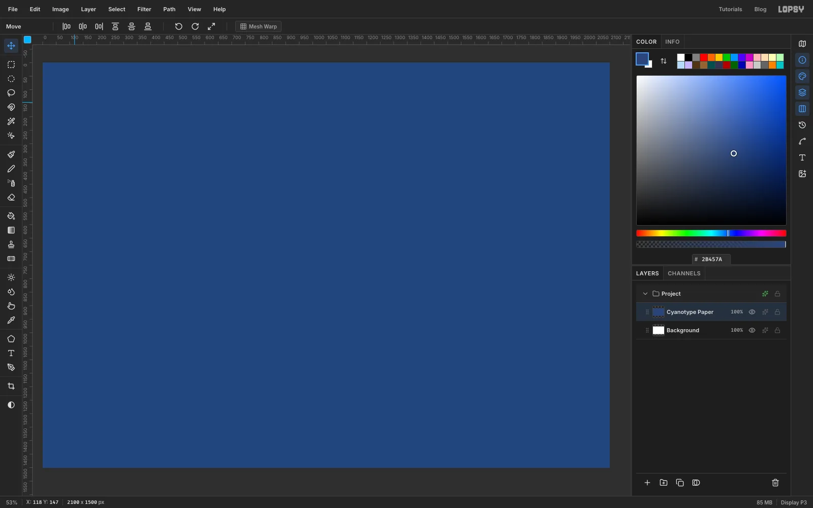

Choose **File → New**, keep the units on **Pixels**, and make the document **2100** wide and **1500** high.

Click *Layer 1*, double-click its name and rename it *Cyanotype Paper*. Set the foreground to `#2B457A` and choose **Edit → Fill**. Leave the white *Background* layer underneath. It never shows.

## Mottle the coating and burn the edges

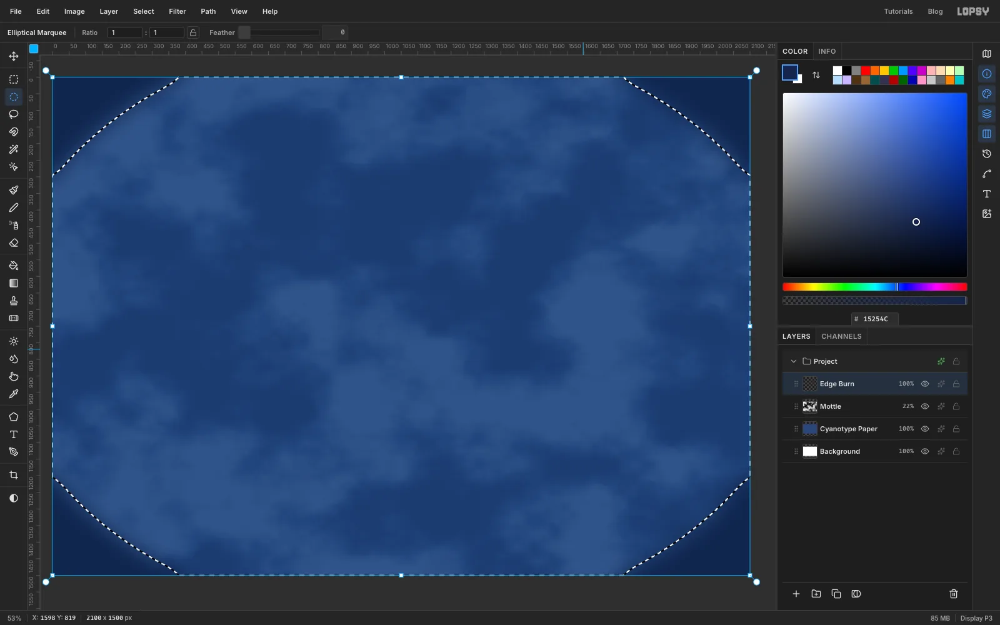

Hand-coated paper is never even. Click **Add Layer** and name the layer *Mottle*. Choose **Filter → Clouds…** with **Scale 9**. Open the layer's effects with the sparkle button on its row, set the blend mode to **Soft Light**, close the drawer, and set the layer's opacity to **22%**.

Now darken the edges. Add a layer called *Edge Burn* and fill it with `#15254C`. Pick the **Elliptical Marquee** and click once on the canvas without dragging. The exact-size dialog opens. Set **From** to **-160, -140** and **To** to **2260, 1640**, and press [[Enter]]. The ellipse is bigger than the canvas, so only its curves cut across the corners. Choose **Select → Feather…** at **63**, the most it softens, and press [[Delete]]. The blur in the next step does the rest.

## Soften the burn and add fibres

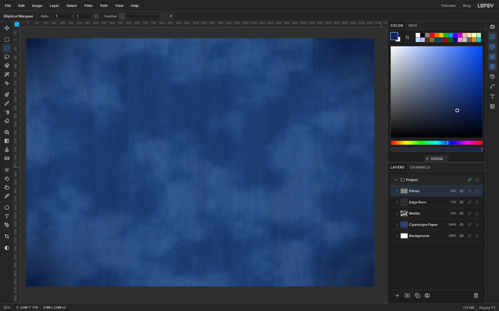

Deselect with [[Cmd+D]], then run **Filter → Gaussian Blur…** at **140** so the burn fades smoothly into the middle. Set *Edge Burn* to **Multiply** at **75%**.

The coating was brushed on, so add the brush marks. Add a layer called *Fibres*, run **Filter → Fibers…** with **Variance 24** and **Strength 6**, and set it to **Overlay** at **16%**. You get faint vertical streaks, like emulsion dragged across the sheet.

## Draw one square of graph paper

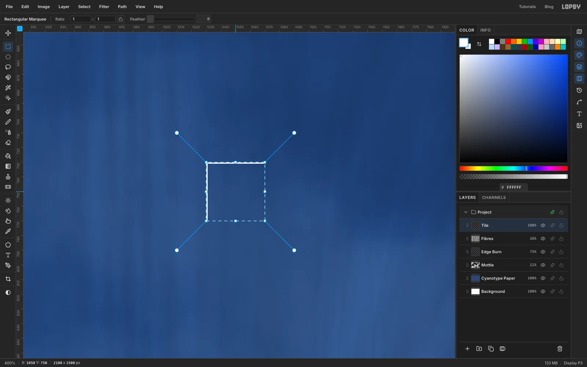

The grid is a pattern made from one 40 px square. Add a layer called *Tile*. Pick the **Pencil**, set **Size 1** and the foreground to white `#FFFFFF`.

Zoom in so you can place single pixels. Choose **View → Actual Size**, then **View → Zoom In** three times. In the middle of the canvas, draw an L:

1. Click at **1030, 730** and [[Shift]]-click at **1030, 769** for the left edge.
2. Click at **1031, 730** and [[Shift]]-click at **1069, 730** for the top edge.

Pick the **Rectangular Marquee**, click once and enter **From 1030, 730** and **To 1070, 770**. That's exactly 40 × 40 px, with the L on its top and left edges, hidden under the marching ants. Choose **Edit → Define Pattern**.

## Fill the drawing panel with the grid

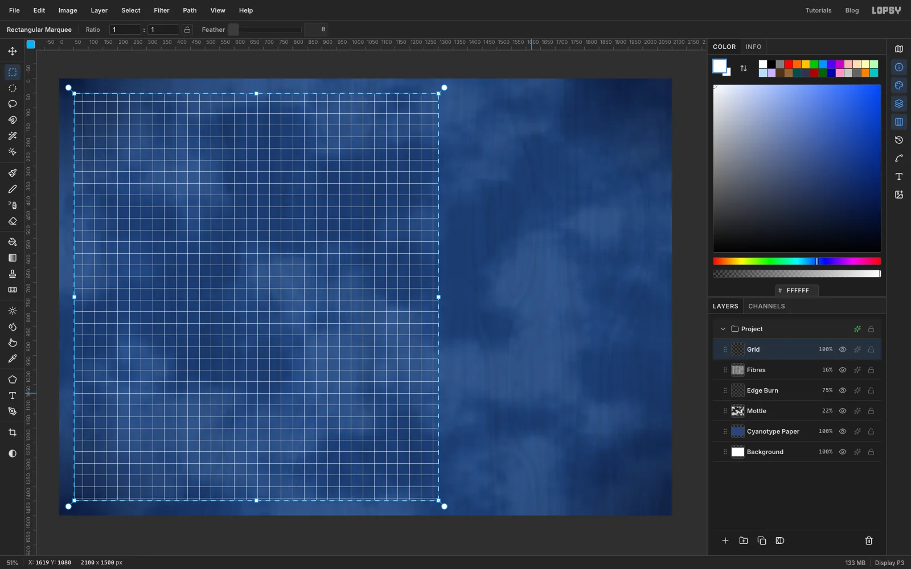

Choose **View → Fit to Screen** and deselect. Delete the *Tile* layer with the bin button at the bottom of the Layers panel.

Add a layer called *Grid*. Click the canvas with the **Rectangular Marquee** and enter **From 52, 52** and **To 1300, 1448**. This is the drawing panel. The right-hand column stays plain for the text. Choose **Edit → Fill with Pattern…**, pick the **40×40** pattern and click **Apply**. Deselect and set *Grid* to **18%** opacity.

## Rule the sheet frame

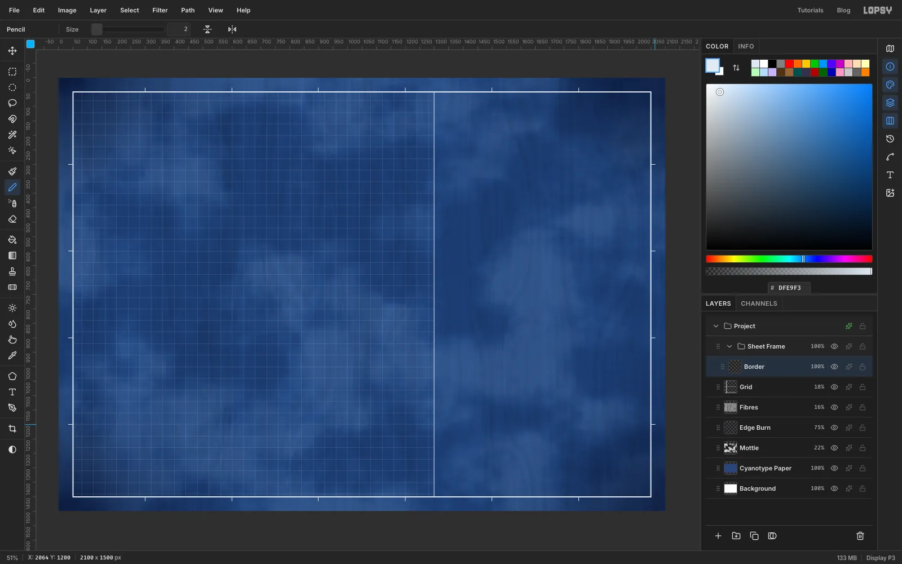

Click **New Group** in the Layers panel and name it *Sheet Frame*. Add a layer inside it called *Border*. Pick the **Shape** tool and set:

- **Shape** to **Rectangle**
- **Fill** to none (click the fill swatch and choose **Remove fill**)
- **Stroke** to line white `#DFE9F3`, **Width 4**

Click once at the exact centre of the canvas, **1050, 750**, without dragging. In the **Shape Size** dialog, enter **2000** × **1400** and press [[Enter]]. The frame lands 50 px in from every edge, at x 50 and 2050 and y 50 and 1450.

Pick the **Pencil** at **Size 2** with `#DFE9F3`. Click on the top edge of the frame at x **1300** and [[Shift]]-click straight down on the bottom edge to divide the sheet. Then add short zone ticks just outside the frame: at x **300, 600, 900, 1200, 1500** and **1800** on the top and bottom edges, and at y **300, 600, 900** and **1200** on the left and right edges. Each tick is a click on the frame and a [[Shift]]-click 14 px outward.

## Draw the shrouds and the sole

Click *Grid* and make a **New Group** called *Wheel Drawing*. Because *Grid* was active, the group sits above it and below the frame. Add a layer inside the group called *Rims*.

The wheel's hub sits at **700, 770**. Keep the **Shape** tool, switch **Shape** to **Ellipse**, keep the fill off and the stroke white. Click the hub point each time and type the size into the dialog:

1. **Width 6**, **840 × 840**: the outer edge of the shroud
2. **Width 2**, **812 × 812**: the inner edge of the shroud
3. **Width 5**, **700 × 700**: the sole, where the buckets start

The shape tool draws from the point you click, so all three circles share one centre.

## Add the hub and the axle

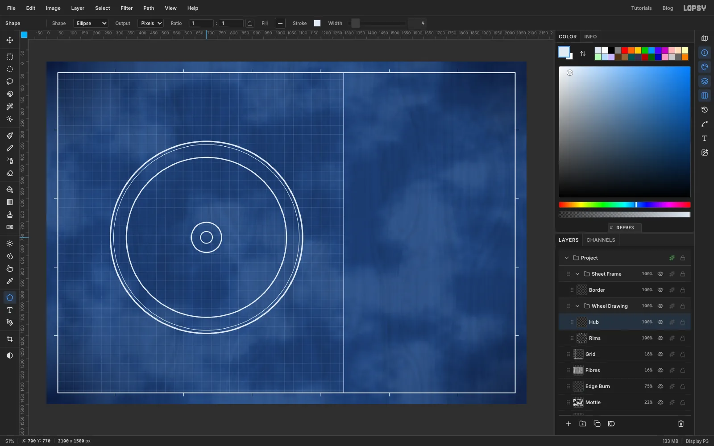

Add a layer called *Hub*. Click the hub point again and make a **132 × 132** circle at **Width 5**. Then make a **52 × 52** circle at **Width 4** for the axle.

## Paint 32 buckets with radial symmetry

Pick the **Brush** and choose **Hard Round** from the brush presets. Set **Size 4** and the foreground to `#DFE9F3`. In the Brush options bar, click **Radial Symmetry** and set **Segments** to **32**.

Add a layer called *Buckets*. Hold [[Cmd]] and click the centre of the hub. That moves the symmetry centre to 700, 770 without painting. Now draw one bucket at the top of the wheel:

1. Click on the sole straight above the hub, at **700, 420**.
2. [[Shift]]-click **34 px** further out, at **700, 386**.
3. [[Shift]]-click up to the outer shroud a little to the right, at about **751, 356**.

Every click is repeated 32 times around the wheel, so one bent board becomes a full ring of buckets.

## Paint the eight arms

Add a layer called *Arms* and change **Segments** to **8**. Each arm is a pair of parallel lines 20 px apart:

1. Click just outside the hub at **690, 705** and [[Shift]]-click on the sole at **690, 420**.
2. Click at **710, 705** and [[Shift]]-click at **710, 420**.

Symmetry turns the one vertical arm into eight.

## Bolt the hub

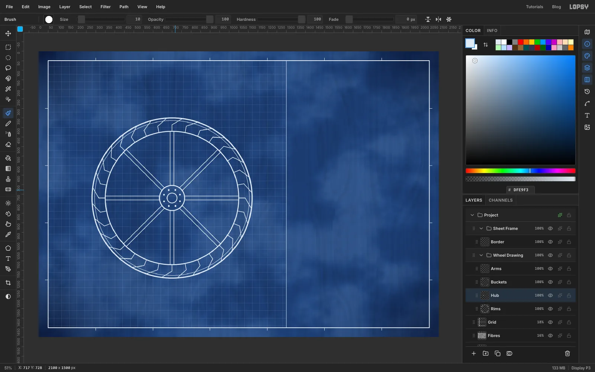

Click the *Hub* layer, set the brush **Size** to **10** and click once at **717, 728**, a little above and to the right of the axle. Symmetry places all eight bolts. Click **Radial Symmetry** again to turn it off.

## Make a dash-dot brush for centre lines

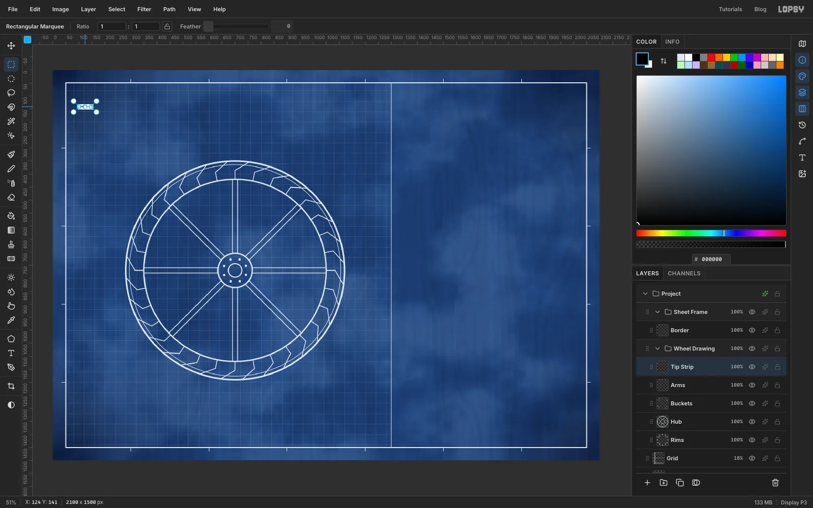

Engineers mark the centre of a circle with a thin chain line, a long dash and then a dot. Lopsy doesn't ship one, so make it. Brush tips are taken from the dark pixels in a selection.

Add a layer called *Tip Strip*. With the exact-corners marquee dialog:

1. Select **96, 132** to **156, 152**, set the foreground to white `#FFFFFF` and choose **Edit → Fill**.
2. Set the foreground to black `#000000`. Select **100, 140** to **130, 142** and fill it (the 30 px dash).
3. Select **136, 140** to **142, 142** and fill it black (the 6 px dot).
4. Select **100, 140** to **148, 142**. That's one 48 px repeat: dash, gap, dot, gap.

Choose **Edit → Define Brush…**, name it *Dash Dot*, and deselect. Delete the *Tip Strip* layer. The new tip is now the active brush.

## Draw the horizontal centre line

Click *Arms* and add a layer called *Centre Lines*. Set the brush **Size** to **48**. Open the brush presets, go to the **Shape** tab and set **Spacing** to **100%** so the repeats sit end to end. Close the panel.

With the foreground still `#DFE9F3`, click at **244, 770** and [[Shift]]-click at **1156, 770**. The line starts and ends the same distance from the hub, which matters for the next step.

## Turn a copy upright

The tip doesn't rotate with the stroke, so a vertical line drawn with it would come out as a stack of flat dashes. Turn a copy instead:

1. Click **Duplicate Layer**.
2. Marquee from **220, 750** to **1180, 790**. That's a box centred on the hub.
3. Pick the **Move** tool and click **Rotate 90° CW** in its options bar.

The copy spins about the centre of the box, so it stands up through the hub. Press [[Cmd+D]], choose **Layer → Merge Down** and set *Centre Lines* to **60%**. Centre lines should be lighter than the parts they measure.

## Build the flume and the trestle

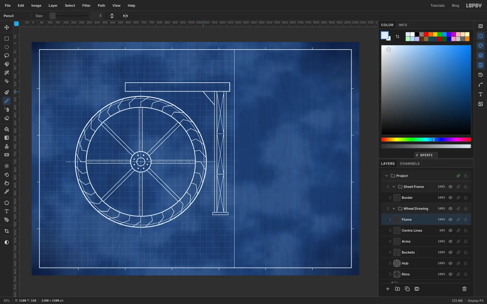

An overshot wheel is fed from above by a wooden channel called a **flume**. Add a layer called *Flume*. With the **Shape** tool on **Rectangle**, no fill and a white stroke, click each centre point and type each size:

- the flume: **Width 4**, centre **935, 290**, **670 × 56**
- two posts: **Width 3**, centres **1180, 706** and **1240, 706**, each **16 × 776**
- a footing: centre **1210, 1102**, **100 × 16**

Then pick the **Pencil** at **Size 2**. Draw horizontal ties between the posts at y **590** and **850**, and an X of braces in each of the three bays between them. Switch to **Size 3** and draw a knee brace from the left post at **1172, 404** up to the underside of the flume at **1100, 320**.

## Pour the water

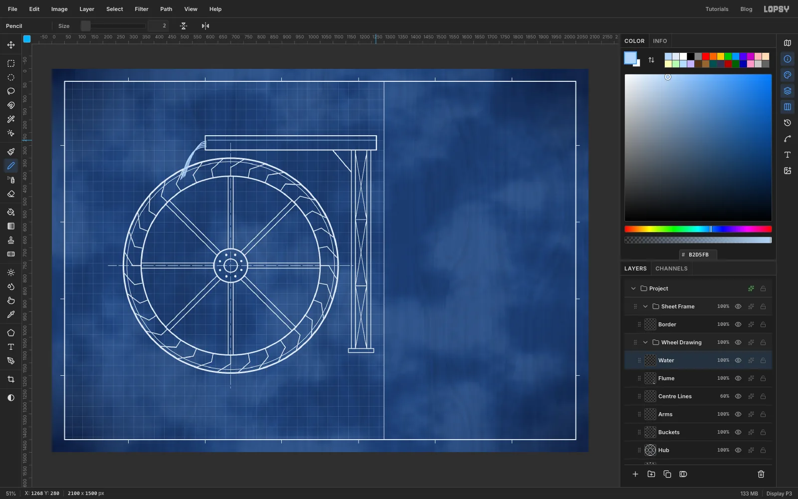

Add a layer called *Water* and set the foreground to `#B2D5FB`. Pick the **Pen** tool and set its **Stroke** to **3**. For each stream:

1. Press at the open end of the flume, about **604, 284**, and drag a little to the left to pull out a handle.
2. Press down on the buckets at about **520, 420** and drag downward.
3. Press [[Enter]] to stroke the path.

Draw four streams, starting each one about 7 px lower at the flume and landing a little further left. Delete each path in the **Paths** panel after you stroke it. The next stream starts only 7 px from the last one's first anchor, and a press that close would grab that anchor instead of starting a new path. Then pick the **Pencil** at **Size 2** and draw the water level inside the flume, from **612, 280** to **1268, 280**.

## Dig the wheel pit

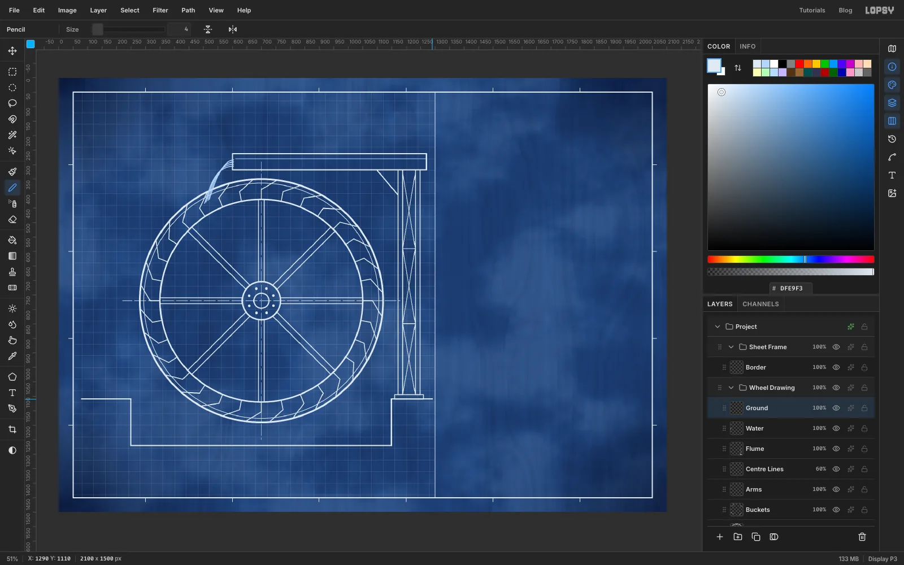

Add a layer called *Ground*. Pick the **Pencil** at **Size 4** with `#DFE9F3`. Click at **80, 1110**, then [[Shift]]-click each corner in turn: **250, 1110**, **250, 1270**, **1150, 1270**, **1150, 1110** and **1290, 1110**. [[Shift]]-click joins each point to the last one, so the pit draws as one line.

## Draw a seamless hatch tile

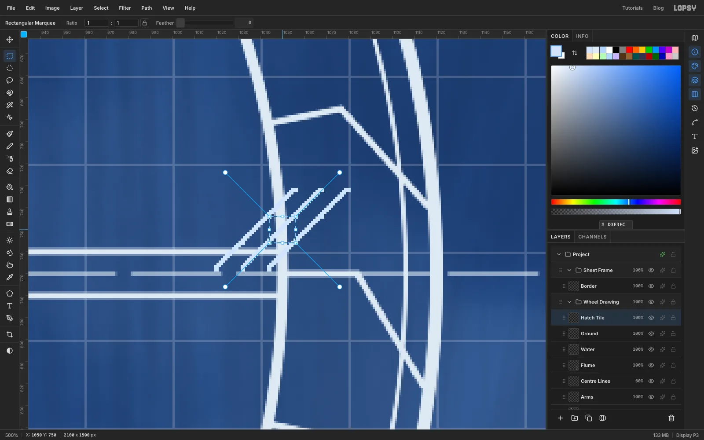

Cut earth is shown with 45° hatching. Make it a 12 px pattern. The catch is that a diagonal line only tiles cleanly if the tile also holds the corners of its neighbours.

Add a layer called *Hatch Tile*. Pick the **Pencil** at **Size 2** with `#D3E3FC`. Choose **View → Actual Size**, then **Zoom In** four times. Draw three parallel diagonals 12 px apart:

- **1020, 768** to **1056, 732**
- **1032, 768** to **1068, 732**
- **1044, 768** to **1080, 732**

Marquee the middle square from **1044, 744** to **1056, 756** and choose **Edit → Define Pattern**. Choose **View → Fit to Screen**, deselect, and delete the *Hatch Tile* layer.

## Hatch the earth around the pit

Click *Ground* and add a layer called *Earth Hatch*. The earth is a band **60 px** thick that hugs the outside of the ground line and the pit. Pick the **Pen** tool and click its twelve corners in order, then click the first point again to close it:

- along the top: **80, 1114**, **246, 1114**, **246, 1274**, **1154, 1274**, **1154, 1114**, **1280, 1114**
- back along the bottom: **1280, 1174**, **1214, 1174**, **1214, 1334**, **186, 1334**, **186, 1174**, **80, 1174**

In the **Paths** panel, click **Path to Selection**, then **Delete Path**. Choose **Edit → Fill with Pattern…**, pick the **12×12** pattern and click **Apply**. Deselect and set the layer to **60%**.

## Add the tail-water lines

Add a layer called *Tailrace*. With the **Pencil** at **Size 2** and `#B2D5FB`, draw three level lines across the pit at y **1176**, **1200** and **1224**, each a little shorter than the one above.

The wheel stands in front of the water, so clear the lines from the wheel. Click the canvas with the **Elliptical Marquee** and enter **From 276, 346** and **To 1124, 1194**, a circle just outside the shroud. Press [[Delete]] and deselect.

## Draw the dimensions

Add a layer called *Dimensions* and use the **Pencil** at **Size 2** in line white.

**Head**, the height the water falls. Draw an extension line left from the flume's water level, from **590, 280** to **130, 280**. Draw another left from the tail-water, from **180, 1176** to **130, 1176**. Stop it short of the hatching. Then draw the dimension line between them at x **150**, from **150, 296** down to **150, 1160**.

**Diameter.** Draw extension lines straight down from the left and right edges of the wheel, from **280, 782** and **1120, 782** to y **1392**. Then draw the dimension line between them at y **1378**, from **296** to **1104**.

**Arrowheads.** Each end gets a solid triangle 22 px long and 14 px wide, its tip touching the extension line. Pick the **Pen** and click the three corners, then the first one again to close it:

- top of the head line: **150, 282**, **143, 304**, **157, 304**
- bottom of the head line: **150, 1174**, **143, 1152**, **157, 1152**
- left end of the diameter: **280, 1378**, **302, 1371**, **302, 1385**
- right end of the diameter: **1120, 1378**, **1098, 1371**, **1098, 1385**

After each triangle, click **Path to Selection** and **Delete Path** in the **Paths** panel, choose **Edit → Fill**, and deselect.

Extension lines shouldn't cross a hatched section. Marquee a thin box around the left extension line where it crosses the pit floor and the hatch, from **272, 1262** to **288, 1338**. Hold [[Shift]] and drag a matching box from **1112, 1262** to **1128, 1338** over the right one to add it, then press [[Delete]].

## Mark the tail-water level

Deselect. Engineers mark a water level with a small downward triangle sitting on the line. With the **Pen**, click **1043, 1161**, **1057, 1161** and **1050, 1175**, then close it. Use **Path to Selection**, delete the path, set the foreground to `#B2D5FB`, choose **Edit → Fill** and deselect.

## Add the balloons and leaders

Drawings number each part in a small circle, called a **balloon**, with a line to the part. Add a layer called *Balloons*. With the **Shape** tool on **Ellipse**, **Width 3**, no fill, make five **48 × 48** circles. Place them in clear space:

1. top left, outside the wheel, at **300, 330** (the shroud)
2. lower left, at **236, 1010** (a bucket)
3. inside the wheel between the top arms, at **604, 539** (an arm)
4. inside the wheel, left of the hub, at **515, 847** (the hub)
5. above the flume at **1010, 196** (the flume)

With the **Pencil** at **Size 2**, draw each leader from the edge of its balloon to the part. Leader 3 must end on an arm line, not in the gap between two. Pick the **Brush** with the **Hard Round** preset at **Size 9** and click once at the end of each leader to put a dot on it.

## Number the balloons and box the schedule

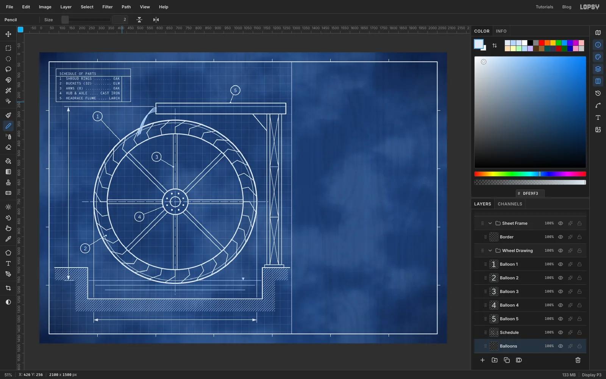

Pick the **Text** tool. Before each new piece of text, click a raster layer such as *Balloons*. If a text layer is active, the options bar restyles it instead of setting up the next one. Use **Overpass Mono** in line white:

- **26 px** numbers **1** to **5**, one in each balloon. Click in empty space, type, press [[Tab]] to commit, then nudge it into the centre of its circle with the **Move** tool and the arrow keys.
- an **18 px** parts list with its top-left corner at **100, 100**. Type each line, pressing [[Enter]] between them: `SCHEDULE OF PARTS`, `1  SHROUD RINGS ........ OAK`, `2  BUCKETS (32) ........ ELM`, `3  ARMS (8) ............ OAK`, `4  HUB & AXLE .... CAST IRON`, `5  HEADRACE FLUME .... LARCH`

Lopsy names each text layer after its text. Renaming them (*Balloon 1*, *Schedule* and so on) is optional, but it makes the panel easier to read.

Now box the list. Click *Balloons* and pick the **Pencil** at **Size 2**. Draw a box around the parts list with about 14 px of margin and an extra **60 px** on the right. Rule a line under the heading. Add a vertical line about 14 px to the right of the longest line, from the heading rule down to the bottom of the box. That narrow column will hold the red ticks.

## Label the dimensions

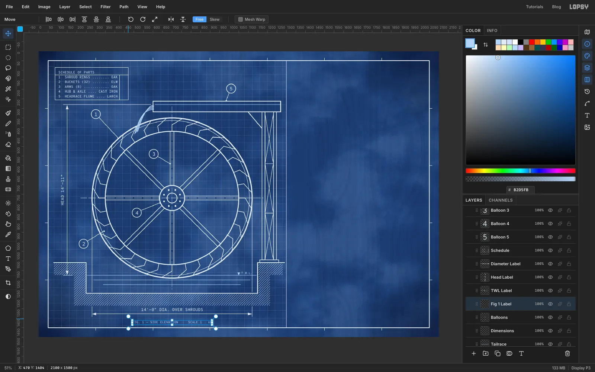

Still clicking *Balloons* before each one, add these in **Overpass Mono**:

- `14'-0" DIA. OVER SHROUDS` at **22 px** in line white, centred above the diameter line
- `HEAD 14'-11"` at **22 px** in line white. With the **Move** tool, click **Rotate 90° CCW**, then nudge it to sit just left of the head dimension line.
- `T.W.L.` at **16 px** in `#B2D5FB`, just right of the triangle
- `FIG. 1 — SIDE ELEVATION  ·  SCALE 1 : 60` at **17 px** in `#B2D5FB`, centred under the drawing at y **1420**

The numbers are to scale. At 1:60 and 300 dpi, the 840 px wheel is exactly 14'-0", and the 896 px head is 14'-11".

## Set the headline

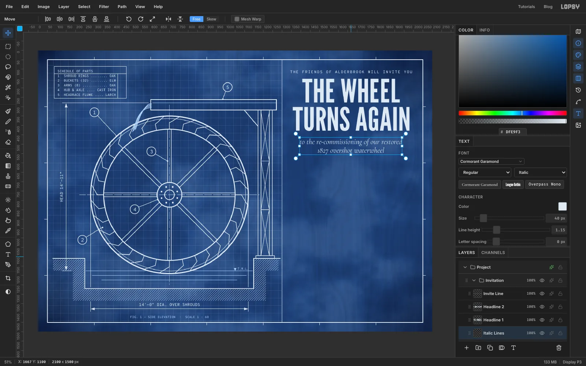

Collapse the *Wheel Drawing* and *Sheet Frame* groups with their arrows. Click *Sheet Frame* and make a **New Group** called *Invitation*. Add an empty layer inside it called *Text Anchor*. Click it before each new piece of text, as before.

Centre everything in the column on x **1667**, the line the photo plate will sit on. Set each line, then centre it with the **Move** tool and the arrow keys:

- `THE FRIENDS OF ALDERBROOK MILL INVITE YOU` in **Overpass Mono 21 px**, with **Letter spacing 3** in the **Text** panel, at y **114**
- `THE WHEEL` and `TURNS AGAIN` in **League Gothic 172 px**, as two separate layers centred at y **214** and **364**. Create the lower one first, so a click for the second never lands on the first.
- `to the re-commissioning of our restored` / `1827 overshot waterwheel` in **Cormorant Garamond**, **Italic**, **40 px**, with **Align** set to **Center** and **Line height 1.15** in the **Text** panel, centred at y **512**

Set **Letter spacing** back to **0** before each new text. Lopsy carries the last value over to the next text you create.

## Drop in the photo and scale it

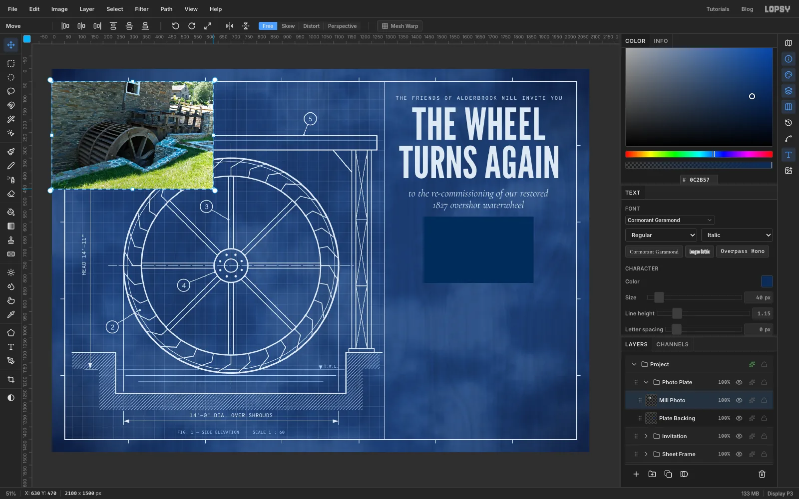

Collapse *Invitation*, click it, and make a **New Group** called *Photo Plate*. Add a layer called *Plate Backing*. Marquee **1452, 578** to **1882, 838**, fill it with `#0C2B57` and deselect. This dark panel sits behind the photo.

Drag the downloaded photo from your desktop onto the canvas. It's bigger than the card, so Lopsy shrinks it to fit and centres it, already selected, with the **Move** tool active. Rename the layer *Mill Photo*.

Hold [[Cmd]] and drag the bottom-right handle up and to the left until the photo is about **30%** of its dropped size, roughly 630 px wide. [[Cmd]] keeps the proportions. Press [[Cmd+D]] to commit the scale.

## Place and crop the photo

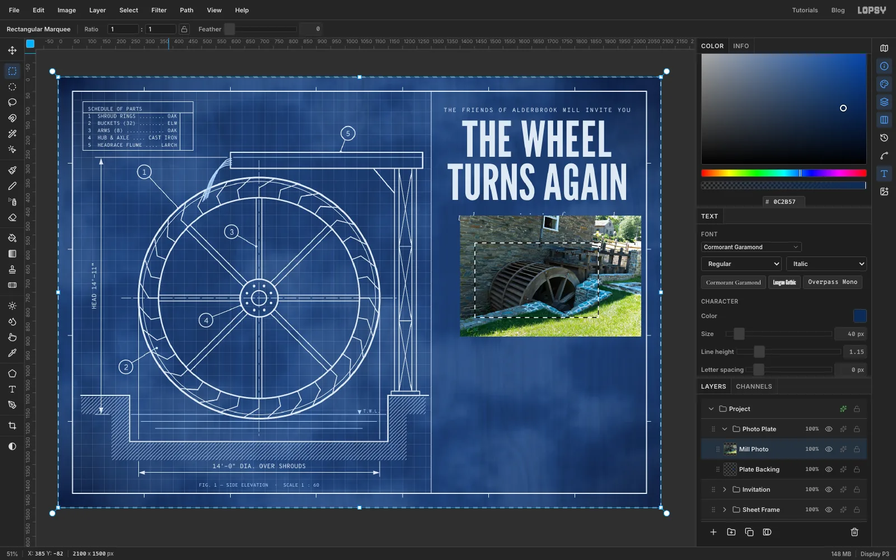

Drag the photo so the wheel fills the lower left of the navy panel and the stone wall shows behind it. Keep the whole photo on the canvas. Pixels left hanging past the edge aren't cleared by the next step, and would slide back into view if you moved the plate later.

Marquee the panel again, **1452, 578** to **1882, 838**. Choose **Select → Inverse**, press [[Delete]] and deselect. The photo is now trimmed exactly to the panel.

## Turn the photo into a cyanotype

With *Mill Photo* active:

1. Choose **Filter → Desaturate**.
2. Run **Filter → Brightness/Contrast…** with **Brightness 5** and **Contrast 50**, so the stones and wheel rim go nearly white.
3. Open the layer's effects and set the blend mode to **Screen**.

Screen keeps only the light parts of the photo. Its dark areas drop away to show the navy backing, so the photo turns into blue and white tones like a real cyanotype print.

## Frame the plate

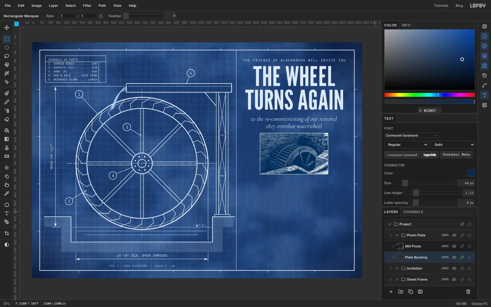

Click *Plate Backing*, open its effects and turn on **Stroke** at **Width 2** in `#DFE9F3`. Keep the plate square to the grid with no shadow. Everything else on the sheet is flat, so a tilted, shadowed snapshot would look stuck on.

## Set the date block

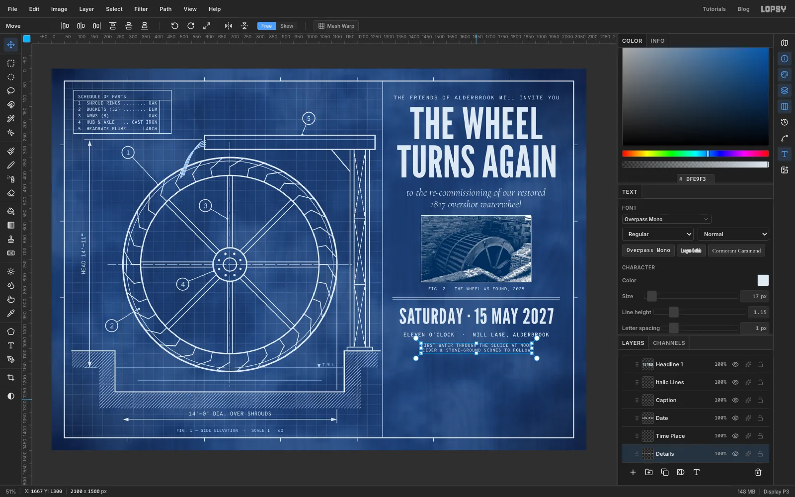

Expand the *Invitation* group, click *Text Anchor* and add:

- `FIG. 2 — THE WHEEL AS FOUND, 2025` in **Overpass Mono 17 px**, **Letter spacing 1**, centred at y **866**

Add a raster layer called *Rules*. With the **Pencil**, draw a **Size 3** line from **1340, 900** to **1994, 900**, and a **Size 1** line 7 px below it. Clicking *Rules* before each of the next texts:

- `SATURDAY · 15 MAY 2027` in **League Gothic 84 px**, **Letter spacing 2**, centred at y **972**
- `ELEVEN O'CLOCK  ·  MILL LANE, ALDERBROOK` in **Overpass Mono 20 px SemiBold**, **Letter spacing 2**, at y **1046**
- `FIRST WATER THROUGH THE SLUICE AT NOON` / `CIDER & STONE-GROUND SCONES TO FOLLOW` in **Overpass Mono 17 px**, centre-aligned, at y **1096**

## Rule the title block

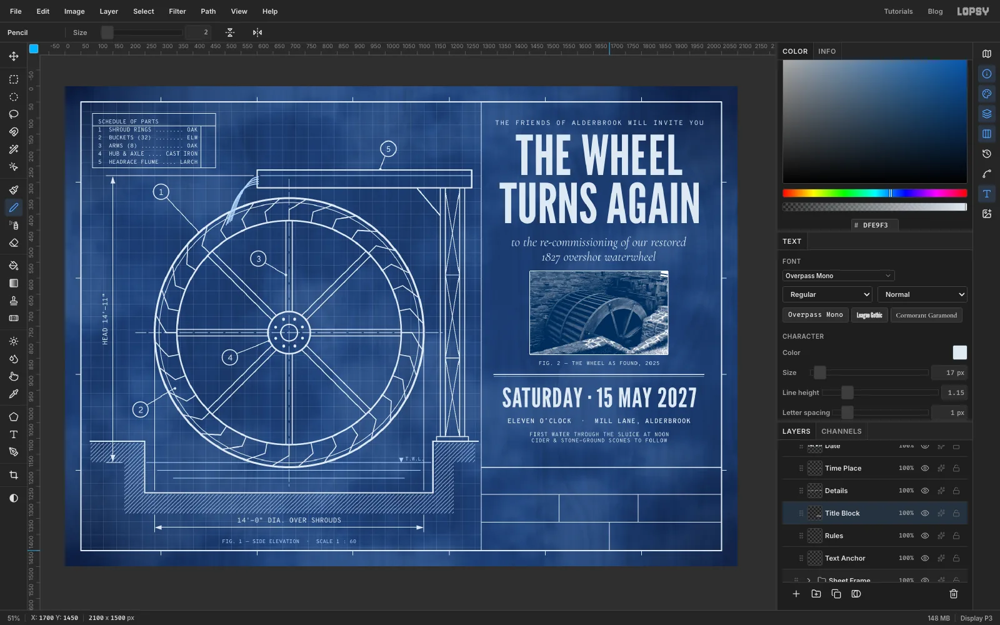

Every engineering sheet carries a **title block** in its bottom-right corner. Add a layer called *Title Block*. With the **Pencil**:

- **Size 3**: a top line from the divider at **1300, 1190** to the frame at **2050, 1190**
- **Size 2**: row lines at y **1276** and **1362**, also running from the divider to the frame
- **Size 2**: cell dividers at x **1544** and **1790** in the middle row, and at x **1700** in the bottom row

The block uses the sheet frame as its right and bottom edges. A second line just inside the frame would look like a misprint.

## Fill in the title block

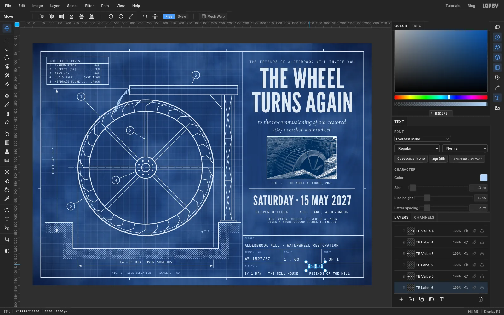

Each cell has a tiny label at its top left and a bold value along its bottom. For every cell, click *Title Block* first. Create the value first and the label second. Click inside the empty cell each time, so the Text tool never lands on a text you already made.

- values in **Overpass Mono SemiBold**, **24 px** with **Letter spacing 1**. Use **22 px** for the project name and **20 px** for the bottom row. Nudge each one so it starts 14 px in from the cell's left line and sits 18 px above the cell's bottom line.
- labels in **Overpass Mono 13 px** in `#B2D5FB` with **Letter spacing 2**, 14 px in and 12 px down from the cell's top-left corner

The cells read: **PROJECT** ALDERBROOK MILL · WATERWHEEL RESTORATION, **DRAWING NO.** AW-1827/27, **SCALE** 1 : 60, **SHEET** 1 OF 1, **R.S.V.P.** BY 1 MAY · THE MILL HOUSE, and **DRAWN BY** FRIENDS OF THE MILL.

## Underline the date in red pencil

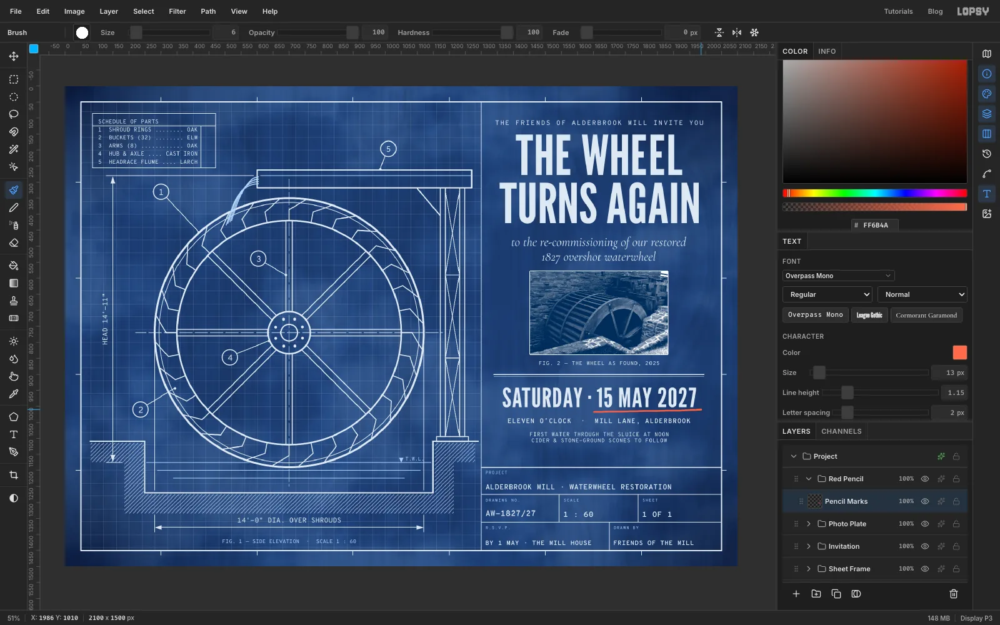

Collapse *Invitation* and *Photo Plate*, click *Photo Plate*, and make a **New Group** called *Red Pencil*. Add a layer called *Pencil Marks*.

Pick the **Brush**, choose **Hard Round**, set **Size 6** and the foreground to red `#FF6B4A`. In one loose stroke, drag under **15 MAY 2027** from just left of the **1** to just past the **7**. Let it rise a few pixels towards the end, the way a hand does.

## Tick the parts and scrawl a note

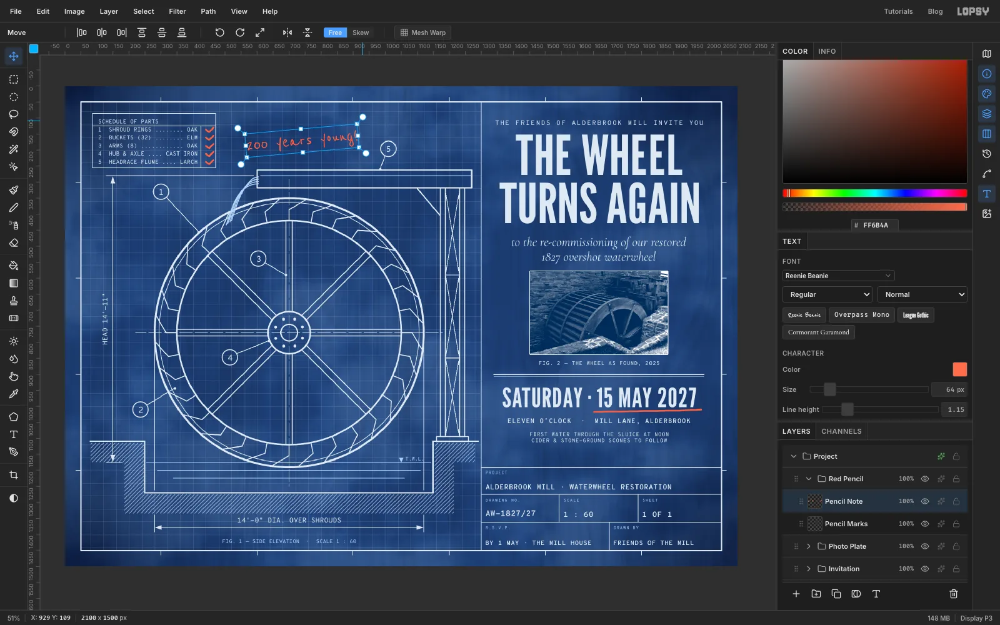

Still on *Pencil Marks*, draw a quick tick in the schedule's narrow column beside each of the five parts. Each tick is a short stroke down and then a longer one up to the right.

Click *Pencil Marks* again, pick the **Text** tool and type `200 years young!` in **Reenie Beanie 64 px**, red. Move it into the open space between the schedule and balloon 5, centred around **740, 176**. Keep it at least 60 px from the balloon. Pick the **Move** tool, hover just outside the top-right corner of the text's box until the cursor becomes a crosshair, and drag up a little to tilt it about **5°** anticlockwise, so the end of the note rises.

## Add grain and a little line bleed

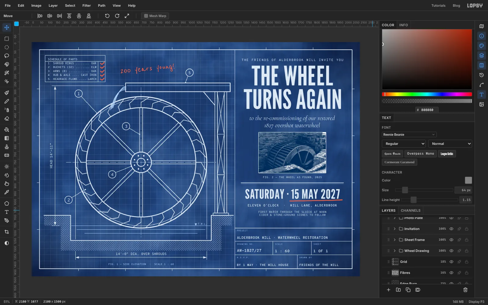

Collapse *Red Pencil*, click it, and add a layer called *Paper Grain*. Fill it with `#808080` and run:

1. **Filter → Add Noise…** at **Amount 40**, **Mono**, **Gaussian**
2. **Filter → Gaussian Blur…** at **1**

Set it to **Overlay** at **22%**. Mid-grey disappears in Overlay, and the noise is all that's left.

Real cyanotype lines bleed a little into the blue. Expand *Wheel Drawing*. On each of *Rims*, *Buckets*, *Arms*, *Hub*, *Flume* and *Ground*, turn on **Outer Glow** with **Size 3**, **Spread 0**, **Opacity 55** and colour `#DFE9F3`.

## Warm the shadows with Color Grading

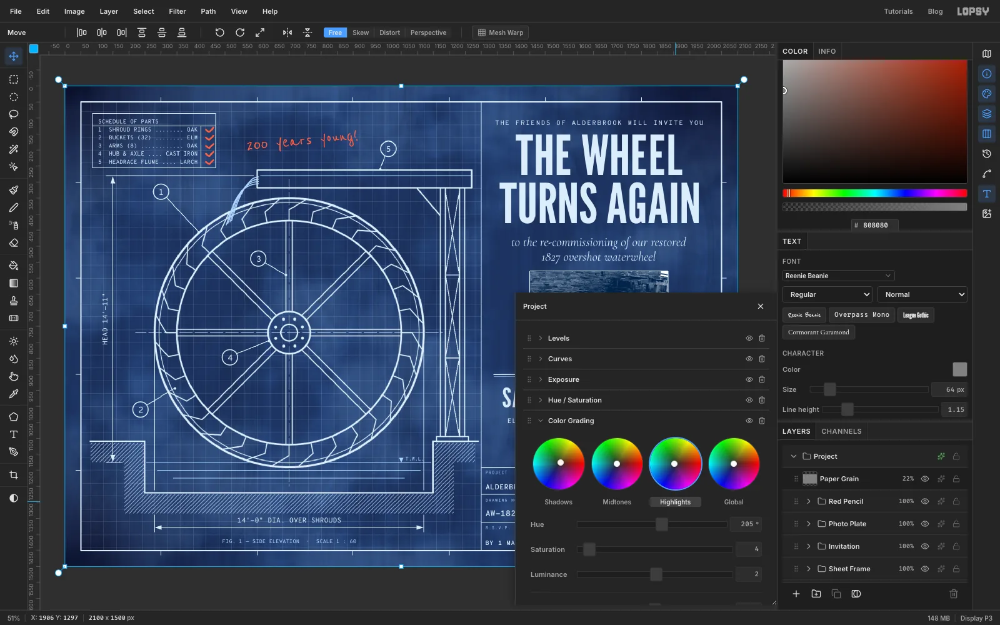

Every new Lopsy document has a stack of neutral adjustments on its root **Project** group. Click *Project* and open its adjustments with the sparkle button on its row. On a group it opens the adjustment stack, not layer effects. Expand the **Color Grading** node. It opens on **Midtones**, and the sliders below the wheels only change the wheel that's selected:

- Click **Shadows** under the first wheel, then set **Hue 30**, **Saturation 8**, **Luminance -6**. A touch of warmth takes the digital edge off the blue.
- Click **Highlights**, then set **Hue 205**, **Saturation 4**, **Luminance 2**. The whites go very slightly cool.

## Calm the blue with Hue / Saturation

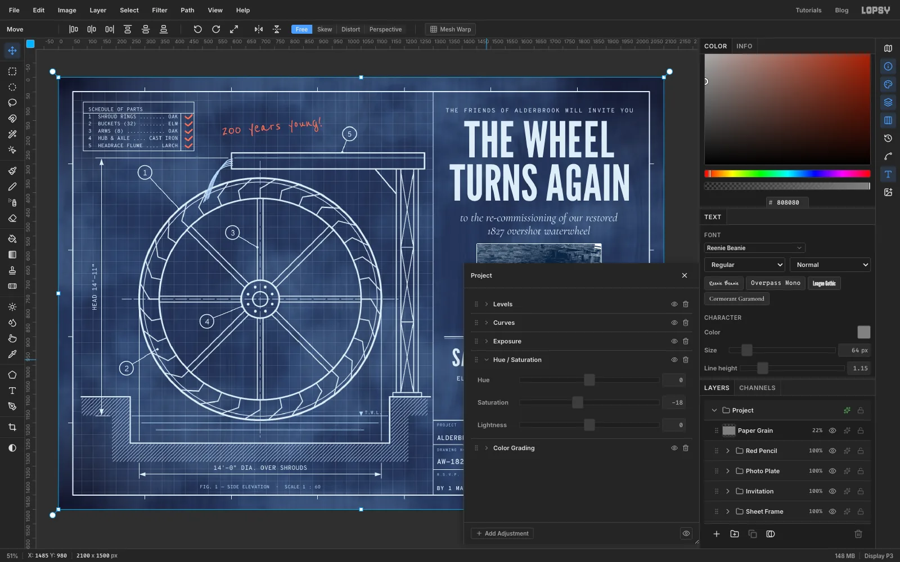

Expand the **Hue / Saturation** node and set **Saturation** to **-18**. Pure screen blue looks like a computer made it. Real Prussian blue is a little greyer. Close the drawer.

Save with **File → Save Project**, then **File → Quick Export PNG**.

> **Tip:** Before you export, zoom to 100% and check the text. No label should touch a rule, and the cell values should all sit the same distance from their bottom lines.
