A *xebec* (say "zee-beck") is a fast Mediterranean sailing ship with three
raked masts, long triangular *lateen* sails and a pointed beak at the bow.
In this tutorial you'll draw one as a naval architect's blueprint and turn it
into a 70th-birthday card for a sea captain.

The card is a 1500 × 2100 px sheet, 5 × 7 inches at 300 dpi. It has a ship
*dressed overall* with signal flags, which is what ships do for celebrations.
Under the ship there's a deck plan, then dimension lines and a scale bar. A
magnified **Detail A** shows the birthday cake "stowed" in the stern cabin.
A title block and a red rubber stamp finish the sheet.

Real blueprints are *cyanotypes*. The paper turns blue where light hits it
and stays white under the inked lines. So everything here is light lines on
a blue ground, with only a few spots of warm colour: the flags, the candle
flames and the red pencil.

Along the way you'll use:

- the **Gradient** tool, **Clouds**, **Fibers** and **Add Noise** for the paper, and ruler **guides**
- **Define Pattern** and **Fill with Pattern** for the grid, and **Define Brush** for a dashed-line brush
- the **Pen** tool, pressing [[Enter]] to stroke a path or clicking ✓ to keep it as a path
- the **Pencil** with [[Shift]]-click straight lines, the **Brush**, and the **Spray** tool on a **layer mask**
- the **Lasso**, **Magic Wand**, **Grow**, **Shrink** and **Select → Inverse**, plus the exact-corners marquee dialog
- the **Shape** tool's click-to-size dialog for exact circles and rectangles
- **Show Grid** with snapping, **New Group**, the **Screen**, **Multiply**, **Soft Light** and **Overlay** blend modes, and layer effects
- **Text** in Krona One, Share Tech Mono, Michroma, Black Ops One and Architects Daughter, including text on a path and rotated text
- **Merge Down**, rotating with the **Move** tool, and undo and redo

The palette:

- Cyanotype ground `#2453A0` → `#173A73` → `#0F2752`
- Line white `#EAF3FF`, construction cyan `#9ED8F5`
- Lens blue `#1F4A8C`, title block `#132F66`, edge burn `#06142F`
- Red pencil `#E2553F`, candle flame `#FFD15C`, flame glow `#FFB347`, flag blue `#4FA3E0`
- Lens shadow `#0B1E44`, grain grey `#808080`

Key positions are given as document coordinates, mostly where two views
have to line up. Watch **X** and **Y** in the status bar at the bottom of the
window as you move the pointer. Freehand shapes only need to be close.

Lopsy names each text layer after its text. I renamed mine as I went
(double-click a name), so the screenshots show names like `Headline`,
`Scale 0` and `Stamp B`. Yours can keep the default names.

## Set up the sheet and guides

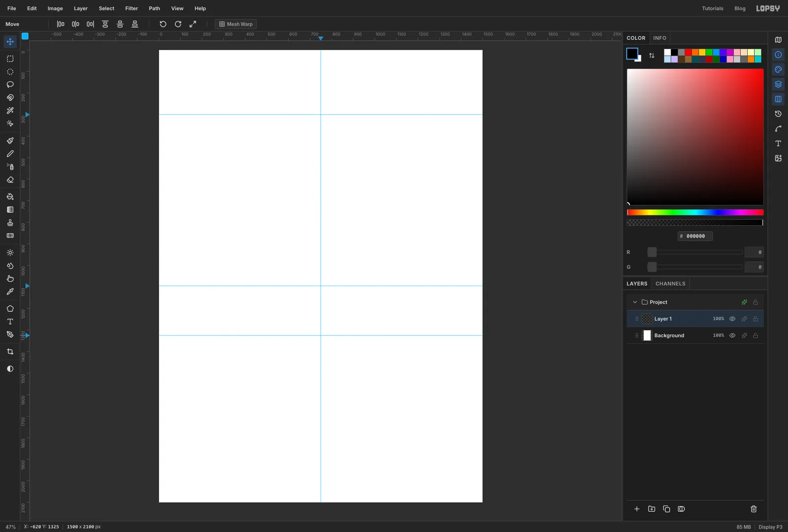

1. Choose **File → New**, set **Width** `1500`, **Height** `2100`, **Pixels**, and click **Create**.
2. Click the top ruler at `x 750` to drop a vertical centre guide.
3. Click the left ruler at `y 300` (the line the ship's sails stay below), `y 1095` (the ship's waterline) and `y 1325` (the deck plan's centreline). Zoom in if you need a click to land exactly.

## Fill the cyanotype ground

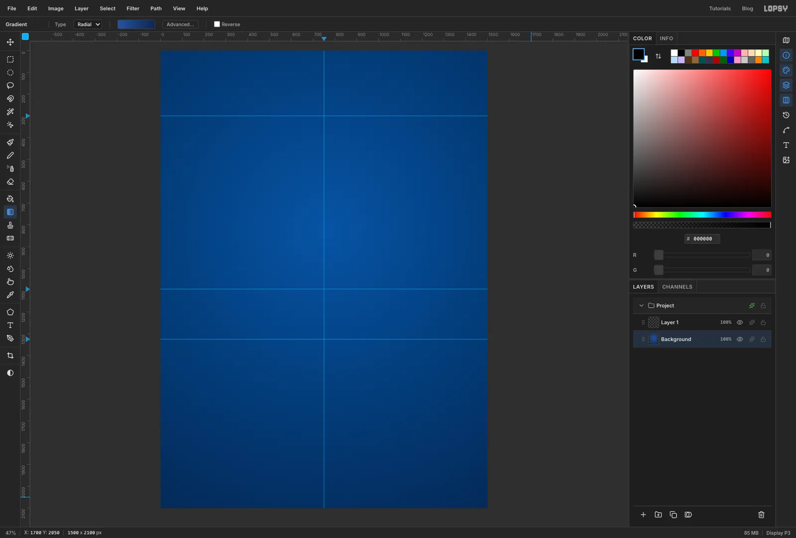

Cyanotypes are never evenly exposed. A radial gradient gives the sheet a lighter middle and darker edges.

1. Click **Background** in the Layers panel and pick the **Gradient** tool. Set **Type** to **Radial**.
2. Click **Advanced…** to open the Gradient Editor. Set the left stop to `#2453A0` and the right stop to `#0F2752` in the **Hex color** field. Click the bar halfway along to add a middle stop and make it `#173A73`. Click **Done**.
3. Drag from just above the centre of the sheet out past the bottom-right corner.

## Add paper texture

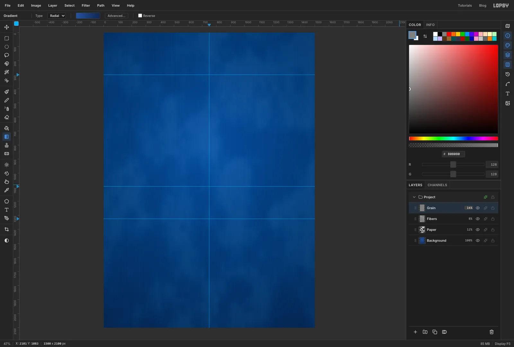

Three thin layers of texture make it read as paper rather than a flat fill.

1. Double-click **Layer 1** and rename it `Paper`. Run **Filter → Clouds…** with **Scale** `8`, then **Filter → Add Noise…** with **Amount** `18` and **Mono**.
2. Open the layer's effects drawer (the ✦ button on its row), set the blend mode to **Soft Light** and close the drawer. Click the opacity on the row and set it to `12%`.
3. Click **Add Layer**, name it `Fibers` and run **Filter → Fibers…** with the default settings. Set it to **Soft Light** at `8%`. Any stronger and the fibres show as streaks.
4. Add a layer called `Grain`. Fill it with mid grey `#808080` (**Edit → Fill**) and run **Add Noise…** at `40`, **Mono**. Set it to **Overlay** at `14%`. Grey disappears in Overlay, so only the speckle shows.

## Make the drafting grid

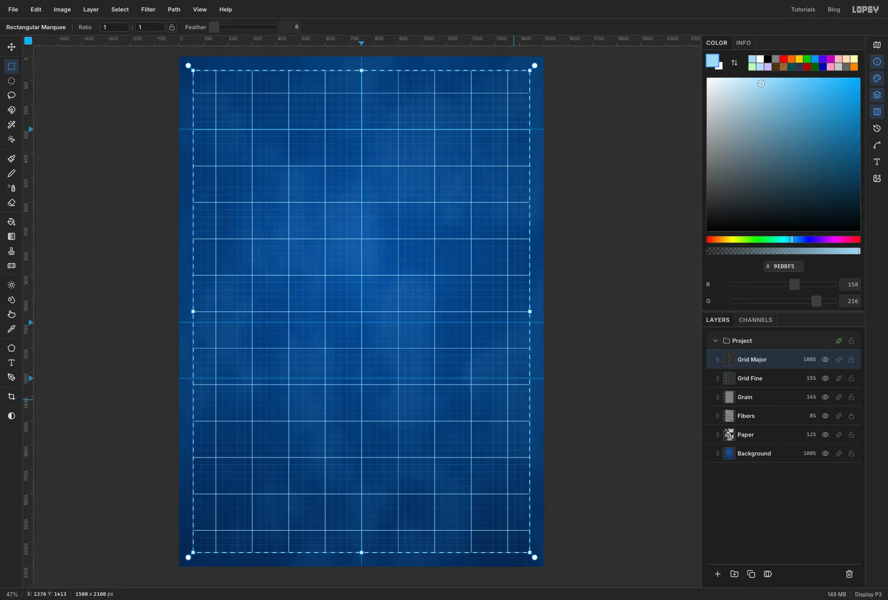

The grid comes from two pattern tiles. Pattern fills start at the top-left corner of the document, so you draw the tiles right there.

1. Add a layer called `Grid Tile` and set the foreground colour to `#9ED8F5`.
2. Pick the **Rectangular Marquee** and, with nothing selected, click once on the canvas without dragging. The **Rectangular Selection** dialog opens. Enter **From** `0`, `0` and **To** `30`, `30` and click **Select**. If a selection is already active, that click only deselects it, so press [[Cmd+D]] first. The same goes for every exact-corners dialog in this tutorial.
3. Pick the **Pencil** at **Size** `2`. Click just left of the canvas on the top edge, then [[Shift]]-click just past the tile on the same edge. Do the same down the left edge. The selection keeps the lines inside the tile, so you get one line along the top and one down the side.
4. Choose **Edit → Define Pattern**. That's the 30 px fine grid.
5. Press [[Cmd+D]], select `0`, `0` to `150`, `150` the same way and press [[Delete]]. Draw the top and left edges again with a **Size** `3` Pencil and choose **Define Pattern** again. Press [[Delete]] and [[Cmd+D]].
6. Rename the layer `Grid Fine`. Select `58`, `58` to `1442`, `2042` (the inside of the border you'll draw next), choose **Edit → Fill with Pattern…**, pick the first (30 px) pattern and click **Apply**. Set it to **Screen** at `15%`.
7. Add a layer called `Grid Major`, make the same selection, fill it with the second (150 px) pattern, deselect, and set it to **Screen** at `21%`.

## Cut the border

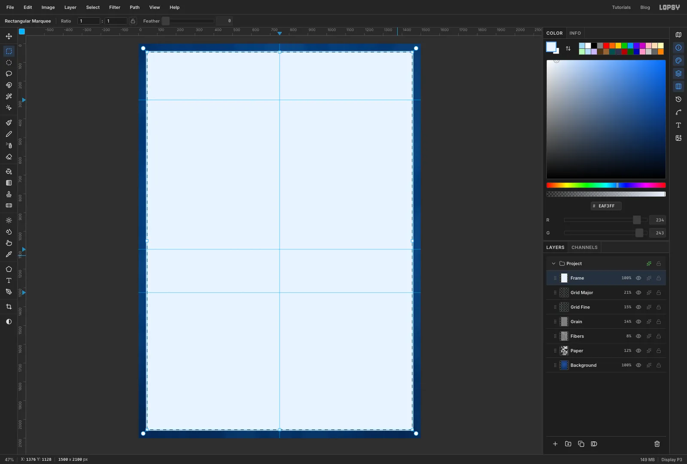

1. Add a layer called `Frame` and set the colour to `#EAF3FF`.
2. Select `40`, `40` to `1460`, `2060` and fill it.
3. Choose **Select → Shrink…** with `5` and press [[Delete]]. That leaves a 5 px outer border.
4. Press [[Cmd+D]], select `58`, `58` to `1442`, `2042`, fill it, **Shrink** by `2` and press [[Delete]]. That's the thin inner border. Deselect.

## Tick the border zones

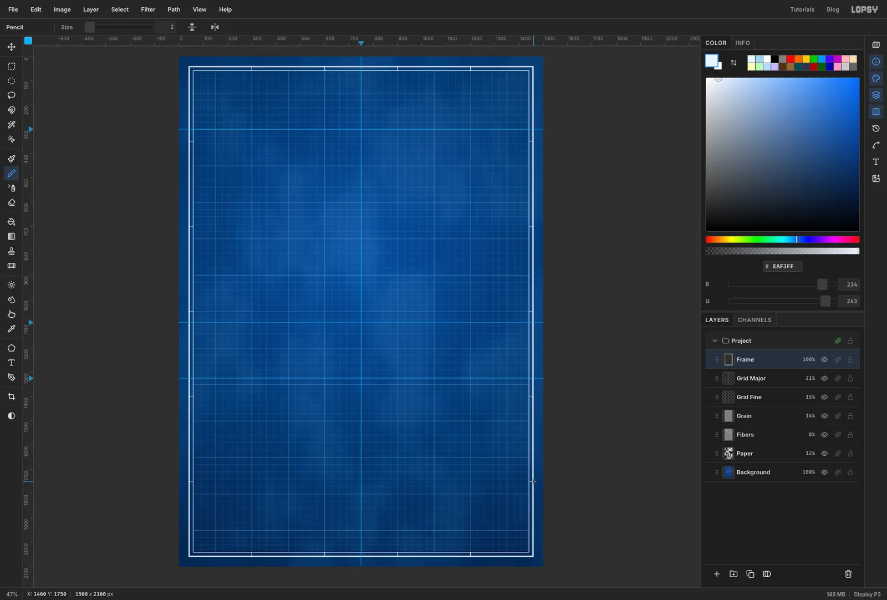

Drawing sheets mark zones along the border so people can say "the stamp in zone D4".

1. With the **Pencil** at **Size** `2`, click on the outer border and [[Shift]]-click straight across to the inner one. Do this at `x 300`, `600`, `900` and `1200` along the top and bottom.
2. Do the same at `y 350`, `700`, `1050`, `1400` and `1750` on the left and right.
3. If a tick lands crooked, [[Cmd+Z]] it and try again.

## Dot in the station lines

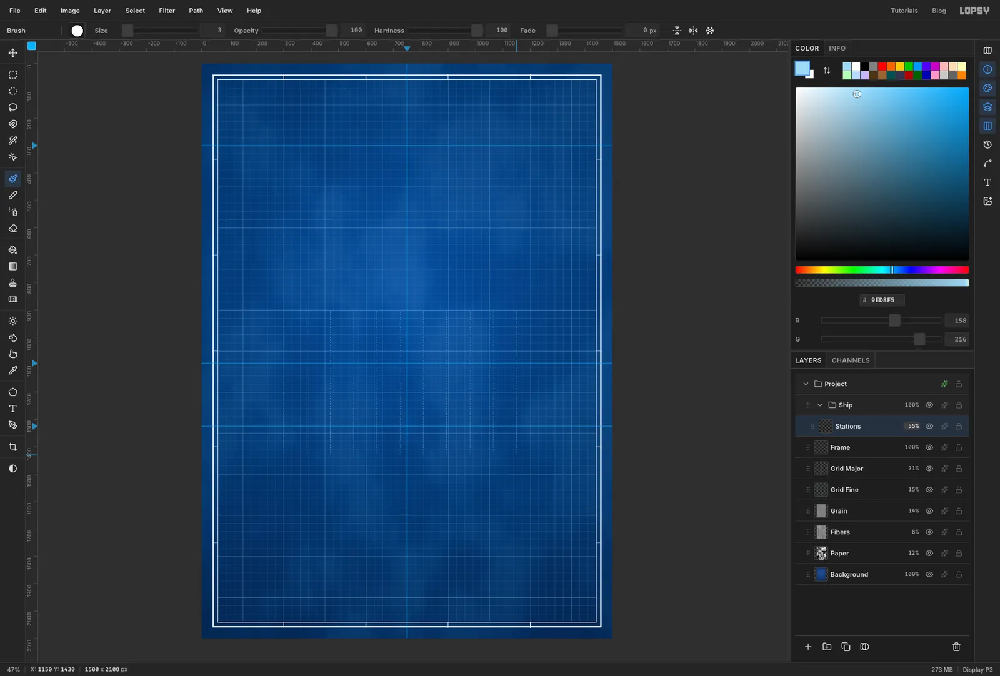

Naval architects slice a hull at evenly spaced *stations*. Those slices show up as light construction lines through every view.

1. With `Frame` selected, click **New Group** and rename it `Ship`. With the group selected, click **Add Layer**. The layer goes inside the group. Name it `Stations`.
2. Set the colour to `#9ED8F5` and pick the **Brush**. Click the brush tip in the options bar to open the **Brushes** panel. On the **Shape** tab set **Size** `3`, **Hardness** `100` and **Spacing** `200`. At 200 % spacing the dabs separate into dots. Close the panel.
3. Click at `x 300`, `y 905` and [[Shift]]-click straight down at `y 1430`. Repeat every 85 px across to `x 1150`, for eleven dotted lines.
4. Set the layer's opacity to `55%`.

## Make a dash brush for the datum lines

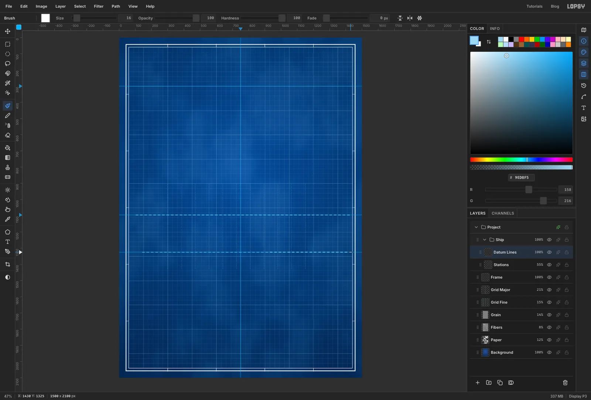

Lopsy has no dashed stroke, but a custom brush tip spaced apart draws one.

1. Add a layer called `Datum Lines`. Set the colour to black and select `0`, `0` to `16`, `3`. Fill it.
2. Choose **Edit → Define Brush…** and name it `Dash`. Dark pixels become the painting part of the tip, so this is a 16 × 3 bar. It becomes the active brush. Press [[Delete]] and [[Cmd+D]].
3. In the **Brushes** panel set **Spacing** `170`. The bars now land with a gap between them.
4. Set the colour back to `#9ED8F5`. Click on the waterline guide near the left border and [[Shift]]-click near the right border. Draw a second dashed line along the plan centreline guide.

## Draw the hull with the Pen

The hull is one closed Pen path: around the deck edge from the stern to the bow, out along the beak, then back along the keel. To make a smooth anchor, drag in the direction you're travelling. To make a sharp corner, just click.

1. Add a layer called `Hull` and set the colour to `#EAF3FF`. Pick the **Pen** and set **Stroke** to `4` in the options bar.
2. Click the top of the stern, about `225, 965`, a little below the left end of the deck line you're about to draw.
3. Halfway along, just above the waterline guide (about `730, 1020`), drag to the right about 230 px. The deck line sags gently between stern and bow.
4. Click the stem head, about `1230, 970`, level with the stern. Click the tip of the beak about 130 px further forward and 30 px lower, then click back on the stem about 20 px below the stem head. That gives a straight, low spur pointing forward.
5. Drag at the forefoot, about 60 px forward of the stem's foot and halfway down to the keel line, down and back. Then, at the bottom of the keel under the main mast (about `720, 1160`), drag to the left about 160 px.
6. Drag about 340 px further aft, roughly 30 px higher, so the keel rises towards the stern. Then drag at the stern post, just above the waterline, up towards the transom.
7. Click the first anchor to close the path, then press [[Enter]]. Enter strokes the path in the foreground colour at the options-bar width.

## Add the rail, wales and stanchions

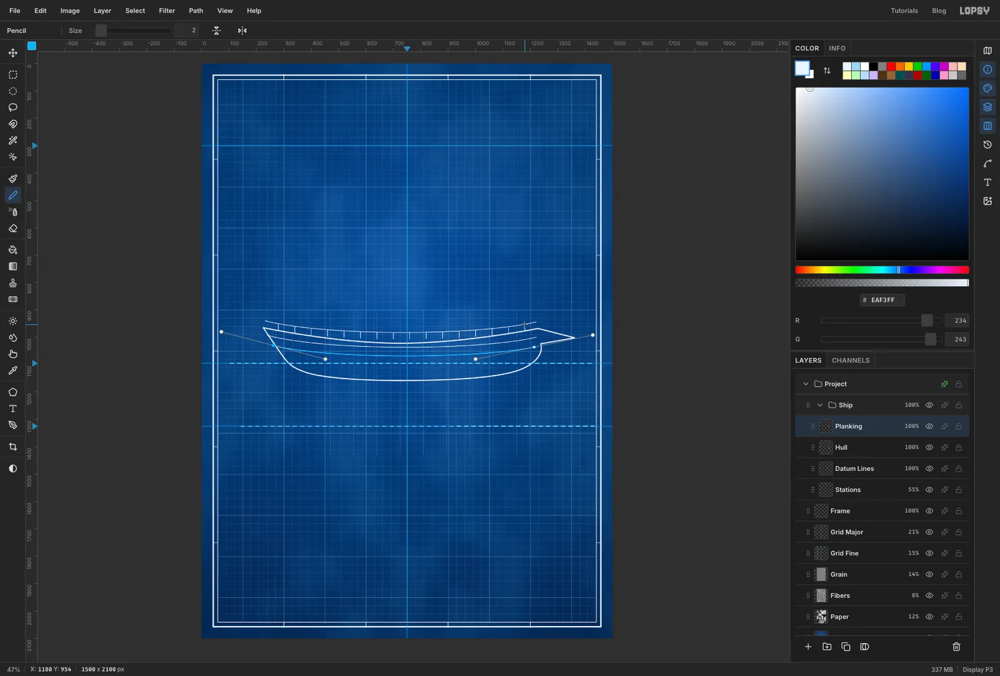

1. Add a layer called `Planking`. Set the Pen's **Stroke** to `2`.
2. Draw the rail as a two-anchor curve about 25 px above the deck line. Drag from the stern end down and to the right, about a quarter of the way along. Then drag at the bow end up and to the right, away from the hull, so the curve sags like the deck. Press [[Enter]].
3. Draw two wales below the deck the same way, one about 30 px and one about 60 px under the deck line. Each new path starts well away from the last one's anchors. If you start right on top of an anchor, the Pen edits that path instead. In that case, click the path in the **Paths** panel to deselect it first.
4. Pick the **Pencil** at **Size** `2`. Every 60 px from `x 280` to `x 1180`, click just above the deck line and [[Shift]]-click about 22 px higher. Those are the rail stanchions.

## Wash the hull

A faint white wash makes the hull read as solid, the way pencil shading does on a real plan.

1. Click the `Hull` layer and pick the **Magic Wand**. Click in the empty middle of the hull. Choose **Select → Grow…** with `2` so the wash tucks under the outline.
2. Click `Datum Lines` and click **Add Layer**. The new layer sits under the hull. Name it `Hull Wash`.
3. Fill with `#EAF3FF`, deselect, and set the opacity to `13%`.

## Punch the oar and gun ports

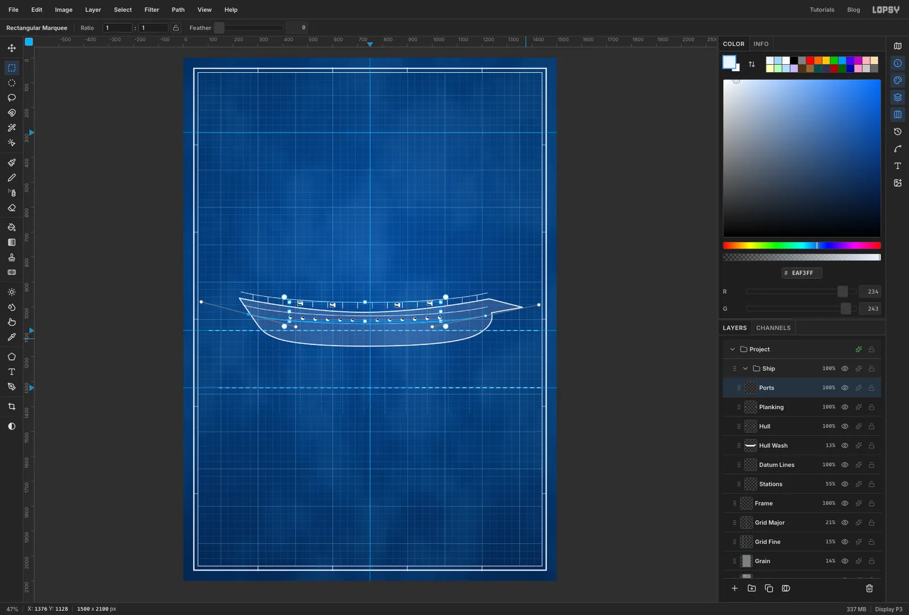

1. Click `Planking` and add a layer called `Ports`.
2. Pick the **Brush** and, in the **Brushes** panel, click **Hard Round** on the **Presets** tab to replace the dash tip. Set **Size** `15`.
3. Click a dot every 50 px from `x 430` to `x 1030`, midway between the two wales. Those are the oar ports.
4. With the **Rectangular Marquee**, drag a small 22 × 16 px box just under the rail at `x 470`. Hold [[Shift]] and drag three more at `x 600`, `860` and `990`. Fill them. Those are the gun ports.
5. [[Cmd]]-click the `Ports` thumbnail to select everything on the layer. Choose **Shrink…** with `3` and press [[Delete]]. Every dot and square becomes an outline. Deselect.

## Raise the masts and yards

1. Add a layer called `Cabin`. Select `258`, `926` to `350`, `975` (a deckhouse on the stern), fill it, **Shrink** by `3` and press [[Delete]].
2. Add a layer called `Spars`. Zoom in, pick the **Lasso** and draw a long thin wedge for each mast, about 10 px wide at the deck and 5 px at the top. Press at one corner and move in quick, straight strokes to each of the other corners before you let go, so the sides stay straight. A little wobble is fine at this size. Hold [[Shift]] as you start each one to add it to the selection.
   - The **fore** mast runs from `1080, 1000` to `1112, 470`, raked forward.
   - The **main** mast runs from `730, 1022` to `742, 405`.
   - The **mizzen** mast runs from `385, 1000` to `385, 560`.
3. Still holding [[Shift]], add a long spindle for each *yard*, the spar the sail hangs from. Make each about 5 px thick in the middle and 2 px at the ends. The yards cross the masts on a steep diagonal, high at the back and low at the front. The mizzen yard runs from about `285, 480` to `570, 920`, the main from `580, 310` to `1025, 905`, and the fore from `965, 380` to `1350, 925`. Fill.
4. With the **Pen** at **Stroke** `5`, click the stem head and then `1415, 918`, and press [[Enter]] for the bowsprit. At **Stroke** `4`, draw the short boomkin from `140, 990` to the top of the stern.
5. With a **Size** `12` Brush, click a round cap (a *truck*) on top of each mast.

## Hang the lateen sails

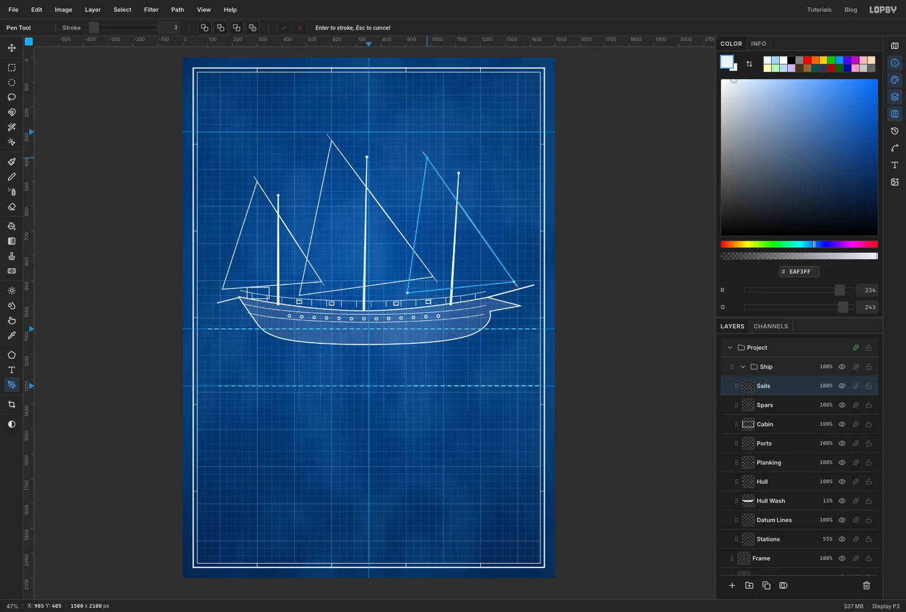

1. Add a layer called `Sails`. Set the Pen's **Stroke** to `3`.
2. For each sail, click its three corners: the head at the top of the yard, the tack at its low front end, and the clew at the back near the deck. Then click the first corner again and press [[Enter]].
   - **Mizzen**: `300, 500`, `560, 905`, `160, 935`
   - **Main**: `600, 335`, `1010, 885`, `470, 960`
   - **Fore**: `985, 405`, `1335, 905`, `905, 950`

The sails overlap. That's correct for a profile drawing, where every sail is drawn as if you could see through it.

## Wash and seam the sails

1. Click `Hull Wash` and add a layer called `Sail Wash`. Lasso all three triangles, holding [[Shift]] for the second and third. Fill with `#EAF3FF`, deselect, and set the opacity to `12%`.
2. Click `Sails` and add a layer called `Sail Seams`. Set the colour to `#9ED8F5`.
3. Lasso one sail. With a **Size** `1` Pencil, draw six lines parallel to the sail's back edge (the *leech*), evenly spaced from front to back. Start and end each line outside the sail. The selection trims them to the cloth.
4. Repeat for the other two sails, deselect, and set the layer to `75%`.

## Rig the shrouds and stays

1. Add a layer called `Rigging`, set the colour to `#EAF3FF` and keep the **Pencil** at **Size** `1`.
2. Draw the *shrouds*. From about 30 px below each masthead, click and [[Shift]]-click down to the rail. Use three on the fore mast, four on the main and two on the mizzen, fanned out either side of the mast.
3. Draw the stays. One runs from the fore masthead to the tip of the bowsprit. One runs from the main masthead down to the fore mast at `y 640`, and one from the mizzen masthead to the main mast at the same height. End each stay right on the mast, not in mid-air.
4. Draw a short *sheet* line from each clew down to the rail a little forward of it.

## Dress the ship with signal flags

1. Add a layer called `Dress Flags`. With the **Pencil** at **Size** `1`, draw four sagging lines of short [[Shift]]-click segments:
   - from the bowsprit tip to the fore masthead
   - from the fore masthead to the main masthead, dipping about 70 px in the middle
   - from the main masthead to the mizzen masthead
   - from the mizzen masthead to the end of the boomkin
2. Pick the **Lasso**. About every 30 px along the lines, draw a flag hanging from the line. Mix the shapes: narrow pennants about 18 px wide and 20 px long, square flags about 16 px, and swallowtails with a notch cut in the bottom. Do one colour at a time. Draw every flag of that colour with [[Shift]] held and fill them together: white `#EAF3FF`, red `#E2553F`, yellow `#FFD15C`, then blue `#4FA3E0`. Avoid putting two flags of the same colour side by side.
3. Give about half the square flags a second colour. Lasso their right half or a band across the middle and fill it in a different flag colour. Real code flags are split, banded and crossed, not plain.

## Draw the deck plan

The deck plan is the hull seen from above, lined up with the profile so every mast and station matches.

1. Collapse `Ship` with its arrow and keep it selected, then click **New Group**. A new group made with a collapsed group selected lands beside it, not inside it. Name it `Plan` and add a layer called `Plan Hull`. Set the colour back to `#EAF3FF`.
2. With the **Pen** at **Stroke** `3`, draw the top half. Drag at the stern end of the centreline (about `x 230`) straight up about 60 px. At the widest point, about 85 px above the centreline under the main mast, drag to the right about 300 px. Click the bow on the centreline at `x 1230` and press [[Enter]]. Click the path in the **Paths** panel to deselect it, then draw the bottom half as a mirror image.
3. Draw the beak as a thin wedge: click 12 px above the centreline just behind the bow, click the point on the centreline level with the beak tip in the profile, and click 12 px below. Press [[Enter]]. Draw the bowsprit beyond it to the same length as in the profile at **Stroke** `4`.
4. At **Stroke** `2`, draw the *bulwark* (the inside of the rail) as two more curves about 12 px inside the hull edge.
5. Marquee two hatches on the centreline, about 70 × 44 px starting at `x 520` and 60 × 36 px starting at `x 880`, holding [[Shift]] for the second. Fill, **Shrink** by `2` and press [[Delete]].
6. Pick the **Shape** tool, choose **Ellipse** and **Pixels**, and click the **Fill** swatch and **Remove fill**. Click **Stroke**, type `EAF3FF` in its hex field and set **Width** to `2`. Click on the centreline under each mast without dragging. The **Shape Size** dialog opens. Enter `22` × `22` and click **Create**. The shape is centred on the point you clicked. Those are the mast steps.

## Wash the deck plan

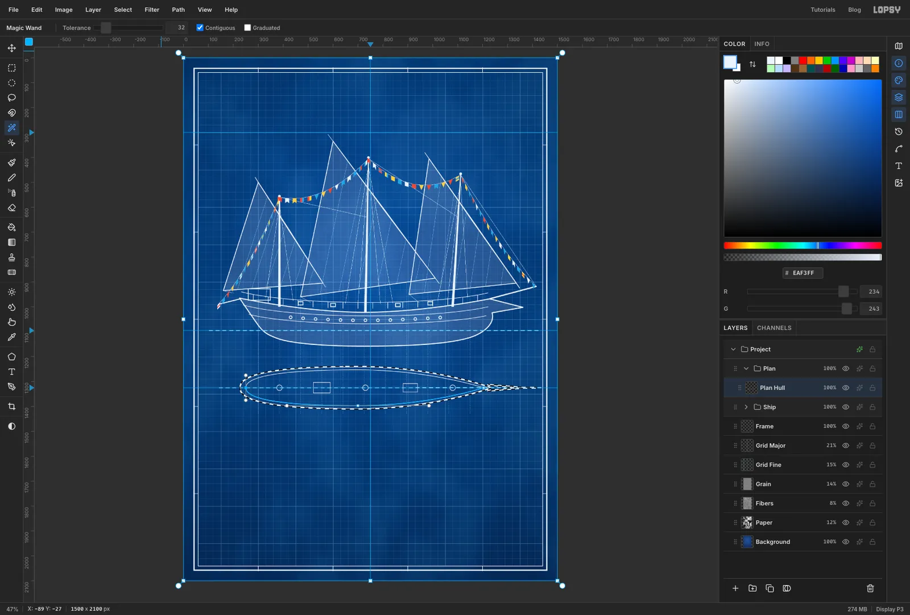

The plan has lines inside it, so the wand can't select the deck in one click. Select the outside instead.

1. On `Plan Hull`, click the empty sheet outside the hull with the **Magic Wand**. Choose **Select → Inverse**, which selects the whole deck.
2. Add a layer called `Plan Wash`, fill with `#EAF3FF`, deselect, and set it to `12%`.

## Add the dimension lines

1. Add a layer called `Dimensions`, colour `#9ED8F5`, **Pencil** **Size** `1`.
2. Drop *extension lines* straight down from the end of the boomkin (`x 140`) and the tip of the bowsprit (`x 1415`) to about `y 1494`. Draw the dimension line between them at `y 1478`.
3. For the height, draw an extension line left from the top of the main yard (`y 322`) to near the border. Extend the waterline to the same spot. Join them with a vertical line at `x 116`.
4. Lasso a small arrowhead, about 16 px long and 10 px wide, at each end of both dimension lines, holding [[Shift]] after the first. Fill.

## Add the scale bar

1. Add a layer called `Scale Bar` and set the colour to `#EAF3FF`.
2. With the **Rectangular Marquee**, drag a block about 61 px wide and 12 px tall, starting at `640, 1545`. Hold [[Shift]] to add the third and fifth blocks along the same row. Fill.
3. With the **Pencil** at **Size** `2`, outline the whole 307 px bar. Click one corner and [[Shift]]-click the other three, then back to the first.

The numbers should agree with the bar. If 25 ft is 307 px, the 1275 px between the extension lines is about 103′ 10″ and the 773 px air draft is about 62′ 11″. You'll write these numbers in the labels. (The `1:70` printed next to the bar is part of the birthday joke, not the real ratio.)

## Set the headline

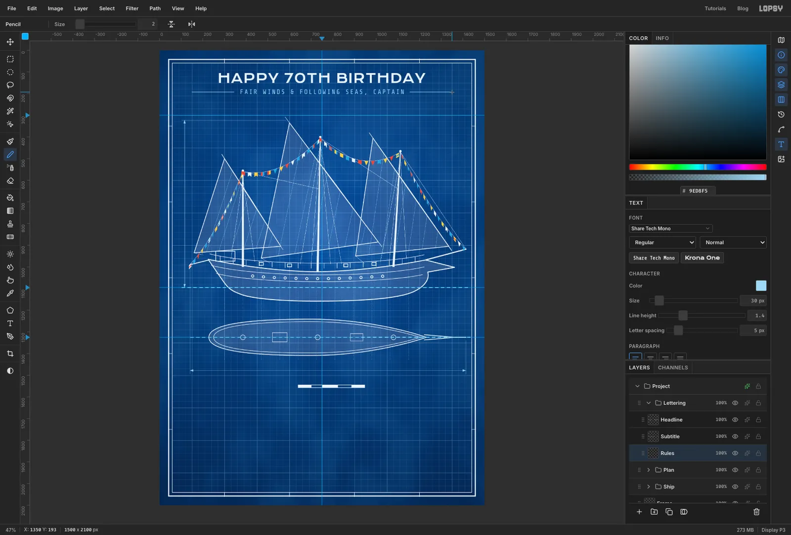

1. Collapse `Plan`, click **New Group** and name it `Lettering`. Add a layer called `Rules`.
2. Pick the **Text** tool. Set the font to **Krona One**, size `60`, colour `#EAF3FF`. Click near the top of the sheet and type `HAPPY 70TH BIRTHDAY`. Click the ✓ button to commit. In the **Text** panel set **Letter spacing** to `2`.
3. With the **Move** tool, centre it on the vertical guide, about 45 px below the inner border.
4. From here on, click a non-text layer (here `Rules`) before every new piece of text. Text options change the *active* text layer, so if a text layer is still active, the next font or size you pick restyles it.
5. Set **Share Tech Mono**, size `30`, colour `#9ED8F5`, and type `FAIR WINDS & FOLLOWING SEAS, CAPTAIN`. Set its letter spacing to `5` and centre it about 30 px under the headline.
6. On `Rules`, with a **Size** `2` Pencil, draw a line level with the middle of the subtitle. Run it from near the left border to 30 px short of the text, and do the same on the right.

## Label the views

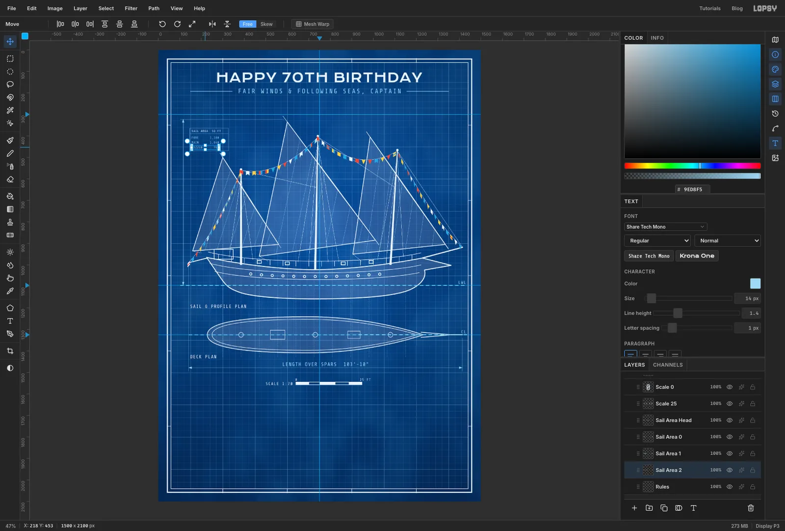

Use **Share Tech Mono** for all the drawing labels, with letter spacing `2`. Click `Rules` before each one.

1. `LENGTH OVER SPARS  103'-10"` at size `24` in cyan, centred just above the length dimension line.
2. `SAIL & PROFILE PLAN` at size `22` in white, starting at `x 150`, just below the keel. Put `DECK PLAN` at the same x, just below the plan.
3. `LWL` and `CL` at size `20` in cyan. Right-align them with the ends of the dashed waterline and centreline, just above each line.
4. `SCALE 1:70` at size `20` to the left of the scale bar. Put `0` and `25 FT` at size `16` above its two ends.
5. On `Rules`, draw a small box with the 1 px cyan Pencil in the empty sky at the top left, about 180 × 105 px, just below the air-draft extension line. Draw a line across it near the top for a header row. Inside, type a header `SAIL AREA  SQ FT` in white at size `14`, then three rows in cyan at size `14`: `FORE      1,180`, `MAIN      1,640` and `MIZZEN      760`. A monospaced font keeps the spaced-out numbers lined up in a column.

## Rotate the air-draft label

1. Type `AIR DRAFT  62'-11"` in cyan at size `24`, anywhere in open space.
2. With the **Move** tool, hover just outside the label's top-right corner until the cursor changes to the rotate cursor. Hold [[Cmd]] (it snaps the angle to 15° steps) and drag until the label reads bottom to top, at −90°.
3. Move it just left of the vertical dimension line, centred between the waterline and the yard.

To nudge the whole ship later, click the `Ship` group row and drag with the **Move** tool. Everything in the group moves together.

## Draw the Detail A lens

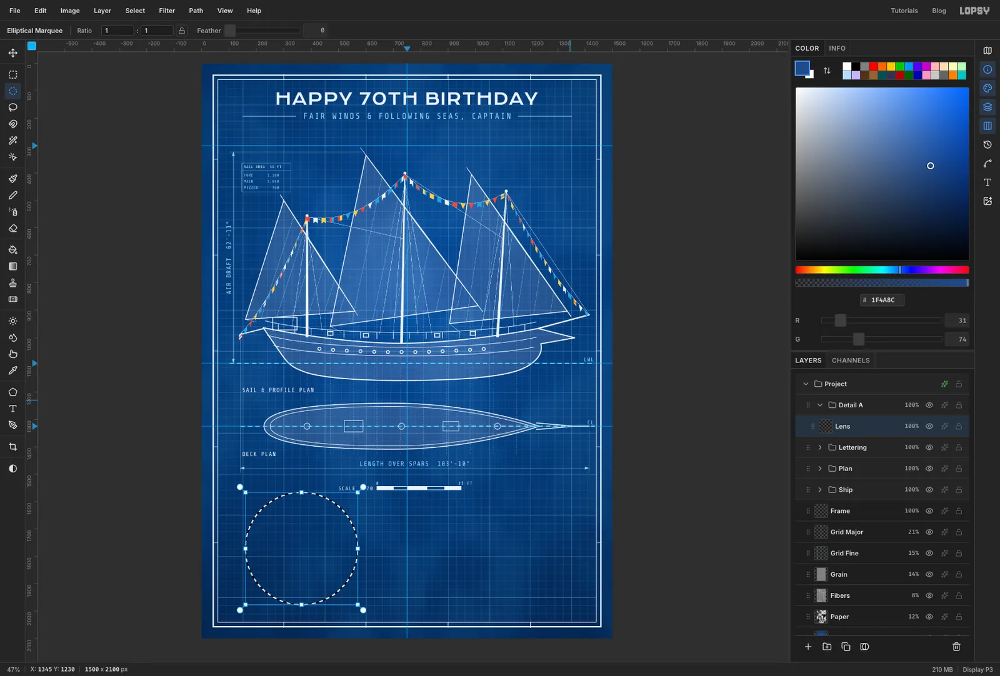

A *detail* redraws a small part of a plan at a larger scale inside a circle.

1. Collapse `Lettering`, click **New Group** and name it `Detail A`. Add a layer called `Lens`.
2. Pick the **Elliptical Marquee** and click once without dragging to open its exact dialog. Enter **From** `160`, `1567` and **To** `570`, `1977`.
3. Fill with `#1F4A8C` and deselect. Add an **Inner Glow** effect in `#0B1E44` with **Size** `40` and **Opacity** `35`, so the lens looks slightly domed.

## Ring the lens

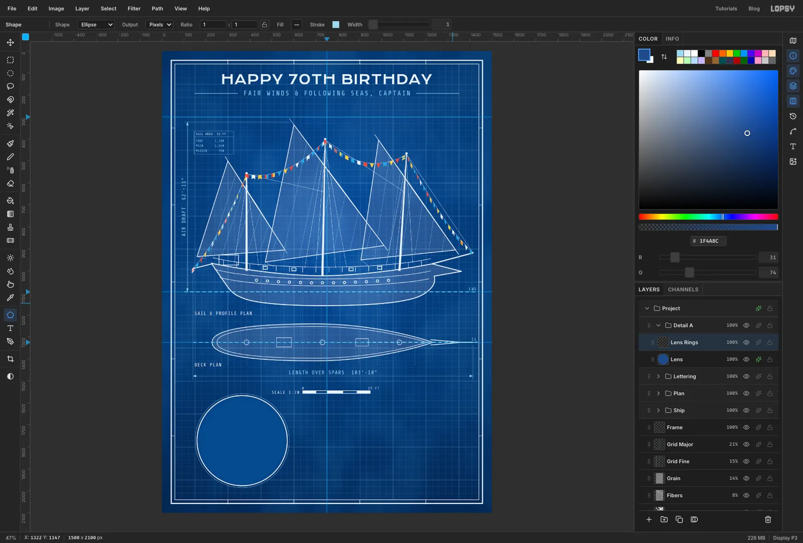

1. Add a layer called `Lens Rings`.
2. Set up the **Shape** tool as before: **Ellipse**, no fill, stroke `EAF3FF` at **Width** `4`. Click the centre of the lens (`365, 1772`) without dragging and create a `410` × `410` circle.
3. Change the stroke to `9ED8F5` at **Width** `1` and make a `428` × `428` circle on the same centre.

## Draw the cake

1. Add a layer called `Cake`. Keep the **Shape** tool on **Ellipse** with a white stroke at **Width** `3`. Click at `365, 1915` and make a `284` × `26` plate.
2. Switch **Shape** to **Rectangle**. Click at `365, 1868` for a `260` × `85` bottom tier, then at `365, 1789` for a `174` × `73` top tier. The top tier sits right on the bottom one.

## Pipe the frosting

1. With the **Pen** at **Stroke** `2`, draw scallops along the top of the bottom tier. Click the left corner. Then, at the middle of the first scallop, 16 px below the edge, drag a little to the right. Click the edge again one scallop along. Repeat for seven scallops, then press [[Enter]].
2. Do the same on the top tier with five scallops, 13 px deep.
3. Pick the **Brush**, choose **Hard Round** on the **Presets** tab and set **Size** `7`. Click a dot every 20 px along the base of the bottom tier and every 18 px along the base of the top tier.

## Outline the 70 candles

1. Click `Cake`. With the **Text** tool, set **Michroma**, size `84`, white, and type `70`. Set letter spacing to `6`.
2. Move it so its bottom sits on the top tier, centred on the cake.
3. In the effects drawer, turn on **Color Overlay** in `#1F4A8C` (the lens colour) and **Stroke** in `#EAF3FF` at **Width** `3`, leaving its other settings at their defaults. The numbers become outlines, the way a draughtsman would draw them, and they stay editable text.

## Light the candles

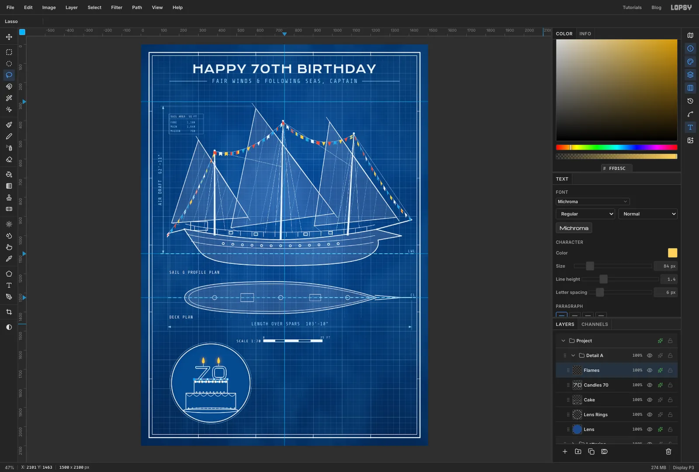

1. Click `Cake`. With a **Size** `2` white Pencil, draw a 13 px wick straight up from the top of each numeral, about a quarter of the way into the 7 and three-quarters into the 0.
2. Click the `70` text layer and add a layer called `Flames`. Set the colour to `#FFD15C`.
3. Lasso a teardrop flame about 34 px tall and 18 px wide above each wick, holding [[Shift]] for the second. Fill.
4. Add an **Outer Glow** in `#FFB347` with **Size** `26` and **Opacity** `70`. These are the only warm colours inside the lens.

## Label the detail

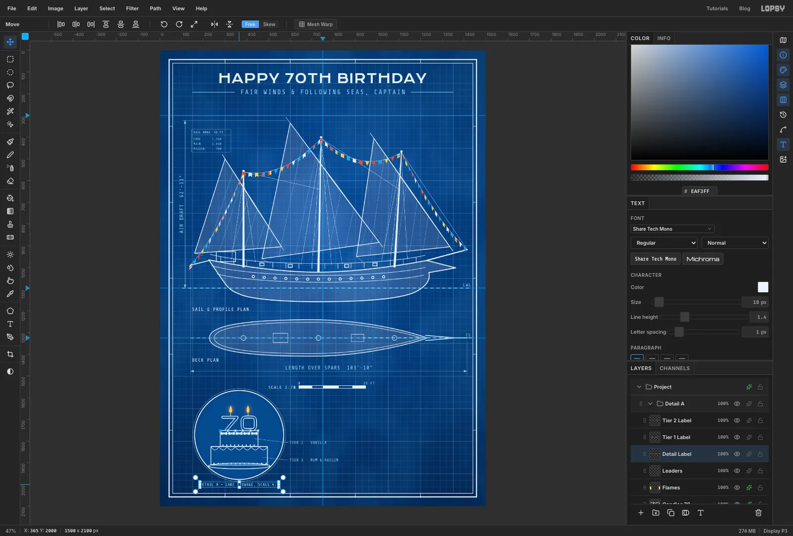

1. Click `Flames` and add a layer called `Leaders`. With a cyan 1 px Pencil, draw a line from the right side of each tier out past the lens rings, then a short level tick.
2. Click `Leaders` before each label. Type `TIER 2 · VANILLA` and `TIER 1 · RUM & RAISIN` in **Share Tech Mono**, size `18`, cyan, letter spacing `1`. Set each one just after its tick, centred on the line.
3. Type `DETAIL A — CAKE STOWAGE, SCALE 4:1` in white at the same size and centre it under the lens, about 16 px below the ring.

## Snap the title block to the grid

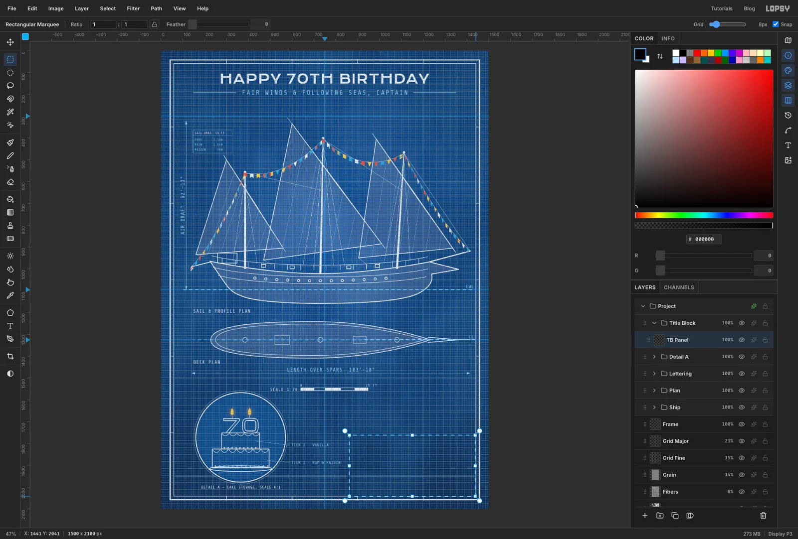

1. Collapse `Detail A`, click **New Group** and name it `Title Block`. Add a layer called `TB Panel`.
2. Choose **View → Show Grid**. In the options bar, set the **Grid** slider to `8px` and make sure **Snap** is ticked.
3. With the **Rectangular Marquee**, drag from about `864, 1760` to the bottom-right corner of the inner border. The corners snap onto grid lines, ending at `1440, 2040` right on the border.
4. Fill with `#132F66`.

## Rule and fill in the title block

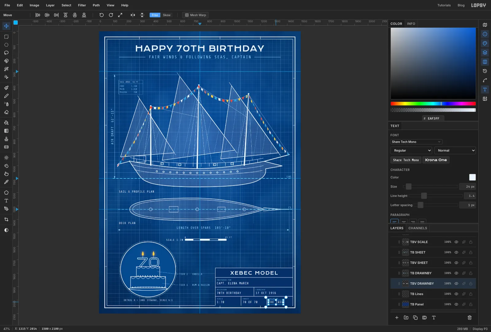

1. Add a layer called `TB Lines` and deselect. Turn **Show Grid** off.
2. With a white **Size** `2` Pencil, draw the block's left and top edges. The right and bottom edges are the sheet border itself, as on a real drawing.
3. Draw cell lines across the block at `y 1832`, `1904` and `1972`. Split the third row at `x 1152`, and the last row at `x 1056` and `1248`.
4. Click `TB Lines` (do this before each piece of text in the block). Type `XEBEC MODEL` in **Krona One**, size `34`, white, letter spacing `4`, centred in the top row.
5. Fill in each cell with a small cyan caption and a larger white entry, both in **Share Tech Mono**. Put the caption at size `13` with letter spacing `2`, 14 px in from the cell's top-left corner. Put the entry at size `24`, 34 px down from the top.
   - `PREPARED FOR`: `CAPT. ELENA MARCH`
   - `OCCASION`: `70TH BIRTHDAY`
   - `LAUNCHED`: `17 OCT 1956`
   - `SCALE`: `1:70`
   - `SHEET`: `70 OF 70`
   - `DRAWN BY`: `THE CREW`

## Draw the stamp rings and arcs

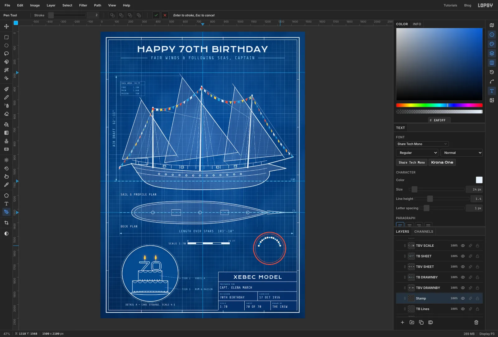

1. Click `TB Lines` and add a layer called `Stamp`.
2. Set the **Shape** tool's stroke to `E2553F` at **Width** `6` and click at `1240, 1588` for a `236` × `236` circle. At **Width** `2`, make a `210` × `210` circle on the same centre.
3. With the **Pen**, draw an arc over the top, about 25 px inside the inner ring, from the upper left round to the upper right. Drag at each of four or five points along it, in the direction you're travelling. Click the ✓ **Commit path** button instead of pressing Enter, so it stays a path and isn't stroked.
4. Draw a second arc under the bottom, about 10 px inside the inner ring, also from left to right, and commit it with ✓. Click it in the **Paths** panel to deselect it.

## Set the stamp lettering

1. Click `Stamp`. Type `APPROVED` in **Black Ops One**, size `24`, `#E2553F`, letter spacing `4`.
2. With the **Text** tool still active, set **Align** to **Center** and choose the top arc in the options bar's **Path** menu. The word wraps over the arc, reading upright.
3. Click `Stamp`, type `70 YEARS` at size `20` with letter spacing `4`, and bind it to the bottom arc the same way. Because that arc runs left to right under the circle, the text stays upright instead of upside down.
4. Click `Stamp` again and type `SEAWORTHY` at size `26`, letter spacing `1`. Centre it straight across the middle, clear of the inner ring.

## Merge and tilt the stamp

1. Click the `SEAWORTHY` text layer and choose **Layer → Merge Down**, which merges it into `Stamp`. Do the same for `70 YEARS` and `APPROVED`. The text becomes pixels, so the stamp is now one piece.
2. Draw a marquee around the stamp. Pick the **Move** tool and drag the rotation handle at the top-right corner about 14° anticlockwise. Nobody stamps a form straight. Press [[Cmd+D]].

## Wear the stamp with a masked spray

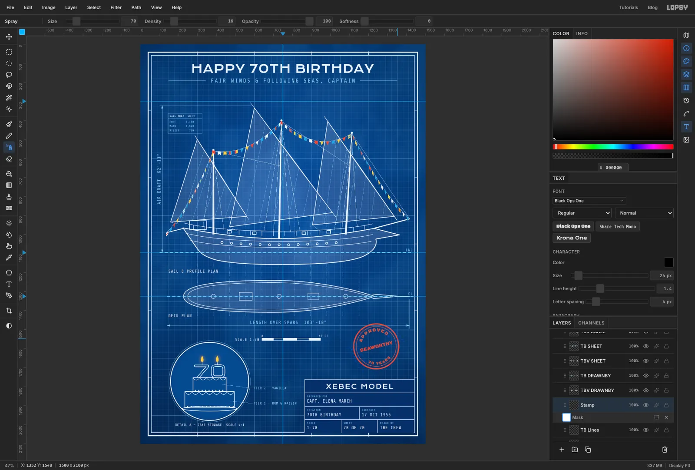

1. With `Stamp` selected, click **Add Mask** at the bottom of the Layers panel. A mask row appears under `Stamp`. Click it to edit the mask.
2. Set the colour to black and pick the **Spray** tool. Set **Size** `70`, **Density** `16`, **Opacity** `100` and **Softness** `0`.
3. Make one short pass along the lower-left rim and one along the upper right. Rubber stamps print unevenly at the edges. While you edit the mask, the hidden speckle shows as blue. Keep the spray off the middle of the words so they still read.
4. Click the layer name to stop editing the mask, and set the opacity to `88%`.

## Add the red-pencil note

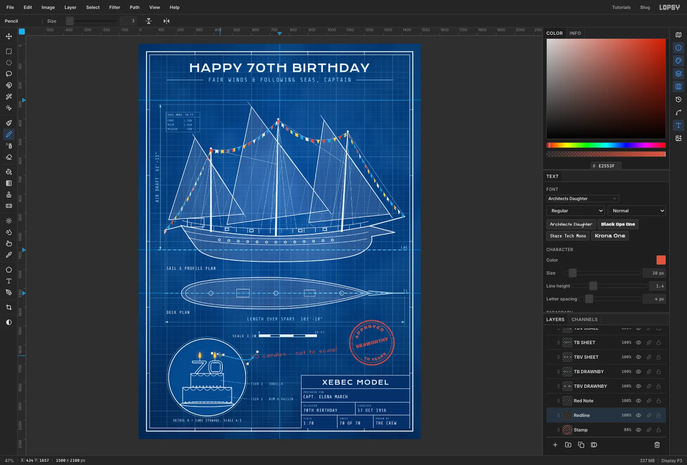

Checkers mark up blueprints in red pencil. Here the note gives the joke away.

1. Add a layer called `Redline`. Type `70 candles — not to scale!` in **Architects Daughter**, size `30`, `#E2553F`.
2. Put it to the right of the lens, under the scale bar, and rotate it about 5° anticlockwise with the Move tool's rotation handle.
3. Click `Redline`. With the **Pen** at **Stroke** `3` in the same red, drag from the start of the note and finish just right of the right-hand flame. Press [[Enter]].
4. With a **Size** `3` Pencil, click and [[Shift]]-click two short strokes at the tip to make the arrowhead.

## Mark where Detail A comes from

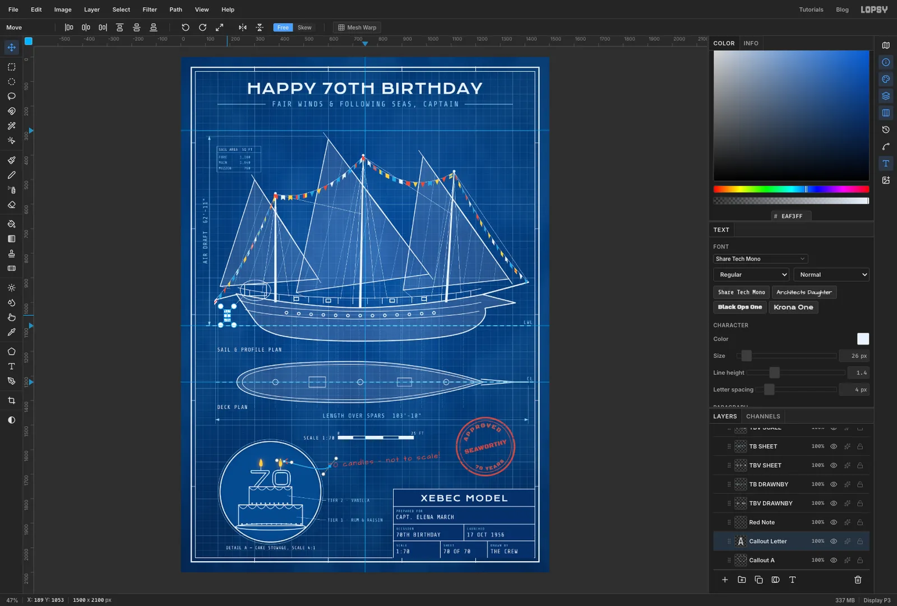

1. Add a layer called `Callout A`. With the **Shape** tool (**Ellipse**, white stroke, **Width** `2`), click the middle of the stern cabin and make a `124` × `84` ellipse.
2. With a 1 px white Pencil, draw a short leader from the ellipse down and left into the open space under the stern.
3. Click `Callout A` and type `A` in **Share Tech Mono**, size `26`, white, at the end of the leader.

## Burn the edges

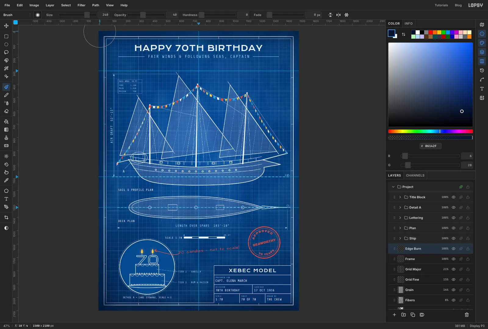

1. Collapse `Title Block`, then click `Frame` and add a layer called `Edge Burn`. It sits under all the drawing.
2. Set the colour to `#06142F`. Pick the **Brush** and choose **Soft Round** on the **Presets** tab, with **Size** `360` and **Opacity** `60`.
3. Drag down the left edge of the sheet with the brush half off the canvas, wandering in and out a little. Then drag along the bottom.
4. Drop to **Size** `240` and **Opacity** `40` and make lighter passes down the right edge and across the top. An uneven burn, heavier on two sides, looks like a real exposure. A perfect radial vignette doesn't.
5. Set the layer to **Multiply** at `70%`.

## Even out the exposure

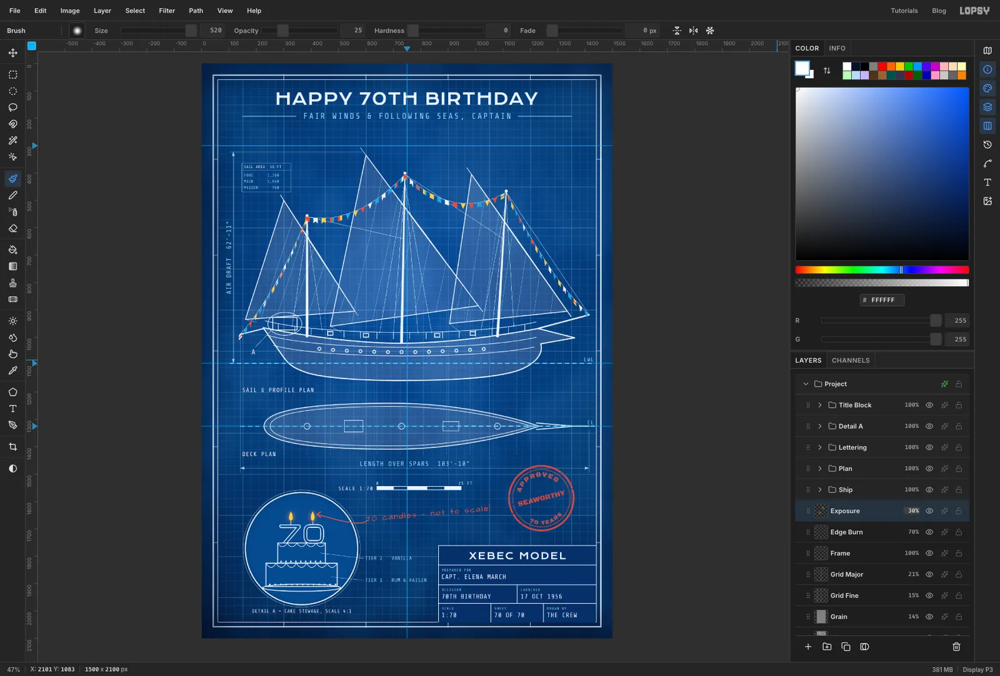

1. Add a layer called `Exposure`, colour white. Use the **Soft Round** brush at **Size** `520` and **Opacity** `25`.
2. Make one short stroke beside the main sail and one over the stern end of the deck plan.
3. Set it to **Soft Light** at `30%`.
4. Choose **File → Save Project** to keep the layered file, and **File → Quick Export PNG** for the card.
