Tattoo flash is a sheet of ready-to-tattoo designs, each one bold, closed
and labelled. A blueprint is the opposite: a negative print with white
lines on blue, dimensions everywhere, and a title block in the corner. Put
the two together and you get flash that looks like a locksmith's patent
drawing.

In this tutorial you'll draw a flash sheet of four **zodiac keys**. Each
key has a bow shaped for its sign: a trefoil ram, a sun for Leo, a stinger
for Scorpio and a fish for Pisces. A zodiac wheel with crossed keys holds
the centre. The sheet is **1600 × 1120 px**.

Along the way you'll use:

- **Define Pattern** and **Fill with Pattern** for the drafting grid and section hatching
- the **Shape** tool's click-to-size dialog for the border, the wheel rings and the title block
- the **Brush** with **Radial Symmetry** for ticks, dividers and sun rays
- **text on a path** for the glyph and name rings and the ribbon title, in **Noto Sans Symbols**, **Share Tech Mono**, **Architects Daughter** and **Rye**
- marquees with **Shift** (add), **Alt** (subtract) and **Shift+Alt** (intersect), and the **Lasso**
- **Select → Selection → Path** and the Paths panel's **Stroke Path** for clean outlines
- group **rotate**, **Flip Horizontal**, **Duplicate Layer** and corner **scale**
- the **Pen** tool for a ribbon banner
- the **Reference** drawer, a dropped photo, the **Magic Wand** and **Screen** for a photostat
- **Clouds**, **Gaussian Blur**, **Surface Blur**, **Add Noise**, a radial **Gradient** and **Copy Merged** for the paper finish

The palette:

- Blueprint paper `#17427F`, deep blue `#0A2350` (vignette and crease shadows)
- Line white `#EEF4FF`, tint white `#FFFFFF` at 16% opacity
- Ribbon fill `#3C6093`
- Red pencil `#FF6A4D`
- Grain grey `#808080`

> **Tip:** Positions are in document pixels, written `x, y`. The status bar
> at the bottom shows where the pointer is. **Edit → Fill** fills the
> selection with the foreground colour, and [[Cmd+D]] deselects. New layers
> appear above the selected layer, and inside it if the selected row is an
> expanded group. Each layer's **Blend** dropdown is in its effects drawer
> (the sparkle icon on its row).

> **Tip:** For an exact rectangle or circle selection, pick the
> **Rectangular** or **Elliptical Marquee**, make sure nothing is selected,
> and click the canvas once without dragging. A dialog asks for the
> **From X / Y** and **To X / Y** corners.

## Fill the blueprint paper

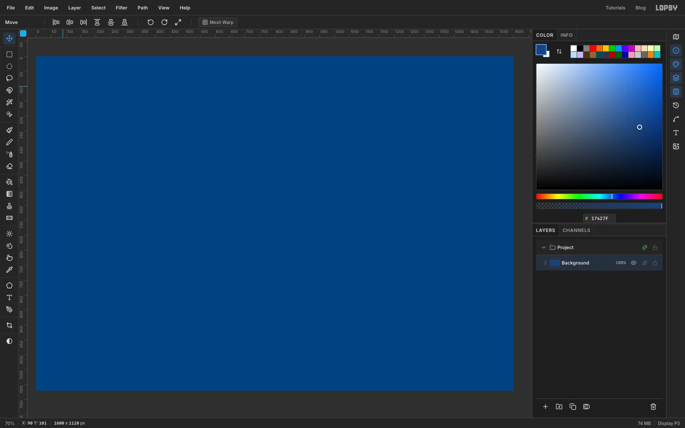

Choose **File → New**, enter **1600 × 1120** pixels and click **Create**.
Delete the empty *Layer 1*. Click *Background*, set the foreground to
`#17427F` and choose **Edit → Fill**.

## Mottle the paper with Clouds

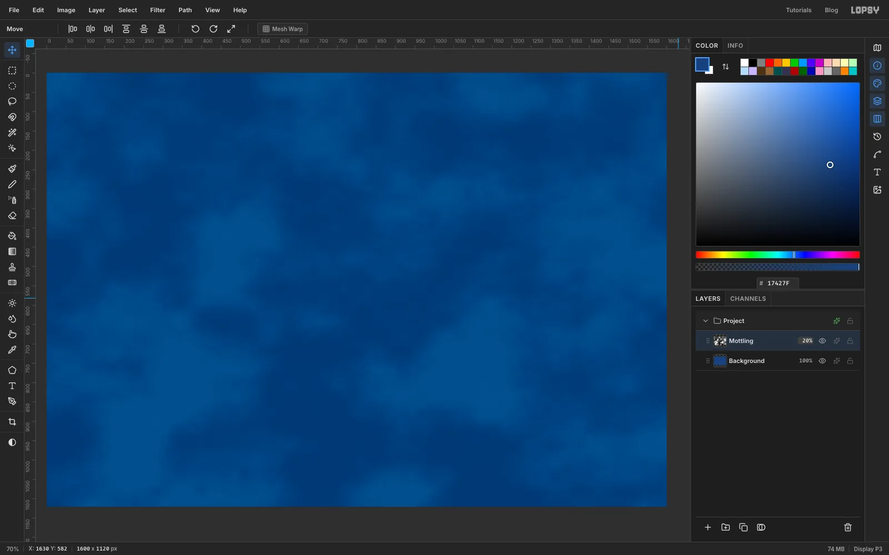

Old diazo prints are never an even blue. Add a layer named *Mottling* and
choose **Filter → Clouds…** with **Scale** `7`. Set the layer's **Blend** to
**Soft Light** and its opacity to **20%**. The clouds now only lighten and
darken the blue underneath.

## Draw a grid tile

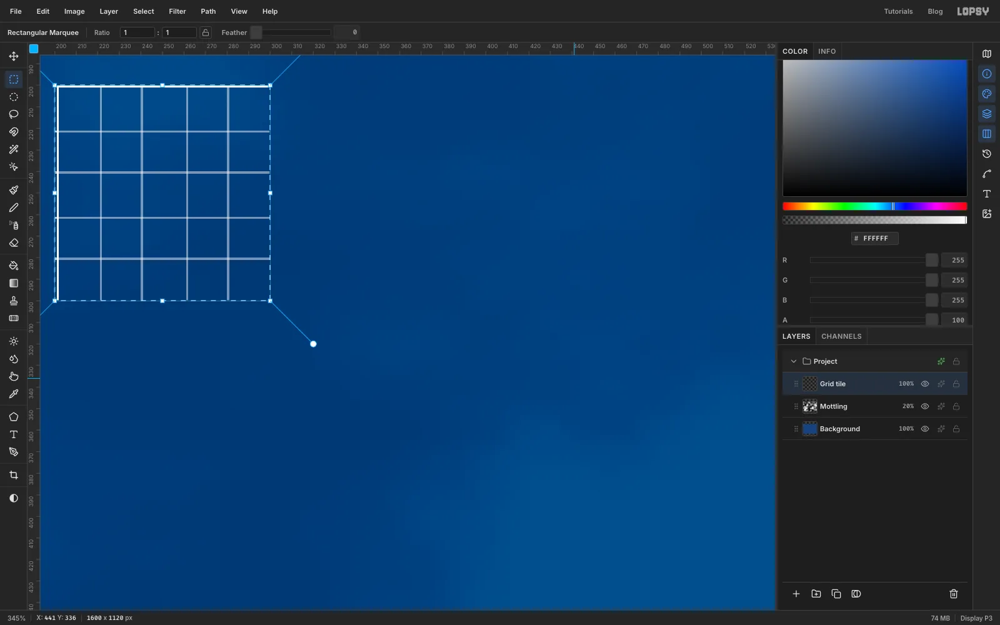

Add a layer named *Grid tile* and pick the **Pencil** at **Size** `1`. You
draw one 100 px cell of the drafting grid, with a fine line every 20 px and a
stronger line on the edge. Zoom in on an empty spot around `250, 250`.

Set the foreground to white with **A** (alpha) at `45`. Click at `220, 200`
and [[Shift]]-click at `220, 299` for a straight line. Draw the other
vertical lines at `x` 240, 260 and 280 the same way, then horizontal lines
at `y` 220, 240, 260 and 280.

Set the alpha back to `100`. Draw one more vertical line at `x` 200 and one
horizontal line at `y` 200. These are the major lines.

Select from `200, 200` to `300, 300` and choose **Edit → Define Pattern**.

## Fill the sheet with the grid

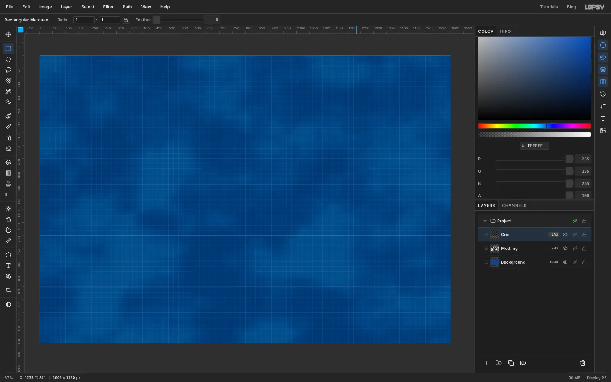

Deselect and delete the *Grid tile* layer; the pattern stays saved. Add a
layer named *Grid*, choose **Edit → Fill with Pattern…**, pick the 100×100
tile and click **Apply**. Lower the layer's opacity to **14%**. The pattern
tiles from the top-left corner, so a major line lands every 100 px.

## Add guides and the drawing border

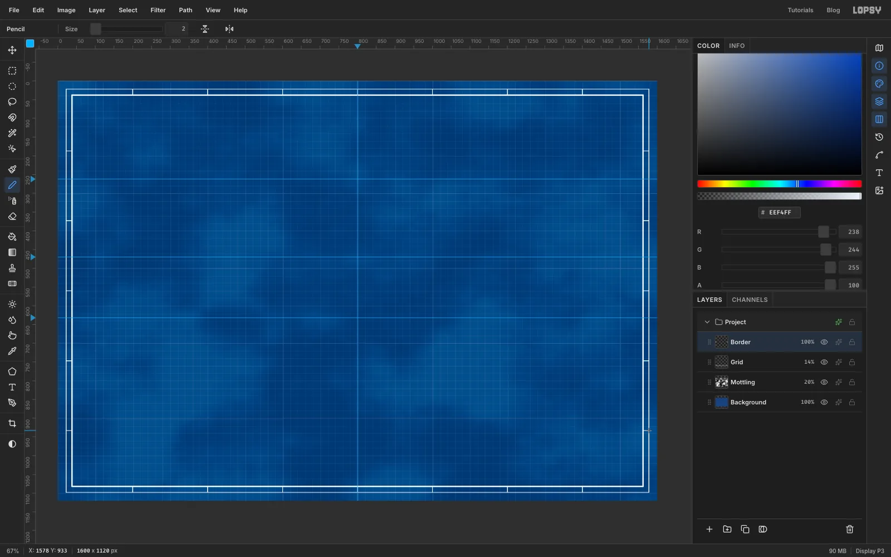

Click the top ruler at `800` to drop a vertical guide. Click the left ruler
at `470` (the wheel's centre), `262` and `632` (the two rows of keys).

Add a layer named *Border*. Pick the **Shape** tool and set **Shape** to
**Rectangle** and **Output** to **Pixels**. Click the **Fill** swatch and
choose **Remove fill**. Click the **Stroke** swatch and type `EEF4FF`. Set
**Width** to `2`.

Click once in the middle of the canvas at `800, 560`. Without a drag, the
Shape tool asks for a size. Enter **1556 × 1076**. Set **Width** to `4`,
click the same spot again and enter **1524 × 1044**. That gives a thin
outer line and a heavier inner one.

Pick the **Pencil** at **Size** `2` with the same white. Draw short
[[Shift]]-click ticks across the margin between the two lines: every 200 px
along the top and bottom, and at every sixth of the height (about every
187 px) on the sides.

The guides show where the wheel and the two rows of keys will sit. Once
you've checked the layout, choose **View → Show Guides** to hide them. Shape
and marquee drags snap to guides, and the small key parts later shouldn't
jump onto them.

## Draw the wheel rings

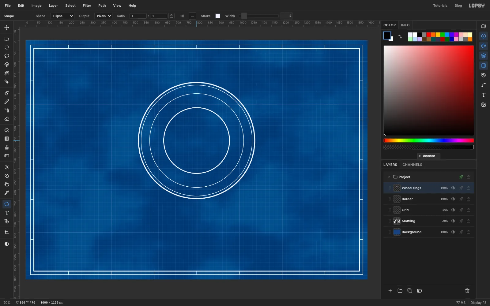

Add a layer named *Wheel rings* and pick the **Shape** tool with **Shape:
Ellipse**, still no fill and a white stroke. Click at the wheel's centre,
`800, 470`, and enter each ring's size in turn:

- **544 × 544** at **Width** `5` (the outer rim)
- **520 × 520** at **Width** `2`
- **440 × 440** at **Width** `2`
- **308 × 308** at **Width** `4` (the inner disc)

Because each ring starts from a click at the same point, they stay exactly
concentric.

## Add tick marks with radial symmetry

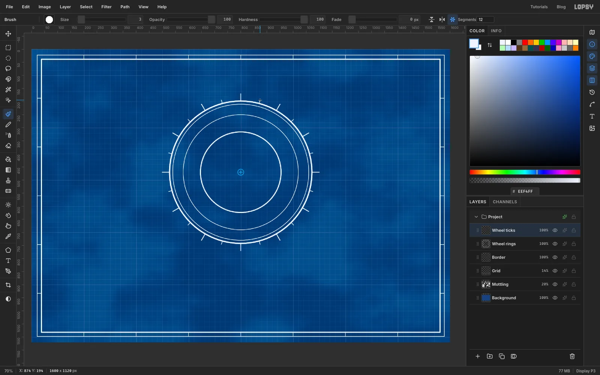

Add a layer named *Wheel ticks* and pick the **Brush**. Click
**Radial Symmetry** in the options bar and set **Segments** to `12`. Then
[[Cmd]]-click the wheel's centre to move the symmetry centre there.

Set **Hardness** to `100` and **Size** to `4`. Click just outside the rim
at the top, `800, 195`, and [[Shift]]-click at `800, 170`. All twelve ticks
appear at once. Set **Size** to `3` and draw a shorter tick halfway between
the first two: click about 3 px outside the rim at 15° clockwise from the
top, and [[Shift]]-click 11 px further out. Now there are 24 ticks, long and
short.

## Set the zodiac glyphs on a circle

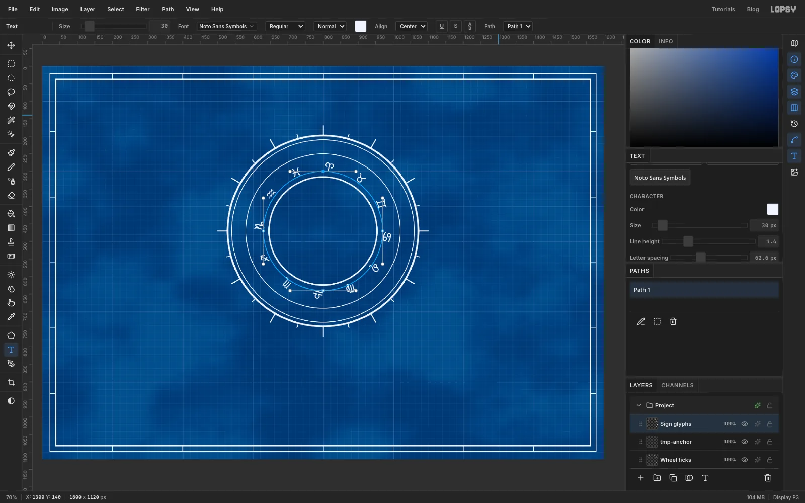

Text on a path needs a path. Pick the **Shape** tool, set **Output** to
**Path**, and drag from the centre `800, 470` out to `970, 640`. The Shape
tool draws from the centre, so this makes a circle path with a radius of
170 px. It starts at the top and runs clockwise.

Click a plain layer first, because the Text options restyle whichever text
layer is selected. The screenshots use an empty helper layer named
*tmp-anchor* for this; *Wheel ticks* works just as well. Pick the **Text** tool, choose
**Noto Sans Symbols** at **Size** `30`, white. In the **Text** panel set
**Letter spacing** to `62.6`. Click an empty spot and type (or paste) the
twelve signs: ♈♉♊♋♌♍♎♏♐♑♒♓. Press [[Tab]] to commit.

In the options bar, set **Path** to the circle path and **Align** to
**Center**. The glyphs wrap round the circle, one every 30°. Rename the
layer *Sign glyphs*.

> **Tip:** The circumference at radius 170 is about 1068 px. Divide by 12
> and each sign gets an 89 px slot. The glyphs are about 26 px wide, so the
> letter spacing makes up the rest.

## Add the ring of sign names

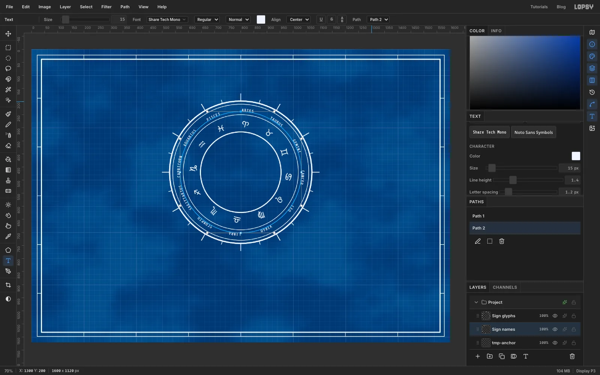

Draw a second circle path the same way, from `800, 470` out to
`1032, 702` (radius 232).

Click *Wheel ticks* again. Set the **Text** tool to **Share Tech Mono** at
**Size** `15` and set **Letter spacing** to `1.2`. In a monospace face
every character is the same width. Give each name a 13-character slot (the
name plus spaces) and the twelve slots fill the circle exactly. Type the
names starting with ARIES and pad each one with spaces so it is roughly
centred in its slot. The gaps below aren't all 13; each one is the end of
one slot plus the start of the next:

- ARIES, 7 spaces, TAURUS, 7 spaces, GEMINI, 7 spaces, CANCER, 9 spaces
- LEO, 9 spaces, VIRGO, 8 spaces, LIBRA, 7 spaces, SCORPIO, 4 spaces
- SAGITTARIUS, 3 spaces, CAPRICORN, 4 spaces, AQUARIUS, 6 spaces, PISCES, 8 spaces

Commit with [[Tab]], set **Path** to the new circle and **Align** to
**Center**, and rename the layer *Sign names*. Each name now sits above
its glyph.

## Divide the wheel into sectors

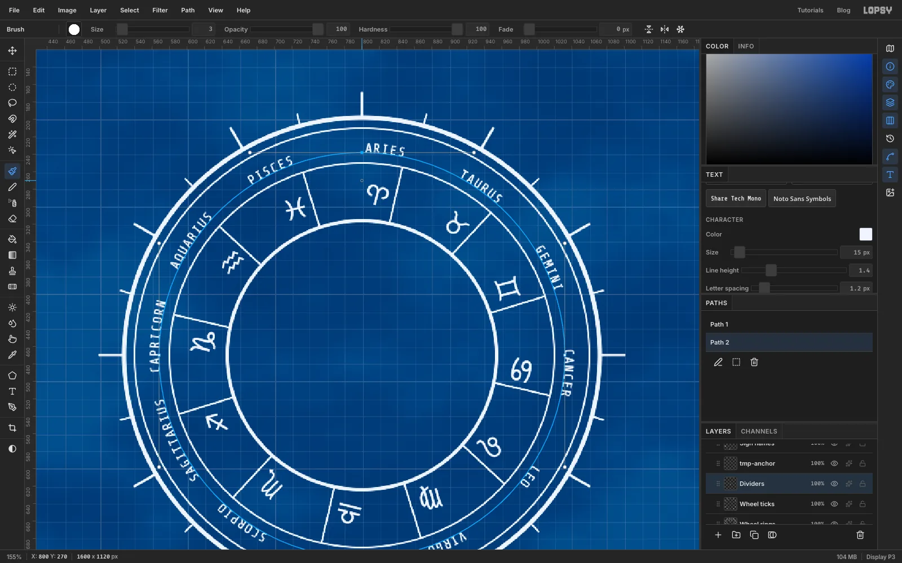

Add a layer named *Dividers*. With the **Brush** (still **Radial
Symmetry**, 12 segments, centred on the wheel) at **Size** `3`, draw one
short line across the glyph band, from just outside the inner disc to just
inside the 440 px ring. Put it in the gap between ♈ and ♉, about 12°
clockwise of straight up. The other eleven land in the other gaps.

Click **Radial Symmetry** again to turn it off.

## Build a key from marquees

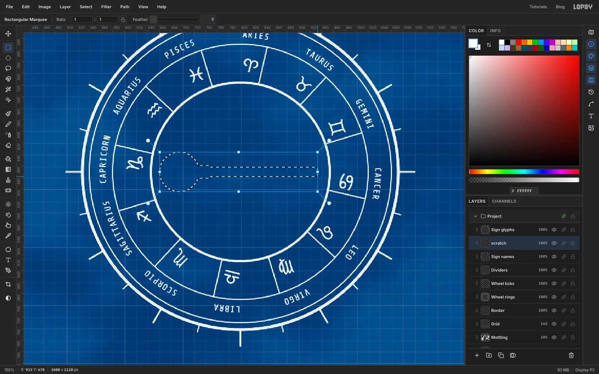

The two crossed keys in the wheel start as one plain key, built from
selections.

First make the hatch pattern you'll use for cut-through parts. Add a layer
named *Hatch tile*, pick the **Brush** at **Size** `2` and **Hardness**
`100`, white, and choose an empty 14 × 14 px square (this build used
`1300, 60` to `1314, 74`). Draw three parallel 45° lines 14 px apart with
[[Shift]]-click: one corner to corner through the square, and one through
each of the two other corners, so the lines wrap seamlessly. Select the
square, choose **Edit → Define Pattern**, deselect and delete the layer.

Now add an empty layer named *scratch* to keep your place in the stack
(you can delete it at the end) and zoom in on the wheel.

With the **Elliptical Marquee**, drag a circle from `661, 436` to
`729, 504` for the bow. Switch to the **Rectangular Marquee** and hold
[[Shift]] while you drag each extra part, so it adds to the selection:

- a short neck from `725, 459` to `749, 481`
- the shaft from `729, 462` to `933, 478`
- a collar ring from `880, 457` to `890, 483`
- the bit (the part that turns the lock) from `897, 476` to `933, 516`

## Cut the finger hole

Hold [[Alt]] to subtract. With the **Rectangular Marquee**, drag a slot into
the bottom of the bit, from `910, 498` to `920, 518`. Then pick the
**Elliptical Marquee** and [[Alt]]-drag a circle from `676, 451` to
`714, 489` for the finger hole.

> **Tip:** Selections are quick to build with modifier keys, and
> **Select → Selection → Path** turns the result into clean paths, tracing
> the finger hole as a path of its own.

## Tint the key and trace its outline

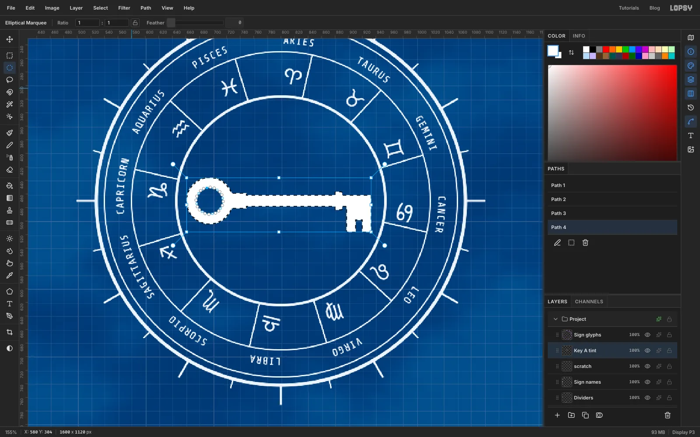

Add a layer named *Key A tint*, set the foreground to white and choose
**Edit → Fill**. Keep the selection and choose **Select → Selection →
Path**. The Paths panel gets two new paths, one for the outside of the key
and one for the finger hole.

## Hatch the bit

Drafters hatch a part that's cut through. The key selection should still
be active from the last step. Add a layer named *Key A hatch*. With the **Rectangular Marquee**, hold
[[Shift]]+[[Alt]] and drag a box around the bit. That keeps only the part
of the key selection inside the box. Choose **Edit → Fill with Pattern…**,
pick the 14×14 hatch and apply it. Set this layer to **70%** and deselect.
Set *Key A tint* to **16%**, so the key is a faint wash and the hatching
shows.

## Stroke the outline

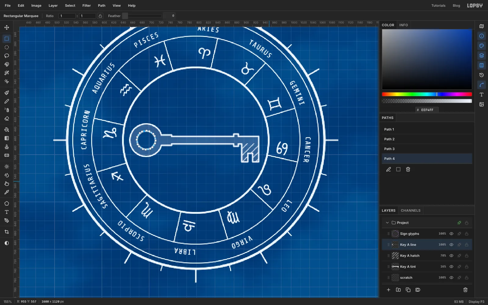

Add a layer named *Key A line* and set the foreground to `#EEF4FF`. In the **Paths** panel, click the first of the two newest paths (the
outline; here *Path 3*) and click **Stroke Path**. Enter
**Width** `3` and click **Stroke**. Do the same for the finger-hole path (*Path 4*).

Stroke Path follows the traced curve exactly, so the line is smooth even
where a marquee edge was a little stepped.

## Group the key and rotate it 45°

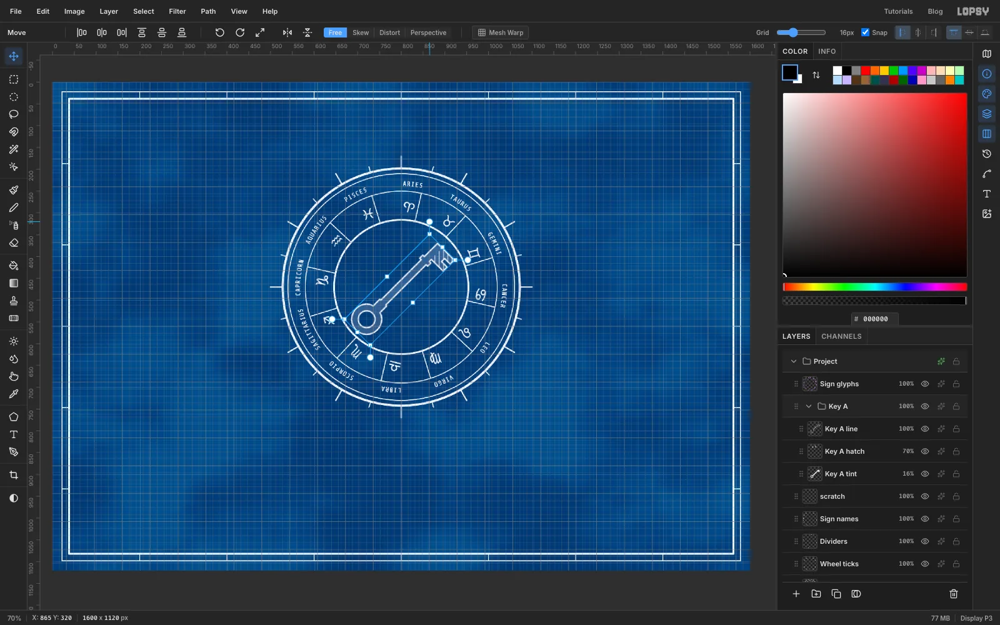

Click *Key A tint*, [[Cmd]]-click *Key A hatch* and *Key A line*, and choose
**Layer → Group Layers**. Name the group *Key A*. Turn on
**View → Show Grid**, because with the grid on the rotate handle snaps in
15° steps.

Click the *Key A* group row and pick the **Move** tool. With no selection,
the handles frame the whole group. Drag the round rotate handle at the
top-right corner counter-clockwise until the key turns 45°: bow down-left,
bit up-right. Press [[Escape]] to apply it, then turn the grid off.

## Duplicate and flip the copy

With *Key A* selected, choose **Layer → Duplicate Layer**. Name the copy
*Key B* and rename its three layers *Key B tint*, *Key B hatch* and
*Key B line*.

With the **Move** tool and *Key B* selected, click **Flip Horizontal** in
the options bar. The copy mirrors in place. Nudge it with the left arrow
key until the X is symmetrical about the vertical centre line. It takes about 6 px.

## Hide the lines underneath

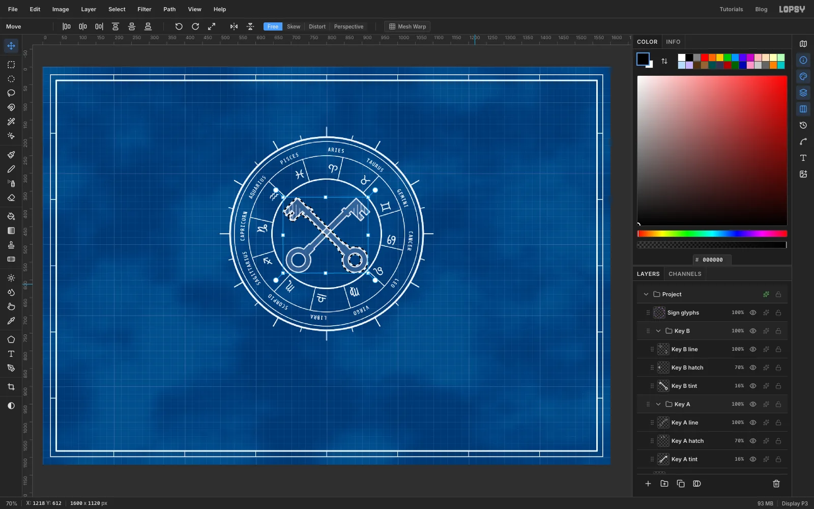

On a drawing, a part in front hides the lines behind it.
[[Cmd]]-click the thumbnail of *Key B tint*. Its full silhouette becomes the
selection, because the tint layer is solid white at a low layer opacity.
Choose **Select → Grow…** `3`.

Click *Key A line* and press [[Delete]]. Do the same on *Key A hatch* and
*Key A tint*, then deselect. Key A now passes cleanly behind Key B.

## Rivet the crossing

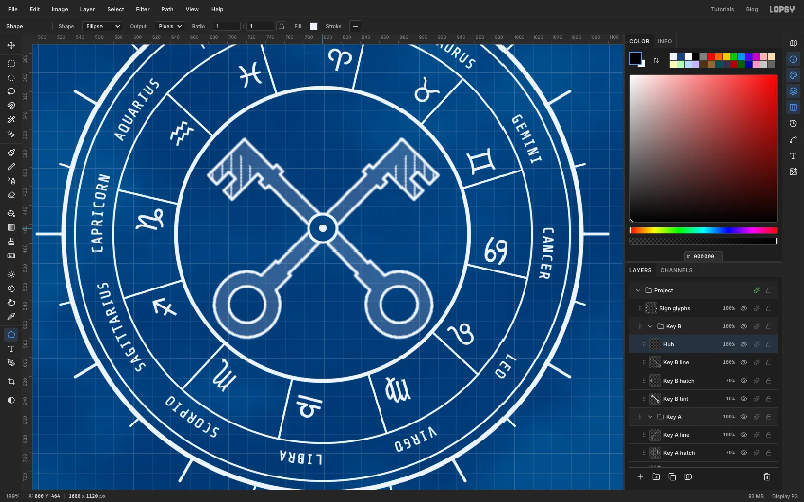

Click *Key B line* and add a layer named *Hub*. Pick the **Shape** tool
with **Ellipse** and **Pixels**. Set the fill to the paper blue `#17427F`
and the stroke to white at **Width** `3`, then click where the shafts cross
and enter **30 × 30**. Remove the stroke, set the fill to white and click
the same point for an **8 × 8** dot.

## Scale the pair to fit the ring

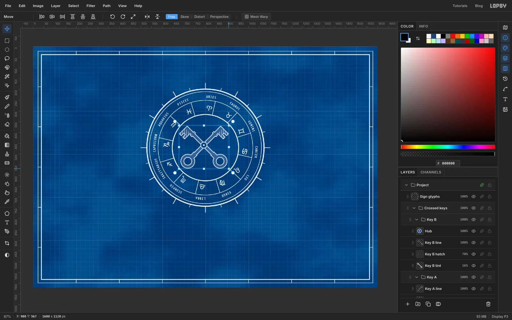

[[Cmd]]-click to select both *Key A* and *Key B* and group them as *Crossed
keys*. With the **Move** tool, [[Cmd]]-drag the bottom-right corner handle
inward until the pair is about 6% smaller. [[Cmd]] keeps the proportions.
Press [[Escape]], then nudge the group so the bows clear the inner ring by
the same gap as the bits.

## Build the Aries key

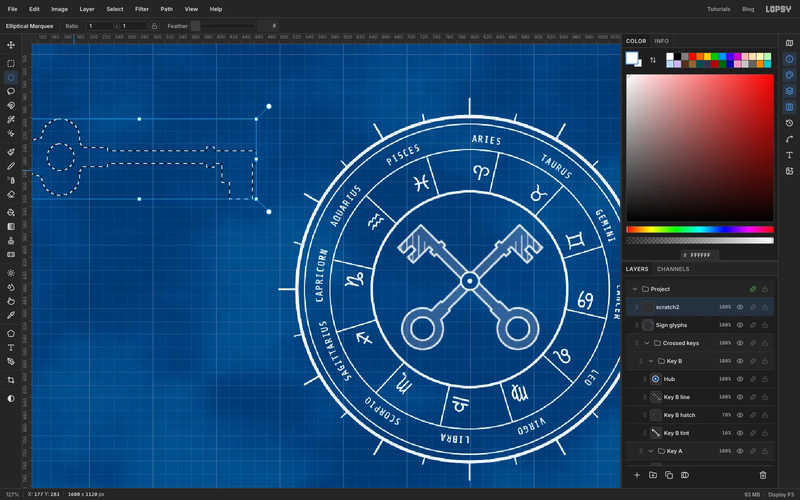

The four figure keys are built the same way as the plain one. Only the bow
and the bit change. Collapse the *Crossed keys* group and click
*Sign glyphs*, so new layers land at the top level rather than inside the
group. Add an empty layer named *scratch2* and zoom in on the top left.

For **FIG. 1 Aries**, the ram's horns become a trefoil bow. Drag a circle
from `96, 232` to `156, 292`. [[Shift]]-drag two more circles of the same
size, above and below to the right, `126, 202` to `186, 262` and `126, 262`
to `186, 322`, then a larger disc from `122, 226` to `194, 298` to fill the
middle.

[[Shift]]-add the rectangles: neck `190, 247` to `230, 277`, shaft
`212, 252` to `464, 272`, collar `386, 246` to `398, 278`, and a stepped
bit `410, 272` to `458, 302` plus `422, 300` to `458, 328`. With the **Elliptical Marquee**, [[Alt]]-drag a circle from `135, 241` to
`177, 283` for the finger hole.

## Tint, hatch and stroke Aries

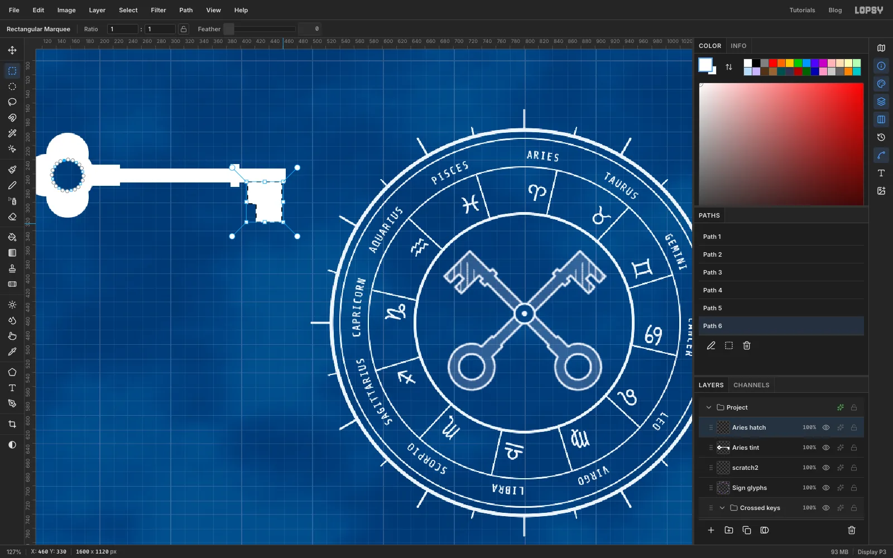

Repeat the three layers from the plain key, named *Aries tint*, *Aries
hatch* and *Aries line*:

1. Fill the selection with white on *Aries tint*.
2. Choose **Select → Selection → Path**.
3. [[Shift]]+[[Alt]]-drag around the bit and fill it with the hatch
   pattern on *Aries hatch* at 70%.
4. Set *Aries tint* to 16%.
5. Stroke both new paths at width 3 on *Aries line*.

Group the three layers as *FIG 1 Aries*.

## Label and dimension FIG. 1

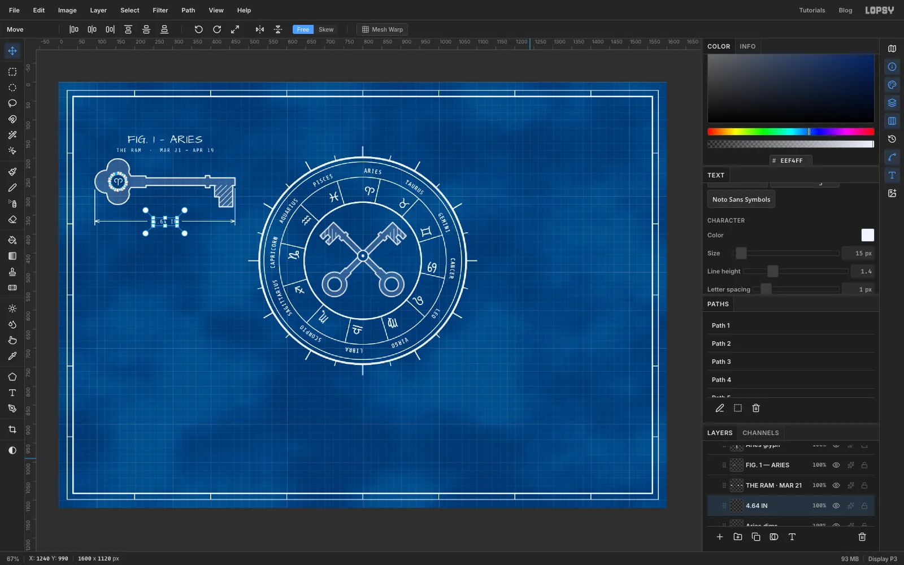

Click *Aries line* so new layers go into the group. Then add:

- **The glyph:** ♈ in **Noto Sans Symbols** at `26`, centred in the
  finger hole.
- **The title:** `FIG. 1 — ARIES` in **Architects Daughter** at `30`,
  letter spacing `1`, centred over the key at `y` 150.
- **The subtitle:** `THE RAM · MAR 21 – APR 19` in **Share Tech Mono** at
  `14`, letter spacing `2`, centred at `y` 178.

Type each one in an empty part of the canvas and move it into place with
the **Move** tool and arrow keys. A click near existing text would edit
that text instead.

Then add a layer named *Aries dims* and draw the dimension with a hard
2 px brush:

1. A vertical extension line down from each end of the key.
2. A horizontal dimension line between them at `y` 366, broken in the
   middle.
3. An open arrowhead at each end: two 12 px Shift-click strokes.
4. The length in **Share Tech Mono** `15` in the gap: the key is
   371 px long, which is `4.64 IN` at 80 px to the inch.

## Give Leo a sun for a bow

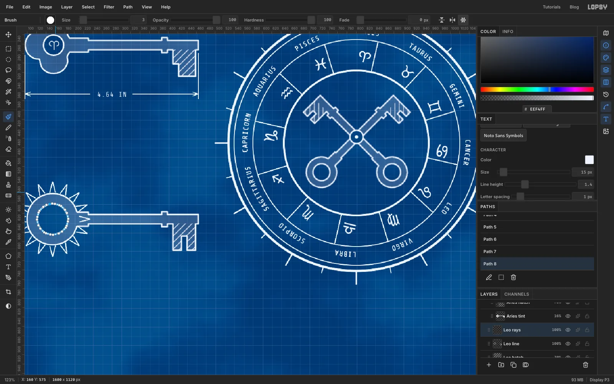

Build **FIG. 2 Leo** in the lower row:

- a ring bow from `100, 578` to `208, 686`
- the same neck, shaft and collar as Aries, 370 px lower
- a forked bit `410, 642` to `458, 698`, with an [[Alt]] slot from
  `428, 668` to `440, 700`
- with the **Elliptical Marquee**, [[Alt]]-drag the finger hole from
  `122, 600` to `186, 664`

Tint, hatch and stroke it as before, on layers named *Leo tint*,
*Leo hatch* and *Leo line*.

Add a layer named *Leo rays*. Pick the **Brush**, turn on **Radial
Symmetry** with **Segments** `16`, and [[Cmd]]-click the centre of the bow at `154, 632`.
At **Size** `3`, draw one pointed ray:

1. Click just outside the ring, a little left of straight up.
2. [[Shift]]-click about 80 px from the centre, straight up.
3. [[Shift]]-click back at the ring, a little to the right.

Sixteen rays appear. Turn symmetry off.

The rays on the right run into the neck. [[Cmd]]-click the *Leo tint*
thumbnail, **Grow** `3`, click *Leo rays* and press [[Delete]].

## Finish FIG. 2

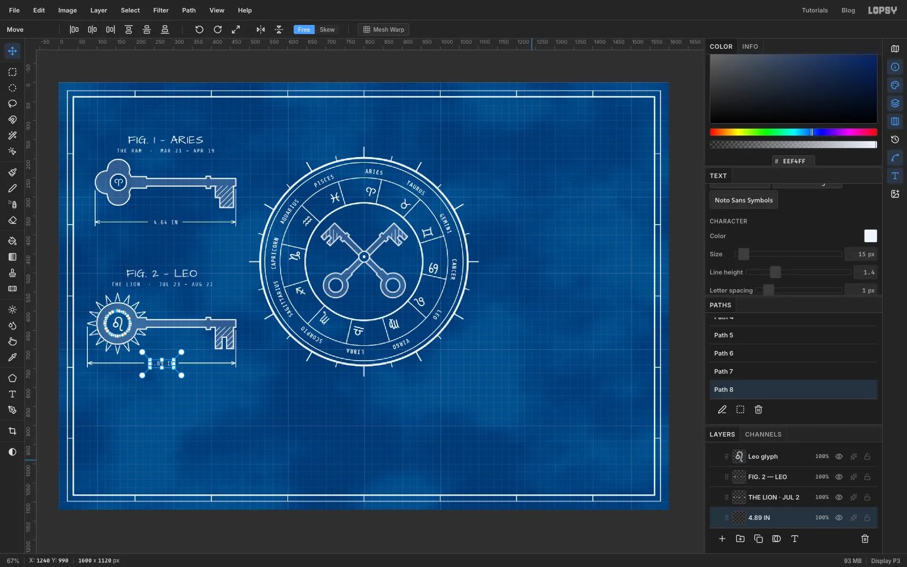

Group Leo's layers as *FIG 2 Leo* and label it like Aries:

- ♌ at size `40` in the hole.
- `FIG. 2 — LEO` centred at `y` 500.
- `THE LION · JUL 23 – AUG 22` at `y` 528.
- A dimension line at `y` 736 reading `4.89 IN`.

Keeping both rows of titles on fixed lines (150 and 500) lines them up
across the sheet even though Leo's rays are taller than the others.

## Build Scorpio with a stinger

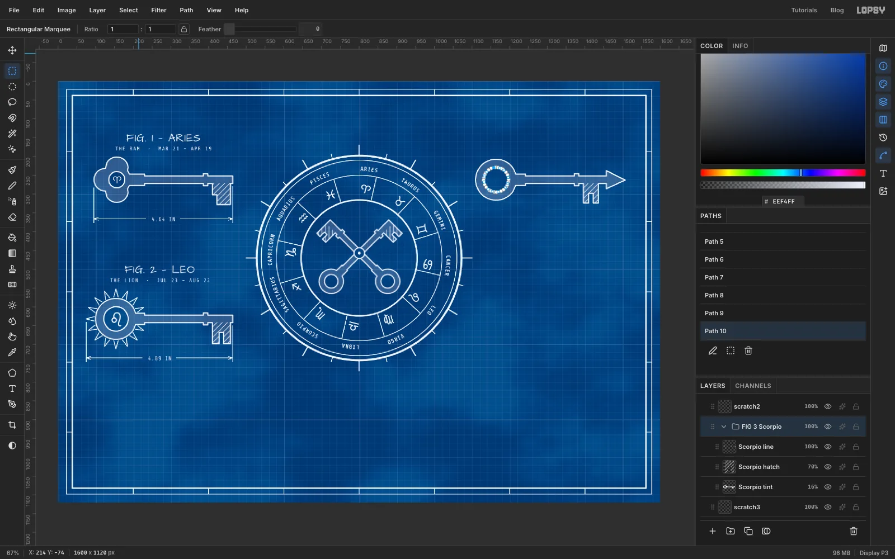

The right-hand keys are drawn the same way round as the left ones, bow on
the left, and flipped afterwards. For **FIG. 3 Scorpio**, start in the top
right:

- A ring bow from `1110, 208` to `1218, 316`.
- A neck `1210, 247` to `1242, 277`.
- A shaft `1224, 252` to `1464, 272`.
- A collar `1372, 246` to `1384, 278`.
- A bit `1396, 272` to `1436, 324`, with an [[Alt]] slot `1410, 298` to
  `1422, 326`.

For the stinger, pick the **Lasso**. Hold [[Shift]] and trace a barbed
arrowhead past the end of the shaft: from `1456, 238` to the point at
`1508, 262`, down to `1456, 286`, back in to `1458, 262`, and close. With the **Elliptical Marquee**, [[Alt]]-drag the finger hole
from `1132, 230` to `1196, 294`. Render the key with *Scorpio tint*,
*Scorpio hatch* and *Scorpio line* layers. Group them as *FIG 3 Scorpio*.

## Flip Scorpio to face the wheel

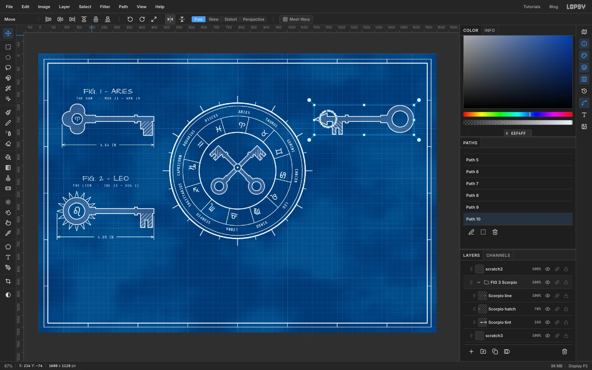

Click the *FIG 3 Scorpio* group, pick the **Move** tool and click
**Flip Horizontal** in the options bar. The whole group mirrors about its
own centre, so it stays in place. The bow is now on the outside edge and
the stinger points at the wheel. Press [[Escape]].

Do this before adding any text: a group that holds text won't flip.

## Label FIG. 3

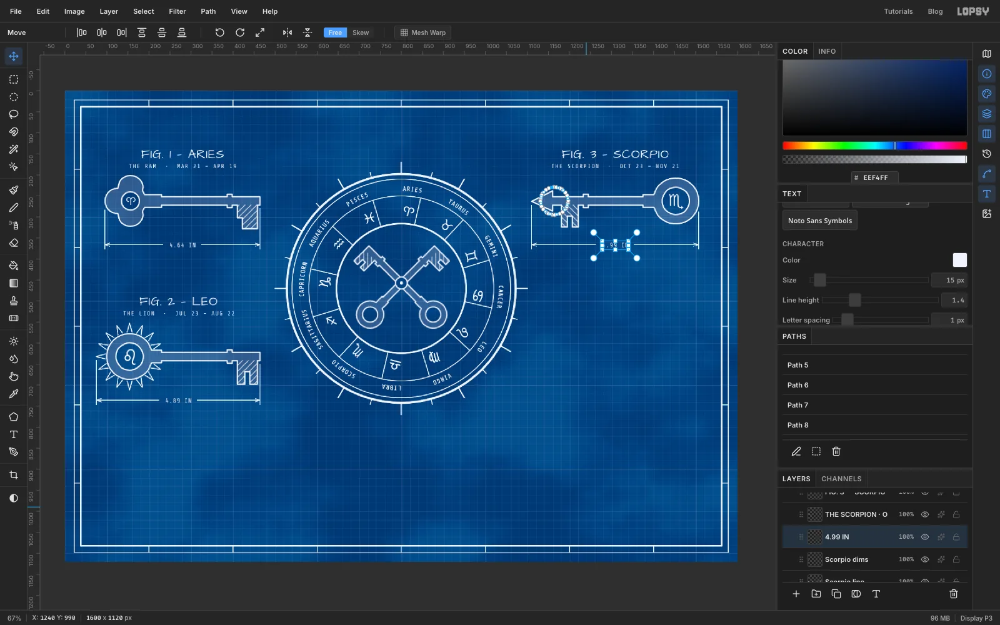

Add ♏ at `40` in the finger hole, `FIG. 3 — SCORPIO` at `y` 150,
`THE SCORPION · OCT 23 – NOV 21` at `y` 178, and the dimension `4.99 IN`
below, all as before.

## Build Pisces with a fish bow

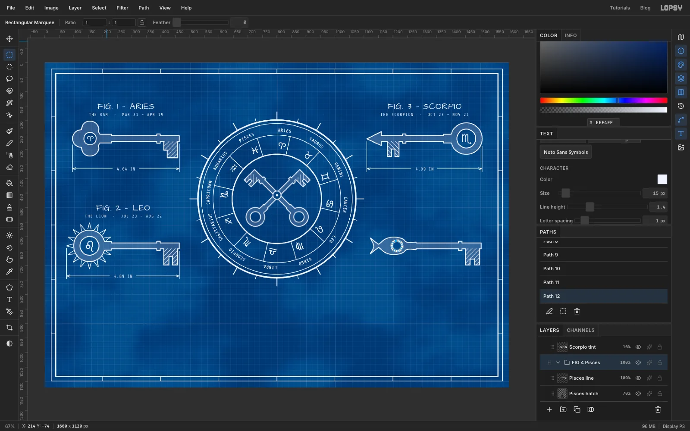

For **FIG. 4 Pisces**, the bow is a fish. With the **Elliptical Marquee**,
drag a circle from `1138, 530` to `1270, 662`. Hold [[Shift]]+[[Alt]] and
drag a second circle of the same size lower down, `1138, 602` to
`1270, 734`. Only the overlap stays: a lens, the fish's body.

[[Shift]]-lasso a forked tail on its left: `1158, 632`, `1122, 604`,
`1134, 632`, `1122, 660`. Then add the parts:

- A neck `1248, 619` to `1280, 645`.
- A shaft `1260, 622` to `1504, 642`.
- A collar `1426, 616` to `1438, 648`.
- A bit `1450, 642` to `1498, 698`, notched with an [[Alt]] box from
  `1466, 678` to `1482, 706`.

The eye is the finger hole: with the **Elliptical Marquee**, [[Alt]]-drag
from `1197, 615` to `1231, 649`.

## Flip and label FIG. 4

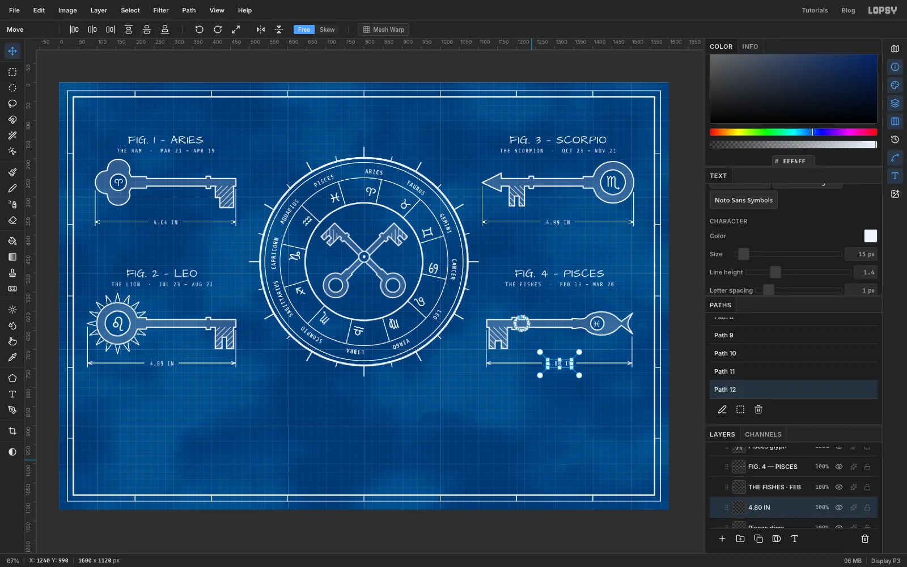

Render and group it as *FIG 4 Pisces*, flip it horizontally, and label it:

- ♓ at about `21` in the eye, which is only 34 px across.
- `FIG. 4 — PISCES` at `y` 500.
- `THE FISHES · FEB 19 – MAR 20` at `y` 528.
- `4.80 IN` below.

The four keys now line up: titles on two shared lines, dimension lines on
two shared lines, and the outer ends of the keys the same distance from the
border on both sides.

## Draw the ribbon tails

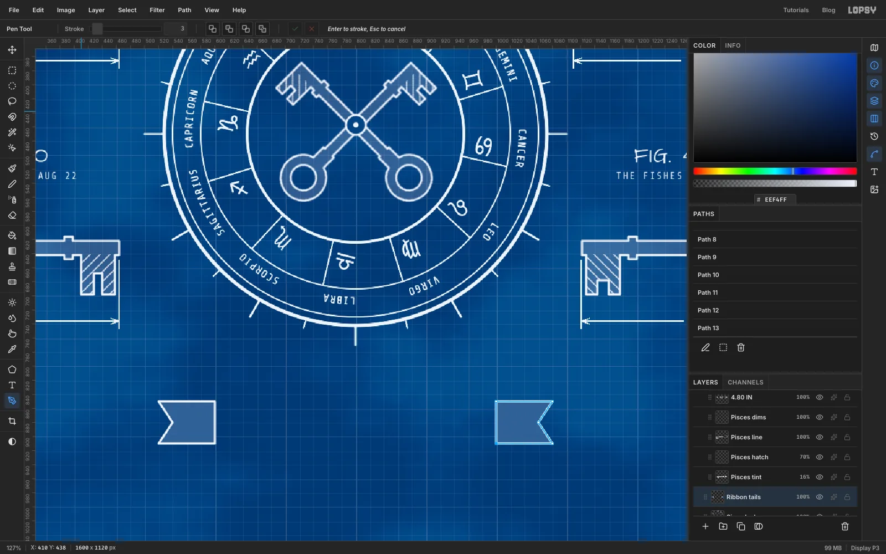

Tattoo flash needs a banner. Click *Sign glyphs* (a top-level layer) and
add a layer named *Ribbon tails*. Pick the **Pen** tool and set **Stroke**
to `3`.

Click five corners for the left tail, `600, 850`, `520, 850`, `540, 880`,
`520, 910` and `600, 910`, then click the first point again to close it. In
the Paths panel click **Path to Selection**. Fill the selection with
`#3C6093`, deselect, and with the foreground back on white, press
[[Enter]] to stroke the path. Draw the right tail as its mirror image.

Draw the two small fold triangles where each tail tucks behind the band.
Click three Pen points and the first one again to close: `572, 890`,
`600, 910`, `600, 890` on the left, and the mirror image on the right. Use
**Path to Selection**, fill each with the hatch pattern, deselect and press
[[Enter]] to stroke it.

## Draw the arched band

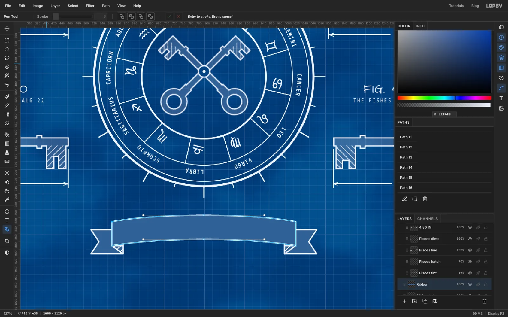

Add a layer named *Ribbon*. With the **Pen**, click `572, 830`, then
**click and drag** at `800, 814` out to `950, 814` to bend the top edge.
Click `1028, 830` and `1028, 890`, then click and drag at `800, 874` out to `650, 874` for the bottom edge. Click `572, 890`, and click the first point
to close the shape.

Path to Selection, fill with `#3C6093`, deselect, and press [[Enter]] to
stroke the outline in white. The band covers the inner ends of the tails.

## Set the title on an arch

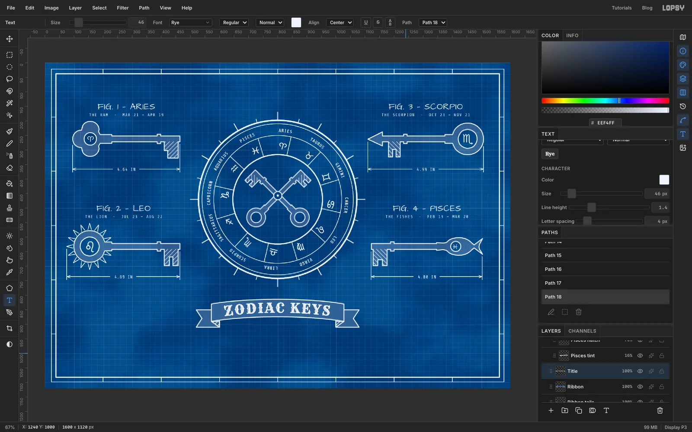

With the **Pen**, click `596, 876`, click and drag at `800, 860` out to `930, 860`, click `1004, 876`, and click the ✓ **Commit path** button to keep
the open curve without stroking it. This is the title's baseline. It
curves the same way as the band.

Click a plain layer, then type `ZODIAC KEYS` in **Rye** at **Size** `46`,
letter spacing `4`, white. Set **Path** to the new curve and **Align** to
**Center**. Rename the layer *Title*. The letters stand upright along the
arch with even margins above and below.

## Add the header, zone numbers and scale bar

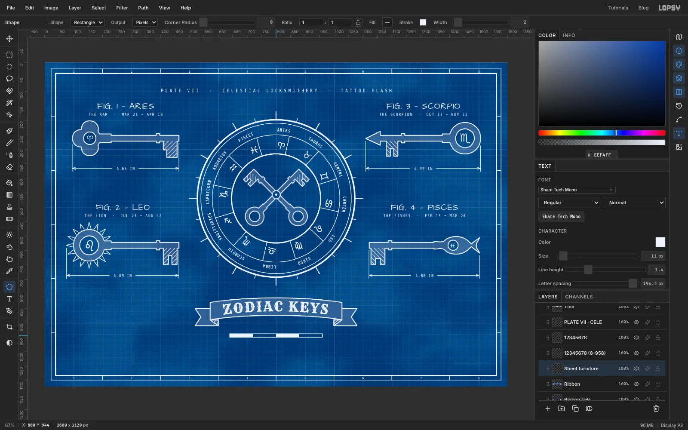

Add a layer named *Sheet furniture*. It will hold the scale bar, frames
and title-block rules; text makes its own layers above it. Add the text in
white:

- **The header:** `PLATE VII · CELESTIAL LOCKSMITHERY · TATTOO FLASH` in
  **Share Tech Mono** `17` with letter spacing `6`, centred at `800, 96`.
- **The zone numbers:** `12345678` in **Share Tech Mono** `11` with
  **Letter spacing** `194.1`. Each digit plus its spacing is exactly
  200 px, so the numbers fall midway between the zone ticks. Centre one
  copy in the top margin at `y` 30 and another in the bottom margin.

For the scale bar, fill two 80 × 12 boxes white (`640, 938` to `720, 950`
and `800, 938` to `880, 950`). Then outline the whole bar with the **Shape**
tool: a stroke-only **Rectangle**, click at `800, 944` and enter
**320 × 12**. Number the ticks `0` to `4` underneath and add `INCHES` below.

## Open a reference photo

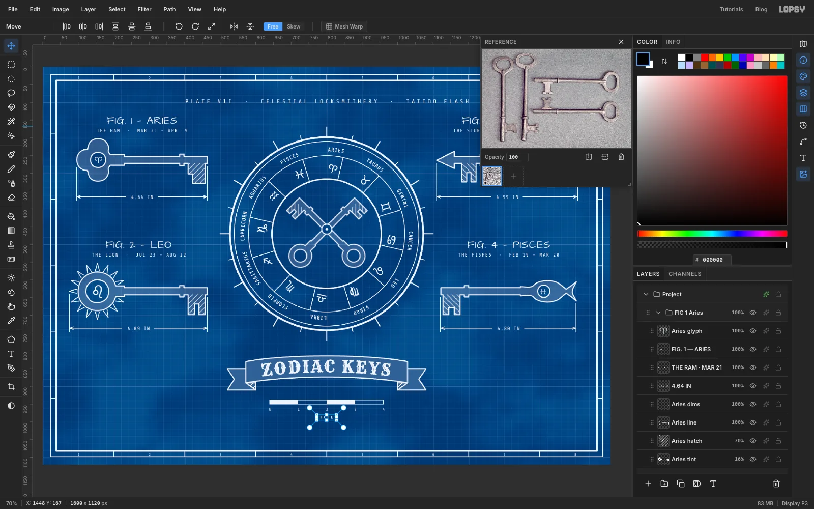

Real keys make better drawings. Click **Reference** in the panel toolbar,
click the drop zone and choose a photo of antique keys. This one is
*Four Skeleton Keys on a blue background* by Cindy Shebley (CC BY 2.0,
Wikimedia Commons); despite the title, the felt reads grey. The drawer floats beside the canvas, so you can check
proportions while you draw.

## Drop the photo onto the sheet and crop one key

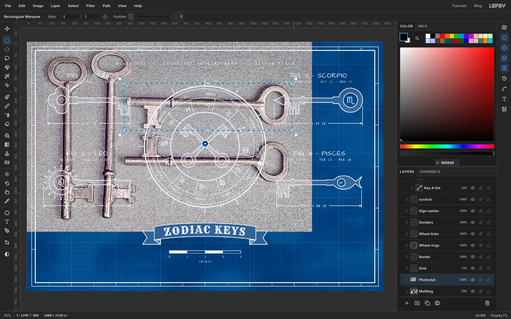

Click *Mottling* so the photo lands low in the stack, then drag the same
photo file onto the canvas. It arrives as a new layer; rename it
*Photostat*. Deselect.

Select from `438, 186` to `1188, 398`, around the key lying on top right in
the photo. Choose **Select → Inverse** and press [[Delete]] to keep just
that strip.

## Cut the key out with the Magic Wand

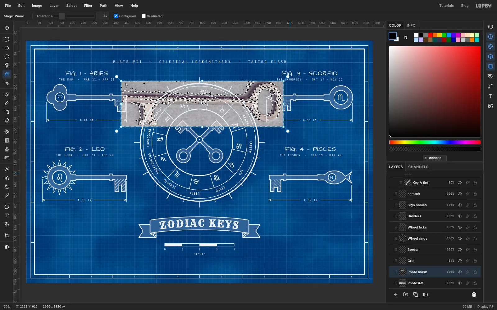

The felt behind the key is too speckled for the wand to read directly. A
blurred copy smooths it out. Choose **Layer → Duplicate Layer**, name the
copy *Photo mask*, and apply **Filter → Gaussian Blur…** with
**Radius** `6`.

Pick the **Magic Wand** with **Tolerance** `34` and **Contiguous** on.
Click the felt above the shaft, then [[Shift]]-click to add these:

- the felt below the shaft
- the felt left of the bit
- two spots inside the bow's hole

Choose **Select → Grow…** `2`.

Click *Photostat* and press [[Delete]]. Then select from `444, 192` to
`1182, 392`, choose **Select → Inverse** and press [[Delete]] again to trim
the blurred edge. Deselect, and delete the *Photo mask* layer.

## Turn the photo into a photostat

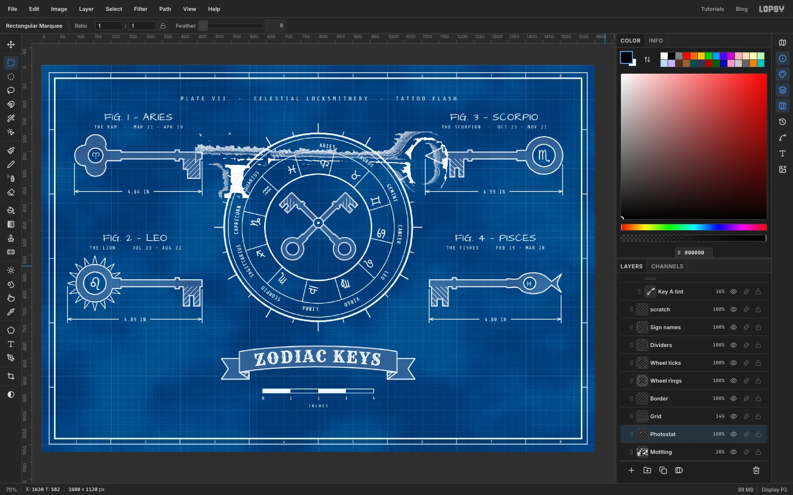

On *Photostat*, apply these filters:

1. **Filter → Desaturate**.
2. **Filter → Surface Blur…** with **Radius** `4` and **Threshold** `30`.
3. **Filter → Brightness/Contrast…** with **Brightness** `15` and
   **Contrast** `45`.

Set the layer's **Blend** to **Screen**. Dark parts of the photo vanish
into the blue and the bright metal prints pale, like a photostat
pasted onto the sheet.

## Scale and tilt it into place

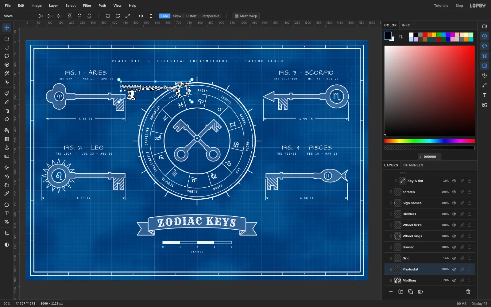

[[Cmd]]-click the *Photostat* thumbnail to select it, pick the **Move** tool
and [[Cmd]]-drag the bottom-right handle inward until the key is a little
under half its size, about 44%. Press [[Escape]] to apply.

Drag it down to the bottom-left corner, centred near `278, 975`, where the
photostat frame will go. Select it again and drag the rotate handle about
4° counter-clockwise. A slightly crooked paste-up
looks hand-mounted. Press [[Escape]] and deselect.

## Draw the title block

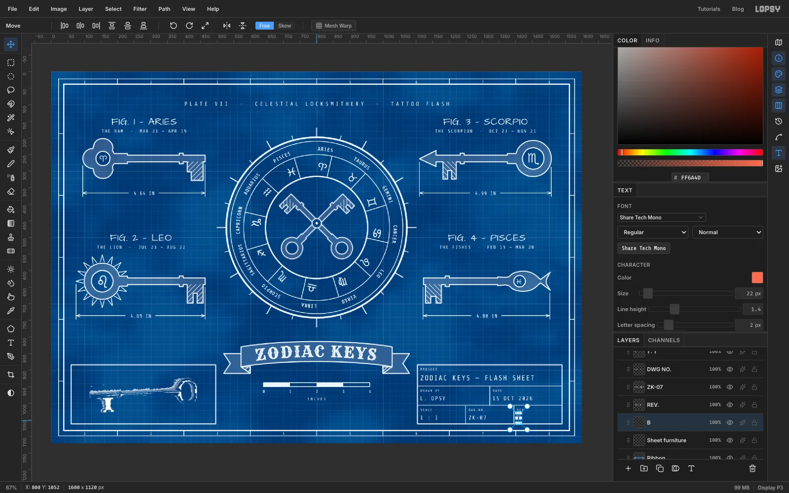

On *Sheet furniture*, use the **Shape** tool (stroke-only **Rectangle**,
**Width** `3`) to draw two 436 × 178 boxes:

- the photostat frame, clicked at `278, 973`
- the title block, clicked at `1322, 973`

Divide the title block with a 2 px hard brush and [[Shift]]-click lines:

- a full-width rule at `y` 948 and another at `y` 1006
- one divider at `x` 1322 in the middle row
- two dividers in the bottom row, splitting it into thirds

Fill the cells in **Share Tech Mono**. Each gets a tiny caption at `10`
with letter spacing `2` in its top-left corner, and its entry underneath:

- **PROJECT:** ZODIAC KEYS — FLASH SHEET, at `22`.
- **DRAWN BY:** L. OPSY, at `17`.
- **DATE:** 15 OCT 2026, at `17`.
- **SCALE:** 1 : 1, at `17`.
- **DWG NO.:** ZK-07, at `17`.
- **REV.:** B, at `22`, in red `#FF6A4D`.

Caption the photostat box as well: `PHOTOSTAT · SPECIMEN A` at the top and
`WARDED DOOR KEY, C. 1890 · 1:2` at the bottom, at `11`.

## Fill the gaps with a crescent moon

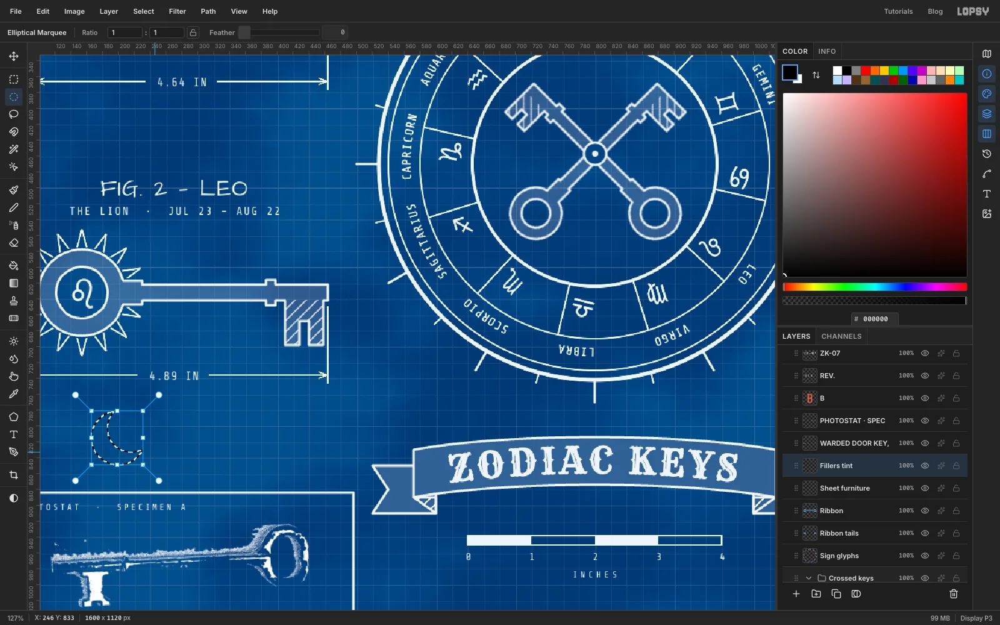

Flash sheets have no dead space. Add a layer named *Fillers tint*. With the
**Elliptical Marquee**, drag a circle from `166, 781` to `234, 849`. Hold
[[Alt]] and drag a slightly smaller circle up and to the right, `186, 773`
to `246, 833`, to bite out a crescent. Fill it with white and choose
**Select → Selection → Path**.

Make the sparkles the same way. Zoom in close and use the **Lasso** to
trace a four-pointed star with curved, pinched-in sides, then fill it and
trace it to a path. Make seven:

- about 38 px across, above and below the crossed keys at `800, 356` and
  `800, 590`
- about 34 px at `300, 790` and `1210, 800`
- about 26 px at `1395, 832`
- about 28 px either side of the header, at `356, 97` and `1244, 97`

Add two small five-pointed stars, about 16 px across, at `336, 842` and
`148, 770`. Five straight lasso sides between the points are enough.

## Draw a keyhole escutcheon

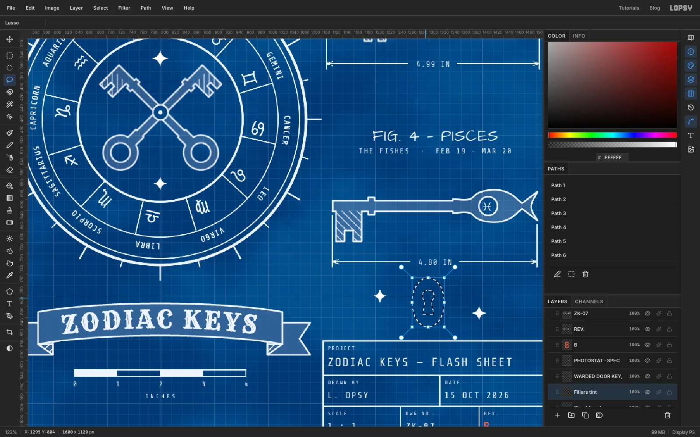

Below FIG. 4, drag an oval with the **Elliptical Marquee** from
`1270, 766` to `1330, 858`. Cut the keyhole out of it:

1. [[Alt]]-drag a small circle from `1289, 789` to `1311, 811`.
2. [[Alt]]-lasso a tapering slot below it: `1295, 804`, `1305, 804`,
   `1310, 834`, `1290, 834`.

Fill the oval and trace it to paths. The outline and the keyhole each
become their own path.

## Stroke the fillers

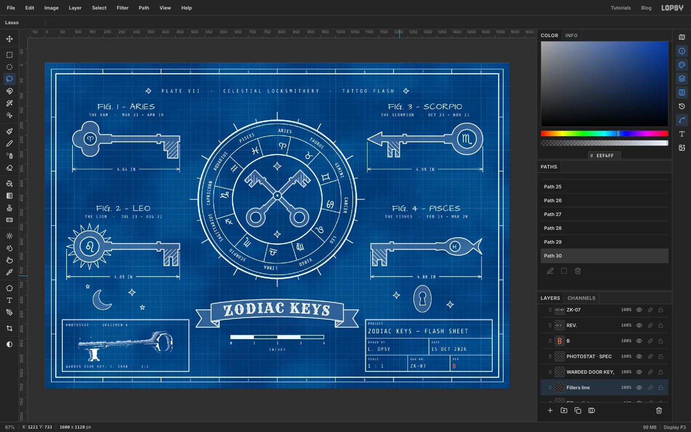

Set *Fillers tint* to **16%**, like the keys. Add a layer named
*Fillers line* and stroke every filler path in the Paths panel at
**Width** `2`, slightly lighter than the keys' 3 px.

## Mark a revision in red pencil

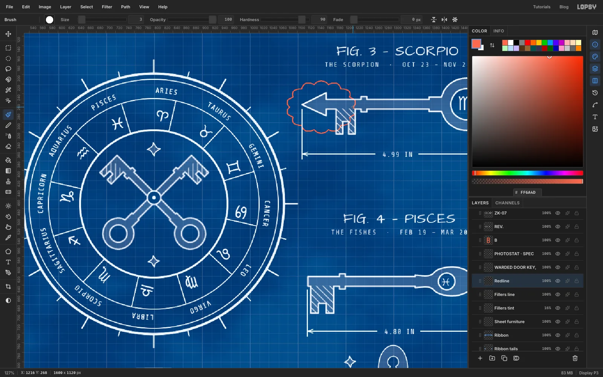

Blueprints get marked up. Add a layer named *Redline*, pick the **Brush**
at **Size** `3` with **Hardness** `90`, and set the foreground to
`#FF6A4D`. Draw a loop of small bumps all the way round the Scorpio
stinger: a revision cloud. Keep the bumps roughly even and close the loop
where you started.

## Add the revision triangle and note

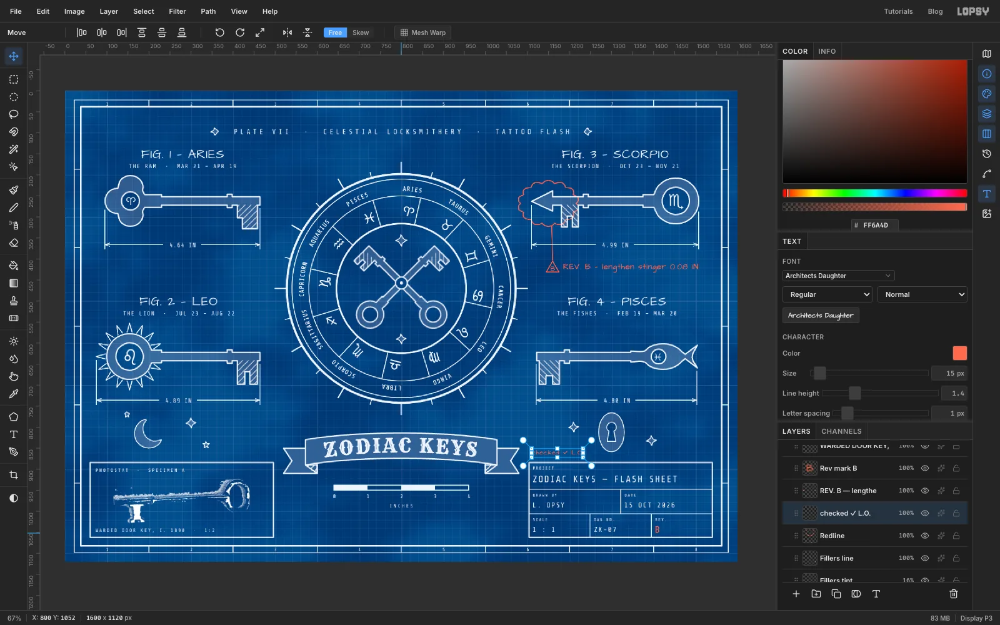

Pick the **Shape** tool and set **Shape** to **Polygon** with
**Sides** `3`. Set no fill and a red stroke at **Width** `2`. Click below
the dimension line at `1160, 418` and enter **30 × 28**. With the brush,
[[Shift]]-click a leader line from the bottom of the cloud down to the
triangle.

In **Architects Daughter**, red, add:

- `B` at `16`, centred in the triangle (rename this layer *Rev mark B*, so
  it isn't confused with the title block's B)
- `REV. B — lengthen stinger 0.08 IN` at `19`, to the right of the triangle
- `checked ✓ L.O.` at `15`, just above the title block

Keep the note in inches: the drawing's dimensions are in inches, and mixing
units on one sheet is a drafting mistake.

## Fold the sheet

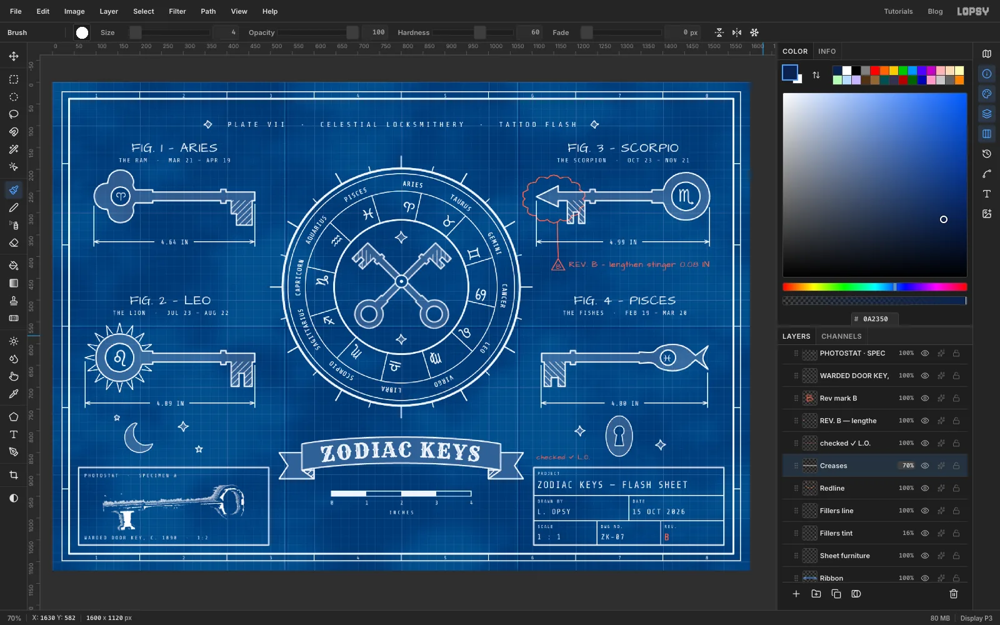

Blueprints were folded to fit in a drawer. Click *Redline* and add a layer
named *Creases*, then pick the **Brush** at **Size** `4`, **Hardness** `60`, white.
[[Shift]]-click two full-height lines at `x` 533 and 1067, and one
full-width line at `y` 560.

Switch to the deep blue `#0A2350` and draw a second set 3 px to the right
and below, for the shadow side of each fold. Apply **Filter → Gaussian
Blur…** at `2`, set **Blend** to **Soft Light** and opacity to **70%**.

## Darken the edges

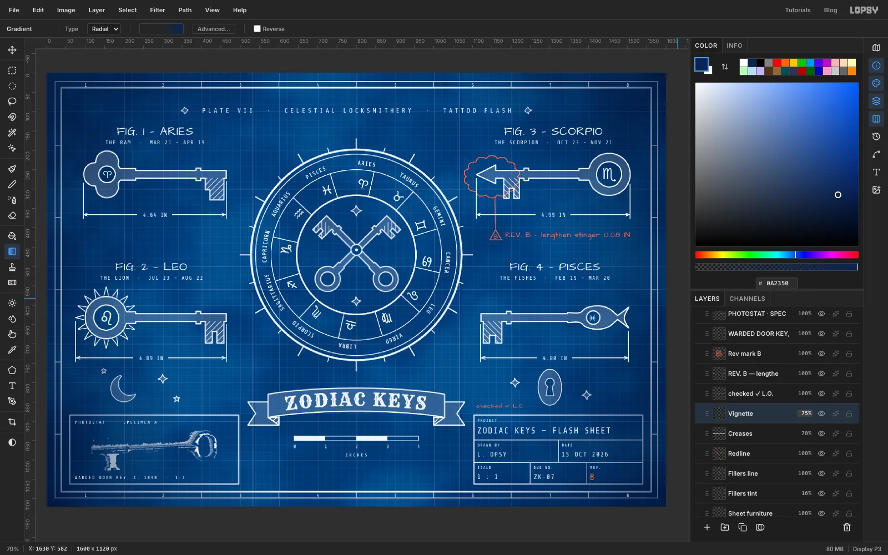

Add a layer named *Vignette*. Pick the **Gradient** tool, set **Type** to
**Radial** and open the gradient editor. Use three stops, all deep blue
`#0A2350`:

- fully transparent at the left end
- fully transparent at 55%
- fully opaque at the right end

Drag from the centre of the sheet to a corner. Set **Blend** to
**Multiply** and the opacity to **75%**.

## Add grain and a diazo bleed

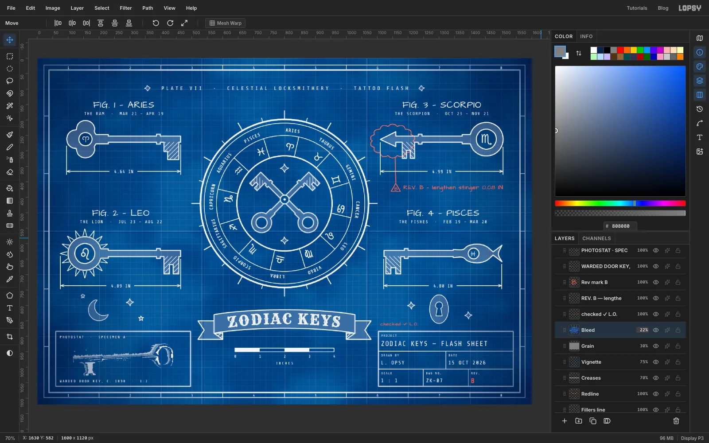

Add a layer named *Grain*. Fill it with `#808080` and apply **Filter → Add
Noise…** with **Amount** `28` and **Mode** set to **Mono**. Set **Blend**
to **Overlay** and the opacity to **30%**.

Diazo prints bleed a little, so lines glow softly into the paper:

1. Choose **Select → All**, then **Edit → Copy Merged**, and deselect.
2. Choose **Edit → Paste** and name the new layer *Bleed*.
3. Apply **Filter → Gaussian Blur…** at `4`.
4. Set **Blend** to **Screen** and the opacity to **22%**.

Export with **File → Quick Export PNG** and save with **File → Save
Project**. You can delete the empty *scratch* layers now. Next time,
swap in another four signs.
