Nineteenth-century botanical plates are calm and exact. A plant is drawn
once, coloured by hand and numbered, and its parts float around it on cream
paper. That calm makes a good disguise for a thriller. This poster for an
imaginary film, **Indigo Datura**, is a specimen plate of a purple thorn-apple
(*Datura*), a beautiful and very poisonous plant. Its flower drips one glowing
drop into a teacup, and an indigo ink band rises from the bottom to carry the
title.

You'll build a 1200 × 1800 px poster with lasso fills, gradients, the
Dodge and Burn tool, tapered brush strokes, a home-made engraving pattern,
layer effects, groups and text. The plant takes the most time. Take it one
part at a time and keep every part on its own layer.

The palette:

- Paper `#EDE3CB`, foxing `#B8956A`, sepia ink `#3A2A22` / `#6B5440`
- Leaves `#2C4438` → `#3B5947` → `#4B6A55`, lit side `#8BA283`, veins `#C5D0AE`
- Corolla `#CFC6E4` → `#9585C8` → `#5A4C9E` → `#2E2C6A`
- Throat `#2B2560` → `#5B4CA3` → `#9D8DD3` → `#CBC0E8`
- Ink band `#2C2B66` → `#1D1C42` → `#121230`, tide-line `#121135`
- Title `#F6EEDA` → `#F2E8CF` → `#BDB0E6`
- Poison drop `#F6F2FF` → `#B7A9E6` → `#4B3F94`, glow `#A68BFF`

## Start the paper and give it a laid grain

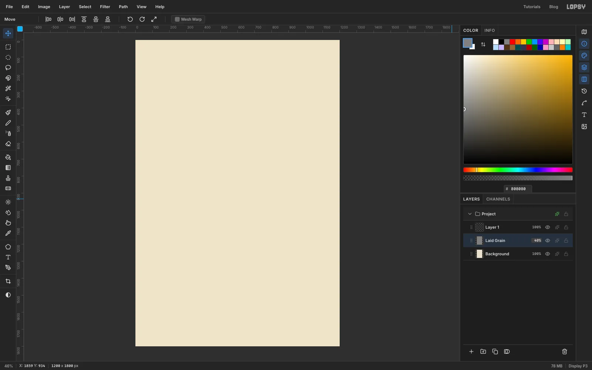

Choose **File → New** and make a **1200 × 1800** document with a white
background. Select **Background** and choose **Edit → Fill** with paper cream
`#EDE3CB`. The new document also comes with an empty *Layer 1* at the top.
You can leave it there for now and delete it before you start the ink band.

Old rag paper has a fine horizontal grain. Add a layer called *Laid Grain*,
fill it with mid grey `#808080`, then:

1. **Filter → Add Noise…**, Amount **45**, **Mono**.
2. **Filter → Motion Blur…**, Angle **0**, Distance **60**. The specks smear
   into horizontal streaks.
3. In the layer's effects drawer set the blend mode to **Overlay**, and drop
   the layer to about **40%** opacity.

## Age the sheet with clouds and a burnt vignette

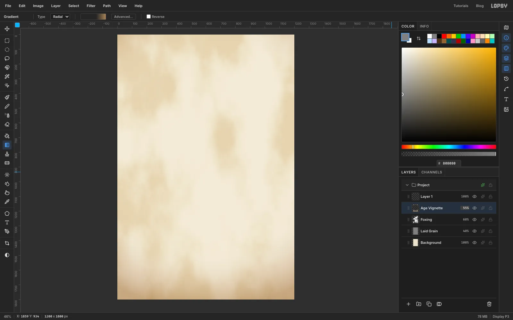

Add a layer called *Foxing*, fill it with `#808080` and run
**Filter → Clouds…** at Scale **5**. Set it to **Soft Light** at about
**60%**. The grey disappears and leaves gentle blotches in the paper.

For the browned edges, add *Age Vignette*. Pick the **Gradient** tool, choose
**Radial**, open **Advanced…** and set three stops: transparent white at 0%,
transparent white at 62%, and `#A98458` at 100%. Drag from just above the
centre of the page down past the bottom edge. Set the layer to **Multiply**
at about **55%**.

## Spray on some foxing spots

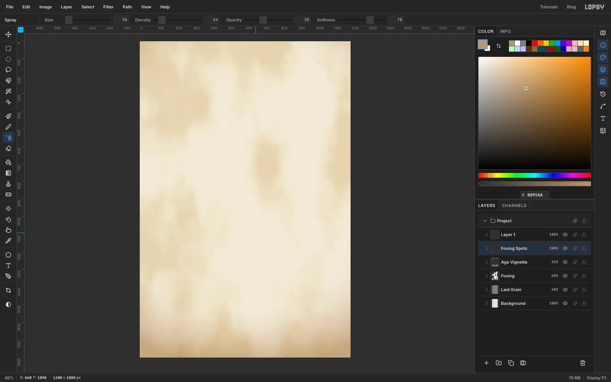

Foxing is the brown freckling old paper picks up. Add a layer called
*Foxing Spots* and choose the **Spray** tool with Size **70**, Density **14**
and Opacity **38**, in `#B8956A`. Make a few short dabs in the top corners
and on the right edge, then drop the Size to **36** for two or three smaller
clusters in the open paper. Keep it sparse. A few spots read as age, and a
lot of them read as dirt.

## Add guides and the double plate rule

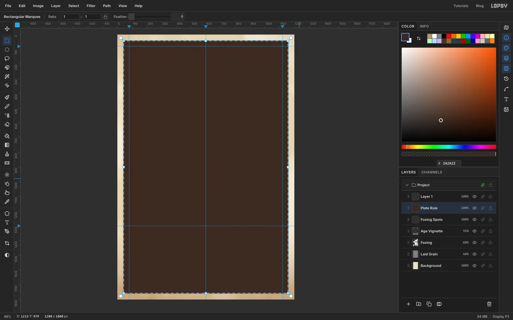

Click the top ruler at **80**, **600** and **1120** to drop vertical guides
for the margins and the centre line. Click the left ruler at **80** and
**1300**. The lower one marks where the ink band will start.

Add a layer called *Plate Rule*. With the **Rectangular Marquee**, drag from
40 px in at the top left to 40 px in at the bottom right. Watch the X / Y
readout in the status bar at the bottom of the window as you drag. Set the foreground
to sepia `#3A2A22` and choose **Edit → Fill**. Then choose
**Select → Shrink…** by **3** px and press [[Delete]]. You're left with a
3 px frame. Repeat with a marquee 52 px in, shrinking by **1**, for the
hairline inside it.

## Drop in a reference plate

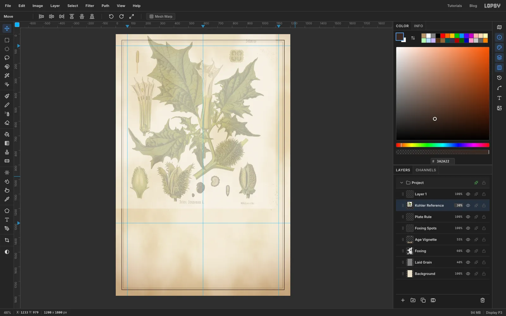

Botanical artists draw from specimens and older plates. Find a public-domain
plate of *Datura stramonium*. Franz Köhler's *Medizinal-Pflanzen* (1887) on
Wikimedia Commons is a good one. Drag the image file straight onto the canvas.
It lands on a new layer. Rename it *Kohler Reference* and set it to **30%**.

Use it to study how the leaves are lobed, how the trumpet tube pleats, and how
spiny the seed capsule is. You won't trace it. Your plant will droop to one
side so its flower can drip into a cup.

## Paint a tapering stem with a forked bud stalk

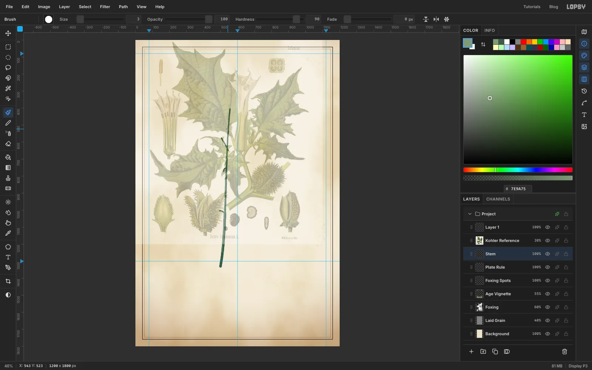

Add a layer called *Stem* above *Plate Rule*. Choose the **Brush**, pick the
**Hard Round** preset and set Hardness to **90**, in `#3F5C49`.

Paint the stem in three strokes so it tapers:

1. Size **16** from just below the lower guide up about a third of the page.
2. Size **12** for the middle third.
3. Size **9** for the last part. Curve it gently and finish a little left of
   centre, about a quarter of the way down the page. The flower hangs from
   there.

At Size **8**, paint a short stalk forking up and to the left about a third
of the way down the stem. That's where the bud goes. Then paint two short
**petioles** (leaf stalks) out to the left, one about 40% of the way down the
page and one about 55%. Each sticks out about 30 px. Finish with a Size **3**
highlight in `#7E9A75` just left of the stem's centre line.

## Lasso a leaf and lay in two washes

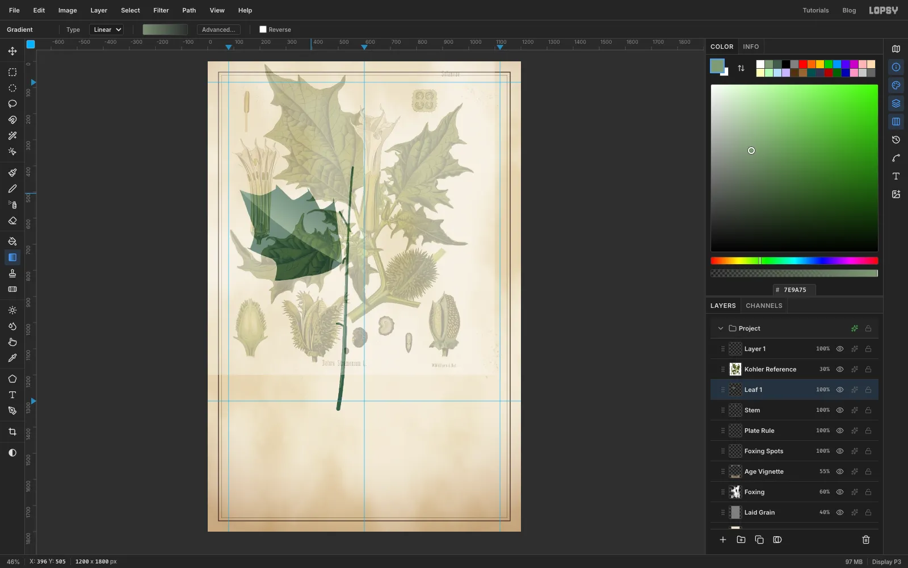

*Datura* leaves are big and lopsided, with a few large, forward-pointing lobes.
Add a layer called *Leaf 1*. The leaf is about 480 px long and 300 px wide,
pointing from the upper petiole towards the upper-left corner.

With the **Lasso**, start at the end of the petiole. Draw the top edge out to
the tip with three lobes. Make each lobe a broad triangle about 50–60 px deep
with a sharp point that leans towards the tip, with a shallow rounded notch
between lobes. Come back along the lower edge with two lobes and close at the
petiole. Make the lower side start a little further out than the upper side,
so the base is lopsided.

Pick the **Gradient** tool, choose **Linear**, and set three stops:
`#2C4438`, `#3B5947` at 55% and `#4B6A55`. Drag from the base of the leaf to
its tip.

Now lasso just the upper half: from an imaginary line running from the
petiole to the tip (where the midrib will go) up to the top edge. Use a
two-stop gradient from `#8BA283` at about **85%** opacity to `#4B6A55` at
about **15%**, dragged from the midrib out towards the edge. The gradient
blends over what's there, so you get a lit half and a shaded half.

## Model the blade with Burn and Dodge

[[Cmd]]-click the *Leaf 1* thumbnail to load the leaf as a selection. This
keeps the next strokes inside it.

Choose the **Dodge / Burn** tool:

- Set the mode to **Burn**, Exposure **22**, Size **34**, and trace once all
  the way round the inside of the edge.
- Switch to **Dodge**, Exposure **16**, Size **26**, and run once along that
  imaginary line from the base to the tip.

The leaf now curves down at the margins and rises along its spine.

## Draw tapered, branching veins

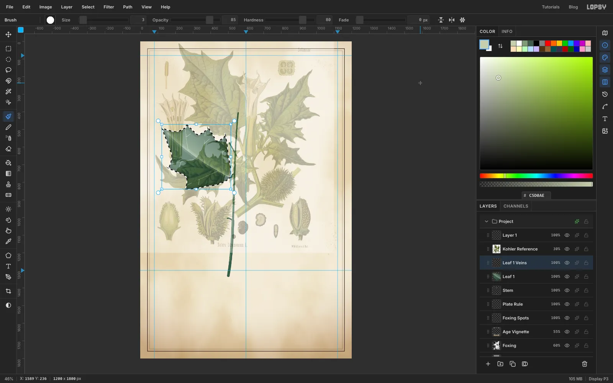

Add a layer called *Leaf 1 Veins* and [[Cmd]]-click the leaf thumbnail again.
Use the Brush at Opacity **85** in `#C5D0AE`.

Open the brush tip thumbnail at the left of the options bar to get the
**Brushes** window. On the **Shape** tab, set **Taper**. Taper is a distance
in pixels over which the stroke thins to nothing, so set it to about the
length of the stroke you're about to paint:

1. Taper **450**, Size **5**: paint the midrib from the base to the tip.
2. Taper **150**, Size **3**: paint a vein from the midrib out to each lobe
   tip, curving slightly forward. Add one or two short side branches running
   off each vein towards the edge.

Set Taper back to **0**, deselect with [[Cmd+D]], and choose
**Layer → Merge Down** to fold the veins into the leaf.

## Repeat for the lower leaf

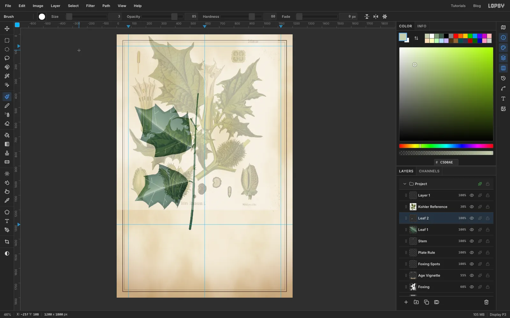

Select *Leaf 1*, add a layer called *Leaf 2*, and repeat the last three steps
for a smaller leaf, about 380 × 250 px, on the lower petiole. Point this one
down and to the left.
Give it two lobes on the top edge and three below so it isn't a copy of the
first.

## Paste and flip a copy for the right-hand leaf

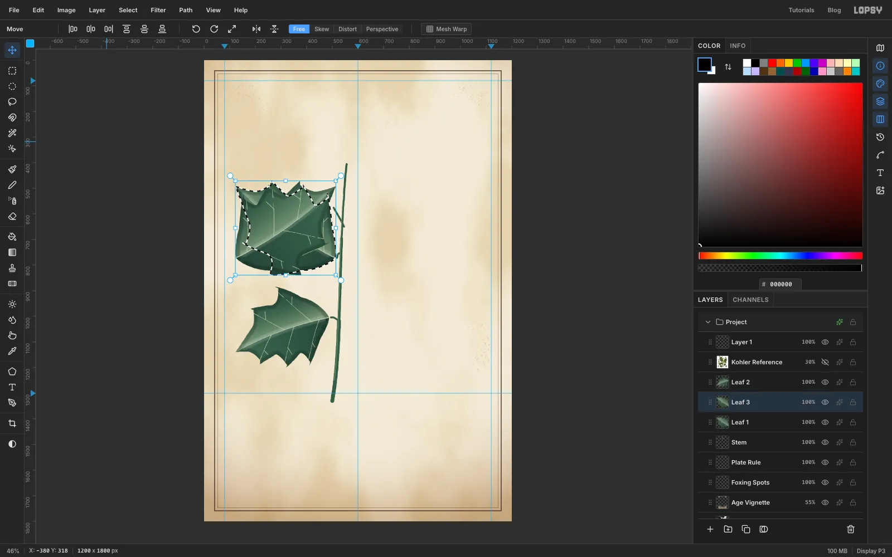

The right side needs a big leaf too. Rather than draw a third, mirror the
first. Hide the *Kohler Reference* layer so you can see the plant clearly.

[[Cmd]]-click *Leaf 1*'s thumbnail, then press [[Cmd+C]] and [[Cmd+V]]. The
copy pastes in place on a new layer. Rename it *Leaf 3*. With the pasted pixels
still selected, choose **Image → Flip Horizontal**. The copy flips inside its
own box, so it sits on top of the original but points the other way.

## Move, rotate and scale the third leaf

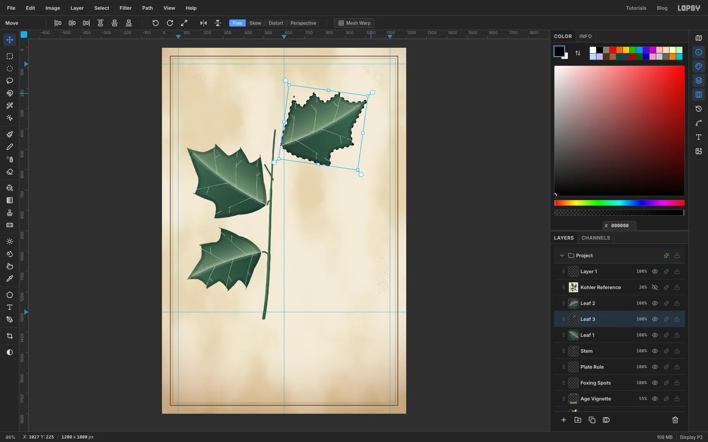

With the **Move** tool, drag inside the selection to carry the leaf over to
the right of the stem, with its base just right of the stem top. Then:

1. Grab the round rotate handle just outside the top-right corner of the box
   and drag about **8°** clockwise. Press [[Cmd+D]] to apply it.
2. [[Cmd]]-click the leaf thumbnail again. Hold [[Cmd]] and drag the
   bottom-right corner handle out a little, about **6%**, to scale the leaf
   evenly. Press [[Cmd+D]] to apply it.

Select the *Stem* layer and paint a short Size **8** petiole from the stem to
the base of the new leaf.

## Ink the leaf outlines

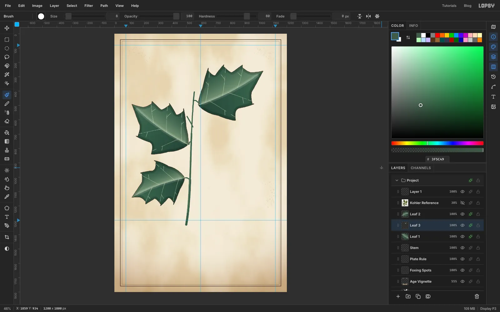

Plates were printed from an engraved line and then coloured by hand, so every
part gets a thin ink edge. For each leaf, open its **Layer effects** (the
sparkle button on its row), turn on **Stroke**, set Width **2** and the colour
to sepia `#3A2A22`, and choose **Outside**.

## Paint the twisted bud

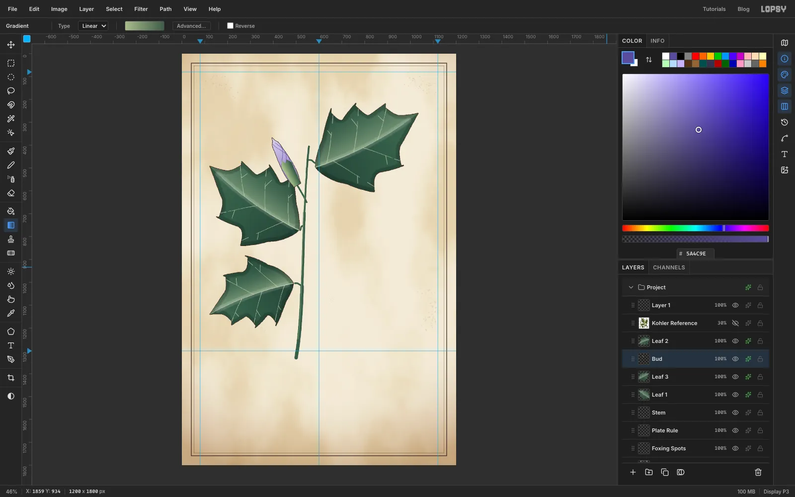

Select *Leaf 3* and add a layer called *Bud*. Lasso a slender spindle about
220 px long, pointing up and to the left from the end of the bud stalk.
Fill it with a linear gradient from `#7F8F6A` through `#9D8FCB` to `#D4CCE6`,
dragged from the base to the tip.

Brush three curved lines along the bud at Size **3**, Opacity **70** in violet
`#5A4C9E` so it looks twisted. Then lasso the green sheath around its lower
half with a couple of pointed teeth. Fill it with a gradient from `#A9BC8C` to
`#3F5C49`, dragged across the sheath. Add a 2 px sepia **Stroke** outline.

## Select the trumpet and its five points

Add a layer called *Corolla*. The flower hangs from the top of the stem and
droops down and to the right at about 50°. It's roughly 500 px long, and its
mouth opens to about 320 px across.

With the **Lasso**, draw the trumpet in one go. Start about 35 px wide at the
stem top and keep the tube slim, about 50 px, for the first half. Then let it
flare quickly. Finish with the mouth: a tilted oval about 320 px across that
faces down and towards you.

Now hold [[Shift]] and lasso each of the five points round the rim. Space
them evenly round the oval. Make each one a slim triangle about 80 px long
with gently curved sides, whose base overlaps the rim so Shift merges it with
the trumpet.

## Shade the corolla and pleat it

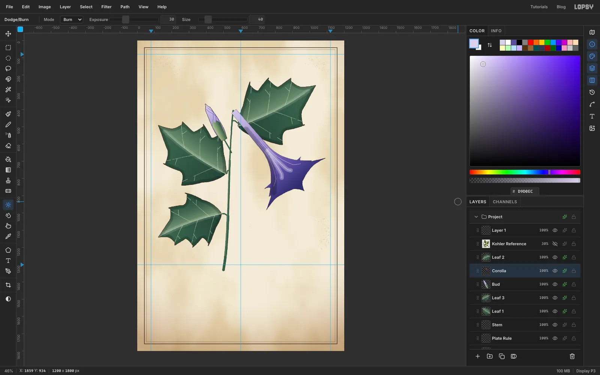

With the selection still active, drag a **Linear** gradient along the flower
from the stem end to the mouth with four stops: `#CFC6E4`, `#9585C8` at 45%,
`#5A4C9E` at 78% and `#2E2C6A`.

Brush four pleat lines down the tube at Size **3**, Opacity **75** in
`#D9D0EC`, flaring out with the trumpet. Then with **Dodge / Burn**:

- **Dodge**, Exposure **35**, Size **26**: run along the two middle pleats.
- **Burn**, Exposure **30**, Size **40**: run along the lower edge of the
  tube.

Deselect and add a **1** px sepia Stroke. Keep it thinner than the leaves'
outline so the flower stays delicate.

## Open the throat with a violet star

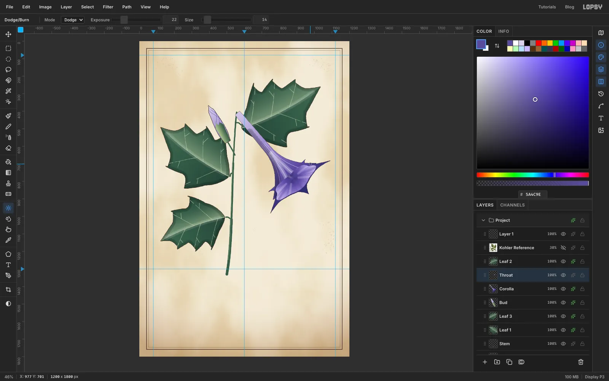

Add a layer called *Throat*. Lasso the open face of the flower. Follow the
mouth just inside the rim and dip the edge slightly between the points so
the face has five shallow lobes.

Drag a **Radial** gradient from a spot a little up the tube from the centre of
the face out to the far rim, with five stops: `#2B2560`, `#5B4CA3` at 25%,
`#9D8DD3` at 55%, `#CBC0E8` at 82% and `#A797D8`.

Then, still inside the selection:

1. Brush at Size **22**, Hardness **20**, Opacity **40** in `#5A4C9E`. Paint
   one stroke from the centre out to each of the five points. That's the
   flower's star.
2. Brush at Size **2**, Opacity **55**: add ten fine nectar lines radiating
   from the centre.
3. Dodge at Exposure **22**, Size **14**: paint a short ridge between each
   pair of star rays to suggest the folded pleats.

## Sheathe the base in a ribbed calyx

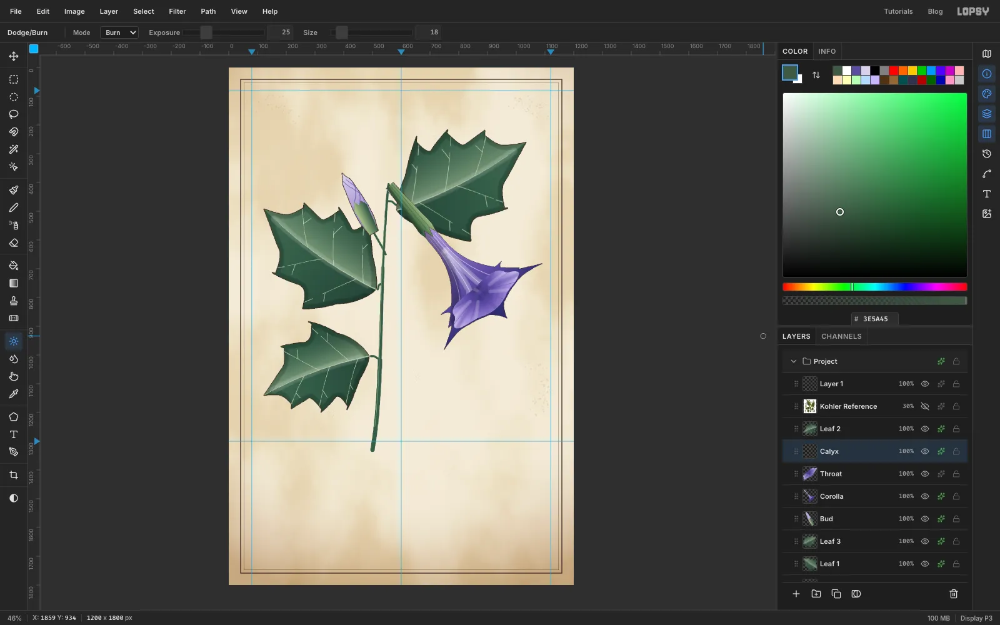

Add a layer called *Calyx*. Lasso a sheath around the first third of the
trumpet, about 195 px long. Make it about 30 px wide at the stem, widening to
about 55 px. End it in pointed teeth about 30 px long, of which you'll see
three from this side. Fill it with a linear gradient dragged across it, from
`#A9BC8C` through `#6E8A5E` to `#34503F`.

Brush three thin rib lines along it at Size **2** in `#3E5A45`. **Burn** once
down its shadow side, then deselect and add a 1 px sepia Stroke.

## Draw the spiny capsule, Fig. 2

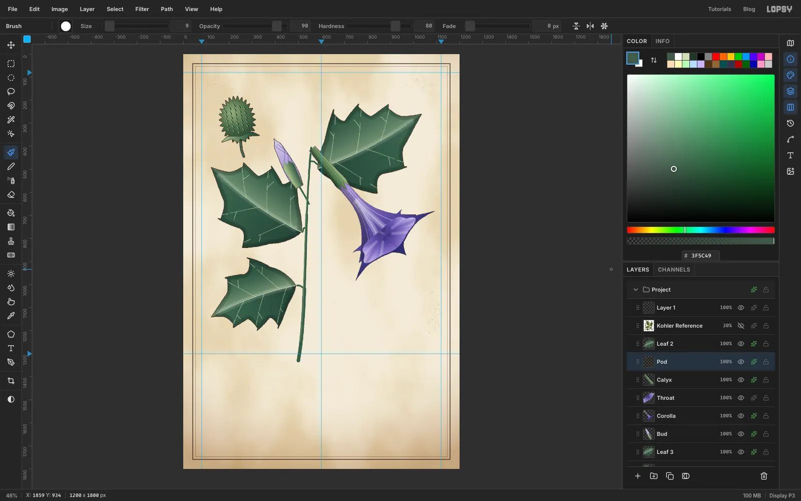

The thorn-apple's seed capsule goes at the top left as its own figure. Add a
layer called *Pod*. Lasso an upright oval about 125 × 165 px with a ring of
short spikes around the outline. Fill it with a **Radial** gradient from
`#9CB184` through `#556F4E` to `#26392D`. Start the drag up and to the left
of centre so the light comes from the top left.

For the spines, set the Brush's **Taper** to **16**:

1. Size **7** in `#22352A`: paint a short stroke for each spine, staggered in
   rows.
2. Size **3** in `#D2DDB2`: repeat them just to the left as highlights.

Set Taper back to **0**. Lasso a ragged collar under the capsule and fill it
with the calyx gradient, add a short Size **9** stalk, and give the layer a 2 px
Stroke.

## Copy and turn the seeds, Fig. 3

Add a layer called *Seed 1*. Seeds go at the lower right, inside the right
margin guide and a little above where the saucer will sit. Lasso a kidney
shape about 48 × 36 px and fill it with a radial gradient: `#4A3E38`, `#1E1816` at 55%
and `#0C0908`. Run **Filter → Add Noise…** at **18**, **Mono**, for a pitted
seed coat.

[[Cmd]]-click the seed thumbnail, copy and paste it, and drag the copy beside
the first. Rotate it with the round corner handle and press [[Cmd+D]] to
apply it. Do it once more for a row of three seeds, each turned a different
way.

## Add a capsule cross-section, Fig. 5

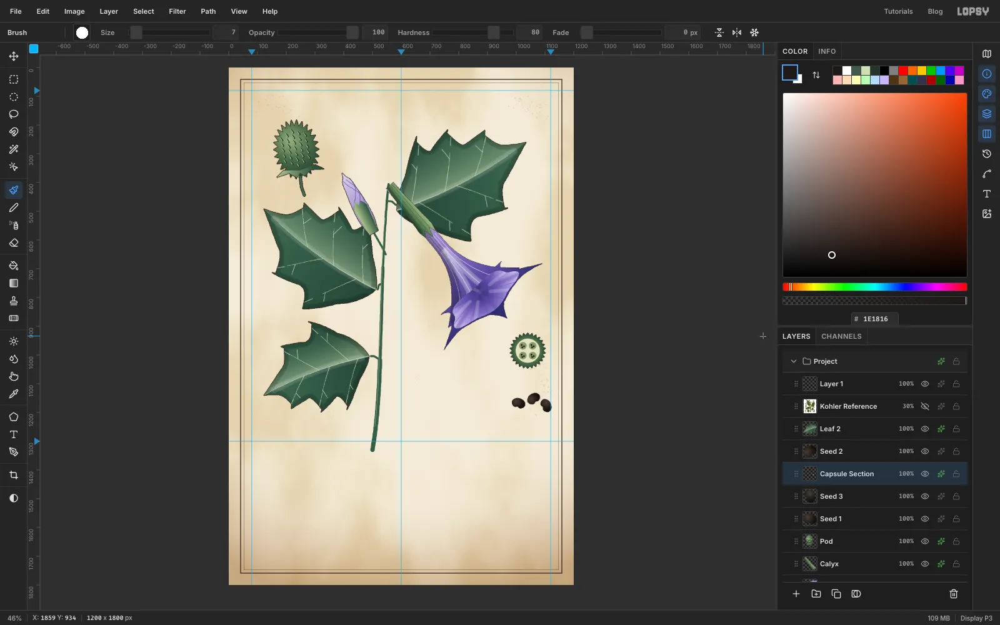

Plates often show a slice through the fruit. Add a layer called
*Capsule Section* above the seeds. Lasso a circle about 125 px across, in the
open paper right of the flower, with a fine sawtooth edge. Fill it with a radial gradient from `#C9D3A4` through
`#556F4E` to `#2E4434`.

With the **Elliptical Marquee**, select a slightly smaller circle in the
middle and fill it with `#E4E3C4`. Marquee one small circle in each quarter,
holding [[Shift]] to add the next three, and fill them with `#8C9A6A`. Click
the Brush at Size **7** in `#1E1816` three times in each chamber for seeds.
Add a 1 px Stroke.

## Start the teacup group: saucer and Pen handle

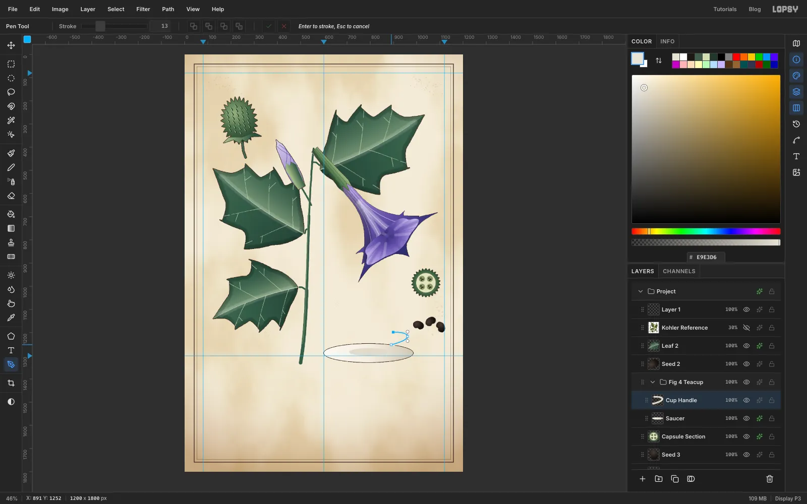

Click the **New Group** button at the bottom of the Layers panel and name the
group *Fig 4 Teacup*. Layers you add while it's selected go inside it.

- **Saucer:** add a layer called *Saucer*. Marquee a wide ellipse about
  380 × 80 px, centred under the flower's lowest point and just above the
  lower guide, and
  fill it with a linear gradient from `#FBF8F1` through `#F3EEE3` to
  `#CFC6B5`, left to right. Fill a smaller inner ellipse with `#E2DACB` for
  the well, and add a 2 px Stroke.
- **Cup Handle:** the handle sits behind the cup, so draw it first. Add a
  layer called *Cup Handle*, set the foreground to `#E9E3D6`, choose the
  **Pen** tool and set its Stroke to **13**. The cup will be about 240 px
  wide, centred over the saucer. Click about 105 px right of that centre and
  about 90 px above the saucer's centre, just under where the rim will be.
  Click-drag out about 60 px further right to bend the loop, then click back
  about 55 px below your first click, beside where the cup's body will be. Press [[Enter]] to stroke the path.
  The blue path outline stays on screen for a while afterwards. It's only a
  guide and isn't part of the picture. Give the handle a 2 px sepia Stroke
  so its edges are inked.

## Build the porcelain cup and tea

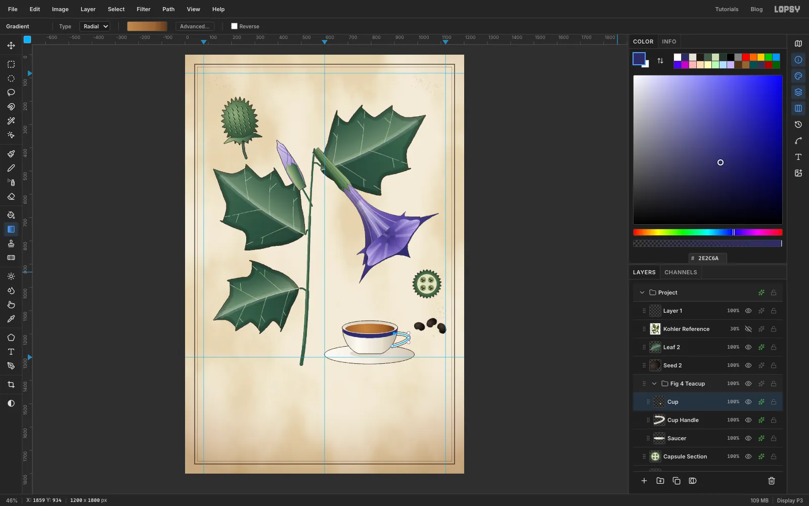

Add a layer called *Cup*. It's about 240 px across at the rim, and the bowl is
about 110 px deep:

1. Lasso the bowl: along the front of the rim, round and down to a foot
   about 90 px wide, and back up the other side.
   Fill it with a linear gradient across it: `#E3DCCD`, `#FCFAF4` at 28%,
   `#E6DFD0` at 70% and `#B9AF9C`. That's a rounded porcelain highlight.
2. Lasso a band about 15 px deep just under the rim, following its curve, and
   fill it with indigo `#2E2C6A`.
3. Marquee the rim ellipse (about 240 × 56 px) and fill it with a gradient from `#D8D0C0` to
   `#FBF8F1`, top to bottom.
4. Marquee a slightly smaller ellipse for the tea and drag a **Radial**
   gradient from `#C08A4E` through `#9A6232` to `#5E3A1E`.

Add a 2 px sepia Stroke.

## Let the poison drop fall

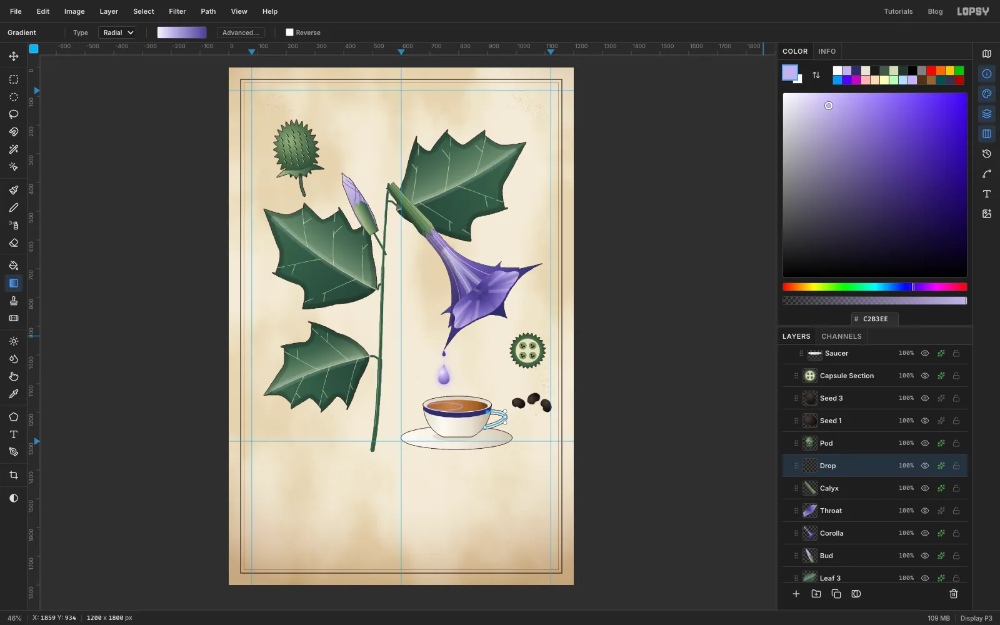

This drop is the whole film, so let it glow.

- **Ripples:** add a layer called *Ripples*. Marquee three ellipses of
  increasing size, centred under the flower's lowest point. Fill each with
  `#C2B3EE`, shrink it by 2 px and press [[Delete]] to leave a ring. Soften
  the rings with **Filter → Gaussian Blur…** at **2**, set the layer to
  **80%**, then add an **Outer Glow** of Size **10**, Opacity **60** in
  `#9B7BFF`.
- **Drop:** the drop belongs to the flower, not the cup, so click the
  *Calyx* layer first (outside the group), then add a layer called *Drop*. Lasso a small drop hanging from the
  lowest point of the flower, then [[Shift]]-lasso a big teardrop about
  40 × 75 px halfway to the cup. Drag a **Radial** gradient from its upper
  left with `#F6F2FF`, `#B7A9E6` at 35% and `#4B3F94`. Add an **Outer Glow**
  of Size **34**, Opacity **90** in `#A68BFF`.

## Nudge the whole teacup group into place

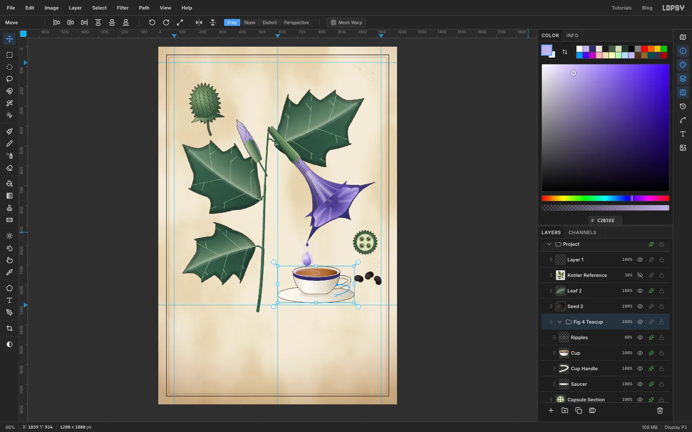

The saucer should sit on the paper, clear of the ink band to come. Click the
*Fig 4 Teacup* group row, choose the **Move** tool, and press
[[Shift+Up]] four times. That moves everything in the group, saucer, handle,
cup and ripples, up 40 px together. The drop stays where it is.

## Lasso the indigo ink band

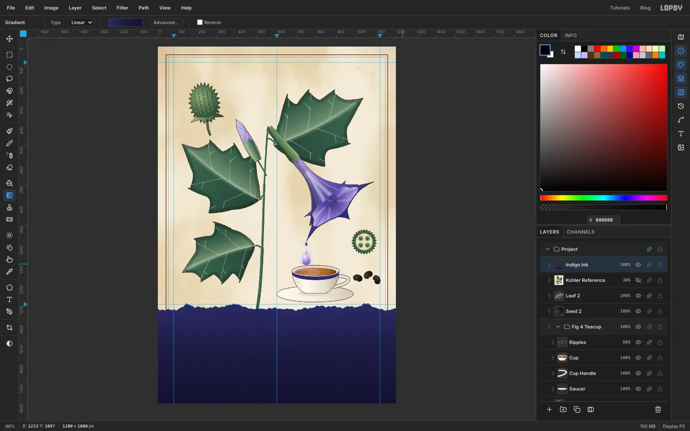

The bottom of the plate is soaked in indigo, as if the paper had been dipped.
First delete the empty *Layer 1*. Then click the *Kohler Reference* layer and
add a layer called *Indigo Ink* above it.

With the **Lasso**, draw an irregular line across the page just below the
lower guide. Wobble it a little and let it rise in three small rounded blooms,
the way wet ink creeps up paper. Keep it low under the saucer. Then go down
and around the bottom corners to close the selection.

Drag a linear gradient from top to bottom: `#2C2B66`, `#1D1C42` at 45% and
`#121230`. Run **Add Noise…** at **6**, **Mono**, for granulation, and
deselect.

## Add a tide-line and a wet halo

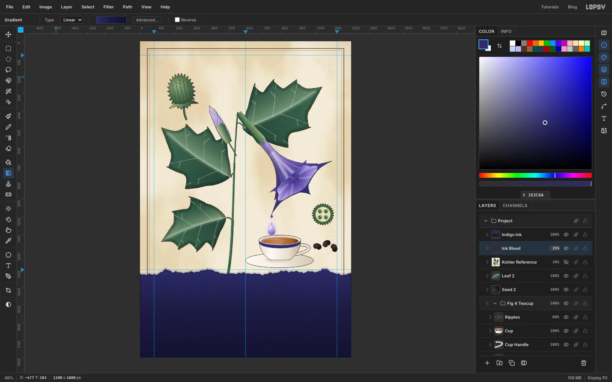

When watercolour dries, the pigment collects at the edge. Open *Indigo Ink*'s
layer effects and add a **Stroke** of Width **3** in `#121135`, positioned
**Inside**. It follows the edge as a darker tide-line.

For the wet halo, click *Kohler Reference* again and add a layer called
*Ink Bleed*, so it sits under the band. [[Cmd]]-click *Indigo Ink*'s thumbnail,
then **Select → Grow…** by **6** and **Select → Feather…** by **8**. Fill with
`#2E2C6A`, deselect, and set the layer to **35%**.

## Set the plate header

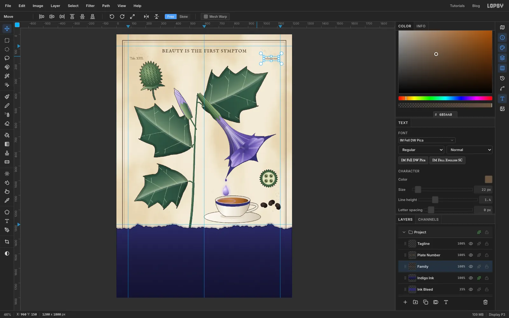

> **Tip:** Before you make each new text layer, click a non-text layer in the
> Layers panel. With a text layer selected, changing the font or size
> restyles that layer. Rename each text layer as you go (*Tagline*, *Fig 1*,
> *Caption*, *Title*, *Cast*…). You'll need the names later.

With the **Text** tool:

- **Tagline:** IM Fell English SC, **30** px, letter spacing **3**, sepia
  `#3A2A22`: *BEAUTY IS THE FIRST SYMPTOM*. Centre it over the centre guide,
  about 110 px from the top.
- **Plate number and family:** IM Fell DW Pica, **22** px in `#6B5440`.
  *Tab. XIII.* at the left margin guide and *Solanaceae.* ending on the right
  margin guide, about 40 px below the tagline.

## Number the figures and caption the plate

Add the figure numbers in IM Fell DW Pica, **30** px, `#6B5440`. Place each
one close to its figure without touching it:

- **1** beside the flower's upper point
- **2** to the right of the capsule
- **3** above the seeds
- **4** to the left of the cup
- **5** above and right of the cross-section

Then type the botanical name *Datura tatula L.* (the purple thorn-apple) at
**30** px in sepia. Centre it under the lower leaf, well clear of the ink
edge.

## Set the title and select its letters

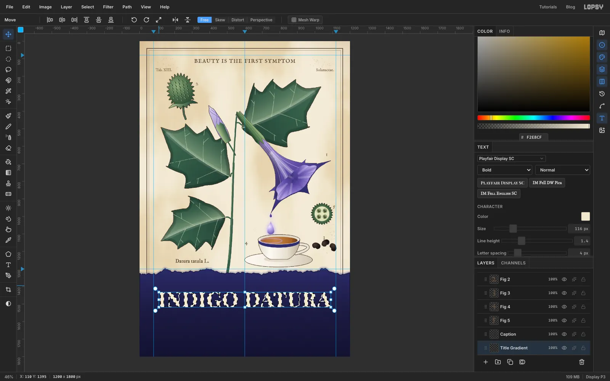

Type *INDIGO DATURA* in **Playfair Display SC**, **Bold**, letter spacing **4**,
in cream `#F2E8CF`, somewhere in the ink band. Raise the Size until the title
is about 980 px wide. That was **116** px here, leaving equal margins. With
the **Move** tool, centre it on the centre guide about 150 px below the ink
edge.

[[Cmd]]-click the title's thumbnail to select the shapes of its letters. Then
add a layer called *Title Gradient*.

## Fill the letters with a cream-to-lilac gradient

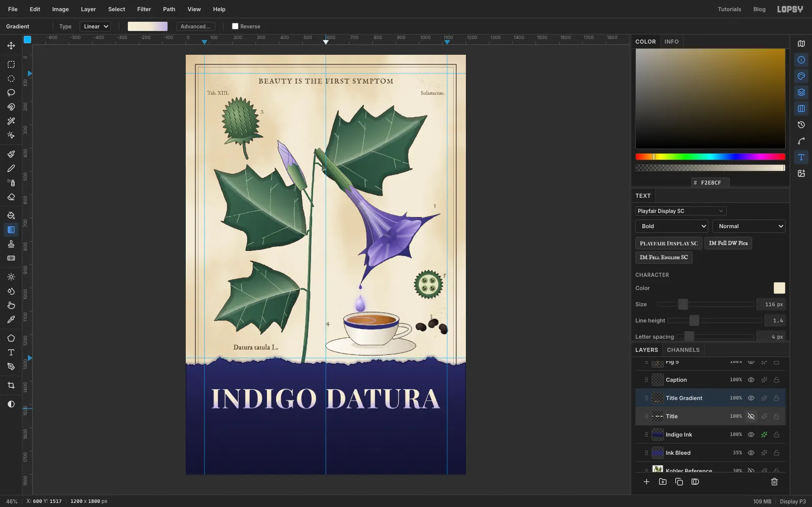

With the letters still selected, drag a **Linear** gradient from the top of
the capitals to their baseline: `#F6EEDA`, `#F2E8CF` at 55% and `#BDB0E6`.
Deselect, then hide the original *Title* layer. Keep it in case you want to
change the wording later.

## Add the cast, common names, billing and date

Each of these is centred on the centre guide:

- **Cast:** IM Fell English SC, **24** px, spacing **3**, `#D9CFEA`:
  *ELODIE MARSH · THEO CALLOWAY · AUGUSTINE REYE*, about 60 px below the ink
  edge.
- **Common names:** IM Fell English, **26** px, `#B9ACDD`:
  *the thorn-apple · the devil's trumpet · the moonflower*, just under the
  title.
- **Billing block:** **Bebas Neue**, **19** px, spacing **2**, `#D3CAE8`.
  Make three separate text layers, each about 900 px wide, 30 px apart.
  Write your own credits or use the three lines below. Leave three spaces
  between credits, and use curly quotes around the title, as real billing
  blocks do.
- **Release:** IM Fell English SC, **30** px, spacing **4**, cream:
  *ONLY IN CINEMAS · OCTOBER 31*, about 70 px from the bottom.

The billing lines used here:

1. LANTERN & LOAM PICTURES PRESENTS A NIGHTSHADE FILM ELODIE MARSH THEO CALLOWAY AUGUSTINE REYE
2. “INDIGO DATURA” MUSIC BY IVO DELACROIX EDITED BY JUNE HARROW COSTUMES BY PERPETUA NYE CASTING BY ODILE FENN
3. DIRECTOR OF PHOTOGRAPHY SAUL OKONJO PRODUCED BY MARGOT ELLERY WRITTEN AND DIRECTED BY ROSALIND VANE

## Make an engraving hatch pattern

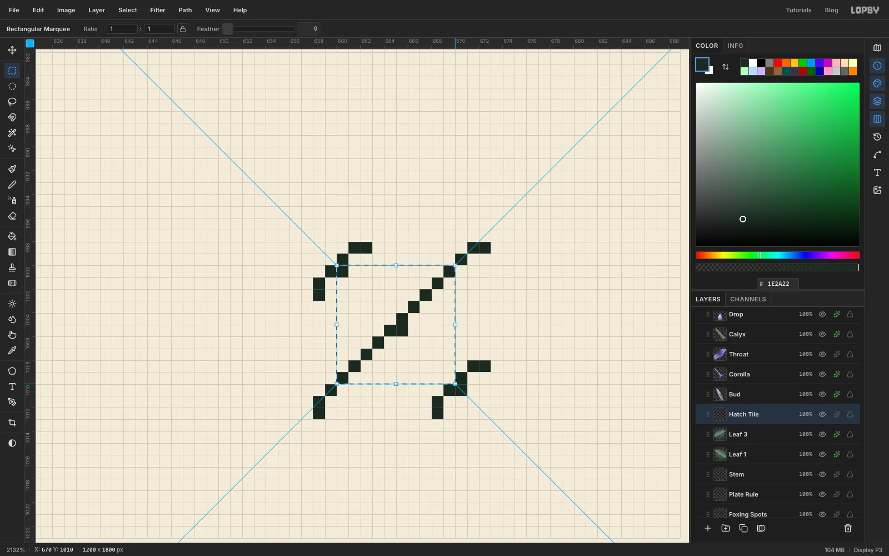

Engraved plates are shaded with fine parallel lines. Make a tile and repeat it.
Add a temporary layer, then zoom right in on an empty patch of paper. Hold
[[Ctrl]] and scroll until single pixels are big squares. Pick the **Pencil**
at Size **1** in `#1E2A22`:

1. Click, then [[Shift]]-click to draw a diagonal line across a 10 × 10 px
   square, from corner to corner and a pixel or two beyond each end.
2. Add short stubs of the next diagonals at the two opposite corners. The
   pencil line is a pixel thick, and the stubs make the tiles join without
   gaps.
3. Marquee exactly that 10 × 10 square and choose
   **Edit → Define Pattern**.

Delete the temporary layer and press [[Cmd+0]] to fit the page again.

## Hatch the leaves and stem

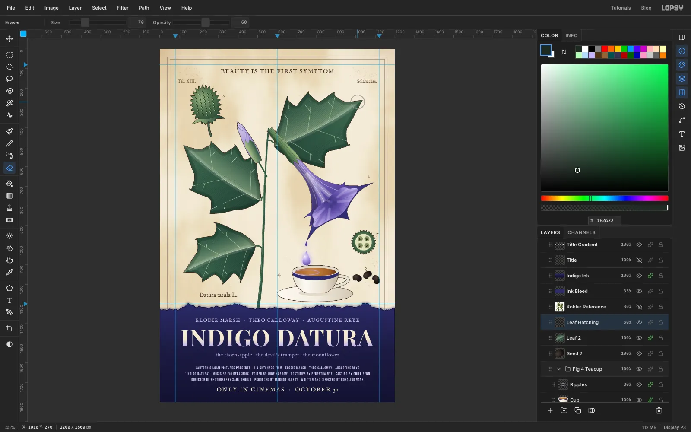

Click the topmost leaf layer in the stack (*Leaf 2* here) and add a layer
called *Leaf Hatching*, so the hatch sits above every leaf. Fill one part at a
time:

1. [[Cmd]]-click *Leaf 1*'s thumbnail and choose
   **Edit → Fill with Pattern… → Apply**.
2. Do the same for *Leaf 2*, *Leaf 3* and the *Stem*.

Set the layer to **Multiply** at **30%**. Real engravers left the lit side
lighter, so take the **Eraser** at Size **70**, Opacity **60** and sweep once
over the lit half of each leaf.

## Rotate a printer's imprint up the margin

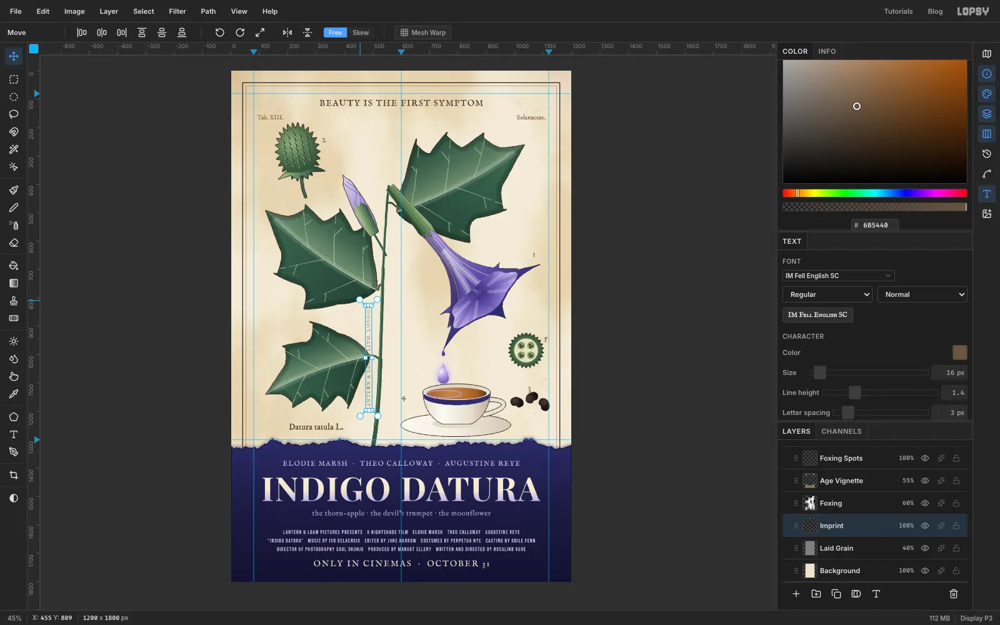

Old plates carry the lithographer's name in tiny type. Click the
*Laid Grain* layer so the imprint sits under the ageing layers and gets
tinted like the rest of the print. Then type *LANTERN & LOAM, LITH. LONDON* in IM Fell
English SC, **16** px, spacing **3**, in `#6B5440`.

With the **Move** tool, drag the round rotate handle at the top-right corner
**90°** anticlockwise so the line reads from bottom to top. Press [[Cmd+D]]
to apply it. Drag it over to the left margin, then nudge it with the arrow
keys until it's centred between the inner rule and the margin guide, halfway
down the plate.

## Group the title block and set it on the grid

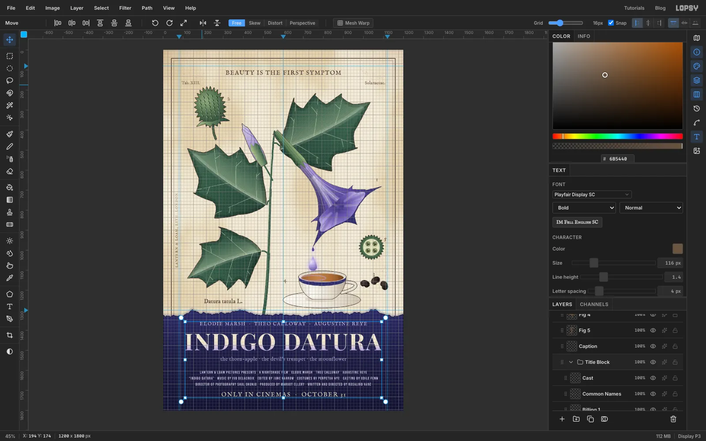

In the Layers panel, click the *Title* row, then [[Shift]]-click the *Cast*
row to select every title-block layer in between. Choose
**Layer → Group Layers** and name the group *Title Block*.

Turn on **View → Show Grid**. The first time you show it, **Snap** switches
on too. With the group selected and the **Move** tool active, each arrow-key
press now moves the block one grid square (16 px). Press [[Up]] once so the
block sits evenly between the ink edge and the bottom of the page. Then turn
the grid back off.

To finish, delete the *Kohler Reference* layer, choose **Edit → Clear Guides**,
deselect, and choose **File → Quick Export PNG**. Save the project with
**File → Save Project** so you can come back to it.
