**Brutalism** takes its name from *béton brut*, French for "raw concrete". The buildings leave their concrete bare, and you can still see the marks of the wooden boards it was poured against: plank lines, wood grain, little air holes and the round plugs where the formwork was tied together. Brutalist graphic design borrows that honesty. The grid is left exposed, type is set big and blunt, and there's one loud colour against a lot of grey.

In this tutorial you'll make a 1500 × 2100 px invitation for **Aloe Yard**, an imaginary concrete conservatory two floors underground, lit by a single round skylight called an *oculus*. It has:

- a board-formed concrete wall built entirely from noise, Clouds, Fibers, Liquify and selections
- a round hole in the wall with a spiral-aloe photo inside it, duotoned green with a Gradient Map
- an ALOE / YARD wordmark stretched from margin to margin, with worn, pitted ink
- monospaced copy, an architect's dimension line, a ruled table and a tilted sticker

The tools you'll use:

- **Add Noise**, **Motion Blur**, **Gaussian Blur**, **Brightness/Contrast**, **Threshold**, **Clouds** and **Fibers**
- **Image → Rotate 90°**, used as a trick to turn Fibers sideways, and **Liquify**'s Twirl mode
- the **Rectangular** and **Elliptical Marquee** with Shift to add and Alt to subtract, **Select → Inverse**, **Shrink** and **Grow**, and the **Magic Wand**
- the **Pencil** and **Brush** with Shift-click straight lines, and the Brush's **Taper** and **Fade**
- the **Drop Shadow** and **Stroke** layer effects, and the **Multiply** and **Soft Light** blend modes
- a group **Gradient Map**, the **Move** tool's scale and rotate handles on a layer, on live text and on a group, and **Rasterize Layer**

The fonts are **Archivo Black** for the wordmark and **Space Mono** for everything else. Both are free Google Fonts in Lopsy's font picker.

The photo is [Spiral Aloe detail](https://commons.wikimedia.org/wiki/File:Spiral_Aloe_detail.jpg) by Sam on Wikimedia Commons (CC BY-SA 4.0). Download the 1280 px version. The card credits it in its small print.

The palette:

- Concrete `#AFAEA9`, plank shade `#8E8C86`, joints `#55524C` / `#DAD7D0`
- Tie holes `#3A3733`, hole lip `#E6E3DC`, oculus rim `#C9C8C2`
- Ink `#141414`, rain `#46443F`
- Duotone `#0E2418` → `#C8F031` (the sticker uses the same acid green)

> **Tip:** Positions are written as `x, y` in document pixels, and the status bar shows the cursor's position as you move. With **nothing selected**, a single click (no drag) with a marquee tool opens a small dialog where you type the two corners. If something is already selected that click just deselects, so press [[Cmd+D]] first. To **Shift-add** or **Alt-subtract** a shape, hold the key and then drag. Key names are Mac keys; on Windows and Linux use Ctrl for Cmd.

## Set up the page and its guides

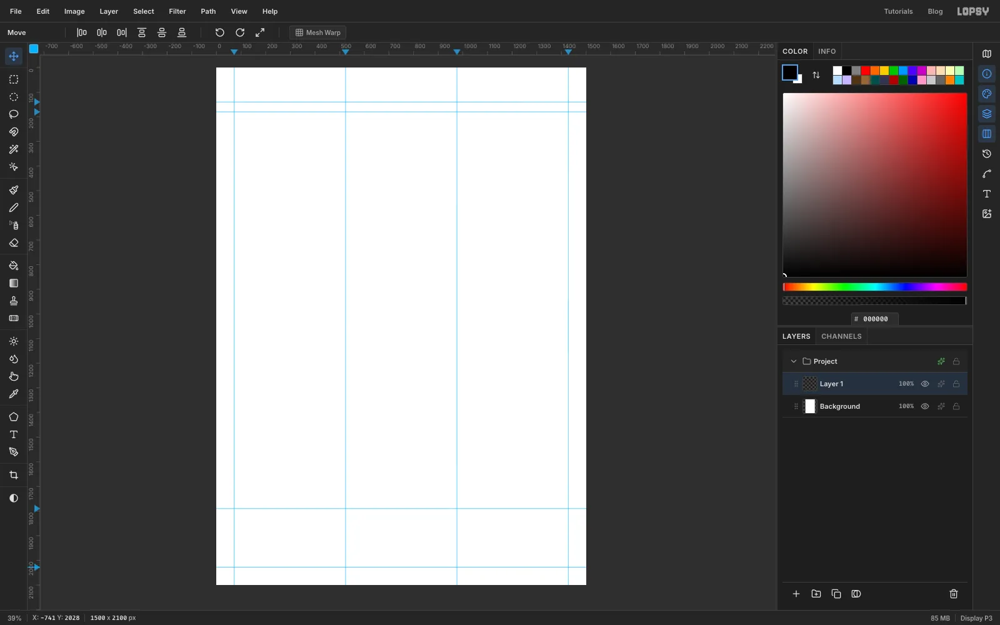

1. Open [Lopsy](/). In the **New Document** dialog set **Width** `1500` and **Height** `2100`, and click **Create**.
2. Click the top ruler at **72**, **524**, **976** and **1428** for vertical guides: the left and right margins and the two column lines of the table you'll draw at the bottom.
3. Click the left ruler at **140**, **180**, **1790** and **2028** for horizontal guides: the header rule, the top of the wordmark, the table's top rule and the bottom margin.
4. Double-click `Layer 1` in the Layers panel and rename it `Concrete`.

## Pour the concrete

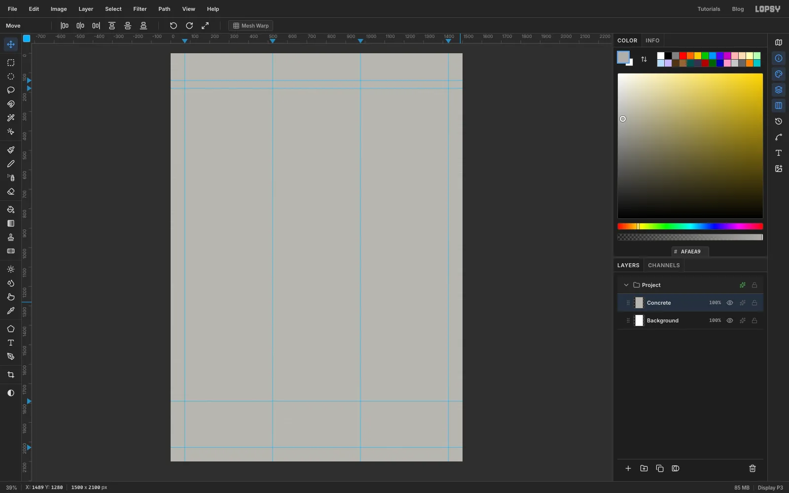

Concrete starts as flat grey with a grain in it.

1. Type `AFAEA9` into the Color panel's hex field and choose **Edit → Fill**. With nothing selected, Fill covers the whole layer.
2. Choose **Filter → Add Noise…**, set **Amount** to `32`, pick **Mono** and **Gaussian**, and click **Apply**.
3. Choose **Filter → Motion Blur…** with **Angle** `0` and **Distance** `90`. The speckle smears into horizontal streaks, like the grain the boards leave behind.
4. **Filter → Brightness/Contrast…**: leave Brightness at `0`, set **Contrast** to `18`, and apply.
5. Run **Add Noise** once more at **Amount** `8` (Mono, Gaussian) to put some fine grit back on top.

## Add soft mottling

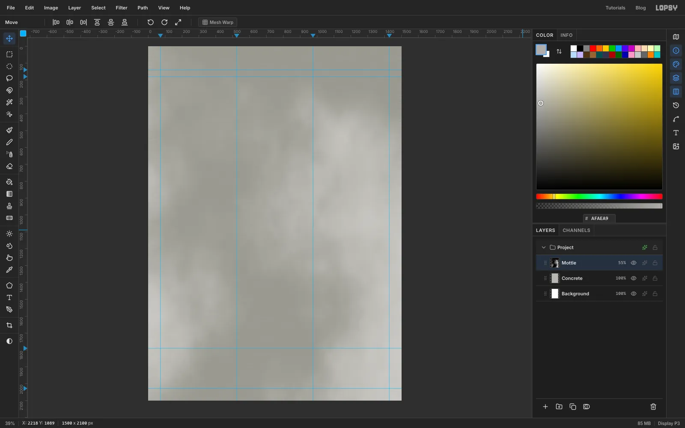

Real concrete dries unevenly, so the wall needs big, soft patches of light and dark.

1. Click **Add Layer** (+) and name it `Mottle`.
2. Choose **Filter → Clouds…**, set **Scale** to `2` (a low scale gives large blobs) and apply.
3. Open the layer's effects with the ✦ button on its row and set its **Blend** mode to **Soft Light**. Close the drawer and set the layer's opacity to **55%**.

## Make the bugholes

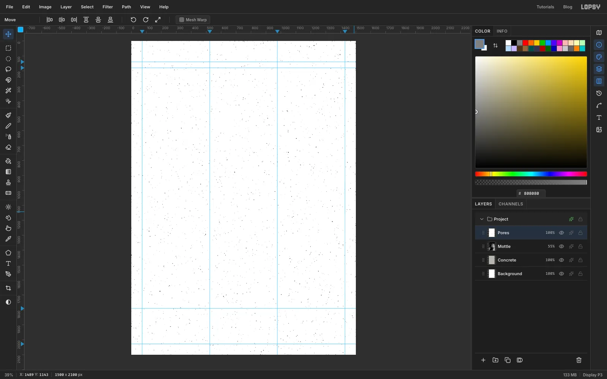

*Bugholes* are the small air pockets left in the surface of poured concrete. You'll make them from blurred noise. Blurring first means the Threshold leaves clumps instead of single pixels.

1. Add a layer named `Pores`. Fill it with `#808080`.
2. **Add Noise** at **Amount** `100`, **Mono**, **Uniform**.
3. **Filter → Gaussian Blur…** with **Radius** `4`.
4. **Filter → Threshold…**. Turn on **Preview** and drag **Level** down until only a sparse scatter of dark clumps is left, about `111`. Apply.

## Cut the bugholes out and give them a lip

1. Pick the **Magic Wand** ([[W]]) and untick **Contiguous** in the options bar. Click any white area of the `Pores` layer, so every white pixel is selected at once.
2. Press [[Delete]] and then [[Cmd+D]]. Only the dark clumps are left.
3. Open the layer's effects and enable **Drop Shadow**: colour `#E4E1DA`, **Offset X** `0`, **Offset Y** `2`, **Blur** `1`, **Spread** `0`, **Opacity** `80`. A pale shadow under a dark hole reads as light catching its lower edge.
4. Close the drawer and set the layer's opacity to **60%**.

## Turn the page to make wood grain

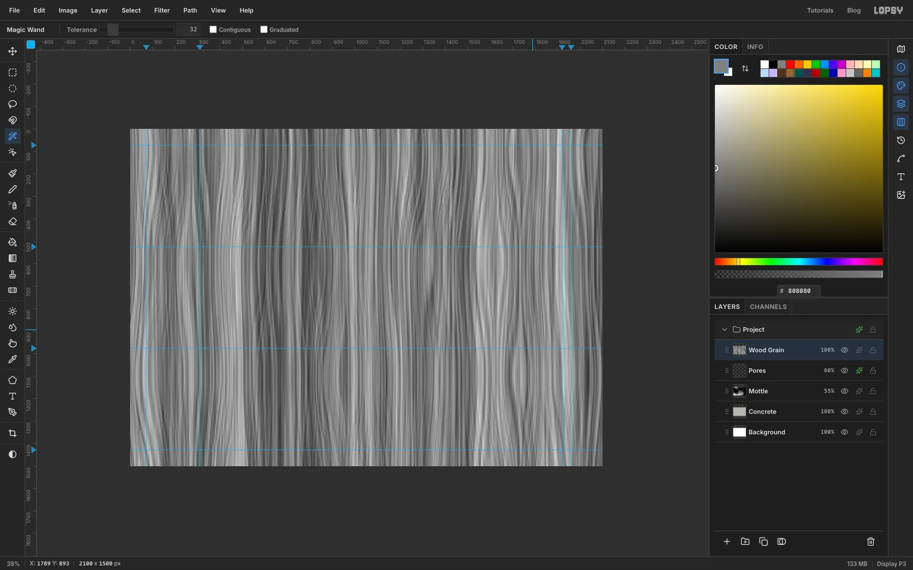

The wood grain comes from **Fibers**, but Fibers always runs vertically and the grain needs to run along the planks. The fix is to turn the whole document on its side first.

1. Choose **Image → Rotate 90° CW**. The page is now 2100 wide and 1500 tall.
2. Add a layer named `Wood Grain`.
3. Choose **Filter → Fibers…**, set **Variance** `28` and **Strength** `48` (higher strength gives straighter strands), and apply.
4. Choose **Image → Rotate 90° CCW** to stand the page back up. The fibers now run across it.

## Twist knots into the grain

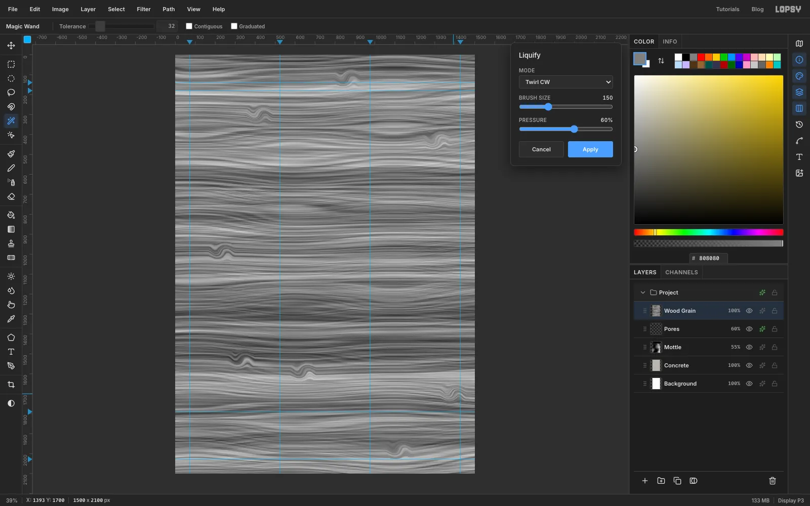

1. With `Wood Grain` still active, choose **Filter → Liquify…**.
2. Set **Mode** to **Twirl CW**, **Brush size** to `150` and **Pressure** to `60`.
3. Press on a spot of grain and hold for about half a second, jiggling the mouse very slightly on the spot so the twirl keeps going. Each hold twists the fibers into a small knot.
4. Make about eight knots, spread out over the wall. Put most of them in places that will stay open concrete, such as the left edge halfway down and the right side near the top.
5. Click **Apply**. Set the layer's blend mode to **Soft Light** and its opacity to **85%**.

## Shade the boards one by one

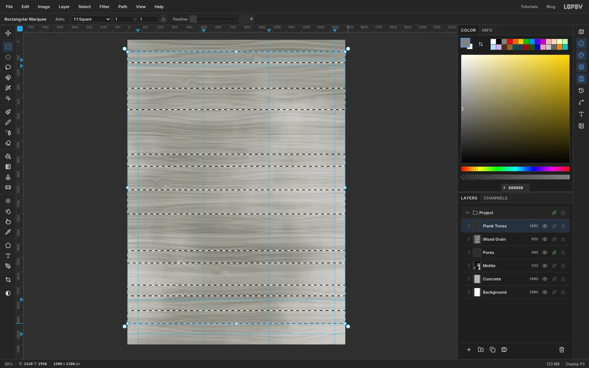

Each board in the formwork leaves the concrete a slightly different shade. The boards are uneven heights, between about 70 and 100 px.

1. You'll be drawing a lot of small shapes near the guides now, so turn off **View → Snap to Guides**. That stops them jumping onto a guide.
2. Add a layer named `Plank Tones`. With the **Rectangular Marquee** ([[M]]), drag a band across the full width, from just off the left edge to just off the right edge, from y `82` to `158`. Hold **Shift** and drag more bands from `334` to `407`, `407` to `481`, `789` to `872`, `1035` to `1123`, `1123` to `1201`, `1453` to `1538`, `1691` to `1765` and `1866` to `1956`.
3. Fill with `#8E8C86`, deselect, set the layer to **Multiply** and its opacity to **40%**.
4. Add a layer named `Plank Lights`. Shift-add bands for `158`–`242`, `585`–`687`, `872`–`962`, `1290`–`1368`, `1612`–`1691` and `1956`–`2004`. Fill them with white, deselect, and set the opacity to **18%**.

## Draw the board joints

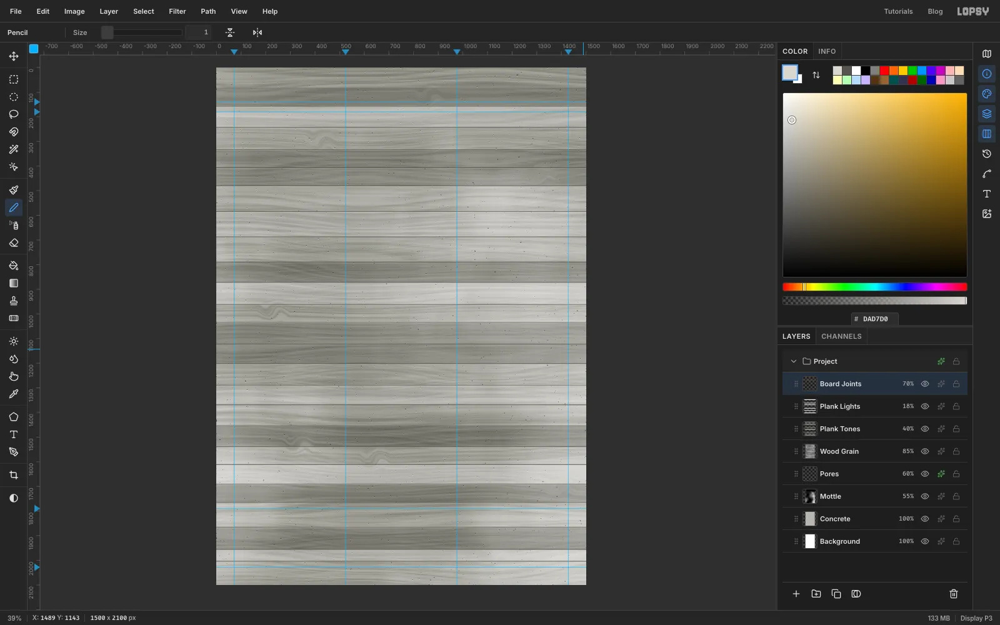

1. Add a layer named `Board Joints`. Pick the **Pencil** ([[N]]) at **Size** `3` and colour `#55524C`.
2. For each joint, click at the left edge of the canvas and **Shift-click** at the right edge to draw a straight line. Draw joints at y `82`, `158`, `242`, `334`, `407`, `481`, `585`, `687`, `789`, `872`, `962`, `1035`, `1123`, `1201`, `1290`, `1368`, `1453`, `1538`, `1612`, `1691`, `1765`, `1866`, `1956` and `2004`. These spacings are uneven on purpose, and they're chosen to fall between the lines of type you'll add later.
3. Switch the Pencil to **Size** `1` and colour `#DAD7D0`, and draw a second line **2 px below** each joint. That pale line is the lit lip of the board below.
4. Run **Gaussian Blur** with **Radius** `1` to soften the joints, and set the layer's opacity to **70%**.

## Plug the form-tie holes

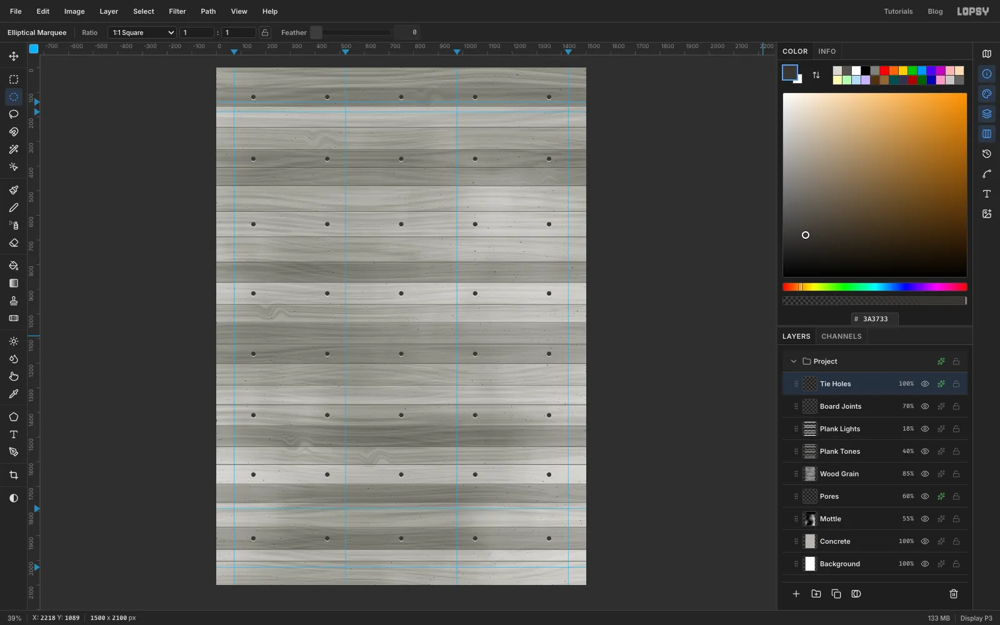

Formwork is held together with steel ties, and they leave neat rows of round holes.

1. Add a layer named `Tie Holes`. Zoom in so the small circles are easy to judge. With the **Elliptical Marquee**, drag an 18 px circle centred on `150, 120`. Hold **Shift** and drag the same size of circle at x `450`, `750`, `1050` and `1350` on that row.
2. Shift-add the same five circles on the rows at y `371`, `636`, `917`, `1162`, `1411`, `1652` and `1911`. Each row sits in the middle of every third board.
3. Fill with `#3A3733` and deselect.
4. Add a **Drop Shadow**: colour `#E6E3DC`, **Offset X** `0`, **Offset Y** `3`, **Blur** `1`, **Spread** `0`, **Opacity** `85`. Some of these holes will clash with the type later, and you'll delete those near the end.

## Cut the aloe photo into a disc

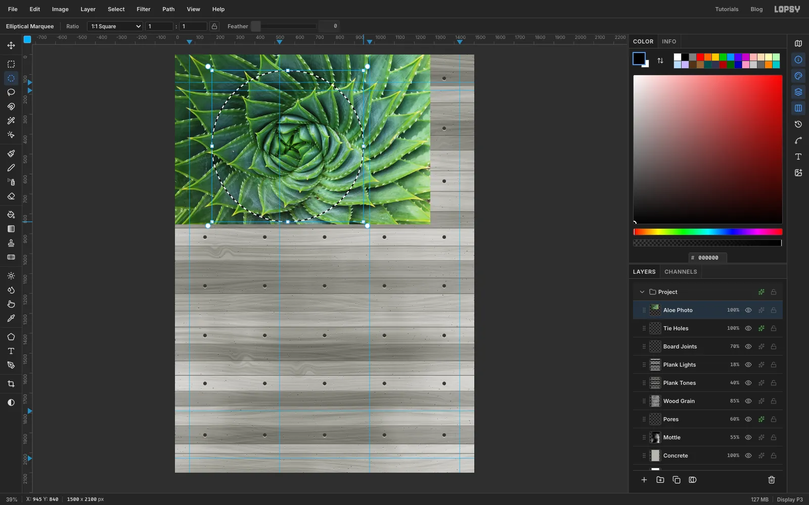

1. Drag the downloaded aloe photo from your desktop onto the canvas. It arrives as a new layer at the top-left corner, already selected and with the Move tool picked. Press [[Cmd+D]] to drop the selection, then rename the layer `Aloe Photo`.
2. Find the tight heart of the spiral, at about `565, 460` on the photo. With the **Elliptical Marquee**, drag a 760 px circle centred on it, from `185, 80` to `945, 840`.
3. Choose **Select → Inverse**, press [[Delete]], then deselect. Only the disc is left.

## Scale the disc to fit the oculus

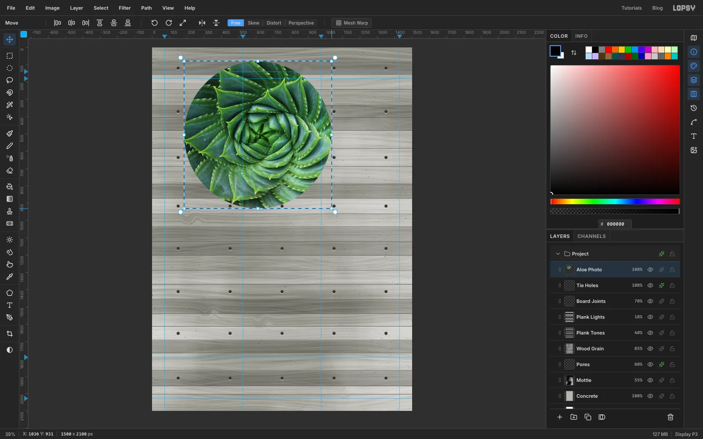

The oculus is an 850 px circle, from `575, 550` to `1425, 1400`.

1. Draw a **Rectangular Marquee** just around the disc, from `184, 79` to `946, 841`.
2. Switch to the **Move** tool ([[V]]). Hold [[Cmd]] (to keep the proportions) and drag the bottom-right corner handle out by about 90 px each way, until the disc is 850 px across.
3. Press [[Cmd+D]] to commit the scale.
4. Drag the disc from its middle until it sits in the oculus area, centred on `1000, 975`. Use the arrow keys to nudge it exactly into place.

## Strip the colour out

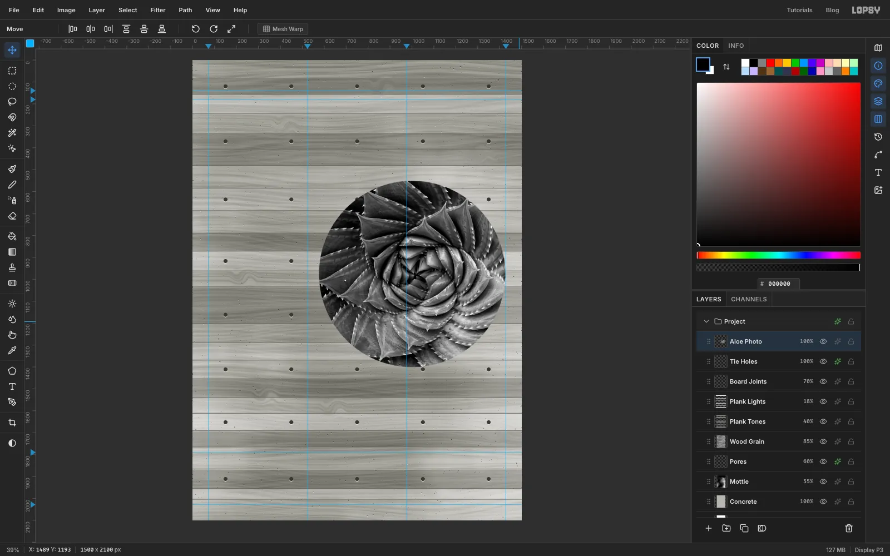

1. Choose **Filter → Desaturate**.
2. **Filter → Brightness/Contrast…** with **Contrast** `30`. The Gradient Map you'll add shortly works from these greys, so good contrast gives a punchier duotone.

## Shade the top of the hole

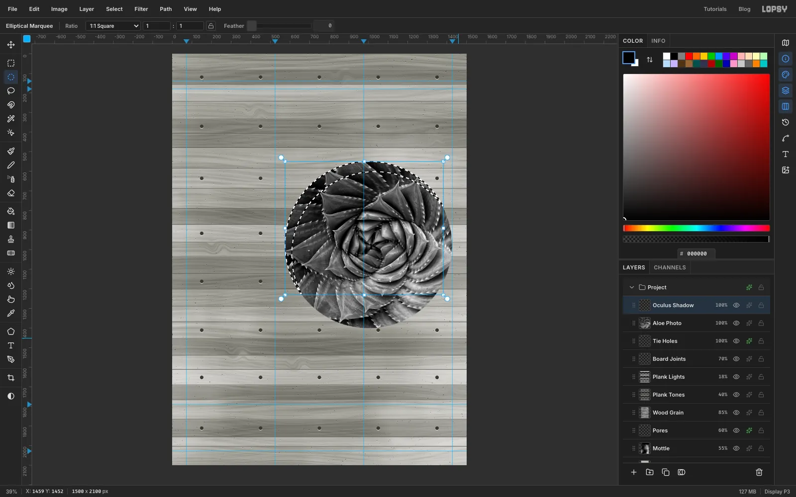

A hole cut through a thick wall is shadowed along one side. Here the light comes from the lower right, so the shadow falls along the top left.

1. Add a layer named `Oculus Shadow`. With the **Elliptical Marquee**, drag the oculus circle, from `575, 550` to `1425, 1400`.
2. Hold **Alt** and drag the same size of circle again, shifted 34 px right and 52 px down (from `609, 602` to `1459, 1452`). This subtracts most of it and leaves a crescent along the top-left edge.
3. Fill it with black and deselect. Run **Gaussian Blur** with **Radius** `18`.
4. The blur spreads past the rim, so trim it back. Select the oculus circle again, choose **Select → Inverse** and press [[Delete]]. Deselect, then set the layer to **Multiply** at **80%**.

## Light the lower lip

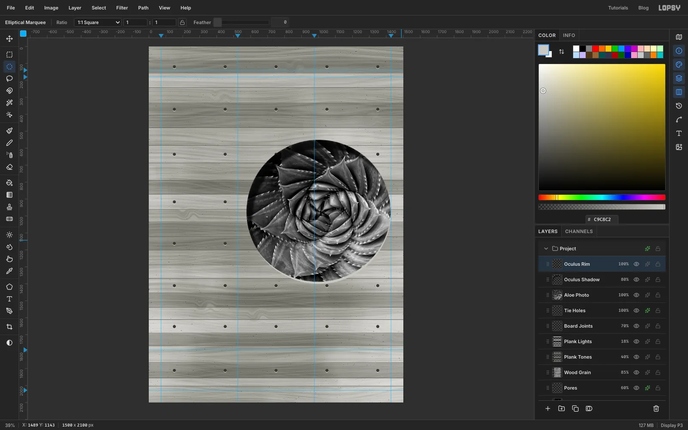

1. Add a layer named `Oculus Rim`. Select a circle 1 px bigger than the oculus (`574, 549` to `1426, 1401`).
2. Hold **Alt** and subtract the same circle moved 9 px left and 13 px up (`565, 536` to `1417, 1388`). What remains is a thin crescent on the lower right.
3. Fill it with `#C9C8C2`, deselect, and blur it with **Radius** `1`. This is the sunlit edge of the cut concrete.

## Duotone the aloe with a Gradient Map

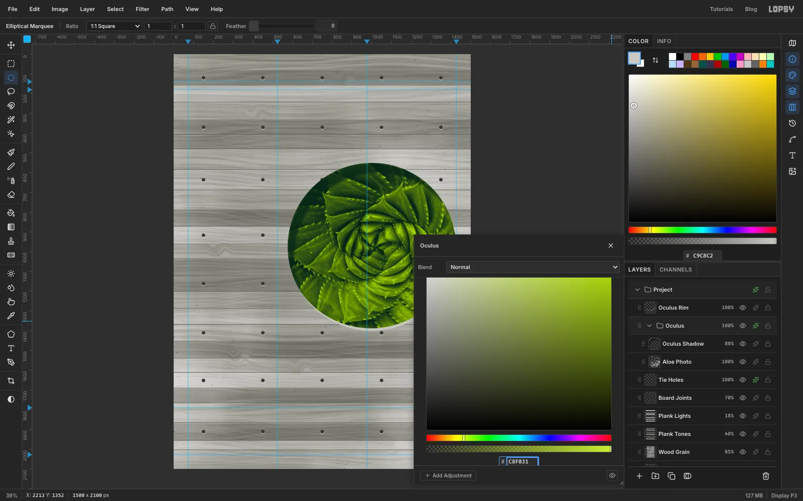

1. Click `Aloe Photo`, then **Shift-click** `Oculus Shadow` so both are selected. Choose **Layer → Group Layers** and rename the group `Oculus`.
2. Click the group's ✦ button to open its **Adjustments** drawer. Click **Add Adjustment** and choose **Gradient Map**.
3. Click the left stop and type `0E2418` in its hex field. Click the right stop and type `C8F031`. The darks become deep moss and the lights become acid lime. The shadow inside the group turns green with the photo, so it looks like shade on the leaves.
4. Close the drawer.

## Let the rain streak down from the lip

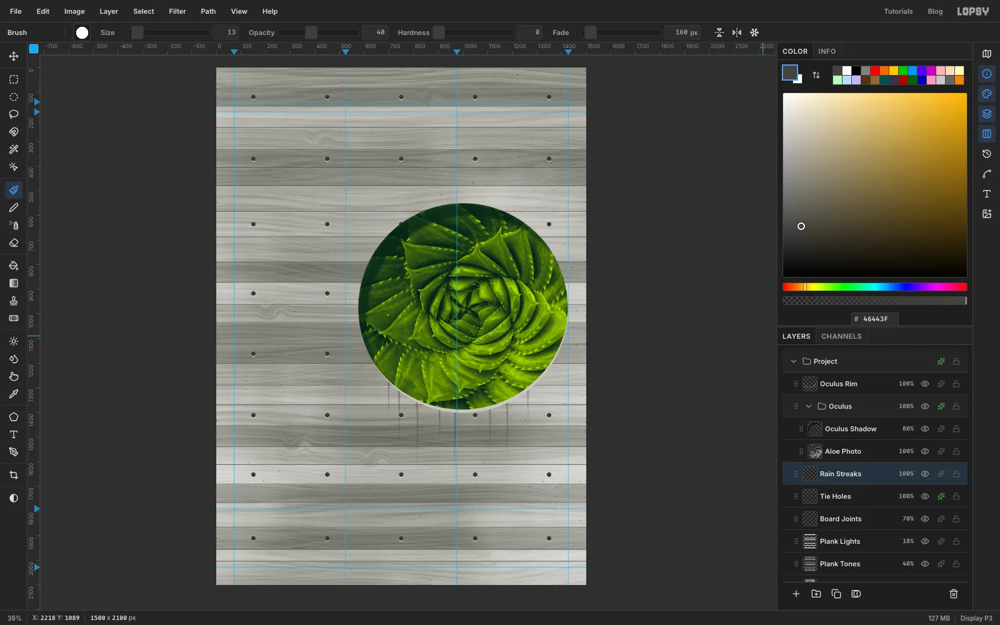

Water dripping off the edge of a hole leaves dark streaks that start strong and fade out.

1. Click `Tie Holes` and add a layer named `Rain Streaks` above it.
2. Pick the **Brush** ([[B]]) at **Size** `13`, **Hardness** `0`, **Opacity** `40`, colour `#46443F`.
3. Open the Brushes window with the brush-tip button at the left of the options bar and, on its **Shape** tab, set **Taper** to a little more than the length of the streak you're about to draw. Then set **Fade** in the options bar to that length. Both start counting from where you press, so always start at the lip and drag straight down.
4. Draw about eight streaks starting at the lower edge of the hole, between x `700` and `1265`, from 150 to 320 px long. Change Taper and Fade for each one so they don't all end at the same point.
5. Set the layer to **Multiply**. Then set **Fade** back to `0` and **Taper** to `0`, so later brush strokes aren't affected.

## Set the table text

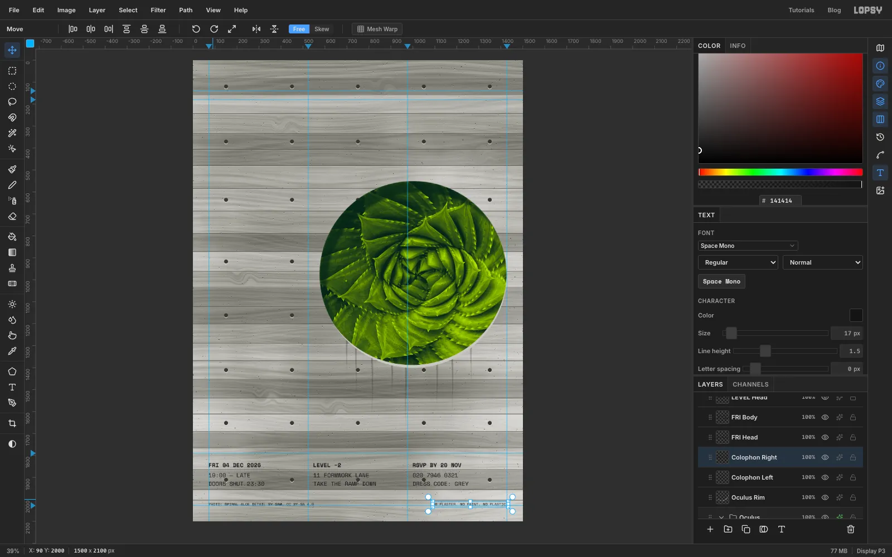

Create all the small type before the giant wordmark. The wordmark's line boxes are huge, and a click inside one would edit it instead of starting a new text layer.

1. Click `Oculus Rim`, the top layer of the image so far, so a raster layer is active. New layers go directly above the active one, and if a text layer were active, changing the Text options would restyle it.
2. Start with the right-hand column. Pick the **Text** tool ([[T]]) and set **Space Mono** **Regular**, size `26`, colour `#141414`, and **Line height** `1.5` in the Text panel. Click in empty space and type `020 7946 0321`, press Enter, type `DRESS CODE: GREY`, and press [[Tab]] to finish. With the **Move** tool, nudge it so the text starts at x `1000` and its first cap tops sit at y `1880`.
3. Click `Oculus Rim` again, pick the **Text** tool, switch Space Mono to **Bold**, and type `RSVP BY 20 NOV`. Move it to x `1000`, with its cap tops at y `1834`, just above the two lines you typed.
4. Middle column: click `Oculus Rim`, type `11 FORMWORK LANE` / `TAKE THE RAMP DOWN` in **Regular** and move it to x `548`, cap tops at y `1880`. Then click `Oculus Rim` again and type `LEVEL −2` in **Bold** at x `548`, cap tops at y `1834`.
5. Left column: the same again at x `72`, with `19:00 — LATE` / `DOORS SHUT 23:30` in Regular and `FRI 04 DEC 2026` in Bold above it.
6. For the small print, click `Oculus Rim` and use Space Mono **Regular** at size `17`. Put `PHOTO: SPIRAL ALOE DETAIL BY SAM, CC BY-SA 4.0` at the left margin and `NO PLASTER. NO PAINT. NO PLASTIC.` with its right edge on x `1428`. Sit both with their cap tops at y `2016`.

## Add the invitation copy

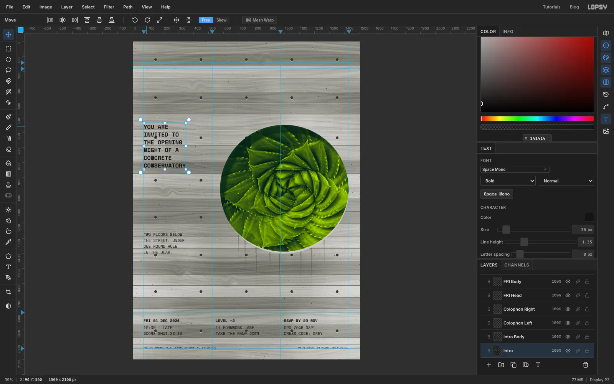

1. Click `Oculus Rim` again so a raster layer is active, pick the **Text** tool, and set Space Mono **Regular**, size `26`, **Line height** `1.5`, and type the four lines `TWO FLOORS BELOW` / `THE STREET, UNDER` / `ONE ROUND HOLE` / `IN THE SLAB.` Nudge it to the left margin so its last line sits on y `1400`, level with the bottom of the oculus.
2. Click `Oculus Rim` once more, then set **Bold** at size `38`, **Line height** `1.35`, and type `YOU ARE` / `INVITED TO` / `THE OPENING` / `NIGHT OF A` / `CONCRETE` / `CONSERVATORY`. Nudge its first cap top to y `550`, level with the top of the oculus. Lining both blocks up with the hole ties the left column to the image.

## Add the header line

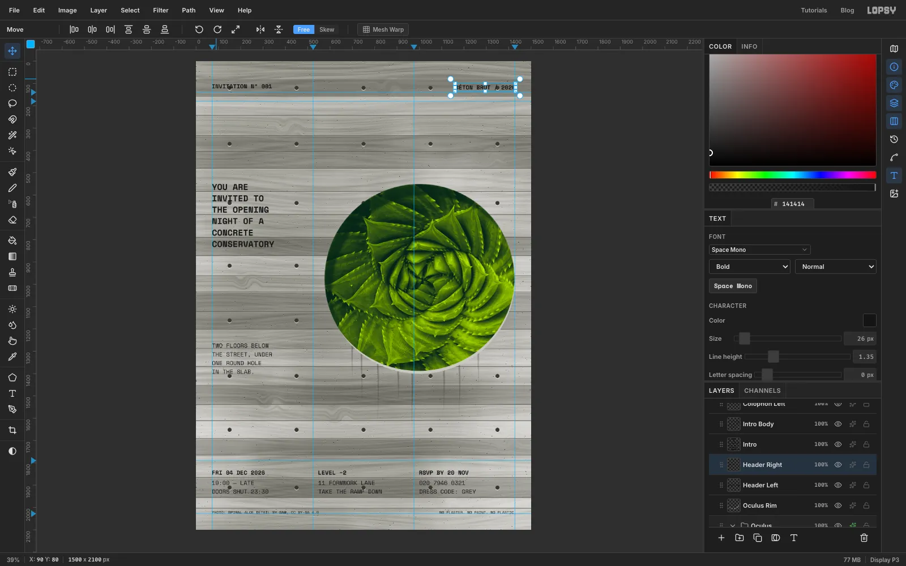

1. Click `Oculus Rim`, pick the **Text** tool, and type `BÉTON BRUT / 2026` in Space Mono **Bold** `26` near the top right. Move its right edge to x `1428`.
2. Click `Oculus Rim` again and type `INVITATION Nº 001` the same way at the left margin, with its cap tops at y `103`. The º is the ordinal indicator: [[Option+0]] on a Mac keyboard.
3. Nudge the right-hand label up or down until the two share a baseline.

## Rule the grid

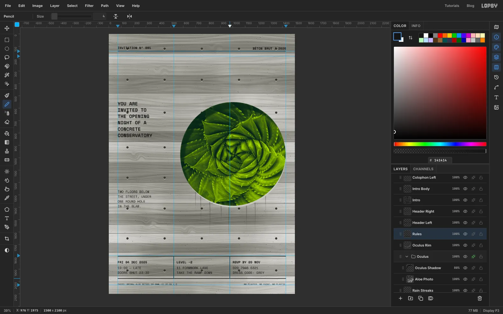

1. Click `Oculus Rim` and add a layer named `Rules`. Pick the **Pencil** at **Size** `4` in `#141414`.
2. Shift-click straight lines from the left margin to the right margin at y `140`, `1795` and `1975`.
3. Draw the two column dividers from `524, 1795` down to `524, 1975`, and from `976, 1795` down to `976, 1975`. The table now reads as three closed cells.

## Dimension the oculus

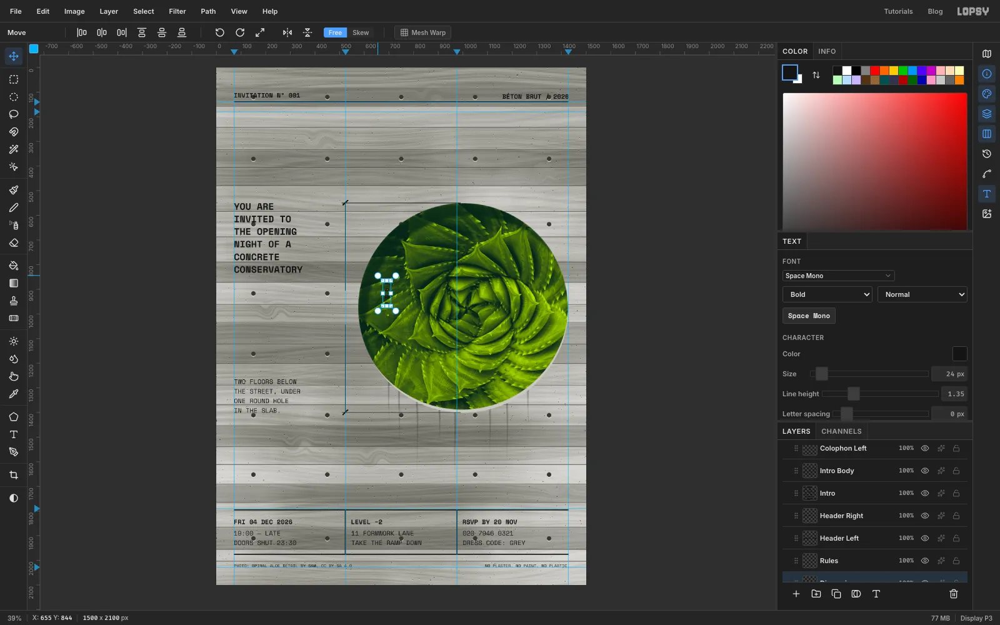

Architects mark sizes on their drawings with a dimension line: a line with short angled ticks at each end and the measurement written alongside.

1. Still on `Rules`, set the Pencil to **Size** `2`. Draw a vertical line at x `524`, the same x as the table's first divider, from y `550` to `905`. Draw a second one from `1045` to `1400`, leaving a gap for the label.
2. Draw horizontal extension lines from `510, 550` to `990, 550`, and from `510, 1400` to `990, 1400`. They reach almost to the edge of the circle.
3. At **Size** `4`, draw a short 45° tick through each end of the dimension line: from `515, 559` to `533, 541` at the top, and from `515, 1409` to `533, 1391` at the bottom.
4. Click `Oculus Rim`, pick the **Text** tool and type `Ø 8.5 M` in Space Mono **Bold** `24` anywhere clear of other text. The screenshot shows it typed over the photo, where it's hard to see. Switch to the **Move** tool and drag the corner rotation handle, holding [[Cmd]] to snap, until the label turns **−90°** and reads from bottom to top.
5. Press [[Cmd+D]], then drag the label into the gap in the dimension line, centred on `524, 975`.

## Make the sticker

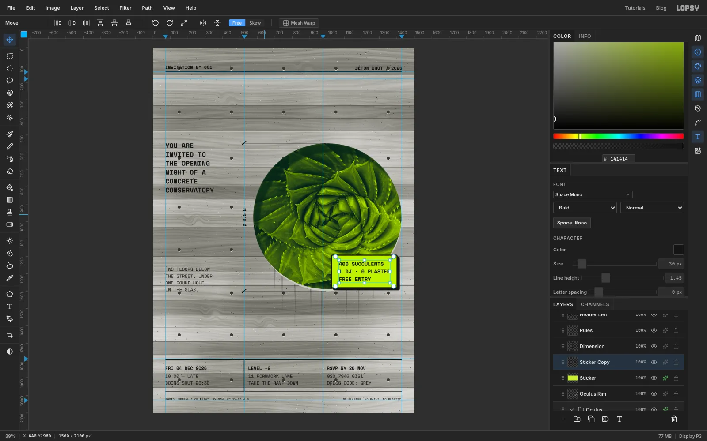

1. Click `Oculus Rim`, add a layer named `Sticker`, and with the **Rectangular Marquee** drag from `1028, 1196` to `1398, 1378`. Fill it with `#C8F031` and deselect.
2. Open its effects. Enable **Drop Shadow** in `#141414` with **Offset X** `12`, **Offset Y** `12`, **Blur** `0`, **Spread** `0` and **Opacity** `100`, for a hard printed shadow.
3. Enable **Stroke**: **Width** `6`, colour `#141414`, position **outside**. Outside keeps the border clean on every edge once the sticker is tilted.
4. With `Sticker` active, pick the **Text** tool and type `400 SUCCULENTS` / `1 DJ · 0 PLASTER` / `FREE ENTRY` in Space Mono **Bold** `30`, **Line height** `1.45`. Nudge it to sit 40 px in from the sticker's left edge and 37 px down from its top. The text lands above the sticker because new layers go directly above the active one. Double-click the new layer's name and rename it `Sticker Copy`.

## Set the wordmark wall to wall

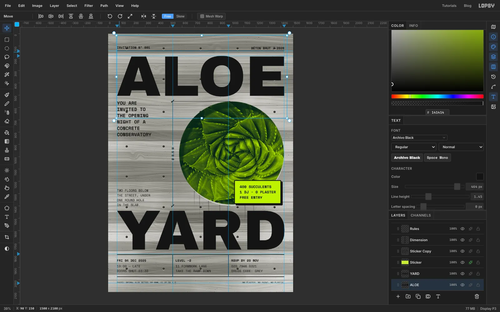

1. Click `Oculus Rim` again. Set the Text tool to **Archivo Black**, size `458`, colour `#141414`.
2. Click in empty space below the second paragraph and type `YARD`, then press [[Tab]]. With the **Move** tool, nudge it so its left edge sits on the left margin.
3. If its right edge doesn't land on the right margin (x `1428`), keep `YARD` selected, pick the **Text** tool and change **Size** in the Text panel by a few points, without clicking the canvas. Check the width again, then move it so its cap tops sit at y `1440`.
4. Click `Oculus Rim` again before starting `ALOE`, or the next size change would restyle YARD. Make `ALOE` the same way at about size `464`, with its cap tops on the y `180` guide. Two different sizes make two different words fill exactly the same width, and that forced fit is a brutalist habit.

## Even out the letter gaps

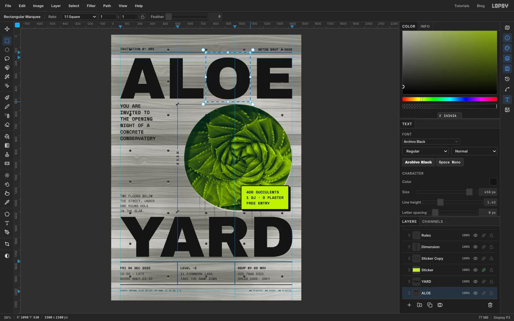

Forced to width, the gaps in ALOE come out uneven: the L and O nearly touch, and there's a wide hole before the E.

1. Click `ALOE` and click **Rasterize Layer** at the bottom of the Layers panel. Do the same for `YARD`, since the worn ink later needs pixels to cut into.
2. With `ALOE` active, marquee tightly around just the **O**, from the right edge of the L to the left edge of the E.
3. Switch to the **Move** tool and press the right arrow until the gaps either side of the O match. That's about **17 px** (Shift+arrow moves 10 at a time). Press [[Cmd+D]].

## Clear the clutter behind the type

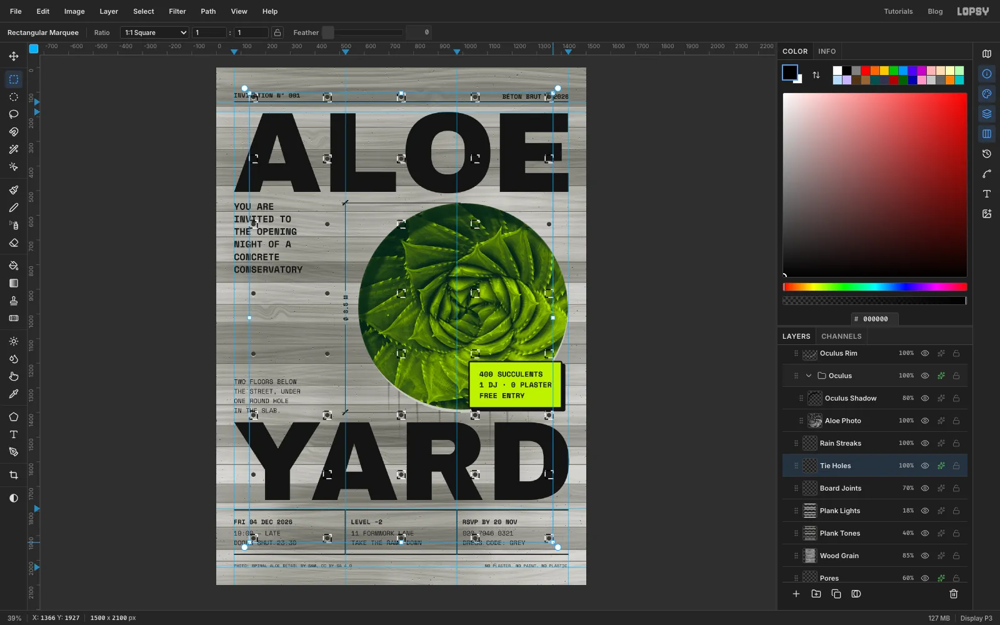

1. Click `Tie Holes`. Only seven holes sit in open concrete well clear of the type, the rules, the table, the oculus and the sticker. They are at `450, 636`, `1350, 636`, `150, 917`, `450, 917`, `150, 1162`, `450, 1162` and `150, 1652`. Hold **Shift** and drag a small square marquee around each of the other holes, press [[Delete]] once to remove them all, and deselect. A few holes are enough to say "formwork", and they no longer fight the type.
2. Click `Pores`, and Shift-marquee a box about 8 px bigger than each block of small type: the header, both paragraphs, the label, the table text and the colophon. Press [[Delete]]. Bugholes right next to 26 px type look like stray punctuation.

## Tilt the sticker

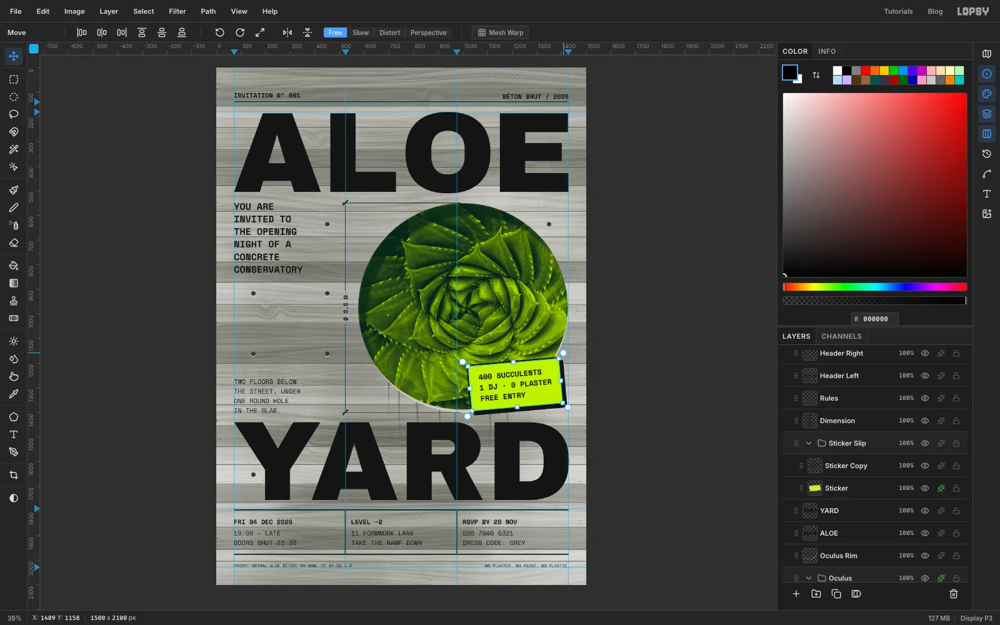

1. Click `Sticker`, Shift-click `Sticker Copy` (the sticker's text layer), choose **Layer → Group Layers** and name the group `Sticker Slip`.
2. With the group selected and nothing marqueed, switch to the **Move** tool. Drag the rotation handle just outside the group's top-right corner to turn it **5°** anticlockwise. The text, the fill, the border and the shadow all turn together.
3. Press [[Cmd+D]] to commit.

## Select the letters

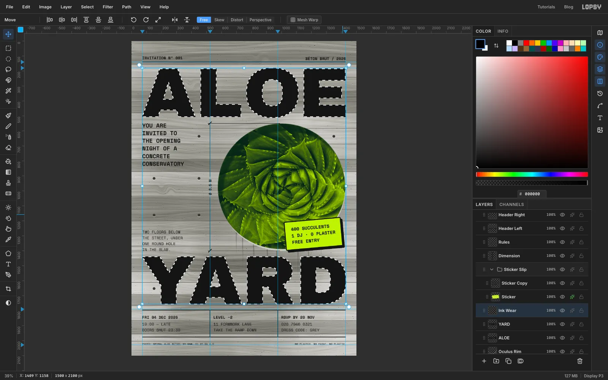

For the worn ink you'll punch small holes through the letters, so the wall shows through them.

1. Click `YARD` and add a layer named `Ink Wear` above it.
2. [[Cmd]]-click the `ALOE` thumbnail to load its letters as a selection. Then [[Cmd+Shift]]-click the `YARD` thumbnail to add its letters too.
3. Click `Ink Wear` and fill the selection with `#808080`. Run **Add Noise** (**Amount** `100`, **Mono**, **Uniform**), then **Gaussian Blur** at **Radius** `3`.

## Make the edges wear faster

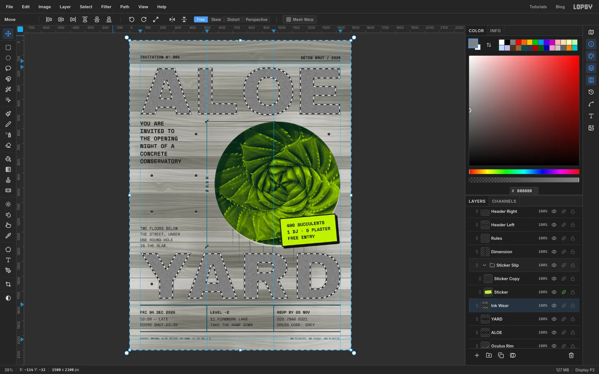

Ink wears fastest at the edges of letters, so make the noise a little brighter there.

1. Choose **Select → Shrink…** and shrink by `7` px. Then choose **Select → Inverse**. You now have a band just inside each letter's edge (plus everything outside the letters, where the layer is empty anyway).
2. Run **Brightness/Contrast** with **Brightness** `6`, then deselect.

## Threshold the wear map

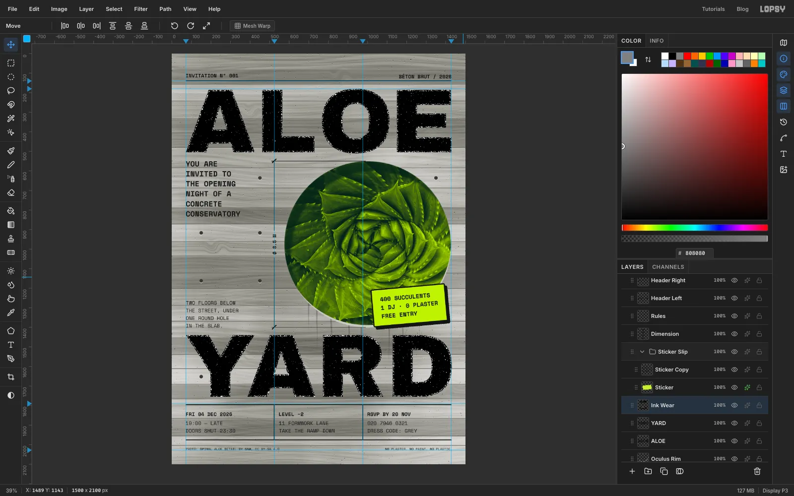

1. Choose **Filter → Threshold…** with **Preview** on. Drag **Level** until only a light sprinkling of white clumps shows, about 4% of the letters. That's a Level of around `149`. Apply.

## Select the voids

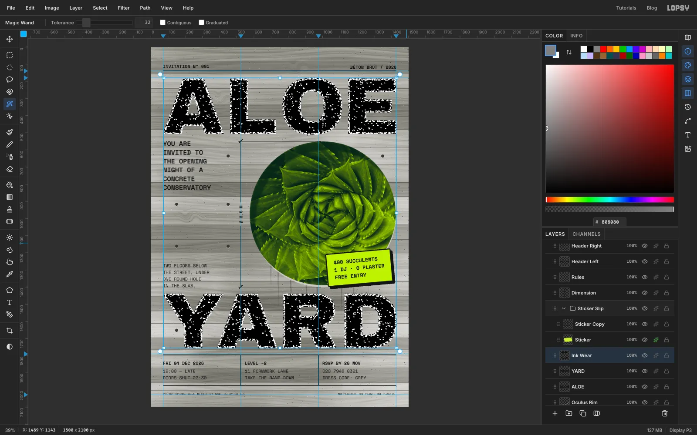

1. Pick the **Magic Wand** with **Contiguous** off, and click one of the white clumps on `Ink Wear`. All of them are selected.
2. Choose **Select → Grow…** and grow by `1` px. This takes the selection into the letters' soft edge pixels, so a void that reaches the edge bites right through the outline instead of leaving a thin dark rim.
3. Hide `Ink Wear` with its eye button.

## Punch the voids out and tidy up

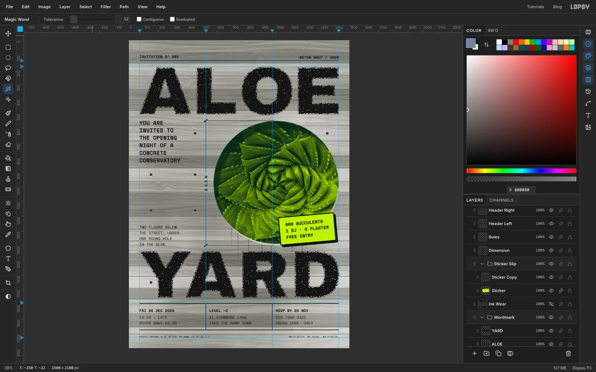

1. Click `ALOE` and press [[Delete]]. Then click `YARD` and press [[Delete]]. The wall's grain and joints now show through the worn letters. Deselect.
2. Select `ALOE` and Shift-click `YARD`, choose **Layer → Group Layers**, and name the group `Wordmark`.
3. Save with **File → Save Project**, and export with **File → Quick Export PNG**.

To see how the layers and groups fit together, open the project from the **Follow along** box at the top of this page and click through the Layers panel. Hidden layers like `Ink Wear` are still there to look at.
