Brutalist architecture gets its name from *béton brut*, French for "raw
concrete". The buildings are honest about what they're made of. You can see
the marks of the wooden boards the concrete was poured against, the holes
left by the ties that held the formwork together, and the stains where rain
runs down the walls. Ernő Goldfinger's Trellick Tower in London is a famous
example: a tall slab of flats with a separate tower for the lifts and stairs,
joined to it by bridges every few floors, with a boiler house cantilevered off
the top.

In this tutorial you'll draw a tower like that at night for **Precast
Nocturnes**, a 12-inch LP by an imaginary ambient band called Slab Choir.
The tower is built from flat rectangles, but the grid makes them line up
exactly. Then come the layers that turn grey boxes into concrete: board
marks, rain stains, a shadow side and sodium-lit windows. The title sits on a
black plinth, as if the building stood on its own name, and the letters get
cast like concrete too.

You'll use:

- the grid with **Snap**, guides, and Shift to add marquees together
- **Define Pattern** and **Fill with Pattern** for the window grid
- Add Noise, Motion Blur, Clouds, Gaussian Blur and Threshold
- the Move tool for scaling, rotating and arrow-key nudges
- Outer Glow, Inner Glow and Drop Shadow
- two Google Fonts: **Archivo Black** and **IBM Plex Mono**
- the root group's **Color Grading** and **Vignette** adjustments

The document is **1536 × 1536 px**, a square record sleeve. Every position
below is in document pixels. Hover over the canvas and read the **X** and
**Y** in the status bar at the bottom left to find them.

The palette:

- Night sky `#080A11` → `#252B3B`
- Moon `#F2EEDC`, halo `#FFF3D6`
- Concrete `#8C877E`, fins `#B2ADA4`, set-back wall `#141722`
- Window recess `#17191F`, sill `#B5AE9F`
- Sodium windows `#FFB13B`, dim windows `#D9822B`, lobby `#C98A3C`
- Television `#0E2A33`, TV glow `#3FE0C8`
- Beacon `#FF3B2F`
- Plinth `#050505`, ground line `#2A2A2A`
- Cast letters `#AEACA6` → `#8A8883`
- Bone type `#E8E2D4`, amber type `#FFB21A`, slate type `#9AA3B5`, title stone `#CFCAC0`
- Working darks `#1B1813`, `#2E2A24`, `#2B2D33`, `#6A665F`, far lights `#C98632`
- Night shade `#39405A` → `#B4B0AE` → `#EADCC6`, shadow side `#FFFFFF` → `#5E6070`

> **Tip:** Lopsy keeps some settings between tools and layers: the
> foreground colour, the marquee's Feather, the Text tool's Letter spacing
> and weight, and the Brush's Hardness. Each step below gives every value
> you need, even when it's the same as last time.

## Set up the canvas and paint the night sky

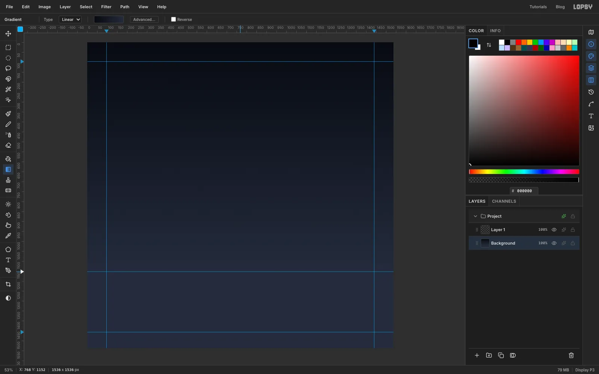

Choose **File → New**, set **Width** and **Height** to `1536` and click
**Create**. A new document has a **Background** layer and an empty **Layer
1** inside the **Project** group. Leave Layer 1 alone for now. It comes in
handy later.

Guides mark the margins. Click the top ruler at **x 96** and **x 1440** to
drop two vertical guides. Then click the left ruler at **y 96**, **y 1152**
and **y 1456** for three horizontal ones. The guide at 1152 is where the
building stands on the plinth.

Click the **Background** row. Pick the **Gradient** tool, set **Type** to
**Linear** and click **Advanced…**. Click the left stop and type `080A11` in
the Hex field, then click the right stop and type `252B3B`. Click **Done**.
Drag from the top edge of the canvas straight down to the 1152 guide. Hold
[[Cmd]] while you drag to snap the angle, so the drag stays vertical. The sky is darkest at the top and
lightens towards the horizon, where city light would be.

## Draw the moon and scale it up

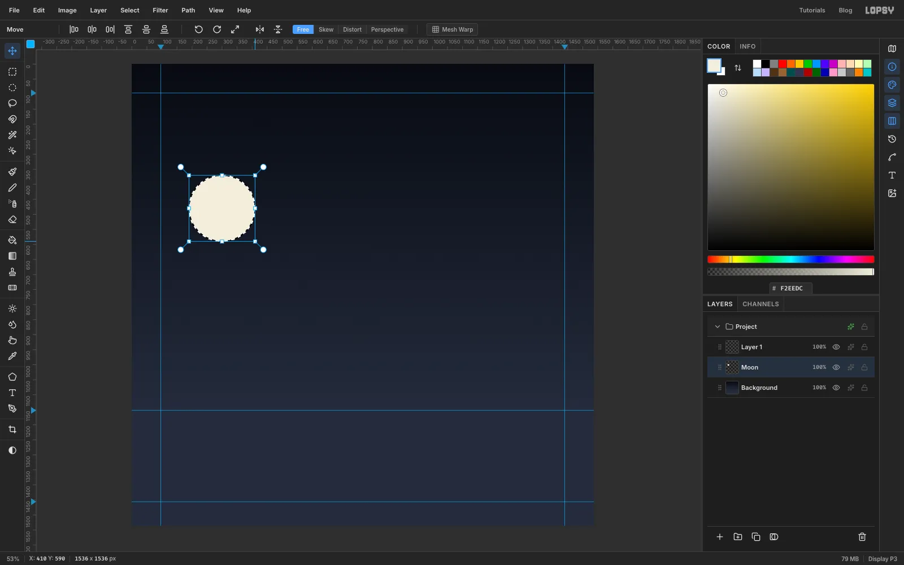

Click **Add Layer** at the bottom of the Layers panel and double-click the
new layer's name to rename it `Moon`. Set the foreground colour to
`#F2EEDC`.

Pick the **Elliptical Marquee** from the toolbox (it has no shortcut) and
hold [[Cmd]] while you drag a circle about 160 px across, from about
(190, 370) to (350, 530). [[Cmd]] keeps it perfectly round. Choose **Edit → Fill**.

The moon looks a bit small, so press [[V]] for the **Move** tool. Hold
[[Cmd]] and drag the bottom-right corner handle outwards about 60 px. [[Cmd]]
keeps the circle round. Press [[Cmd+D]] to apply the scale. The moon is now
about 220 px across. Drag it so its centre sits at about (270, 450), well clear
of where the tower will go.

## Give the moon craters and a halo

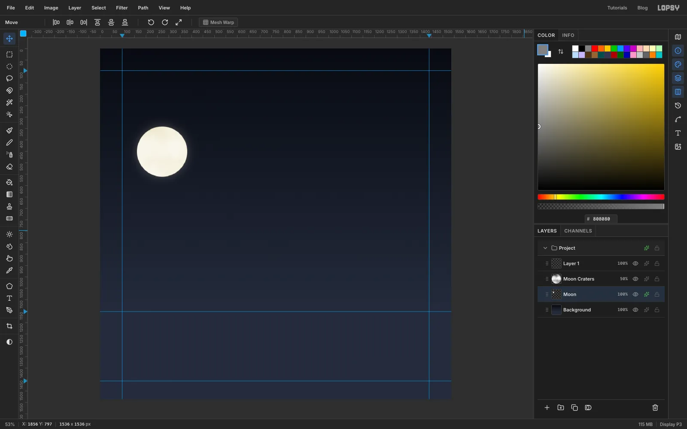

[[Cmd]]-click the Moon layer's thumbnail. This selects the moon's shape.
Click **Add Layer** and rename it `Moon Craters`. Set the foreground to
`#808080` and choose **Edit → Fill**. Then choose **Filter → Clouds…**
with **Scale** `7` and click **Apply**.

Click the layer's effects button (the sparkle icon on its row) to open the
drawer. Set **Blend** to **Overlay** and close the drawer. Click the
layer's opacity readout (the `100%` on its row) and drag the slider until it
reads **50%**. Overlay keeps mid-grey
invisible, so only the lighter and darker cloud patches show as maria and
highlands. Press [[Cmd+D]].

Click the **Moon** row, open its effects and tick **Outer Glow**. Click the
swatch and pick `#FFF3D6`, then set **Size** `60` and **Opacity** `25`. Close
the drawer.

## Block out the tower on a snapped grid

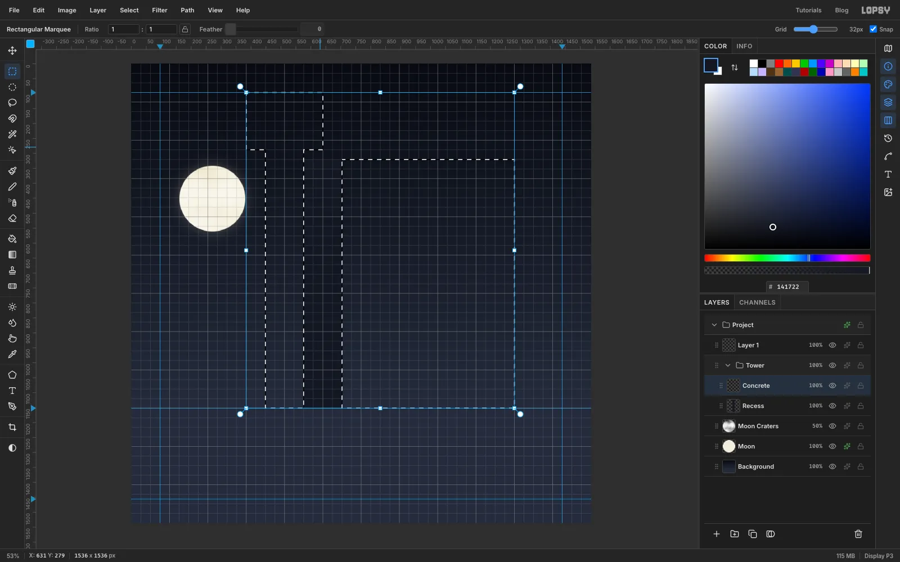

With **Moon Craters** selected, click **New Group** and rename the group
`Tower`. Everything that belongs to the building goes in here.

Choose **View → Show Grid**. On the right of the options bar, drag the
**Grid** slider to **32px** and make sure **Snap** is ticked. Every marquee
corner now jumps to a grid line, so all the pieces of the building line up
exactly.

Add a layer in the group called `Recess`. Drag a **Rectangular Marquee**
[[M]] from (576, 320) to (704, 1152) and fill it with `#141722`. This dark
wall sits behind the gap between the two towers, so the gap reads as a deep
shadow rather than a hole.

Add another layer called `Concrete` and draw the building as one selection:

1. Drag the **slab** from (704, 320) to (1280, 1152). That's 9 windows
   wide and 13 floors tall at 64 px each.
2. Hold [[Shift]] and drag the **core** (the lift and stair tower) from
   (448, 192) to (576, 1152). [[Shift]] adds it to the selection.
3. Hold [[Shift]] and drag the **boiler house** from (384, 96) to (640, 288).

Set the foreground to `#8C877E` and choose **Edit → Fill**, then press
[[Cmd+D]].

## Copy the sky bridge down the core

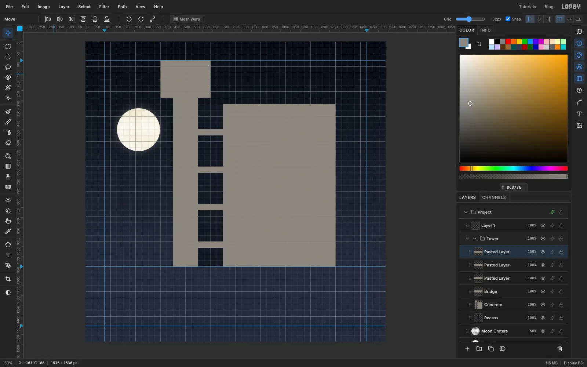

Add a layer called `Bridge`. Drag a marquee from (576, 448) to (704, 480),
fill it with `#8C877E`, and press [[Cmd+C]].

Press [[Cmd+V]]. The copy is pasted exactly on top of the original. Press
[[V]] for the Move tool, then press [[Down]] six times. With the grid and
Snap on, each arrow press moves the layer one grid cell (32 px), so six
presses drop the bridge three floors. Paste twice more, and move those
copies down **12** and **18** presses. That gives bridges at y 448, 640, 832
and 1024.

Click the top pasted layer and choose **Layer → Merge Down** four times to
merge the bridges into **Concrete**.

## Draw one window and define it as a pattern

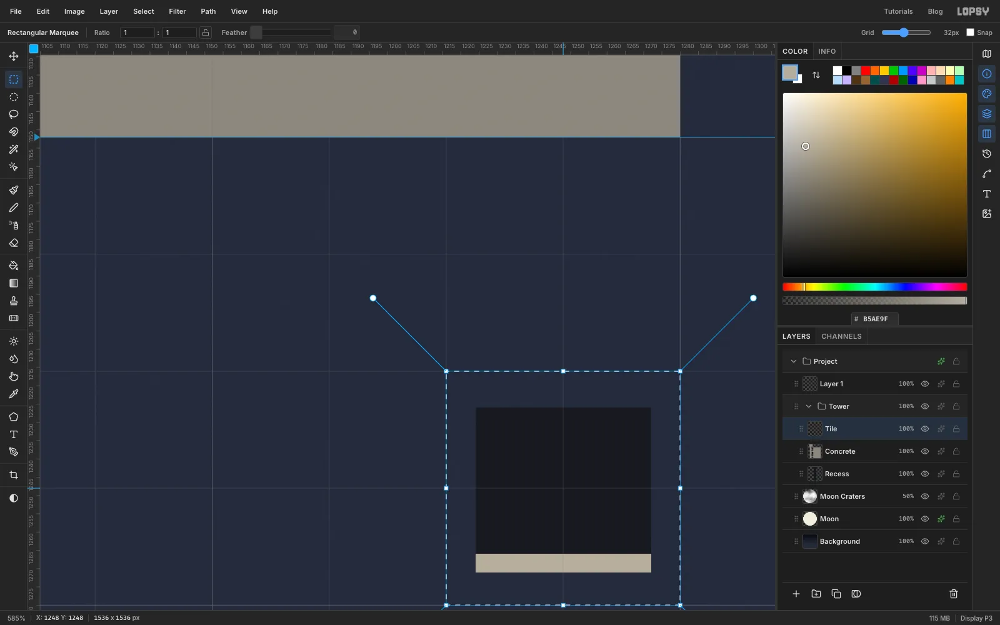

The facade has over a hundred identical windows, so draw one and let Lopsy
tile it.

Untick **Snap** for now. Add a layer called `Tile`. Pick the
**Rectangular Marquee** and press [[Cmd+D]] so nothing is selected. Then
*click* (don't drag) on the canvas. A **Rectangular Selection** dialog opens
where you can type exact corners. Use it three times, in an empty bit of
sky below the slab:

1. From (1224, 1226) to (1272, 1266). Fill with `#17191F`. This is the
   dark window opening.
2. From (1224, 1266) to (1272, 1271). Fill with `#B5AE9F`. This is the
   pale concrete sill under the window.
3. From (1216, 1216) to (1280, 1280). This 64 × 64 square is the whole
   tile, with the window 8 px in from the left and 10 px down from the top.

Zoom in with [[Cmd]] and the scroll wheel to check it, then choose
**Edit → Define Pattern**. Press [[Cmd+D]] and delete the Tile layer with
the trash button. The pattern stays defined.

## Fill the slab with windows

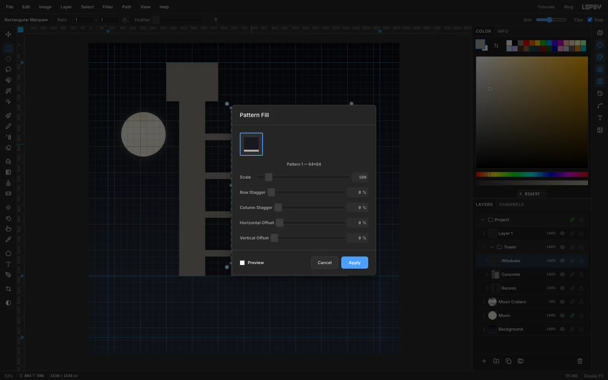

Click the **Concrete** row and add a layer called `Windows`. Tick **Snap**
again and drag a marquee from (704, 320) to (1280, 1088). Stop one floor
short of the ground, because the ground floor becomes a lobby.

Choose **Edit → Fill with Pattern…**, click your tile in the pattern grid,
leave **Scale** at `100` and click **Apply**. The pattern tiles from the
document's top-left corner, and the slab starts on a multiple of 64. So every
window lands exactly inside its bay, 12 floors of 9. Press [[Cmd+D]].

## Cut stair slits and louvres

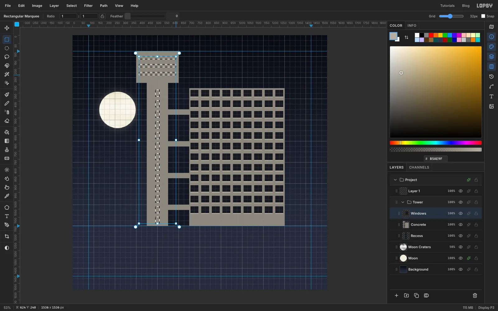

Stair towers often have narrow slit windows, one per landing. Untick
**Snap**, and in the **View** menu untick **Snap to Guides** too. The
guides would otherwise grab marquee edges that land within a few pixels of
them.

Still on the **Windows** layer, drag a marquee 24 × 40 px from (500, 330) to
(524, 370). Then hold [[Shift]] and add twelve more the same size straight
below it, each 64 px lower than the one before, down to (500, 1098).

On the boiler house, [[Shift]]-add three louvres: from (400, 128) to
(624, 144), from (400, 176) to (624, 192), and from (400, 224) to (624, 240).

Fill with `#17191F` and press [[Cmd+D]].

## Recess the ground floor

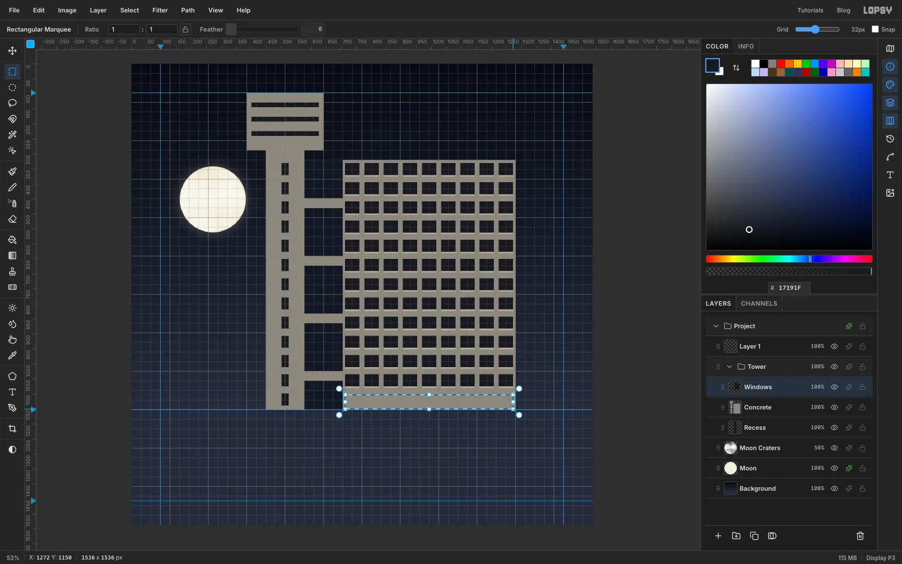

Brutalist blocks often stand on columns called *pilotis*, with a glazed lobby
tucked behind them. On the **Windows** layer, drag a marquee from
(712, 1102) to (1272, 1150) along the bottom floor, fill it with `#1B1813`
and press [[Cmd+D]]. You'll light it and add the columns later.

## Add two structural fins

Fins break the long facade into bays and show off the structure. Click the
**Windows** row and add a layer called `Fins`.

Drag a marquee from (880, 288) to (912, 1152), then hold [[Shift]] and add
a second from (1072, 288) to (1104, 1152). They start 32 px above the roof so
they stick up past it. Fill with `#B2ADA4`.

Leave the selection on, click the **Concrete** row, set the foreground to
`#8C877E` and choose **Edit → Fill** again. This adds the fin tops to the
concrete shape, which matters in the next few steps. Click the **Fins** row
and press [[Cmd+D]].

Open the Fins layer's effects and tick **Drop Shadow**. Set the colour to
black, **Offset X** `14`, **Offset Y** `0`, **Blur** `6` and **Opacity**
`75`. The moon is on the left, so each fin throws a shadow to the right
across the windows. That shadow is what makes the fins look like they stand
out from the wall.

## Mark the concrete with formwork boards

[[Cmd]]-click the **Concrete** thumbnail to select the building's shape.
Click the **Fins** row and add a layer called `Board Marks`. Fill it with
`#808080`.

Choose **Filter → Add Noise…**, set **Amount** to `70`, click
**Mono** and click **Apply**. Then choose **Filter → Motion Blur…**
with **Angle** `0` and **Distance** `40`. The speckles smear into fine
horizontal streaks, like the grain of the boards the concrete was poured
against.

Open the layer's effects and set **Blend** to **Overlay**. Keep the
selection: the next three layers use it too.

## Paint rain stains under the sills

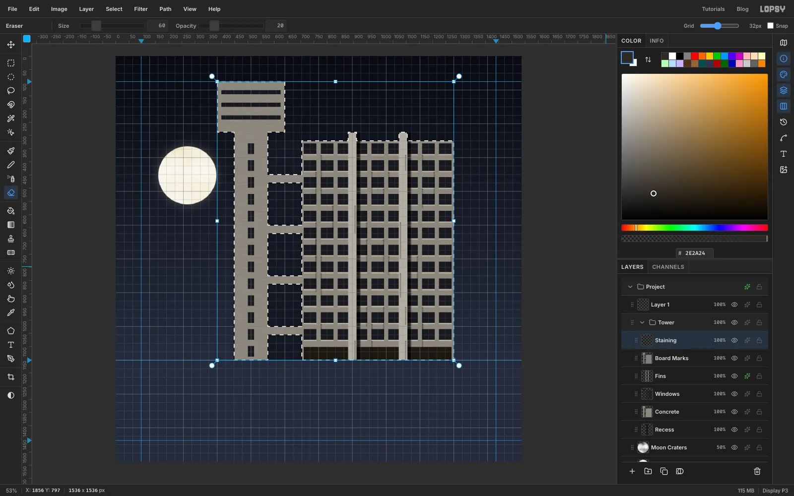

Add a layer called `Staining`. Pick the **Brush** [[B]] and set **Size**
`9`, **Hardness** `0` and **Opacity** `35`. Set the foreground to `#2E2A24`.

Rain collects on each sill and runs off its ends, so stains start at the
corners of the sills. Click just below the left or right end of a sill, then
[[Shift]]-click 30 to 150 px straight below it to draw a straight drip.
Do this under about a third of the windows, picked at random, and vary the
lengths. Add a 70 px drip under each end of every bridge as well. The
selection keeps every drip on the concrete.

To soften the bottom ends of the bridge drips, pick the **Eraser** [[E]],
set **Size** `60` and **Opacity** `20` and drag once across under each bridge.

Open the layer's effects and set **Blend** to **Multiply**.

## Shade the building for night

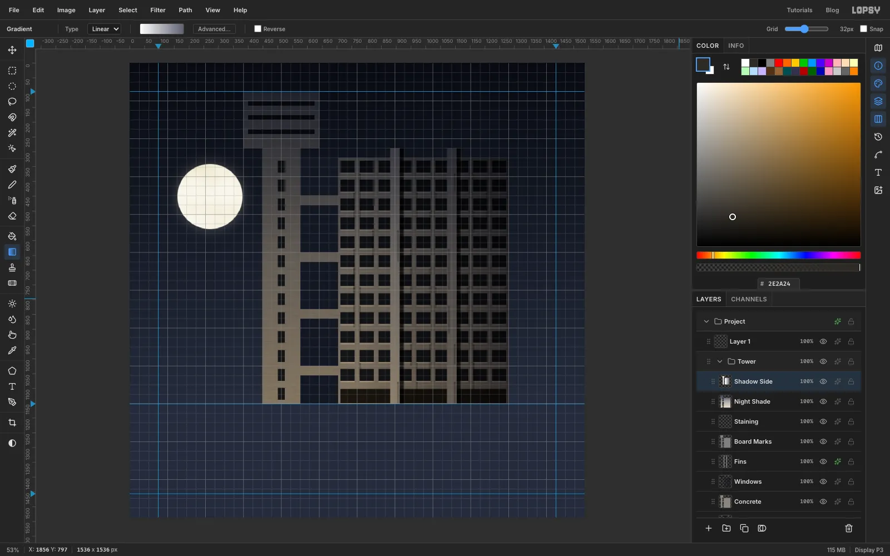

Add a layer called `Night Shade`. Pick the **Gradient** tool, click
**Advanced…** and set three stops: `#39405A` on the left, `#B4B0AE` at about
55 %, and `#EADCC6` on the right. Click the bar to add the middle stop.
Drag from the top of the boiler house (y 96) straight down to the 1152 guide.
Open the layer's effects and set **Blend** to **Multiply**. The top of the tower falls into the night
and the base picks up warm street light.

Add one more layer called `Shadow Side`. Click **Advanced…** again. The
editor still has Night Shade's three stops, so select the middle one and
click the trash button to delete it. Then set the left stop to `#FFFFFF` and
the right stop to `#5E6070`. Drag horizontally from x 760 to the slab's right
edge at x 1280 (hold [[Cmd]] to keep it level), and set this layer's
**Blend** to **Multiply** too. The side away from the
moon is now darker.

Press [[Cmd+D]].

## Select the lit windows

Click the **Shadow Side** row and add a layer called `Sodium`.

The quickest way to select a window opening exactly is the **Magic Wand**.
Click the **Windows** row, pick the **Magic Wand** [[W]] and tick
**Contiguous** in the options bar. Click inside one dark opening: the wand
selects just that opening and leaves the sill alone. [[Shift]]-click seven
more, scattered over different floors. Don't line them up, because real
people don't keep their lights on in neat rows. [[Shift]]-click four of the
stair slits too, for landing lights.

Click the **Sodium** row, fill with sodium amber `#FFB13B` and press
[[Cmd+D]].

## Light the windows, the TVs and the lobby

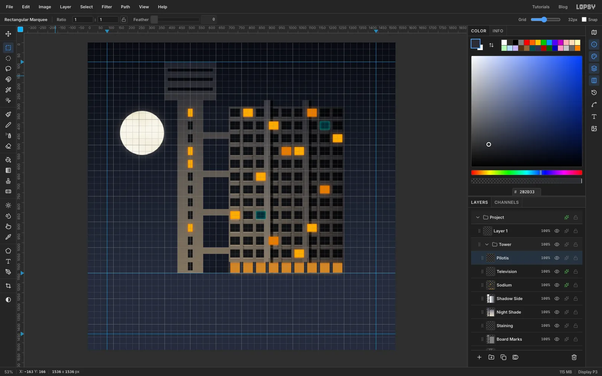

Click **Windows** again and wand-select four more openings, then click
**Sodium** and fill them with a dimmer `#D9822B`, for lamps behind curtains.
Press [[Cmd+D]]. With the **Rectangular Marquee**, drag along the lobby from
(712, 1102) to (1272, 1150), fill it with `#C98A3C` and press [[Cmd+D]].

Open the layer's effects:

- **Outer Glow**: colour `#FF9526`, **Size** `26`, **Opacity** `55`.
- **Inner Glow**: colour `#B4561C`, **Size** `10`, **Opacity** `60`. A
  darker rim on the inside makes each window look like a lit room instead of
  a flat sticker.

Add a layer called `Television`. Click **Windows**, wand-select two more
openings, click **Television**, fill them with `#0E2A33` and press
[[Cmd+D]]. Give the layer an **Inner Glow** of `#3FE0C8` (**Size**
`16`, **Opacity** `60`) and an **Outer Glow** of the same colour (**Size**
`18`, **Opacity** `35`). It looks like someone is up watching TV.

Add a layer called `Pilotis`. Turn **View → Show Grid** on, set the
**Grid** slider to **8px** and tick **Snap**. Drag a marquee 16 px wide down
the lobby from y 1096 to the 1152 line, under the strip of concrete between
the first two windows (x 760 to 776). Then [[Shift]]-drag one under every
other strip of concrete between windows, plus a half-width one at each end
of the slab. That's ten columns, 64 px apart. Fill them with `#2B2D33` and
press [[Cmd+D]]. Dark columns now stand in front of the glowing lobby. Set
the **Grid** back to **32px** and untick **Snap**.

## Put a beacon on the roof

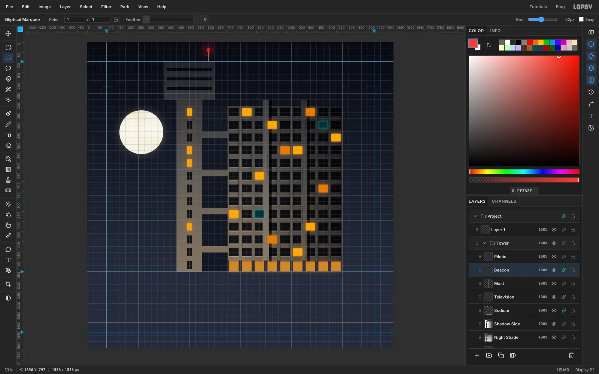

Add a layer called `Mast`. Pick the **Pencil** [[N]], set **Size** `4` and
the foreground to `#6A665F`. Click at (608, 96) on the boiler house roof,
then [[Shift]]-click at (608, 44) for a straight mast.

Add a layer called `Beacon`. With the **Elliptical Marquee**, [[Cmd]]-drag a small
circle about 18 px across centred on the top of the mast, at (608, 38). Fill
it with `#FF3B2F` and press [[Cmd+D]]. Give it an **Outer Glow** of
`#FF3B2F` with **Size** `48`, **Spread** `35` and **Opacity** `80`. Spread
keeps the glow strong around such a tiny shape.

## Add a sodium skyglow behind the tower

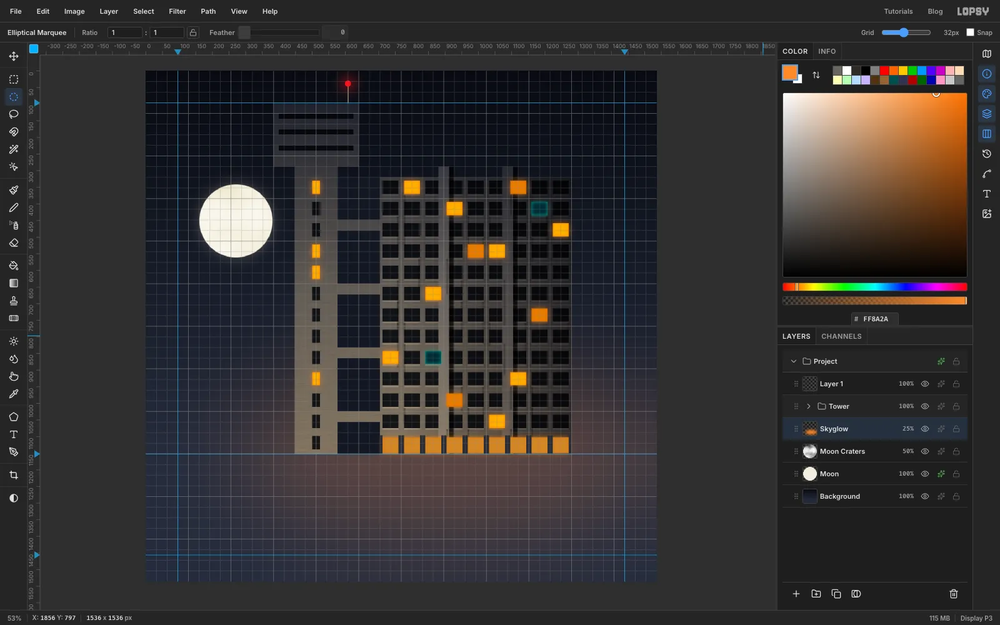

Click the arrow beside the **Tower** group to collapse it, then click the
**Moon Craters** row so the new layer lands under the tower. Add a layer
called `Skyglow`.

Drag an elliptical marquee from (260, 900) to (1540, 1400), fill it with
`#FF8A2A` and press [[Cmd+D]]. Choose **Filter → Gaussian Blur…** with
**Radius** `140`. Open its effects, set **Blend** to **Screen**, and drag the layer's opacity
to **25%**. It looks like the orange haze of streetlights reflecting off the
clouds.

## Add a block in the distance

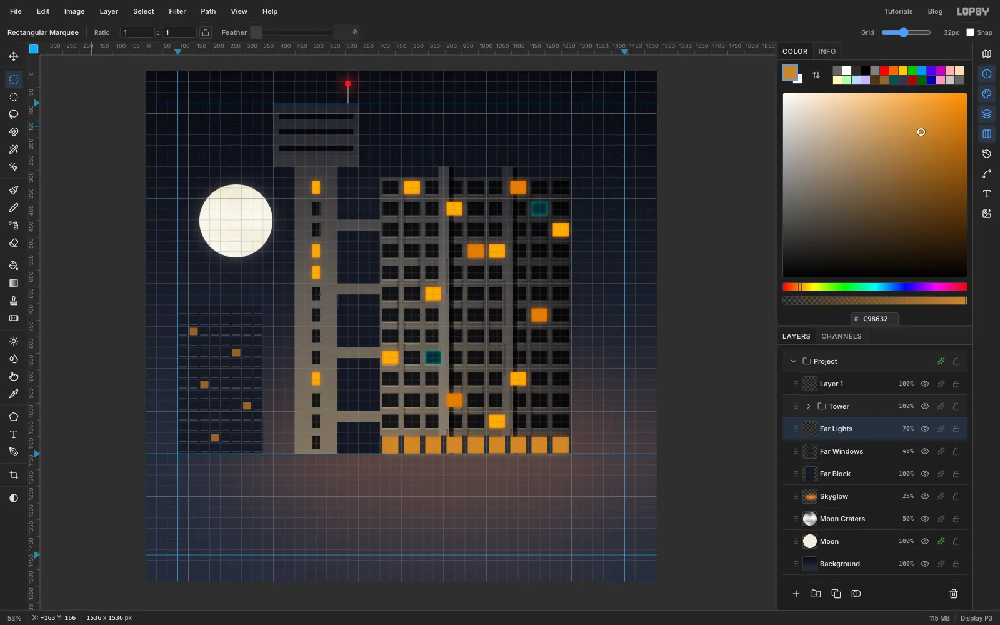

Tick **Snap** again (the grid is still showing at 32px). With **Skyglow**
selected, add a layer called
`Far Block`. Drag a marquee from (96, 704) to (352, 1152) and fill it with
`#151A28`.

Keep the selection and add a layer called `Far Windows`. Choose **Edit →
Fill with Pattern…**, pick the window tile again and set **Scale** to `50`.
The windows come out half the size, so the block reads as further away.
Click **Apply**, press [[Cmd+D]] and drag the layer's opacity slider to
**45%**.

Untick **Snap** and add a layer called `Far Lights`. Click **Far Windows**,
and with the **Magic Wand** (Contiguous on) click five of the little
openings, holding [[Shift]] after the first. Click **Far Lights**, fill with
`#C98632`, press [[Cmd+D]] and set the layer to **70%**.

## Build the plinth

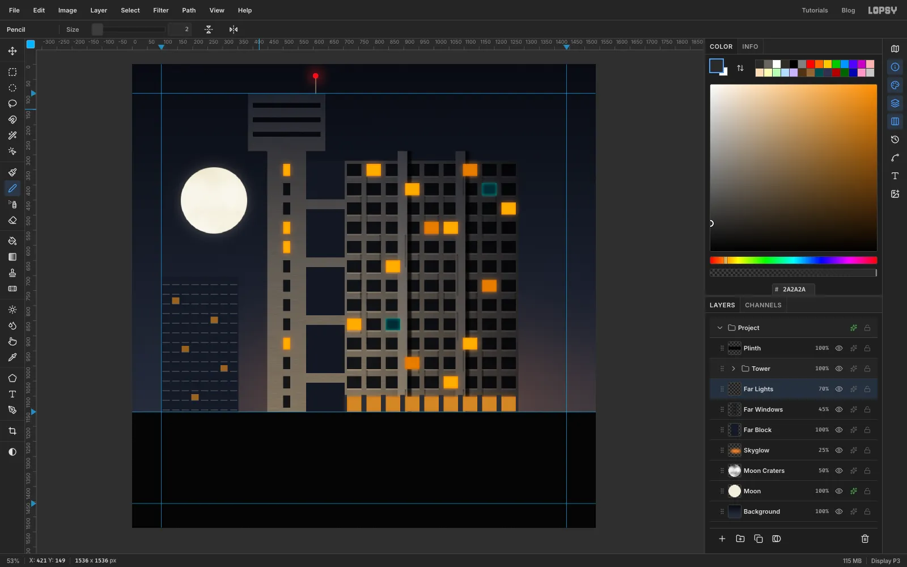

Tick **Snap**. Click the empty **Layer 1** row at the top of the Project
group and add a layer called `Plinth`. Drag a marquee from just left of the
canvas at the 1152 guide to just past the bottom-right corner, fill it with
`#050505` and press [[Cmd+D]].

Pick the **Pencil**, set **Size** `2` and the foreground to `#2A2A2A`. Click
at the left edge just under the 1152 line and [[Shift]]-click at the right
edge for a ground line. Then click **Layer 1** and delete it, and turn off
**View → Show Grid**.

## Set the title

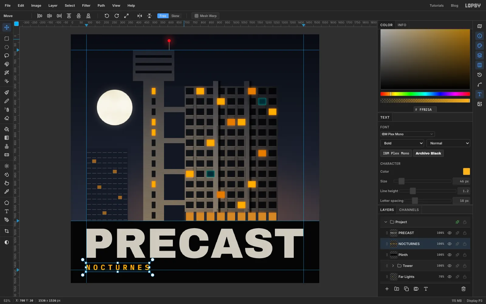

Click the **Plinth** row so the text options don't restyle an existing
layer. Pick the **Text** tool [[T]] and choose **Archivo Black** in the
font menu. Set **Size** `262`, colour `#CFCAC0`, and in the Text panel set
**Letter spacing** `0` and **Line height** `1.2`. Click inside the plinth,
type `PRECAST` and press [[Tab]] to finish. At 262 px the word is almost
exactly as wide as the space between the margin guides.

Press [[V]] and drag it into place by eye: its left edge lines up with the 96
guide, and the tops of the capitals sit about 45 px below the top of the
plinth, at y 1197. Watch the X and Y readout in the status bar, and finish
with the arrow keys, which move it 1 px at a time with the grid off.

Click the **Plinth** row again. With the Text tool, choose **IBM Plex Mono**,
set the weight to **Bold**, **Size** `46`, **Letter spacing** `18` and colour
`#FFB21A`. Click in empty sky at the top of the canvas, type `NOCTURNES` and
press [[Tab]]. Move it the same way, so its left edge lines up with the 96
guide and the bottom of the letters sits on the 1456 guide. That leaves a gap of about 40 px under
PRECAST and an 80 px margin at the bottom.

## Add the credits and a dimension line

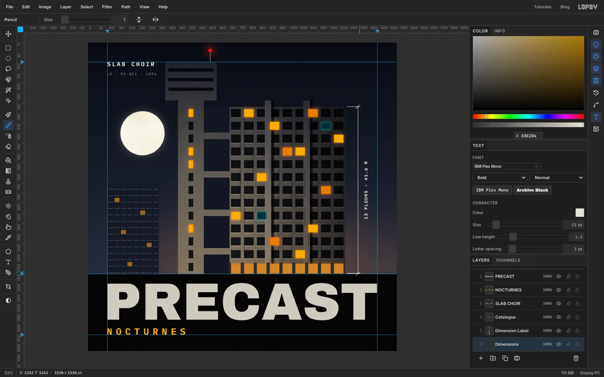

For each line below, click the **Plinth** row first, set up the text
options, then click in empty sky away from any other text, type, and press
[[Tab]]. Clicking on existing text would edit it instead. On a Mac, type the
middle dot · with [[Option+Shift+9]]. Rename each layer as you go: double-click
its name.

- `SLAB CHOIR` (layer `SLAB CHOIR`): IBM Plex Mono **Bold**, **Size** `30`,
  **Letter spacing** `6`, colour `#E8E2D4`. Move it into the top-left corner
  of the margins, so its top-left sits at (96, 96).
- `LP · PC-021 · 1974` (layer `Catalogue`): IBM Plex Mono **Regular**,
  **Size** `18`, **Letter spacing** `3`, colour `#9AA3B5`. Line its left
  edge up with the 96 guide, with the tops of the letters at y 150. That
  leaves a gap of 34 px under the band name.
- `13 FLOORS · 41.6 M` (layer `Dimension Label`): IBM Plex Mono **Bold**,
  **Size** `22`, **Letter spacing** `3`, colour `#E8E2D4`.

With the last one selected, press [[V]] and click **Rotate 90° CCW** in the
options bar so it reads upwards. Drag it to the right of the slab, centred at
about (1382, 736).

Add a layer called `Dimensions`. With the **Pencil** at **Size** `2` and
colour `#E8E2D4`, click at (1344, 320) and [[Shift]]-click at (1344, 1152)
for the measuring line. Draw a short line across each end, from x 1292 to
x 1356, level with the roof and the ground. Then add a small diagonal tick
through each end of the measuring line, the way architects mark dimensions.

## Draw the 33⅓ RPM stamp

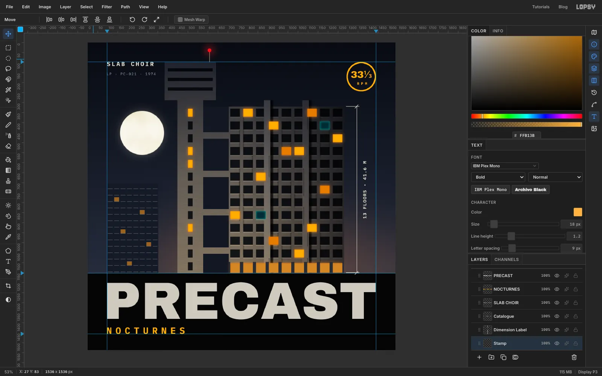

Click **Dimensions** and add a layer called `Stamp`. Turn **Snap to
Guides** back on. With the **Elliptical Marquee**, [[Cmd]]-drag a circle from
(1292, 96) to the 1440 guide at (1440, 244). The guides make the stamp line
up with the top and right margins. Fill it with `#FFB13B`, choose **Select →
Shrink…** with `7` and press [[Delete]]. You're left with a ring. Press
[[Cmd+D]].

Now the two lines of text. Type each one in empty sky, then move it into the
ring:

1. Click the **Stamp** row. With the Text tool, choose **Archivo Black**,
   **Size** `48`, **Letter spacing** `0`, colour `#FFB13B`. Click in empty
   sky and type `33⅓`. Copy the ⅓ from this page if your keyboard doesn't
   have it. Press [[Tab]], then click **Rasterize Layer** at the bottom of
   the Layers panel. Move it into the ring, a little above the middle.
2. Click the new `33⅓` layer, which is now ordinary pixels, so the text
   options can't restyle it. Choose IBM Plex Mono **Bold**, **Size** `18`,
   **Letter spacing** `9`, the same colour. Click in empty sky, type `RPM`,
   press [[Tab]], click **Rasterize Layer** and move it under `33⅓`.

With the RPM layer active, choose **Layer → Merge Down** twice to merge both
lines into the ring.

## Wear the stamp like real ink

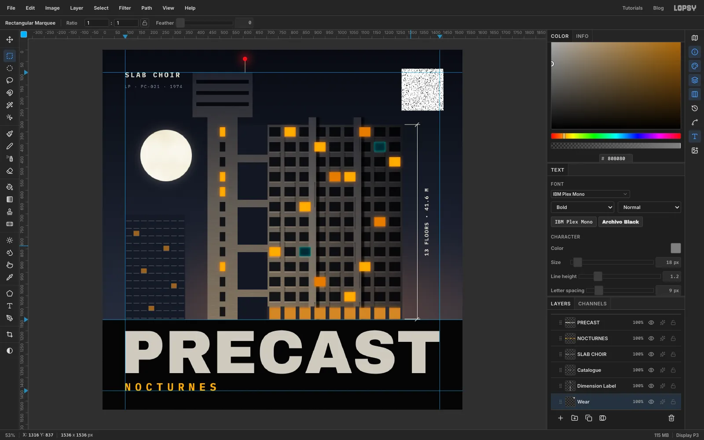

A rubber stamp never prints perfectly. Add a layer called `Wear`, drag a
marquee over the whole stamp and fill it with `#808080`. Run **Add Noise**
(**Amount** `100`, **Mono**), then **Gaussian Blur** (**Radius** `2`), then
**Filter → Threshold…** with **Level** `112`. The blurred noise turns
into blotchy black and white specks. Press [[Cmd+D]].

Pick the **Magic Wand** [[W]], untick **Contiguous**, and click a black speck
to select all of them. Click the **Stamp** row and press [[Delete]]. The
specks are cut out of the ink. Press [[Cmd+D]], then click the **Wear** row
and delete it with the trash button.

## Tilt the stamp

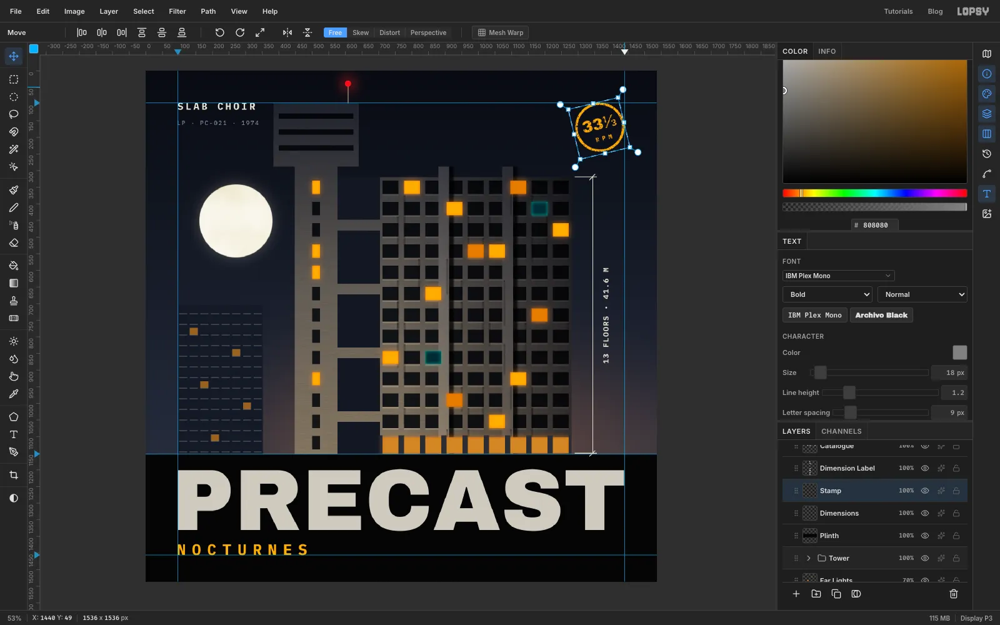

Click the **Stamp** row and drag a rectangular marquee a little bigger than
the stamp. Press [[V]]. Just off the top-right corner of the box there's a
small round handle on a short line. Drag that handle up and to the left to turn the stamp about 14°
anticlockwise. Press [[Cmd+D]] to apply it. A crooked stamp looks like
someone thumped it on by hand.

## Cast the title in concrete

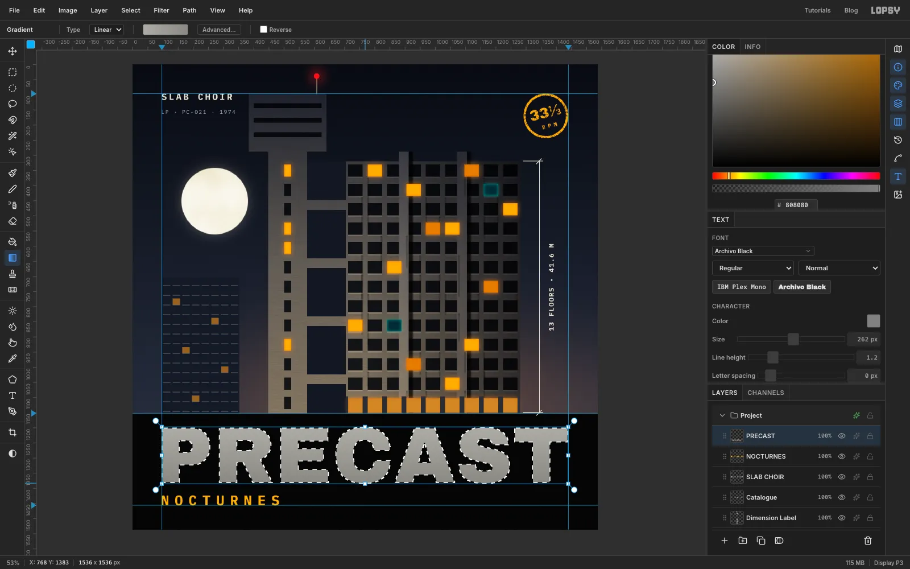

Click the **PRECAST** row and click **Rasterize Layer**. [[Cmd]]-click its
thumbnail to select the letters.

Pick the **Gradient** tool, click **Advanced…** and set the stops to
`#AEACA6` and `#8A8883`. Drag from the top of the letters to the bottom. The
gradient only fills inside the selection, so the letters turn concrete grey,
a little lighter at the top as if lit from above.

Keep the selection. Add a layer called `Cast Texture`, fill it with
`#808080`, run **Add Noise** (**Amount** `60`, **Mono**) and **Motion Blur**
(**Angle** `0`, **Distance** `30`), and set it to **Overlay**. The same
board marks as on the building now run through the letters.

## Add a panel joint and tie holes

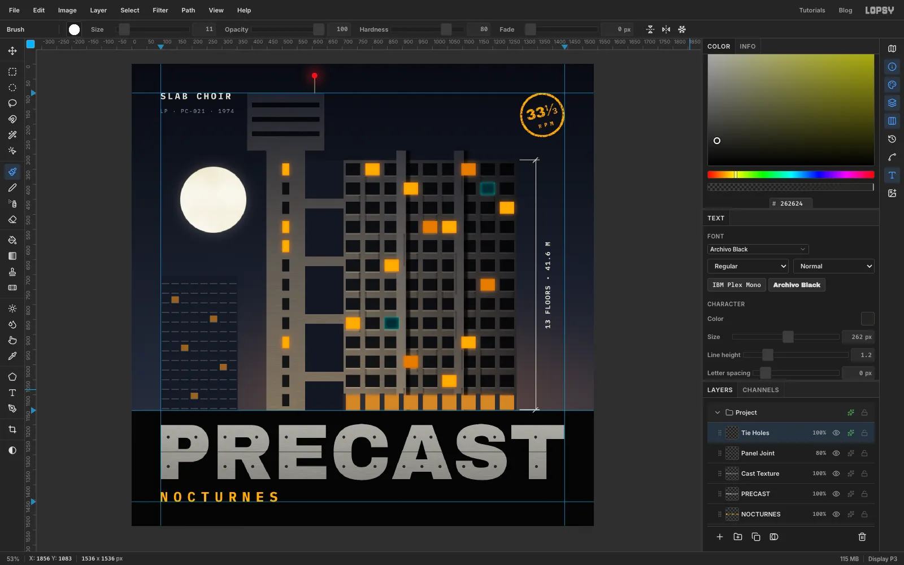

Precast concrete comes in panels, with a joint where two panels meet. Add a
layer called `Panel Joint`. With the **Pencil** at **Size** `2` and colour
`#55534F`, click just left of the P halfway down the letters, at about
y 1290, and [[Shift]]-click past the T at the same height. The selection keeps the line inside the
letters. Set the layer to **80%**.

Add a layer called `Tie Holes`. Pick the **Brush**, set **Size** `11`,
**Hardness** `80`, **Opacity** `100` and colour `#262624`. Click two rows of
holes, about 44 px in from the top and the bottom of the letters. Only put a
hole where it fits completely inside a stroke, and keep the holes at least
52 px apart. Press [[Cmd+D]].

Give the layer a **Drop Shadow** of `#C4C1BA` with **Offset X** `0`,
**Offset Y** `1`, **Blur** `0` and **Opacity** `90`. The thin light edge
under each hole makes it look drilled into the surface.

## Add film grain

Click the top layer, **Tie Holes**, and add a layer called `Grain`. Fill it
with `#808080` with nothing selected, so it covers the whole canvas.
Run **Add Noise** with **Amount** `30`, **Mono** and **Gaussian**. Set the
layer to **Overlay** at **45%**. The grain knits the flat vector shapes into
one printed image.

## Grade the colour

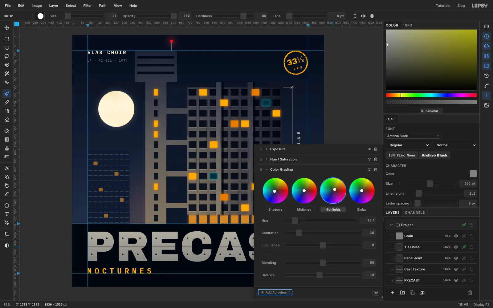

Click the **Project** group row and click its adjustments button. New
documents come with a few neutral adjustments already in the list. Click the
arrow beside **Color Grading** to open it.

- Click the **Shadows** tab under the wheels and type **Hue** `220` and
  **Saturation** `8`.
- Click the **Highlights** tab and type **Hue** `38` and **Saturation**
  `16`.
- Set **Balance** to `-10`.

This pushes the darks towards blue and the lights towards sodium orange.
Keep Shadows saturation low: Color Grading tints pure black too, and at
higher values the black plinth turns navy.

## Darken the corners

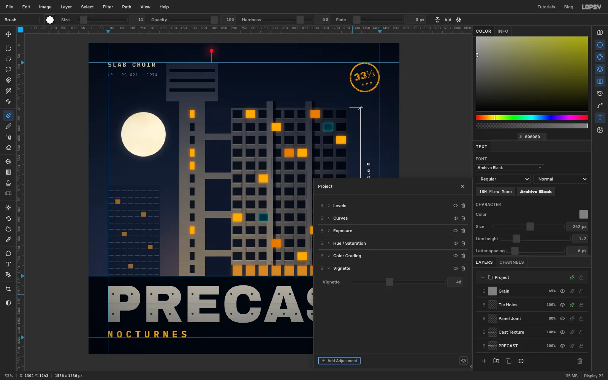

Click **Add Adjustment** at the bottom of the drawer, choose **Vignette** and
set it to `40`. Close the drawer.

That's the cover. Choose **File → Quick Export PNG** to export it, and
**File → Save Project** to keep the layers. If you'd rather start from the
finished layers, open the project file above.
