Brutalism takes its name from *béton brut*, raw concrete. The buildings
show how they are made: the marks of the timber boards the concrete was
poured against, the holes left by the ties that held those boards together,
floors that hang out over the floor below, and rows of identical windows.
Brutalist graphic design borrows the same honesty. It uses heavy grotesque
type set huge and tight, a visible grid, raw textures, and a grey palette
with a single loud signal colour.

In this tutorial you'll make the poster for **Starling Terminal**, an
imaginary film about an airport taken over by birds. A concrete terminal
looms over the viewer, a murmuration of starlings wraps the control tower,
one giant starling dives at the building, and the title is cast into a
concrete slab under an orange departures board. The poster is
**1200 × 1800 px**.

Along the way you'll use:

- the **Gradient** editor, **Clouds** and **Motion Blur** for an overcast sky
- the **Pencil** with **Shift**-click for a visible construction grid
- exact marquees, the **Lasso** and **Edit → Fill** to build the terminal
- **Define Pattern** and **Fill with Pattern** for window fins and form-tie holes
- **Merge Down**, **Add Noise** and the **Burn** tool for weathered concrete
- the **Move** tool's **Perspective** mode to tilt the building
- two reference photos: a murmuration made black with **Threshold** and **Multiply**, and a starling cut out with the **Magic Wand**
- **Define Brush** to turn a tiny drawn bird into a scattering brush
- **Archivo Black** and **Space Mono** type, the **Text** panel, and text turned with the rotate handles
- layer masks painted with a gradient and with the brush
- **Drop Shadow**, **Inner Glow** and a grain layer on **Overlay**

The palette:

- Sky `#2B2F35` → `#77746E` → `#D9CFBE` (greyed down at the end)
- Concrete `#A29D94`, lit edge `#D2CBBF`, soffit `#45423D`
- Glass `#202326`
- Slab planks `#8D8981` / `#9A968E` / `#827E77` / `#96928A` / `#87837C` / `#9C978F`
- Ink `#161616`
- Signal orange `#F2551E`
- Paper-white type `#ECE6DA` / `#E2DDD3` / `#D8D2C6`

The two photos come from Wikimedia Commons:
[A starling murmuration](https://commons.wikimedia.org/wiki/File:A_starling_murmuration_-_geograph.org.uk_-_6389346.jpg)
by Walter Baxter (CC BY-SA 2.0), and
[European starling in flight](https://commons.wikimedia.org/wiki/File:European_starling_(Sturnus_vulgaris)_in_flight_Almoloya_composite.jpg)
by Charles J. Sharp (CC BY-SA 4.0). Crop both before you start, so the
positions below match. Open each photo with **File → Open**, make an exact
selection, choose **Edit → Crop** and save it with **File → Quick Export PNG**:

- the 1024 × 844 murmuration: keep `0, 0` to `1024, 690`, which cuts off the rooftops
- the 3750 × 2500 starling composite: keep `820, 720` to `1760, 1680`, the bird with its wings up (940 × 960)

> **Tip:** Positions are in document pixels, written `x, y`. The status bar
> shows where the pointer is. For an exact rectangle, pick the **Rectangular
> Marquee**, make sure nothing is selected and click the canvas once without
> dragging. A dialog asks for the **From X / Y** and **To X / Y** corners.
> **Edit → Fill** fills the selection with the foreground colour, and
> [[Cmd+D]] deselects.

> **Tip:** New layers appear above the selected layer. If the selected row
> is an expanded group, the new layer goes inside it. Each layer's effects
> drawer opens from the sparkle icon on its row, and the **Blend** dropdown
> is in there too.

## Set up the canvas and guides

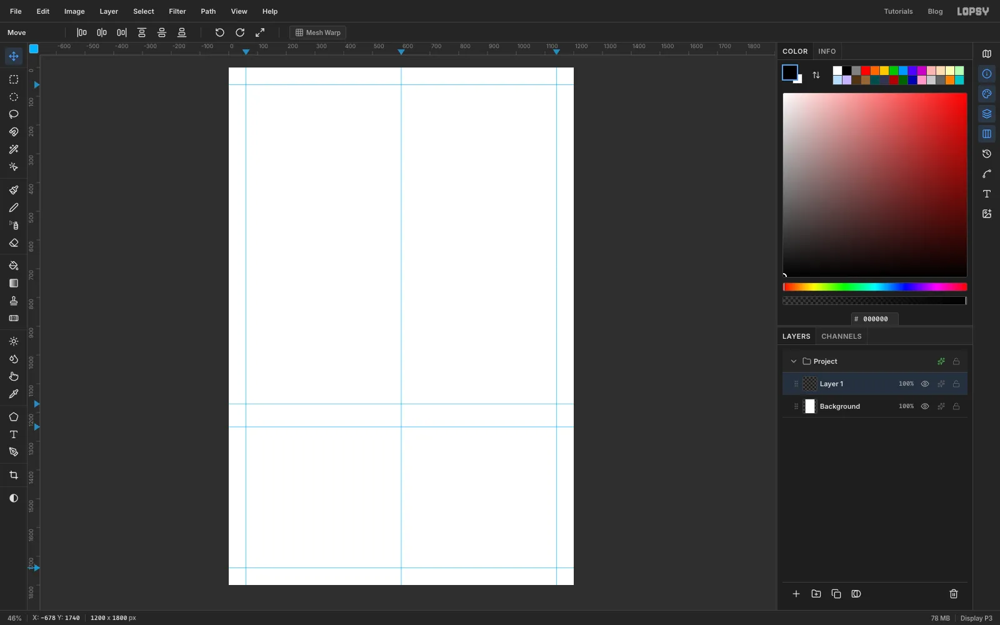

Choose **File → New**, enter **1200 × 1800**, pick a white background and
click **Create**.

Click the top ruler at `60`, `600` and `1140` for vertical guides: a 60 px
margin on each side, plus the centre line. Click the left ruler at `60` for
the top margin, at `1170` for the ground line under the building, at `1250`
where the title slab starts, and at `1740` for the bottom margin.

## Paint an overcast sky

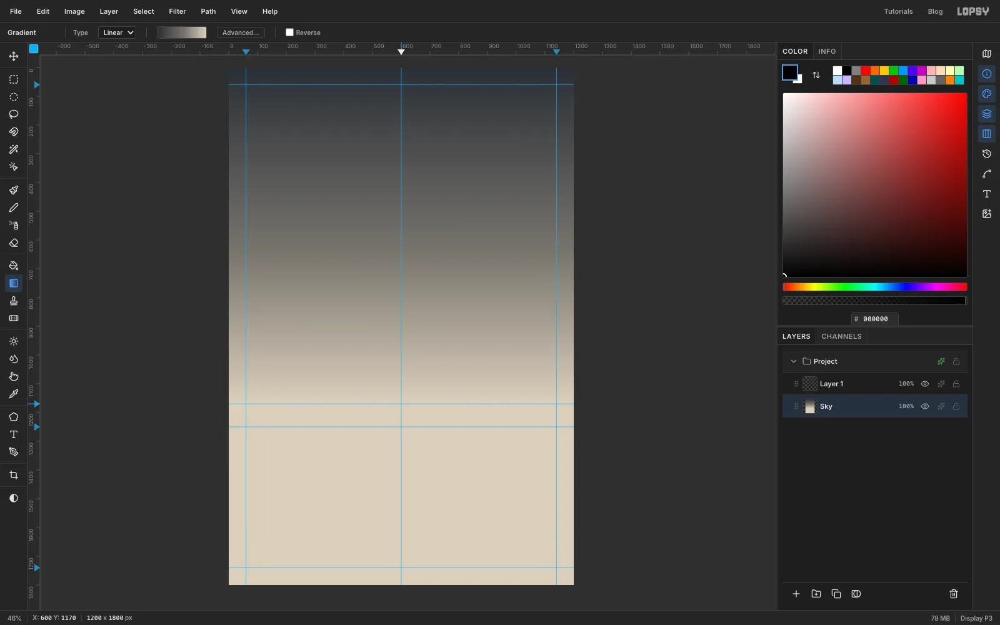

Double-click the *Background* layer's name and rename it *Sky*. Pick the
**Gradient** tool, set **Type** to **Linear** and click **Advanced…**. Make
three stops: `#2B2F35` at the left end, `#77746E` at about 55%, and
`#D9CFBE` at the right end. Click a stop and type its colour into the hex
field. Click on the bar to add the middle stop.

Drag from the top edge straight down to the ground line at `1170`. Below
the line the gradient stays pale. That part will be covered by the slab.

## Add low cloud banks

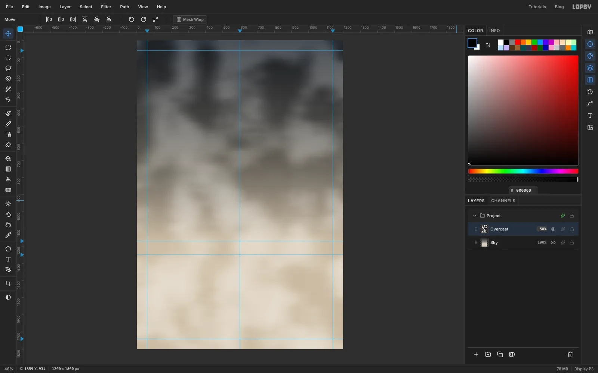

Rename *Layer 1* to *Overcast*. Choose **Filter → Clouds…** with **Scale**
`9`. Then **Filter → Motion Blur…** with **Angle** `0` and **Distance**
`90`, which smears the puffs into flat banks of low cloud.

Open the layer's drawer, set **Blend** to **Soft Light**, and set the
layer's opacity to **50%** from the percentage on its row. Soft Light
darkens and lightens the gradient underneath instead of covering it.

## Draw the exposed grid

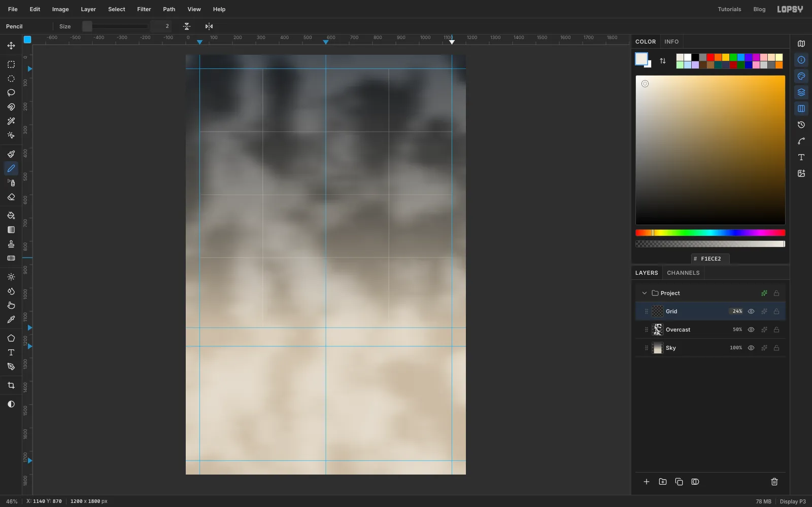

Click **Add Layer** and name it *Grid*. Set the foreground to `#F1ECE2`,
pick the **Pencil** and set its **Size** to `2`.

Click at `60, 60`, hold **Shift** and click at `60, 1170`: that's a
perfectly straight line. Draw vertical lines the same way at `x` = 60,
330, 600, 870 and 1140, all from the top margin down to the ground line.
Then draw horizontal lines at `y` = 60, 330, 600 and 870 from the left
margin to the right one. Set the layer's opacity to **24%**. A visible
grid is a brutalist habit: the poster shows how it is built.

## Start the terminal with a glass lobby

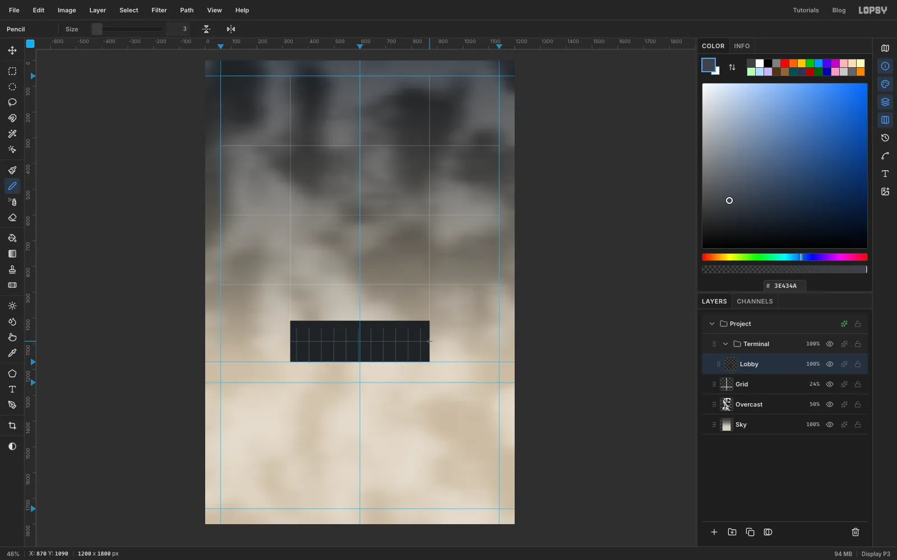

With *Grid* selected, click **New Group** at the bottom of the Layers panel
and name it *Terminal*. Add a layer inside it called *Lobby*.

Make an exact selection from `330, 1010` to `870, 1170` and fill it with
glass `#202326`. Deselect. Set the foreground to `#3E434A` and the Pencil
size to `3`, then draw window mullions: vertical Shift-click lines every
48 px starting at `x` = 354, from `y` 1040 down to 1170, plus one line
across at `y` 1090.

## Block in the four cantilevered floors

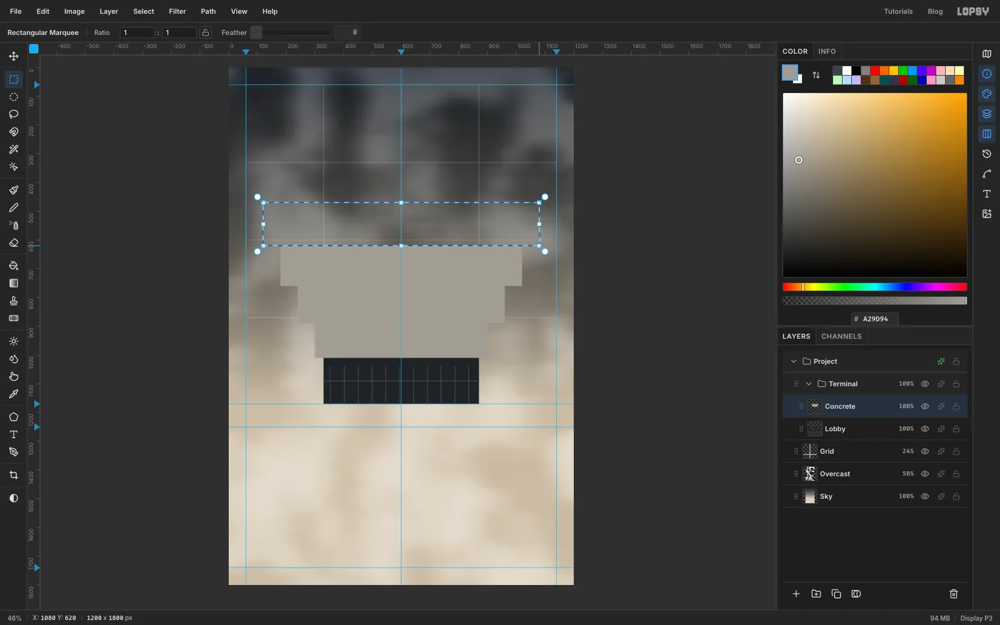

Add a layer called *Concrete* and set the foreground to `#A29D94`. The
terminal is an upside-down ziggurat: each floor overhangs the one below.
Make an exact selection for each floor and fill it:

- bottom floor: `300, 890` to `900, 1010`
- second floor: `240, 760` to `960, 890`
- third floor: `180, 620` to `1020, 760`
- top floor: `120, 470` to `1080, 620`

Now the pillars. Fill six thin rectangles 30 px wide, from `y` 1010 down
to 1170, centred on `x` = 360, 456, 552, 648, 744 and 840. For the first
one that's `345, 1010` to `375, 1170`. Deselect.

## Add the control tower

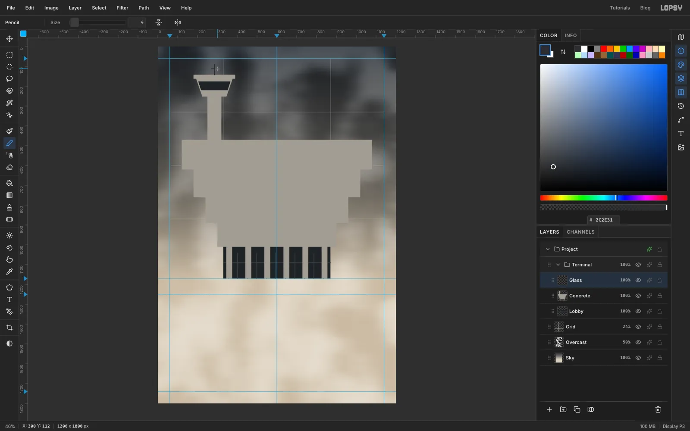

Still on *Concrete*, fill the tower shaft from `250, 230` to `320, 470`
and its roof slab from `180, 142` to `390, 162`.

The cab under the roof slab is wider at the top, like a real control tower.
Pick the **Lasso** and, holding the mouse down, move in straight runs
from corner to corner: `192, 160`, `378, 160`, `346, 252`, `224, 252` and
back to the start. Then fill it. A slight wobble in the edges won't show at
this size.

Add a layer called *Glass*. Lasso a slightly smaller band inside the cab,
through `204, 176`, `366, 176`, `352, 220` and `218, 220`, and fill it with
`#202326`. For the antenna, set the foreground to `#2C2E31` and the
Pencil size to `4`. Shift-click a line from `285, 142` up to `285, 88`,
and a short crossbar from `270, 112` to `300, 112`.

## Show the undersides of the floors

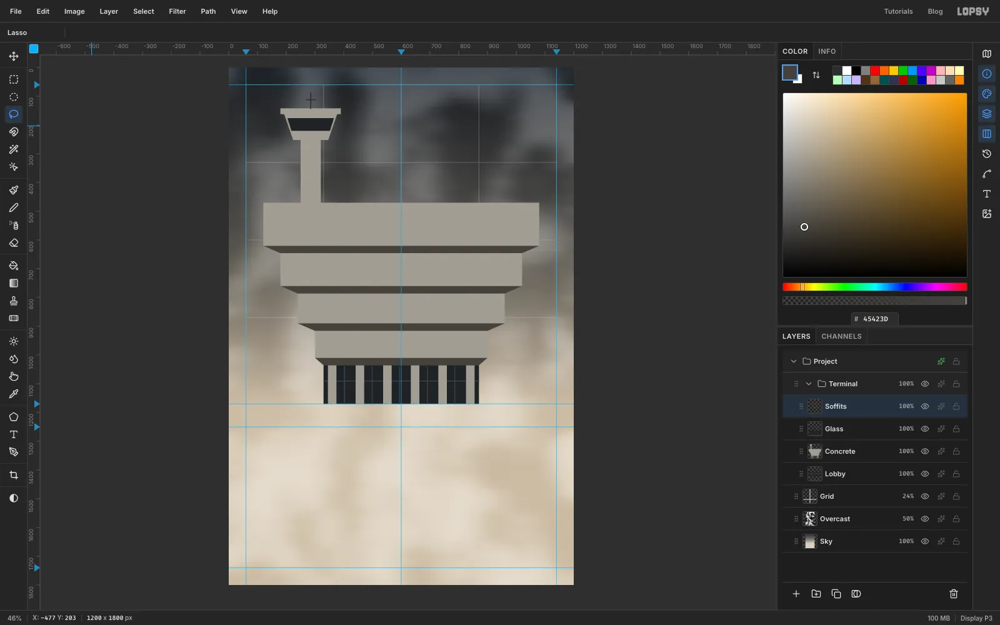

Because we look up at the building, we see the underside of every
overhang. Add a layer called *Soffits* and set the foreground to
`#45423D`.

Under each floor, lasso a band 26 px deep that runs from the floor's own
corners in to the corners of the narrower floor below it, and fill it. For
the top floor that's `120, 620`, `1080, 620`, `1020, 646` and `180, 646`.
Repeat under the third and second floors. Under the bottom floor, run the
band in to the lobby: `300, 1010`, `900, 1010`, `870, 1036`, `330, 1036`.

## Draw one window fin and define it as a pattern

The windows are deep slots between concrete fins. Draw one repeat of that
and let the pattern do the rest. Add a scratch layer called *Tile* and make
three exact fills in an empty spot:

- recess: `40, 1300` to `76, 1340` in `#292A2C`
- fin: `40, 1300` to `54, 1340` in `#BDB6AB`
- fin shadow: `54, 1300` to `58, 1340` in `#7A756D`

Select the whole tile, `40, 1300` to `76, 1340`, and choose
**Edit → Define Pattern**. Deselect and delete the *Tile* layer with the
trash button.

## Fill each floor with fins

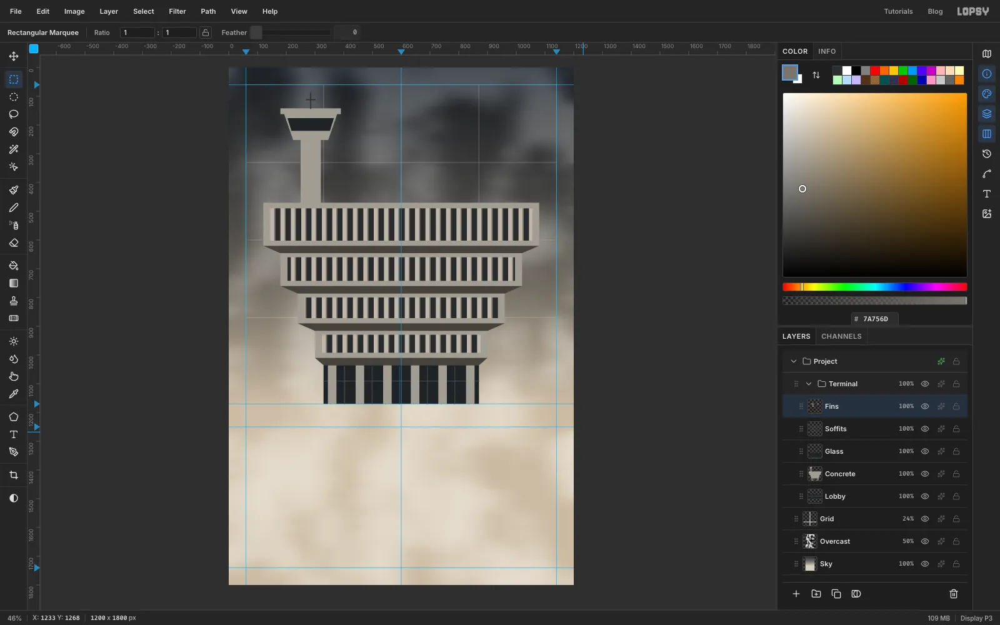

Click *Soffits* and add a layer called *Fins*. For each floor, select a band
inset 24 px from both ends. Start it 40 px below the floor's top edge
(20 px for the top floor, which has no soffit over it) and end it 18 px
above its bottom edge:

- top floor: `144, 490` to `1056, 602`
- third floor: `204, 660` to `996, 742`
- second floor: `264, 800` to `936, 872`
- bottom floor: `324, 930` to `876, 992`

Choose **Edit → Fill with Pattern…**, check that your 36 × 40 fin tile is
selected, leave **Scale** at `100` and click **Apply**. Do the same on the
other three floors and deselect.

## Light the edges

Add a layer called *Edges*, set the foreground to `#D2CBBF` and the Pencil
size to `4`. Shift-click a line along the top of the roof, from `120, 472`
to `1080, 472`. Then run a vertical line down the left end of each floor's
face, starting just under its soffit and stopping at the floor's bottom
edge: `122, 470` to `122, 620`, `182, 646` to `182, 760`, `242, 786` to
`242, 890`, and `302, 916` to `302, 1010`. Add one down the left side of the
tower shaft, `252, 230` to `252, 470`. The sky is brightest at the upper
left, so only those edges catch the light.

## Merge and weather the concrete

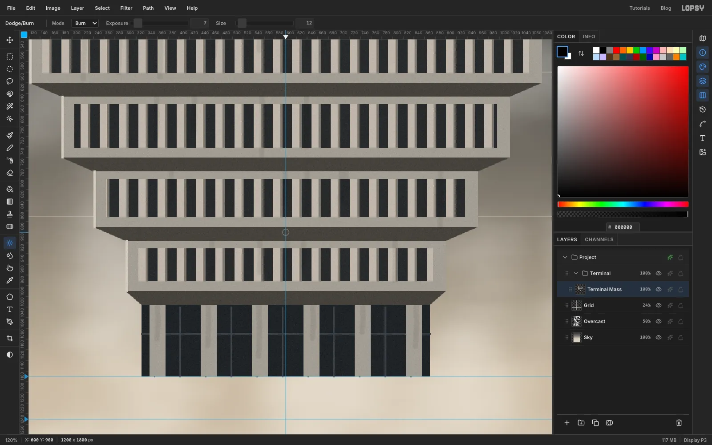

Click *Edges* and choose **Layer → Merge Down** five times, until the
*Terminal* group holds one layer. Rename it *Terminal Mass*.

[[Cmd]]-click its thumbnail to select its pixels and choose
**Filter → Add Noise…** with **Amount** `16`, **Mono** and **Gaussian**.

Pick the **Dodge / Burn** tool, set **Mode** to **Burn**, **Exposure** to
`7` and **Size** to `12`. On each floor, drag four to six short strokes
straight down from just under the soffit. Vary their lengths and spacing.
Give each pillar one streak and the tower shaft two long ones. Concrete
stains where rain runs off an edge, so the marks should hang from the edges.
Deselect.

## Tilt the building into perspective

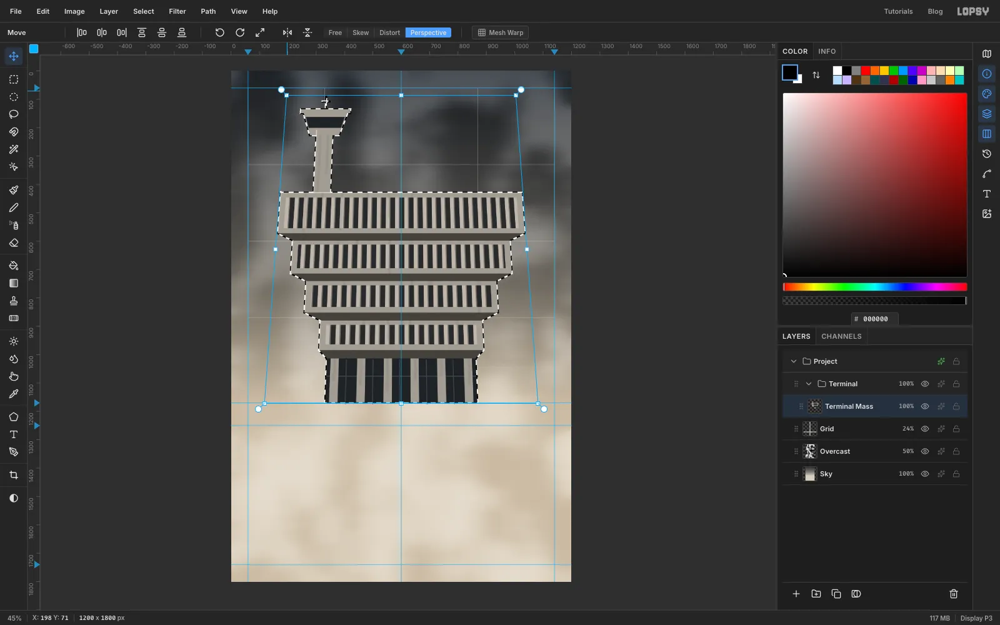

[[Cmd]]-click the *Terminal Mass* thumbnail again and pick the **Move**
tool. In the options bar, click **Perspective**. Drag the top-left corner
handle about 80 px to the right. The top-right corner moves in to match
while the bottom stays put, so the walls lean in as if you were standing
at the foot of the building. Press [[Enter]] and deselect.

## Bring in the murmuration photo

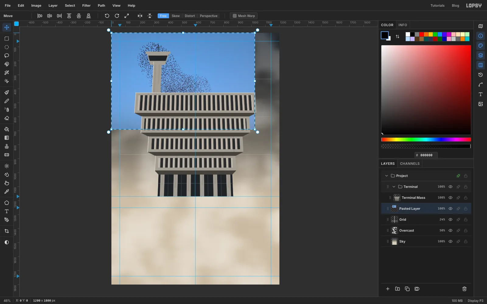

Click *Grid* so the photo lands under the building. Drag the trimmed
murmuration photo from your desktop onto the canvas. It arrives at the top
left corner with its pixels selected. Rename the layer *Murmuration*.

## Turn the flock into black birds

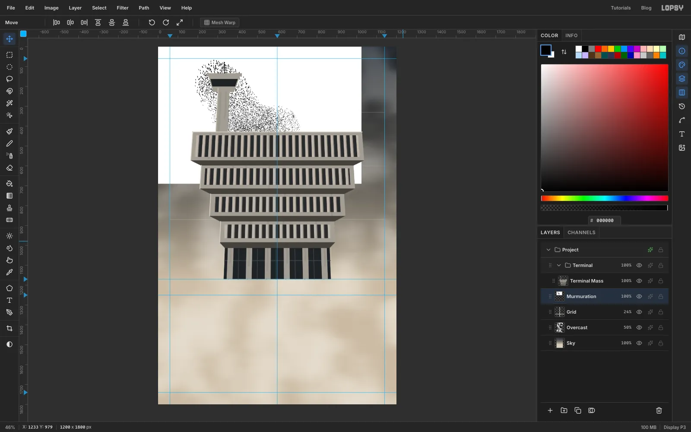

Deselect and choose **Filter → Desaturate**. Then choose
**Filter → Threshold…** with **Level** `104`. Every bird turns pure black
and the sky turns pure white.

## Multiply the flock and scale it up

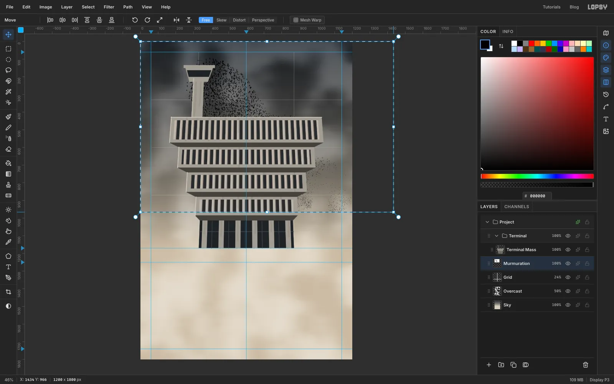

Open the layer's drawer and set **Blend** to **Multiply**. White
disappears on Multiply, so only the birds are left over the sky.

Zoom out a little ([[Cmd+-]]) so you can see past the right edge of the
canvas. [[Cmd]]-click the layer's thumbnail and pick the **Move** tool. Hold
[[Cmd]] (to keep the proportions) and drag the bottom-right handle out until
the box is about 40% bigger. Its corner ends up past the right edge of the
poster, which is fine. Drag inside the box to slide the flock a little to
the left, so the dense part swirls around the tower. Press [[Enter]] and
deselect. The tail of the flock tucks in behind the building.

## Draw a bird and make it a brush

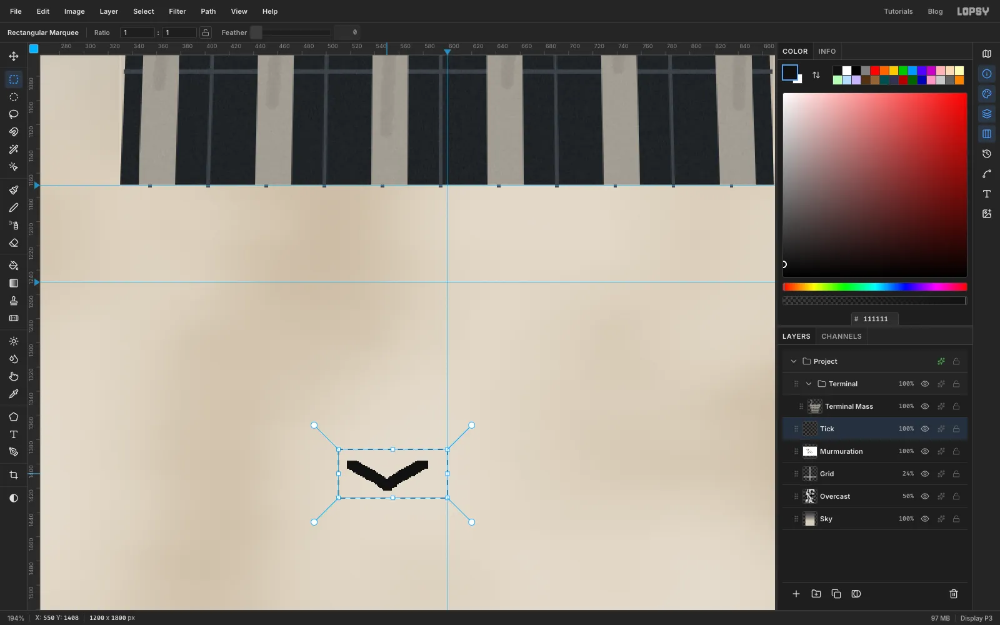

A distant starling is just a little tick. Draw one and turn it into a
brush. Add a scratch layer called *Tick*, set the foreground to `#111111`
and the Pencil size to `7`. In an empty spot, click at `520, 1400` and
Shift-click `542, 1412`, `550, 1418`, `558, 1412` and `580, 1400`: two
wings meeting at a body.

Select around it, from `510, 1388` to `590, 1428`, and choose
**Edit → Define Brush…**. Name it *Starling Tick*. It becomes the active
brush. Deselect and delete the *Tick* layer.

## Set up the brush dynamics

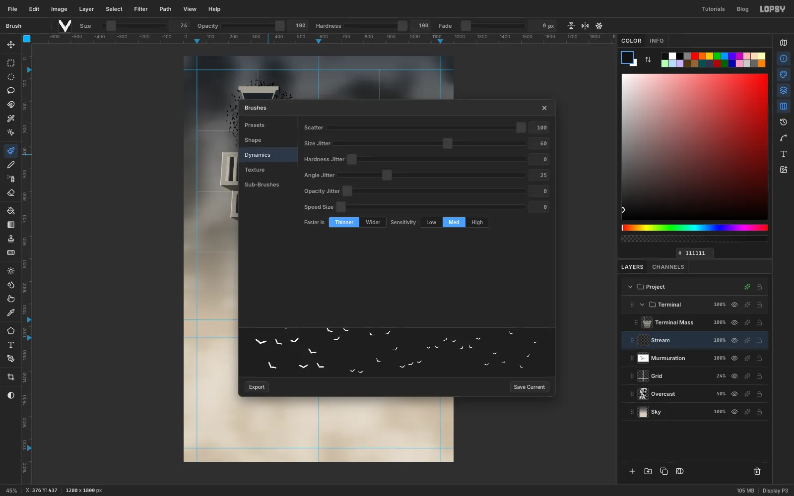

Click *Murmuration* and add a layer called *Stream*. Pick the **Brush** and
click the brush-tip thumbnail at the left of the options bar to open the
**Brushes** modal. On the **Shape** tab set **Size** `24`, **Spacing** `70`
and **Taper** `900`. Taper is the distance in pixels over which a stroke
shrinks to nothing, so 900 makes the birds get smaller along a long stroke. On the **Dynamics** tab set **Scatter** `100`,
**Size Jitter** `60` and **Angle Jitter** `25`. The preview at the bottom
now paints a loose scatter of birds. Close the modal.

## Paint a stream of starlings

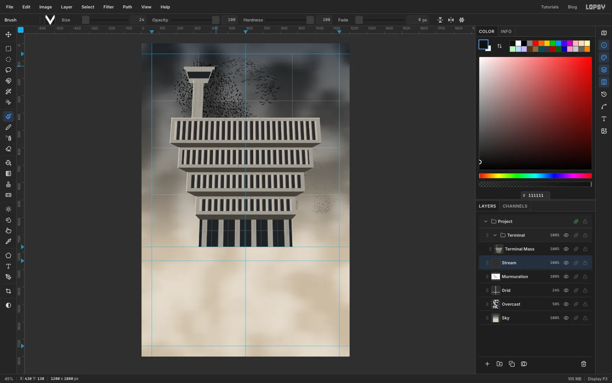

Paint five curved strokes. Start each one near `760, 300`, where the big
starling will be, then arc up and left over the top of the poster at
about `y` 80 and come down into the flock beside the tower, near
`440, 160`. Keep them roughly parallel but not identical. Taper shrinks the
birds along each stroke, so they're big near the hero bird and tiny where
they join the flock.

## Pour the concrete slab

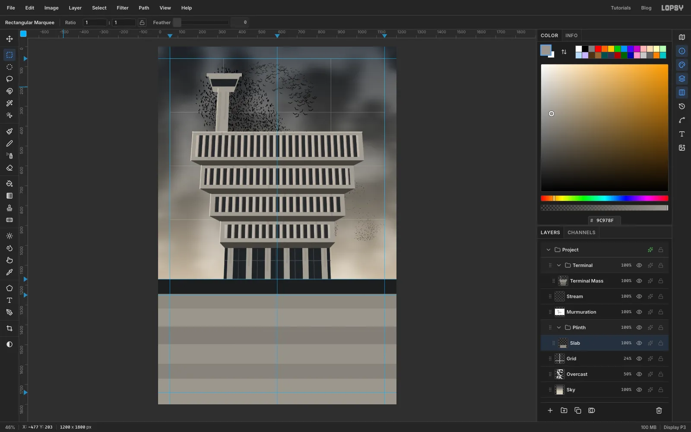

Click *Grid* and click **New Group**. Name it *Plinth* and add a layer
inside it called *Slab*. Fill `0, 1170` to `1200, 1800` with `#1C1D1F` for
the ground line. Then fill six planks of uneven height, each a slightly
different grey:

- `0, 1244` to `1200, 1318` in `#8D8981`
- `0, 1318` to `1200, 1409` in `#9A968E`
- `0, 1409` to `1200, 1497` in `#827E77`
- `0, 1497` to `1200, 1596` in `#96928A`
- `0, 1596` to `1200, 1671` in `#87837C`
- `0, 1671` to `1200, 1800` in `#9C978F`

Deselect and choose **Filter → Add Noise…** with **Amount** `14`, **Mono**
and **Gaussian**.

## Cut the board joints

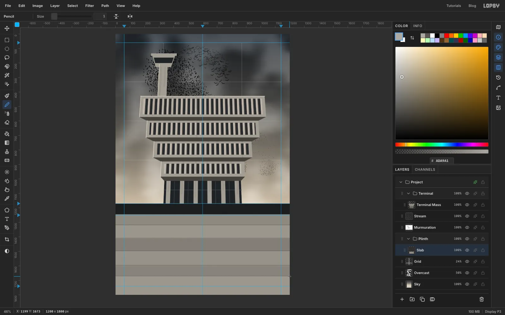

Where two timber boards met, the concrete keeps a small ridge. With the
Pencil, draw a 2 px line in `#5B5751` across the whole width at each joint
(`y` = 1318, 1409, 1497, 1596 and 1671). Then draw a 1 px line in
`#ADA9A1` 2 px under each one. That's the lit lip of the ridge.

## Add a row of form-tie holes

Make one more scratch tile. Add a layer called *Tile*, pick the
**Elliptical Marquee** and click once to get the exact dialog. Select
`68, 11` to `82, 25` and fill it with `#3A3835`. Select `0, 0` to
`150, 78` (one hole in a 150 × 78 tile) and choose **Edit → Define Pattern**.
Delete the *Tile* layer.

Click *Slab*, add a layer called *Form Ties* and select a thin strip from
`0, 1250` to `1200, 1284`. Choose **Edit → Fill with Pattern…** and click
**Apply**. The pattern lines up with the document, so the holes land on a
row at `y` 1266, 150 px apart. Deselect, open the drawer and turn on
**Inner Glow** with **Size** `3`, **Opacity** `70` and colour `#1A1918`, so
each hole looks recessed.

## Lay the orange departures band

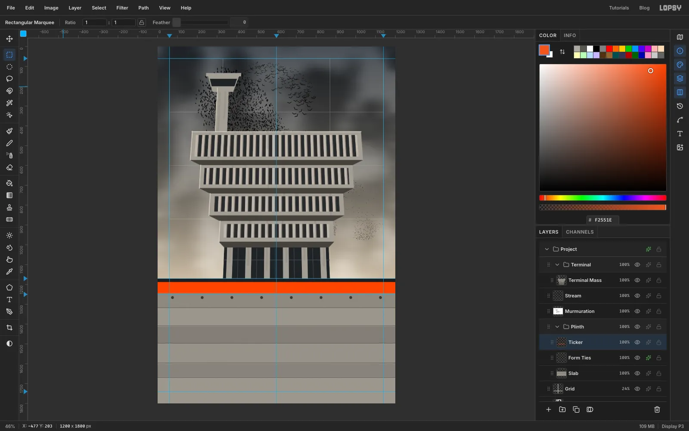

Add a layer called *Ticker*, select `0, 1188` to `1200, 1244` and fill it
with signal orange `#F2551E`. Deselect. This is the only colour on the
poster apart from grey, so it will catch the eye first.

## Set the title

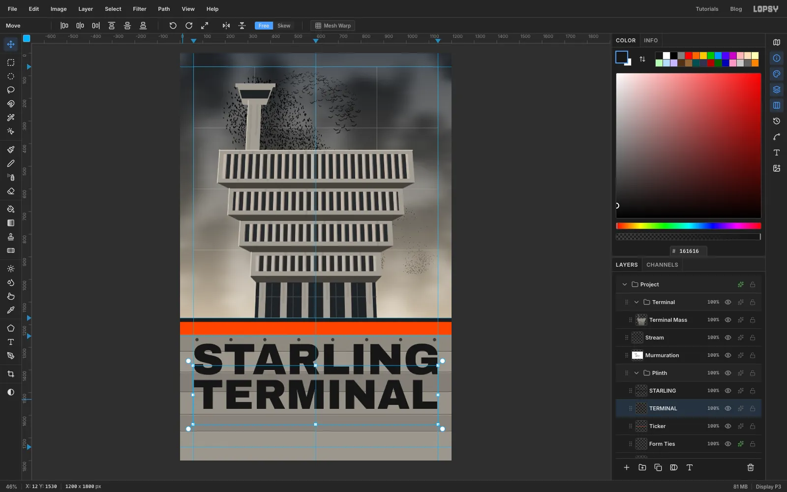

Keep *Ticker* selected so the type goes above it. Pick the **Text** tool.
In the options bar choose **Archivo Black**, set **Size** to `194` and set
the foreground to `#161616`. Click an empty part of the slab, type
*STARLING* and click the ✓ to commit.

Switch to the **Move** tool, drag the word near the top left of the slab,
then nudge it with the arrow keys ([[Shift]] moves 10 px) until the S sits
on the left margin guide and the tops of the letters are about 40 px under
the orange band. Leave that strip clear: the tie holes go there.

Click *Ticker* again, so the next text doesn't restyle *STARLING*. Make
*TERMINAL* the same way at **Size** `186`, then nudge it to the left margin,
24 px under the first line. *TERMINAL* is a wider word, so its smaller size
makes both lines run exactly from margin to margin. That forced
justification is a classic brutalist move.

## Type the departures board

Click *Ticker*. With the Text tool, choose **Space Mono**, **Font weight**
**Bold**, **Size** `24`. Click somewhere empty and type
`DEP 04:17    STR 404    GATE 00    CANCELLED    CANCELLED    CANCELLED    CANCELLED`
with four spaces between the items. Commit it, rename the layer *Ticker Text*,
and nudge it so it starts at the left margin, centred in the band.

The last *CANCELLED* runs off the edge after a few letters. That's
deliberate: it reads like a board that keeps scrolling.

## Add the billing block

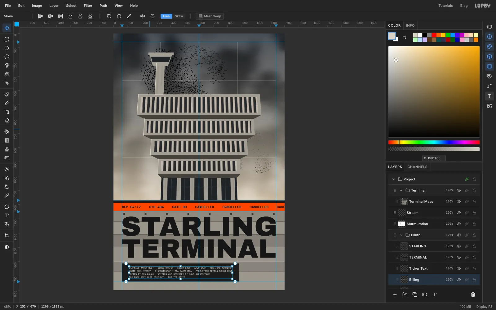

Click *Ticker* and add a layer called *Billing Plate*. Fill `60, 1612` to
`880, 1740` with `#1B1B1B`.

With the Text tool set to **Space Mono Regular**, **Size** `15`, and the
foreground at `#D8D2C6`, click somewhere empty and type the credits. Press
[[Enter]] between the lines:

- STARRING MAREN HOLT   IDRIS OKAFOR   LUCJA BREM   ARVO SAAR   AND JUNE WICKLOW
- MUSIC SAUL VEDDER   CINEMATOGRAPHY RIA NAKASHIMA   PRODUCTION DESIGN OSKAR LUND
- EDITED BY BEA KOVAC   WRITTEN AND DIRECTED BY TOVE ANKARSTRAND
- (C) 2027 GREY SLAB PICTURES   NOT YET RATED

Commit and rename the layer *Billing*. Open the **Text** panel from the
panel strip on the right and set **Line height** to `1.45`. Then nudge the
block until it's centred on the plate, with the same space on the left and
right and the same above and below.

## Add the release date

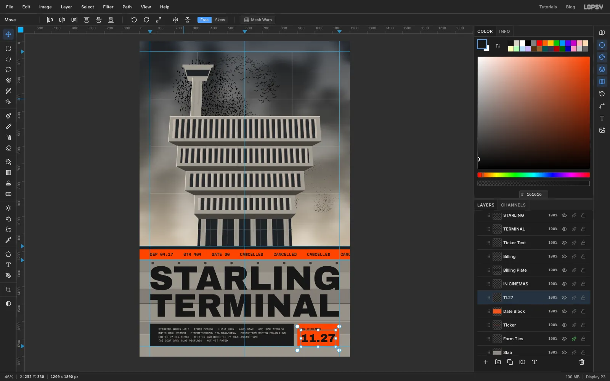

Add a layer called *Date Block* and fill `900, 1612` to `1140, 1740` with
orange `#F2551E`. Its top and bottom match the billing plate.

Type *IN CINEMAS* in **Space Mono Bold** at **Size** `18`, in `#161616`, and
nudge it to 24 px in from the block's top-left corner. Click *Date Block*
again and type *11.27* in **Archivo Black** at **Size** `66`. Centre it
across the block, with its baseline 24 px above the bottom edge.

## Set the tagline

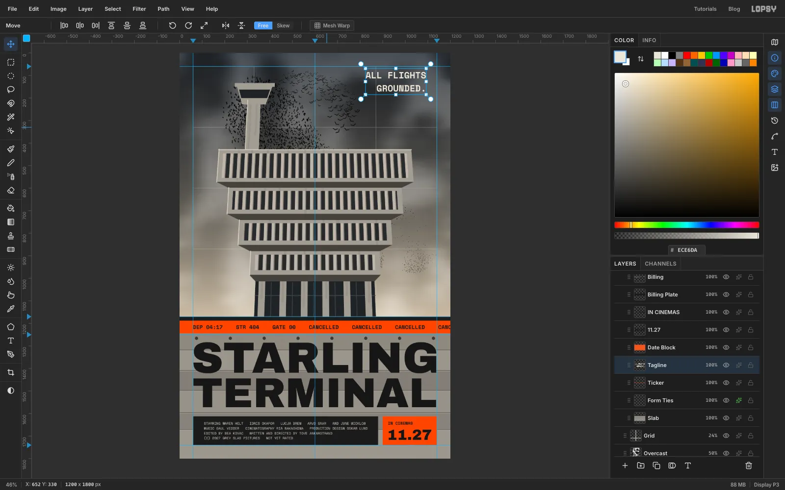

Click *Ticker*. With the Text tool, choose **Space Mono Bold**, **Size**
`40`, set **Align** to **Right** and the foreground to `#ECE6DA`. Type
*ALL FLIGHTS*, press [[Enter]], type *GROUNDED.* and commit. Rename the
layer *Tagline*. Move it to the top right, with its top just under the top
margin guide and its right edge about 50 px inside the right margin guide.
That gap keeps it from crowding the vertical credit you'll put in the
margin next.

## Run credits up the margins

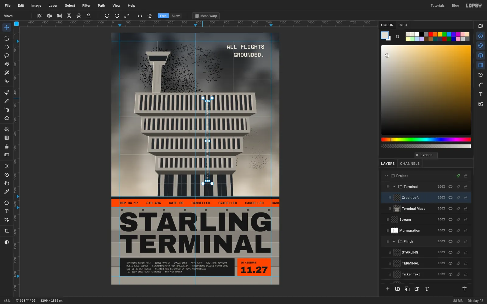

Click *Terminal Mass*, so the credits go above the building and you can see
them while you turn them. Set the Text tool back to **Align Left**,
**Space Mono Regular**, **Size** `17`, colour `#E2DDD3`, and type
*GREY SLAB PICTURES PRESENTS  /  A TOVE ANKARSTRAND FILM*. Commit and
rename the layer *Credit Left*.

Pick the **Move** tool. The text shows its own frame. Hold [[Cmd]] and drag
the top-right rotation handle (the circle just outside the corner)
anticlockwise. [[Cmd]] snaps the angle to steps of 15°, so stop at −90°.
The line now reads from bottom to top. Drag it over to the left margin,
then nudge it with the arrow keys until it's centred in the strip outside
the margin guide, with its top level with the top margin.

The credits live in the *Terminal* group and the tagline in *Plinth*. That
doesn't affect how they look: the groups are only for keeping the stack
tidy, and the margin credits need to sit above the building.

Click *Terminal Mass* again and do the same with *BOARDING CLOSED  /  THE FLOCK HAS TAKEN THE GATE / 0417*.
Name it *Credit Right*, turn it clockwise to +90°, and move it into the
right margin the same way, also starting at the top margin. The two lines are the same length, so the margins mirror
each other.

## Bring in the starling photo

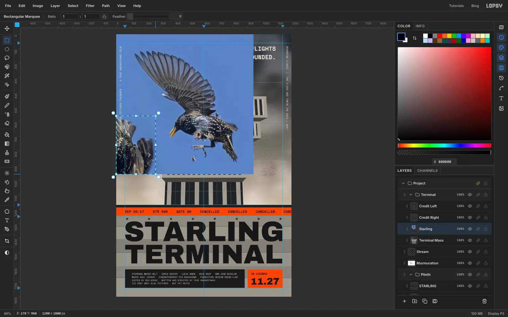

Click *Terminal Mass* so the bird goes into the *Terminal* group, above the
building. Drag the cropped starling photo onto the canvas and rename the
layer *Starling*.

Another bird pokes into the bottom left of the photo. Deselect, drag a
marquee from `0, 560` to `270, 960` around it and press [[Delete]].
Deselect.

## Lift the bird off the sky

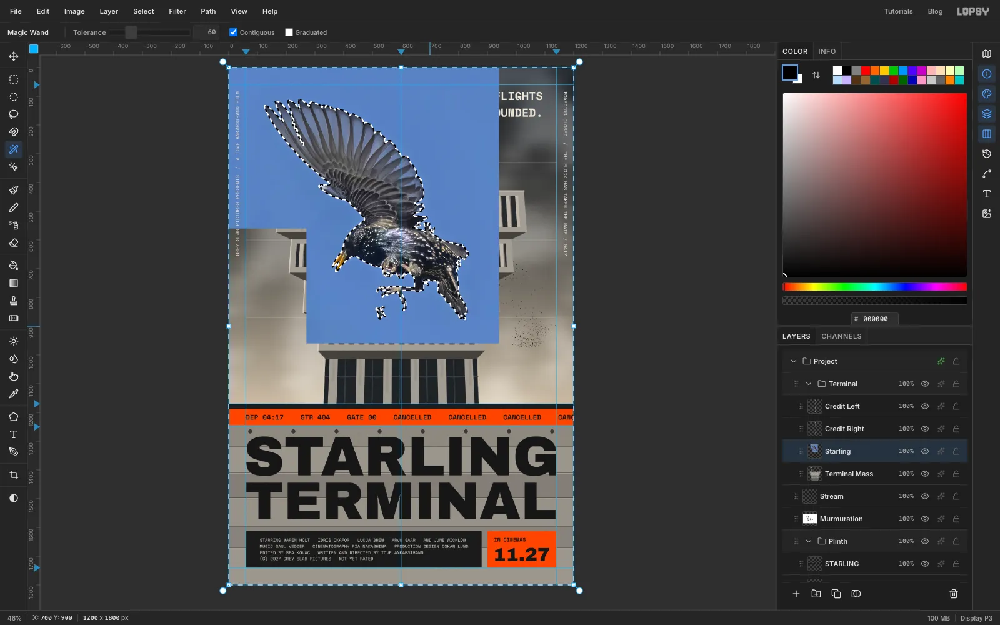

Pick the **Magic Wand**, set **Tolerance** to `60` and click the blue sky.
Hold [[Shift]] and click the other pockets of sky the first click missed:
the bottom corners, the gap between the legs and the far right edge. Press
[[Delete]] and deselect. Then pick the **Eraser** at **Size** `36` and drag
once over the little insect floating under the bird's feet.

## Make it black and white, except the beak

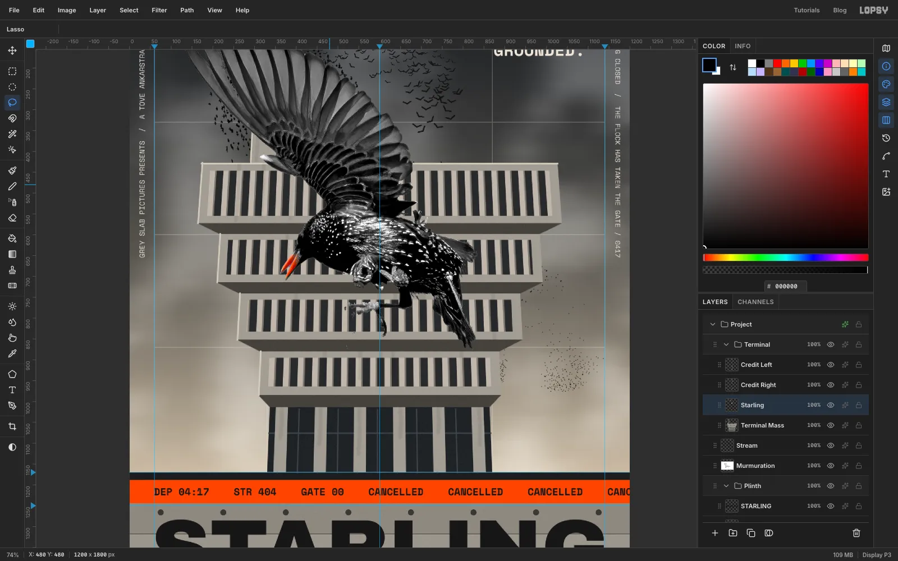

With the **Lasso**, drag a loose loop around the beak. Choose
**Select → Inverse**, then **Filter → Desaturate**. Choose
**Filter → Brightness/Contrast…** with **Brightness** `-6` and **Contrast**
`38`. Everything except the beak is now black and white.

Lasso the beak again and choose **Filter → Hue/Saturation…** with **Hue**
`-24` and **Saturation** `45`. The yellow beak turns signal orange, the
same colour as the departures board.

## Scale and turn the bird

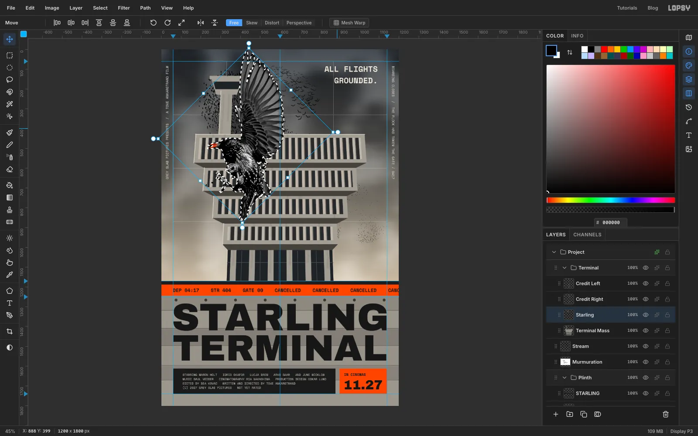

[[Cmd]]-click the *Starling* thumbnail and pick the **Move** tool. Hold
[[Cmd]] and drag the bottom-right handle up and left to shrink the bird to
about 85%. Then hold [[Cmd]] and drag the top-right rotation handle
clockwise to 45°, which tips the bird into a dive. Press [[Enter]] and
deselect.

## Place it and blur the wingtips

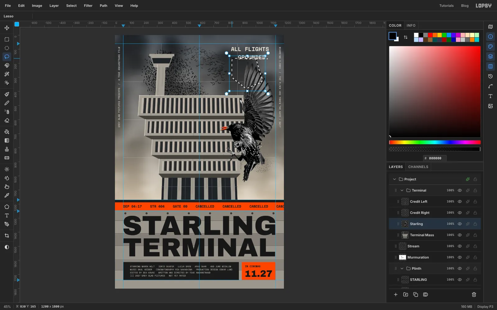

With the Move tool, drag the bird to the right side of the poster, so its
wing starts just under the tagline and its tail stays clear of the right
credit. Its beak should point at the middle of the building.

The Lasso has no feather setting of its own. It uses the marquee's. So
pick the **Rectangular Marquee**, set **Feather** to `18`, then switch to
the **Lasso** and drag a loose shape around the raised wingtips. Choose **Filter → Motion Blur…** with **Angle** `70` and **Distance** `15`.
The tips smear a little along the wingbeat. Deselect and set **Feather**
back to `0`.

## Throw the bird's shadow onto the building

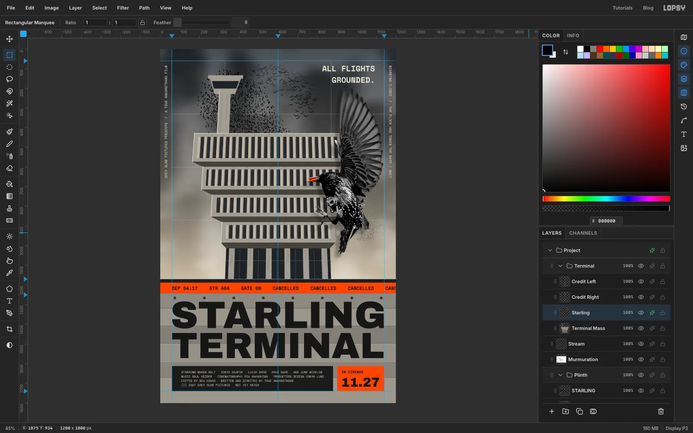

Open the *Starling* drawer and turn on **Drop Shadow** with **Offset X**
`-22`, **Offset Y** `24`, **Blur** `14` and **Opacity** `28`. An overcast
sky casts no hard shadows, so this isn't strict lighting. Pushing the
shadow left puts it on the wall behind the bird instead of on empty sky,
and that faint shadow on the facade sets the bird just in front of the
building instead of pasted on top of the picture.

## Grey the sky and darken the ground

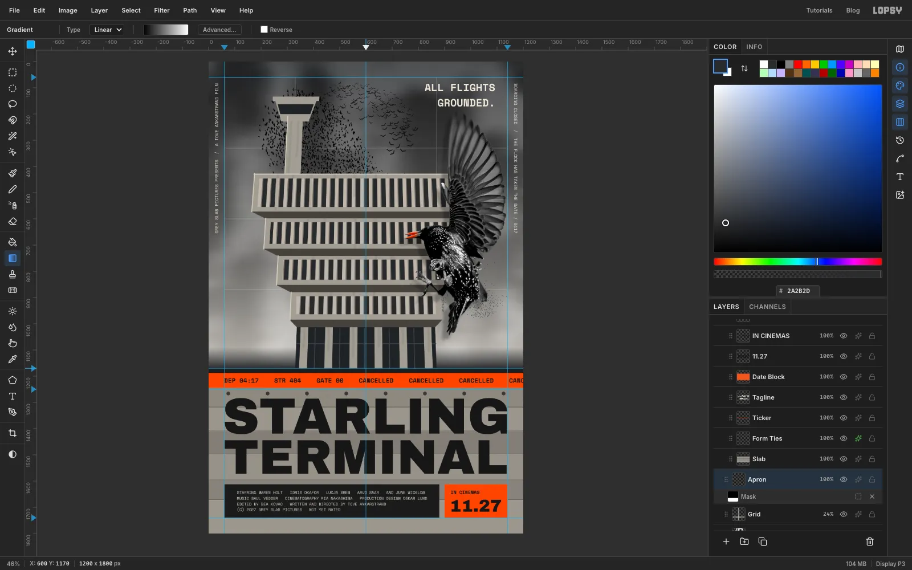

Click *Sky* and choose **Filter → Hue/Saturation…** with **Saturation** `-70`. The
beige drains out and the poster turns properly grey, so the orange is the
only colour.

Click *Grid* and add a layer called *Apron*. Fill `0, 1090` to `1200, 1170`
with `#2A2B2D` and deselect. Click **Add Mask** at the bottom of the Layers
panel, then click the new mask thumbnail to edit the mask. Pick the
**Gradient** tool and click **Advanced…**. Delete the middle stop left over
from the sky, set the left stop to `#000000` and the right one to
`#FFFFFF`, and click **Done**. Drag from `y` 1090 straight down to `y` 1170. The dark band now fades in toward the ground. Click the layer's
name to stop editing the mask.

## Add grime to the concrete

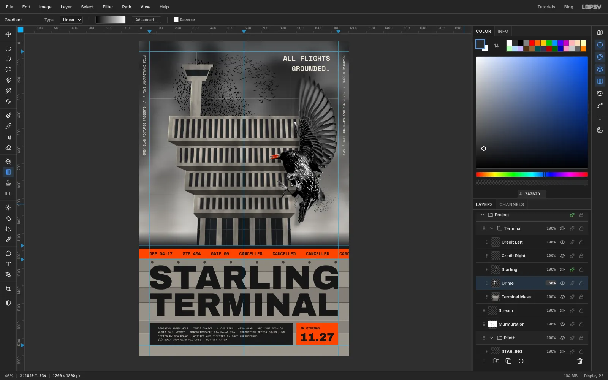

[[Cmd]]-click the *Terminal Mass* thumbnail, click its row, and add a layer
called *Grime*. Choose **Filter → Clouds…** with **Scale** `14`. The
clouds stay inside the building's shape. Deselect, set **Blend** to
**Multiply** and the opacity to **30%**.

## Paint drip streaks

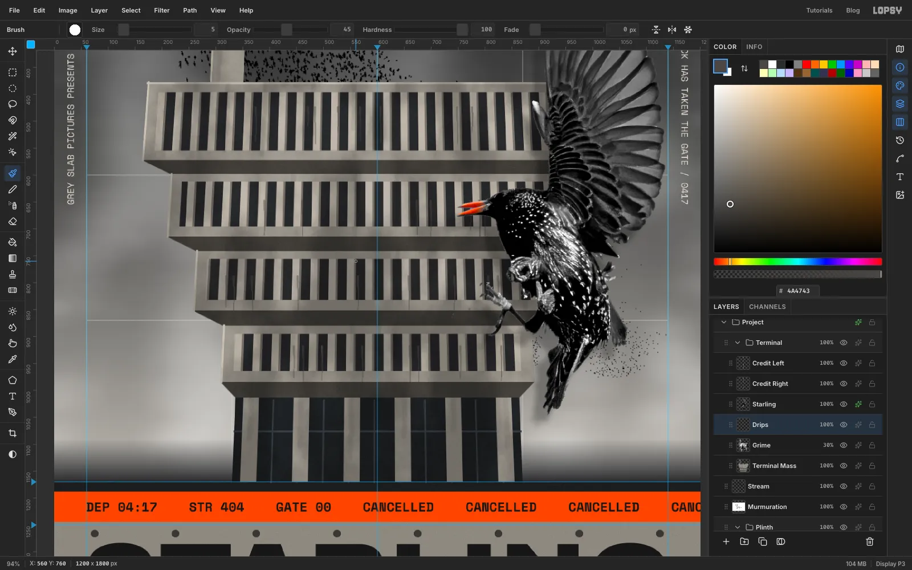

Add a layer called *Drips*. Pick the **Brush**, open the **Brushes** modal
and click **Hard Round** on the **Presets** tab. That loads the whole
preset, so the scatter and jitter from the bird brush are cleared. Then set
**Size** `5`, **Opacity** `45` and **Taper** `70` (short streaks, so a short
taper). Set the foreground to `#4A4743`.

On every floor, paint about nine streaks straight down from just under the
soffit (from the very top on the roof floor). Make them 30 to 120 px long,
with uneven gaps, and keep them on the floor's face. Taper makes each one
end in a point, the way real run-off does.

## Stand the building on a podium

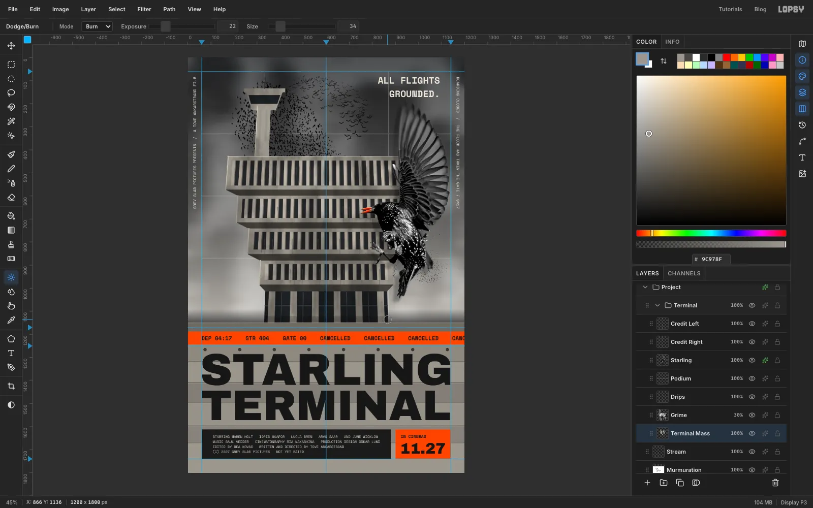

Add a layer called *Podium*. Fill `0, 1148` to `1200, 1188` with `#6E6A64`,
run **Filter → Add Noise…** at `12`, **Mono**, **Gaussian**, and deselect. Draw a
2 px Pencil line in `#9C978F` along its top edge at `y` 1149.

Click *Terminal Mass*, pick **Dodge / Burn** on **Burn** with **Exposure**
`22` and **Size** `34`, and drag once along the foot of the pillars at
`y` 1136. That contact shadow sits the building on the podium.

## Thin the flock with a mask

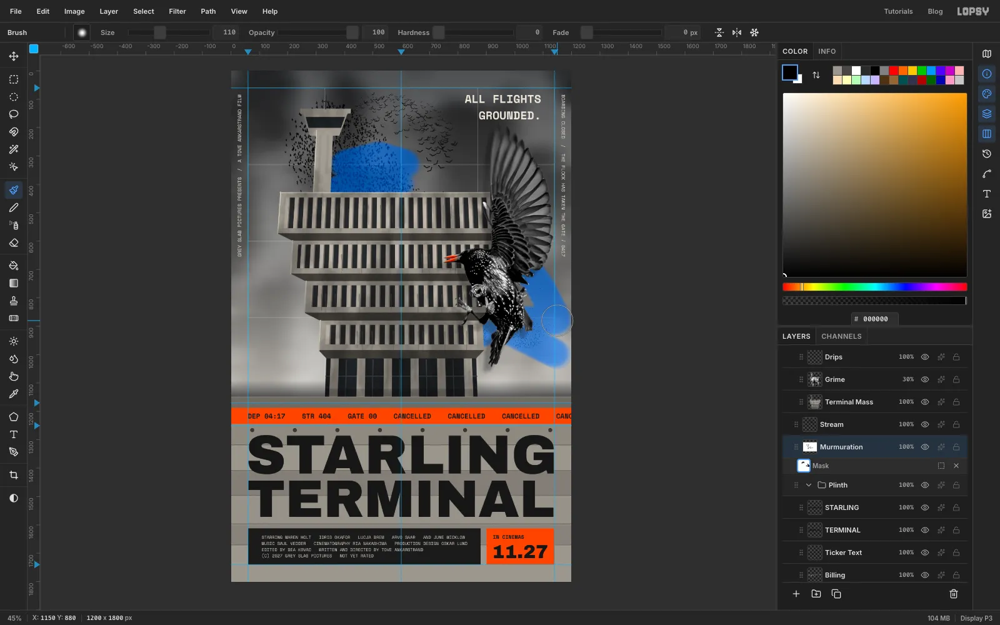

The flock reads better as a ribbon than as a big blob. Click *Murmuration*,
click **Add Mask** and click the mask thumbnail. Set the foreground to black.
Pick the **Brush**, choose **Soft Round** on the **Presets** tab of the
Brushes modal, and set **Size** `110`, **Opacity** `100` and **Taper** `0`,
so the brush stays full size along the stroke.

Paint over the lower half of the cloud to the right of the tower, and over
the stray specks of the flock's tail around the starling. Painting black
on the mask hides those birds without erasing them, so you can paint white
to bring any back. Click the layer's name to stop editing the mask.

## Finish with run-off and grain

Click *Slab*, pick **Dodge / Burn** on **Burn** at **Exposure** `6` and
**Size** `26`, and drag six strokes of different lengths (70 to 230 px)
straight down from just under the orange band. They're the rain stains
under the board.

Click *Starling* and add a layer called *Grain*, so it sits above all the
artwork. Only the two margin credits stay on top of it. Set the foreground
to `#808080`, choose **Select → All** and **Edit → Fill**, then deselect
and choose **Filter → Add Noise…** with **Amount**
`28`, **Mono** and **Gaussian**. Set **Blend** to **Overlay** and the
opacity to **40%**. Overlay leaves mid-grey invisible, so only the grain
shows, over the concrete, the bird and the type alike.

Turn the guides off with **View → Show Guides**. Export with
**File → Quick Export PNG** and keep the layered file with
**File → Save Project**.
