This tutorial makes a 1600 × 1600 px album cover for an imaginary folk band, **Greylag**, and its record **Yonder**. It's designed to look like a calligrapher's practice sheet. There's blue pencil ruling on parchment, flourishes drawn with a broad nib, a script title, and a real photo of a greylag goose flying across a watercolour sun.

The calligraphy comes from Lopsy's **Caligraphic Rounded** brush tip (spelled that way in Lopsy). It's a flat nib, like a chisel-edged pen. Because the tip keeps one angle, the stroke goes thick when you move across the nib's edge and thin when you move along it. You get the thick-and-thin rhythm of real penwork without any pressure tablet. You'll also learn a trick for hairline ends: draw each flourish in three moves, so that both ends taper.

You'll use the **Pencil**, **Lasso**, **Magic Wand**, **Brush** with Taper, **Move** tool rotation, the **Pen** with text on a path, **Clouds**, **Fibers**, **Add Noise**, **Desaturate**, **Brightness/Contrast**, a radial **Gradient**, an **Inner Glow** effect, blend modes and groups.

The photo is [Anser anser in flight, Rust, Burgenland, Austria](https://commons.wikimedia.org/wiki/File:Anser_anser_in_flight,_Rust,_Burgenland,_Austria,_20220425_1351_5116.jpg) by Jakubhal on Wikimedia Commons, licensed CC BY-SA 4.0. Download the original-size file. It has a clean, pale sky, which is easy to remove.

The fonts are free Google Fonts in Lopsy's font picker: **Pinyon Script** for the title, **Cormorant SC** for the small capitals, and **Cormorant Upright** for the subtitle.

The palette:

- Parchment `#EFE6D2`, iron-gall ink `#211A15`
- Pencil ruling `#7FA6D6`
- Sun `#D45A3C`, pooled rim `#B4301C`, blooms `#F6E3C8`
- Vermilion lettering `#C8442A`
- Sepia `#8A7560`, distant ink `#433A31`
- Vignette `#FFFFFF` → `#7A5636`, grain `#F5F5F5`

> **Tip:** Positions are written as `x, y` in document pixels. The status bar at the bottom of the window shows the cursor's position, so hover to find a spot. Keys are Mac keys; on Windows and Linux, use Ctrl for Cmd. Freehand strokes don't need to match the screenshots exactly. The type positions are worth getting right.

## Lay out the page

Open [Lopsy](/). In the **New Document** dialog, set **Width** and **Height** to `1600` and click **Create**.

1. Click the `Background` layer. In the **Color** panel, type `EFE6D2` into the hex field and choose **Edit → Fill**.
2. Click the ruler along the top of the canvas at `100`, `800` and `1500` to drop three vertical guides. They mark the side margins and the centre line.
3. Click the ruler on the left at `100`, `1285` and `1500`. The guide at `1285` is where the title will sit.

## Mottle the paper

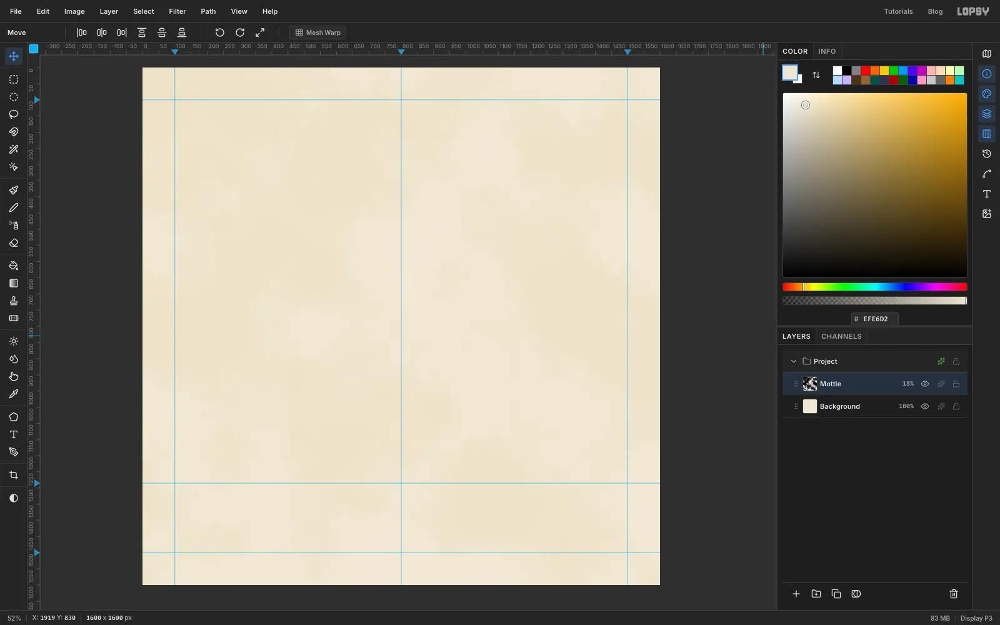

1. Double-click `Layer 1` and rename it `Mottle`.
2. Choose **Filter → Clouds…**, set **Scale** to `6` and click **Apply**.
3. Click the layer's effects button (the sparkle icon on its row) and set **Blend** to **Soft Light**. Close the drawer.
4. Click the `100%` on the layer's row and drag the slider to `18`. Click the number again to close it.

The clouds now read as gentle staining in the paper.

## Rule the practice lines

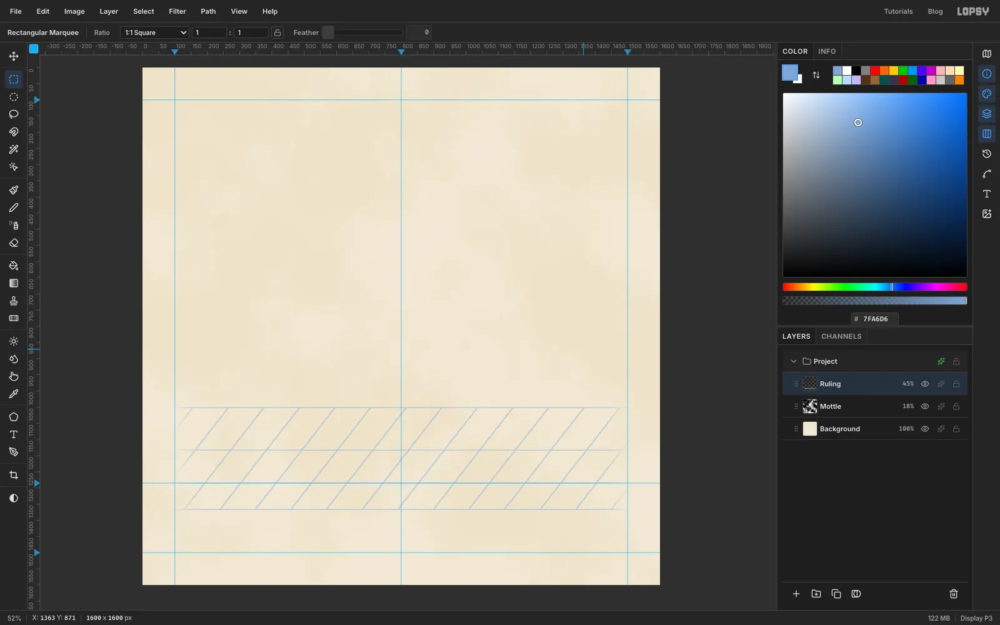

Calligraphers rule their paper before they write. You'll draw the same guidelines the title will sit on: ascender, x-height, baseline and descender lines, plus slant lines.

1. Click **Add Layer** and name the layer `Ruling`.
2. Press [[N]] for the **Pencil**, set **Size** to `3`, and set the foreground to `7FA6D6`.
3. Draw four horizontal lines from `x 90` to `x 1510`, at `y 1051`, `1184`, `1285` and `1366`. For each line, click at the left end, then hold [[Shift]] and click at the right end.
4. Now the slant lines, which run from the bottom line (`1366`) up to the top line (`1051`) at 52°. Each one ends 246 px to the right of where it starts. Click on the bottom line at `x 130`, then [[Shift]]-click on the top line at `x 376`. Repeat every 110 px along the bottom line, at `240`, `350`, `460` and so on up to `1450`. Stop any line that would pass `x 1510` at that edge. Fill the empty bottom-left corner with two or three short lines that start on `x 90` and run parallel to the others.
5. To fade the band at both ends, press [[M]] for the **Rectangular Marquee** and click once on the canvas without dragging. In the dialog, enter **From** `0, 1011` and **To** `130, 1406` and click **Select**. Choose **Select → Feather…**, enter `80` and click **Apply**, then press [[Delete]].
6. Press [[Cmd+D]] to deselect. You need to do this first: with a selection active, a single marquee click only deselects and doesn't open the dialog. Then repeat the same thing at the right edge, from `1470, 1011` to `1600, 1406`, and press [[Cmd+D]] again.
7. Set the layer's opacity to `45`.

## Lasso a hand-drawn sun

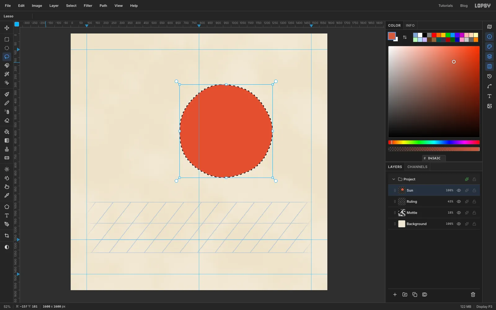

A watercolour sun is never a perfect circle.

1. Add a layer named `Sun`.
2. Press [[L]] for the **Lasso** and drag a circle about 580 px across, centred near `965, 610`. Let the edge wobble a little.
3. Set the foreground to `D45A3C` and choose **Edit → Fill**. Keep the selection.

## Give it a watercolour edge

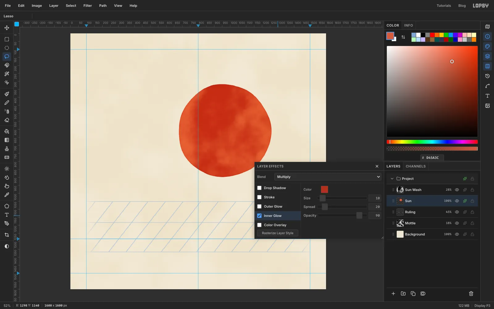

1. Add a layer named `Sun Wash`. With the sun's selection still active, choose **Filter → Clouds…**, set **Scale** to `9` and click **Apply**. The clouds fill only the sun.
2. Press [[Cmd+D]]. Set `Sun Wash` to **Overlay** blend mode and `28%` opacity.
3. Click the `Sun` layer and open its effects drawer. Tick **Inner Glow**, click its name, and set **Color** to `#B4301C`, **Size** `10`, **Spread** `20` and **Opacity** `90`. Wet watercolour dries darker at its edge, and this is that pooled rim.
4. In the same drawer, set **Blend** to **Multiply**. Close the drawer and set the layer's opacity to `85`.

## Add two pale blooms

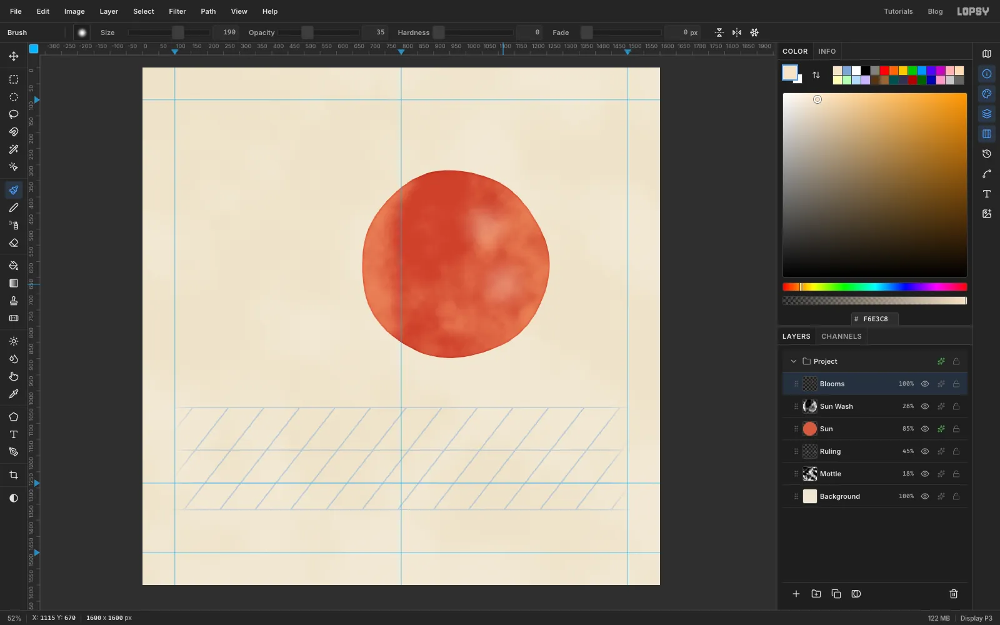

1. Click `Sun Wash`, then add a layer named `Blooms`.
2. Hold [[Cmd]] and click the `Sun` layer's thumbnail. That loads the sun's shape as a selection, so the blooms can't spill outside it.
3. Press [[B]] for the **Brush** and click the brush-tip thumbnail at the left of the options bar. Pick **Soft Round**, then set **Size** `190`, **Hardness** `0` and **Opacity** `35`. Close the panel.
4. Set the foreground to `F6E3C8`. Click once at about `1060, 490` and once at about `1115, 670`.
5. Press [[Cmd+D]].

## Bring in the goose

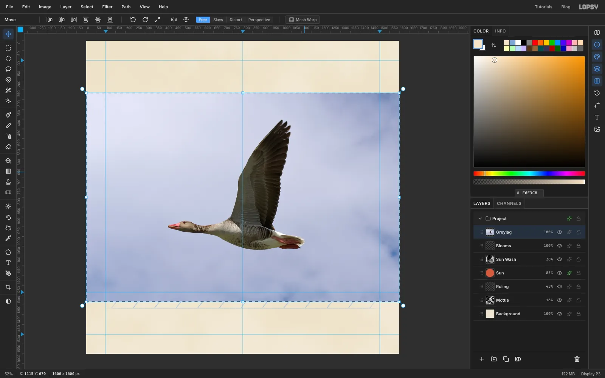

With `Blooms` selected, drag the downloaded goose photo onto the canvas. It's scaled to fit the document's width and arrives above the selected layer. Rename the new layer `Greylag`.

## Select the sky

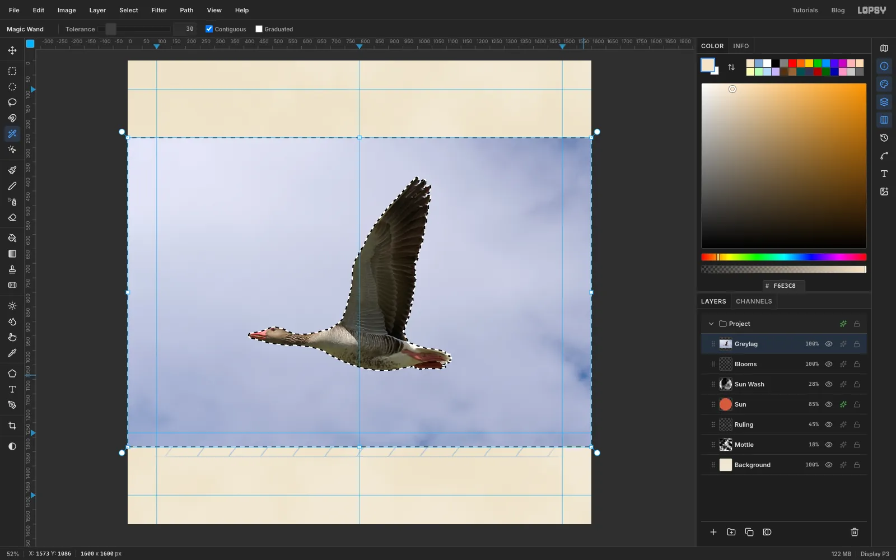

1. Press [[Cmd+D]], then press [[W]] for the **Magic Wand**. Set **Tolerance** to `30` and leave **Contiguous** ticked.
2. Click the sky at the top left. Hold [[Shift]] and click the other corners, the middle of the top and bottom edges, and any other patch of sky. The sky is a gradient, so it takes about a dozen clicks. Look out for small leftover patches near the photo's right edge.

## Delete the sky and clean the edge

1. Press [[Delete]]. The sun and paper show through where the sky was.

Now clean the edge so no blue fringe is left:

1. [[Cmd]]-click the `Greylag` thumbnail to select the goose.
2. Choose **Select → Shrink…** and enter `2`, then **Select → Feather…** and enter `1`.
3. Choose **Select → Inverse** and press [[Delete]]. Press [[Cmd+D]].

## Turn the photo into ink

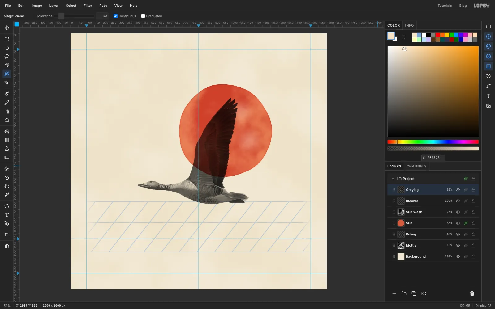

1. Choose **Filter → Desaturate**.
2. Choose **Filter → Brightness/Contrast…** and set **Brightness** to `4` and **Contrast** to `10`. Click **Apply**.
3. Open the effects drawer and set **Blend** to **Multiply**. Close it.
4. Set the layer's opacity to `88`. At 100% the wing over the sun goes almost black.

The white parts of the goose now take on the colour of the paper, and the wing turns the sun a deep red.

## Tilt the goose upward

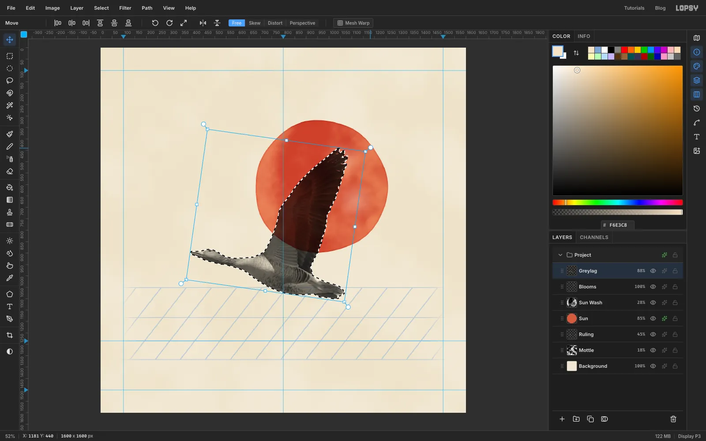

1. [[Cmd]]-click the `Greylag` thumbnail.
2. Press [[V]] for the **Move** tool. Drag the small circle outside the top-right corner of the box clockwise by about `8°`, so the head lifts and the goose climbs.
3. Press [[Cmd+D]] to commit.

## Place it and warm it

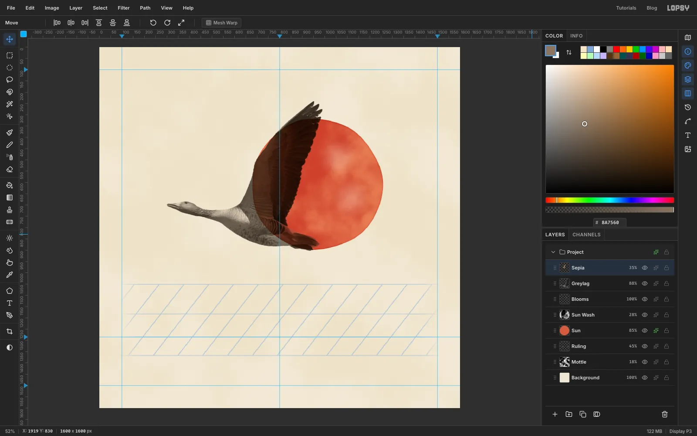

1. Drag the goose with the Move tool until the tip of its beak is near `300, 700` and its highest wing tip is near `950, 240`.
2. Add a layer named `Sepia`. [[Cmd]]-click the `Greylag` thumbnail, set the foreground to `8A7560` and choose **Edit → Fill**. Press [[Cmd+D]].
3. Set `Sepia` to **Color** blend mode at `35%`. The cool grey photo now sits warmly on the paper.

## Load the broad nib

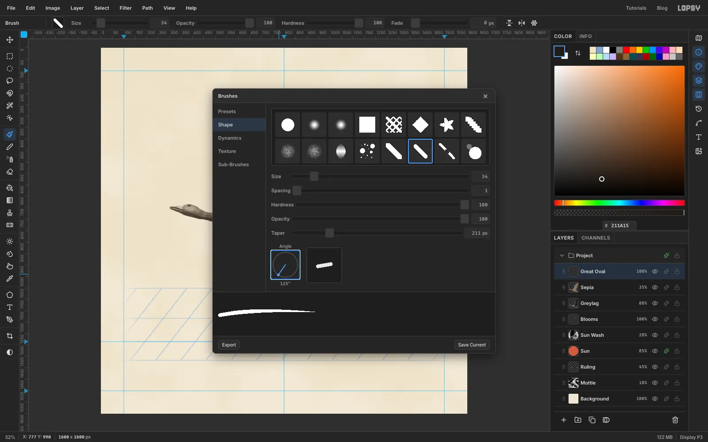

1. With `Sepia` selected, add a layer named `Great Oval`. Set the foreground to `211A15`.
2. Press [[B]] and open the brush presets. Pick **Caligraphic Rounded**.
3. On the **Shape** tab, set **Size** `34`, **Hardness** `100` and **Opacity** `100`. You'll set **Taper** for each stroke below.
4. Drag the **Angle** dial until it reads `125°`.

At this angle the nib lies almost flat. Strokes that move sideways come out thin, and strokes that move up and down come out thick. That's the classic flourish look: hairlines across the top, heavy downstrokes on the sides.

## Draw the great oval

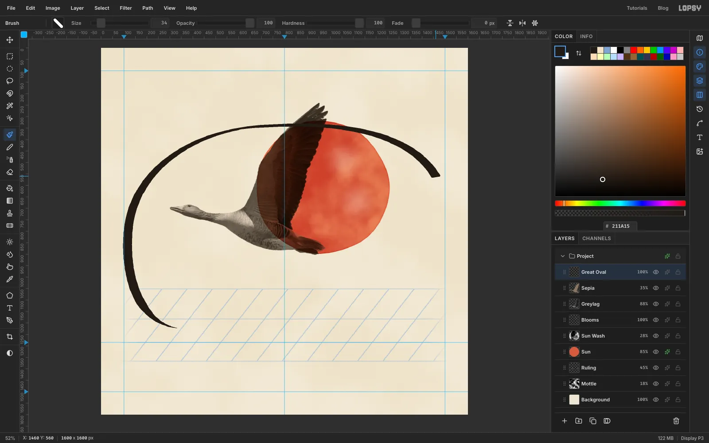

One freehand stroke would start blunt and stop blunt. To get hairlines at both ends, draw the oval in three moves.

**Taper** is only in the Brushes panel. Reopen it from the brush-tip thumbnail each time you change it, and close it with its ✕ before you draw, because it covers the canvas.

1. **The tail, drawn backwards.** Set **Taper** to `210`. Taper starts at full width where you press and thins to a hairline where you let go, so draw this tail backwards, toward its tip. Press at about `175, 1113` on the left and drag down and right to `330, 1222`.
2. **The body.** Set **Taper** back to `0`. Press at `175, 1113` again and draw one big curve. Go up the left side through `120, 780`, over the top through `660, 345` and `980, 340`, and down to `1460, 560` on the right. Above the goose's wing, the curve is a fine line.

Keep your hand moving. If you pause for more than a second and a half, Lopsy smooths the stroke and drops the taper.

## Finish the oval and add the swash

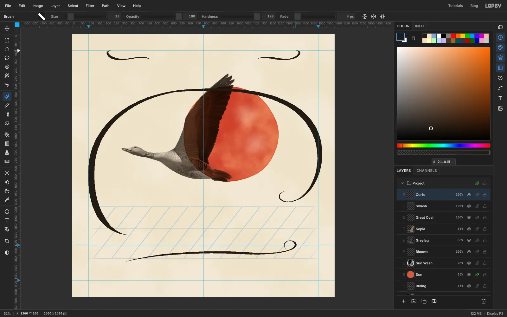

1. **The oval's exit.** Set **Taper** to `740`. Press at `1460, 560` and carry the curve down the right side through `1510, 760` and `1455, 935`. Then curl it in under itself, past `1325, 1020`, ending around `1300, 955`.
2. Add a layer named `Swash` and set **Size** to `30`. Draw it in the same three moves:
   - For the left tail, set **Taper** `240` and drag from `546, 1346` down to `330, 1385`.
   - Set **Taper** `0` and draw the body from `546, 1346` across to `1060, 1335`, bowing slightly upward in the middle.
   - Set **Taper** `470`, press at `1060, 1335` and finish with a loop: right and up through `1362, 1285`, over the top at `1330, 1258`, and down inside the loop to `1300, 1305`.
3. Add a layer named `Curls` and set **Size** to `20`. Draw two small curls at the top, mirror images of each other:
   - Left tail (**Taper** `60`): press at `417, 141` and drag right to `470, 150`.
   - Left body (**Taper** `0`): from `417, 141` left to `250, 145`.
   - Left hook (**Taper** `90`): from `250, 145`, curl round and up to `240, 100`.
   - For the right curl, mirror it: tail from `1183, 141` to `1130, 150`, body from `1183, 141` to `1350, 145`, and hook from `1350, 145` round to `1360, 100`.

## Select the wing where the oval crosses it

Right now the oval runs over the wing. Passing it behind the wing makes the goose look like it's flying through the flourish.

1. Click `Great Oval`, then [[Cmd]]-click the `Greylag` thumbnail. `Great Oval` stays the active layer.
2. Press [[M]]. Hold [[Shift]] and [[Option]] and drag a rectangle from `600, 150` to `1100, 470`. **Shift+Option** keeps only the overlap, so the selection is just the top of the wing.

## Cut the oval behind the wing

Press [[Delete]], then [[Cmd+D]]. The part of the oval that crossed the wing is gone, so the line now seems to pass behind it and come out the other side.

## Draw the distant skein

1. Click `Curls` and add a layer named `Skein`. Set the foreground to `433A31`.
2. Keep **Caligraphic Rounded** at `125°`. Set **Size** to `9` and **Taper** to `0`.
3. Draw seven little gull birds. Each is one stroke: a shallow arch up and down for the left wing, then the same for the right wing. Put the leader at `1272, 700`, about 40 px across. Each bird behind it is about 52 px further right and 31 px higher (the upper arm) or lower (the lower arm), with three birds on each arm. Make the trailing birds about 30 px across. The V points left, the way the goose is flying.
4. Set the layer's opacity to `85`.

## Write the title

1. With `Skein` selected, press [[T]] for the **Text** tool.
2. In the options bar, set **Size** to `300` and pick **Pinyon Script** in the font picker. Make sure **Align** is **Left**. In the **Text** panel (the **T** icon in the strip of panel buttons at the far right), set **Letter spacing** to `0`. Set the foreground to `211A15`.
3. Click in empty space at about `380, 980`, type `Yonder` and press [[Tab]].
4. Press [[V]]. Nudge the text with the arrow keys ([[Shift]] moves 10 px at a time) until the bottoms of the letters sit on the `1285` guide and the word is centred on the `800` guide. The tops of the o, n and e should touch the x-height rule at `1184`.

## Set the band name

1. Click `Skein` so a raster layer is active. Otherwise the next text setting would restyle `Yonder`.
2. Press [[T]]. Set **Size** `92`, font **Cormorant SC** and weight **SemiBold**. In the Text panel set **Letter spacing** to `24`. Set the foreground to `C8442A`.
3. Click at about `520, 60`, type `GREYLAG` and press [[Tab]]. Double-click the new layer's name and rename it `Band`.
4. Press [[V]] and nudge it so it's centred on the `800` guide, with its letters running from about `y 124` to `183`. That leaves the same gap to each curl.

## Draw the subtitle's curve

1. Press [[P]] for the **Pen**.
2. Click at `520, 1452`. Press at `800, 1420` and drag right to `950, 1420` to make a smooth top. Click at `1088, 1452`.
3. Click the ✓ (**Commit path**) in the options bar. Don't press Enter, because that strokes the path with paint.

## Put the subtitle on the curve

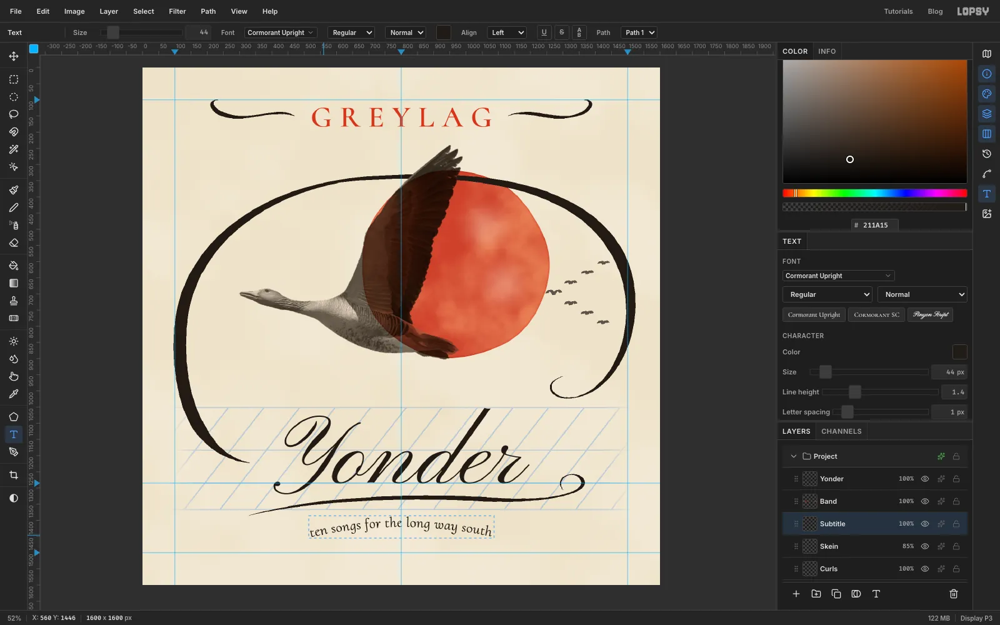

1. Click `Skein`, then press [[T]]. Set **Size** `44`, font **Cormorant Upright** and weight **Regular**, and set **Letter spacing** to `1`. Set the foreground back to `211A15`.
2. Click in empty space near the bottom of the canvas, type `ten songs for the long way south` and press [[Tab]]. Rename the layer `Subtitle`.
3. In the options bar, set **Path** to *Path 1*. The text starts at the path's first anchor and follows the arch.
4. Open the **Paths** panel (the pen-curve icon in the strip at the far right) and click *Path 1*'s row to hide the blue outline. Don't delete the path, because the text needs it.

## Add the footer

1. Click `Skein`. Press [[T]], set **Size** `30`, font **Cormorant SC** and weight **Medium**, and set **Letter spacing** to `2`.
2. Click in empty space at about `100, 1440`, type `Hollow Reed Records` and press [[Tab]]. Rename the layer `Label`. Press [[V]] and nudge it so it starts on the `100` guide and its baseline sits at `y 1515`.
3. Click `Skein` again and press [[T]]. Click at about `1200, 1440` and type `HR–07 · Stereo` with the same settings. Paste it if your keyboard can't type the dash and the dot. Press [[Tab]] and rename the layer `Catalogue`. Nudge it so it ends on the `1500` guide and its baseline lines up with the first label's.

Match the baselines, not the bottoms. Cormorant's old-style **7** hangs about 5 px below the line, so this label's lowest pixel is at `1520`, not `1515`.

## Rotate a rubric diamond

Scribes marked their pages in red, called rubrication.

1. Click `Skein` and add a layer named `Rubric`.
2. Press [[M]], click once on the canvas, and enter **From** `789, 1495` and **To** `811, 1517`. Fill it with `C8442A` (**Edit → Fill**).
3. Press [[V]]. Hold [[Cmd]] and drag the rotate circle at a corner of the box until it turns `45°`. Cmd snaps the angle in 15° steps. On Windows and Linux the snap doesn't work with Ctrl, so turn it to 45° by eye. Press [[Cmd+D]].

## Darken the edges

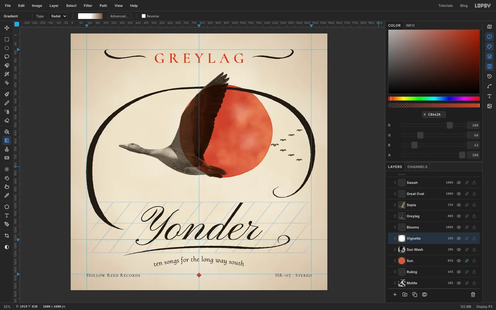

1. Click `Sun Wash` and add a layer named `Vignette`. At this height it darkens the paper and the sun, but not the goose, the ink or the lettering.
2. Pick the **Gradient** tool (it has no shortcut). Set **Type** to **Radial** and click **Advanced…**. Click the left stop and type `FFFFFF` in **Hex**. Click the right stop and type `7A5636`. Click the middle of the bar to add a stop at 50% and type `FFFFFF`. Click **Done**.
3. Drag from the centre of the canvas (`800, 790`) to the bottom-right corner.
4. Set the layer to **Multiply** at `28%`.

In Multiply, white changes nothing, so only the edges get darker. There's no ring where a feathered selection would end.

## Add grain and fibres

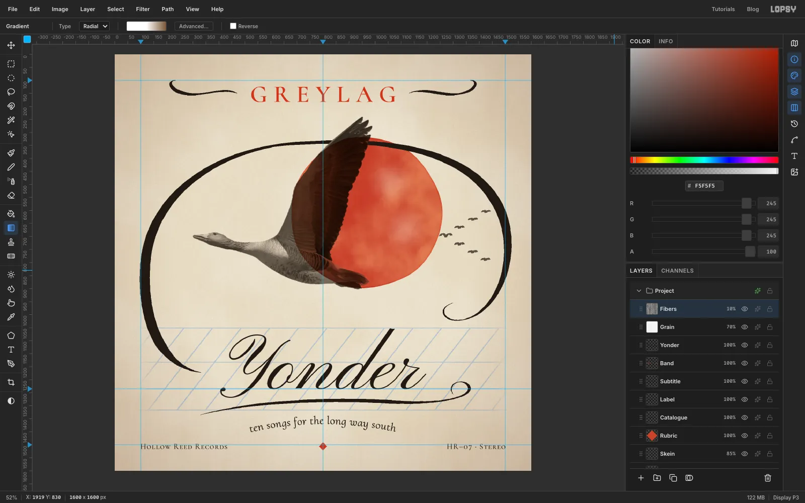

1. Click `Yonder` so the next layer goes on top of everything. Add a layer named `Grain`.
2. Set the foreground to `F5F5F5` and choose **Edit → Fill**.
3. Choose **Filter → Add Noise…**. Set **Amount** `45`, click **Mono** and **Gaussian**, then click **Apply**.
4. Set `Grain` to **Multiply** at `70%`. Near-white noise in Multiply only darkens, so it shows on light paper. Overlay barely shows there.
5. Add a layer named `Fibers` and choose **Filter → Fibers…** with its default settings. Set it to **Soft Light** at `10%`.

## Group the layers

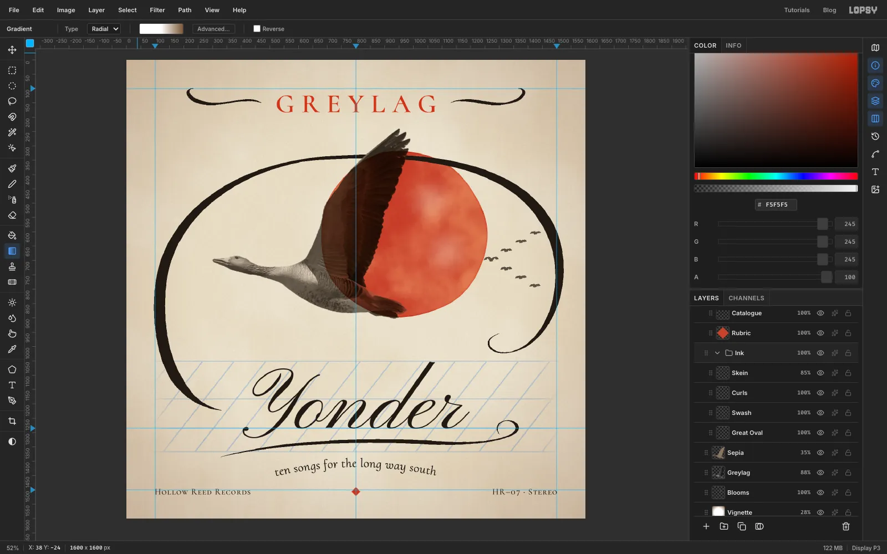

1. Click `Yonder`, then [[Shift]]-click `Rubric` to select the lettering. Choose **Layer → Group Layers**, then double-click the new group's name and type `Lettering`.
2. Click `Skein`, [[Shift]]-click `Great Oval`, choose **Layer → Group Layers**, and rename the group `Ink`.

Now you can move the lettering as one piece. Select `Lettering`, press [[V]] and use the arrow keys. The subtitle stays on its curve. Press [[Cmd+Z]] once for each nudge to put it back.

Choose **File → Quick Export PNG** to save the cover, and **File → Save Project** to keep the layers.
