Copperplate is the pointed-pen script of 18th- and 19th-century engravers.
It slants at about 55 degrees, swells on the downstrokes and thins to a hair
on the upstrokes. Calligraphers still practise it on paper ruled with a cap
line, a waistline, a baseline and rows of slant lines. In this tutorial you'll
use all of that for an imaginary ink company. The result is a 3:1 billboard
for **Peacock**, an iridescent fountain-pen ink.

The idea fits in one sentence: *the feather is the pen*. A real peacock
feather lies on ivory paper, and its quill flows straight into a broad ink
swash under the word. The ink colour shifts from teal to blue to violet to
emerald, the way a peacock's feathers do. An inkwell on the right, with a
second feather standing in it, says what's being sold.

The feather is a public-domain scan from Wikimedia Commons,
[Pavo cristatus feather-scan.jpg](https://commons.wikimedia.org/wiki/File:Pavo_cristatus_feather-scan.jpg).
Download it before you start (the 1280 px-wide preview is plenty).

Along the way you'll use:

- the **Gradient** tool with typed hex stops, **Clouds** and **Add Noise** for the paper
- ruler **guides**, **Show Grid** and the **Pencil** with [[Shift]]-click straight lines for the ruled sheet
- a **layer mask** filled through a feathered selection, and a second mask painted with a gradient
- a dropped photo cleaned up with **Brightness/Contrast**, the **Magic Wand** and the **Multiply** blend mode
- **Move** tool scaling and rotation, then undo and redo to check them
- **Text** in Pinyon Script and Cormorant SC, **Rasterize Layer**, **Select → Grow** and gradient-filled lettering
- the **Brush** with the *Caligraphic Angle* tip, a set angle and **Taper**
- copy and paste, **Flip Horizontal**, **Hue/Saturation**, the **Lasso** with [[Alt]] to subtract
- **New Group**, the **Color**, **Screen**, **Overlay** and **Multiply** blend modes, the **Spray** tool and layer effects

The palette:

- Paper `#F7F0E2` → `#EDE1C8` → `#D8C4A0`, ruling `#A88F6A`
- Peacock ink `#0D5C63` → `#1F4FA0` → `#4B2E83` → `#0E7C7B` → `#1E8C5A`
- Feather sheen `#1E8C5A` → `#0E7C7B` → `#1F4FA0` → `#3A3F9E`
- Gold `#9C7A2B` → `#E8C66A` → `#A8832F` → `#E3C060` → `#9C7A2B`, gold line `#C9A24A`
- Swash ink `#0D5C63` → `#1F4FA0` → `#5A2D91` → `#0E6F78` → `#0F8F6A`
- Ink teal `#0D4F57`, sepia type `#4A3B2A`, label cream `#F3EAD6`
- Glass `#0A3238` → `#0E6F73` → `#2A9C98` → `#0B4A5A` → `#1D2F66` → `#120F2E`
- Shadow brown `#3B2A14`, vignette `#7A5A35`, grain grey `#808080`

Positions are given in document pixels where things have to line up. Watch
**X** and **Y** in the status bar as you move the pointer. Freehand strokes
only need to be close.

Lopsy names each text layer after its text. I renamed my layers as I went
(double-click a name), so the screenshots show names like `Peacock`,
`Subhead` and `Tag Text`.

## Start the billboard and lay the paper

1. Choose **File → New**, set **Width** `2400` and **Height** `800`, keep the **White** background and click **Create**.
2. Click **Background** in the Layers panel and pick the **Gradient** tool. Set **Type** to **Radial**.
3. Click **Advanced…**. Set the left stop to `#F7F0E2` and the right stop to `#D8C4A0` in the **Hex color** field. Click the bar about 60% of the way along to add a stop and make it `#EDE1C8`. Click **Done**.
4. Drag from a little left of centre (about `x 1300, y 380`) out past the bottom-right corner of the canvas.

## Add a paper fibre

Real paper is never one flat colour. A faint, fine cloud pattern multiplied over the gradient gives it some body.

1. Click **Layer 1**, the empty layer Lopsy adds above **Background**, and double-click its name to rename it `Paper Fibre`.
2. Choose **Filter → Clouds…**, set **Scale** to `3` and click **Apply**.
3. Open the layer's effects (the ✦ button on its row) and set the blend mode to **Multiply**. Close the drawer.
4. Click the layer's opacity and drag it down to `7%`.

## Place the guides

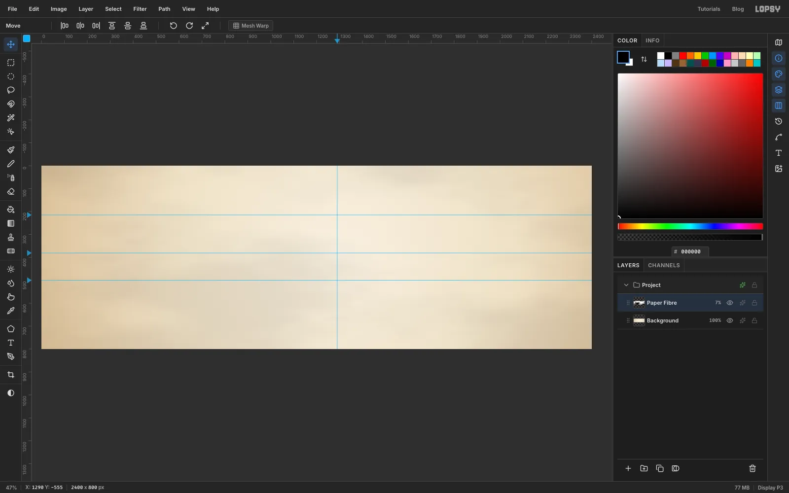

Copperplate is written between ruled lines. These guides mark where the headline will sit.

1. Click the left ruler at `y 215` (the cap line), `y 381` (the waistline, where lowercase letters stop) and `y 500` (the baseline).
2. Click the top ruler at `x 1290`. That's the centre of the lettering block, a little left of the canvas centre to leave room for the inkwell.

Zoom in if a click doesn't land exactly where you want. Clicking a guide on the ruler again removes it.

## Rule the lines with the Pencil

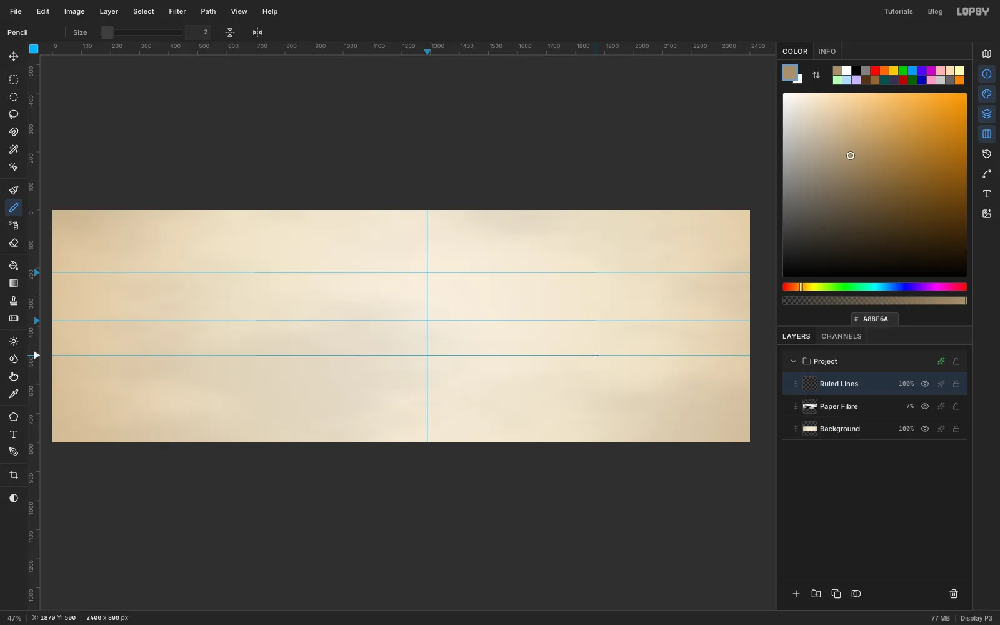

1. Click **Add Layer** and name the new layer `Ruled Lines`.
2. Pick the **Pencil**, set **Size** to `2` and set the foreground colour to `#A88F6A`.
3. For each guide, click at `x 700` on it, then hold [[Shift]] and click at `x 1870`. Shift-click draws a straight line from the last point.

The lines sit right on top of the guides, so they're hard to see until you hide the guides at the end.

## Add the 55° slant lines

Copperplate leans at about 55 degrees, so practice sheets carry rows of slant lines at that angle.

1. Choose **View → Show Grid**. It's only there to help your eye keep the lines evenly spaced.
2. Still with the Pencil, click on the baseline at `x 730`, then [[Shift]]-click at `x 944, y 195`. That point is 305 px up and about 214 px across, which is 55°.
3. Repeat every 64 px along the baseline (`x 794`, `858`, `922` and so on), ending each line 214 px to the right and 20 px above the cap line. That's 15 lines in all; the last one starts at `x 1626`.
4. Choose **View → Show Grid** again to hide it.

The slant lines stop at the baseline. Below it, the swash will need clear space.

## Fade the ends of the ruling

Hard-ended rules look like a box pasted behind the word. A layer mask lets them fade out at each end.

1. With **Ruled Lines** selected, click **Add Mask** at the bottom of the Layers panel. A **Mask** row appears under the layer; click its thumbnail to edit the mask.
2. Press [[Cmd+A]], set the foreground to `#000000` and choose **Edit → Fill**. The whole mask is black, so the lines disappear and the canvas turns blue.
3. With the **Rectangular Marquee**, drag from `x 730, y 120` to `x 1840, y 600`.
4. Choose **Select → Feather…**, enter `30` and click **Apply**.
5. Set the foreground to `#FFFFFF` and choose **Edit → Fill**. Press [[Cmd+D]].
6. Click the **Ruled Lines** layer's name to stop editing the mask.

## Soften the ruling

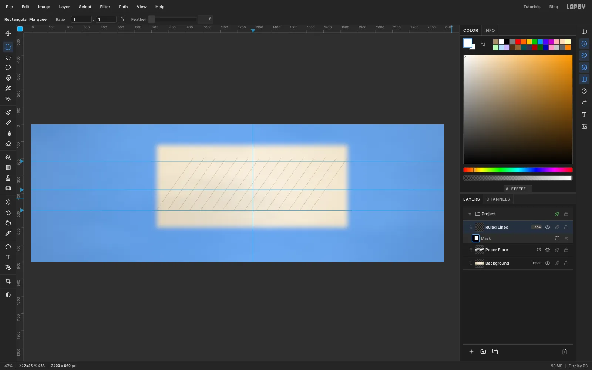

1. Open the effects for **Ruled Lines** and set the blend mode to **Multiply**.
2. Drag the layer's opacity down to `38%`.

The ruling should be just visible: enough to say "calligrapher's sheet" without competing with the lettering.

## Drop in the feather scan

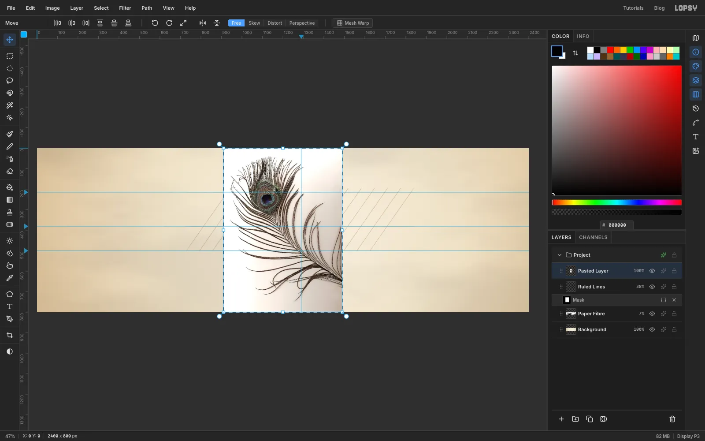

1. Make sure **Ruled Lines** is selected, so the photo lands above it.
2. Drag the feather image from your desktop or Finder onto the canvas. Lopsy adds it as a new layer, shrinks it to fit the height and selects it.
3. Press [[Cmd+D]] and rename the layer (Lopsy calls it *Pasted Layer*) to `Feather`.

## Whiten the scanner bed

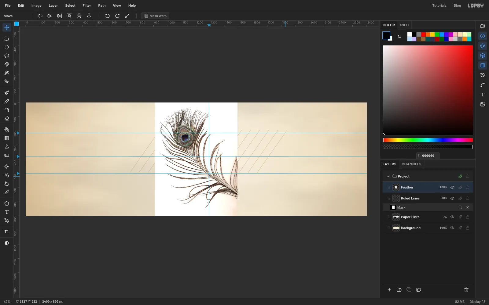

The scan's background isn't pure white: it drifts to pinkish grey in the bottom-right corner. Brightening it first lets one Magic Wand click catch all of it.

1. Choose **Filter → Brightness/Contrast…**.
2. Set **Brightness** to `15` and **Contrast** to `25`, then click **Apply**.

## Select the background with the Magic Wand

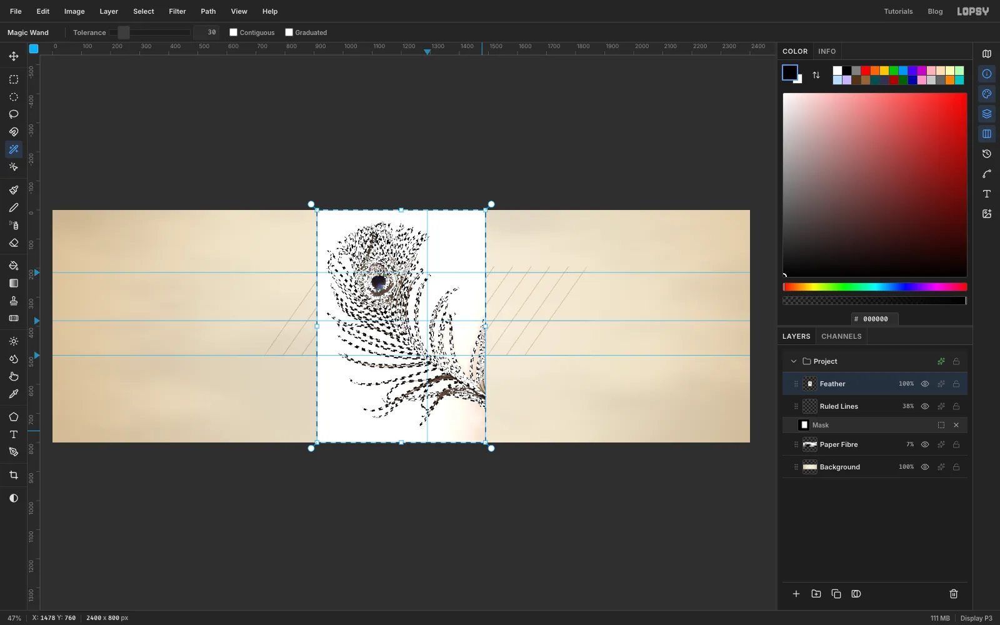

1. Pick the **Magic Wand**. Set **Tolerance** to `30` and untick **Contiguous**, so it also catches the pockets of background between the barbs.
2. Click the white background near the top-right corner of the photo.
3. Hold [[Shift]] and click the greyer background in the bottom-right corner to add it to the selection.

## Cut out and colour the feather

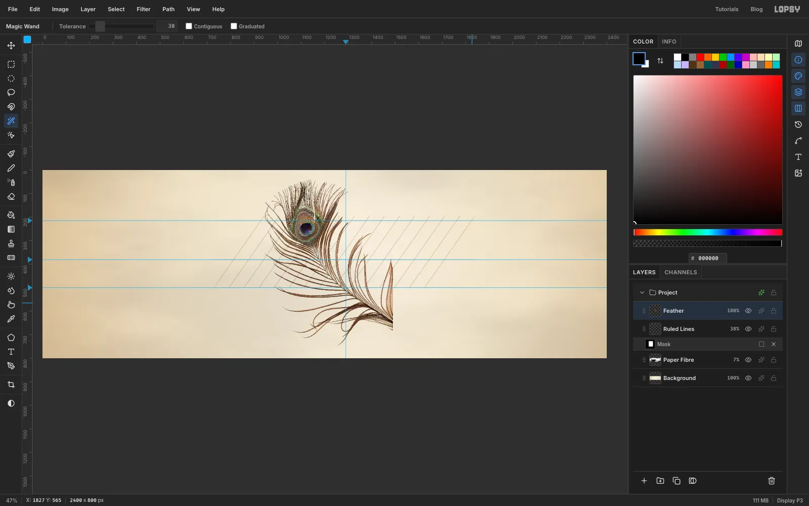

1. Press [[Delete]] to clear the background, then [[Cmd+D]].
2. Set the **Feather** layer's blend mode to **Multiply**. Any pale fringe left around the barbs now disappears into the paper instead of showing as a light halo.
3. Choose **Filter → Hue/Saturation…**, set **Saturation** to `45` and click **Apply**.

## Move the feather to the left

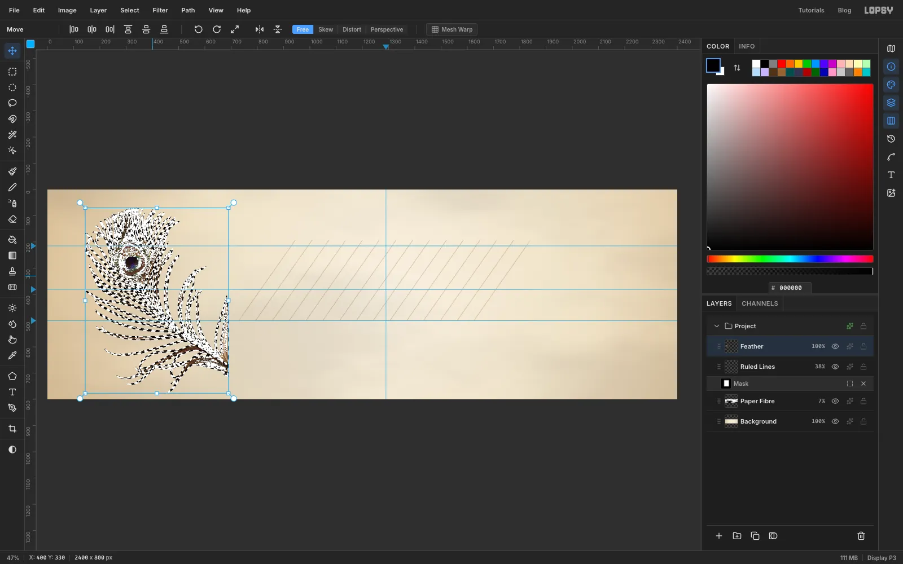

1. Hold [[Cmd]] and click the **Feather** thumbnail to select the feather's pixels.
2. With the **Move** tool, drag the feather about 800 px to the left and 30 px down, so its left edge sits near `x 145`.

## Scale it up

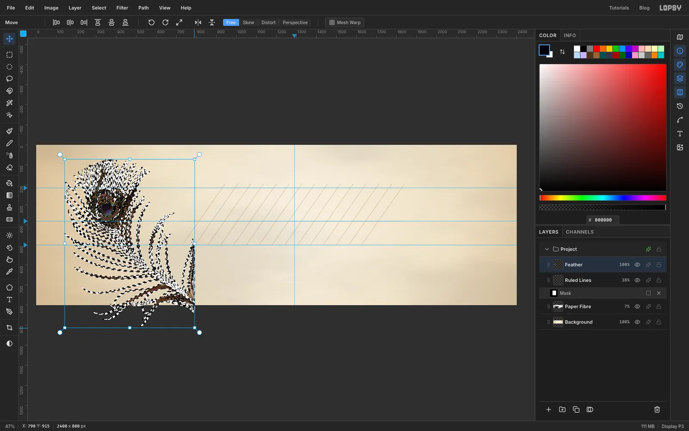

Hold [[Cmd]] and drag the bottom-right corner handle out, about 100 px right and 138 px down. Cmd keeps the proportions. The feather grows by about a fifth, and its lower barbs now run off the bottom of the canvas.

## Tilt the feather

The quill should run toward the lettering, so tip the feather back.

1. Find the small round rotate handle tethered just outside the top-right corner. The pointer becomes a crosshair over it.
2. Drag it counter-clockwise by eye, about 15°. The eye of the feather drops a little and the quill points toward the right.
3. Press [[Cmd+D]] to apply the rotation and drop the selection.

> **Tip:** If the tilt isn't right, [[Cmd+Z]] steps back through the rotate, scale and move one at a time, and [[Cmd+Shift+Z]] steps forward again.

## Paint an iridescent sheen

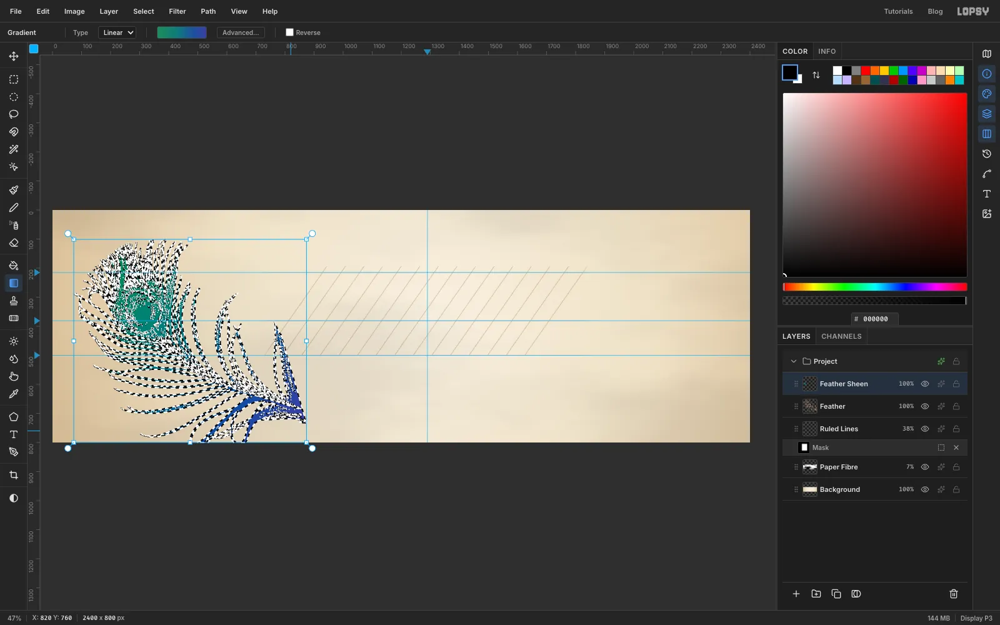

The scan is bronze and brown. A gradient in the feather's shape, set to Color mode, turns it into peacock blues and greens.

1. [[Cmd]]-click the **Feather** thumbnail to select its pixels.
2. Click **Add Layer** and name it `Feather Sheen`.
3. Pick the **Gradient** tool and set **Type** to **Linear**. In **Advanced…** set the end stops to `#1E8C5A` (left) and `#3A3F9E` (right). Click the bar to add a stop and drag it until **Position** reads 40%, and make it `#0E7C7B`; add another at 75% in `#1F4FA0`. Every gradient in this tutorial is set up the same way.
4. Drag from the top-left of the feather (`x 150, y 150`) to its lower-right end (`x 820, y 760`). Press [[Cmd+D]].

## Set the sheen to Color mode

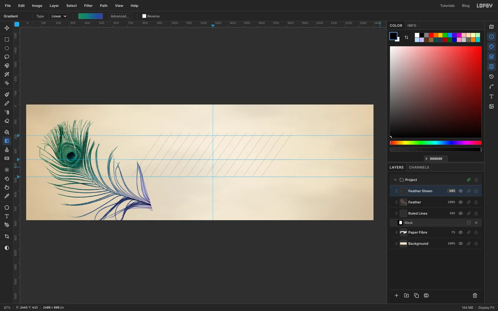

1. Set the **Feather Sheen** blend mode to **Color** and its opacity to `60%`. The barbs keep their light and shade but take the gradient's hues.
2. Choose **Layer → Merge Down** to bake the sheen into the feather.

## Fade the scan's cut edge

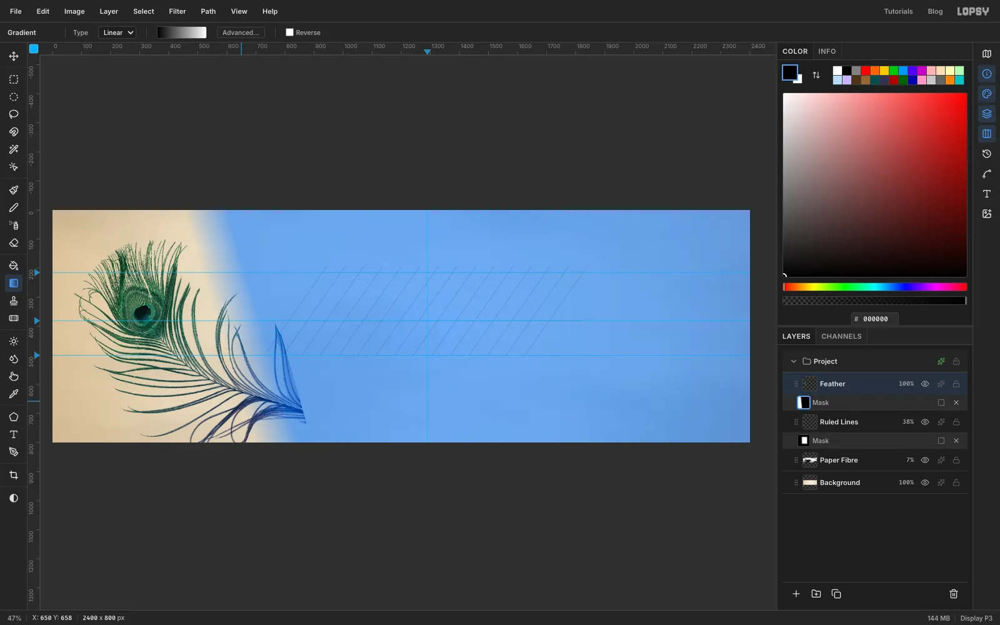

The scan cuts off some barbs in a straight line along its right edge. A gradient on a layer mask fades them out.

1. With **Feather** selected, click **Add Mask**, then click the thumbnail in its **Mask** row to edit the mask.
2. In the Gradient tool's **Advanced…** editor, set the left stop to `#000000` and the right stop to `#FFFFFF`, and remove any middle stops (select one and click **Delete**).
3. Drag from the cut edge (about `x 790, y 615`) inward to `x 650, y 658`, at right angles to the edge. Everything beyond the start of the drag is hidden, and the barbs fade in over about 145 px.
4. Click the **Feather** layer's name to stop editing the mask.

## Type the headline

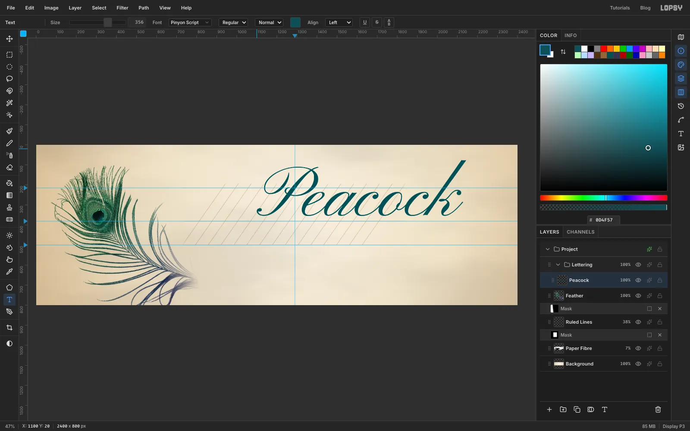

1. With **Feather** selected, click **New Group** in the Layers panel and name the group `Lettering`. Layers you add while it's selected go inside it.
2. Pick the **Text** tool. Set **Size** to `356`, choose **Pinyon Script** in the font menu, and set the colour to `#0D4F57`.
3. Click an empty area near the top of the canvas, type `Peacock` and press [[Tab]] to commit.

## Seat it on the baseline

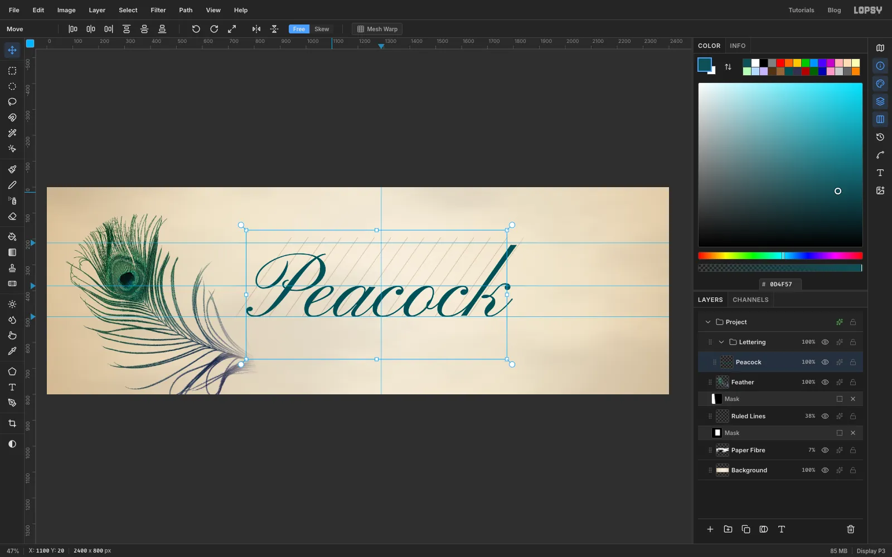

With the **Move** tool, nudge the word with the arrow keys ([[Shift]]+arrow moves 10 px) until:

- the bottoms of the lowercase letters sit exactly on the baseline guide at `y 500`;
- the word is centred on the vertical guide at `x 1290` (it spans about `x 769` to `x 1812`).

At Size 356 the tops of the *a*, *c* and *o* then land on the waistline, and the *P* and *k* come up just short of the cap line.

Pinyon Script has no descenders in this word, so the baseline is the bottom of the ink.

## Ink the headline

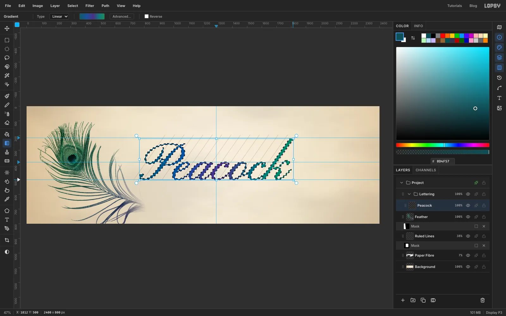

Copperplate hairlines are lovely up close but vanish at billboard distance, so thicken them slightly before filling the word with the ink colours.

1. Click **Rasterize Layer** (the **T** button in the Layers panel footer) to turn the text into pixels.
2. [[Cmd]]-click the **Peacock** thumbnail, then choose **Select → Grow…**, enter `2` and click **Apply**.
3. With the **Gradient** tool (Linear), set five stops: `#0D5C63`, `#1F4FA0` at 30%, `#4B2E83` at 55%, `#0E7C7B` at 80% and `#1E8C5A`.
4. Drag from the top-left of the word (`x 769, y 223`) to its bottom-right (`x 1812, y 500`). The grown selection fills too, so each stroke gains 2 px all round. Press [[Cmd+D]].
5. Add a **Drop Shadow**: **Offset X** `2`, **Offset Y** `4`, **Blur** `5`, **Opacity** `22`, colour `#3B2A14`.

## Load the calligraphic brush

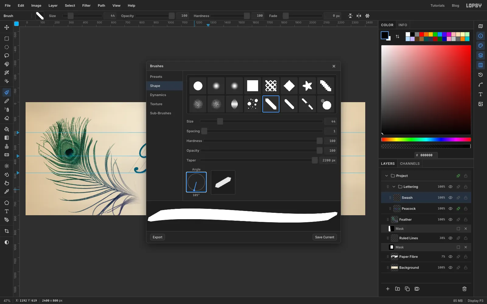

A broad-edged pen makes thick strokes when it moves across its edge and hairlines when it moves along it. The *Caligraphic Angle* tip behaves the same way.

1. Click **Add Layer** (with **Peacock** selected) and name it `Swash`.
2. Pick the **Brush** and click the brush-tip thumbnail at the left of the options bar to open **Brushes**.
3. On the **Presets** tab, click **Caligraphic Angle**.
4. On the **Shape** tab, set **Size** to `44`, and type `2200` in the **Taper** box (the slider only drags to 1000). Click the **Angle** dial down and slightly left of its centre so it reads `105°`. The preview shows the nib as a short line rising to the right at about 30°.
5. Close the window and set the foreground to `#0D4F57`.

**Taper** shrinks the brush over the first 2200 px of a stroke, so a stroke starts at full width and gets steadily thinner. Strictly, copperplate is written with a pointed pen; a broad-edged swash is a deliberate choice here, because it reads from much further away.

## Pull the swash out of the quill

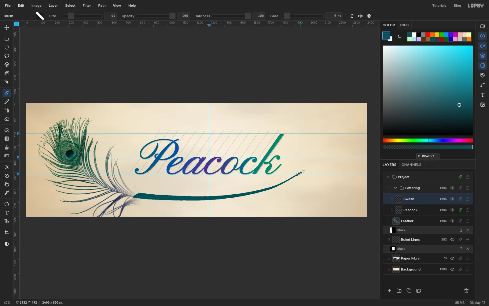

Draw one smooth, continuous stroke:

1. Start right at the end of the feather's shaft, around `x 782, y 650`.
2. Sweep right under the headline. Let it sag gently to about `y 672` between `x 1100` and `x 1300`, staying well clear of where the small type will go at `y 720`.
3. Rise through `x 1720, y 600`, and finish with a flick up and to the right that ends at `x 1932, y 492`, past the end of the *k*.

Where the stroke runs nearly level it's broad, because it crosses the nib. On the final rise it runs along the nib and the taper has done its work, so it ends in a hairline. Undo and try again until the curve feels like one confident movement.

## Ink the swash

1. [[Cmd]]-click the **Swash** thumbnail.
2. In the Gradient editor, set `#0D5C63`, `#1F4FA0` at 35%, `#5A2D91` at 65%, `#0E6F78` at 85% and `#0F8F6A`. It's the headline's ink with a deeper violet and a greener tail, so the long stroke doesn't look like a stretched copy of the word.
3. Drag from the start of the swash (`x 782, y 650`) to its tail (`x 1932, y 492`). Press [[Cmd+D]].
4. Choose **Filter → Gaussian Blur…**, set **Radius** to `1` and click **Apply**. A single pixel of blur takes the stamped edge off the stroke.

## Echo it with a gold hairline

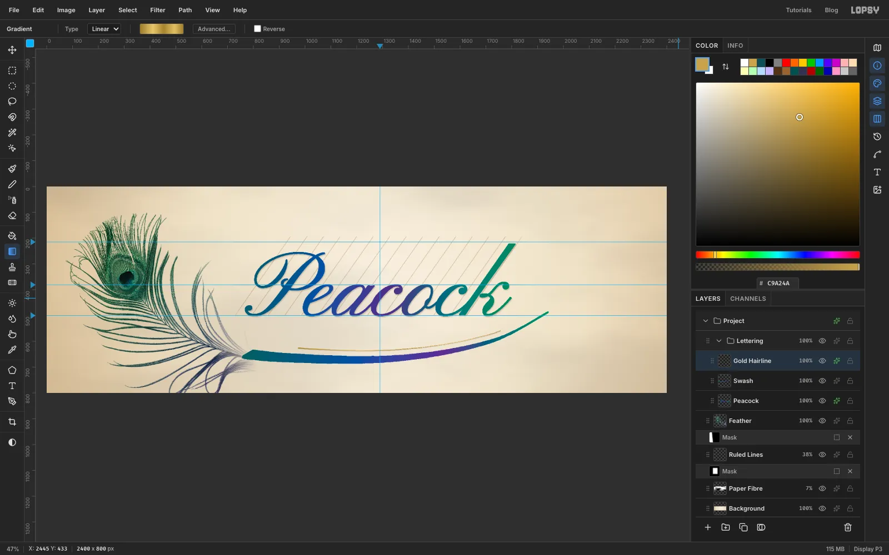

1. Click **Add Layer** and name it `Gold Hairline`.
2. With the **Brush**, open **Brushes** and click **Hard Round** on the **Presets** tab. On the **Shape** tab set **Size** to `4` and **Taper** to `900`. Close it and set the foreground to `#C9A24A`.
3. Draw a line that follows the swash about 40 px above its centre, from `x 960, y 624` to `x 1760, y 560`. Keep the gap even all the way along, so it reads as a deliberate second stroke.
4. [[Cmd]]-click the **Gold Hairline** thumbnail. In the Gradient editor set the gold stops `#9C7A2B`, `#E8C66A` at 30%, `#A8832F` at 55%, `#E3C060` at 80% and `#9C7A2B`, and drag along the line from end to end. Press [[Cmd+D]].
5. Add a **Drop Shadow**: **Offset X** `1`, **Offset Y** `2`, **Blur** `2`, **Opacity** `30`, colour `#3B2A14`.

The alternating light and dark stops are what make flat yellow read as metal.

## Set the subhead

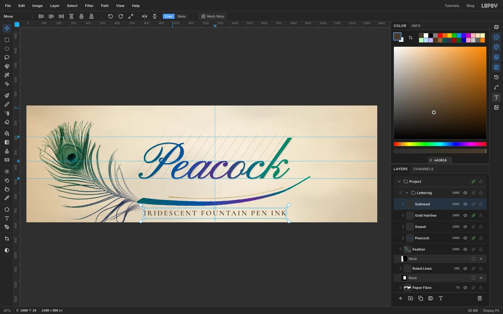

1. Keep **Gold Hairline** selected. (If a text layer is selected, changing the font restyles that layer instead.)
2. Pick the **Text** tool. Set **Size** to `51`, font **Cormorant SC**, weight **SemiBold**, colour `#4A3B2A`.
3. Click an empty spot near the top, type `IRIDESCENT FOUNTAIN PEN INK`, press [[Tab]] and rename the layer `Subhead`.
4. Open the **Text** panel from the panel toolbar on the right and set **Letter spacing** to `8`.
5. With the **Move** tool and the arrow keys, centre it on `x 1290` with the tops of the capitals at `y 720`. That leaves about 28 px of air under the swash and 47 px above the bottom edge.

## Add the maker's line

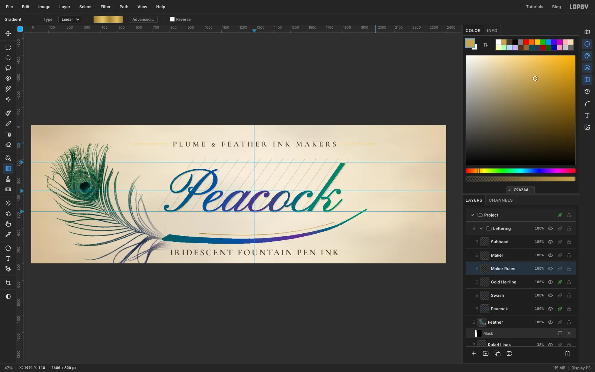

1. Click **Gold Hairline** again, then make a new text layer: **Size** `44`, **Cormorant SC**, **SemiBold**, `#4A3B2A`. Type `PLUME & FEATHER INK MAKERS`, press [[Tab]] and rename the layer `Maker`.
2. Set **Letter spacing** to `12` and centre the line on `x 1290` with its capitals starting at `y 96`.
3. Select **Gold Hairline**, click **Add Layer** and name it `Maker Rules`.
4. With the **Pencil** at **Size** `3` and colour `#C9A24A`, click at `x 590, y 110` and [[Shift]]-click at `x 790, y 110`. Do the same from `x 1791` to `x 1991`. Both rules are 200 px long and stop 30 px from the text.
5. [[Cmd]]-click the **Maker Rules** thumbnail. The Gradient tool still holds the gold stops from the hairline, so drag it across both rules from the left end to the right. Press [[Cmd+D]].

## Copy the feather for a quill

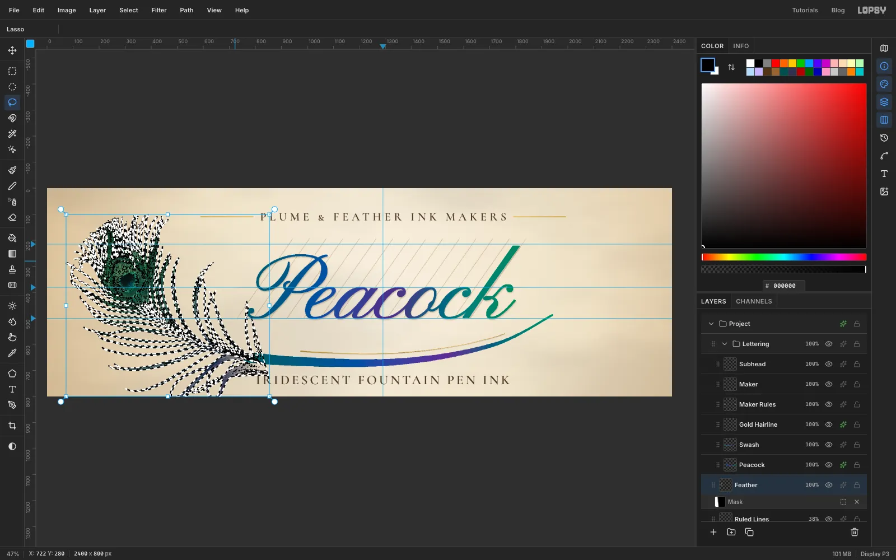

The inkwell gets its own feather. Copy the big one, but leave out the barbs along its cut edge: Copy takes the layer's own pixels, not what its mask shows, so the cut edge would come back.

1. Select the **Feather** layer and [[Cmd]]-click its thumbnail.
2. Pick the **Lasso**, hold [[Alt]] and draw around the strip to the right of the scan's cut edge: from about `x 722, y 280` across to `x 1010`, down past the bottom of the canvas, and back to `x 878`. Alt subtracts it from the selection.
3. Press [[Cmd+C]], then [[Cmd+D]].

## Paste, mirror and recolour it

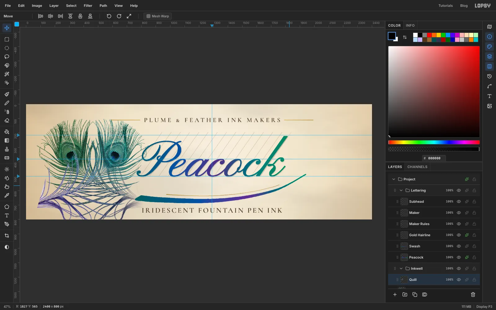

1. With **Feather** still selected, click **New Group** and name it `Inkwell`.
2. Press [[Cmd+V]]. The copy pastes in place inside the group. Rename it `Quill`.
3. Click **Flip Horizontal** in the Move tool's options bar, then press [[Cmd+D]].
4. Choose **Filter → Hue/Saturation…**, set **Hue** to `18` and click **Apply**.

Mirrored and pushed toward blue, it no longer reads as a clone of the big feather.

## Shrink the quill

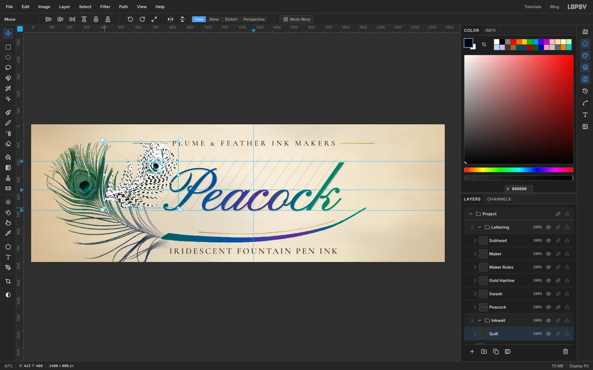

1. [[Cmd]]-click the **Quill** thumbnail.
2. With the **Move** tool, hold [[Cmd]] and drag the bottom-left corner handle up and to the right until the quill is a little over half its size.
3. Press [[Cmd+D]] to apply.

## Stand it upright

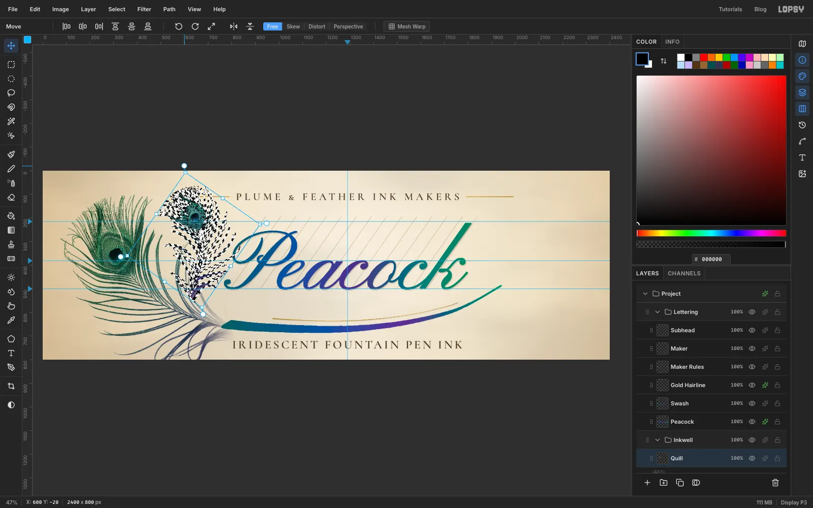

1. [[Cmd]]-click the **Quill** thumbnail again.
2. Drag the round rotate handle outside the top-right corner counter-clockwise by eye, about 55°, until the eye is at the top and the shaft points almost straight down.
3. Press [[Cmd+D]] to apply.

## Move it over to the right

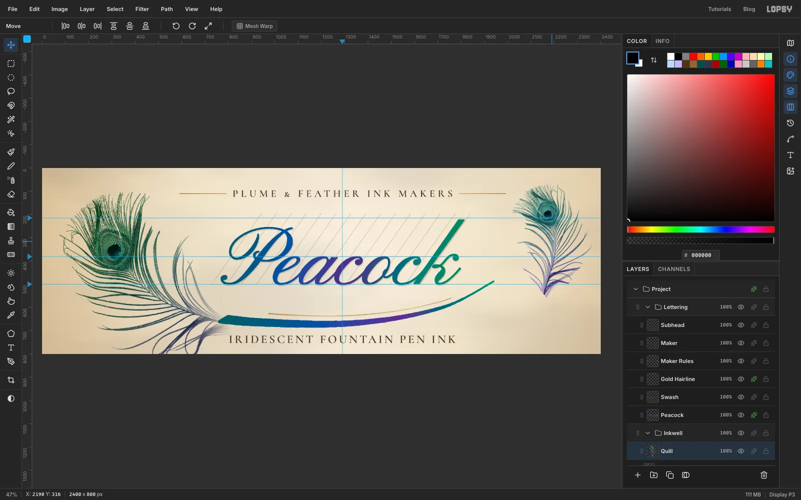

Drag the quill with the **Move** tool so the bottom of its shaft is around `x 2190, y 561`. The bottle you're about to draw will cover the lower part, so it looks as if it's standing in the ink.

## Draw the bottle

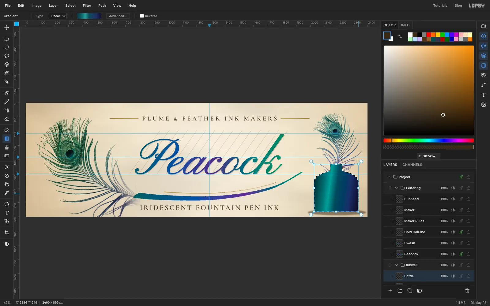

1. Click **Add Layer** and name it `Bottle Shadow`. With the **Elliptical Marquee**, drag a flat ellipse centred on `x 2185, y 770`, about 410 px wide and 40 px tall. Fill it with `#3B2A14`, press [[Cmd+D]], run **Filter → Gaussian Blur…** at `10`, and set the layer to **Multiply** at `50%`.
2. Click **Add Layer** and name it `Bottle`. With the **Lasso**, drag round a straight-sided bottle, moving in straight lines from corner to corner: the foot runs from `x 2026` to `x 2334` at `y 765`, the sides go straight up to `y 549`, the shoulders slope in to `y 477`, and the neck runs from `x 2137` to `x 2223` up to `y 431`.
3. Set a Linear gradient of `#0A3238`, `#0E6F73` at 22%, `#2A9C98` at 34%, `#0B4A5A` at 50%, `#1D2F66` at 80% and `#120F2E`, and drag from the left side of the bottle to the right. The light band left of centre is the glass catching the light.
4. Press [[Cmd+D]] and add an **Inner Glow**: **Size** `16`, **Opacity** `45`, colour `#03171A`.

## Add the lip and the glass highlights

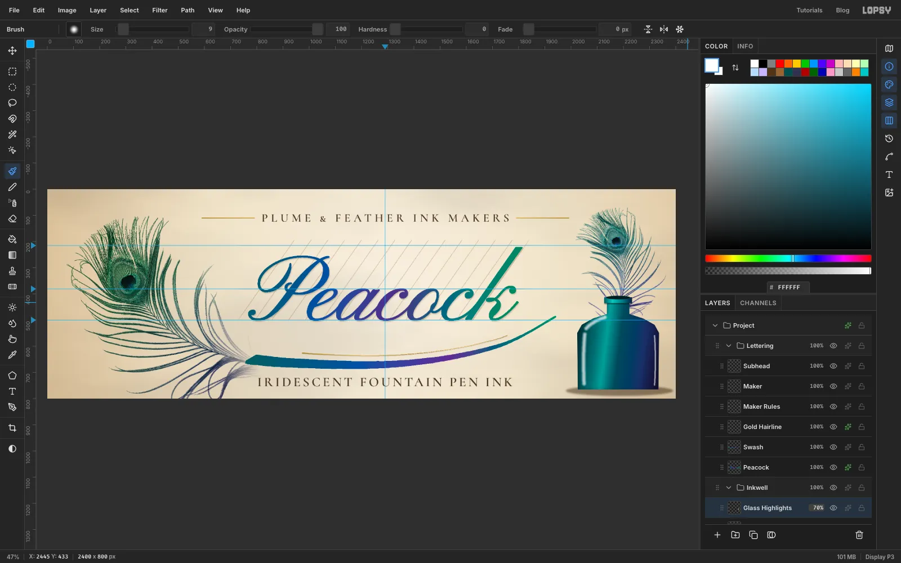

1. Click **Add Layer** and name it `Bottle Lip`. Drag a **Rectangular Marquee** from `x 2127, y 413` to `x 2233, y 435`, and fill it with a left-to-right gradient of `#0E5C62`, `#5CC4BE` at 30%, `#14707A` at 70% and `#141A40`. Press [[Cmd+D]].
2. Drag an elliptical marquee for the mouth, centred on `x 2180, y 414`, about 92 × 14 px, and fill it with `#071C20`. Press [[Cmd+D]] and give the layer a **Drop Shadow** with **Offset X** `0`, **Offset Y** `4`, **Blur** `5`, **Opacity** `55`, colour `#03171A`.
3. Click **Add Layer** and name it `Glass Highlights`. Pick the **Brush**, choose **Soft Round** in **Brushes**, set **Size** to `26` and **Taper** to `0`, and use white.
4. Paint a stroke down the left side of the bottle from `y 743` up to `y 554` at about `x 2050`, and a short curve along the left shoulder toward the neck. At **Size** `9`, add a thin stroke down the right edge at `x 2319`.
5. Set the layer to **Screen** at `70%`.

## Make the label

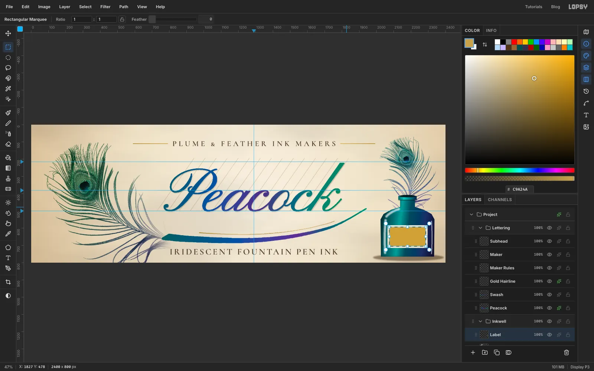

1. Click **Add Layer** and name it `Label`. Drag a **Rectangular Marquee** from `x 2064, y 583` to `x 2296, y 715` and fill it with `#F3EAD6`.
2. With the marquee still active, choose **Select → Shrink…** `8` and fill with `#C9A24A`.
3. Choose **Select → Shrink…** `2` and fill with `#F3EAD6` again. That leaves a thin 2 px gold rule 8 px inside the edge.
4. Press [[Cmd+D]] and add a **Drop Shadow**: **Offset X** `2`, **Offset Y** `3`, **Blur** `4`, **Opacity** `45`, colour `#06181C`.

## Letter the label and wrap it round the glass

1. [[Cmd]]-click the **Label** thumbnail, click **Add Layer** and name it `Label Shade`. Make a gradient of `#3B2A14` at 70% opacity at both ends and 0% at 28% and 72% (use the **Opacity** strip under the colour picker for each stop). Drag it across the label from left to right, press [[Cmd+D]], and set the layer to **Multiply** at `35%`. The label now looks wrapped round a curve.
2. Make a text layer: **Pinyon Script**, **Size** `62`, `#0D4F57`, `Peacock`. Rename it `Label Name` and centre it on `x 2180` with its top at `y 605`.
3. Click **Label Shade** first, then make `IRIDESCENT INK` in **Cormorant SC SemiBold**, **Size** `18`, `#4A3B2A`, **Letter spacing** `2`. Rename it `Label Small` and centre it on `x 2180` with its top at `y 681`.
4. Click **Add Layer** and name it `Glass Glint`. With the Soft Round brush at **Size** `14` in white, paint one stroke from `x 2086, y 742` up to `x 2088, y 575`, across the label's left side. Set it to **Screen** at `30%`.

## Hang a tag on the neck

1. Click **Add Layer** and name it `Tag String`. With the **Pencil** at **Size** `2` in `#4A3B2A`, click at `x 2224, y 461`, then [[Shift]]-click at `x 2238, y 515` and at `x 2252, y 540`.
2. Click **Add Layer** and name it `Tag`. With the **Lasso**, drag a luggage-tag shape in straight lines: a point at `x 2232, y 540`, then `x 2254, y 512`, `x 2342, y 512`, `x 2342, y 568`, `x 2254, y 568` and back to the point. That's a tag about 110 × 56 px with a pointed left end. Fill it with `#F3EAD6` and press [[Cmd+D]].
3. Drag a 10 px circle with the **Elliptical Marquee** at `x 2252, y 540` and press [[Delete]] to punch the hole. Press [[Cmd+D]].
4. Give the tag a **Stroke** with **Width** `2` in `#C9A24A` and a **Drop Shadow**: **Offset X** `2`, **Offset Y** `3`, **Blur** `4`, **Opacity** `40`, colour `#3B2A14`.
5. Type `No. 7` in **Cormorant SC SemiBold**, **Size** `28`, `#0D4F57`, rename the layer `Tag Text`, and centre it on the tag at `x 2300`, top `y 531`.

## Tilt the tag

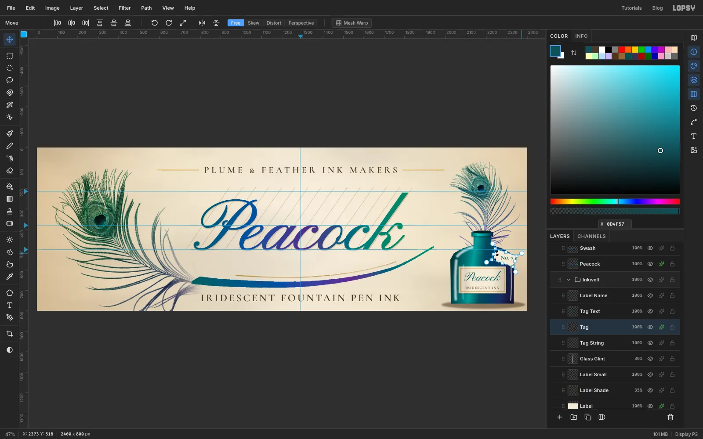

1. Select the **Tag** layer and [[Cmd]]-click its thumbnail.
2. With the **Move** tool, hold [[Cmd]] and drag the round rotate handle outside the top-right corner clockwise by one snap. Cmd snaps the angle to steps of 15°. Press [[Cmd+D]] to apply.

## Tilt the lettering to match

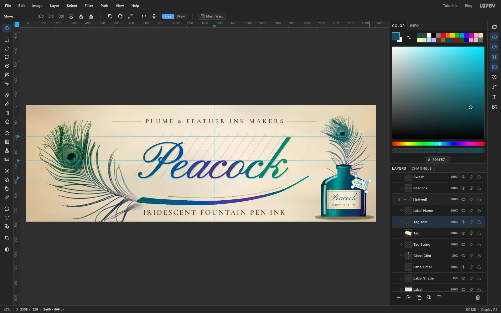

1. Click the **Tag Text** layer. With the **Move** tool, a text layer shows its own transform handles, so you don't need a selection.
2. Hold [[Cmd]] and drag its rotate handle clockwise by one snap, the same 15° as the tag. The rotation applies when you release.

The tag is so small that turning both about their own centres leaves the lettering where it should be.

## Spatter ink off the quill

1. Select **Swash**, click **Add Layer** and name it `Ink Splatter`.
2. Pick the **Spray** tool. It paints with the Brush's current tip, which is still Soft Round from the highlights, so the dots come out round. Set **Size** `90`, **Density** `22`, **Opacity** `95`, **Softness** `5`, colour `#0D4F57`. Click once at `x 790, y 632`.
3. Set **Size** to `46` and **Density** to `12`, and click at `x 752, y 612` and `x 836, y 612`.
4. With the **Lasso**, draw three small teardrops, 20–30 px long, pointing up and to the left away from the stroke, around `x 742, y 636`, `x 774, y 598` and `x 726, y 662`. Hold [[Shift]] for the second and third. Choose **Edit → Fill**.
5. [[Cmd]]-click the layer's thumbnail and fill it with a gradient of `#1F4FA0`, `#0E6F78` at 50% and `#0D5C63`, dragged from the upper left of the spatter to the lower right. Press [[Cmd+D]] and set the layer opacity to `85%`.

## Add grain and a vignette

1. Click the **Lettering** group row and click **Add Layer**, which puts the new layer at the top of the group. Name it `Grain`.
2. Press [[Cmd+A]], fill with `#808080`, and press [[Cmd+D]].
3. Choose **Filter → Add Noise…**, set **Amount** to `22`, pick **Mono** and **Gaussian**, and click **Apply**. Set the layer to **Overlay** at `36%`.
4. Click **Add Layer** and name it `Vignette`. Make a Radial gradient of `#7A5A35` at 0% opacity at the left stop and at 55%, and at full opacity on the right stop.
5. Drag from `x 1250, y 400` to well past the bottom-right corner, around `x 2760, y 900`. Set the layer to **Multiply** at `18%`. The edges should warm slightly, not turn brown.

## Check the balance, then export

Groups move as one, so it's easy to try a layout change and take it back.

1. Click the **Inkwell** group row in the Layers panel.
2. With the **Move** tool, drag the bottle 60 px to the left. Everything in the group moves together: the quill, bottle, label and tag.
3. It crowds the swash's tail, so press [[Cmd+Z]]. [[Cmd+Shift+Z]] and [[Cmd+Z]] flip between the two positions if you want to compare them.

To finish, choose **View → Show Guides** to hide the guides. Choose **File → Quick Export PNG** to save the billboard, and **File → Save Project** to keep the layers.
