A tattoo flash sheet is a page of ready-to-tattoo designs that hangs on the wall of a shop. In the American traditional style every design has a heavy black outline, a small set of strong colours and a lot of bare skin, so it still reads from across the room. Lettering does as much work as the pictures. Names and mottoes sit on ribbons, set in brush script or blackletter.

In this tutorial you'll make **Roses & Oaths**, a 1200 × 1600 px calligraphic flash sheet with five designs: a full rose, a dagger through a heart, a script ampersand in a gold medallion, two small rose buds, and a "True Till Death" banner. Each design is built from simple filled selections. One shared outline effect turns those fills into flash.

Along the way you'll use:

- **guides**, the marquees with add, subtract and intersect, **Edit → Fill** and **Select → Shrink**
- **Clouds**, **Gaussian Blur**, **Add Noise** and a radial **Gradient** to age the paper
- the **Brush** with **Fade** for tapered whip shading, a **Caligraphic Angle** tip with **vertical symmetry**, and the **Spray** tool for dotwork
- the **Stroke**, **Inner Glow** and **Drop Shadow** layer effects
- the **Pen** tool, **Select → Selection → Path** and **Stroke Path**
- text in **Alex Brush**, **UnifrakturMaguntia**, **Great Vibes** and **IM Fell English SC**, set on a path and rotated
- **groups**, duplicating a group, flipping it, scaling with [[Cmd]]-drag and rotating with the **Move** tool, plus copy and paste

The palette:

- Paper `#EFE2C0`, foxing `#8A5A28`, edge burn `#5E3E1A`
- Ink `#1B1512`, oxblood `#7A1018`, shadow red `#5E0B13`
- Rose red `#B8202A`, highlight `#FBEADB`
- Leaf green `#3E8E4E` / `#1D4527`, stem `#2F6B3C`
- Stipple `#4A0810`
- Gold `#E2A93B` / `#A8701C`, ribbon cream `#F6EBCF`, ribbon shade `#C9A86A`, tail tan `#D9C49A` / `#8C6E3C`
- Steel `#E4E9EA` → `#AEB8BC` → `#6F7C82` → `#4C575C`

> **Tip:** Positions are written as `x, y` in document pixels. The status bar at the bottom of the window shows where the cursor is, so you can hover to find a spot. Key names are Mac keys. On Windows and Linux, use Ctrl for Cmd. Every outline on this sheet is the same **Stroke** effect: **Width** `12`, colour ink `#1B1512`. Use the same setting every time and the designs will look like one artist drew them. One rule to remember with text: if a text layer is selected, changing the font or size in the options bar restyles that layer. So before you set up a new piece of text, click a non-text layer such as `Frame`.

## Age the paper

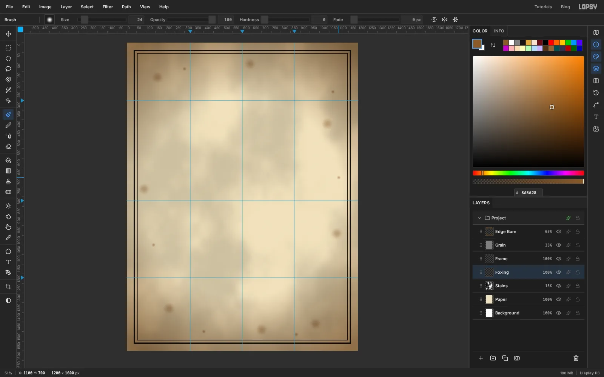

Choose **File → New**, set the size to **1200 × 1600** px and click **Create**. Rename `Layer 1` to `Paper` (double-click its name), set the foreground to `#EFE2C0` and choose **Edit → Fill**.

Click **Add Layer** and name it `Stains`. Choose **Filter → Clouds…** and click **Apply**. Clouds always paints grey mottling, whatever your colours are. Then run **Filter → Gaussian Blur…** with **Radius** `20`. Open the layer's effects drawer (the **✦** button on its row), set the blend mode to **Multiply**, and drop the layer's opacity to `15%`.

Add a layer called `Foxing` for the little rust spots old paper gets. Open the brush presets (the tip thumbnail at the left of the Brush options bar) and pick **Soft Round**. Set **Size** `70`, **Opacity** `35` and the foreground to `#8A5A28`, then click eight or so times around the edges of the sheet. Drop to **Size** `24`, **Opacity** `45` and add a few smaller specks.

Add a layer called `Grain`, fill it with mid grey `#808080`, run **Filter → Add Noise…** at **Amount** `30`, and set it to **Overlay** at `35%`. Leave `Grain` at the top of the stack all the way through: it lays the same fine paper texture over the artwork too, which helps the inks look printed on the sheet.

Last, add `Edge Burn`. Pick the **Gradient** tool, choose **Radial**, and click **Advanced…** to open the Gradient Editor. Click under the bar to add a stop, drag stops to move them, and type a hex into the colour picker to set each one. Set the stops: `#5E3E1A` fully transparent at the left and at about 55%, and fully opaque at the right. Drag from the centre of the page down past the bottom edge. Set it to **Multiply** at `65%`. Later you'll drag `Edge Burn` down so it sits just above `Foxing`, below the artwork.

## Rule the guides and the double frame

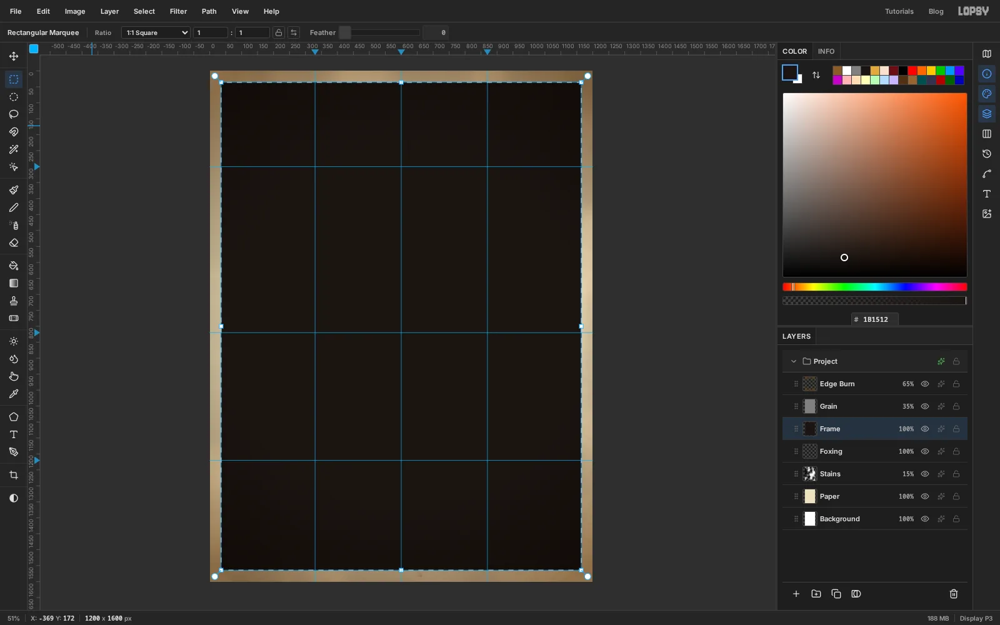

[[Cmd]]-click the top ruler near the middle to drop a guide exactly on the centre line (**600**). Then click the top ruler at **330** and **870**, the centre lines of the two columns. Click the left ruler at **300**, **820** and **1220** to mark the tops of the three rows.

Add a layer called `Frame`. Pick the **Rectangular Marquee** (**M**) and drag from **36, 36** to **1164, 1564**, leaving an even margin of paper all round. Fill it with ink `#1B1512`. Choose **Select → Shrink…**, shrink by `7` and press [[Delete]] to hollow out a 7 px line.

Do the same for an inner hairline: drag from **54, 54** to **1146, 1546**, fill, shrink by `3`, press [[Delete]] and then [[Cmd+D]].

## Write the title in brush script

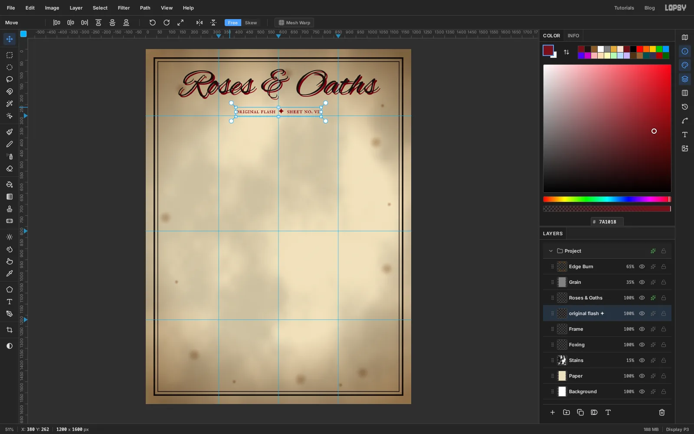

Pick the **Text** tool (**T**). In the options bar set the font to **Alex Brush**, the size to `165` and the foreground to ink. Click in the empty space near the top left, type `Roses & Oaths` and press [[Tab]] to commit. Switch to the **Move** tool (**V**) and click **Align center horizontally** in the options bar.

Open the title's effects drawer, tick **Drop Shadow**, and set **Offset X** `7`, **Offset Y** `7`, **Blur** `0`, **Opacity** `100` and the colour to oxblood `#7A1018`. A hard, offset shadow is how sign painters and tattooers make script pop without a second outline.

For the subtitle, click the `Frame` row first so the next font change doesn't restyle the title. Set the Text tool to **IM Fell English SC** at size `30` and the foreground to oxblood. Click below the title and type `original flash  ✦  sheet no. vii`. You can copy the ✦ from this page and paste it with [[Cmd+V]] while typing, or use a plain `•` instead. This font draws lowercase letters as small capitals. Commit with [[Tab]] and centre it the same way.

## Start the rose with its stem and leaves

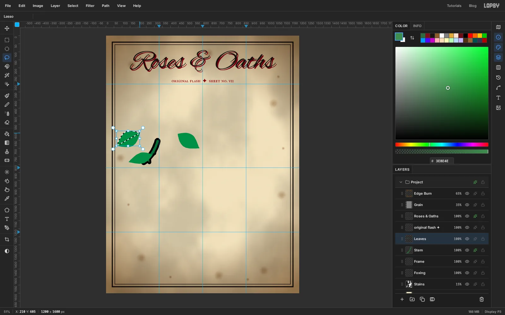

The rose sits in the left column, centred near **330, 535**. Build it back to front.

Click the `Frame` row, then add a layer called `Stem` so it sits under the text. Pick the **Brush** (**B**), choose the **Hard Round** preset, set **Size** `16` and the foreground to `#2F6B3C`, and draw a short curve down and to the left from under the flower (about **320, 655**) to **235, 785**. Add two small thorns with the **Lasso** (**L**): drag a little triangle on each side of the stem and **Edit → Fill** it. Give the layer the standard **Stroke** (Width `12`, ink).

Add a layer called `Leaves`. With the Lasso, draw three pointed leaves, each about 150 px long: one off the left of the flower, one off the right, and a smaller one on the stem. Fill all three with `#3E8E4E`.

Now shade one half of each leaf. [[Cmd]]-click the `Leaves` thumbnail to load the leaves as a selection. Hold [[Shift+Alt]] and lasso around the upper half of the first leaf, so the selection becomes only the part inside both. Fill it with `#1D4527`. Repeat for the other two leaves. Draw a centre vein in each with the Brush at **Size** `5` in ink, and give the layer the standard **Stroke**.

## Block in the back petals

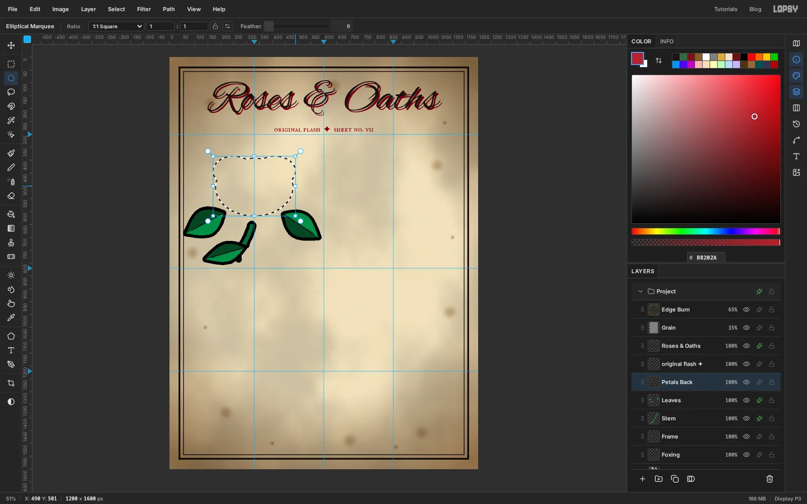

Add a layer called `Petals Back`. Pick the **Elliptical Marquee**. In its options bar, make sure the lock button next to **Ratio** is off, or every drag will come out as a circle. Drag an oval about **300** px wide and **225** px tall, centred just above the rose's centre. Hold [[Shift]] and drag two smaller ovals, about **160 × 115** each, over its top left and top right, so the outline gets two rounded lobes like the back petals of an open rose.

Fill it with rose red `#B8202A`, deselect, and add the standard **Stroke**.

## Add the bud, side petals and front petal

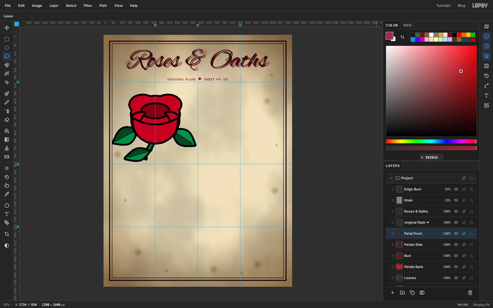

Each petal gets its own layer so its outline overlaps the petal behind it. That overlap is what makes a flash rose read as layered.

- **Bud:** add a layer called `Bud`. Drag an elliptical marquee about **170 × 85** px across the top of the back petals and fill it with oxblood `#7A1018`. Add the Stroke.
- **Side petals:** add `Petals Side`. With the Lasso, draw a curved petal that starts under the left of the bud, swings out past the back petals and curls back in near the bottom. [[Shift]]-drag its mirror image on the right. Fill both with rose red and add the Stroke.
- **Front petal:** add `Petal Front`. Lasso a deep bowl shape. Its top edge is a shallow smile across the middle of the flower, and its bottom is a half circle about **275** px wide. Fill it with rose red and add the Stroke.

## Shade the petals with whip strokes

Whip shading is short strokes that start dark and flick out to nothing. The Brush's **Fade** setting does that for you.

[[Cmd]]-click the `Petal Front` thumbnail so the strokes stay inside the petal, and click its row so you paint on it. Set the Brush to **Size** `22`, **Fade** `110` and the foreground to `#5E0B13`. Paint five short strokes down from the lip: one in the centre, two either side, each starting at the lip and flicking down. Then set **Fade** back to `0`, raise the size to `34`, and paint one solid band along the whole lip so the strokes grow out of a shadow. Press [[Cmd+D]].

Do the same on `Petals Back` (strokes running up into the lobes, and a band around the bud) and on `Petals Side` (one stroke along each inner edge).

To finish the flower, click the `Bud` row, [[Cmd]]-click its thumbnail, and draw a loose spiral in ink with a **Size** `6` brush. Then click `Petal Front` and add a layer called `Highlights`, so it lands above all the petals. Paint thin cream `#FBEADB` arcs along the rims of the back petals and the front petal with **Size** `8` and **Fade** `90`, and click a few single dots. If an arc spills outside a petal, wipe it off with the **Eraser** (**E**).

## Group the rose

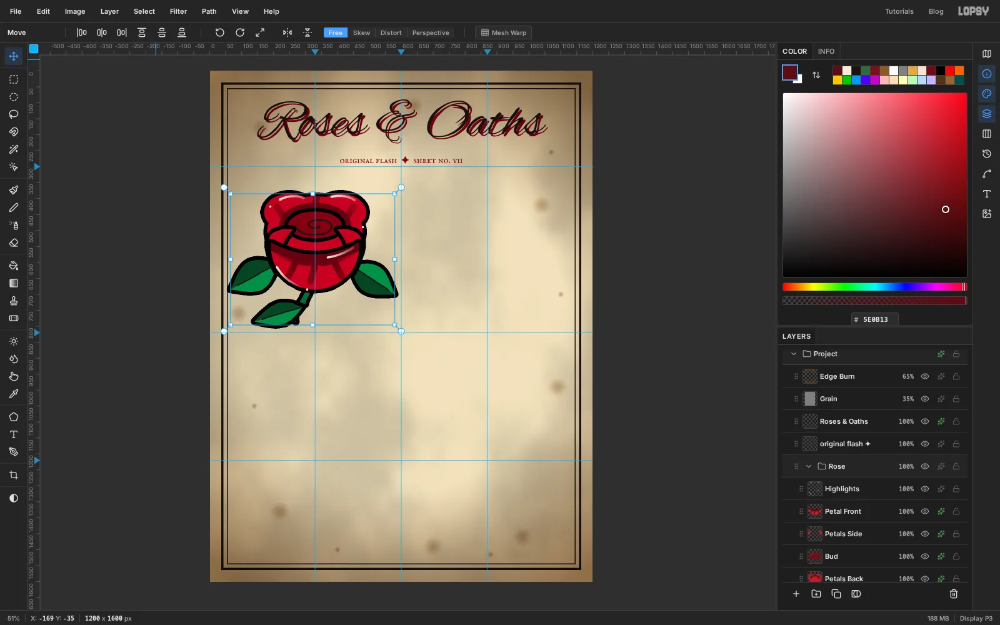

Click `Highlights`, [[Shift]]-click `Stem`, and choose **Layer → Group Layers**. Rename the group `Rose`. Check the order inside the group: from the bottom it should be Stem, Leaves, Petals Back, Bud, Petals Side, Petal Front, Highlights. If a layer ended up outside the group, drag it into place by the dotted grip (⠿) at the left of its row.

With the group selected, the **Move** tool's handles frame the whole flower, so you can move or scale it as one piece later.

## Build the dagger blade

The dagger is built upright, then rotated as a group.

Click the `Frame` row and add a layer called `Blade`. With the **Lasso**, draw a tall blade centred on the **870** guide: about **52** px wide at the top (y **370**), narrowing slightly to y **665**, then coming to a point at about y **775**.

Pick the **Gradient** tool, choose **Linear**, and open **Advanced…**. In the Gradient Editor, set four stops: `#E4E9EA` at the left, `#AEB8BC` at the middle, `#6F7C82` just right of the middle, and `#4C575C` at the right. Placing two stops so close together gives the hard edge of a sharpened bevel. Drag across the blade from its left edge to its right edge and deselect.

Pick the **Pencil** (**N**) at **Size** `5` in ink. Click near the top of the blade and [[Shift]]-click near the tip to draw the centre ridge. Add the standard **Stroke**.

## Add the grip and the flared crossguard

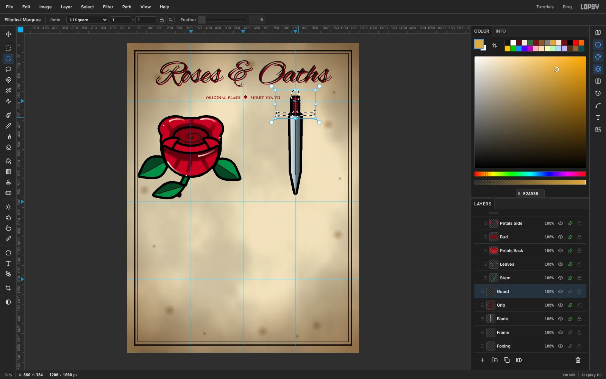

Add a layer called `Grip`. Drag a rectangular marquee about **28 × 80** px above the blade and fill it with oxblood. Wrap it with the Pencil at **Size** `4`: click the left edge and [[Shift]]-click a little lower on the right edge, every 12 px or so. Add the Stroke.

Add a layer called `Guard`. With the Lasso, draw a crossbar about **210** px wide where the grip meets the blade, flaring into fishtail points at each end. Then switch to the **Elliptical Marquee** and [[Shift]]-drag a round pommel on top of the grip and a small round boss in the middle of the bar. Fill everything with gold `#E2A93B`.

Add the Stroke, and an **Inner Glow** with **Size** `10`, **Opacity** `70` and colour `#A8701C` to give the gold some weight. Click `Guard`, [[Shift]]-click `Blade` and choose **Layer → Group Layers**. Name the group `Dagger`.

## Rotate the dagger

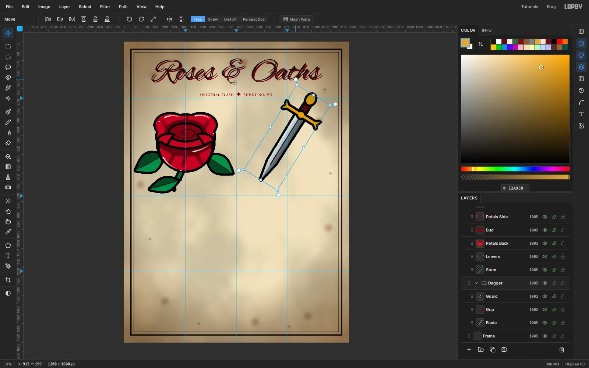

With the `Dagger` group selected and no selection on the canvas, pick the **Move** tool. Handles appear around the whole dagger. Grab the round **rotate handle** just outside the top-left corner and drag clockwise until the dagger leans about **32°** to the right, pommel up and to the right, point down and to the left. Press [[Cmd+D]] to apply the rotation. With the Move tool, [[Cmd+D]] applies a transform as well as clearing the selection.

All three layers turn together around the group's centre, and the outlines keep the same weight as on the rose.

## Draw the heart on top of the dagger

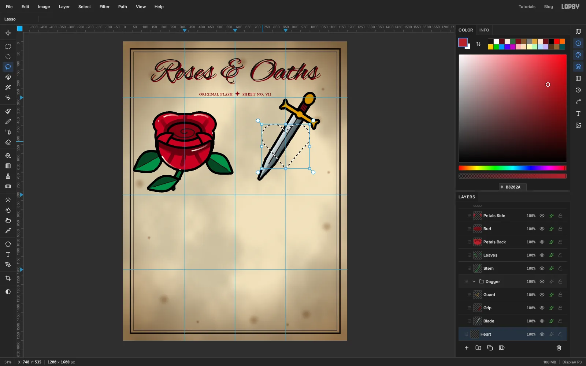

Click the `Frame` row and add a layer called `Heart`. Pick the **Elliptical Marquee**. Drag a circle about **130** px across centred at **805, 510**, then [[Shift]]-drag a matching circle beside it centred at **935, 510**. Switch to the **Lasso** and [[Shift]]-drag a triangle that joins the outer sides of both circles to a point at **870, 680**.

Fill it with rose red, deselect, and add the Stroke. In the Layers panel, drag the `Heart` row up by its grip until it sits **above** the `Dagger` group. Now the blade looks like it passes through the heart: the grip shows above it and the point below.

## Stipple the heart's shadow

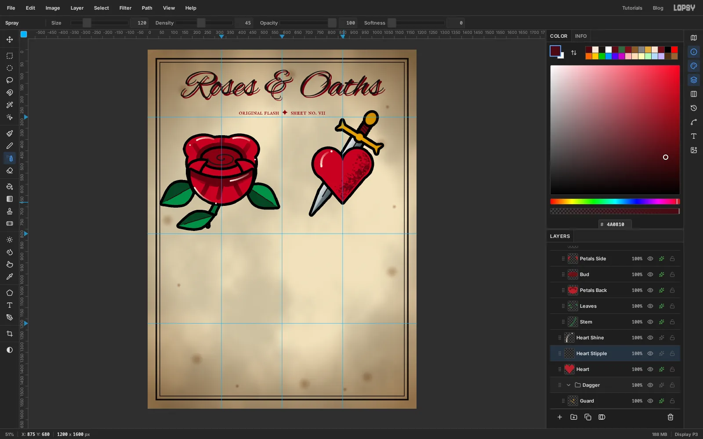

Flash artists shade hearts with dotwork, so use the **Spray** tool (**J**) for this rather than a gradient.

Add a layer called `Heart Stipple` above `Heart`. [[Cmd]]-click the heart's thumbnail, then **Select → Shrink…** by `6` so the dots stay inside the outline. Pick the Spray tool and set **Size** `60`, **Density** `35`, **Opacity** `100`, **Softness** `0`, with the foreground `#4A0810`. Drag along the right lobe and down the lower right edge to the point. Then switch to **Size** `120` and **Density** `45` and make one more pass along the same path for some bigger dots. Above about 100 px the spray switches to larger dots, which gives the dotwork some variety. Deselect.

Add a layer called `Heart Shine`. Pick the Brush at **Size** `10` with **Fade** `70` and paint one cream `#FBEADB` arc on the left lobe, with a single dot just past its end.

## Wrap the heart in an "Oath" ribbon

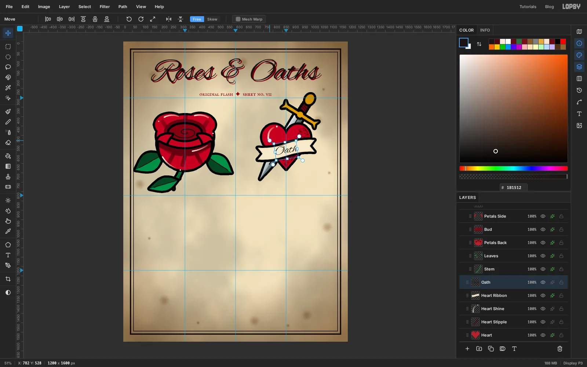

Add a layer called `Heart Ribbon`. With the Lasso, draw a gently waving band about **64** px tall that crosses the heart from **720** to **1020**, rising slightly to the right (about **8°**), with a V-notch cut into each end. Fill it with cream `#F6EBCF`, add the Stroke, and add an **Inner Glow** of **Size** `14`, **Opacity** `55` in `#C9A86A` so the ribbon looks slightly curled.

Pick the Text tool, set **Alex Brush** at `64` in ink, and click on **empty** paper, for example low on the left side. Clicking inside an existing text layer edits that layer instead of starting a new one. Type `Oath` and press [[Tab]]. Switch to the **Move** tool and drag the word onto the centre of the ribbon. Drag its rotate handle about **8°** anticlockwise to match the ribbon's tilt. You can still edit the word afterwards.

## Shape the bottom banner and draw its pen path

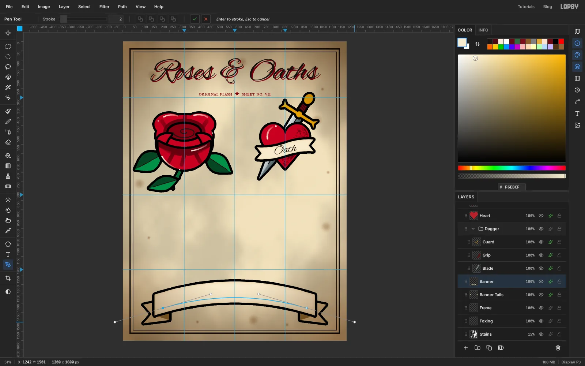

Click the `Frame` row and add a layer called `Banner Tails`. With the Lasso, draw a forked tail at each end of where the banner will go, low on the sheet: a five-point shape that sticks out past the band's ends with a V cut into it. [[Shift]]-drag the second tail so both are in one selection. Fill with `#D9C49A`. Then lasso a small triangle where each tail folds under the band and fill it with `#8C6E3C`. Add the Stroke.

Add a layer called `Banner`. Lasso a band about **112** px tall that arches gently, highest in the middle (about y **1285–1395**) and dropping about **70** px at each end, running from **x 170** to **1030** so it overlaps the tails. Fill it with cream, add the Stroke, and add an **Inner Glow** of **Size** `22`, **Opacity** `55` in `#C9A86A`.

Now draw the line the lettering will follow. Pick the **Pen** tool (**P**). Press near the left end of the band, a little below its middle (about **215, 1418**), and **drag** to the right and slightly up to pull out a handle. Then press near the right end (**985, 1418**) and drag further right and down. You get one smooth arc that follows the band. Check that it runs parallel to the banner's edges, then click the **✓ Commit path** button in the options bar.

## Set "True Till Death" on the path

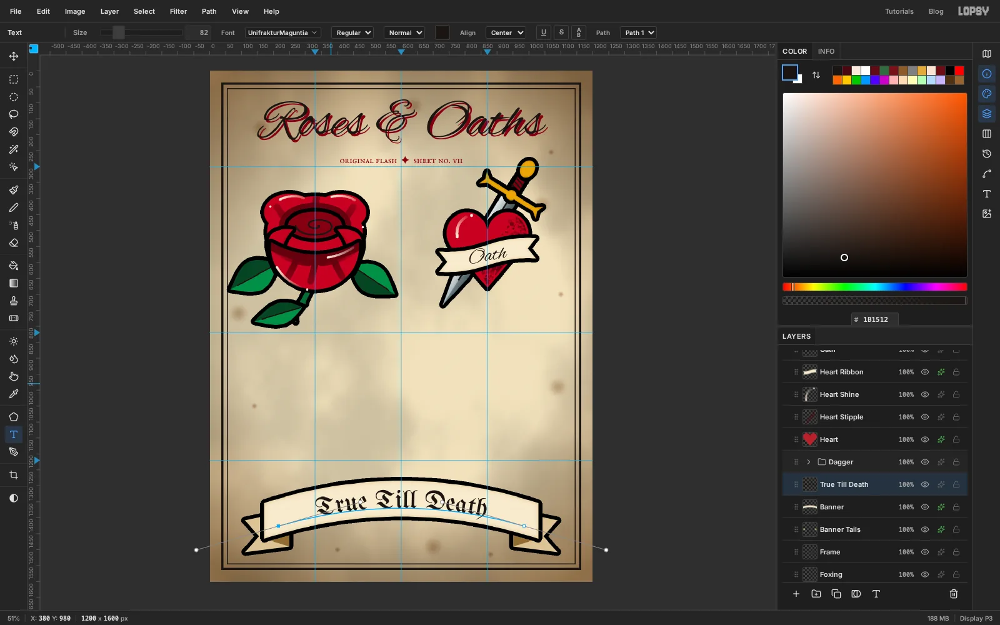

Click the `Banner` row. Set the Text tool to **UnifrakturMaguntia** at `82` in ink. Click on empty paper and type `True Till Death`, then press [[Tab]].

With the new text layer selected, set the alignment dropdown in the options bar to **Center**, then open the **Text path** dropdown and choose **Path 1**. The letters jump onto the arc and turn to follow it. Look at the gaps above the capitals and below the baseline. They should be about equal, with every letter inside the band. If the text sits too high or low, move the pen path's two anchors up or down a few pixels and the text follows.

This is also a good time to fix the paper. In the Layers panel, drag `Edge Burn` down until it sits just above `Foxing`. The burn then darkens only the paper, not the cream ribbons.

## Build the gold medallion

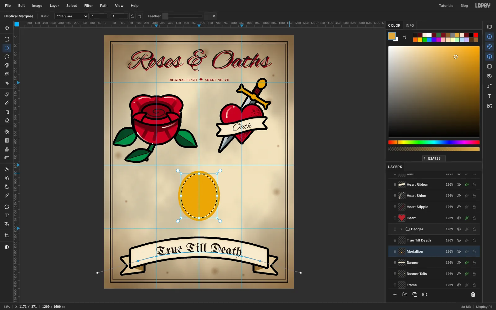

Click `Banner` and add a layer called `Medallion`. Drag an elliptical marquee about **264 × 316** px centred on **600, 1015**, in the middle of the sheet's second row. Fill it with gold. Keep the selection, choose **Select → Shrink…** by `18`, and fill the smaller oval with cream. You now have a gold rim.

For a thin ink line inside the rim, choose **Select → Selection → Path**. This adds the oval to the **Paths** panel as `Path 2` and selects it. Press [[Cmd+D]] to drop the marquee. Pick the Pen tool, set **Stroke** to `6` in the options bar and make sure the foreground is ink. Press [[Enter]] to **stroke the selected path**, `Path 2`, onto the medallion layer. (If you clicked something else in between, open the Paths panel with the curved-path icon in the right-hand toolbar and click `Path 2` first.) Once it's stroked you don't need the path any more: select it in the Paths panel and click **Delete Path**.

Add the standard **Stroke** and an **Inner Glow** of **Size** `26`, **Opacity** `45` in `#C9A86A`.

## Drop a script ampersand into the medallion

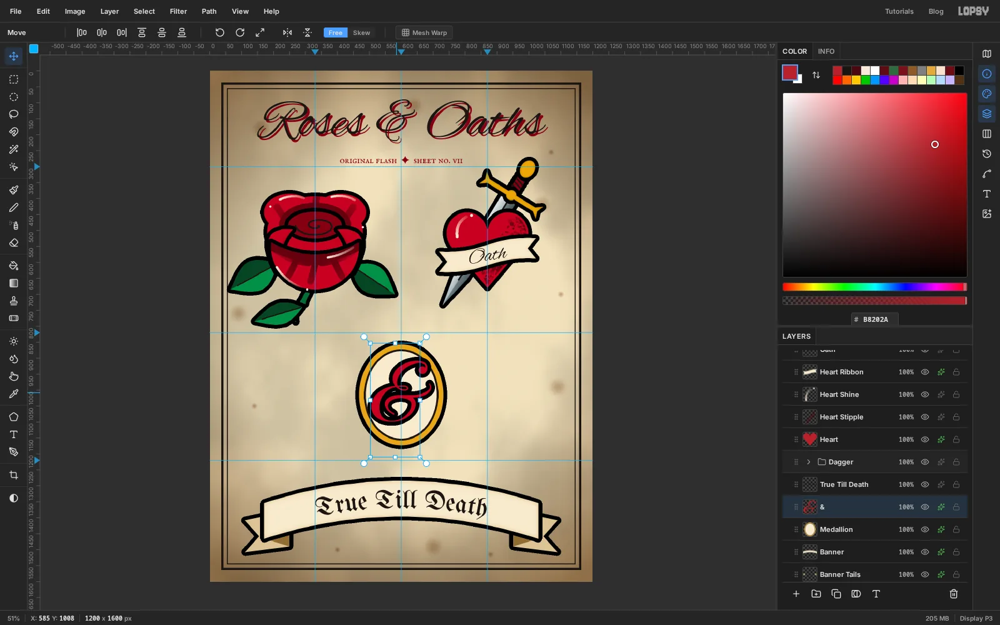

Set the Text tool to **Great Vibes** at `255` with the foreground rose red, click on empty paper, type `&` and press [[Tab]]. With the **Move** tool, click **Align center horizontally**, then drag the ampersand down into the medallion. Its weight should sit slightly below the oval's middle, which looks centred to the eye. Add the standard **Stroke** so it matches the rest of the sheet.

## Duplicate the rose and scale it down

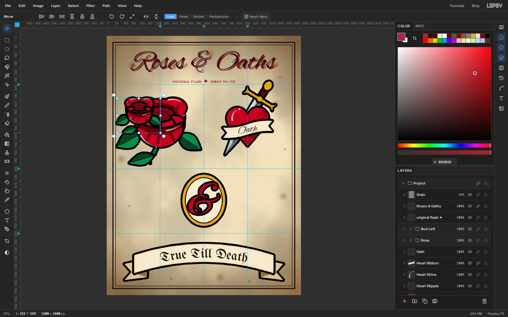

Click the `Rose` group and choose **Layer → Duplicate Layer**. The copy lands directly on top of the original. Rename it `Bud Left`.

Pick the **Move** tool. Hold [[Cmd]] (to keep the proportions) and drag the bottom-right corner handle up and to the left until the copy is a bit over half its size. Press [[Cmd+D]] to apply it. Every layer in the group scales together, and the outlines keep the same weight as on the big rose.

## Place a mirrored pair of buds

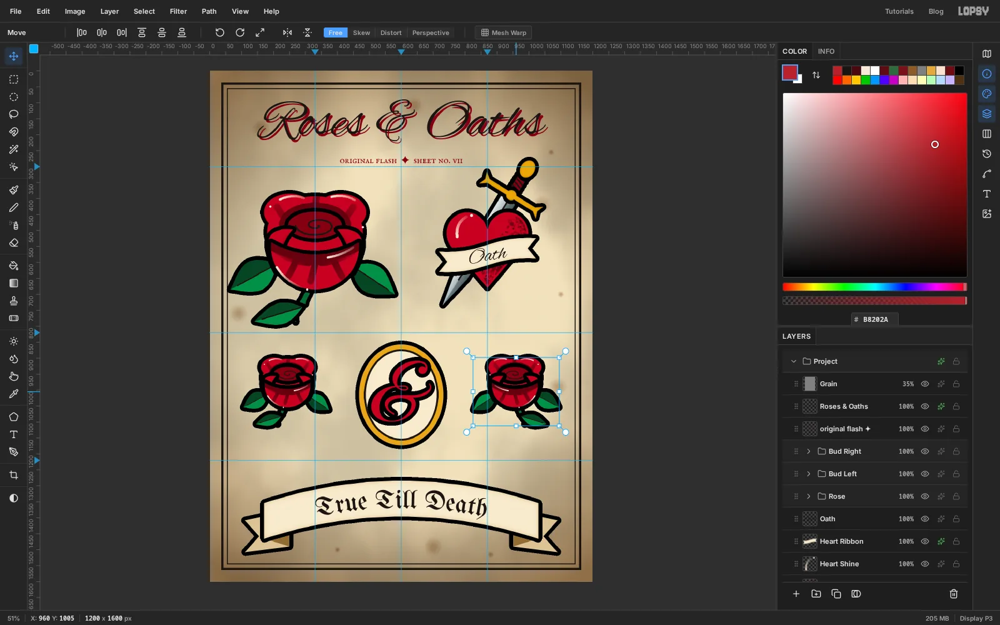

Drag `Bud Left` down into the middle row so it sits left of the medallion, centred near **240, 1005**. Leave clear paper between its leaves and the frame.

Choose **Layer → Duplicate Layer** again and rename the copy `Bud Right`. In the Move tool's options bar click **Flip Horizontal**, then drag the copy across to **960, 1005**. The two buds now face each other and frame the medallion.

## Paint calligraphic swashes with symmetry

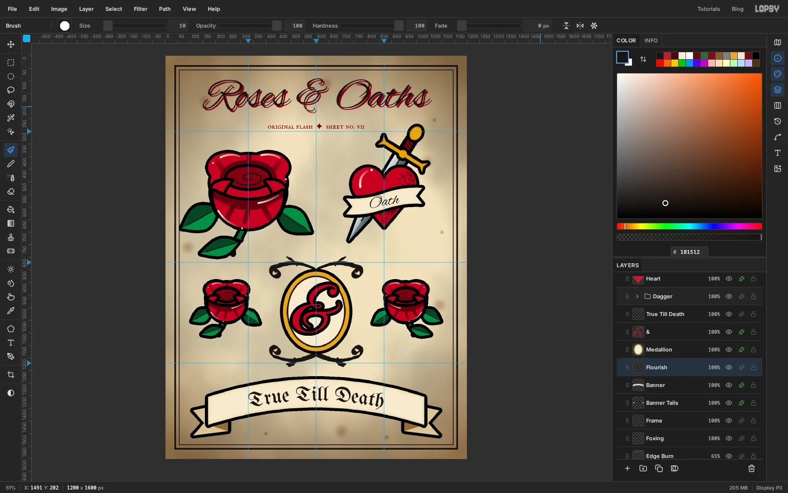

Click `Banner` and add a layer called `Flourish`. In the Brush presets pick **Caligraphic Angle** (that is how the app spells it), a slanted nib, so the stroke goes thick and thin as it changes direction. Set **Size** `14` and ink. Then turn on **Symmetry Vertical**, the middle of the three symmetry icons at the right end of the Brush options bar (hover to see the names). It mirrors everything you paint from left to right across the canvas centre.

Starting at the top of the medallion, paint one swash out to the left in a long, shallow arc and finish with a tight inward curl at about **x 440**. The mirror paints the right half for you. Paint a matching swash under the medallion, curling the other way. Add a small flick off each swash for a leaf. Because `Flourish` is below `Medallion`, the swashes look like they pass behind it, like a scroll the medallion hangs on.

Turn symmetry off when you're done. (The screenshot was taken after switching back to the Hard Round brush, which is why its options bar shows a different size.)

## Sparkle the corners with copy and paste

Add a layer called `Sparkles` above `Banner`. With the Lasso, draw a slim four-point star about **60** px tall near **125, 320** and fill it with ink. Drag a small circle just below and to the right of it with the Elliptical Marquee and fill it too.

Drag a marquee around the sparkle and press [[Cmd+C]]. Press [[Cmd+V]]: the copy is pasted in place as a new layer, already selected, with the Move tool active. Drag it to the gap between the title and the heart. Paste and drag three more times: beside the heart's ribbon, and into the bottom two corners above the banner tails. Press [[Cmd+D]] after each one.

Each paste makes its own layer. To tidy up, click the top pasted layer and press [[Cmd+E]] (Merge Down) four times to fold the copies back into `Sparkles`.

> **Tip:** If a sparkle lands in the wrong spot, [[Cmd+Z]] steps back one paste or drag at a time and [[Cmd+Shift+Z]] puts it back.

Finally, look over the spacing. Every design should have clear paper around it and a gap from the frame. If the big rose's leaf comes too close to the left edge, click the `Rose` group and nudge it right with the Move tool. Choose **File → Save Project**, then **File → Quick Export PNG**.
