Calligraphers have a habit: the last stroke of a word never quite stops. It swings out into a flourish, loops back on itself and wanders off across the page. This cover takes that habit literally. The opening hairline of a gilded copperplate **V** keeps going, climbs the margin, and becomes a wisteria vine hung with purple flowers.

It's the cover of *Velvet Wisteria*, an imaginary quarterly about pen-and-ink lettering and slow gardening. The page is 1200 × 1700 px, a zine shape. It has:

- a dark plum "velvet" ground
- a gilded two-line script title over faint gold practice guidelines, the kind calligraphers rule before they write
- gold vines drawn the way a pointed pen draws: hairline upstrokes and swelling downstrokes
- wisteria clusters painted with tapered, scattered brush passes
- a pointed-pen swash under the title, a contents block, and a red chop seal carved with 藤, the Japanese and Chinese character for wisteria

There are no photos to download. Everything is painted or set in Lopsy.

The tools you'll use:

- the **Brush** with the Hard Round, Leaf and Caligraphic Angle tips, and its **Taper**, **Scatter**, **Size Jitter** and **Angle Jitter** settings
- the **Pencil** with [[Shift]]-click straight lines
- the **Gradient** tool and its **Gradient Editor**
- live text in four Google fonts: Pinyon Script, Cormorant Upright, Cormorant SC and Ma Shan Zheng
- [[Cmd]]-click on a layer thumbnail, **Copy**, **Paste**, **Flip Horizontal** and the **Move** tool's scale and rotate handles
- **Add Noise**, **Gaussian Blur**, **Clouds** and **Threshold**, including on a layer mask
- layer masks, groups, the **Soft Light** and **Overlay** blend modes, and **Drop Shadow** and **Inner Glow** effects
- the document's **Color Grading** and **Vignette** adjustments

The palette is plum, gold and wisteria, with one spot of red:

- Velvet `#24122B`, sheen `#9A6AA0` → `#5A3460` → `#160B1A`
- Gold leaf `#F3DEA6` → `#D8B775` → `#8F6A34`
- Wisteria `#4E2F86` → `#7B58BF` → `#A88BDD` → `#D7C8F2`
- Leaves `#B5C68F` → `#7D9562` → `#405335`
- Contents ivory `#EDE3D6`, seal red `#B5452F`, shadow plum `#0C0510`

> **Tip:** On a wide-gamut (Display P3) screen, Lopsy treats typed hex codes as P3 colours. These codes were picked as P3 values, so on an sRGB screen your cover will look a little less vivid.

> **Note:** Shortcuts are written for a Mac. On Windows, use [[Ctrl]] wherever it says [[Cmd]].

## Make the page and lay down velvet

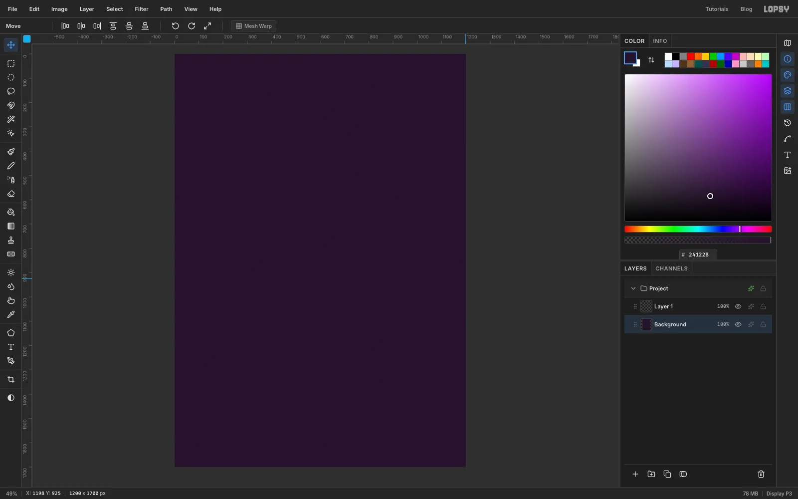

Choose **File → New**, keep the units on **Pixels**, and make the document **1200** wide and **1700** high.

Click the *Background* row, set the foreground colour to velvet `#24122B`, and choose **Edit → Fill**.

Velvet has a soft pile rather than a flat colour. Choose **Filter → Add Noise…** with **Amount 10**, set **Mode** to **Mono** and **Distribution** to **Gaussian**, and click **Apply**. Then choose **Filter → Gaussian Blur…** at **Radius 1**. The blur softens the noise into a fine grain.

## Light the velvet

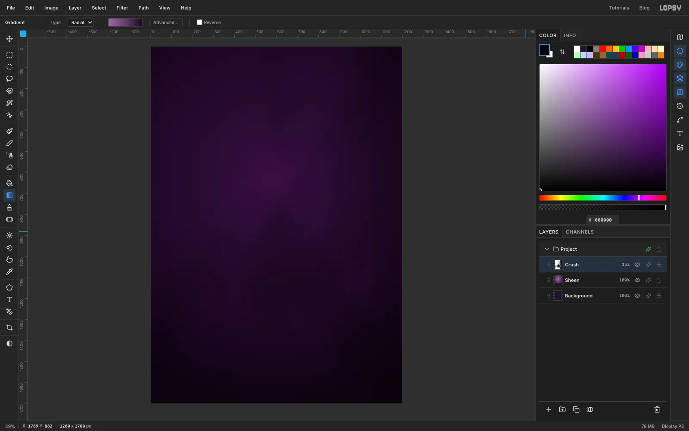

Velvet catches light in a broad, soft patch, so add a sheen:

1. Click *Layer 1* and rename it *Sheen* (double-click its name).
2. Pick the **Gradient** tool and set it to **Radial**. Click **Advanced…** to open the Gradient Editor. Give it three stops: `#9A6AA0` at the left end, `#5A3460` at about 60%, and `#160B1A` at the right end. To add a stop, click the bar where you want it. To colour a stop, click it and type the code into the **Hex** field. To move one, drag it along the bar. To remove one, select it and delete it with the editor's delete-stop button. You'll rebuild this editor several times in this tutorial, so it's worth getting comfortable with it.
3. Drag from a little above the middle of the page (about x 600, y 640) straight down to the bottom edge.
4. Open the layer's effects with the sparkle button on its row and set the blend mode to **Soft Light**. Close the drawer.

Now add the crushed look real velvet has. Click **Add Layer** and name it *Crush*. Choose **Filter → Clouds…** at **Scale 3**. Set the layer to **Overlay** and drag its opacity down to **15%**.

## Rule the margins

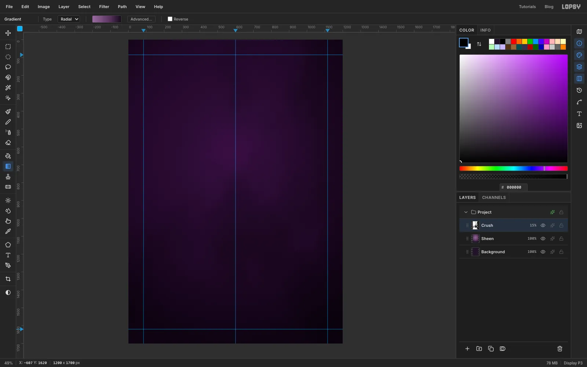

Click the top ruler to drop vertical guides at **85**, **600** and **1115**. Click the left ruler to drop horizontal guides at **85** and **1620**. These are your margins, and the centre guide is for centring type later.

## Set the title in copperplate script

Pick the **Text** tool (**T**). In the options bar, click the font name, type *Pinyon Script* into the search box and pick it from the list. Lopsy downloads the Google font the first time you use it. Set **Size** to **330** and the text colour to gold `#D8B775`.

Set the bottom line first. A click inside an existing line of text edits that line, and point text has a tall click area. Click *Crush* in the Layers panel, then click on the canvas at about **x 110, y 690**, type *Wisteria*, and press [[Tab]] to commit it.

Click *Crush* again, so the next text isn't added to *Wisteria*. Click at about **x 110, y 400**, type *Velvet*, and press [[Tab]].

The **W**'s top flourish should tuck in under the baseline of *Velvet*. If it doesn't, switch to the **Move** tool (**V**), select the line, and nudge it with the arrow keys.

## Merge the title and load its shape

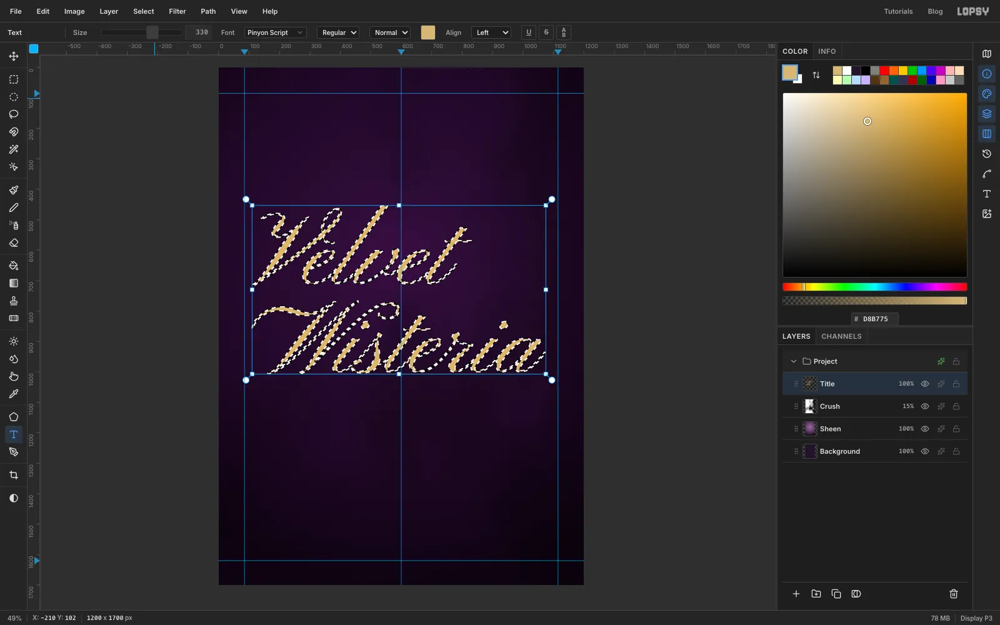

Click *Velvet* and press **Rasterize Layer** in the Layers panel footer. Do the same for *Wisteria*. With *Wisteria* still selected, choose **Layer → Merge Down** and rename the result *Title*.

[[Cmd]]-click the *Title* thumbnail. That loads the letter shapes as a selection.

## Gild the title

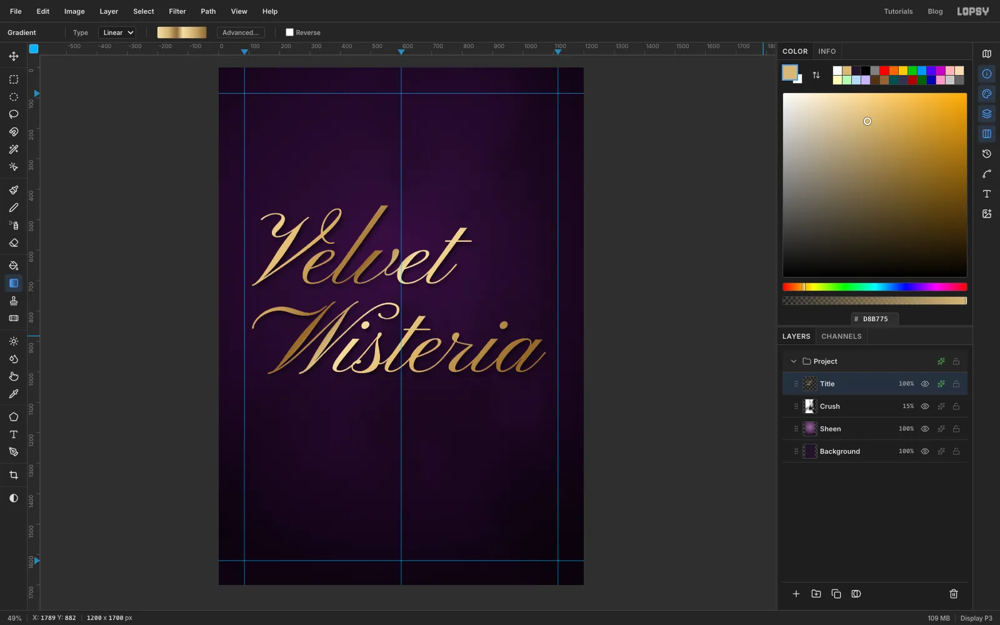

Gold leaf isn't one colour. It's bright where it catches light and bronze where it turns away. Click **Add Layer** and name it *Gilt*.

Pick the **Gradient** tool, set it to **Linear**, and build six stops in the Gradient Editor. Call this the *gold gradient*, because you'll rebuild it twice more:

- `#F3DEA6` at 0%
- `#D8B775` at 22%
- `#8F6A34` at 40%
- `#F3DEA6` at 52%
- `#D8B775` at 72%
- `#8F6A34` at 100%

Drag from just above the top left of the **V** down to just below the end of the **a**, so the bands run diagonally through both lines. The selection keeps the gradient inside the letters. Press [[Cmd+D]] to deselect, then **Layer → Merge Down** to bake the gilt into *Title*.

Open the effects for *Title* and turn on **Drop Shadow**: **Offset X 6**, **Offset Y 10**, **Blur 14**, **Opacity 80**, colour `#0C0510`.

## Rule a practice sheet behind the title

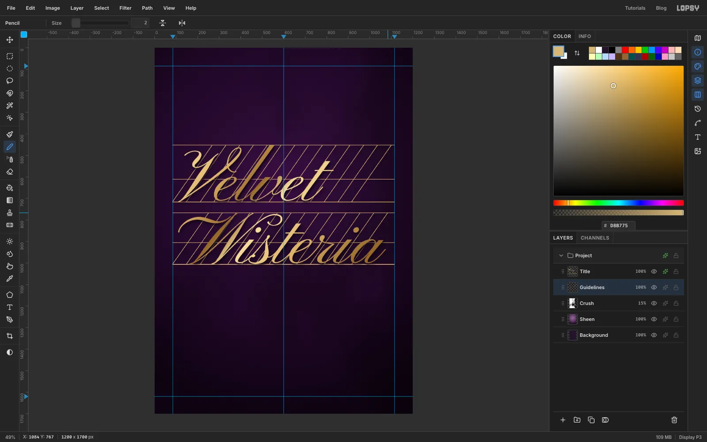

Before writing, a calligrapher rules guidelines: an ascender line, a waistline for the small letters, a baseline, and slant lines at the angle of the script. Drawing them faintly behind the title tells the viewer this is penmanship.

Click *Crush* and add a layer called *Guidelines*. It lands above *Crush* and below *Title*. Pick the **Pencil** (**N**) and set **Size** to **2**, with gold `#D8B775` as the foreground.

To draw a straight line with the Pencil, click where it starts, then [[Shift]]-click where it ends. Run each line from the left margin guide to the right one:

- **Velvet:** an ascender line at y **453**, a waistline at y **612**, and a baseline at y **716**. Draw a second baseline 1 px below it so the baseline reads heavier.
- **Wisteria:** an ascender line at **767**, a waistline at **906**, and a baseline at **1006**, also doubled.
- **Slant lines:** Pinyon Script slopes at about 55°, so rule slant lines at that angle inside each band. Start each one on the baseline and [[Shift]]-click its top end on the ascender line, **185 px** further right in the *Velvet* band (**165 px** in the shorter *Wisteria* band). Start the first on the left guide and step **64 px** to the right for each next one, until the top end would pass the right guide. That's 14 lines per band.

## Fade the guidelines at both ends

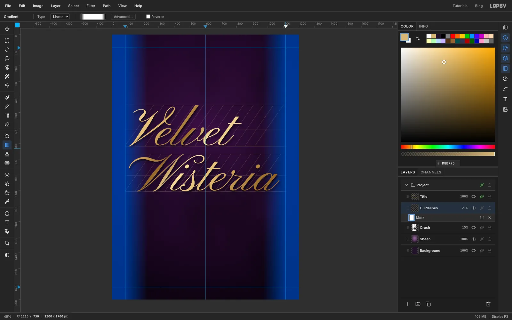

Set the *Guidelines* layer's opacity to **21%**.

Hard-ended lines look like boxes, so fade them out. Click **Add Mask** in the Layers panel footer, then click the new mask thumbnail to edit the mask. Pick the **Gradient** tool and rebuild the Gradient Editor with four stops (delete the extra gold ones): black `#000000` at 0%, white `#FFFFFF` at 14%, white at 86%, and black at 100%.

Drag straight across from the left margin guide to the right one. Where the mask is black, the lines disappear. Click the layer's name to stop editing the mask.

## Paint the back row of wisteria

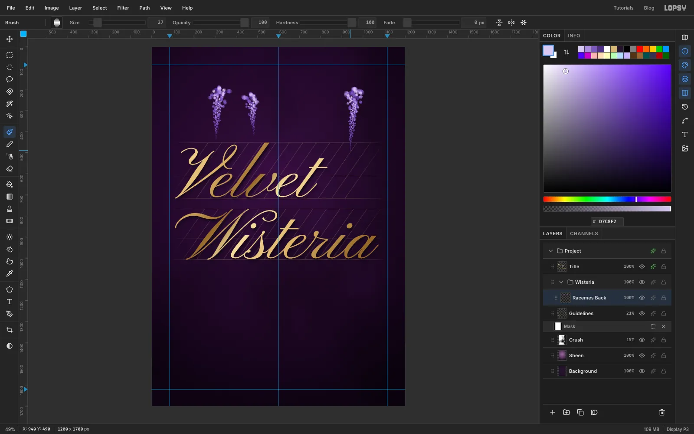

Wisteria flowers hang in long clusters called racemes. The open flowers at the top are pale, and the closed buds towards the tip are dark. Paint the racemes in two rows, a soft one at the back and a crisp one at the front, which gives the curtain depth.

Click *Guidelines* and click **New Group**, and name the group *Wisteria*. With the group selected, click **Add Layer** and name the new layer *Racemes Back*. It goes inside the group.

Each raceme is four brush strokes along the same path, each dragged from the top of the raceme straight down with a gentle curve. Every stroke uses **Taper**, which shrinks the brush as you drag, so the cluster narrows to a point. **Scatter** throws the dabs out sideways, so it fills out into a cone.

Pick the **Brush** (**B**) and open the Brushes modal by clicking the brush-tip thumbnail at the left of the Brush options bar. Here are the four passes, with the values for a raceme about **300 px** long. Taper is in pixels.

1. **Buds:** the **Hard Round** preset, `#4E2F86`, **Size 30**, **Spacing 30**, **Hardness 90**, **Scatter 80**, **Size Jitter 50**, **Taper 300**.
2. **Florets:** the **Leaf** preset, `#7B58BF`, **Size 52**, **Spacing 28**, **Scatter 75**, **Size Jitter 45**, **Angle Jitter 100**, **Taper 270**.
3. **Open flowers:** **Leaf**, `#A88BDD`, **Size 46**, **Spacing 30**, **Scatter 70**, **Size Jitter 45**, **Angle Jitter 100**, **Taper 210**.
4. **Highlights:** **Leaf**, `#D7C8F2`, **Size 36**, **Spacing 36**, **Scatter 70**, **Size Jitter 45**, **Angle Jitter 100**, **Taper 150**.

Each pass has a shorter Taper than the last, so the lighter colours only cover the top of the cluster. For a shorter or longer raceme, scale the Taper values with its length.

Clicking a preset on the **Presets** tab resets every setting, so pick the preset first, then type the rest on the **Shape** and **Dynamics** tabs. You'll switch between these four brushes dozens of times. Set each one up once and click **Save Current** in the modal's footer, naming them *Buds*, *Florets*, *Open* and *Highlights*. After that, each pass is one click on your saved preset plus a Size and Taper change.

For the back row, use about **70%** of those sizes. Paint three racemes: about 250 px long hanging from x 320, 200 px from x 470, and 290 px from x 960. All three start between y 195 and 230, where the vine will run.

## Draw the vine as a hairline

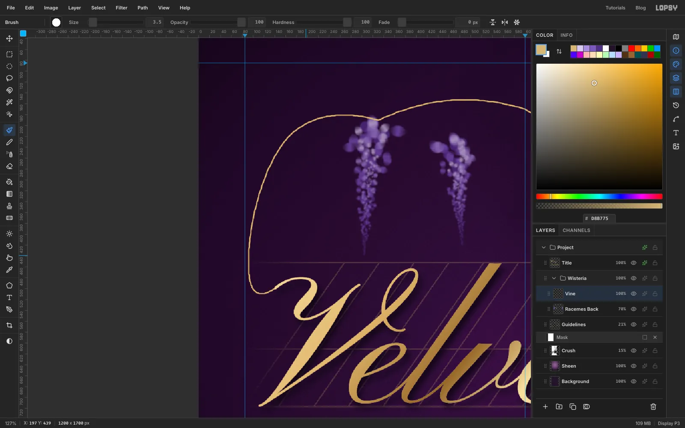

First push the back row back. Choose **Filter → Gaussian Blur…** at **Radius 3** on *Racemes Back* and set its opacity to **70%**. The clusters now sit slightly out of focus behind everything you paint next.

Click **Add Layer** inside the group and name it *Vine*. A pointed pen makes thin upstrokes and thick downstrokes, because pressing down spreads the nib. Build the vine the same way: draw the whole path as a hairline first, then add the swells.

Pick the **Brush**, choose the **Hard Round** preset, and set **Size 3.5** with gold `#D8B775`. Make sure **Taper** is back at **0**. The vine is long, so draw it in several overlapping drags, starting each new drag on the end of the last one:

1. Start right on the **V**'s opening hairline at its top left. Drag down and to the left in a small curl tucked under it, then up the left margin to about level with the top of the page's wisteria (y 240).
2. Turn right along the top of the page. Make a gentle wave that rises to just under the masthead (about y 150) and dips back to about y 230 around the middle of the page, above the second **e** of *Velvet*.
3. Make a second, matching wave across the right half.
4. Finish at the top right by curling back inward, staying inside the right margin.

Now draw a thinner twin strand at **Size 2.5**, the way wisteria stems twine around each other. Start it with a small curl at about x 128, y 428. Climb it alongside the first strand, then cross it three times, near x 330, 600 and 880, and end it at about x 1080, y 190.

## Swell the vine

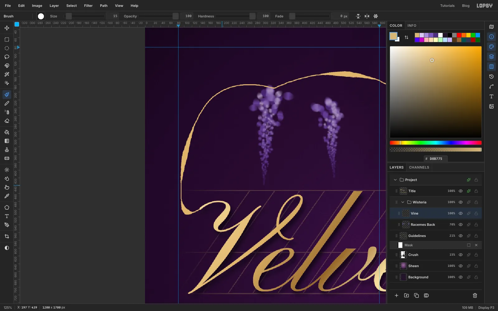

Give the vine five swells:

- the curl under the V
- the long run up the left margin
- the downhill side of each wave along the top
- the final curl at the top right

For each one, pick the point where it should be fattest. With **Hard Round** at **Size 15**, set **Taper** to the distance from that point to the end of the swell, about 100–150 px. Drag from the fat point outwards along the hairline. Do the same in the other direction from the same point. The two tapered strokes meet in a swell that thins to nothing at both ends.

Do the same on the twin strand at **Size 9**, only on its two biggest dips.

## Gild the vine

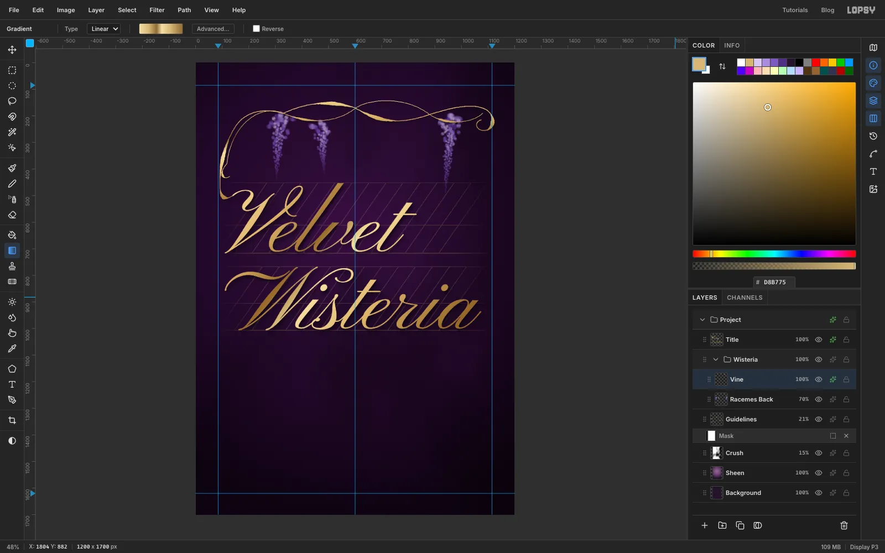

The vine should look like the same gold as the title. [[Cmd]]-click the *Vine* thumbnail, pick the **Gradient** tool (**Linear**), and rebuild the gold gradient in the Gradient Editor. The guideline mask replaced it, so delete the extra stops and set the six again:

- `#F3DEA6` at 0%
- `#D8B775` at 22%
- `#8F6A34` at 40%
- `#F3DEA6` at 52%
- `#D8B775` at 72%
- `#8F6A34` at 100%

This time drag straight down from just above the vine (y 100) to the bottom of the left curl (y 560), so the bands run horizontally across the vine. Deselect.

Give *Vine* a **Drop Shadow**: **Offset X 4**, **Offset Y 6**, **Blur 8**, **Opacity 70**, colour `#0C0510`.

## Add pinnate leaf sprays

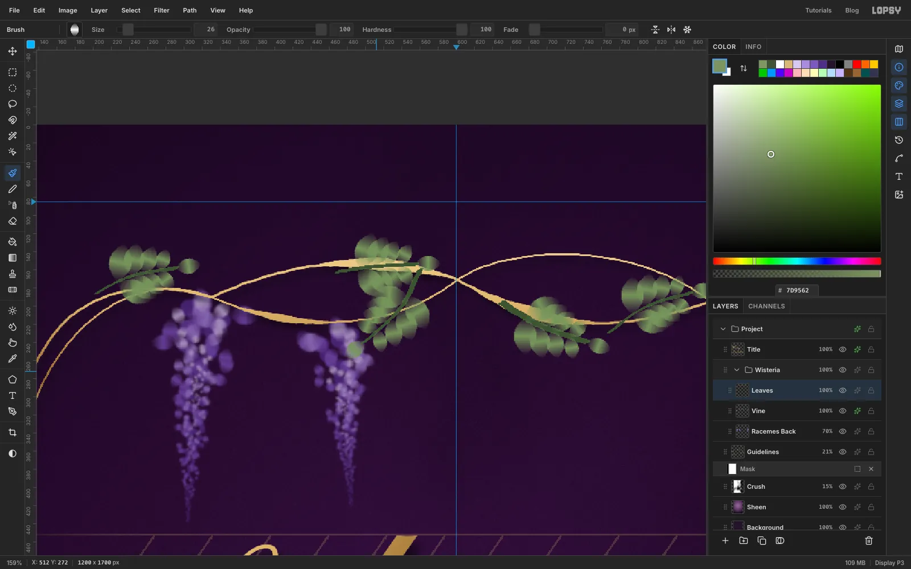

Wisteria leaves are pinnate: a row of leaflet pairs along a stem. Add a layer called *Leaves* inside the group.

For the stems, pick the **Brush** with the **Caligraphic Angle** preset at **Size 6**, set the foreground to `#405335`, and draw seven short curved stems about 100 px long. Each one should start on the vine. Point three or four of them up and to the right, and droop the rest. Keep them all inside the margins and below y 130, so they don't crowd the masthead.

For the leaflets, choose the **Leaf** preset with **Hardness 100** and set the foreground to `#7D9562`. The Leaf tip is a narrow oval. Its direction is set by the **Angle** dial on the Brushes modal's **Shape** tab, and 0° points straight up.

Work along each stem from its base. Dial one angle so the leaflets point out about 60° from the stem on its left side, and click all the left-hand leaflets. Then dial a second angle for the right side and click those. Re-dial only where a stem bends sharply. Make the leaflets smaller as you go out: **Size 42**, **38**, **32** and **26**. Finish with one leaflet of **Size 28** pointing straight off the tip.

## Shade the leaves

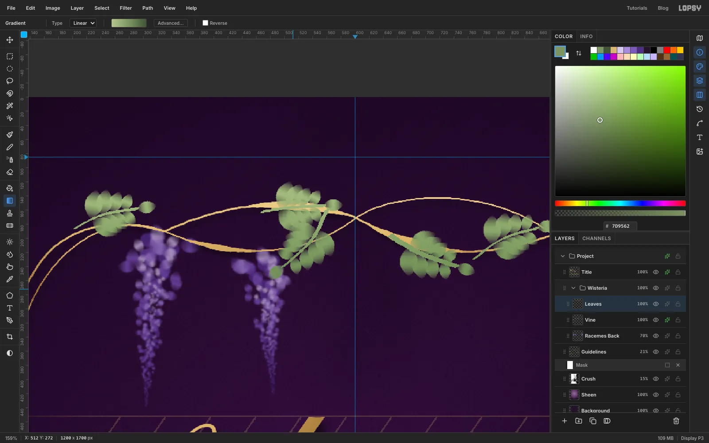

[[Cmd]]-click the *Leaves* thumbnail. In the Gradient Editor, make a three-stop linear gradient from `#B5C68F` through `#7D9562` to `#405335`. Drag it from y 110 down to y 360, so the tops of the sprays catch the light. Deselect.

## Paint the front racemes: buds

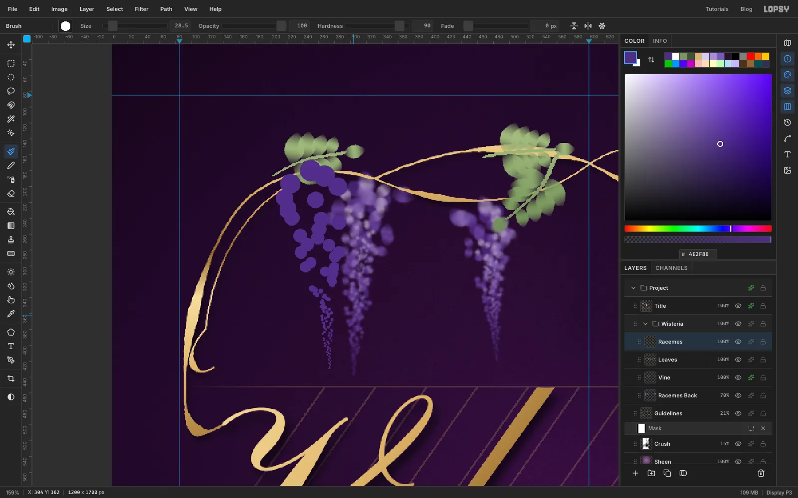

Add a layer called *Racemes* at the top of the group, above *Leaves*. The front row uses the same four passes at full size, so it looks closer.

Paint one raceme at a time and finish all four passes before moving on. Start with the one hanging from the vine at about x 250, y 180. Make it about 250 px long and curve it slightly to the right. Pass 1 lays down the dark buds.

## Paint the front racemes: florets

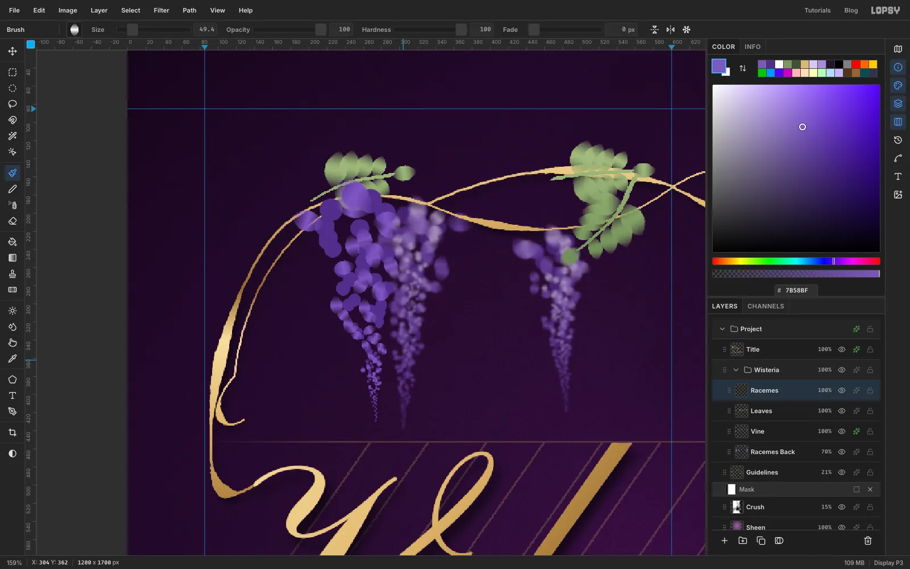

Pass 2, the **Leaf** tip in `#7B58BF`, covers most of the cluster. **Angle Jitter 100** spins every petal to a random angle. Keep exactly the same path, from the vine down to the tip.

## Paint the front racemes: highlights

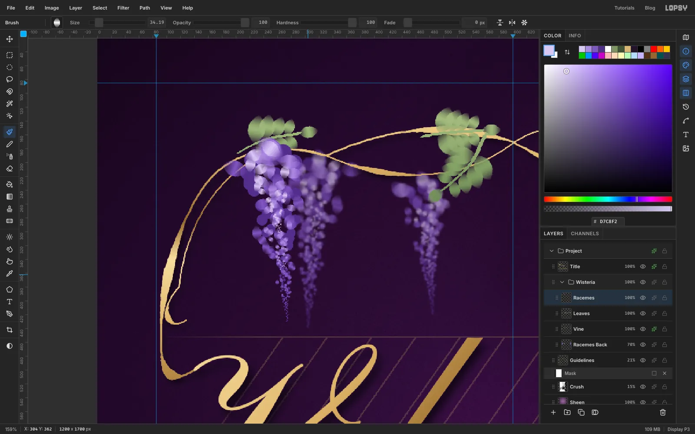

Passes 3 and 4 add `#A88BDD` and then `#D7C8F2`. Their shorter tapers keep the light colours near the top. That's one finished raceme.

## Finish the curtain

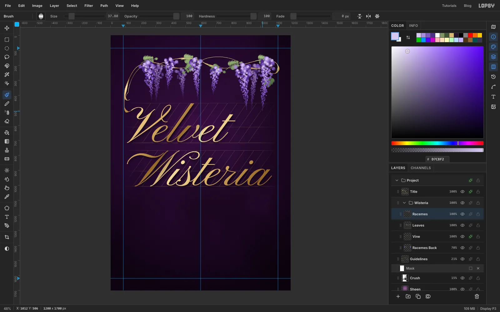

Paint five more front racemes the same way:

- about 200 px long from x 400, curving left
- 270 px from x 560
- 180 px from x 700
- 300 px from x 880
- 350 px from x 1040, curving left

Scale the brush sizes with the length: about 75% for the shortest and full size for the longest. Hang each one from the vine. Keep the left and middle ones short enough to stop above the title. The right ones can drop lower beside the **t** of *Velvet*.

## Draw the swash under the title

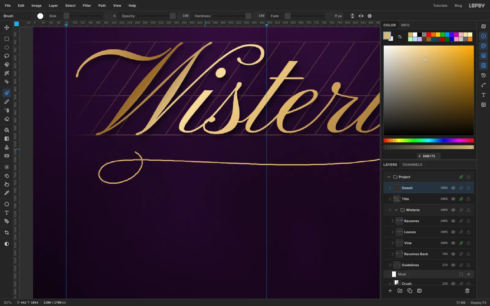

A good title gets a flourish underneath. Click *Title* and add a layer called *Swash* above it.

Use the same hairline-then-swell method as the vine, in two or three overlapping drags. Draw a **Size 4** **Hard Round** hairline (Taper **0**) starting on the exit stroke of the **a** (about x 1068, y 1000). Sweep it down and left under the whole title, past y 1085 in the middle. At the left, end in a small, slightly tilted oval loop that comes back up to about x 262, y 1050.

## Swell and gild the swash

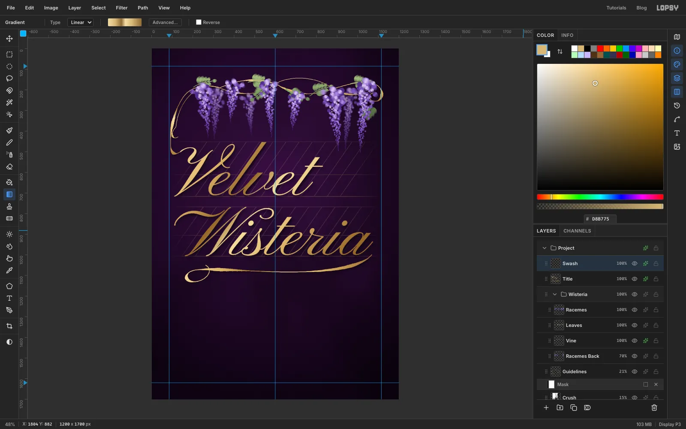

Add **Size 17** swells exactly as on the vine: set Taper to the distance from the fat point to the end of the swell (about 150–250 px on this long stroke), then drag outward both ways from the fat point. Put them on three runs: where the swash drops away from the **a**, along the long middle, and on the loop's downstroke.

Then gild it. [[Cmd]]-click the *Swash* thumbnail, rebuild the six gold stops from *Gild the title* in the Gradient Editor (the leaf greens replaced them), and drag diagonally from just above the loop on the left to just below the **a** on the right. Deselect. Give *Swash* a **Drop Shadow**: **Offset X 4**, **Offset Y 7**, **Blur 9**, **Opacity 70**, colour `#0C0510`.

## Copy a raceme and hang it from the loop

Two small racemes hanging from the swash will frame the contents. You don't need to paint them: copy one.

Click *Racemes*. With the **Rectangular Marquee** (**M**), draw a box around the short raceme at x 700, taking in its whole length but none of its neighbours. Press [[Cmd+C]], then [[Cmd+V]]. Lopsy pastes it in place as a new layer. Rename the layer *Swash Raceme L*.

Hang it from the swash loop:

1. Switch to the **Move** tool (**V**) and drag the copy down until its top touches the bottom of the loop, at about x 200, y 1136. Press [[Cmd+D]].
2. Draw a marquee a few pixels bigger than the raceme.
3. Hold [[Cmd]] and drag the bottom-right handle up and to the left, shrinking it by about 18%. [[Cmd]] keeps the proportions.
4. Press [[Cmd+D]] to commit the scale.

## Paste a second copy and flip it

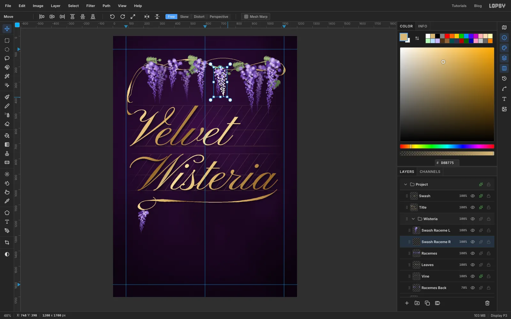

Click *Racemes* again, draw the same marquee, and copy and paste again. Rename this copy *Swash Raceme R*.

So the two don't look identical, flip this one. Draw a marquee around it, switch to the **Move** tool (**V**), and click **Flip Horizontal** in the options bar. Press [[Cmd+D]]. The flip mirrors the copy in place while it still sits exactly over the original, which makes it easy to check.

## Hang the flipped copy and scale it down

With the **Move** tool, drag *Swash Raceme R* down until its top touches the swash, at about x 1005. Press [[Cmd+D]].

Draw a marquee a few pixels bigger than the raceme, then [[Cmd]]-drag the bottom-right handle inward by the same 18% as the left one. Press [[Cmd+D]].

## Both racemes in place

The swash now holds a cluster at each end, and the space between them is ready for the contents.

## Set the contents and masthead

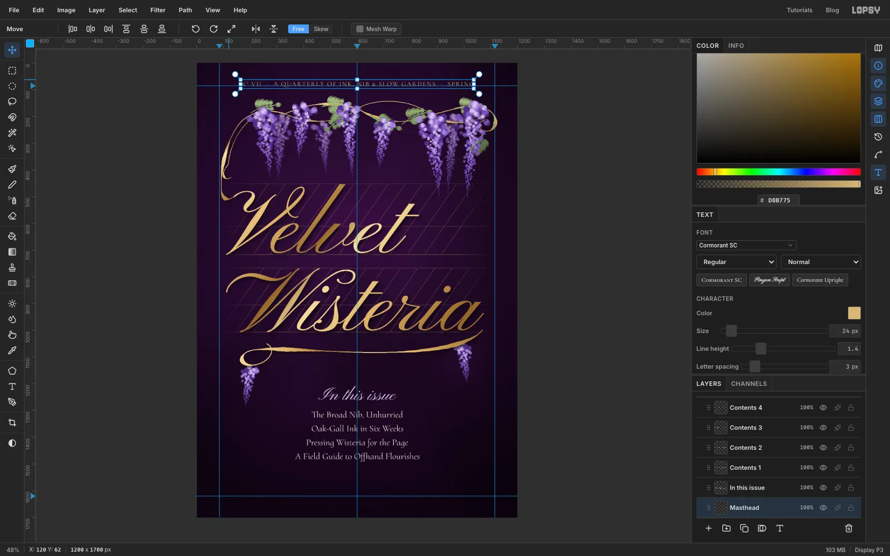

Click *Swash* before each new piece of text. If a text layer is selected, the Text tool's settings restyle it.

The contents use **Cormorant Upright** at **Size 34** in ivory `#EDE3D6`. Set them from the bottom up, so no click lands inside a line you've already set. Make sure **Letter spacing** in the Text panel is **0**.

1. Click at about x 380, y **1448** and type *A Field Guide to Offhand Flourishes*. Press [[Tab]].
2. Click *Swash*, click about 52 px higher (y 1396), and type *Pressing Wisteria for the Page*.
3. Repeat at y **1344** for *Oak-Gall Ink in Six Weeks* and at y **1292** for *The Broad Nib, Unhurried*.

Centre each line on the centre guide. Select it, switch to the **Move** tool (**V**), and nudge it left or right with the arrow keys. Hold [[Shift]] to move 10 px at a time. Switch back to the **Text** tool for the next line.

Above them, set *In this issue* in **Pinyon Script**, **Size 66**, lilac `#D7C8F2`, at about y 1198, and centre it too.

For the masthead, use **Cormorant SC**, **Size 24**, gold `#D8B775`, with **Letter spacing 3** in the Text panel. Open the panel with the **T** button in the right-hand strip. Click near the top at y 62 and type *N° VII · A QUARTERLY OF INK, NIB & SLOW GARDENS · SPRING*. Centre it on the centre guide.

## Cut a seal block and set the character

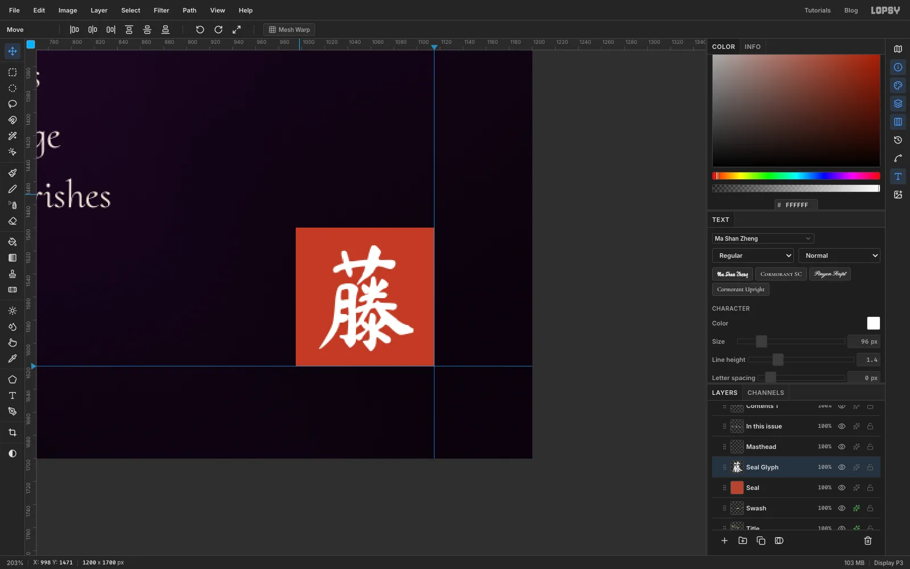

East Asian books and prints are often signed with a red stamp, a chop seal. Ours carries 藤, *fuji*, wisteria.

Click *Swash* and add a layer called *Seal*. Pick the **Rectangular Marquee** and click once on the canvas without dragging to open its exact-size dialog. Set **From** to **995, 1500** and **To** to **1115, 1620**, and press [[Enter]]. The seal now sits on the right and bottom margin guides. Fill it with `#B5452F` and deselect.

Pick the **Text** tool and choose **Ma Shan Zheng** at **Size 96** in white, with **Letter spacing** back at **0**. Click on the seal and paste 藤 with [[Cmd+V]] (copy it from this page first). Press [[Tab]] and rename the layer *Seal Glyph*. Nudge it with the **Move** tool until it sits in the middle of the seal. Then click **Rasterize Layer**.

## Carve the character and stamp it askew

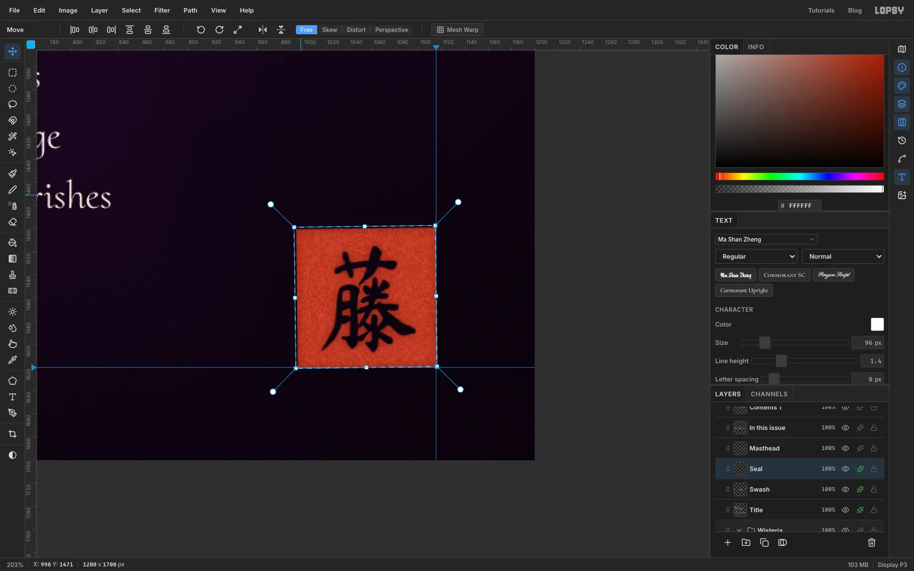

Carve it the way a real seal is cut, by removing the red:

1. [[Cmd]]-click the *Seal Glyph* thumbnail.
2. Click *Seal* and press [[Delete]]. The character is now a hole that shows the velvet.
3. Deselect, then click *Seal Glyph* and delete it with **Delete Layer**.

Choose **Filter → Add Noise…** on *Seal* at **Amount 30**, **Mono**. Then open its effects and add an **Inner Glow**: **Size 12**, **Opacity 55**, colour `#5E140C`. That darkens the edges like ink that pooled at the rim.

A hand-pressed seal is never quite square. Draw a marquee a couple of pixels bigger than the seal, switch to the **Move** tool, and drag the rotate handle just outside the top-right corner. Turn it a degree or two counter-clockwise, just enough to look hand-stamped. Press [[Cmd+D]].

## Mottle the ink with a mask

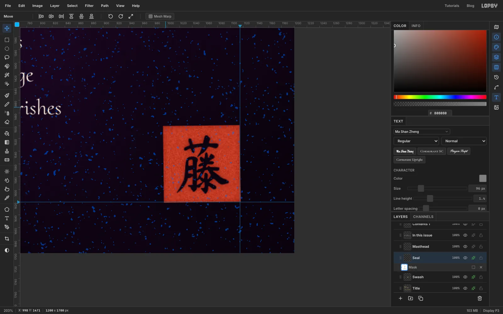

Stamped ink leaves tiny gaps where the paper didn't take it. Add these after rotating, because a layer mask stays where it is while its layer moves.

1. Click **Add Mask**, then click the mask thumbnail to edit it.
2. Set the foreground to mid grey `#808080` and choose **Edit → Fill**. A grey mask is the right starting point for noise, which only adds or subtracts up to 50 levels.
3. Run **Add Noise…** at **Amount 100**, **Mono**, then **Gaussian Blur…** at **Radius 3**. The blur groups the noise into small clumps.
4. Run **Filter → Threshold…** at **Level 112**. Everything below 112 turns black and hides the ink there. That leaves small, irregular voids across the seal and nicks in its edges.

Click the layer's name to stop editing the mask.

## Add the footer

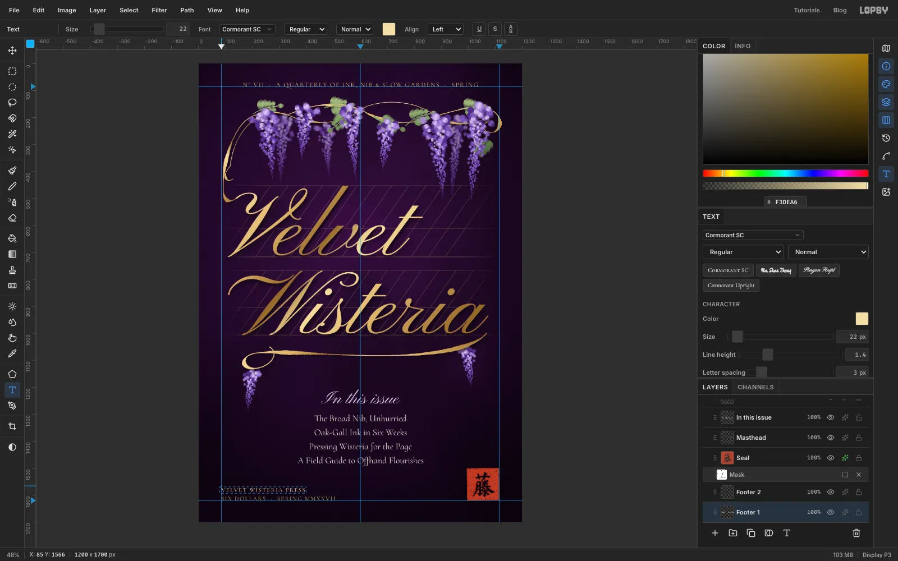

Click *Swash* again. In **Cormorant SC**, **Size 22**, **Letter spacing 3** (restate it: the glyph step set it to 0), set two lines on the left margin, bottom line first:

1. *SIX DOLLARS · SPRING MMXXVII* in gold `#D8B775`, clicked at about x 85, y 1598, so its baseline sits on the bottom margin guide, level with the bottom of the seal.
2. *VELVET WISTERIA PRESS* in pale gold `#F3DEA6`, about 32 px higher.

## Let a few petals fall

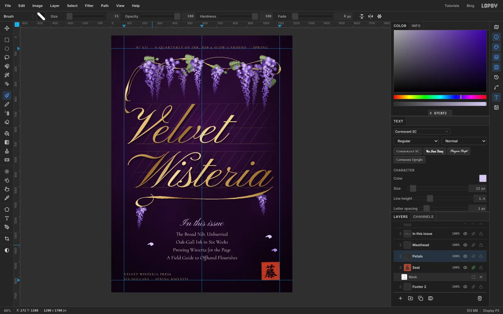

Click *Seal* and add a layer called *Petals*. Pick the **Brush** with the **Caligraphic Angle** preset (that's Lopsy's spelling) at **Size 15**. In the Brushes modal's **Shape** tab, set the **Angle** dial to **105°**, so the nib leans like a broad pen.

A short curved stroke, about 20 px long, makes a crescent petal, thick in the middle and thin at the ends. Draw three: two in lilac `#D7C8F2` and lavender `#A88BDD` below the right-hand cluster, and one under the left. Keep them at least 60 px from any type.

## Add grain and grade the colour

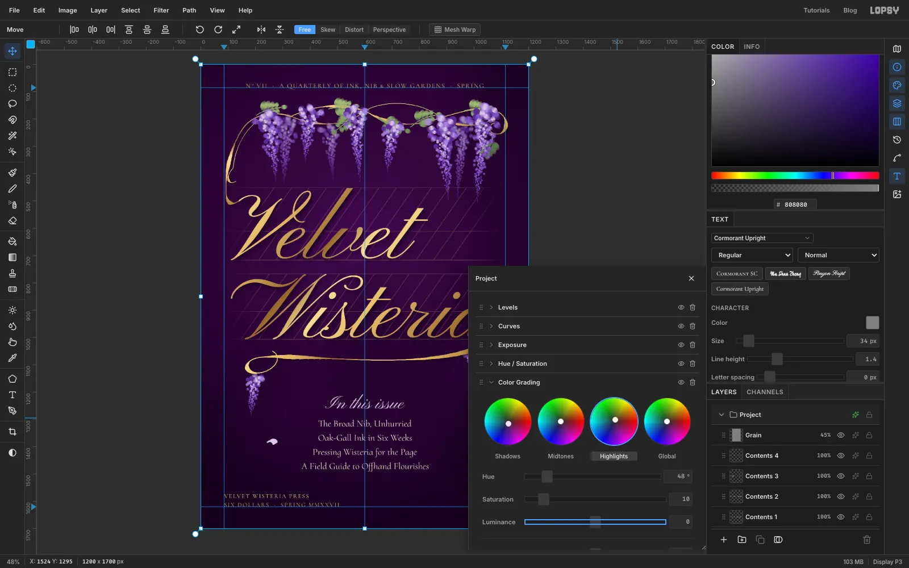

Click the top layer in the panel and add a layer called *Grain*. Fill it with `#808080`. Add Noise at **Amount 22**, **Mono**, **Gaussian**. Set the layer to **Soft Light** at **45%**. The grey disappears and leaves a fine texture over everything, type included, so the whole cover looks printed.

Then grade the whole document. Click the sparkle button on the *Project* row to open its adjustments, and expand **Color Grading**:

- Drag the **Shadows** wheel a little towards violet. Pressing a wheel also selects it, so the **Hue** and **Saturation** sliders below now edit Shadows. Fine-tune to **Hue 285**, **Saturation 12**.
- Drag the **Highlights** wheel a little towards warm gold, then set its sliders to **Hue 48**, **Saturation 10**.

The shadows deepen into plum, and the gold warms up.

## Darken the edges

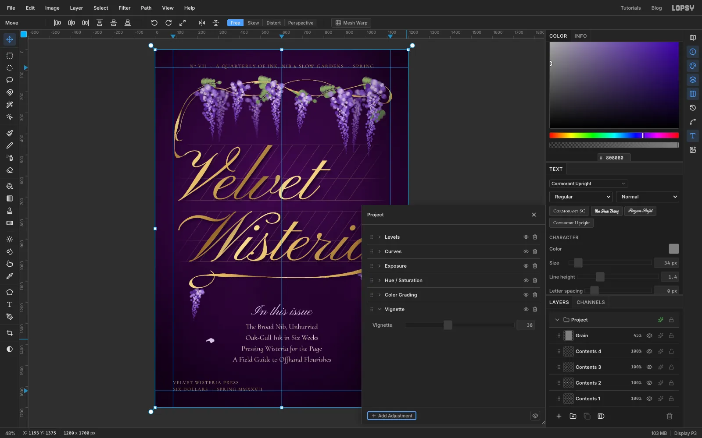

Still in the *Project* drawer, click **Add Adjustment → Vignette** and set **Vignette** to **38**. The corners fall into shadow and the eye goes to the gold. Close the drawer.

## Save and export

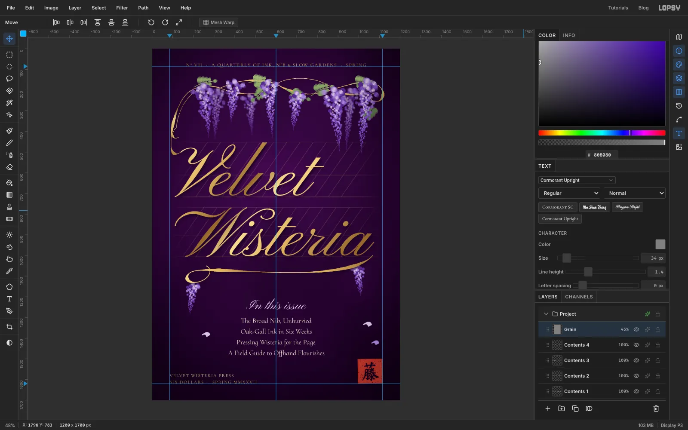

Choose **File → Save Project** to keep a `.lopsy` with every layer, mask and adjustment, and **File → Quick Export PNG** for the finished cover.
