Old encyclopaedias and service manuals explained machines with cutaway
plates: the object drawn whole on one side and sliced open on the other,
every part pointed at by a numbered callout. The same treatment makes a
charming holiday card when the "machine" is something small and warm.

In this tutorial you'll draw **Beeswax Votive**, a plate titled *The
Anatomy of a Small Light*. A rolled beeswax candle stands in a glass
votive. Its front-right quarter is cut away so you can see the rolled
sheets of wax, the wick and the zinc tab. Above it a flame glows, with
labels for each zone of the flame. A photo of the candle's spiral top
becomes a plan view in the corner, and a title block and a greeting finish
the sheet. You'll build it at **2100 × 1500 px**, a 7 × 5 card at 300 dpi.

The plan view and the honeycomb texture come from
[Wax candle detail](https://commons.wikimedia.org/wiki/File:Wax_candle_detail.jpg)
by Paolo Neo on Wikimedia Commons, which is in the **public domain**.
Download the full 2048 px version. Any close photo of a rolled beeswax
candle will do.

Along the way you'll use:

- ruler guides, **Define Pattern** and **Fill with Pattern** for a drafting grid, section stripes, glass hatching and chain lines
- the **Rectangular** and **Elliptical Marquee** with [[Shift]] to add, [[Alt]] to subtract and [[Shift]]+[[Alt]] to intersect
- linear and radial **Gradients** with transparent stops
- the **Pen** tool, the Paths panel's **Path to Selection**, **Grow**, **Shrink** and **Feather**
- the **Shape** tool's click-to-size dialog, **Brush** and **Pencil** lines drawn with [[Shift]]-clicks
- pasting a photo, scaling and stretching it with the Move tool, **Merge Down** and a group **Photo Filter** adjustment
- **Outer Glow** and **Drop Shadow** effects, the **Screen**, **Multiply** and **Overlay** blend modes
- text in **Cormorant Garamond**, **Red Hat Mono** and **Barlow Condensed**, the Text panel's line height and a rotated line of live text

A few habits that the steps rely on:

- **Exact sizes.** When a step gives a marquee a size, watch the
  **Selection W** and **H** in the **Info** panel as you drag. Or, with
  nothing selected, click once without dragging to type the exact corners.
- **The drawer.** Each layer row has an effects (fx) button that opens a
  drawer with that layer's **blend mode**, opacity and effects. On a group
  row, the same drawer holds adjustments instead.
- **Type settings.** Click a non-text layer before you change the font,
  size or colour. Otherwise you'll restyle the last text you typed.

The palette:

- Drafting board `#101827`, grid `#22314D` / `#2E4166`
- Linework `#EFE4C8`, label grey `#BCB39B`
- Beeswax `#5A3A12` → `#D9A441` → `#F3D27E` → `#9C6A22`
- Flame `#FF6A1A` → `#FFAA33` → `#FFE08A` → `#FFF9E6`, flame glow `#FFB547`
- Cut face `#CFA04E` → `#A97A2C`
- Dark zone `#E8962A`, blue zone `#4A78FF`, cool air `#8FB0FF`
- Glass `#A9D3E3`, rim `#CFEAF5`, lamp glow `#C8741E`

## Set up the canvas and guides

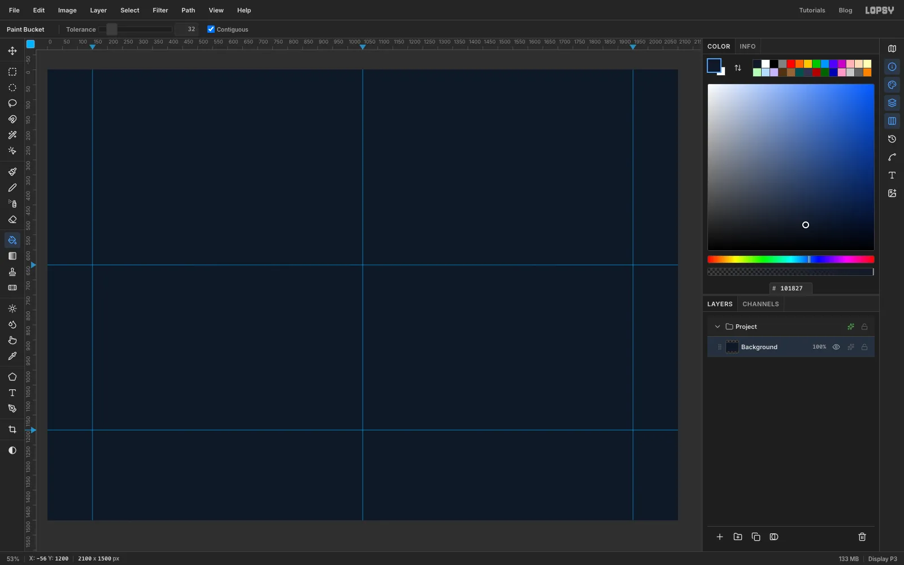

Choose **File → New**, enter **2100 × 1500** pixels and click **Create**.
Click the *Background* row, set the foreground to `#101827`, pick the
**Fill** tool and click the canvas. Then select *Layer 1* and delete it
with the trash button at the bottom of the Layers panel.

Click the top ruler at **150**, **1050** and **1950** to drop three
vertical guides: the left margin, the centre line and the right margin.
The candle will stand on the centre line. Click the left ruler at **650**
and **1200** for the top of the glass and its base.

## Fill a drafting grid with two patterns

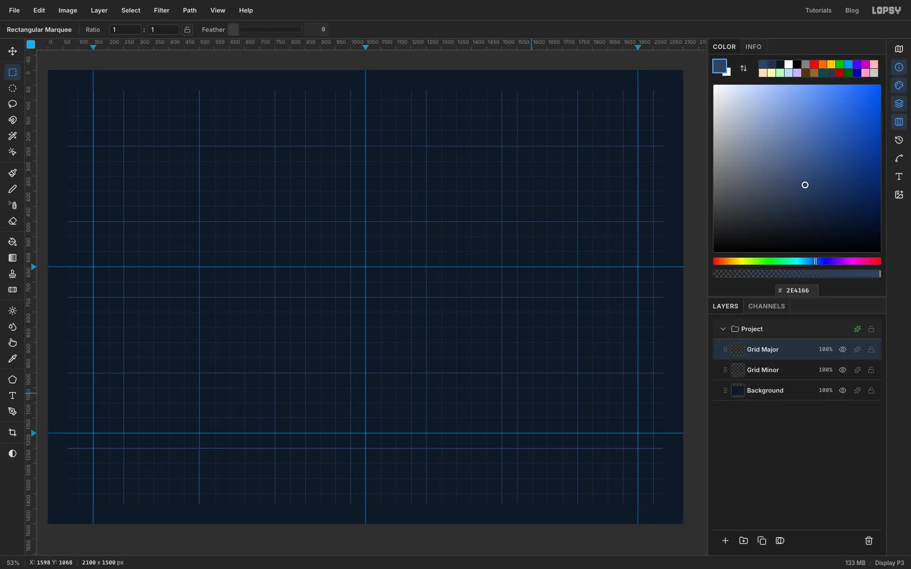

Add a layer called *Tile*. Pick the **Pencil**, set **Size** to **1** and
the foreground to `#22314D`. Zoom in on the top-left corner. Click at the
very corner, then [[Shift]]-click 50 px to the right, and do the same 50 px
down, so you have an L along the top and left edges of a 50 px square.
Switch to `#2E4166` and Size **2** and draw a second, bigger L for a
250 px square just to the right of the first.

Draw a **Rectangular Marquee** exactly over the small square and choose
**Edit → Define Pattern**. Marquee the big square and define it too. Then
delete *Tile*.

Add a layer called *Grid Minor*. Marquee the board 66 px in from every
edge, which is where the inner border will sit, and choose **Edit → Fill with Pattern…**, pick the small
pattern and click **Apply**. Add *Grid Major* and fill the same marquee with
the big pattern. Patterns tile from the canvas corner, so both grids line
up with each other.

## Darken the edges and draw the border

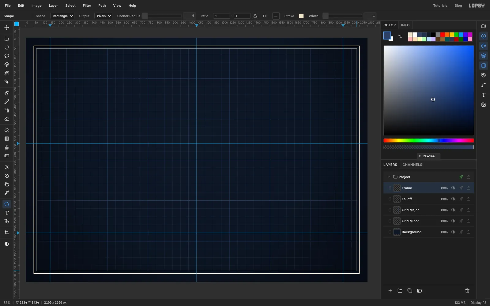

Add a layer called *Falloff*. Pick the **Gradient** tool, set **Type** to
**Radial** and open **Advanced…**. Give it three stops: black at **0%**
opacity on the left, black at **15%** opacity a little past the middle, and
`#05080F` at **85%** opacity on the right. Drag from the middle of the board out to the
bottom-right corner. The edges darken like a lamp-lit desk.

Add a layer called *Frame*. Pick the **Shape** tool, set **Shape** to
**Rectangle** and **Output** to **Pixels**. Click the **Fill** swatch and
**Remove fill**, then set the **Stroke** to `#EFE4C8` and **Width 4**.
Shapes grow from where you press, so press on the centre of the canvas and
drag out until the box sits 50 px in from every edge. Set the width to
**1** and drag a second box 16 px inside the first.

## Build the glass outline from three marquees

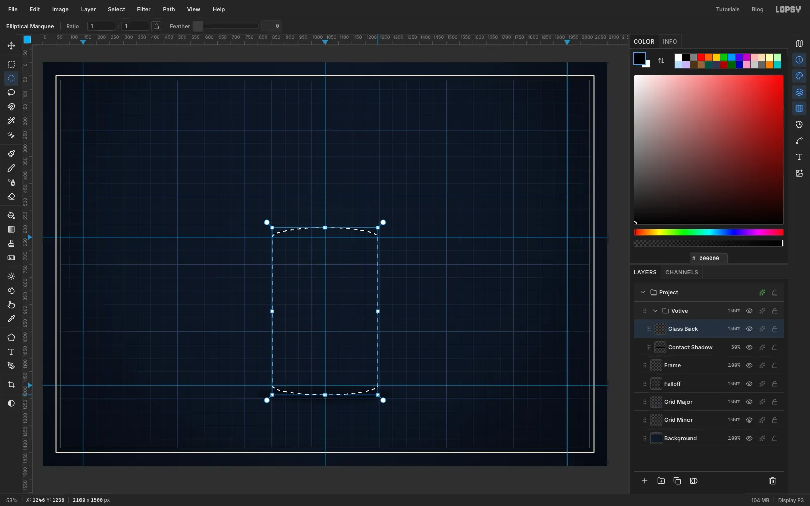

Click **New Group** and name it *Votive*. Inside it, add a layer called
*Contact Shadow*. Draw an **Elliptical Marquee** 500 × 68 px centred
32 px below the base guide, fill it with black, then run **Filter → Gaussian Blur**
with a **Radius** of **16** and set the layer's opacity to **30%**.

Add a layer called *Glass Back*. With the **Rectangular Marquee**, drag a
box from the rim guide to the base guide, **392 px** wide and centred on
the centre line. Pick the **Elliptical Marquee**, hold [[Shift]] and drag a
392 × 72 ellipse centred on the rim guide. [[Shift]] adds it to the
selection. Add another 392 × 72 ellipse centred on the base guide. The
three shapes merge into a tumbler.

## Ghost the glass with a transparent gradient

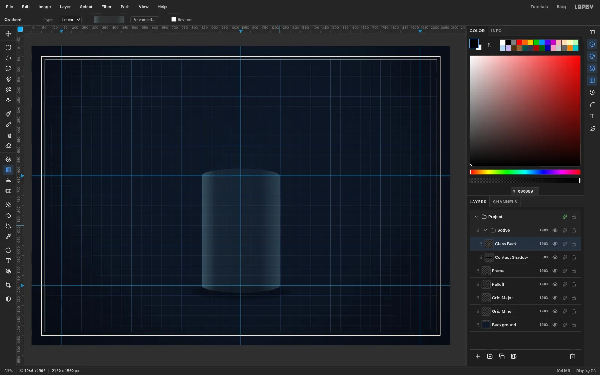

Glass in technical drawings is "ghosted": you see through it, and only the
edges catch the light. Keep the tumbler selected, pick the **Gradient**
tool and click **Advanced…** to open the editor. Set four stops, all
`#A9D3E3`, at **30%**, **8%**, **5%** and **22%** opacity from left to
right. Put the second stop at about 18% along and the third at about 75%.
Set **Type** to **Linear** and drag from the left edge of the glass to the
right edge. Press [[Cmd+D]].

## Shade the outside of the wax

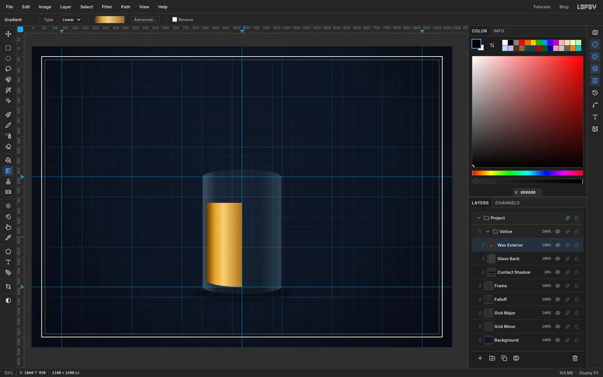

The wax is 356 px wide, just a few pixels narrower than the inside of the
glass. Add a layer called *Wax Exterior*. Marquee the left half of the
candle from y **780** to y **1166**. That's a box from the candle's left
edge to the centre line. Then [[Shift]]-drag a 356 × 64 ellipse centred on
the bottom of that box. Hold [[Alt]] and drag a box over everything right
of the centre line to subtract the right half of the ellipse.

Fill it with a linear gradient: `#5A3A12` at 0%, `#D9A441` at 22%,
`#F3D27E` at 45% and `#9C6A22` at 100%. Drag from the left edge to just
past the centre line. The bright band a third of the way across makes the
cylinder look round.

## Draw the top and the cut face

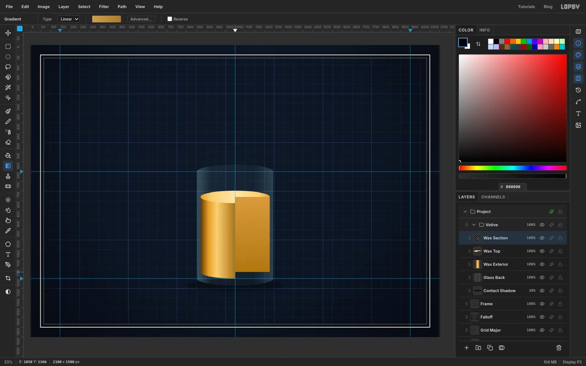

Add a layer called *Wax Top*. Draw a 356 × 64 ellipse centred on the top of
the wax at y **780**. Hold [[Alt]] and drag a box from the centre of the
ellipse down and to the right, to subtract the front-right quarter. That
quarter has been cut away. Fill it with a **radial** gradient from
`#FBE7B0` to `#F3D27E` to `#D9A441`, dragging from the centre of the top
to its right edge.

Add a layer called *Wax Section*. Marquee the right half of the candle from
the centre line to its right edge, from y **780** to the bottom. This is
the flat face the saw left. Fill it with a vertical linear gradient from
`#CFA04E` at the top to `#A97A2C` at the bottom.

## Add the melt pool

Add a layer called *Melt Pool*. Draw a 300 × 50 ellipse just inside the
top, centred at y **782**, and [[Alt]]-subtract the front-right quarter
again. Fill it with a radial gradient from `#FFF1C4` through `#F6CD6A` to
`#E2A84A`, dragging from a little left of the centre out to its right end.

## Stripe the cut face with rolled sheets

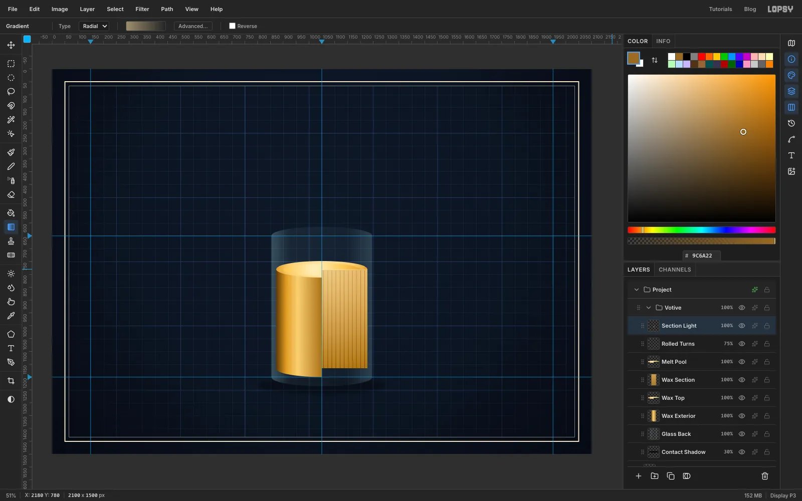

A rolled candle is a sheet of honeycomb wax wound round the wick, so the
cut face shows a stripe for every turn. Add a layer called *Tile*, set the
foreground to `#9C6A22` and zoom in on an empty part of the canvas. Marquee
a strip **2 px wide and 16 px tall** and fill it. Then marquee a
**16 × 16** square with its left edge on the strip and choose
**Edit → Define Pattern**. Delete *Tile*.

Click *Melt Pool* and add a layer called *Rolled Turns*. Marquee the cut
face, from 6 px right of the centre line to its right edge. Choose
**Edit → Fill with Pattern…**, pick the stripes and click **Apply**. Set
the layer to **Multiply** at **75%**. You should see 11 stripes, one for
each turn of the sheet.

Add a layer called *Section Light*. [[Cmd]]-click the *Wax Section*
thumbnail to select the cut face. Fill it with a radial gradient from
`#FFE6A8` at **55%** opacity to fully transparent, dragging from the top of
the cut down to the bottom. Set the layer to **Screen**. The cut face now
catches the light near the flame.

## Draw the wick and the wick tab

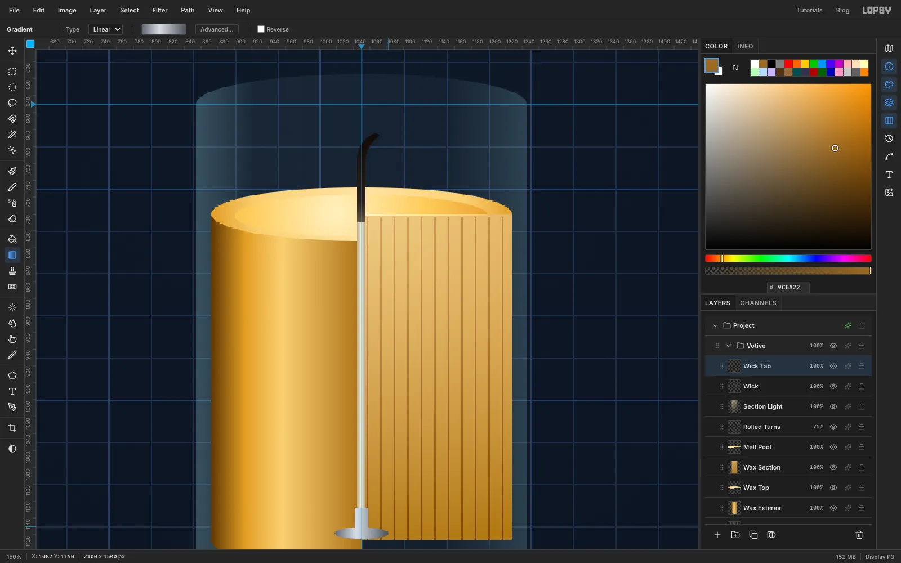

The wick sits exactly on the centre guide, and guide snapping would pull a
narrow marquee onto the guide. Turn off **View → Snap to Guides** before
you draw it. Zoom to about **150%** with [[Cmd]]+scroll over the candle.

Add a layer called *Wick*. Marquee a strip **10 px** wide centred on the
guide, from y **760** down to y **1152**. Fill it with a linear gradient
from `#B9AC8E` through `#F4EBD6` to `#A89B7E`, dragged across the strip, so
it looks round. Then use the **Lasso** to draw the charred top: up the
wick from the wax to about 90 px above it, curling over to the right in a
little hook. Fill it with a gradient from `#0E0A08` at the tip to
`#7A6A52` where it meets the wax.

Add a layer called *Wick Tab*. Draw a 64 × 14 ellipse at the bottom of the
wick and [[Shift]]-add a 16 × 30 box above it for the crimped neck. Fill it
with a grey metal gradient: `#5F6670`, `#D9DEE4`, `#4A5058`, dragged across
it.

## Hatch the cut glass

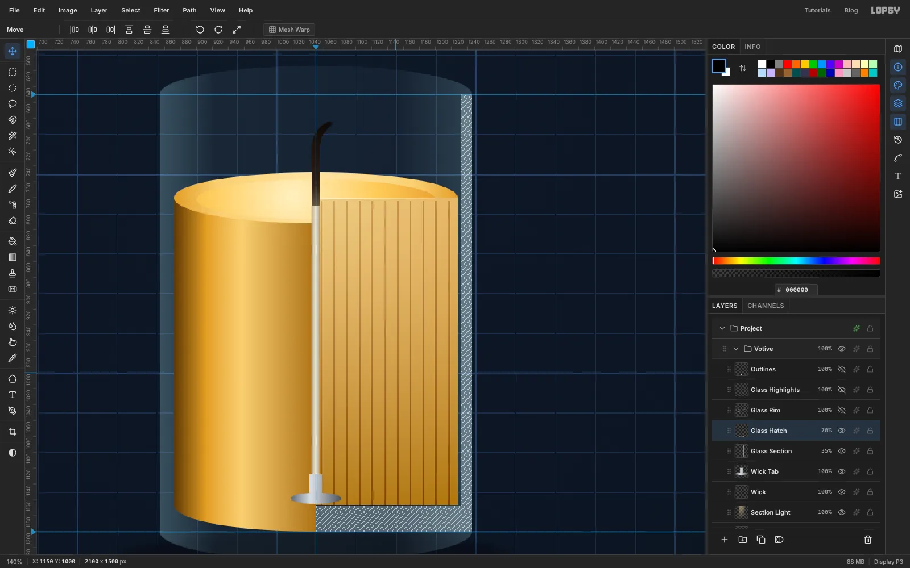

The saw also cut through the glass: its right wall and the right half of
its base. Add a layer called *Glass Section*. Marquee the right wall, a
14 px strip down the outside edge of the glass, and [[Shift]]-add the
right half of the base, the bottom 32 px. Fill it with `#D6E6EC` and set
the layer to **35%**.

Cut materials in drawings get 45° hatching. Add a layer called *Tile*, zoom
in to **1600%** on an empty spot and pick the **Pencil** at Size **1** with
`#DCEFF5`. Click one corner of a 6 × 6 px square and [[Shift]]-click the
opposite corner to draw a diagonal. Marquee the 6 × 6 square,
**Define Pattern**, and delete *Tile*. [[Cmd]]-click the *Glass Section*
thumbnail, add a layer called *Glass Hatch* and **Fill with Pattern** with
the diagonal. Set it to **70%**.

## Draw the glass rim

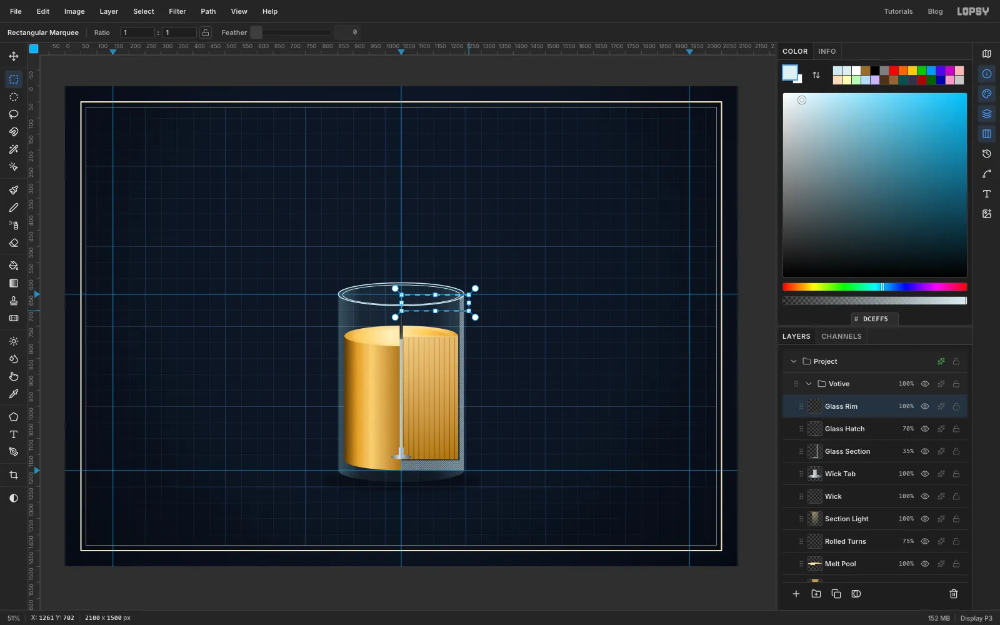

Add a layer called *Glass Rim*. Pick the **Shape** tool with **Ellipse**,
no fill, a `#CFEAF5` stroke and **Width 3**. Press on the rim guide at the
centre line and drag out a 392 × 72 ellipse. Set the width to **2** and
drag a slightly smaller one inside it, 364 × 62, for the inner edge of the
lip.

The front-right quarter of the rim was cut away with the rest. Marquee from
the centre of the rim down and to the right, past the edge of the glass,
and press [[Delete]].

## Add highlights and the inner walls

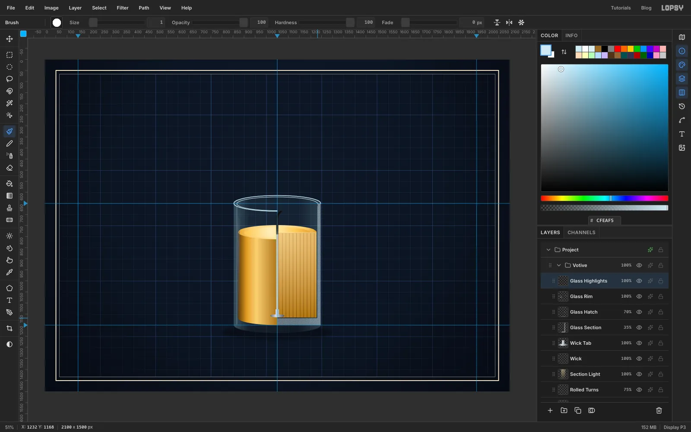

Add a layer called *Glass Highlights*. Marquee a strip 12 px wide just
inside the left edge of the glass, from just under the rim to just above
the base. Fill it with a vertical white gradient: **0%** at the top,
**75%** a third of the way down, **5%** at the bottom. Run
**Gaussian Blur** at **2**.

Click *Glass Back* and add a layer called *Glass Inner Wall*. Because it
sits under the wax, the lines you draw show only where the glass is empty.
Pick the **Brush** at Size **1**, Hardness **100**, with `#CFEAF5`. Click
14 px inside the left edge of the glass, just under the rim, and
[[Shift]]-click straight down to the base. Do the same 14 px inside the
right edge. Set the layer to **40%**.

## Keyline the glass and the wax

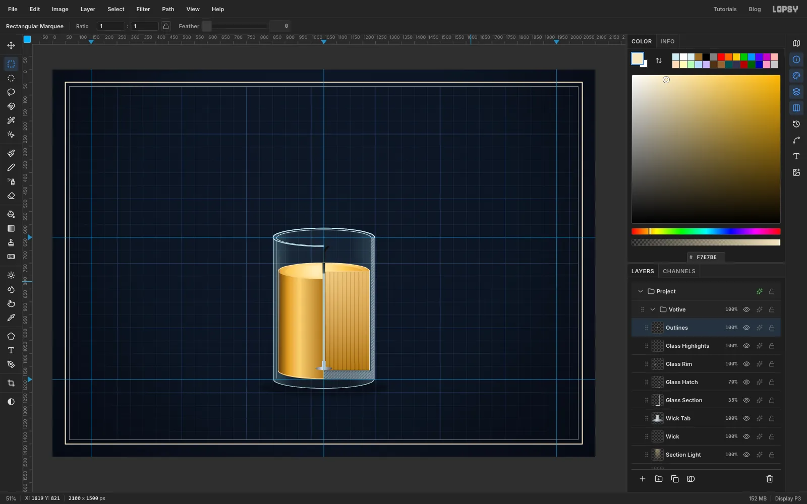

Click *Glass Highlights* and add a layer called *Outlines*. Rebuild the
glass selection from step 4: the box plus the two [[Shift]]-added
ellipses. Set the foreground to `#CFEAF5`, choose **Edit → Fill**, then
**Select → Shrink…** by **2** px and press [[Delete]]. That leaves a clean
2 px outline. It's anti-aliased, unlike the hard Stroke effect.

Do the same for the wax in `#F7E7BE`. Use the box from the top of the wax
to the bottom, [[Shift]]-add the top and bottom ellipses, and
[[Alt]]-subtract a box under the cut face so the bottom-right corner stays
square.

## Paste the reference photo

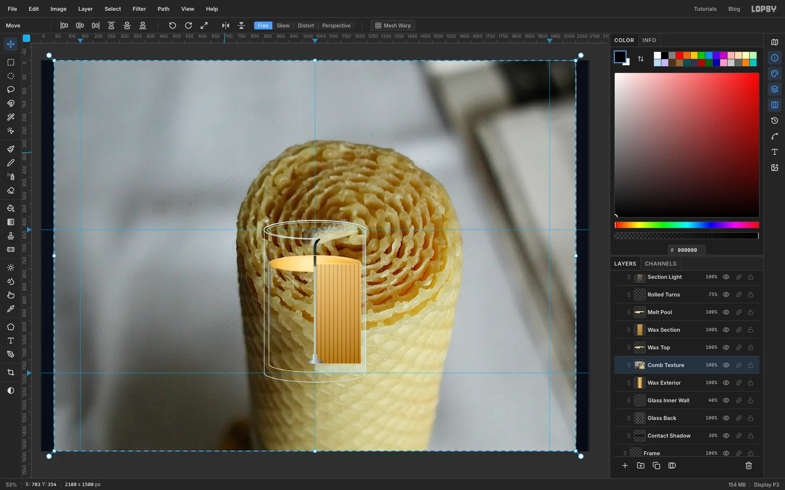

Click *Wax Exterior*, so the paste lands just above it. Open the downloaded
photo in another app, copy it, and press [[Cmd+V]] in Lopsy. The photo is bigger than the canvas, so Lopsy shrinks it to fit,
selects it and switches to the **Move** tool. Rename the layer
*Comb Texture*.

## Scale the photo down

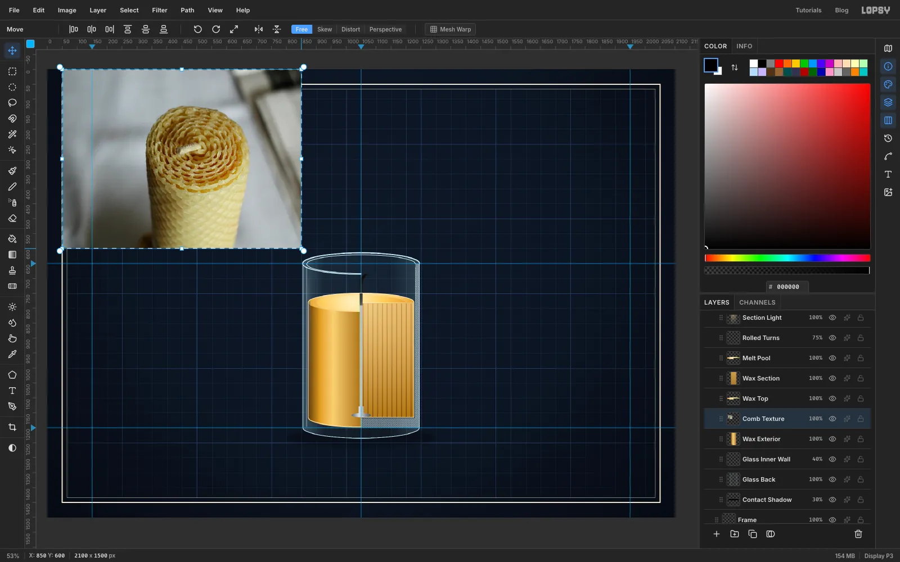

Hold [[Cmd]] and drag the bottom-right corner handle up and to the left
until the photo is about **40%** of its size, roughly 800 px wide. [[Cmd]]
keeps the proportions. Press [[Cmd+D]] to commit. At this size the
honeycomb cells are about the right scale for the candle.

## Cut out a band of honeycomb

With the **Rectangular Marquee**, select a band of the photo's honeycomb
side, below the spiral top and away from the curved edges. Choose
**Select → Inverse** and press [[Delete]], then [[Cmd+D]].

Soften its edges so copies will blend: [[Cmd]]-click the layer thumbnail,
choose **Select → Shrink…** by **10**, **Select → Feather…** by **10**,
**Select → Inverse** and press [[Delete]]. [[Cmd]]-click the thumbnail
again and drag the band onto the top-left of the wax.

## Stack copies down the candle

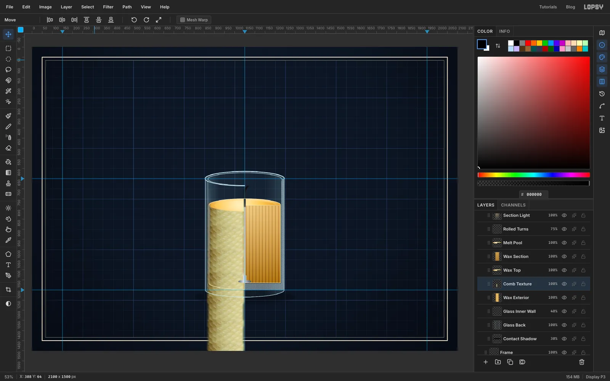

[[Cmd]]-click the thumbnail, press [[Cmd+C]] and then [[Cmd+V]]. A copy
made inside Lopsy pastes in place, on a new layer, already selected. Drag
it straight down so it overlaps the band above by about 35 px, press
[[Cmd+D]] and choose **Layer → Merge Down**. Repeat until the column of
honeycomb runs past the bottom of the candle. The soft edges hide the
joins.

## Clip the texture to the wax

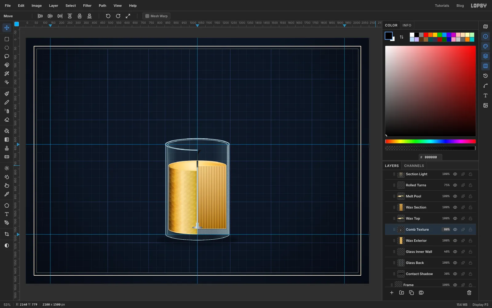

[[Cmd]]-click the *Wax Exterior* thumbnail to select the outside of the
candle. Click the *Comb Texture* row, choose **Select → Inverse** and
press [[Delete]]. Deselect, then choose **Filter → Desaturate**. In the
layer's drawer, set the blend mode to **Overlay** and the opacity to
**80%**. The cells now press into the gradient underneath.

## Draw the flame with the Pen tool

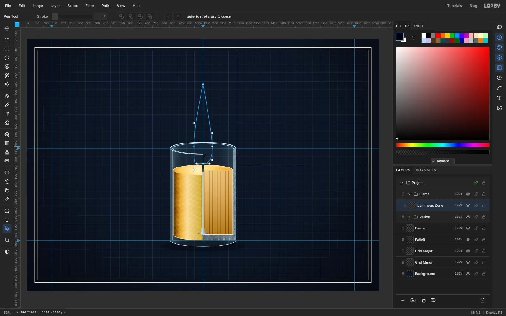

Collapse *Votive* and click **New Group** for a group called *Flame*. Add a
layer called *Luminous Zone*.

Pick the **Pen** tool. Start at the left side of the flame, 54 px left of
the centre line at y **640**. Press there and drag straight up about 140 px
to pull out a handle. Click once at the tip on the centre line, at y
**270**, for a sharp point. Press at the matching spot on the right and
drag down about 80 px. Press at the bottom of the flame, at y **742** on
the centre line, and drag 38 px to the left. Finally, click the first
anchor to close the path. It appears in the Paths panel as *Path 1*. While
it's selected there, its anchors stay on screen. Click the row again to
deselect it when you want a clean view.

## Fill the luminous zone

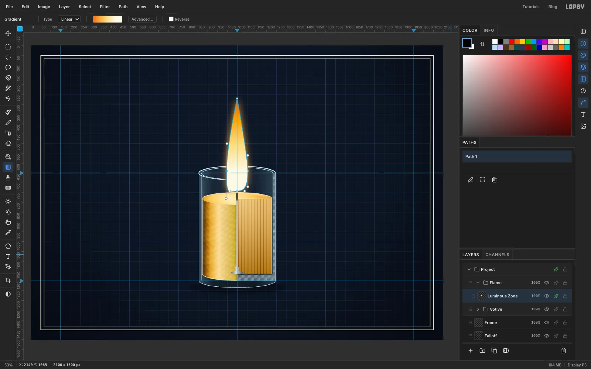

In the **Paths** panel, select *Path 1* and click **Path to Selection**.
Fill it with a linear gradient: `#FF6A1A` at the tip, `#FFAA33` at 22%,
`#FFE08A` at 50% and `#FFF9E6` from 78% to the bottom. Drag from the tip
to the base. Deselect.

Open the layer's effects drawer, turn on **Outer Glow** and set its
colour to `#FFB547`, **Size 48**, **Spread 10**, **Opacity 80**.

## Add the veil, dark zone and blue zone

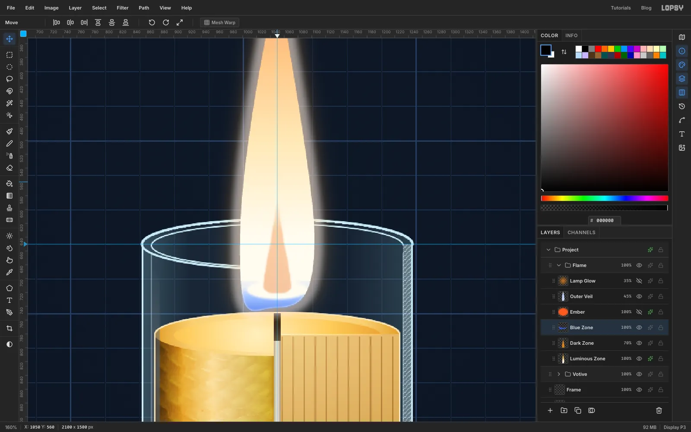

A candle flame has distinct zones, and the callouts will point at each one.

- **Outer veil:** add a layer called *Outer Veil*, load *Path 1* as a
  selection again, **Grow** it by **12** and **Feather** by **8**. Fill it
  with `#C9DBFF`, set the layer to **Screen** at **45%**.
- **Dark zone:** click *Luminous Zone* and add *Dark Zone* above it. With
  the **Lasso**, draw a narrow cone around the wick, from y **580** down to
  y **724** and about 40 px wide at the bottom. **Feather** by **2** and
  fill it with a gradient of `#E8962A` that starts transparent at the top
  and is solid a third of the way down. Set the layer to **70%**.
- **Blue zone:** add *Blue Zone*. Load *Path 1* as a selection. Hold
  [[Shift]]+[[Alt]] and drag a marquee across the bottom 40 px of the flame
  to intersect. Then [[Alt]]-drag an 88 × 28 ellipse just above the flame's
  base to subtract it. A thin crescent is left. **Feather** by **3** and
  fill it with `#4A78FF`, transparent at the top and solid at the bottom.

## Light the ember and the lamp glow

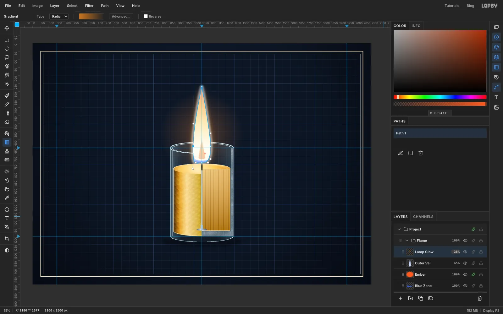

With *Blue Zone* selected, add a layer called *Ember*. Zoom in on the curled wick tip, draw a 10 × 8
ellipse over it and fill it with `#FF5A1F`. Give it an **Outer Glow** in
`#FF7A1A`, **Size 8**, **Opacity 90**.

Click *Outer Veil* and add a layer called *Lamp Glow* above it. Fill it
with a radial gradient of `#C8741E`: full opacity at the centre, **50%**
opacity halfway out and transparent at the edge, dragged from the middle of the flame about 260 px
out. Set it to **Screen** at **35%**. Keep the glow small. A big one turns
the navy board muddy.

## Draw the leader lines

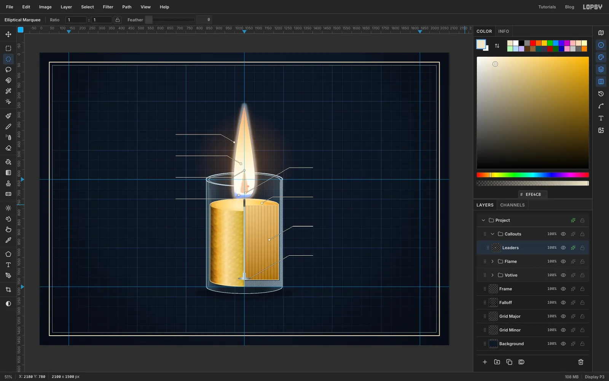

Collapse *Flame*, click **New Group** and call it *Callouts*. Add a layer
called *Leaders*. Pick the **Brush** with **Size 2**, **Hardness 100** and
**Spacing 10** (percent of the brush size), in `#EFE4C8`.

Each leader starts beside a bubble, runs level, then turns at **30°** to
its target. Put the left bubbles at x **680**, 110 px apart starting at y
**420**. Put the right bubbles at x **1420**, 150 px apart starting at y
**590**. For each leader, click 19 px from the bubble's centre, then
[[Shift]]-click the elbow, then [[Shift]]-click the target. To keep every
diagonal at 30°, put the elbow 1.73 times as far sideways from the target
as it is up or down.

Add a 10 px dot at each target by [[Shift]]-adding small elliptical
marquees and filling them. Then give the layer a **Drop Shadow** in
`#070B14` with **Offset 0 / 0**, **Blur 3**, **Spread 40**, **Opacity 90**.
That dark halo keeps the lines readable where they cross the bright flame.

## Add the number bubbles

Add a layer called *Bubbles*. Pick the **Shape** tool with **Ellipse**,
fill `#101827`, stroke `#D9A441`, **Width 3**. Click, don't drag, on each
bubble position. Each click opens the **Shape Size** dialog. Enter
**38 × 38** and click **Create**.

## Show the airflow

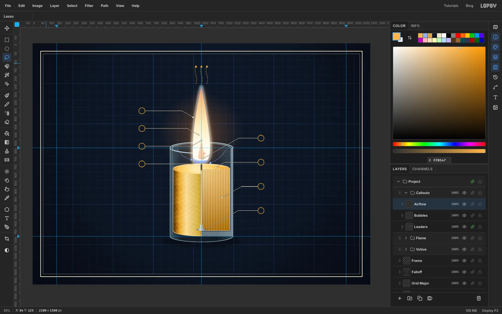

Add a layer called *Airflow*. Set the **Brush** to **Size 5**,
**Spacing 260** (percent) and **Hardness 100**. The high spacing turns a stroke into
a row of dots. In `#8FB0FF`, drag a curve from just outside the rim on each
side, sweeping down into the base of the flame. Cool air feeds the flame
from below. In `#FFB547`, drag three short wavy strokes rising straight up
from above the tip for the hot gas.

Add arrowheads: **Lasso** a small triangle at the end of each stroke,
[[Shift]]-adding the others, and fill them in the matching colours.

## Dimension the glass

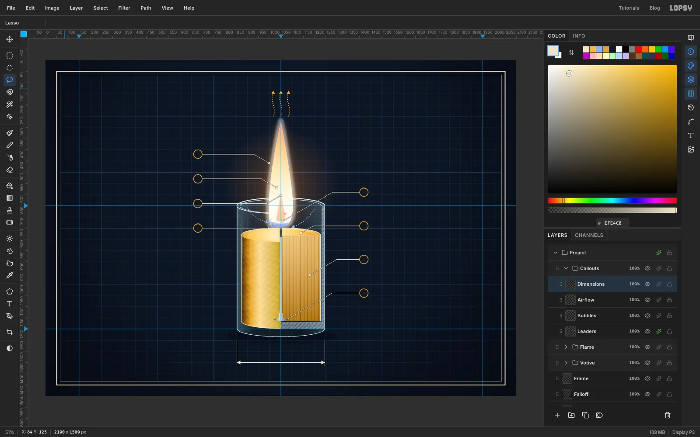

Add a layer called *Dimensions*. With the **Brush** at **Size 1** and
normal spacing in `#EFE4C8`, [[Shift]]-click a line straight down from
each side of the glass, from just under the base shadow to about y
**1366**. At **Size 2**, draw the dimension line between them at y
**1350**, and **Lasso** and fill an arrowhead at each end.

## Label the callouts

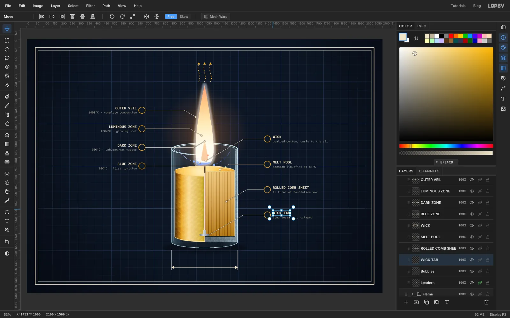

Hide the guides with **View → Show Guides** for now, so no click lands on
one. Click the *Bubbles* layer before you set up the type.

Pick the **Text** tool. Choose **Red Hat Mono**, **Regular**, **Size 17**,
colour `#BCB39B` and **Align Right**. Click 14 px left of each left-hand
bubble and type its detail line: `1400°C · complete combustion`,
`1200°C · glowing soot`, `600°C · unburnt wax vapour` and
`800°C · first ignition`. Press [[Tab]] to commit each one. Switch to
**Align Left** and type the right-hand lines 14 px right of their bubbles:
`braided cotton, curls to the air`, `beeswax liquefies at 63°C`,
`11 turns of foundation wax` and `zinc sustainer, crimped`.

Then set **SemiBold**, **Size 21**, `#EFE4C8` and type the names above:
*OUTER VEIL, LUMINOUS ZONE, DARK ZONE, BLUE ZONE* on the left and
*WICK, MELT POOL, ROLLED COMB SHEET, WICK TAB* on the right. Type the
lower lines first: a click inside an existing line edits it.

With the **Move** tool and the arrow keys, nudge each pair so the bubble
sits halfway between the two lines: the name just above its centre, the
detail line just below.

## Number the bubbles

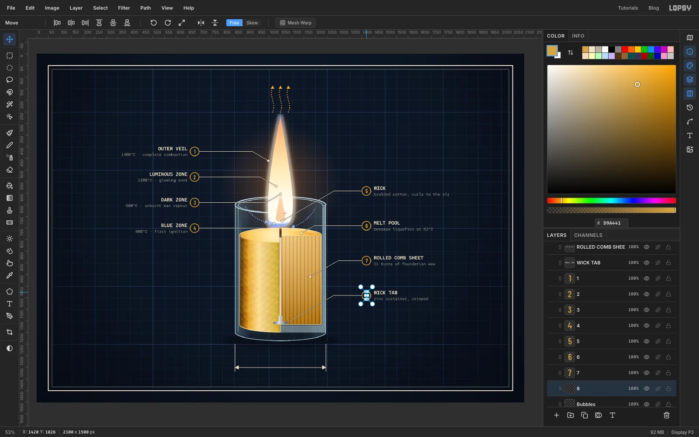

Click *Bubbles* again. Set the Text tool to **Barlow Condensed**,
**SemiBold**, **Size 24**, `#D9A441`, **Align Center**. Click in each
bubble, type its number and press [[Tab]]. Nudge each numeral so it sits
in the middle of its ring. Then turn the guides back on with
**View → Show Guides**.

## Put the wick inside the flame

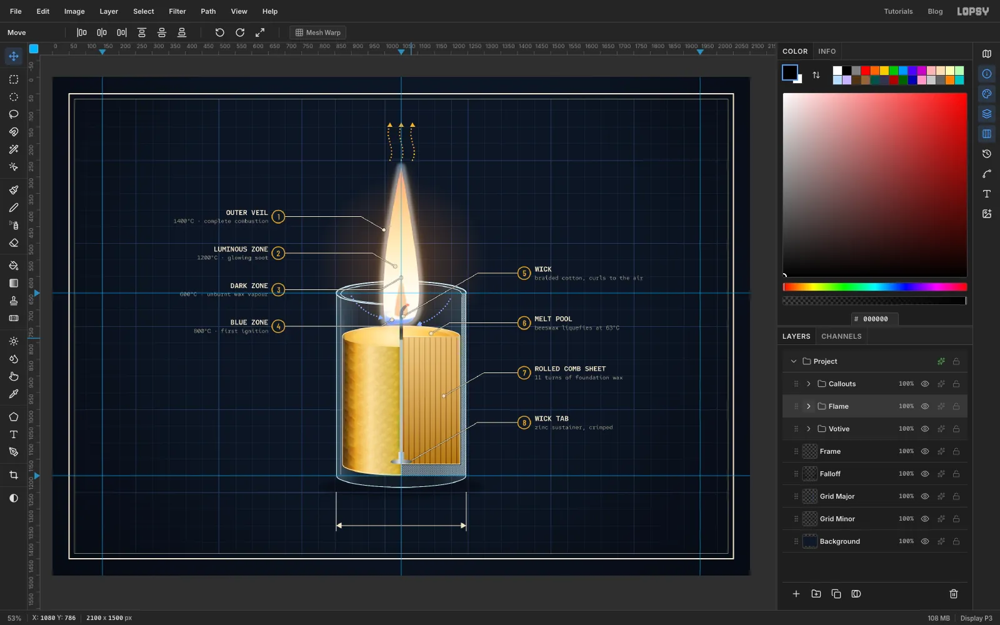

The flame is painted over the wick, but a real wick shows through the dark
zone. Expand *Votive*, click *Wick* and marquee its charred top. Press
[[Cmd+C]] and deselect. Collapse *Votive*, expand *Flame* and click
*Dark Zone*. Press [[Cmd+V]]: the copy pastes in place right above it.
Rename it *Wick In Flame* and set it to **85%**.

## Set the title

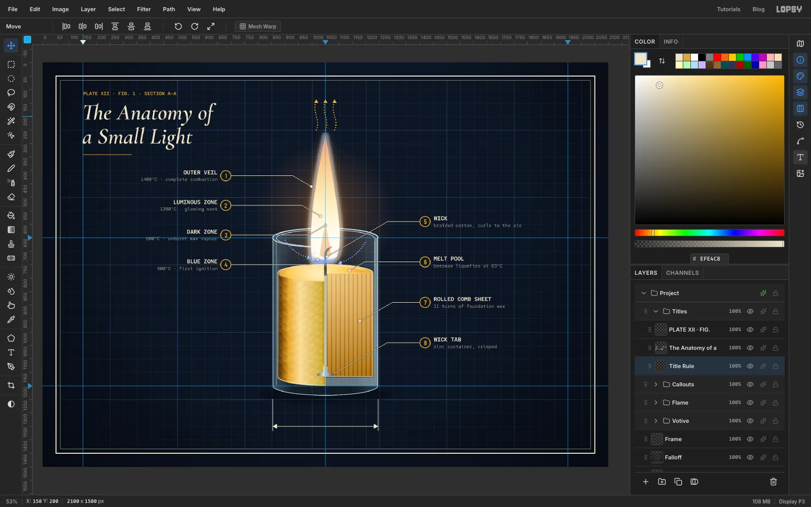

Collapse *Flame*, click *Callouts* and make a **New Group** called
*Titles*. Add a layer called *Title Rule* and draw a short honey line with
the **Brush** at **Size 3** under where the title will go, from the left
margin about 180 px across.

With *Title Rule* selected, set the Text tool to **Red Hat Mono**,
**SemiBold**, **18**, `#D9A441`, **Align Left**. Type the kicker
`PLATE XII · FIG. 1 · SECTION A–A` on the left margin near the top.
Click *Title Rule* again and switch to **Cormorant Garamond**,
**SemiBold**, **Italic**, **84**, `#EFE4C8`. Click below the kicker and type
`The Anatomy of`, press [[Enter]] and type `a Small Light`, then
[[Tab]].

The default leading is loose for a display title. Open the **Text** panel
and set **Line height** to **1.05**, then nudge the title so it sits
between the kicker and the rule. The Text panel also sets the default for
new type, so click *Title Rule* and set **Line height** back to **1.4**.

## Add the greeting and a spec list

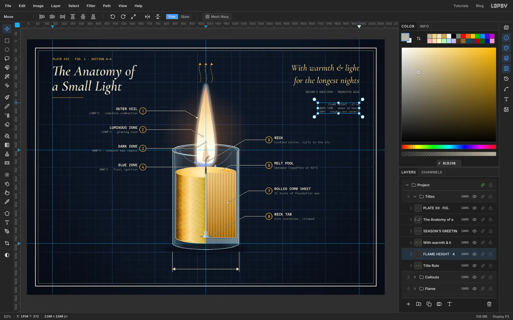

With *Title Rule* selected, set **Red Hat Mono**, **Regular**, **15**,
`#BCB39B`, **Align Right**. Click on the right margin guide and type
`SEASON’S GREETINGS · MIDWINTER 2026`. Then switch to
**Cormorant Garamond**, **Medium**, **Italic**, **52**, `#F3D27E` and type
the greeting above it in two lines: `With warmth & light` and
`for the longest nights`. With **Align Right**, each line ends where you
clicked, so both blocks finish exactly on the margin.

Below them, in the small mono style, type three lines of specs:
`FLAME HEIGHT · 47 mm`, `BURN TIME · about 18 hours` and
`LIGHT · roughly one candela`. The candela, the unit of light, started out
as the brightness of a candle.

Finally, set **Align Center**, **Size 17**, `#EFE4C8` and type `Ø 64 mm`
centred just above the dimension line.

## Rotate a margin note

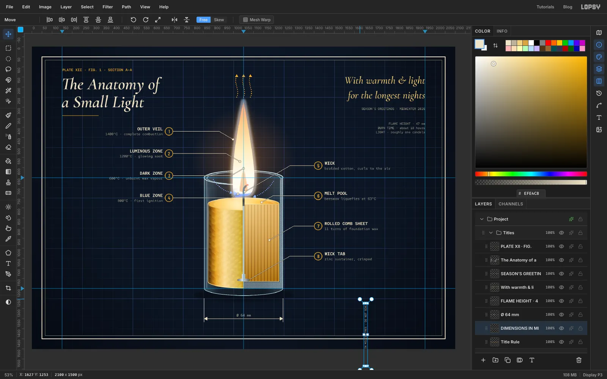

Set the Text tool to **Size 13**, `#EFE4C8`, **Align Left**, click in an
empty area and type `DIMENSIONS IN MILLIMETRES · DO NOT SCALE`. Pick the
**Move** tool. The text gets transform handles without a selection. Hold
[[Cmd]] and drag the round rotation handle off the top-right corner a
quarter turn anticlockwise. [[Cmd]] snaps the angle to 15° steps, so it
lands on exactly 90°. The text stays editable.

Nudge it into the gap between the right-hand labels and the border,
centred top to bottom, and set the layer to **60%**.

## Build the title block

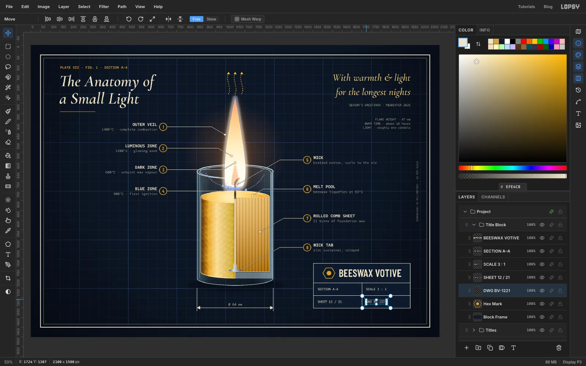

Collapse *Titles*, click it and make a **New Group** called *Title Block*.
Add a layer called *Block Frame*. With the **Shape** tool on **Rectangle**,
fill `#111A2B`, stroke `#EFE4C8` at **Width 2**, click in the bottom-right
corner and create a **497 × 230** box. Its left edge should line up with
the right-hand labels and its right edge with the margin guide. Draw
three 1 px **Brush** lines inside it: one across 100 px below the top, one
65 px below that, and one down the middle of the two lower rows.

Add a layer called *Hex Mark*. Set the Shape tool to **Polygon**, type
**6** in **Sides**, remove the fill and use a honey **Width 3** stroke.
Click near the left of the top row and make a **62 × 62** hexagon. Then switch to a honey
fill with no stroke and click-create a **26 × 26** hexagon in its centre.

Type `BEESWAX VOTIVE` in **Barlow Condensed**, **SemiBold**, **54**,
`#EFE4C8` to the right of the hexagon. Then nudge the hexagon and the
wordmark together until the space on their left equals the space on their
right. In the four cells, type `SECTION A–A`, `SCALE 3 : 1`,
`SHEET 12 / 21` and `DWG BV-1221` in **Red Hat Mono Medium 16**, 22 px from
each cell's left rule.

## Cut the spiral top out of the photo

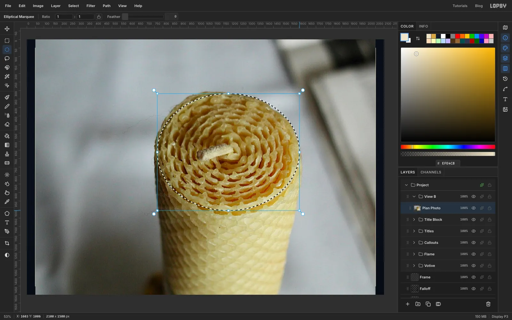

Collapse *Title Block* and make a **New Group** called *View B*. You've copied
other things since the last paste, so go back to the photo in your other
app and copy it again. Then press [[Cmd+V]] and rename the layer
*Plan Photo*. Deselect.

Drag an **Elliptical Marquee** around the spiral top of the candle, just
inside its outer turn. In the photo the top is seen at an angle, so the
ellipse is wider than it is tall. Choose **Select → Inverse**, press
[[Delete]] and deselect.

## Stretch it into a circle

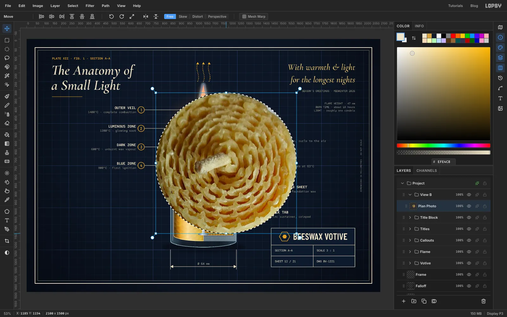

A plan view looks straight down, so the ellipse should be a circle.
[[Cmd]]-click the *Plan Photo* thumbnail, then drag the **bottom-middle**
handle down until the transform box is square. Without [[Cmd]], an edge
handle stretches one way only. Press [[Cmd+D]].

[[Cmd]]-click the thumbnail again and [[Cmd]]-drag a corner to shrink it
to about **388 px** across, then press [[Cmd+D]]. Drag it into the
bottom-left corner. The spiral's centre sits a little off the photo's
centre, so nudge it until the wick sits about 170 px right of the left
margin guide and level with the middle of the gap between the labels and
the bottom border. Draw a **344 px** circle marquee centred on the wick, choose **Select → Inverse** and
press [[Delete]]. That trims a clean round edge whose left side sits on
the margin guide.

## Tone the photo with a Photo Filter

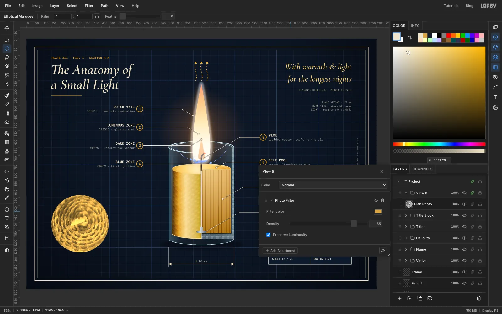

Run **Filter → Brightness/Contrast…** with **Brightness 25** and
**Contrast 30**, then **Filter → Desaturate**. Click the *View B* group
row and open its drawer. Groups get adjustments instead of effects. Click
**Add Adjustment → Photo Filter**, set **Filter color** to `#D9A441` and
**Density** to **85**. Everything inside *View B* is toned to the wax's
honey. That's why the next step puts the annotations in a group of their
own.

## Mark the section line on the plan

Collapse *View B* and make a **New Group** called *View B Notes* above it.
Add a layer called *Plan Ring* and click-create a **344 × 344** ellipse
with a cream **Width 3** stroke and no fill, centred on the plan.

Drafting centre lines are **chain lines**: long dash, gap, short dash, gap.
You'll make them as patterns. Patterns repeat from the top-left corner of
the canvas, so plan the tile first. It will be 24 px tall, and the dash has
to fall on the plan's centre line. Divide the centre line's distance from
the top by 24 and look at the remainder. That's how many pixels down the
tile the dash goes (3 for this layout). Do the same with 24 and the
distance from the left for the upright tile (10 here).

Add a *Tile* layer and zoom right in on an empty spot. Fill a 24 × 2 px dash,
then a 4 px gap, a 4 × 2 px dash and another 4 px gap, and define a
**36 × 24** pattern around them with the dashes at that height. Make the
matching upright tile, **24 × 36**, and define that too. Delete *Tile*.

Click *Plan Ring*. Marquee a **24 px tall** band across the plan's centre,
reaching 24 px past the ring on each side, and **Fill with Pattern** with
the flat tile. Then marquee a 24 px wide band down through the centre and
fill it with the upright tile.

Still on *Plan Ring*, mark the cutting plane A–A along the horizontal
line. With the **Brush** at
**Size 4**, draw a 30 px heavy stroke at each end of that line. At
**Size 2**, draw a short arrow pointing up from each end and fill **Lasso** arrowheads.
Type an `A` above each arrow in **Barlow Condensed SemiBold 24** honey, and
rename the two layers *Section A Left* and *Section A Right* so you can
tell them apart.

Add a layer called *Plan Glass Ring* with a **372 × 372** pale-blue
`#CFEAF5` ellipse stroke at **Width 2** and **60%** opacity. It shows the
glass wall around the wax.

## Caption View B and add its arrow

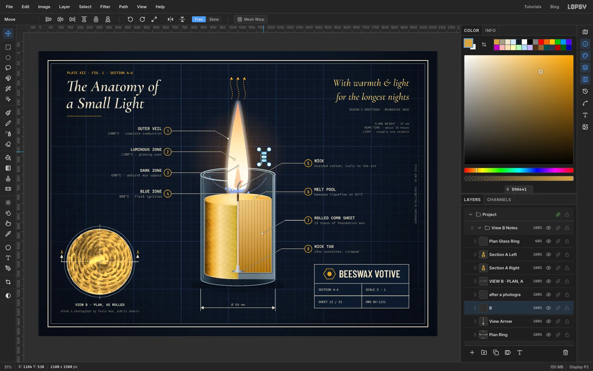

Under the plan, type `VIEW B · PLAN, AS ROLLED` in **Red Hat Mono
SemiBold 18** cream, centred, sitting on the same baseline as the
`Ø 64 mm` label. Below it, in **15 px** `#A69E88`, type the credit
`after a photograph by Paolo Neo, public domain`.

The main drawing needs to show where View B is seen from. Add a layer
called *View Arrow* and draw a short downward arrow just above the
right-hand rim, with the **Brush** at **Size 3** and a **Lasso** head.
Type a honey `B` beside it.

## Bring the front lip in front of the flame

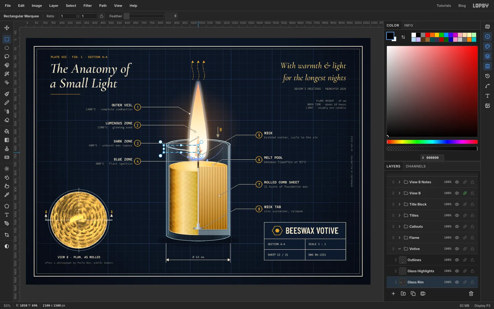

The flame's base sits inside the glass, so the front of the rim should
cross in front of it. Expand *Votive*, click *Glass Rim* and marquee its
front-left arc, from the left edge of the glass to the centre line, just
under the rim guide. Press [[Cmd+C]] and deselect. Collapse *Votive*, expand
*Flame*, click its top layer and press [[Cmd+V]]. Rename it *Rim Front* and
set it to **65%**.

## Turn the plan photo

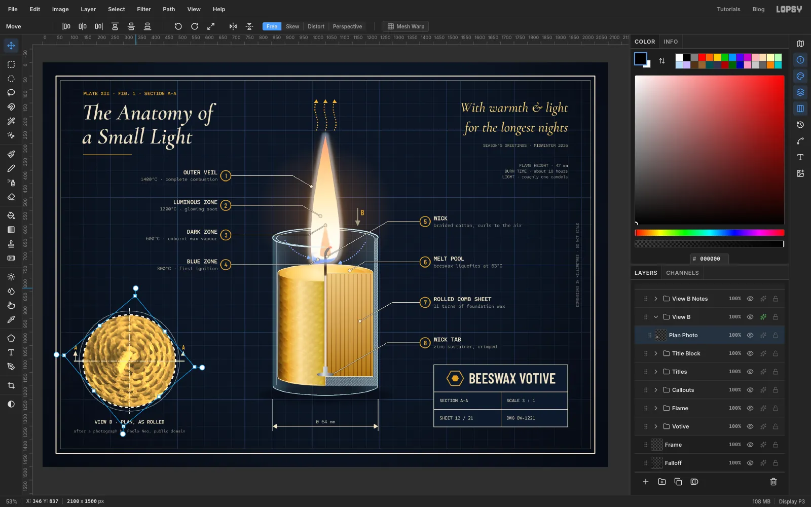

Expand *View B*, click *Plan Photo* and [[Cmd]]-click its thumbnail. With
the **Move** tool, drag one of the round rotation handles off a corner
about **40°** anticlockwise, so the wick's tail points up and to the left
and stays clear of the crosshair. A circle stays a circle when it turns,
so the clean edge isn't affected. Press [[Cmd+D]].

## Finish with grain

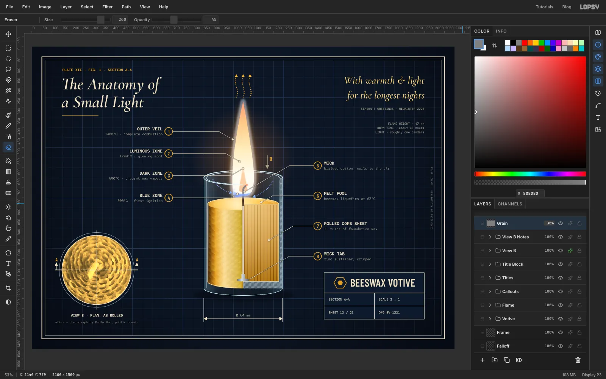

Collapse every group, click *View B Notes* and add a layer called *Grain*.
It lands above everything. Set the foreground to `#808080`, choose
**Edit → Fill**, then run **Filter → Add Noise…** with **Amount 16**,
**Mono** and **Gaussian**. Set the layer to **Overlay** at **30%**. Mid
grey vanishes in Overlay and leaves only a fine printed texture.

Save with **File → Save Project** and export with
**File → Quick Export PNG**.
