Classic car culture has its own lettering. Look at the back of any 1950s
car and you'll find the model name in chrome script, bolted to the trunk.
Eighties chrome type took the same idea further: blue sky on top, a hard
horizon line through the middle, and warm brown ground reflected underneath.
In this tutorial you'll use both looks for a flier.

You'll make a flier for **Yesteryear Autos**, an imaginary classic car show
and cruise night. A chrome script and a block of chrome capitals sit on a
midnight-blue page. They hang above a chrome-framed photo of a hot rod's
grille, with pinstripe flourishes either side. Underneath, the date, time
and address follow the same chrome-and-orange system, so the whole flier
hangs together. You'll build it at **1275 × 1650 px**, the shape of a US
Letter sheet.

The photo is [Macro of vintage grille and headlight](https://commons.wikimedia.org/wiki/File:Macro_of_vintage_grille_and_headlight_(Unsplash).jpg)
by Clem Onojeghuo on Wikimedia Commons. It's in the public domain (**CC0**),
so you can use it freely. Download the 1920 px version. Any close-up of a
car's grille and headlight will work the same way.

Along the way you'll use:

- the **Gradient** tool for chrome, a sky and a glow, plus **Halftone**, **Emboss** and **Bloom**
- the **Shape** tool for rounded rectangles and a stroked circle, and the **Pen** for a curved path
- pasting, scaling and clipping a photo, **Color LUT** and **Brightness/Contrast**
- **Grow**, **Inverse**, **Feather** and ⌘-clicking layer thumbnails to load selections
- layer effects: **Stroke**, **Drop Shadow**, **Outer Glow** and **Inner Glow**
- text in **Yellowtail**, **Racing Sans One**, **Bebas Neue** and **Barlow Condensed**, including text on a path
- the **Brush** with **Taper** and **Symmetry**, the **Eraser**, and copy, paste and **Merge Down**
- rotating layer groups with the **Move** tool, ruler guides and the grid

The palette:

- Night sky `#050913` → `#0F1A33` → `#1C2546` → `#0A0D1A`
- Chrome lettering `#EEF6FF` → `#7FA6D6` → `#F8FBFF`, horizon `#5A2A0E` → `#B8662A` → `#E08A3C` → `#FFD08A`
- Chrome frame `#F2F7FF` → `#8FB0DA` → `#F6FAFF`, horizon `#3A2C22` → `#B8763E` → `#E9C9A0` → `#FFF0D8`
- Extrusion maroon `#4A1606`, outline ink `#070B16`
- Hot rod orange `#F26A1B`, glow orange `#E8601C`, glow plum `#8A2E3A`
- Panel navy `#0B1020`, badge navy `#0B1226`, address navy `#0A1022`
- Cream `#F3E6CC` (type and pinstripes), halo cream `#F3E3C8`, steel blue `#BAC6DA`

New layers always appear above whichever layer is selected. Before each
section, you'll select a layer at the right level of the stack and collapse
any open group.

## Set up the canvas, guides and grid

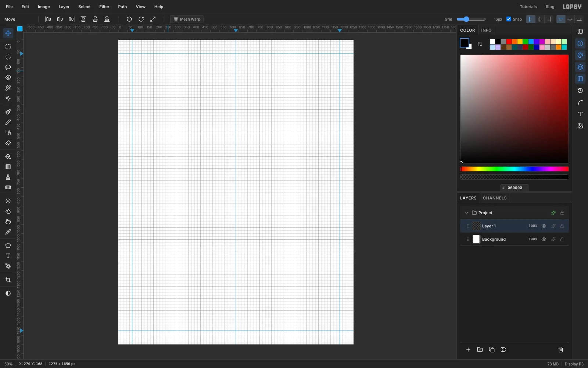

Choose **File → New**, check that the unit is **Pixels**, enter
**1275 × 1650**, and click **Create**. The document comes with an empty
*Layer 1* above the white *Background*.

Make sure **View → Show Guides** is ticked. Click the top ruler at **75**,
**637** and **1200** to drop three vertical guides: two margins and the
centre line. Then click the left ruler at **75** and **1575** for the top
and bottom margins. Turn on **View → Show Grid** to check that the guides
sit where you expect, then turn it off again. Snap is on by default,
so shapes and marquees will catch the guides. Leave the grid off while
you work: with the grid showing, rotations snap to 15° steps, which would
spoil the small tilts later on.

## Paint the night sky

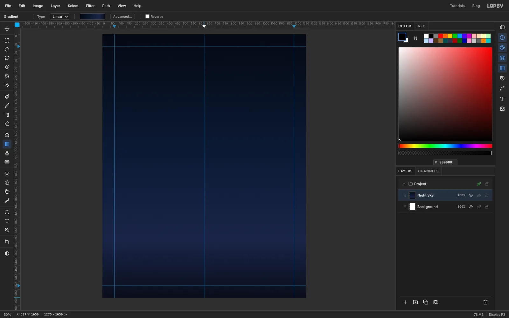

Double-click *Layer 1*'s name and rename it *Night Sky*. Pick the
**Gradient** tool, set **Type** to **Linear**, and click **Advanced…** to
open the Gradient Editor. Give it four stops: `#050913` at the left,
`#0F1A33` at 45%, `#1C2546` at 78% and `#0A0D1A` at the right. To add a
stop, click the bar where you want it, then type its hex code. Click
**Done**.

Drag from the top edge of the canvas straight down to the bottom edge.
Hold [[Cmd]] while you drag to keep the line vertical.

## Add a warm glow behind the photo

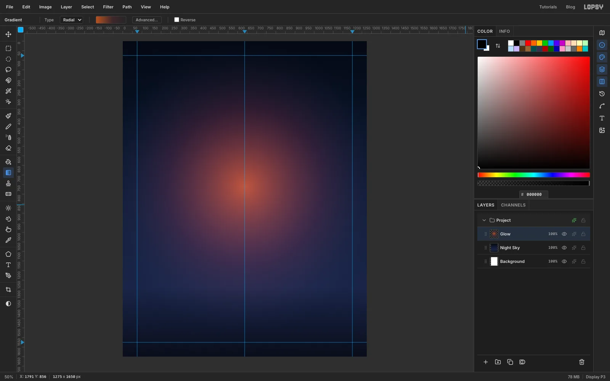

Click **Add Layer** at the bottom of the Layers panel and name the new layer
*Glow*. In the Gradient tool, switch **Type** to **Radial**. In the editor,
set three stops:

- `#E8601C` at the left, with opacity **75%**
- `#8A2E3A` at the middle, with opacity **25%**
- `#1C2546` at the right, with opacity **0**

Drag from a point a little above the centre of the page out past the right
edge.

Open the layer's drawer with the effects button on its row and set the
blend mode to **Screen**. The glow now brightens the sky instead of
covering it.

## Turn a gradient into a halftone dot field

Add another layer called *Dots*. Set the gradient to two stops, white at
the left and black at the right, keep it **Radial**, and drag from the
middle of the page out well past the right edge.

Choose **Filter → Halftone…**, set **Dot Size** to **14** and **Angle** to
**45**, and click **Apply**. The gradient breaks into dots that are big in
the middle and tiny at the edges. In the layer's drawer, set the blend mode
to **Screen**. Then click the **100%** opacity readout on the row and drag
the slider down to **9%**. You're left with a faint printed texture, like
an old screen-printed poster.

## Draw the rounded photo panel

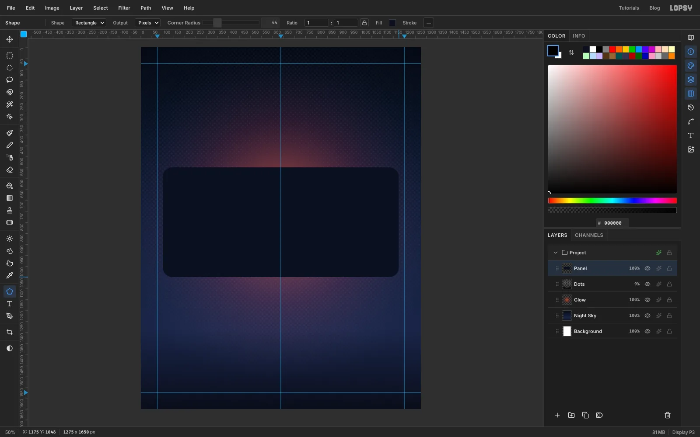

With *Dots* selected, add a layer called *Panel*. Pick the **Shape** tool
and set **Shape** to **Rectangle**, **Output** to **Pixels** and **Corner
Radius** to **44**. Click the **Fill** swatch and set it to `#0B1020`. If
the **Stroke** swatch shows a colour, open it and click **Remove stroke**.

The Shape tool grows from the centre, so press where you want the middle
of the panel. That's on the centre guide, a little below the middle of the
page (about y 800). Drag out toward the bottom right and stop about 25 px
short of the right margin guide (x 1175), when the panel is
**1075 × 500 px**. The gap leaves room for the chrome frame.

## Fill a chrome bezel around it

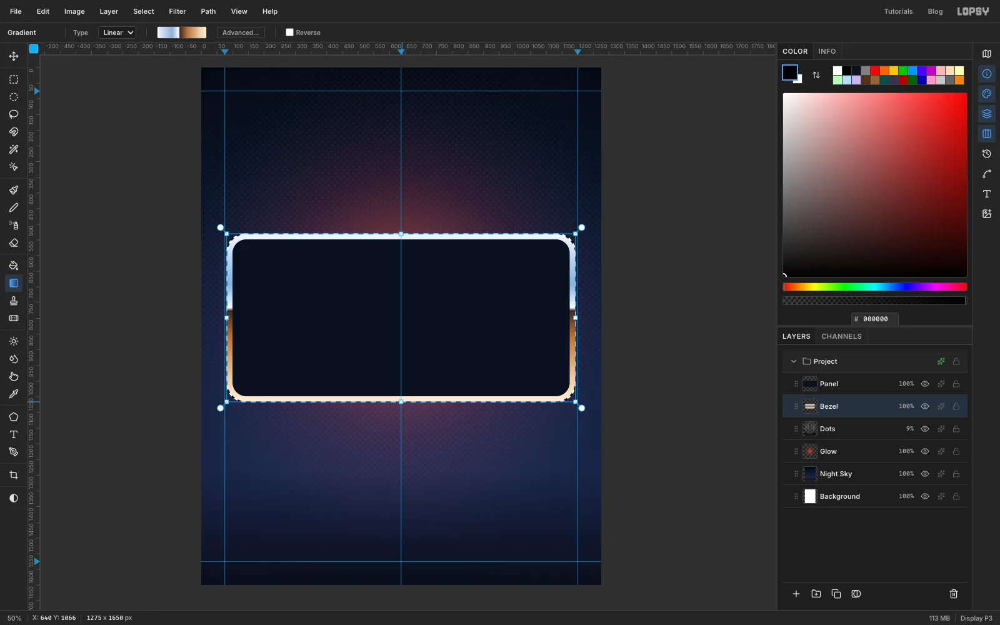

Select *Dots* again and add a layer called *Bezel*. It sits under *Panel*.
[[Cmd]]-click the *Panel* thumbnail to load its shape as a selection. Then
choose **Select → Grow…**, enter **18** and click **Apply**.

Pick the **Gradient** tool, set **Type** to **Linear**, and open the
Gradient Editor. Give the frame its own chrome ramp:

- `#F2F7FF` at 0%
- `#8FB0DA` at 30%
- `#F6FAFF` at 44%
- `#3A2C22` at 46% (the hard horizon)
- `#B8763E` at 62%
- `#E9C9A0` at 85%
- `#FFF0D8` at 100%

Drag from the top edge of the selection straight down to its bottom edge,
holding [[Cmd]].

Press [[Cmd+D]] to deselect.

## Paste the photo and scale it up

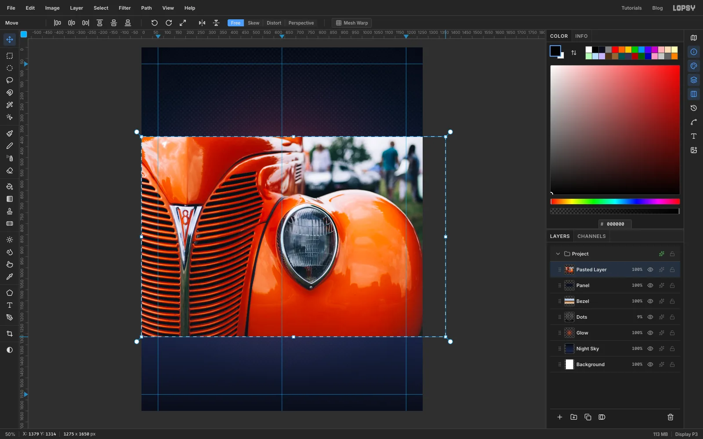

Open the grille photo in another tab, copy it, and come back to Lopsy.
Click the *Panel* row and press [[Cmd+V]]. The photo lands as a new *Pasted
Layer* above *Panel*, shrunk to the width of the canvas, with transform
handles around it.

It needs to be a bit bigger. Hold [[Cmd]] (to keep its proportions) and
drag the bottom-right corner handle outward, until the photo's right edge
sits about 100 px past the canvas (roughly 1380 px wide).

## Position the photo and clip it to the panel

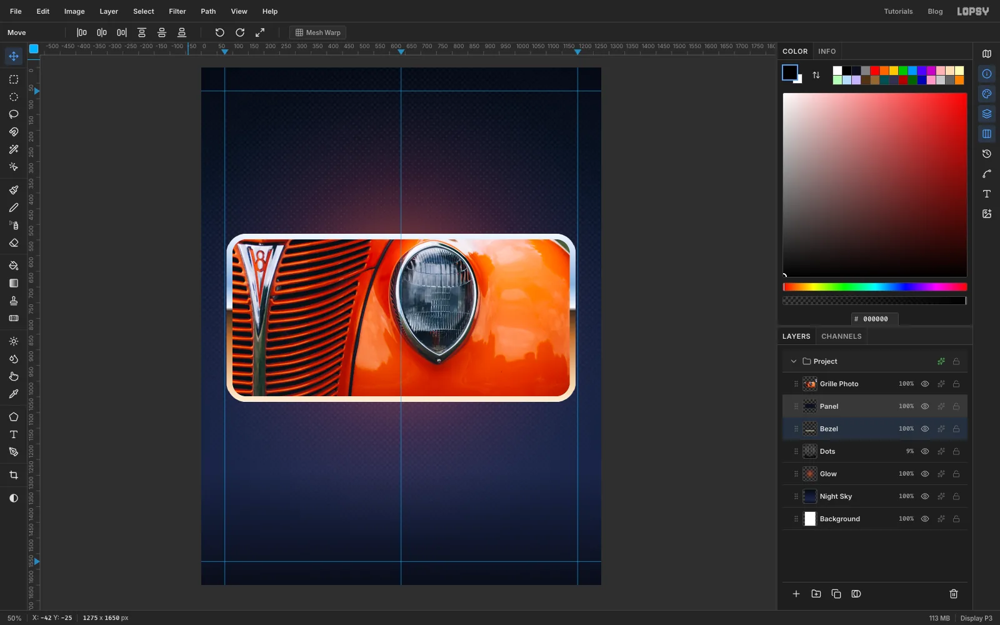

Drag the photo with the **Move** tool until the headlight sits a little
right of the panel's centre. The orange fender should fill the panel's top
edge, so no blurry background shows above it. Press [[Escape]] (or
[[Cmd+D]]) to commit the transform. Either key works for every transform
in this tutorial. Rename the layer *Grille Photo*.

Now trim it. [[Cmd]]-click the *Panel* thumbnail, choose
**Select → Inverse**, click the *Grille Photo* row and press
[[Delete]]. Deselect.

Then hollow out the bezel. Click *Bezel*, [[Cmd]]-click the *Panel*
thumbnail again and press [[Delete]]. That leaves an 18 px chrome ring.
Deselect again.

## Grade the photo with a Color LUT

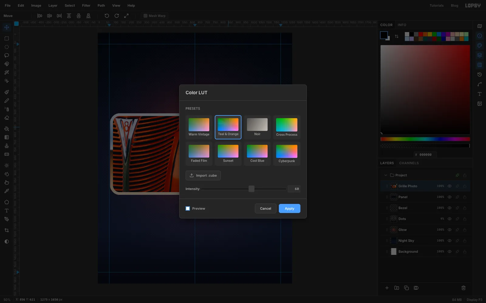

Click *Grille Photo* and choose **Filter → Color LUT…**. Pick the **Teal &
Orange** preset, set **Intensity** to **60** and click **Apply**. The car
gets even more orange. The blurry lawn and the shadows go cool and dark, so
they sit nicely with the navy page.

## Add contrast to the photo

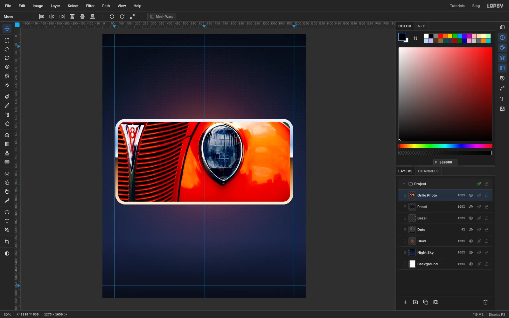

Choose **Filter → Brightness/Contrast…** and set **Brightness** to
**-6** and **Contrast** to **22**.

To compare before and after, press [[Cmd+Z]] twice to step back through both
grades, then [[Cmd+Shift+Z]] twice to bring them back.

## Style the bezel

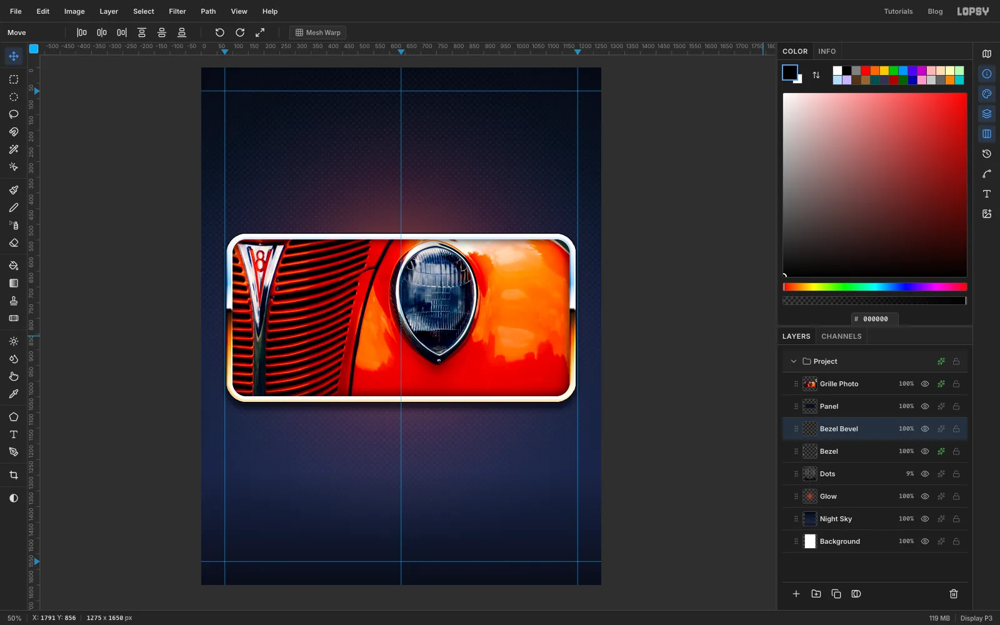

Three things make the frame look like solid metal.

1. **Recess the photo.** With *Grille Photo* selected, open its effects
   drawer and turn on **Inner Glow**. Set the colour to `#050913`,
   **Size 46**, **Spread 10** and **Opacity 85**. The photo now looks set
   back behind the frame.
2. **Outline and lift the frame.** Click *Bezel* and turn on **Stroke**:
   colour `#070B16`, **Width 3**, position **outside**. Then turn on
   **Drop Shadow**: colour `#02040A`, **Offset X 0**, **Offset Y 18**,
   **Blur 30**, **Opacity 80**.
3. **Bevel the edge.** Choose **Layer → Duplicate Layer** and rename the
   copy *Bezel Bevel*. In its drawer, untick **Stroke** and **Drop Shadow**.
   Run **Filter → Emboss…** with **Angle 120** and **Strength 60**, then
   set its blend mode to **Overlay**. The grey relief disappears, and only
   the light and dark edges are left on the chrome.

## Group the panel

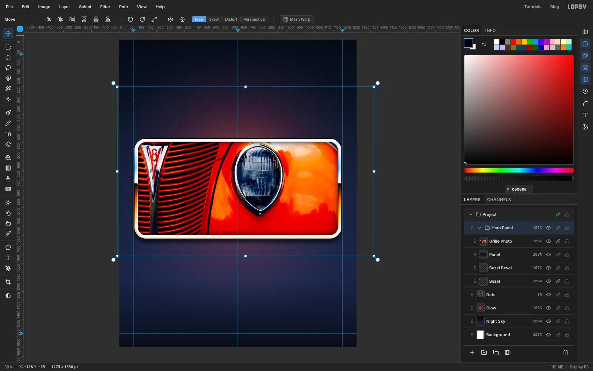

Click the *Grille Photo* row, then [[Shift]]-click *Bezel* to select all
four panel layers. Choose **Layer → Group Layers** and rename the group
*Hero Panel*. Click the arrow beside the group to collapse it.

## Set the script

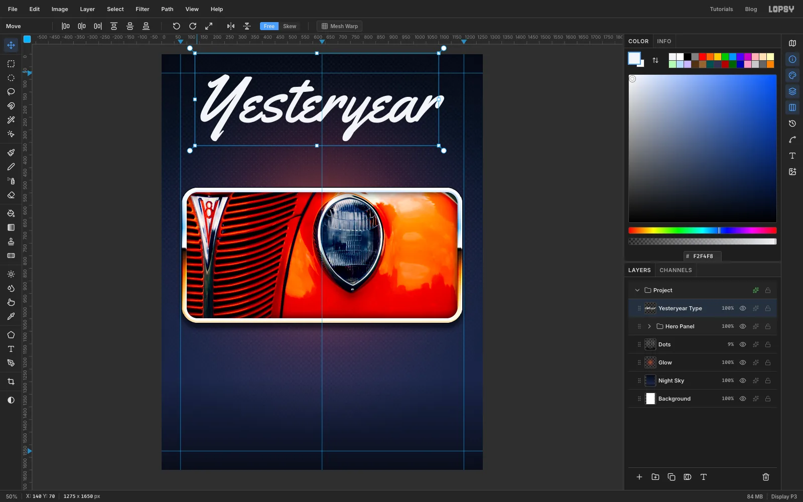

Click the collapsed *Hero Panel* row so the text lands above it. Pick the
**Text** tool, choose **Yellowtail** in the font menu, set **Size** to
**262**, and set the foreground colour to `#F2F4F8`. Click near the
top-left margin, type *Yesteryear*, and press [[Tab]] to commit.

Rename the layer *Yesteryear Type*. Switch to the **Move** tool and nudge
it with the arrow keys ([[Shift]] moves 10 px at a time) until it's
centred on the middle guide, with the top of the Y just under the top
margin.

## Set AUTOS under it

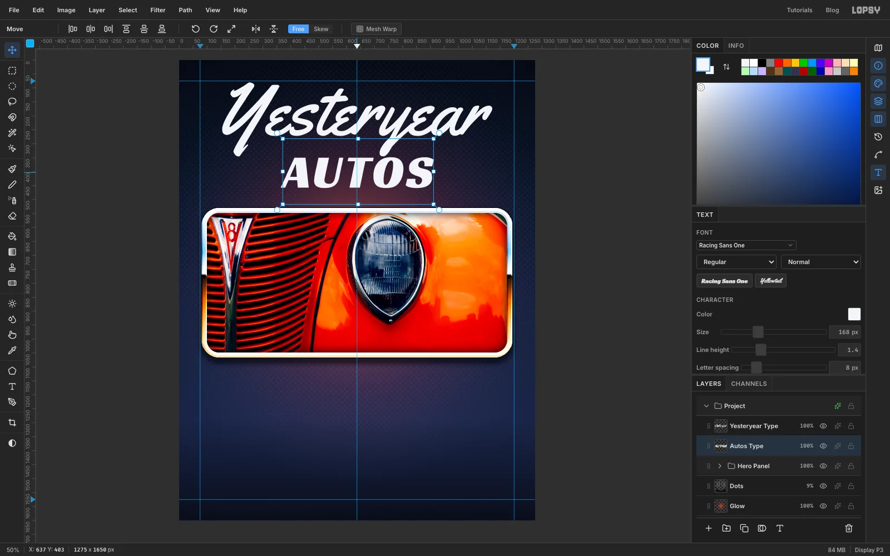

Click *Hero Panel* again. You'll type AUTOS somewhere empty and then move
it, because a click inside the script's text box would add the word to
*Yesteryear* instead of making a new layer. With the **Text** tool, choose
**Racing Sans One** at **168**, click in the empty area below the photo,
and type *AUTOS*. Press [[Tab]]. In the **Text** panel, set **Letter
spacing** to **8**. Rename the layer *Autos Type*.

Now drag AUTOS up with the **Move** tool so it sits just under the script,
centred on the middle guide. Its top should be about level with the bottom
of the y's descender.

## Chrome-plate the script

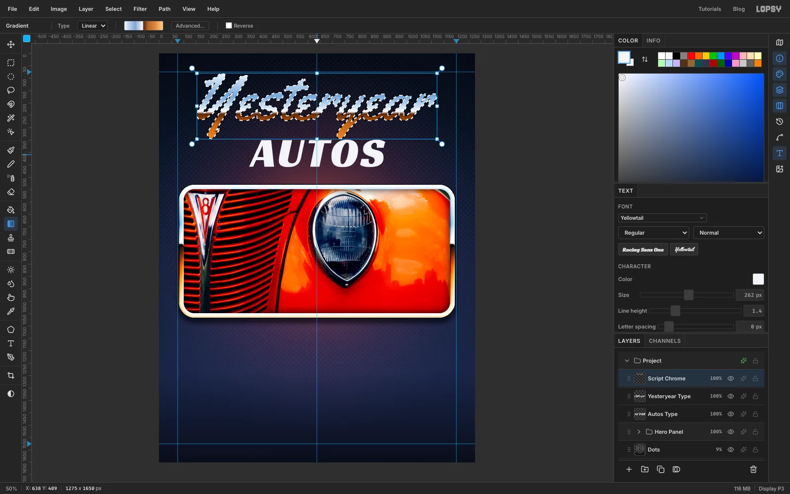

Select *Yesteryear Type* and add a layer above it called *Script Chrome*.
[[Cmd]]-click the *Yesteryear Type* thumbnail to load the letters as a
selection.

Pick the **Gradient** tool with **Type** set to **Linear**, and set up the
lettering chrome in the Gradient Editor:

- `#EEF6FF` at 0%
- `#7FA6D6` at 28%
- `#F8FBFF` at 47%
- `#5A2A0E` at 50% (the horizon)
- `#B8662A` at 62%
- `#E08A3C` at 80%
- `#FFD08A` at 100%

Drag from the top of the tallest letters straight down, holding [[Cmd]].
Drag for about one and a quarter times the height of the letters, so the
horizon falls a little above the middle of the lowercase letters. Deselect.

> **Tip:** Don't grow the selection on a fine script like Yellowtail. It
> fills in the little loops of the e's, and *Yesteryear* starts to read as
> *Yesterysar*.

## Chrome-plate AUTOS

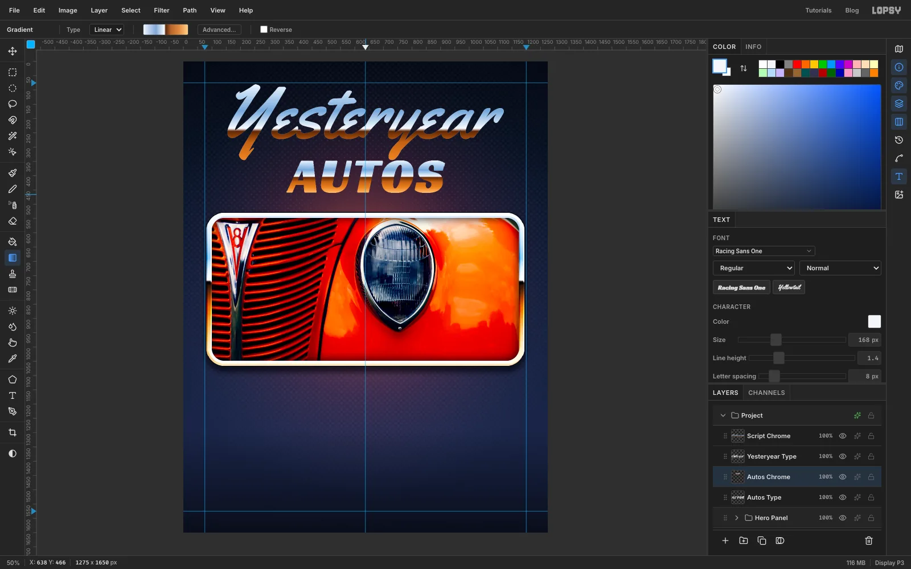

Do the same for the capitals. Select *Autos Type*, add *Autos Chrome* above
it, and [[Cmd]]-click the *Autos Type* thumbnail. AUTOS can take a little
weight, so choose **Select → Grow…** with **2**. Then drag the same
gradient from the top of the letters, a little past their bottom edge.

Turn off the eye icons on *Yesteryear Type* and *Autos Type*. You only need
them as stencils now.

## Outline, extrude and halo the chrome

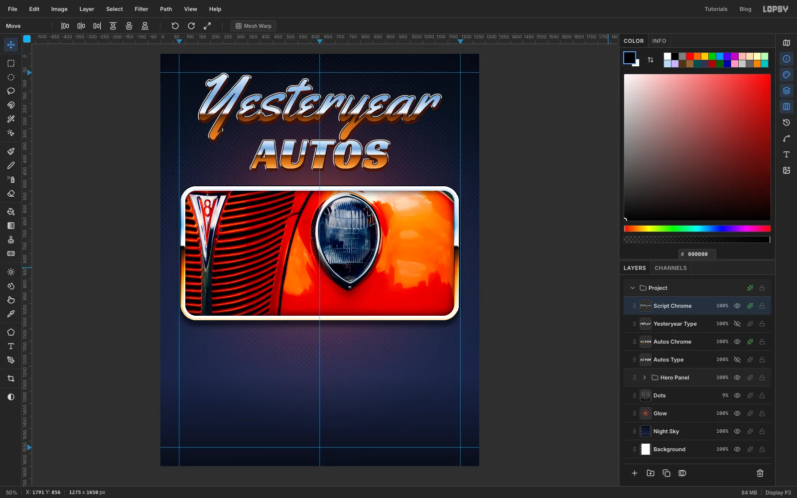

Give *Script Chrome* and *Autos Chrome* the same three effects:

- **Stroke**: `#070B16`, **Width 3**, position **center**. A center stroke
  keeps the script's small loops open.
- **Drop Shadow**: `#4A1606`, **Offset X 2**, **Offset Y 9**, **Blur 0**,
  **Opacity 100**. With no blur, the shadow reads as a solid extruded edge.
- **Outer Glow**: `#F3E3C8`, **Size 3**, **Spread 100**, **Opacity 100**.
  At full spread the glow becomes a thin cream outline around the dark
  stroke, so the lettering stands out from the navy.

## Bevel the lettering

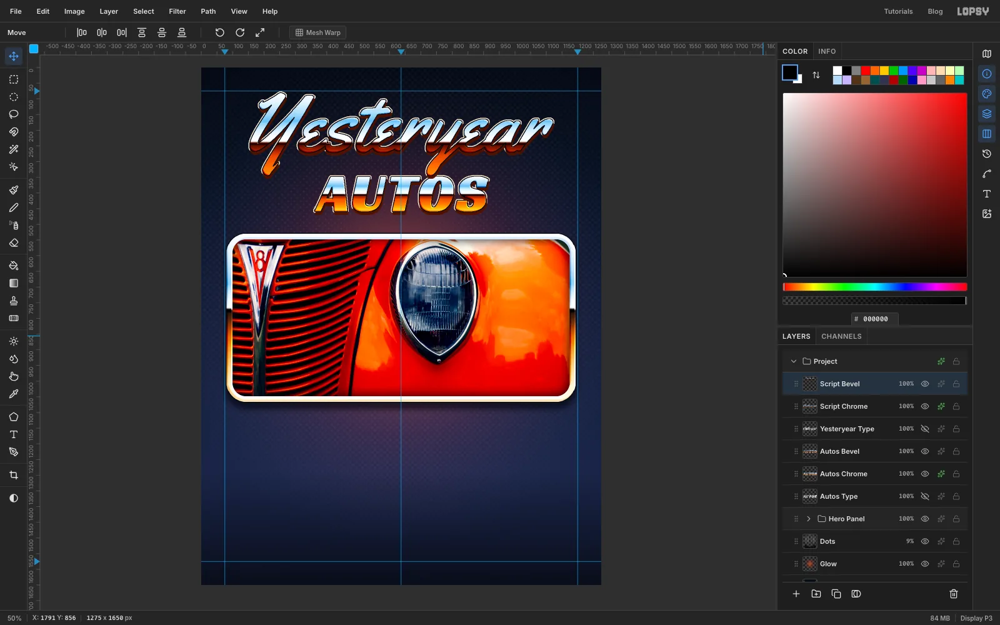

Select *Autos Chrome*, choose **Layer → Duplicate Layer**, and name the
copy *Autos Bevel*. In its drawer, untick the three effects. Run
**Filter → Emboss…** with **Angle 125** and **Strength 45**, then set the
blend mode to **Overlay**.

Repeat for *Script Chrome* to make *Script Bevel*. Every stroke now has a
light top edge and a dark lower edge, like pressed metal.

## Paint pinstripes with symmetry

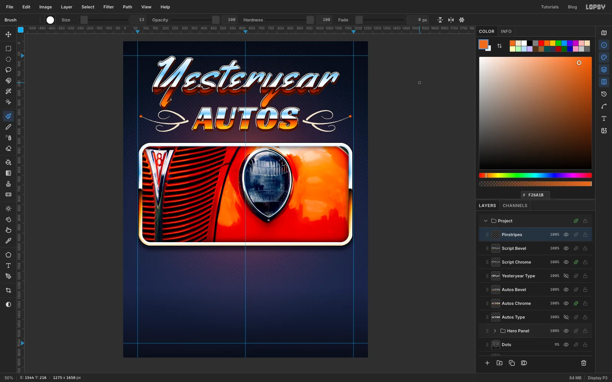

Select *Script Bevel* and add a layer called *Pinstripes*. Pick the
**Brush**, click **Open brush presets**, and on the **Shape** tab set
**Size 11**, **Hardness 100** and **Spacing 4**. In the options bar, turn
on **Symmetry Vertical**. Everything you paint on the left of the centre
line is now mirrored on the right. Set the foreground to `#F3E6CC`.

Pinstripes are painted one stroke at a time, from thick to thin. Start
each stroke next to the lettering and pull it outward. Before each one,
set **Taper** in the brush presets to roughly the stroke's length in
pixels. The brush then shrinks to a point just as the stroke ends.

1. **The sweep.** With **Taper** at about **270**, start just left of the
   A. Dip down a little, then sweep out and up to a point near the left
   margin.
2. **The loop.** With **Taper** at about **255**, start at the same place.
   Arc up and outward over the sweep, then curl back down and round into a
   small hook.
3. **The curl.** With **Taper** at about **195**, start a little below and
   curve down and out under the sweep, finishing in a small curl.

For the one-shot dots, set **Taper** back to **0** and **Size** to **13**,
pick `#F26A1B`, and click once at the tip of the sweep. Symmetry adds the
matching dot on the right. Turn **Symmetry Vertical** off.

## Group the title and tilt it

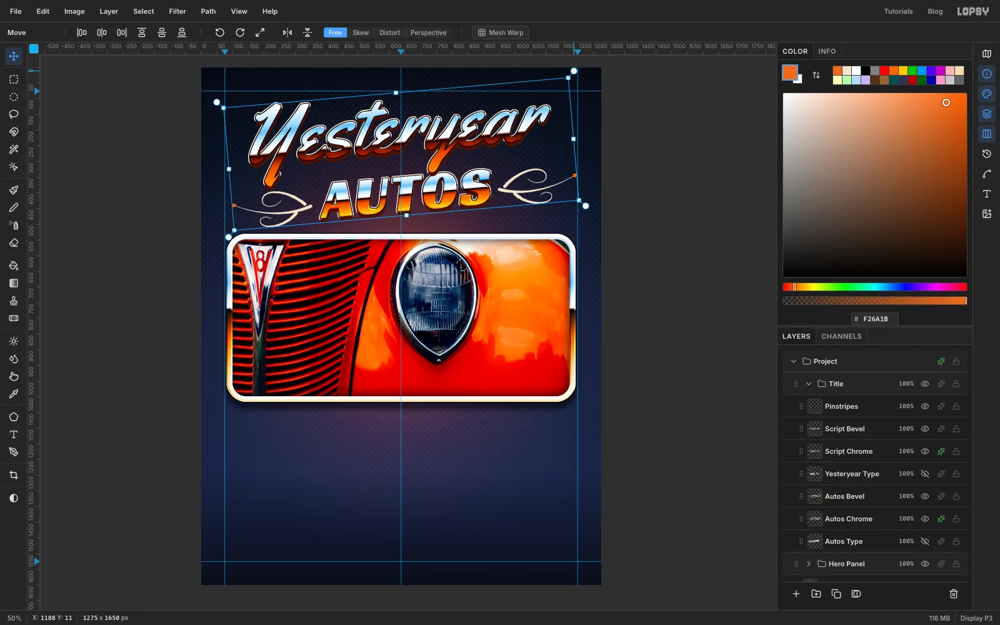

Click *Pinstripes*, then [[Shift]]-click *Autos Type*. That selects the
chrome, bevels, stencils and pinstripes. Choose **Layer → Group Layers** and
name the group *Title*.

With the **Move** tool, the group gets one frame around everything. Drag
the round rotation handle off its top-right corner upward, about **5°**
anticlockwise, so the lettering climbs gently to the right. Press
[[Escape]] to commit. Press [[Cmd+Z]] and [[Cmd+Shift+Z]] to compare
straight and tilted.

## Draw an arch with the Pen

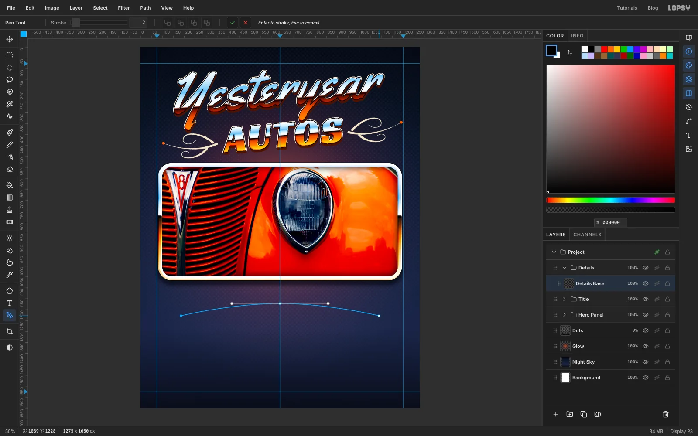

Collapse *Title* and click its row. Click **New Group** in the Layers
panel, name it *Details*, and add a layer inside it called *Details Base*.
This empty layer is an anchor: clicking it before you add each new text
layer keeps that layer inside the *Details* group.

Pick the **Pen** tool. Click about 110 px inside the left margin guide
(x 185), about 160 px below the photo frame (y 1230). Then press on the
centre guide about 55 px higher (y 1175) and drag about 220 px to the
right to pull out smooth handles. Finally, click the matching point on the
right (x 1089, y 1230). Click the **✓ Commit path** button
in the options bar. Don't press [[Enter]]: that would paint the path onto
the layer.

## Set the subtitle on the arch

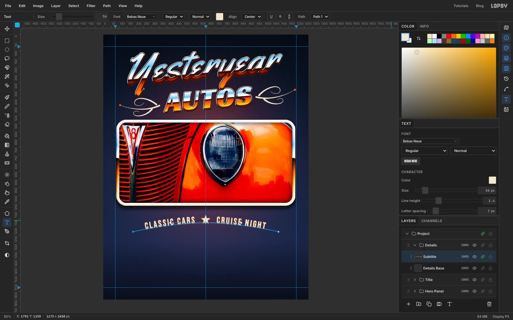

With the **Text** tool, choose **Bebas Neue** at **56** with `#F3E6CC`.
Click in an empty spot near the bottom of the page, type
*CLASSIC CARS  ★  CRUISE NIGHT* (two spaces either side of the star), and
press [[Tab]]. Rename the layer *Subtitle* and set **Letter spacing** to
**7** in the Text panel.

Open the **Path** dropdown at the right end of the options bar (not the
Path menu in the menu bar) and choose *Path 1*. The text jumps onto the
arch. Then set **Align** to **Center**. The two phrases are the
same length, so the star lands on the centre guide. Give it a
**Drop Shadow** of `#F26A1B` with **Offset X 1**, **Offset Y 4**,
**Blur 0**.

## Add the date and times

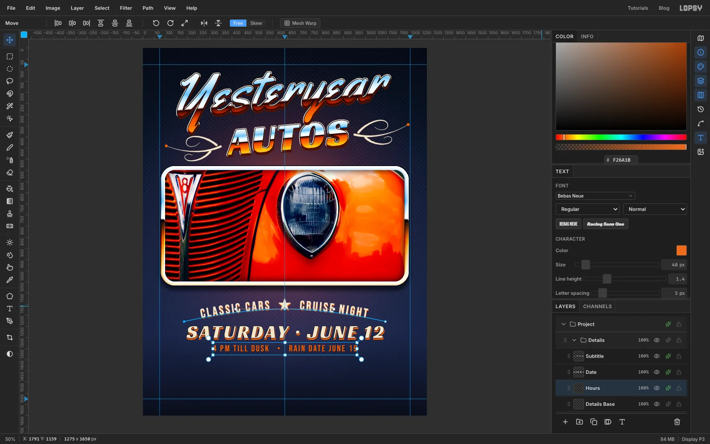

> **Tip:** On a Mac, type the middle dot · with [[Alt+Shift+9]] and the
> bullet • with [[Alt+8]].

Click *Details Base*. Set *SATURDAY · JUNE 12* in **Racing Sans One** at
**86**, cream `#F3E6CC`, and centre it about 35 px below the ends of the
arch. Name it *Date*. It gets the same treatment as the title, in miniature:

- **Stroke** `#070B16`, **Width 2**, position **center**
- **Drop Shadow** `#F26A1B`, **Offset X 2**, **Offset Y 6**, **Blur 0**

Click *Details Base* again. Set *4 PM TILL DUSK   •   RAIN DATE JUNE 19* in
**Bebas Neue** at **40** in `#F26A1B` with **Letter spacing 5**, and centre
it about 32 px below the date. Name it *Hours*. Give it a dark **Drop
Shadow** (`#070B16`, **Offset X 1**, **Offset Y 3**, **Blur 0**) so it
matches.

## Build a chrome bumper bar

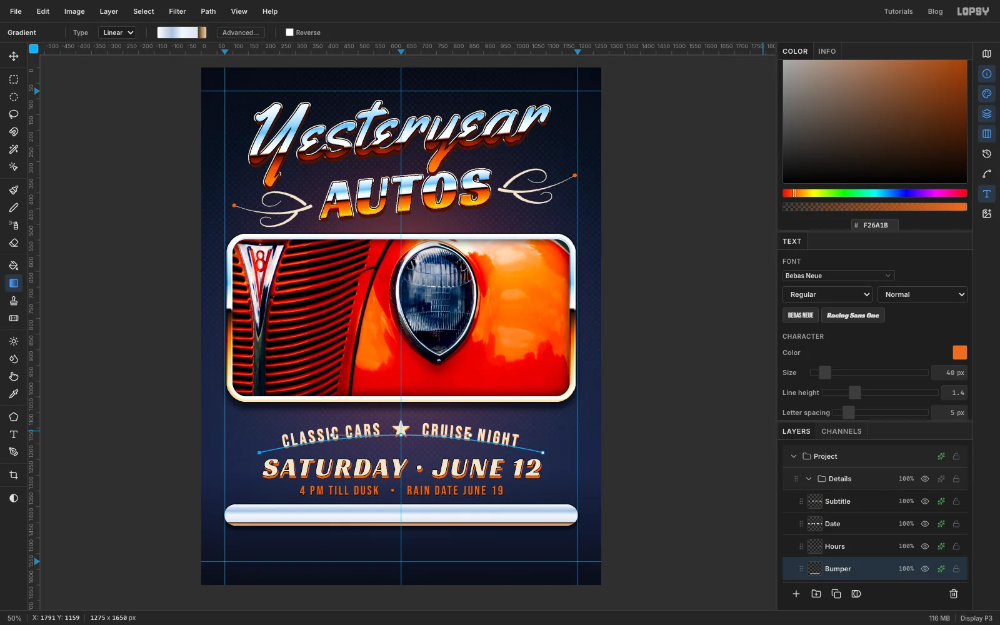

With *Details Base* selected, add a layer called *Bumper*. With the
**Shape** tool (Rectangle, **Corner Radius 34**, any fill), press on the
centre guide about 66 px below the times line. That's the 32 px gap plus
half the bar's height, because the shape grows from its centre. Drag out
to the right edge of the photo frame for a bar about **68 px** tall.

[[Cmd]]-click the *Bumper* thumbnail and fill it with this gradient, top
to bottom, holding [[Cmd]]:

- `#FFFFFF` at 0%
- `#A9C0DF` at 30%
- `#F2F6FC` at 50%
- `#DCE4EF` at 82%
- `#4A3A2C` at 84% (the horizon)
- `#B88A5E` at 92%
- `#E9D2B4` at 100%

Putting the horizon low keeps the face bright for the lettering. Deselect.
Add a **Stroke** (`#070B16`, **Width 3**, **outside**) and a **Drop
Shadow** (`#02040A`, **Offset Y 10**, **Blur 14**, **Opacity 75**).

## Stamp the address on the bar

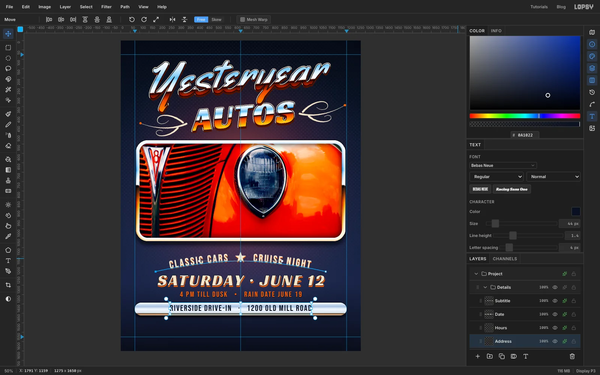

With the **Text** tool, choose **Bebas Neue** at **44** with `#0A1022`,
click an empty area of the page, type *RIVERSIDE DRIVE-IN   ·   1200 OLD MILL ROAD*, and set **Letter
spacing** to **4**. Name it *Address*.

Move it onto the bar and centre it horizontally. Vertically, centre it on
the bright face of the bar, above the tan lip, not on the bar's full height. That leaves an equal
strip of light chrome above and below the letters. A **Drop Shadow** in
white, **Offset Y 2**, **Blur 0**, **Opacity 70**, gives each letter a
crisp lower highlight, as if it were stamped into the metal.

## Add the programme and small print

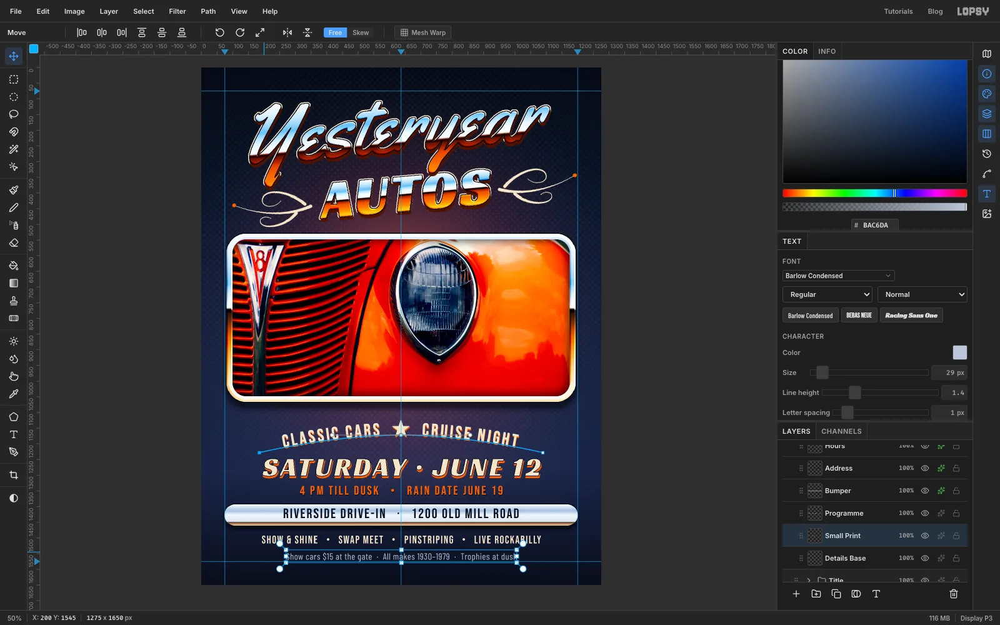

Click *Details Base* and set *SHOW & SHINE   •   SWAP MEET   •
PINSTRIPING   •   LIVE ROCKABILLY* in **Bebas Neue** at **34**, cream,
**Letter spacing 3**. Centre it about 32 px below the bar.

Under it, set the small print in **Barlow Condensed** at **29** in
`#BAC6DA` with **Letter spacing 1**: *Show cars $15 at the gate  ·  All
makes 1930–1979  ·  Trophies at dusk*. Leave about 30 px between the two
lines, and keep the small print above the bottom margin guide.

## Make a chrome badge ring

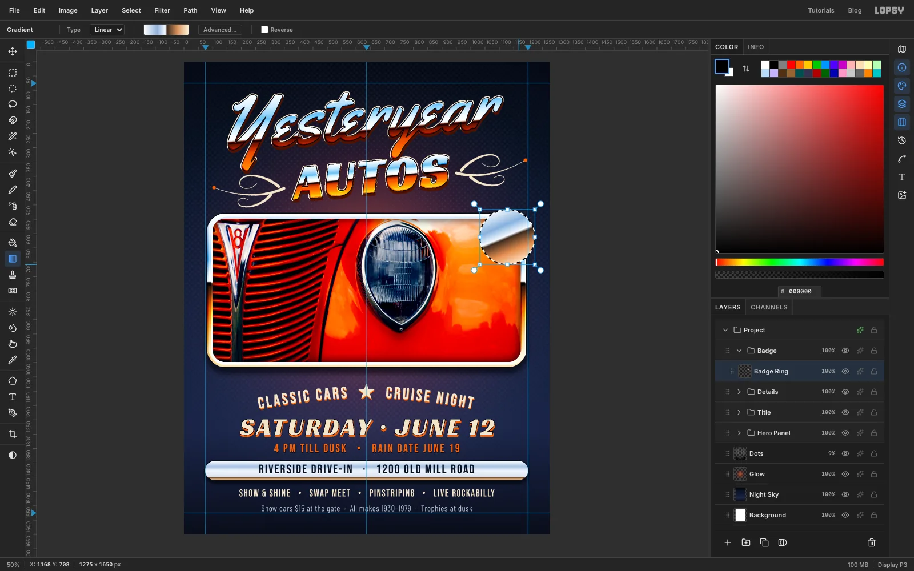

Collapse *Details*, click its row, click **New Group** and name it *Badge*.
Add a layer called *Badge Ring*.

With the **Elliptical Marquee**, click once on the photo's top-right
corner. In the dialog, enter **From 1032, 516** and **To 1224, 708**: a
192 px circle that hangs past the frame's right edge on purpose. Pick the
**Gradient** tool and re-enter the seven frame stops from *Fill a chrome
bezel around it* (the editor still holds the bumper's stops). Drag from
the top of the circle to the bottom.

Then click again and make a 168 px circle with the same centre
(**From 1044, 528** to **1212, 696**). Press [[Delete]] to leave a ring,
and deselect. Give the ring a **Drop Shadow** (`#02040A`, **Offset Y 10**,
**Blur 16**, **Opacity 80**).

## Fill the badge and set its type

Add a layer called *Badge Disc*. Make a circle with the same centre, just
inside the ring (**From 1043, 527** to **1213, 697**), and fill it with
`#0B1226`. Deselect.

For the thin orange ring, keep *Badge Disc* selected and pick the **Shape** tool and set **Shape** to
**Ellipse**. Click **Remove fill** in the Fill swatch, set **Stroke** to
`#F26A1B` and **Width** to **3**. Hold [[Cmd]] and drag from the badge's
centre out about 74 px for a perfect circle.

Set *FREE* in **Racing Sans One** at **47**, cream, and name the layer
*Badge Free*. Click *Badge Disc* again and set *SPECTATORS* in **Bebas
Neue** at **19**, `#F26A1B`, **Letter spacing 2**, named *Badge
Spectators*. Click away from the badge to create each one, then move it
into place. Centre both on the
badge, with FREE a few pixels above the middle and SPECTATORS beneath it.
Leave equal space between the type and the orange ring on both sides. A
heavy italic looks right-heavy, so shift FREE about 3 px left of true
centre. Give FREE the small orange **Drop Shadow** (**Offset X 1**,
**Offset Y 4**, **Blur 0**).

## Tilt the badge

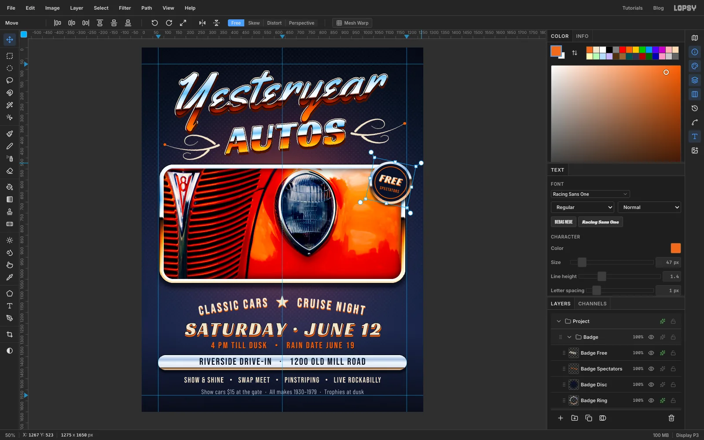

Click the *Badge* group row. With the **Move** tool, drag the top-right
rotation handle about **12°** clockwise and press [[Escape]]. The tilt runs
against the title, which keeps the badge from looking like part of the
frame.

## Draw a glint

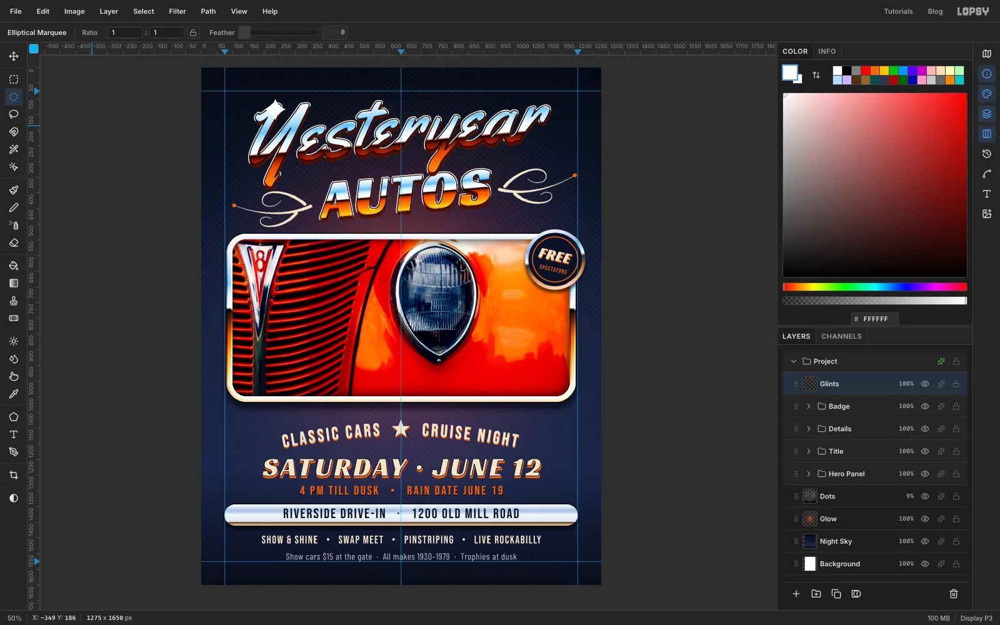

Collapse *Badge*, click its row, and add a layer called *Glints*. Use the
**Lasso** to draw a four-point star about 70 px across on the top stroke of
the Y. Make its four points long and sharp, and curve its sides inward.
Fill it with white.

For a hot centre, make a circle about 10 px across at its middle with the
**Elliptical Marquee**. Choose **Select → Feather…** with **4**, and fill it with white
too. Deselect.

## Copy, paste and scale a second glint

Draw a marquee around the sparkle and press [[Cmd+C]], then [[Cmd+V]]. The
copy appears as a new layer in the same spot, with transform handles. Drag
it onto the top-right corner of the S in AUTOS. Then [[Cmd]]-drag a corner
handle inward until it's about two thirds the size. Press [[Escape]] to
commit, and [[Cmd+E]] to merge it down into *Glints*.

Two glints are enough. More starts to look like clip art. Give *Glints* an
**Outer Glow** in white: **Size 16**, **Spread 0**, **Opacity 75**.

## Bloom the photo's highlights

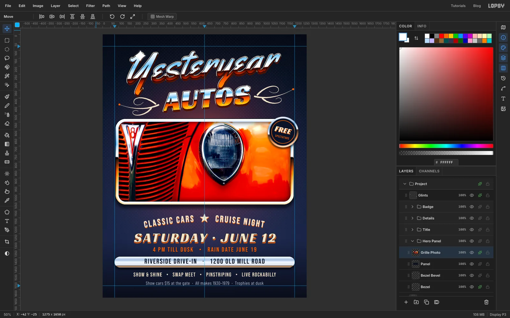

Expand *Hero Panel* and click *Grille Photo*. Choose **Filter → Bloom…**
with **Threshold 86**, **Soft Knee 40**, **Radius 24** and **Intensity 35**.
Only the brightest reflections glow.

Bloom also spreads glow outside the frame. A selection can't reach the
parts of the photo that hang off the canvas, so the earlier Delete left
them, and Bloom blurs their glow back onto the page edges. Clip it again: [[Cmd]]-click the
*Panel* thumbnail, choose **Select → Inverse**, click *Grille Photo*,
press [[Delete]] and deselect. Collapse *Hero Panel*.

## Darken the edges and clean up behind the small print

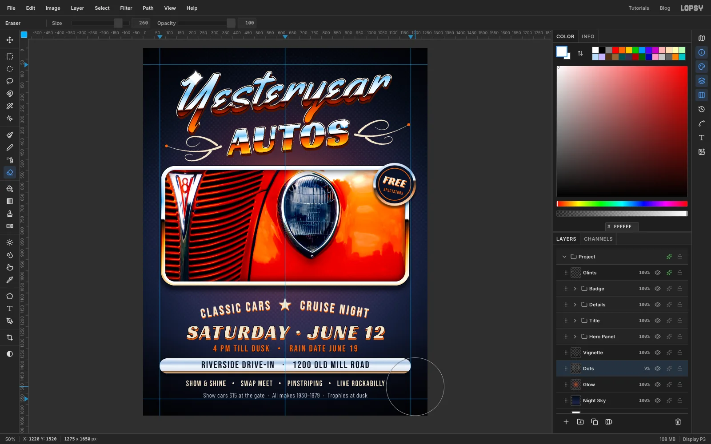

Click *Dots* and add a layer called *Vignette*. Make a **Radial** gradient
in `#02040A` with three stops: opacity **0** at the left, **0** at 55%, and
**85%** at the right. Drag from the middle of the page out past a corner,
and set the layer to **Multiply**.

The halftone dots make the small print look busy. Click *Dots*, pick the
**Eraser**, set **Size** to **260**, and sweep it once across the bottom of
the page, behind the last two lines.

## Add print grain

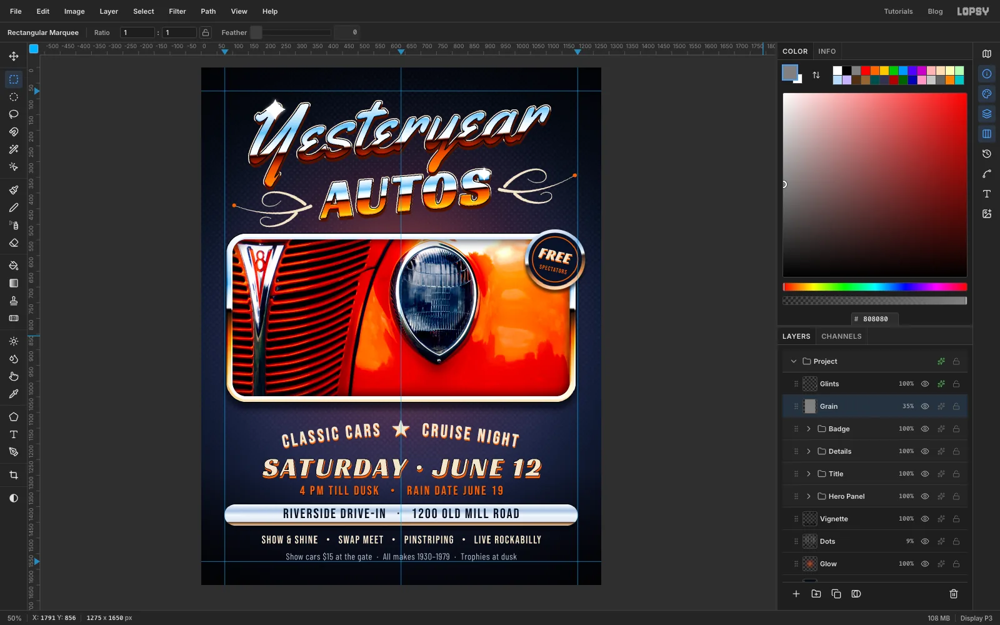

Click the *Badge* group row and add a layer called *Grain*. Set the
foreground to `#808080`, choose **Select → All** and **Edit → Fill**, then
deselect. Run **Filter → Add Noise…** with **Amount 22**, **Mono** and
**Gaussian**. Set the blend mode to **Overlay** and the opacity to **35%**.
The grey disappears in Overlay, leaving fine grain that ties the photo, the
chrome and the sky together.

Save your work with **File → Save Project**, then choose
**File → Quick Export PNG** for the finished flier.
