This tutorial paints a surreal piece called **Upright Piano**: a chrome upright piano left out on a desert salt flat just after sunset. It's melting. Liquid chrome sags off the keyboard into a puddle, and the score blows out of the top towards the moon. There's no photo and no text. Everything is drawn from gradients, selections, brushes and filters on a 1500 × 1875 px canvas, a 4:5 portrait shape that works as a print or a phone wallpaper.

The look depends on one idea. **Chrome has no colour of its own; it only shows what's around it.** A shiny flat panel facing you mirrors the sky in its top half and the ground in its bottom half. Where the two meet there's a sharp bright line (the reflected horizon) with a sudden drop into dark underneath. Get that hard break into every gradient and flat bands start to read as polished metal. Leave it soft and you get a retro stripe illustration instead.

Along the way you'll use:

- ruler **guides**, **groups**, reordering layers by dragging, and transforming a whole group with its handles
- the **Gradient** tool with multi-stop gradients from the **Gradient Editor**, linear and radial
- the **Rectangular** and **Elliptical Marquee**, the **Lasso**, and adding, subtracting and intersecting selections
- [[Cmd]]-clicking a layer thumbnail to select its pixels
- **Spray**, **Brush**, **Pencil** and the **Pen** tool (with a path stroked to pixels)
- **Copy Merged**, paste in place, arrow-key nudges, **Flip Horizontal / Vertical**, and the **Perspective** transform mode
- **Voronoi**, **Invert**, **Motion Blur**, **Gaussian Blur**, **Liquify**, **Bloom** and **Add Noise**
- **Layer masks** painted with a gradient
- **Inner Glow**, **Outer Glow** and **Drop Shadow**, the **Screen**, **Multiply** and **Overlay** blend modes, and the **Vignette** and **Color Balance** adjustments

The palette:

- Dusk sky `#120D2E` → `#3B1C5C` → `#A2417A` → `#F08A5D` → `#FFD9A3`
- Chrome `#1A0F33` → `#7A3A86` → `#FFC9A0` → `#FFFFFF` → `#2A1426` → `#4A2638` → `#C0606E`
- Stars `#FFF4E6`, moon `#F7EEDC`, moon glow `#FFC9A8`, halo `#FFC79A`
- Mesas `#4A2150`
- Ivory keys `#F4EDE3`, ebony keys `#1A0F1E`
- Shadow ink `#12081C`, rim light `#FFE0C0`, ornament `#FFE6C4`
- Score paper `#F6EBDD`, notes `#3A1A4E`

> **Tip:** Positions are given as `x, y` in document pixels. The status bar at the bottom left shows where your cursor is. Mac key names are used; on Windows and Linux use Ctrl for Cmd.

> **Tip:** "Fill" means set the foreground colour in the Color panel's hex field, then choose **Edit → Fill**. Press [[Cmd+D]] to drop a selection before you draw a new one, so the new drag doesn't move the old outline.

> **Tip:** Gradient colours are set in the **Gradient Editor**, not by the foreground colour. With the Gradient tool picked, click **Advanced…** in the options bar, click a stop to set its colour, click under the bar to add a stop, and drag stops to position them. Hold [[Shift]] while you drag a gradient on the canvas to keep it perfectly vertical or horizontal. When a step lists stops, set them up this way before you drag.

> **Tip:** A new layer appears just above the active one, and inside a group if the active row is a group. Each step says which row to click first.

> **Tip:** The marquee options bar shows a **Ratio** menu. It only applies while the lock button beside it is on, so leave the lock off and every marquee follows your drag.

## Set up the canvas and paint the sky

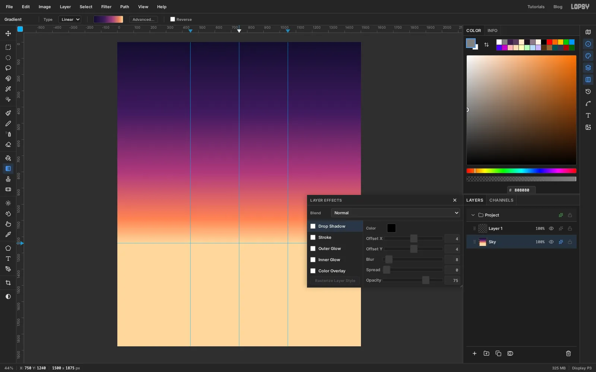

Create a new document `1500` × `1875` px with a white background. Turn on **View → Show Rulers**, then drop four guides by clicking the rulers. Click the top ruler at x `450`, `750` and `1050`, and the left ruler at y `1240`. The horizontal guide is the horizon. The vertical ones frame where the piano will be built.

1. Double-click the `Background` row and rename it `Sky`.
2. Pick the **Gradient** tool, set **Type** to **Linear** and open **Advanced…**. Make five stops: `#120D2E` at the left end, `#3B1C5C` at about 35%, `#A2417A` at about 65%, `#F08A5D` at about 88% and `#FFD9A3` at the right end.
3. Hold [[Shift]] and drag from the top of the canvas straight down to the horizon guide.

Everything below the horizon gets the last colour. That's fine, because the ground will cover it.

## Scatter the stars

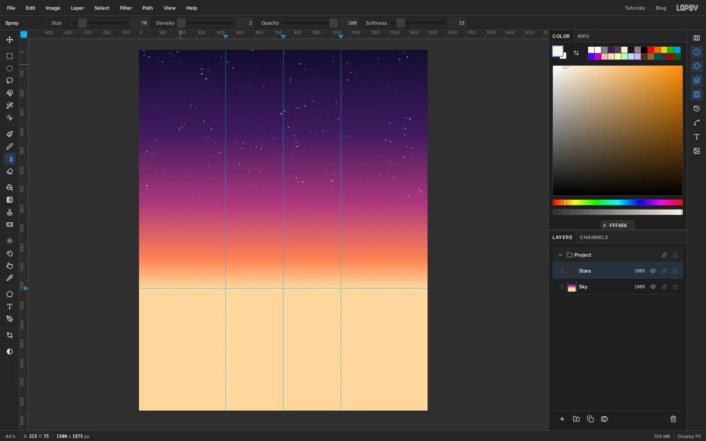

The new document comes with a white `Background` and an empty `Layer 1` above it. Double-click `Layer 1`, rename it `Stars`, and pick the **Spray** tool ([[J]]). Set **Size** `70`, **Density** `2`, **Opacity** `100` and **Softness** `15`, with the foreground colour `#FFF4E6`.

Don't drag. A drag sprays a trail of dots along your path, and the stars come out in strings. Instead, **click** about a hundred times at random over the top of the sky. Each click drops two small dots. Click more often near the top and less often lower down, and stop around y `760`: real stars wash out in the bright glow above a sunset.

Spray's **Size** is the width of the cloud, and it also sets the size of each dot. At Size 400 you'd get soft snowballs. Keep it small for pinpoint stars.

## Cut a crescent moon

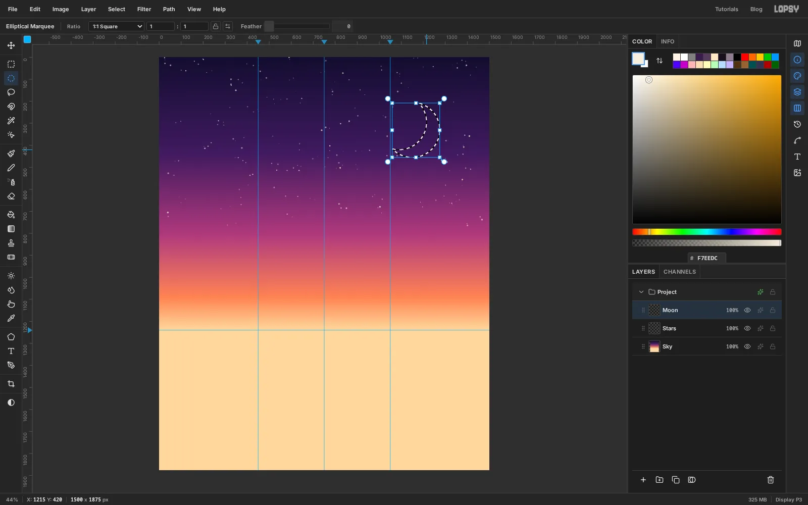

1. With `Stars` active, click **Add Layer** and rename it `Moon`.
2. Pick the **Elliptical Marquee** and hold [[Cmd]] to keep it a circle. Drag a 250 px circle in the upper right, from about `1025, 205` to `1275, 455`.
3. Hold [[Alt]] and drag a second circle of the same size, 60 px further left and 35 px higher. It's subtracted from the first, leaving a crescent that opens towards the top left.
4. Fill with `#F7EEDC` and press [[Cmd+D]].
5. Open the layer effects (the ✦ button on the row), turn on **Outer Glow**, and set **Size** `70`, **Opacity** `55` and the colour `#FFC9A8`.

## Add distant mesas

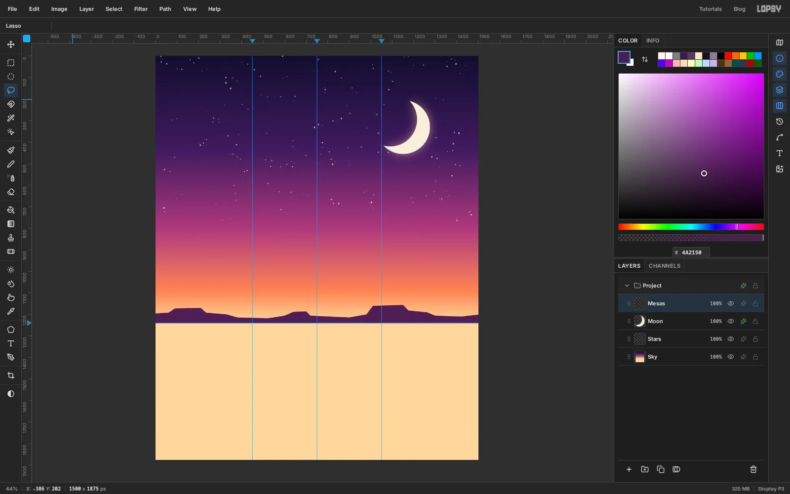

Click **Add Layer** and name it `Mesas`. With the **Lasso** ([[L]]), draw a low, flat-topped skyline along the horizon. Start below the guide at the left edge and work right. Keep the mesas short (40 to 85 px tall) and flat on top, with steep sides, a big one on the left and a bigger one right of centre. Close the shape back below the horizon guide. Fill with `#4A2150`.

Keep them low. They only need to say "desert" and give the horizon a silhouette; the piano will be the tall shape.

## Mirror the sky into the salt flat

A salt flat after rain is a near-perfect mirror, so the ground is just the sky upside down.

1. Drag a **Rectangular Marquee** ([[M]]) from the top-left corner of the canvas to the right edge at the horizon guide.
2. Choose **Edit → Copy Merged** ([[Cmd+Shift+C]]). That copies what you see, sky, stars, moon and mesas together, rather than one layer.
3. Press [[Cmd+V]]. The copy pastes in place as a new layer, already selected, and the **Move** tool is picked. Rename it `Mirror`.
4. Click **Flip Vertical** in the options bar, then drag the selection straight down until its top edge sits on the horizon guide.
5. Press [[Cmd+D]], then run **Filter → Motion Blur…** with **Angle** `90` and **Distance** `14`. A slight vertical smear makes it read as a wet surface rather than glass.

## Make the salt crust texture

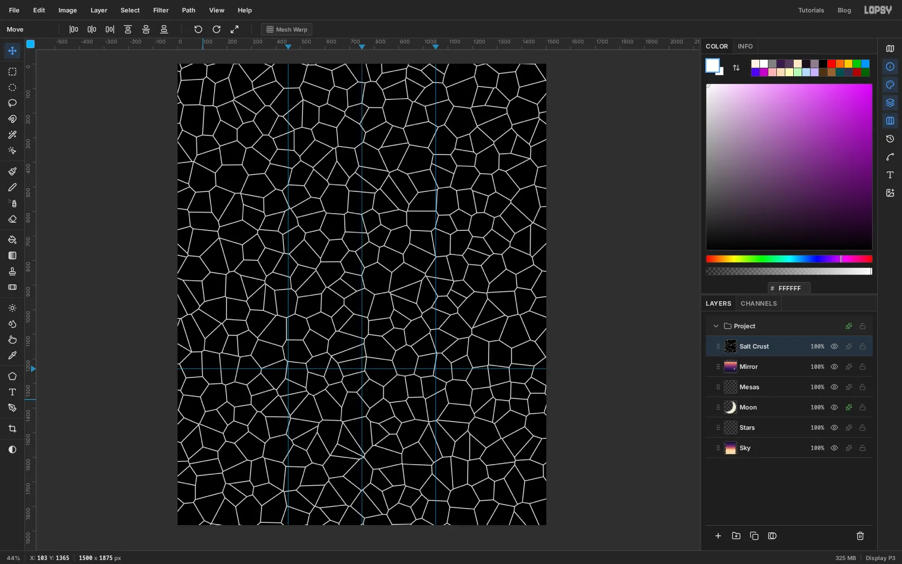

Real salt flats crack into polygons, and **Voronoi** draws exactly that.

1. Click **Add Layer** and name it `Salt Crust`. Fill the whole layer with white ([[Cmd+A]], **Edit → Fill**, [[Cmd+D]]).
2. Run **Filter → Voronoi…** with **Cells** `22`, **Edge Width** `6` and **Seed** `42`. You get white cells with black borders.
3. Choose **Filter → Invert**. Now the borders are white lines on black, which is what you want for a **Screen** blend later: black disappears and only the lines show.

## Squash the crust onto the ground

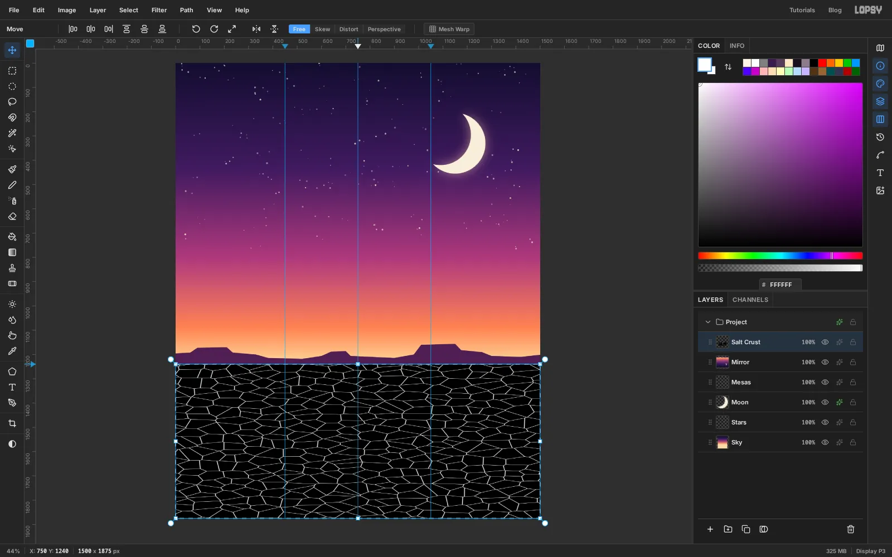

Pick the **Move** tool ([[V]]) and press [[Cmd+A]]. Transform handles appear around the whole canvas. Drag the **top-middle** handle straight down to the horizon guide. The cells flatten into wide shapes, like tiles seen from a low angle.

## Put the crust in perspective

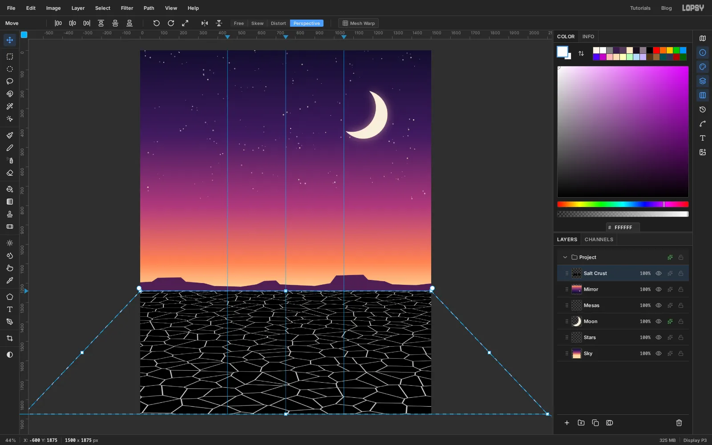

With the handles still showing, click **Perspective** in the options bar. Changing mode commits the squash first. Now drag the **bottom-left** corner handle out to the left, about 600 px past the canvas edge. In Perspective mode the bottom-right corner mirrors it automatically.

The cells now shrink towards the horizon and grow towards you, which is what sells the ground as a flat plane stretching away. Press [[Cmd+D]] to commit.

## Blend the crust and fade it with distance

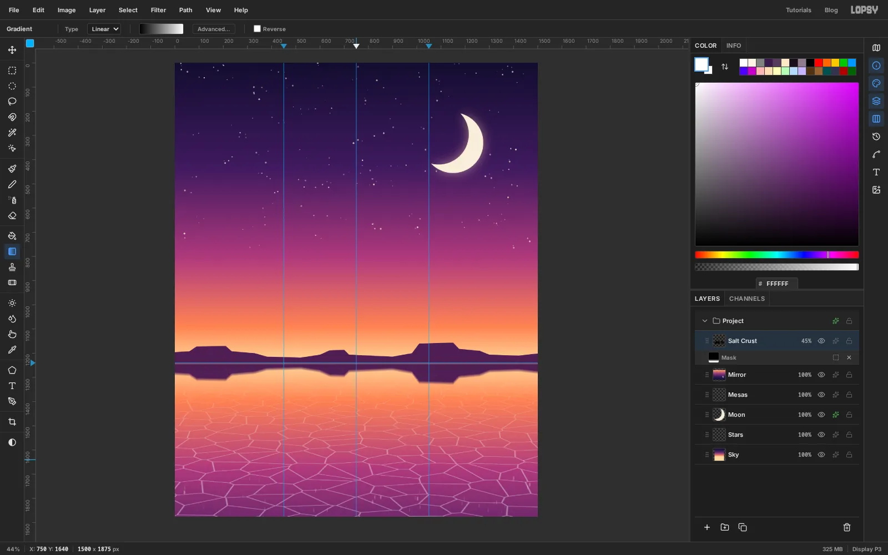

1. Run **Filter → Gaussian Blur…** with **Radius** `1.5` to soften the lines.
2. In the layer effects drawer, set the blend mode to **Screen**. Then click the opacity on the row and set it to `45%`.
3. Click **Add Mask** at the bottom of the Layers panel, then click the mask's thumbnail (`Edit mask for Salt Crust`) to paint on the mask.
4. In the Gradient Editor, set up a two-stop gradient, black on the left and white on the right, and [[Shift]]-drag from the horizon guide down to about y `1640`.

Black on the mask hides the lines near the horizon and white keeps them in the foreground. Lines that fade with distance read as depth. Lines that are bright all the way up read as a tiled floor.

## Add the afterglow behind the piano

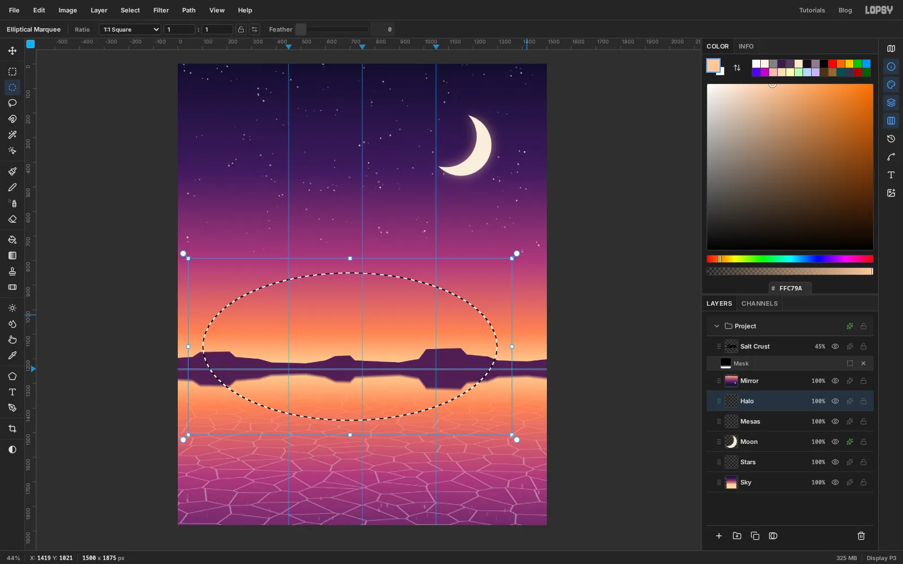

Click the `Mesas` row and **Add Layer**. Name it `Halo`.

1. With the **Elliptical Marquee**, drag a wide oval centred on about `700, 1150`, 1200 px across and 600 px tall.
2. Choose **Select → Feather…** and enter `60`.
3. Fill with `#FFC79A`, press [[Cmd+D]], then run **Gaussian Blur** with **Radius** `60`.
4. Set the blend mode to **Screen** and the opacity to `75%`.

The glow sits behind where the piano will stand, so the instrument's silhouette is lit from behind.

## Group the backdrop

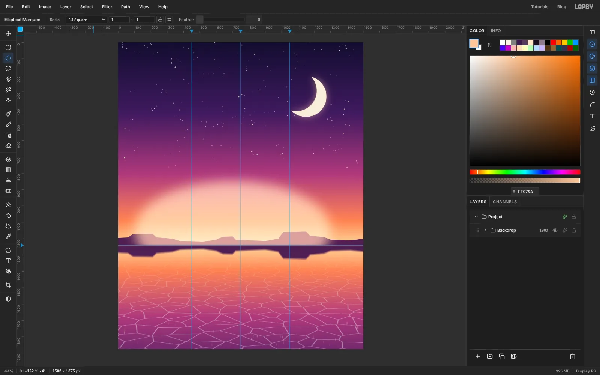

Click the top row of the stack (`Salt Crust`), then [[Shift]]-click `Sky` so every backdrop layer is selected. Choose **Layer → Group Layers**, rename the group `Backdrop` and collapse it with its chevron. From now on, the background stays out of the way.

## Start the piano with a chrome case

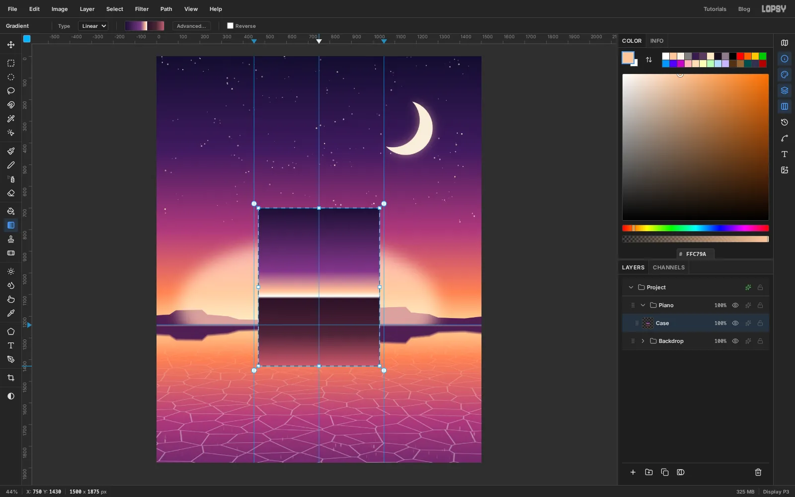

Click the `Backdrop` row and click **New Group**. Because a group was active, the new group lands inside `Backdrop`. Drag it out by its grip (⋮⋮) until it sits **above** `Backdrop`, then rename it `Piano`.

Now build the chrome gradient. This is the most important gradient in the piece, so set it carefully in the Gradient Editor:

- `#1A0F33` at 0% (the dark top of the sky)
- `#7A3A86` at 40%
- `#FFC9A0` at 53% (the glow just above the horizon)
- `#FFFFFF` at 56% (the specular line)
- `#2A1426` at 57.5% (the sudden drop into the reflected ground)
- `#4A2638` at 80%
- `#C0606E` at 100% (a warm bounce from the ground)

The white and the dark stop sit only 1.5% apart. That's the hard break that makes it chrome.

With `Piano` active, click **Add Layer** and name it `Case`. Marquee from `470, 700` to `1030, 1430` and [[Shift]]-drag the gradient from the top of the marquee to the bottom. Press [[Cmd+D]].

## Build the rest of the case

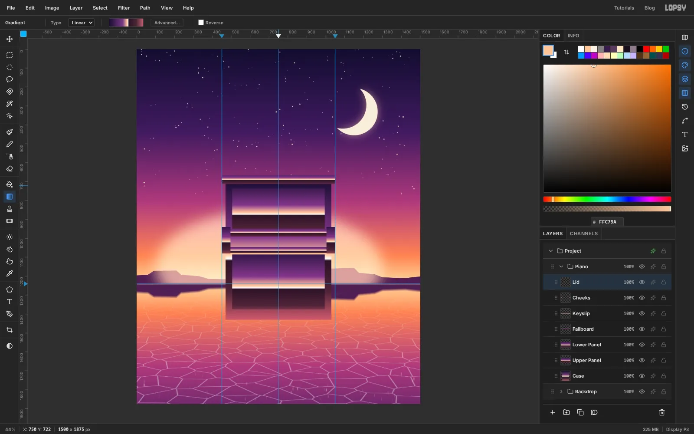

Each part goes on its own layer, filled with the same chrome gradient, and each new layer lands above the last one you made, starting from `Case`. Click **Add Layer**, name it, marquee it, then drag the gradient. The trick is to **start and end the drag at different places for each part**, so the bright line lands at a different height every time. Identical bands on every panel look printed; staggered ones look like separate pieces of polished metal.

- `Upper Panel`: marquee `505, 735` to `995, 950`, drag the gradient from y `700` to `1010`.
- `Lower Panel`: marquee `505, 1085` to `995, 1375`, drag from y `1050` to `1430`.
- `Fallboard`: marquee `470, 952` to `1030, 990`, drag from y `935` to `1000`.
- `Keyslip`: marquee `470, 1045` to `1030, 1077`, drag from y `1030` to `1092`.
- `Cheeks`: marquee `448, 940` to `496, 1080`, then [[Shift]]-drag `1004, 940` to `1052, 1080`, and drag from y `925` to `1095`.
- `Lid`: marquee `445, 666` to `1055, 712`, drag from y `650` to `722`.

The Cheeks layer uses one selection made of two rectangles. Holding [[Shift]] on the second drag adds it to the first, so one gradient fills both blocks the same way.

## Draw one octave of keys

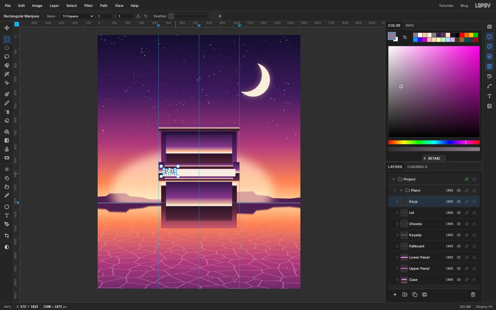

1. Click **Add Layer** and name it `Keys`. Fill a strip from `480, 990` to `1020, 1045` with `#F4EDE3`.
2. Pick the **Pencil** ([[N]]), **Size** `2`, colour `#8E7A8C`. Draw the dividers between the first seven white keys: they're 15 px wide, so click at the top of x `495`, then [[Shift]]-click at the bottom of the strip to draw a straight line. Repeat at `510`, `525` and so on, up to `585`.
3. With the **Rectangular Marquee**, select the five black keys of that octave: 10 px wide and 35 px tall, starting at the top of the strip, centred on the dividers at x `495`, `510`, `540`, `555` and `570`. Hold [[Shift]] for each one after the first to add it to the selection.
4. Fill with `#1A0F1E` and press [[Cmd+D]].

That's two black keys, a gap, then three, the pattern every keyboard repeats.

## Repeat the octave across the keyboard

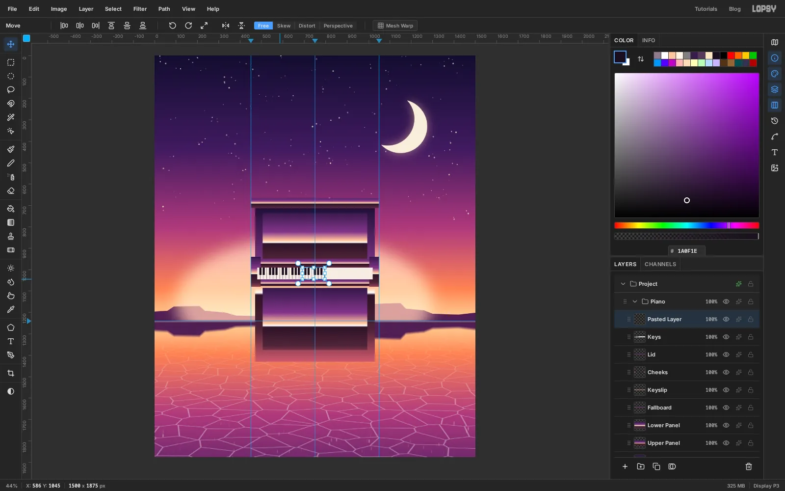

Instead of drawing 36 keys, copy the octave and step it along.

1. Marquee the octave from the left end of the strip, `480, 990`, to just past the seventh divider, `586, 1045`, so each copy brings its own right-hand divider. Press [[Cmd+C]].
2. Press [[Cmd+V]]. The copy pastes in place on a new layer with the Move tool picked.
3. Nudge it right with the arrow keys: [[Shift+→]] moves 10 px and [[→]] moves 1 px. For the first copy that's 105 px: ten [[Shift+→]] and five [[→]].
4. Press [[Cmd+D]], then [[Cmd+E]] to merge it down into `Keys`.

Repeat for 210, 315 and 420 px. Click `Keys` before each paste so the copy lands above it. Five octaves plus the last white key fill the strip exactly. Use the keys here rather than a drag. At fit-to-screen zoom one screen pixel is about two document pixels, so a drag leaves the octaves a pixel or two out, and the black keys would drift off the 15 px rhythm. Holding [[Shift+→]] down works too: just count to the distance in the status bar.

## Give the piano a side

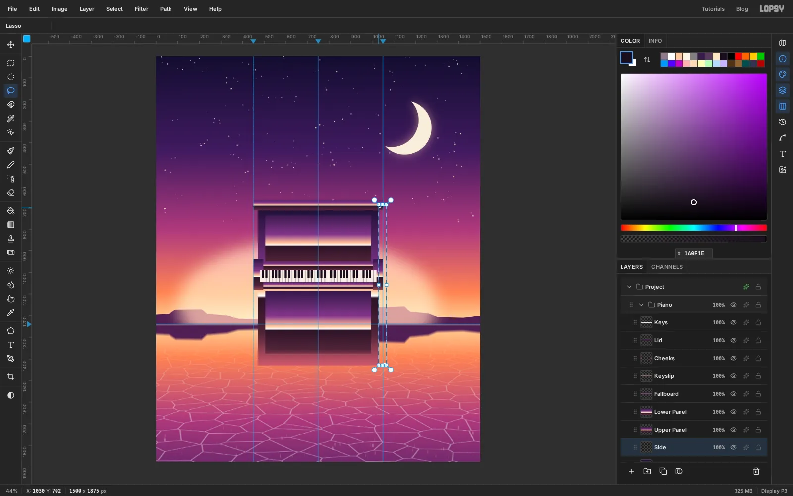

A perfectly flat front looks like a cardboard cut-out. A sliver of side panel gives the piano depth.

1. Click the `Case` row and **Add Layer**. Name it `Side`.
2. With the **Lasso**, draw a thin four-sided shape along the right edge of the case: `1030, 702`, up to `1066, 686`, down to `1066, 1418` and back to `1030, 1430`.
3. Set up a three-stop gradient, `#2A1426`, `#5A2A66` in the middle and `#B5546E`, and [[Shift]]-drag it across the shape from left to right.

## Add legs, toe blocks and pedals

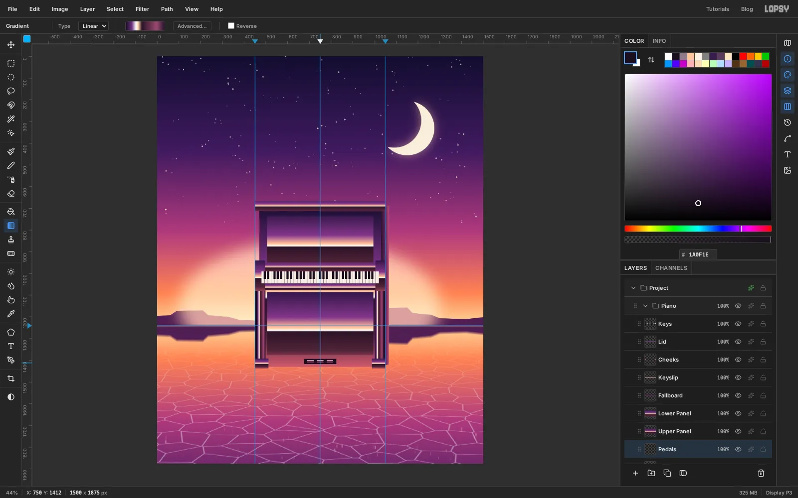

Legs are cylinders, so their reflection runs **across** them, dark at the edges with a hot white streak just left of centre. Set up a second gradient for them:

- `#140A20` at 0%
- `#6E3482` at 16%
- `#FFFFFF` at 27% (the hot streak)
- `#FFD6B0` at 32%
- `#2A1426` at 42%
- `#9A4A6E` at 80%
- `#24102C` at 100%

Click the `Side` row first, so the legs stack above it.

1. **Add Layer** named `Legs`. Marquee the left leg from `458, 1077` to `498, 1397` and [[Shift]]-drag the gradient from its left edge to its right edge. Do the same for the right leg at x `1002` to `1042`.
2. **Add Layer** named `Toe Blocks`. Select both feet at once (`444, 1392` to `512, 1438`, then [[Shift]]-add `988, 1392` to `1056, 1438`) and fill them with the main chrome gradient, dragged top to bottom.
3. **Add Layer** named `Pedals`. Fill a dark slot from `676, 1393` to `824, 1417` with `#1A0F1E`. Then select three small pedals, 30 × 12 px each, inside the slot with their left edges at x `690`, `735` and `780`, and drag the cylinder gradient down across them.

## Recess the panels and add a rim light

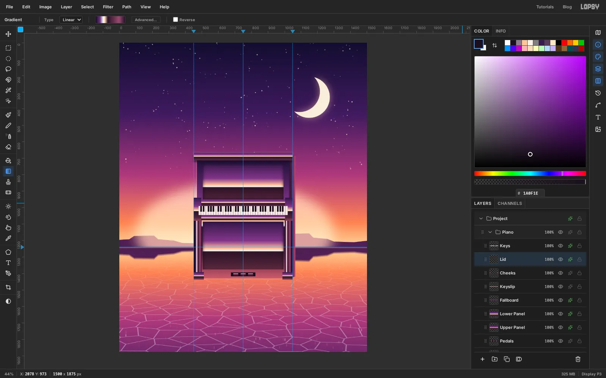

Effects do the shading. Open each row's effects drawer:

- `Upper Panel` and `Lower Panel`: **Inner Glow**, colour `#12081C`, **Size** `28`, **Opacity** `85`. The dark edges push the panels back into the case.
- `Lid`: **Drop Shadow**, colour `#12081C`, **Offset Y** `10`, **Blur** `16`, **Opacity** `70`. Also **Outer Glow** `#FFE0C0`, **Size** `8`, **Opacity** `60`.
- `Fallboard`: **Drop Shadow**, `#12081C`, **Offset Y** `6`, **Blur** `8`, **Opacity** `65`.
- `Keys`: **Inner Glow**, `#6E3482`, **Size** `6`, **Opacity** `55`.
- `Case`: **Outer Glow**, `#FFE0C0`, **Size** `10`, **Opacity** `70`.

The pale outer glow on the case and lid is a **rim light**. It keeps the piano's warm bottom half from melting into the orange glow behind it.

## Scale the whole piano

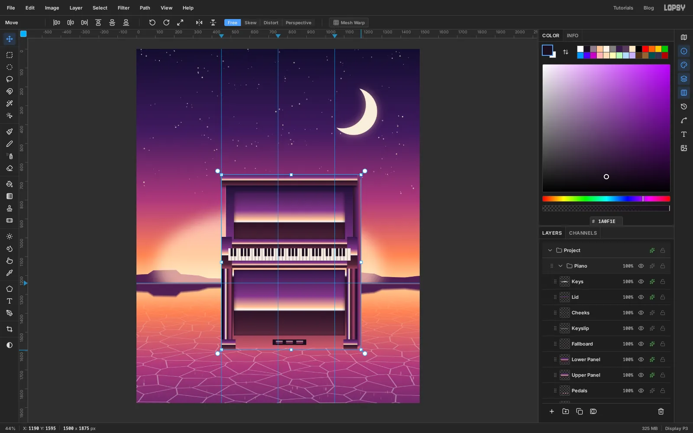

The piano is a little small for the canvas. Scale everything at once:

1. Click the `Piano` group row and pick the **Move** tool. Handles appear around all of the piano's layers together.
2. Hold [[Cmd]] (to keep the proportions) and drag the **bottom-right** corner handle down and right until the box is about 120% of its size: from `1066, 1440` to about `1190, 1595`.
3. Press [[Cmd+D]] to apply.

All the parts scale together, in one undo step.

## Move the piano off centre

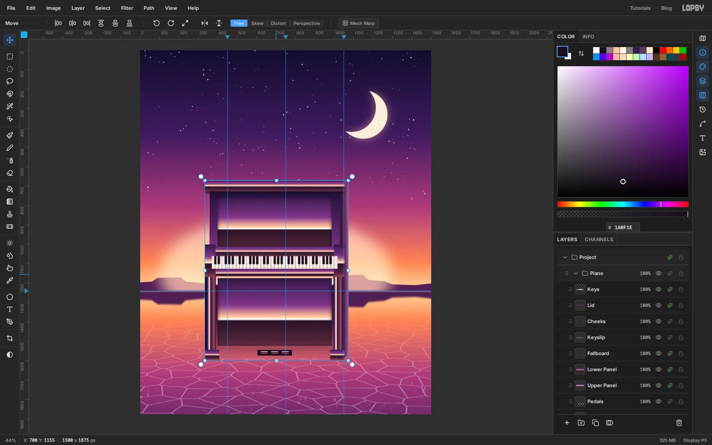

A piano dead centre is static. Move it a little left, so the moon has room on the right. With the `Piano` group still active and the Move tool picked, drag from the middle of the piano about 115 px to the left. Aim for the piano's centre at about x `700` and its feet at about y `1597`. Press [[Cmd+D]].

## Draw the scroll ornament with the Pen

Click the `Upper Panel` row and **Add Layer**. Name it `Ornament`. Set the foreground colour to `#FFE6C4`.

Pick the **Pen** tool ([[P]]) and set **Stroke** to `7`. Draw half of a scroll on the left half of the upper panel. Press and **drag** to make each smooth anchor, so the curve has handles:

1. Start at the centre of the panel, near its bottom edge. Drag out to the left.
2. Next anchor high on the panel, about a quarter of the way in from the left. Drag up and left.
3. Next anchor near the panel's left side, a little below middle. Drag down.
4. Next anchor just right of that, lower down. Drag up, to start the curl.
5. Single-click a little above that to end the spiral.

Press [[Enter]]. The path is saved and stroked onto the layer in the foreground colour.

## Mirror the ornament

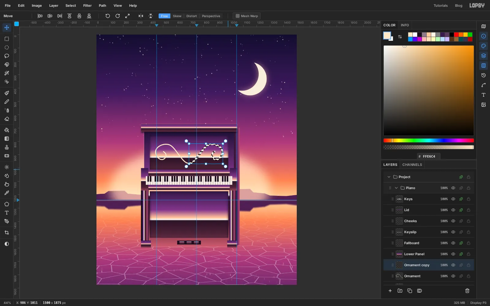

1. The stroked path stays selected and its blue outline stays on screen. To clear it, click once on an empty part of the canvas with the Pen (that deselects the path and starts a new one) and press [[Escape]] straight away to throw the new one away.
2. Choose **Layer → Duplicate Layer**.
3. Marquee the **whole upper panel**, which after the scale and move runs from about `400, 755` to `986, 1011`. The flip turns around the middle of the selection, and the panel is centred on the piano, so the copy lands as a mirror image on the right.
4. Pick the **Move** tool and click **Flip Horizontal**. Afterwards the selection shrinks to hug the flipped half: that's normal. Press [[Cmd+D]], then [[Cmd+E]] to merge the two halves.
5. Where the two halves meet, fill a 40 px circle with `#FFE6C4` as a medallion.
6. Give `Ornament` an **Outer Glow** (`#FF9A6A`, **Size** `14`, **Opacity** `60`) and a small **Drop Shadow** (`#12081C`, **Offset Y** `3`, **Blur** `4`, **Opacity** `70`).

## Paint the drips and the puddle

Click the `Keys` row and **Add Layer**. Name it `Drips`. Work in plain white first: you'll fill the shape with chrome afterwards.

1. Pick the **Brush** ([[B]]), **Hardness** `100`, **Opacity** `100`, **Size** `28`. Drag a slightly wavy line along the bottom edge of the keyslip, from one side of the piano to the other. This is the molten lip.
2. Hang eight drips from it. For each one, set the size (16 to 26), click on the lip, then [[Shift]]-click lower down for a straight line. Vary the lengths a lot: some stop a third of the way down the lower panel, one reaches its middle. For the short ones, raise the size by about half and click once at the end to make a blob.
3. Make two of the thickest drips (near x `480` and `905`) run all the way past the feet to about y `1660`.
4. With the **Lasso**, draw a wide, slightly wobbly oval at the piano's feet, about 960 px across and 110 px tall, centred around `700, 1645`. Fill it white. That's the puddle the long drips pour into.

## Make the drips sag with Liquify

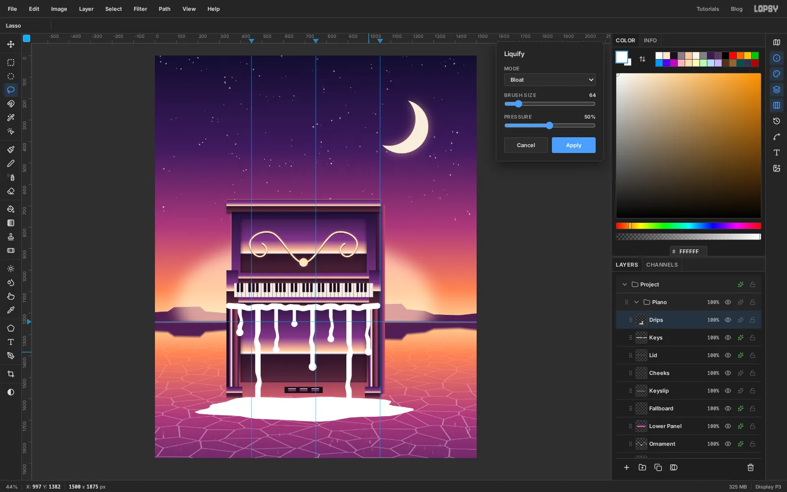

Straight brush lines look like icicles. Liquid sags.

1. Choose **Filter → Liquify…** ([[Cmd+Shift+X]]). Leave **Mode** on **Push Forward**, with **Brush Size** `64` and **Pressure** `50%`.
2. Push each drip sideways a little partway down with short diagonal drags, alternating left and right, so they wobble.
3. Between drips, drag the lip **down** a few pixels so it sags.
4. Switch **Mode** to **Bloat** and press and hold for a moment on each blob, so the ends swell.
5. Click **Apply**.

## Select the drips

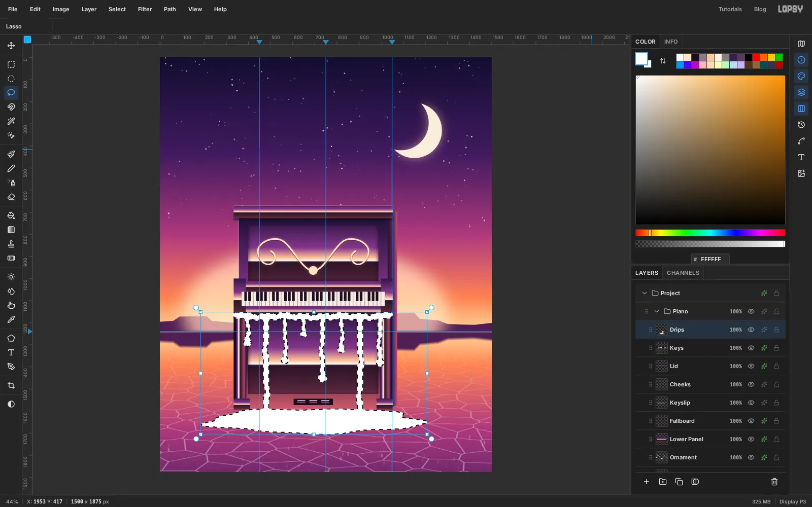

[[Cmd]]-click the `Drips` thumbnail in the Layers panel. Everything painted on the layer becomes the selection, so a gradient fills only the drips and never spills onto the panels behind them.

The puddle and the drips get different chrome. The puddle lies flat, so it mirrors the dark piano right above it. The drips hang upright, like the panels. So you'll split this selection in two with an **intersect**: hold [[Shift+Alt]] while you drag a Rectangular Marquee, and only the part of the selection inside the new box stays selected.

## Chrome the puddle and the drips

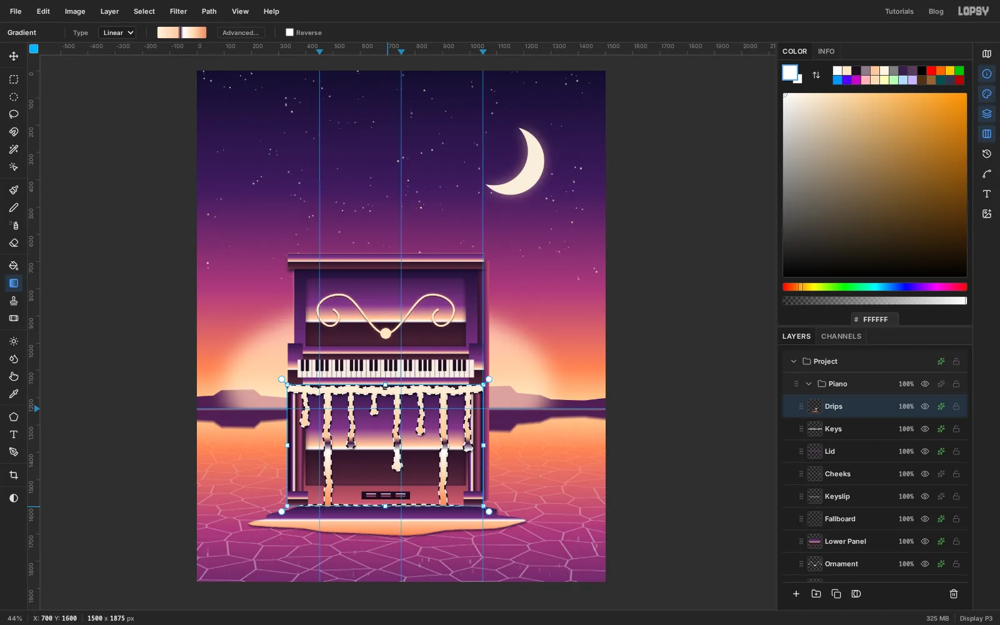

**The puddle first.** With the selection from the last step, pick the **Rectangular Marquee**, hold [[Shift+Alt]] and drag a box around just the puddle, from about y `1598` down past its bottom edge. Set up this gradient and [[Shift]]-drag it from the top of the puddle to the bottom:

- `#1A0F33` at 0% (the piano's dark underside, reflected)
- `#6E3482` at 45%
- `#FFFFFF` at 52%
- `#FFC9A0` at 56%
- `#F08A5D` at 100%

Press [[Cmd+D]].

**Then the drips.** [[Cmd]]-click the `Drips` thumbnail again, and this time [[Shift+Alt]]-drag a box from above the keyboard down to y `1598`, so the puddle is left out. If the drips used the same chrome as the case they'd vanish into it, so make them a **lighter** chrome that reads against the body:

- `#FFF1DC` at 0%
- `#FFC9A0` at 42%
- `#3A1A3E` at 47% (the horizon line)
- `#FFFFFF` at 53%
- `#FFD6B0` at 75%
- `#F08A5D` at 100%

[[Shift]]-drag it from the lip (about y `1160`) down to y `1600`, then press [[Cmd+D]].

Finally, open the drawer for `Drips`:

- **Inner Glow** `#2A1238`, **Size** `9`, **Opacity** `70`. It darkens the edges, so each drip looks round, like a tube of liquid metal.
- **Drop Shadow** `#12081C`, **Offset X** `3`, **Offset Y** `6`, **Blur** `8`, **Opacity** `55`. It lifts the drips off the panel.

No stroke. An outline would turn the metal into a cartoon.

## Add speculars and Bloom

Click the `Drips` row and **Add Layer**, named `Glints`. It sits at the top of the `Piano` group. Paint with white.

1. **Brush**, **Hardness** `80`, **Size** `5`. Draw a straight highlight down the left side of each drip: click near the top, then [[Shift]]-click near the bottom.
2. **Size** `4`: one long highlight along the top of the lid, from its left end to its right end. Keep it on the lid.
3. Only two star glints, on spots where light would really catch: the lid's left corner and the ornament's medallion. Set **Hardness** to `0`. For each one, draw a short horizontal and a short vertical line through the point, then one soft dab at **Size** `20` in the middle.
4. Run **Filter → Bloom…** with **Threshold** `20`, **Radius** `18` and **Intensity** `160`, then set the blend mode to **Screen**.

Resist adding more glints. Two read as light; six read as clip art.

## Copy the piano for its reflection

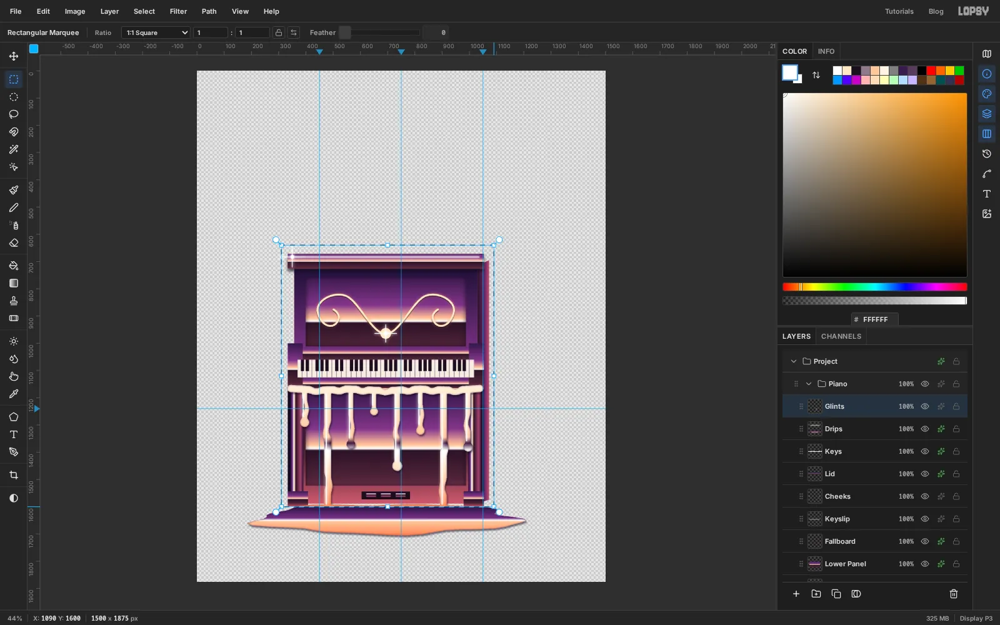

The mirror flat should reflect the piano too.

1. Click the eye on the `Backdrop` row to hide it, so only the piano shows.
2. Marquee the piano from its top-left corner (about `310, 640`) down to its feet (about `1090, 1600`). The box is 960 px tall.
3. Press [[Cmd+Shift+C]] for **Copy Merged**, then show `Backdrop` again and press [[Cmd+D]].

## Flip the reflection under the piano

The reflection has to meet the feet exactly, or the piano looks like it's hovering, so this time nudge it with the keys rather than dragging.

1. Expand `Backdrop` and click the `Mirror` row, so the paste lands above it but below the crust.
2. Press [[Cmd+V]] and rename the new layer `Piano Reflection`.
3. Click **Flip Vertical**. Then press [[Shift+↓]] 96 times to move it down exactly 960 px, the height of the copy. Its top edge now meets the piano's feet.
4. Press [[Cmd+D]].

## Fade the reflection and ground the piano

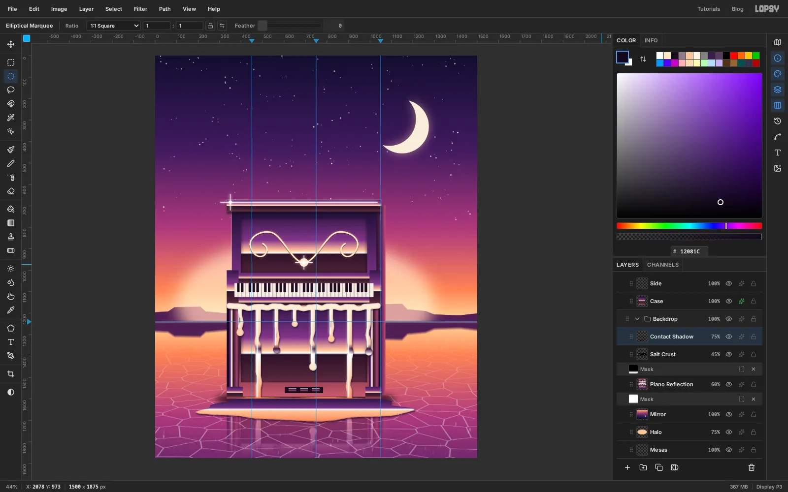

1. Run **Motion Blur** with **Angle** `90` and **Distance** `8`.
2. **Add Mask**, click the mask thumbnail, and drag a white-to-black gradient from y `1600` (the feet) to the bottom of the canvas. Then click the layer thumbnail to leave mask editing, and set the opacity to `60%`.
3. Click `Salt Crust` and **Add Layer**. Name it `Contact Shadow`. Marquee a flat ellipse about 840 × 84 px centred at `700, 1602`, **Feather** it by `30`, fill with `#12081C`, and set the layer to **Multiply** at `75%`.

The contact shadow is what stops the piano from floating. It's darkest exactly where the piano touches the ground.

## Draw a sheet of music

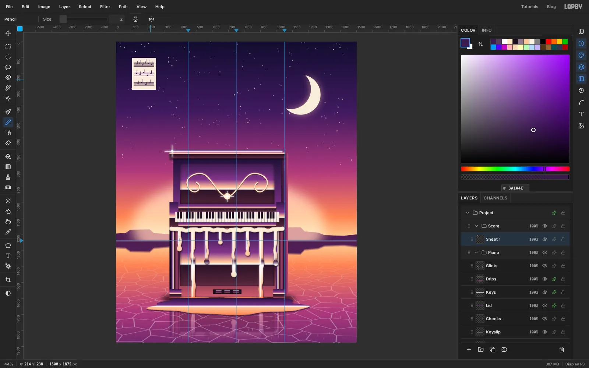

Click the `Piano` group, click **New Group**, drag the new group out above `Piano` and rename it `Score`. Then **Add Layer** inside it, named `Sheet 1`.

1. Fill a 150 × 200 px page from `100, 100` to `250, 300` with `#F6EBDD`. It's drawn in a corner for now and moved later.
2. **Pencil**, **Size** `2`, colour `#5A3A5E`: three staves of five lines each, 6 px apart, starting at y `130`, `190` and `250`. Use click and [[Shift]]-click for each line.
3. Select fifteen tiny ovals (8 × 6 px) on the staves with the **Elliptical Marquee**, holding [[Shift]] to add each one, and fill them with `#3A1A4E`. Add a short stem to the right of each one with the Pencil.
4. Give the layer a **Drop Shadow** (`#12081C`, **Offset X** `6`, **Offset Y** `10`, **Blur** `14`, **Opacity** `50`) and an **Outer Glow** (`#FFB38A`, **Size** `22`, **Opacity** `35`).
5. Choose **Layer → Duplicate Layer** three times. The copies keep the effects. They're called `Sheet 1 copy`, `Sheet 1 copy copy` and so on; you'll rename each one as you place it.

## Throw the sheets into the sky

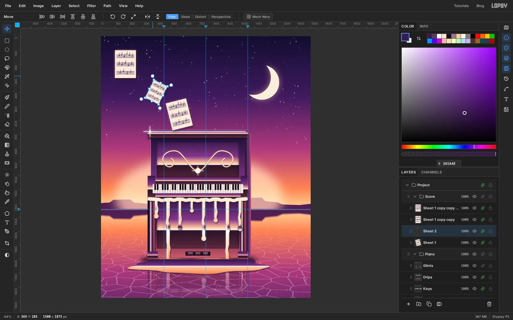

Each sheet gets its own move, scale and turn, and each one should be smaller and more tilted than the last. Work from `Sheet 1` up. Click the layer's row, double-click its name to rename it (the first copy becomes `Sheet 2`, the next `Sheet 3`, the top one `Sheet 4`), marquee the page in the corner, pick the **Move** tool, then:

1. Drag the page to its spot.
2. [[Cmd]]-drag the bottom-right corner handle to shrink it.
3. Drag a rotation handle (the circle just outside a corner) to turn it.
4. Press [[Cmd+D]].

- `Sheet 1`: centred on `560, 560`, just breaking over the top of the lid. Full size, tilted about 14° anticlockwise.
- `Sheet 2`: centred on `395, 400`. About 108 × 144 px, tilted about 26° clockwise.
- `Sheet 3`: centred on `470, 228`. About 78 × 104 px, tilted about 38° anticlockwise.
- `Sheet 4`: centred on `690, 120`. About 54 × 72 px, tilted about 64° clockwise.

The page starts at 150 × 200 px, so those sizes are 72%, 52% and 36% of it. Nothing here needs to be exact: scale and turn by eye until each page is clearly smaller and more tilted than the one before.

The path goes up and left, then hooks back right towards the moon. That curve leads the eye from the piano to the moon instead of off the top of the canvas.

## Curl two pages

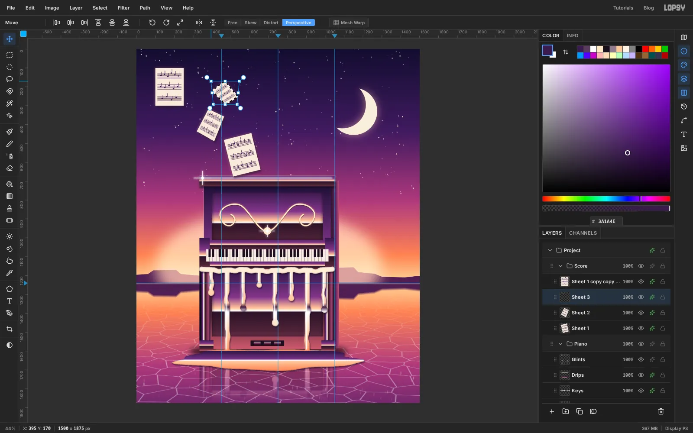

Flat pages look like stickers. Bend two of them slightly with **Perspective**:

1. [[Cmd]]-click the `Sheet 3` thumbnail to select the page, and pick the **Move** tool.
2. Click **Perspective** in the options bar and drag the top-left corner in and down by about 12 px.
3. Click **Free** to commit, then [[Cmd+D]].

Do the same on `Sheet 2`, pulling its top-right corner in instead.

## Nudge the score as a group

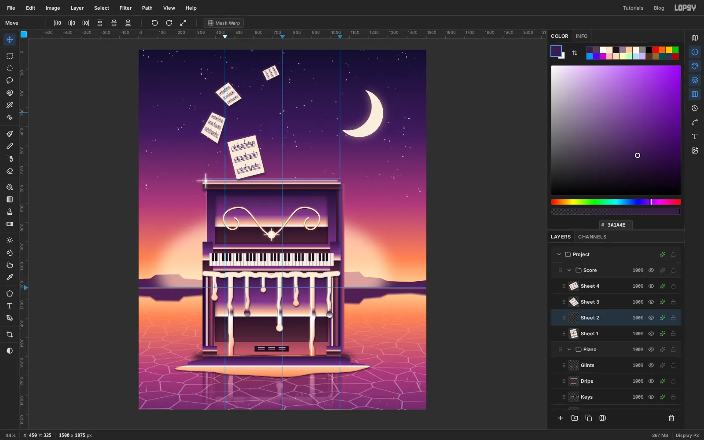

The sheets now form a curve: out of the lid, up, and back towards the moon. Check the gaps between them. If the arc sits too close to the moon or too far left, click the `Score` group row, pick the **Move** tool and nudge with the arrow keys ([[Shift]] moves 10 px at a time). All four sheets move together, and [[Cmd+Z]] puts them back in one step.

## Add grain and the final grade

1. Click `Sheet 4`, **Add Layer**, name it `Grain`, and drag it above the `Score` group so it's at the very top.
2. Fill it with `#808080`, run **Filter → Add Noise…** with **Amount** `18` and the **Mono** and **Gaussian** toggles on, then set the layer to **Overlay** at `45%`. Grain hides gradient banding and makes the flat digital shapes feel printed.
3. Click the top `Project` group and open its drawer (✦). The root group already lists **Levels**, **Curves**, **Exposure**, **Hue / Saturation** and **Color Grading** at their neutral settings. Leave those alone. Click **Add Adjustment → Vignette** and set its single **Vignette** slider to `40`.
4. **Add Adjustment → Color Balance**. On **Shadows** set **Yellow — Blue** to `12` and **Cyan — Red** to `-4`, for cool night shadows. On **Highlights** set **Cyan — Red** to `6`, for warm light.

## Export

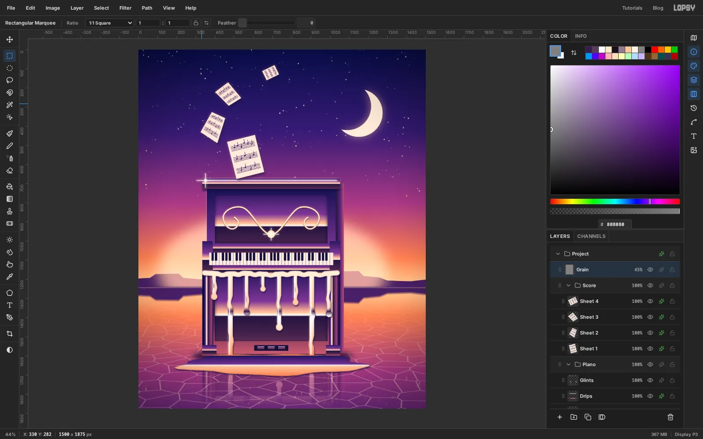

Choose **File → Quick Export PNG** for the finished image, and **File → Save Project** to keep every layer, mask and effect editable.

If you want to push it further, try a different sky with the same chrome stops (a blue noon sky makes the piano look like a 1950s diner fitting), or move the `Halo` layer to put the sunset on the other side of the piano and see how the drips' horizon line still holds.
