This tutorial designs the menu for an imaginary late-night yakitori bar, **Yakitori Nights**, tucked under a railway arch. Yakitori is chicken grilled on skewers over charcoal, and the bars that serve it are lit by red paper lanterns and fill up after the trains stop. The menu borrows the look of 1980s **chrome lettering**: heavy capitals that seem to mirror a sky, a horizon and a sunset, with a hot neon script underneath. The canvas is 1200 × 1800 px, a 2:3 portrait, the shape of a 4 × 6 in card. For a large print, build it at double size.

The trick behind all chrome is one idea. **A polished surface has no colour of its own; it reflects what's around it.** The top half of a letter shows the sky and gets lighter towards the horizon. Then there's a hard bright line, and directly under it the dark ground starts, warming up towards the bottom. Every chrome element on this menu (title, headings, skewer, lantern caps and frame) uses the same kind of gradient: sky over ground, with a hard break in the middle. A soft blend reads as plastic; the hard line reads as metal.

Everything is drawn in Lopsy from gradients, selections and type, with no photos.

Along the way you'll use:

- ruler **guides** with snapping, **groups**, dragging a layer into a group, and moving a whole group with the arrow keys
- the **Gradient** tool with multi-stop gradients from the **Gradient Editor**, linear and radial
- the **Rectangular** and **Elliptical Marquee** and the **Lasso**, with adding, subtracting and intersecting selections, **Select → Shrink**, and [[Cmd]]-clicking a layer thumbnail to select its pixels
- the **Shape** tool (rectangles with rounded corners) and the **Pencil** for straight lines
- the **Move** tool's rotate and scale handles, on a selection, a text layer and a pasted layer
- **Smoke**, **Gaussian Blur** and **Add Noise**
- a **layer mask** painted with a gradient
- **Text** in Russo One, Mr Dafoe, Barlow Condensed and Dela Gothic One, including **vertical** Japanese text, line height and paragraph spacing from the **Text** panel
- **Stroke**, **Drop Shadow**, **Outer Glow** and **Inner Glow**, the **Screen** and **Overlay** blend modes, and a **Color Grading** adjustment on the whole image

The palette:

- Night sky `#07060F` → `#15102A` → `#2E0B1E` → `#4A0E16`
- Title chrome `#0A1A4F` → `#3E78D6` → `#DCEBFF` → `#FFFFFF` → `#2A0E10` → `#7C2E1A` → `#F0954A` → `#FFE2AE`
- Small chrome `#0A1A4F` → `#5B8FE0` → `#F4F8FF` → `#2A0E10` → `#B4562A` → `#FFE2AE`
- Frame chrome `#7FA6FF` → `#E8F2FF` → `#FFFFFF` → `#2A0E10` → `#9A4320` → `#FFE2AE`
- Outline ink `#0B0820`, offset red `#E8112D`, neon rim `#FF2E4D`
- Neon script `#FFE1EC`, neon glow `#FF2E88`, inner glow `#FF7AB0`
- Lantern `#FFC08A` → `#F0382B` → `#A3101C` → `#4A0510`, ribs `#5A0812`, kanji `#3A0A0A`, cord `#9A8FB0`, glow `#FF7A3A`
- Glazed chicken `#FFD08A` → `#F2A54A` → `#B3561A` → `#6A2A0C`, char `#2A0A02`
- Scallion `#D6EC9A` → `#8DBE5A` → `#4F8A3A` → `#24461A`
- Panel `#0D0B1E` (82% opacity), dish names `#F4F1FF`, descriptions `#A99BD6`, prices `#F2B85A`, labels `#FF6B8A`
- Footer amber `#FFC46B`, footer lavender `#D8D0F5`, glint glow `#BFD8FF`

> **Tip:** Positions are given as `x, y` in document pixels. The status bar at the bottom left shows where your cursor is. Mac key names are used; on Windows and Linux use Ctrl for Cmd.

> **Tip:** Gradient colours come from the **Gradient Editor**, not the foreground colour. With the Gradient tool picked, click **Advanced…** in the options bar, click a stop to set its colour, click under the bar to add a stop, and drag stops to position them. Hold [[Shift]] while you drag on the canvas to keep a gradient perfectly vertical.

> **Tip:** "Fill" means set the foreground colour in the Color panel's hex field, then choose **Edit → Fill**. Press [[Cmd+D]] to drop a selection before you draw the next one.

> **Tip:** A new layer or group appears just above the active one, and inside a group if the active row is an expanded group or one of its children. To add something above a group instead, collapse the group with the arrow on its row first. Each step says which row to click.

> **Tip:** The marquee options bar shows a **Ratio** menu. It only applies while the lock button beside it is on, so leave the lock off and every marquee follows your drag.

> **Tip:** For perfectly level or upright pencil lines, click the start and then [[Cmd+Shift]]-click the end. Shift draws a straight line from the last point, and Cmd snaps its angle to 15° steps.

## Set up the canvas and paint the night sky

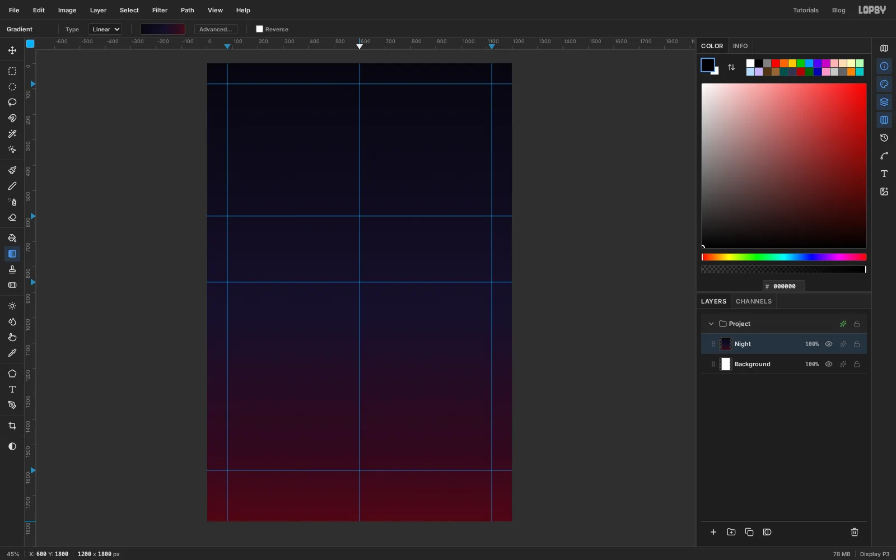

Create a new document `1200` × `1800` px with a white background. If the rulers aren't showing, turn on **View → Show Rulers**. Click the top ruler at x `80`, `600` and `1120`, and the left ruler at y `80`, `600`, `860` and `1600`. The outer vertical guides are the margins, the middle one is the centre line, and the horizontal guides mark where the title, the illustration and the menu panel begin and end.

1. Double-click `Layer 1` and rename it `Night`.
2. Pick the **Gradient** tool, set **Type** to **Linear** and open **Advanced…**. Make four stops: `#07060F` at the left end, `#15102A` at about 55%, `#2E0B1E` at about 85% and `#4A0E16` at the right end.
3. [[Shift]]-drag from the top edge of the canvas to the bottom edge.

The bottom of the menu glows faintly red, like a grill.

## Render grill smoke

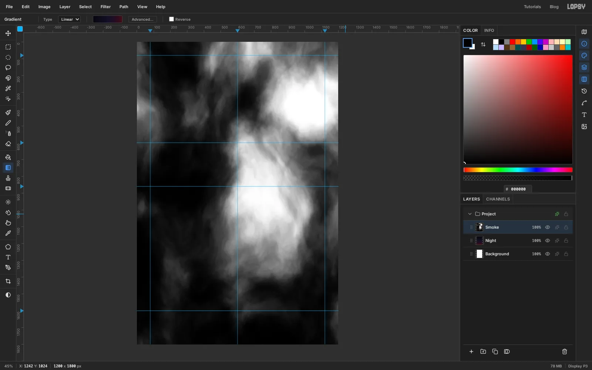

Click **Add Layer** and rename the new layer `Smoke`. Choose **Filter → Smoke…**, set **Scale** to `3` and **Turbulence** to `70`, and click **Apply**. The filter generates a fresh pattern every time, so yours will look different. Click the circular **Regenerate** button in the dialog if you'd like another one.

## Fade the smoke with a layer mask

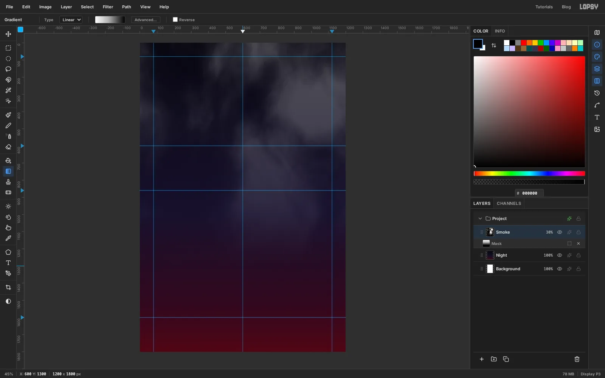

1. Open the layer effects for `Smoke` (the sparkle button on its row) and set **Blend** to **Screen**, so only the light parts of the smoke show. Click the opacity on the row and drag it down to `30%`.
2. Click **Add Mask** at the bottom of the Layers panel, then click the white **Mask** thumbnail under the row. This switches to mask editing, and painting now hides or reveals the layer instead of changing its pixels.
3. With the **Gradient** tool, set three stops: white at the left, `#B0B0B0` at about 45%, and black at the right. [[Shift]]-drag from the top of the canvas down to about y `1300`.
4. Click the `Smoke` name on its row to go back to editing pixels.

The smoke now drifts across the top and dies away before the menu panel, which keeps the price list easy to read.

## Type the title

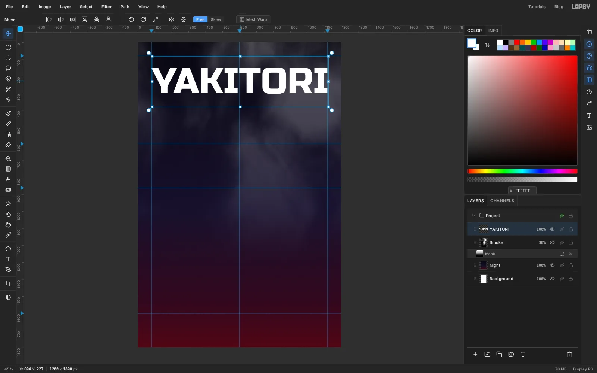

Pick the **Text** tool. Set the foreground colour to white, choose **Russo One** in the font menu and set **Size** to `213`. Click near the top-left guide intersection and type `YAKITORI`, then press [[Tab]] to commit.

Switch to the **Move** tool and drag the text so its left edge snaps to the guide at x `80` and the tops of the letters sit at about y `150`. At this size the word runs right across to the x `1120` guide. If yours is a little wide or narrow, select the layer, pick the Text tool and nudge **Size** until it fits between the guides.

## Fill the title with chrome

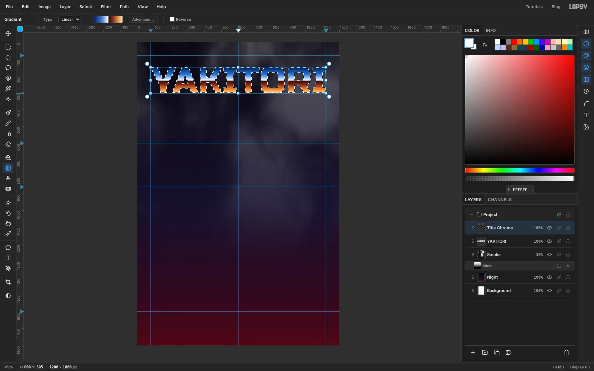

The text layer stays as an editable source. The chrome goes on a layer above it.

1. [[Cmd]]-click the `YAKITORI` thumbnail in the Layers panel to select the letter shapes.
2. Click **Add Layer** and rename it `Title Chrome`.
3. With the **Gradient** tool, make eight stops: `#0A1A4F` at 0%, `#3E78D6` at 28%, `#DCEBFF` at 47%, `#FFFFFF` at 50%, `#2A0E10` at 53%, `#7C2E1A` at 66%, `#F0954A` at 86% and `#FFE2AE` at 100%. The white stop and the dark stop sit only three percent apart. That close pair is the horizon.
4. [[Shift]]-drag from the very top of the letters to the very bottom (about y `149` to y `305`; watch the status bar).
5. Press [[Cmd+D]], then click the eye on the `YAKITORI` row to hide the white text underneath.

## Outline the chrome and give it a red offset

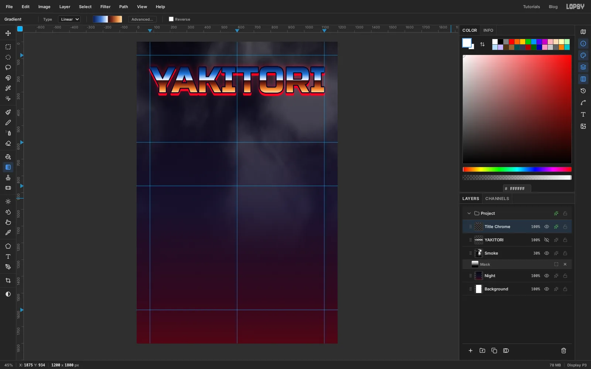

Open the layer effects for `Title Chrome` and turn on three effects:

- **Stroke**: Width `6`, Outside, colour `#0B0820`.
- **Drop Shadow**: Offset X `0`, Offset Y `14`, Blur `0`, Spread `6`, Opacity `100`, colour `#E8112D`. With no blur, the shadow becomes a hard red extrusion, a classic 80s logo move.
- **Outer Glow**: Size `48`, Spread `0`, Opacity `45`, colour `#FF2E4D`.

## Write the neon script

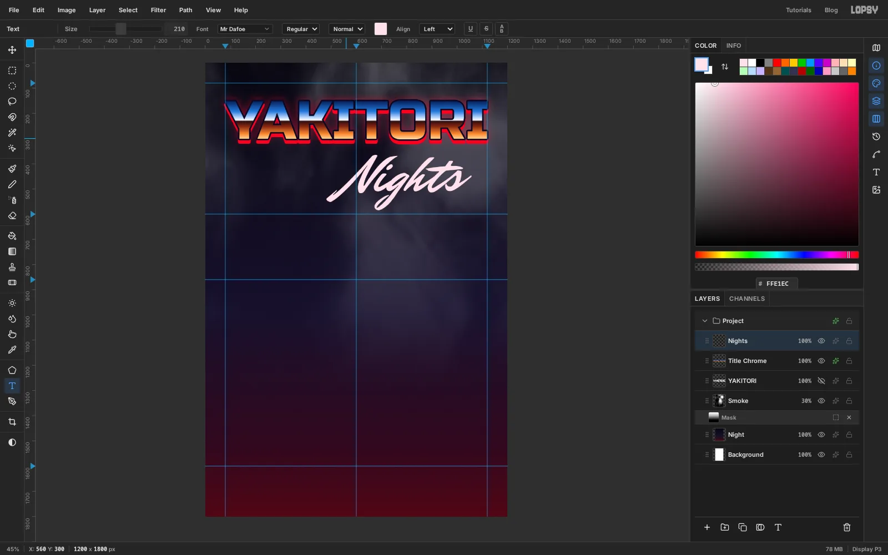

Set the foreground colour to `#FFE1EC`. With the **Text** tool, choose **Mr Dafoe** at **Size** `210`, click in an empty spot under the title at about `560, 360`, type `Nights` and press [[Tab]].

Click away from the title when you start the text. A click on an existing text layer opens it for editing instead of starting a new one.

## Light it up

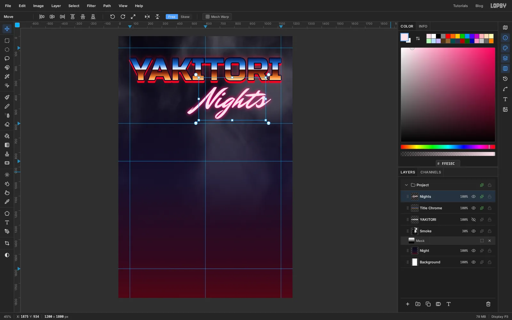

Open the layer effects for `Nights`:

- **Outer Glow**: Size `34`, Spread `10`, Opacity `95`, colour `#FF2E88`.
- **Inner Glow**: Size `6`, Spread `0`, Opacity `70`, colour `#FF7AB0`.

Real neon has a nearly white core and a coloured halo. The pale fill gives the core, and the two glows do the rest.

## Tilt the script under the title

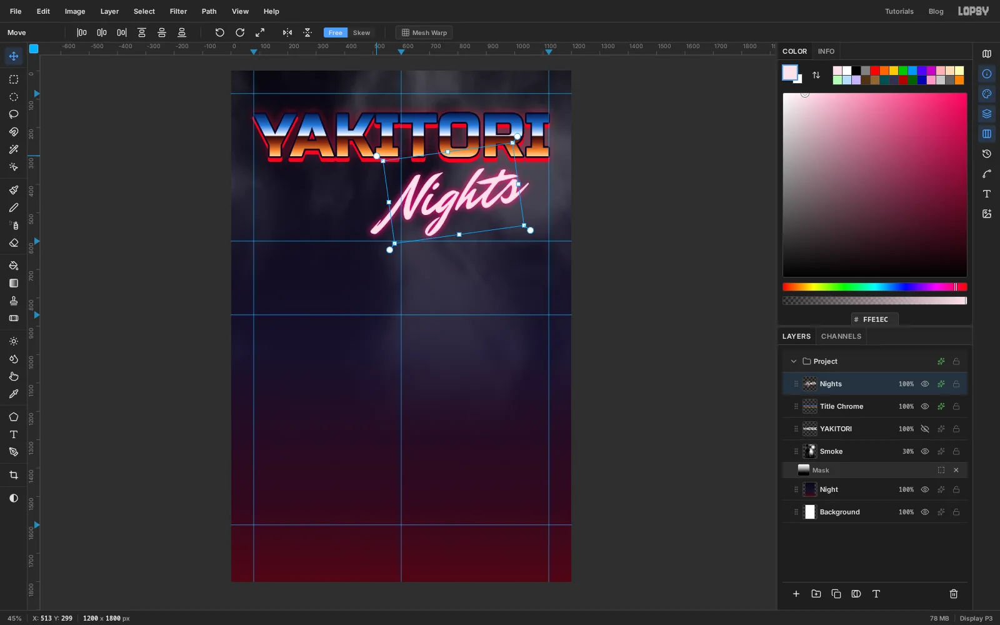

Switch to the **Move** tool with `Nights` active. Handles appear around the text without needing a selection. Drag the round rotation handle outside the top-left corner **down** until the text has turned about 8° anticlockwise, and press [[Enter]]. Then drag the text up so the top of the N tucks just under the red offset of the title. The script now rises to the right, the way a signwriter would hang it.

## Draw the paper lantern

1. Click the `Nights` row, then click **New Group** and rename the group `Lantern`. Click **Add Layer** and rename the layer `Paper`.
2. With the **Elliptical Marquee**, drag a tall oval about 160 px wide and 200 px tall in the empty space left of `Nights`, centred near `225, 470`.
3. With the **Gradient** tool set to **Radial**, make four stops: `#FFC08A`, `#F0382B` at 35%, `#A3101C` at 80% and `#4A0510`. Drag from a little above and left of the oval's centre out to its lower-right edge, so the lantern looks lit from inside.
4. Pick the **Pencil**, set **Size** to `2` and the colour to `#5A0812`. Click left of the oval and [[Cmd+Shift]]-click right of it to draw a level rib. Repeat for six evenly spaced ribs. The selection keeps the lines inside the oval.
5. Press [[Cmd+D]]. Give `Paper` an **Outer Glow**: Size `90`, Opacity `60`, colour `#FF7A3A`.

## Add chrome caps, a cord and a tassel

1. Click **Add Layer** and rename it `Caps`. Pick the **Shape** tool, set **Shape** to **Rectangle**, **Corner Radius** to `6` and the fill to `#14101C`.
2. The Shape tool grows a shape **from its centre**, so press at the middle of the top of the lantern and drag outwards until the cap is about 88 × 24 px. Draw a matching cap at the bottom.
3. To chrome each cap separately, [[Cmd]]-click the `Caps` thumbnail, pick the **Rectangular Marquee**, and hold [[Shift+Alt]] while you drag a rectangle around just the top cap. Shift+Alt intersects, so only the top cap stays selected.
4. Set the Gradient tool to **Linear** with the small chrome stops: `#0A1A4F`, `#5B8FE0` at 30%, `#F4F8FF` at 48%, `#2A0E10` at 52%, `#B4562A` at 75% and `#FFE2AE`. [[Shift]]-drag from the top of the cap to its bottom. Repeat steps 3 and 4 for the bottom cap.
5. With the **Pencil** at size `2` and colour `#9A8FB0`, click just under the title's red offset above the lantern and [[Cmd+Shift]]-click the top cap straight below to hang the cord. Switch to size `3` and `#E8112D` and draw four short lines down from the bottom cap for a tassel.

## Mark the lantern and group it

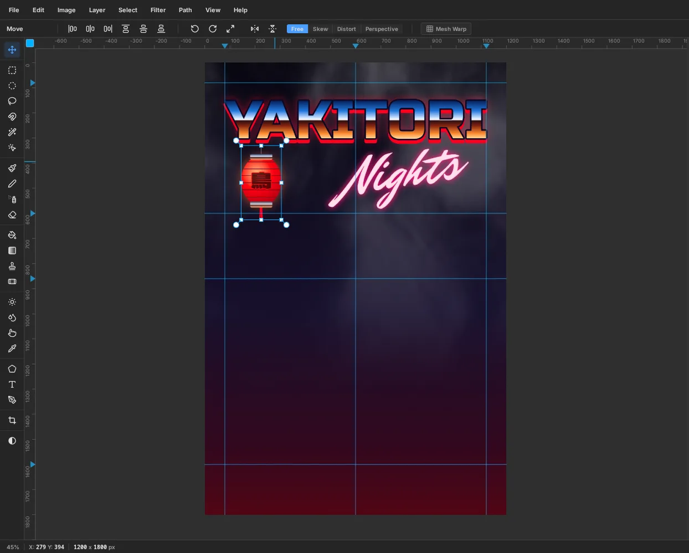

Lanterns outside yakitori bars carry a kanji. 鳥 (tori) means "bird".

1. Click the `Caps` row. Set the foreground colour to `#3A0A0A`, pick the **Text** tool with **Dela Gothic One** at `84`, click on the lantern and type `鳥`, then press [[Tab]].
2. Centre it on the paper with the **Move** tool or the arrow keys, set its opacity to `85%`, and add a **Stroke** of width `3` in `#F0382B`, so the ribs don't seem to cut through the character.
3. If the text landed outside the group, drag its grip (the dotted handle at the left of the row) onto the middle of the `Lantern` group row to drop it in.

Click the `Lantern` group row and switch to the **Move** tool. The handles now frame the whole lantern, and dragging moves all three layers together.

## Draw the skewer rod flat

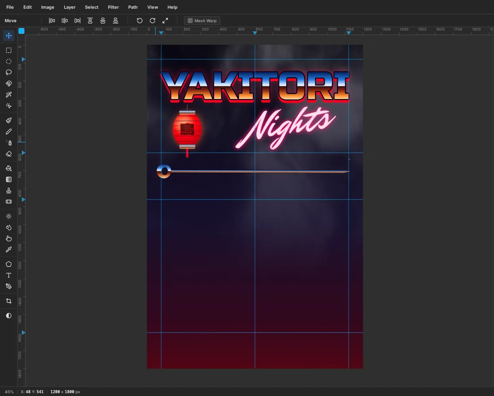

The rod will end up tilted, but draw it level first. A chrome gradient across a 12 px rod needs a perfectly square drag, and that's easy with [[Shift]] held on a level shape.

1. Collapse the `Lantern` group with the arrow on its row, keep the row selected, then click **New Group** and rename it `Skewer`. Add a layer inside it named `Rod`.
2. With the **Lasso**, click out a long, thin rod about 12 px thick along y `686`, running from just inside the left margin guide (x `130`) to just past the right one. Bring the last 40 px or so to a point at the right end. Click on each corner and double-click to close, so the edges stay straight.
3. [[Shift]]-drag the small chrome gradient from the top edge of the rod to the bottom edge.
4. Press [[Cmd+D]]. With the **Elliptical Marquee**, hold [[Shift]] and drag an 80 px circle at the left end of the rod. Then hold [[Alt]] and drag a 44 px circle in its middle to cut a hole. Fill the ring with the same gradient, top to bottom.
5. Add a **Stroke** of `2` px in `#0B0820` to `Rod`.

## Tilt the rod

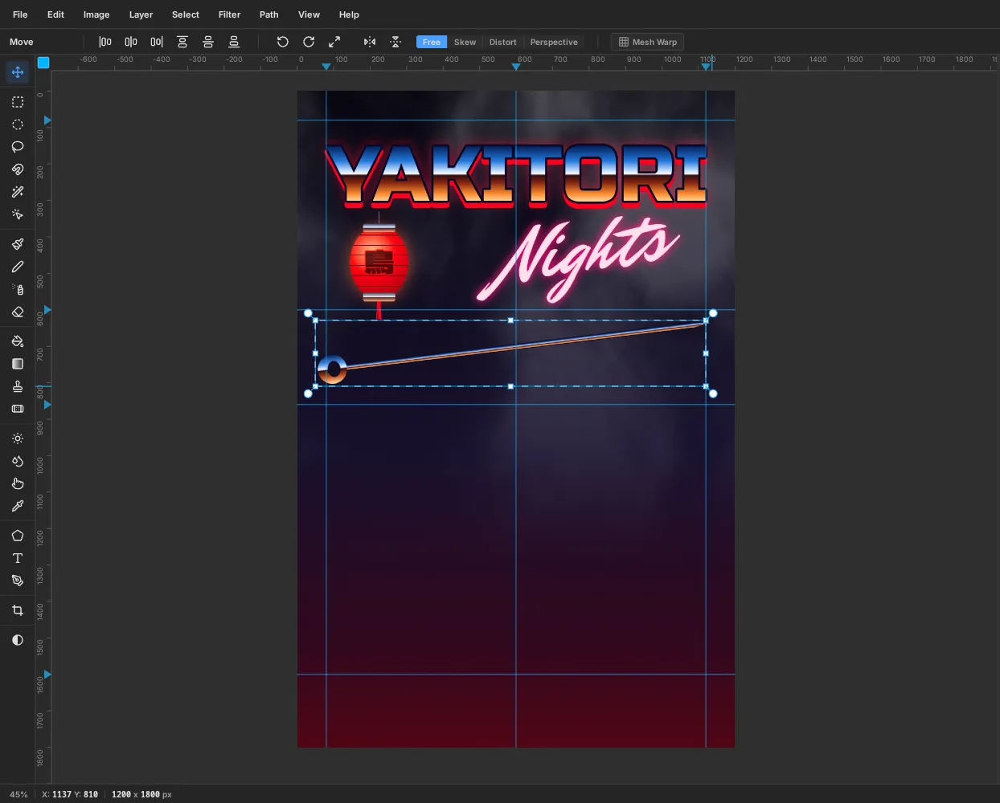

Draw a rectangular marquee around the rod and ring, switch to the **Move** tool and drag the rotation handle outside the top-left corner until the rod has turned about 7° anticlockwise. The tip now points up towards the right, echoing the slant of `Nights`. Press [[Enter]] and [[Cmd+D]].

## Cut a lumpy piece of chicken

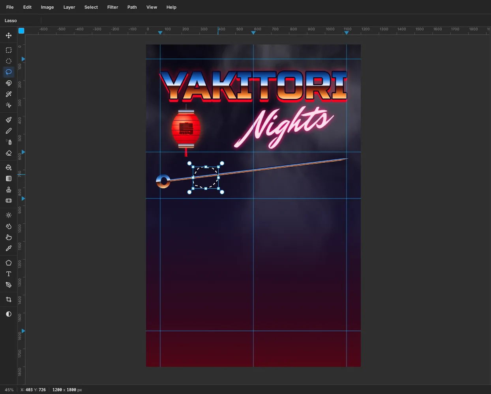

Grilled thigh isn't square. Each piece should be lumpy, and each one should be different.

Click **Add Layer** and rename it `Chicken 1`. With the **Lasso**, click about sixteen points in a rough oval about 150 × 125 px on the left third of the rod, tilted a little. Vary how far out each point is, so the outline bulges and dents.

## Glaze and char it

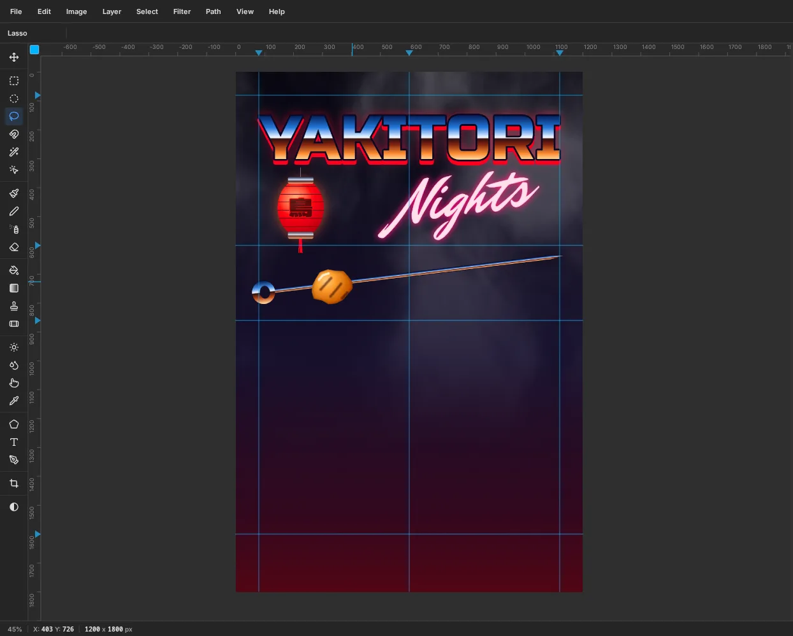

1. Set the Gradient tool to **Radial** with four stops: `#FFD08A`, `#F2A54A` at 25%, `#B3561A` at 70% and `#6A2A0C`. Drag from just up and left of the centre out to the lower-right edge.
2. Pick the **Brush** with **Size** `16`, **Hardness** `0` and **Opacity** `60`, and the colour `#2A0A02`. Paint two or three short diagonal streaks for grill marks, each a slightly different length. The selection keeps them on the chicken.
3. Set the Brush to size `9`, hardness `70`, opacity `90` and colour `#FFF4DC`, and paint one short curved stroke near the upper left. That's the shine on the tare glaze.
4. Press [[Cmd+D]] and add an **Inner Glow** of size `16`, opacity `60`, in `#2A0802` to darken the edges.

## Add more chicken and the scallions

1. Make `Chicken 2` and `Chicken 3` the same way, a little further along the rod each time. Change the outline, the tilt and the char marks so no two pieces match.
2. For the scallions (negi), add a layer named `Negi 1`. Pick the **Shape** tool, set **Rectangle** with **Corner Radius** `20` and any fill, and drag from the rod between the first two pieces out to make a 64 × 108 px pill.
3. [[Cmd]]-click its thumbnail and fill it with a **Linear** gradient: `#D6EC9A`, `#8DBE5A` at 35%, `#4F8A3A` at 75% and `#24461A`, dragged from its upper-left to its lower-right corner. The light then comes from the same upper left as the chicken highlights.
4. Copy it with [[Cmd+C]], paste with [[Cmd+V]], rename the pasted layer `Negi 2` and drag it between the second and third pieces. Rotate both scallions with the Move tool's handle so they sit square to the tilted rod.

## Cast one shadow under the whole skewer

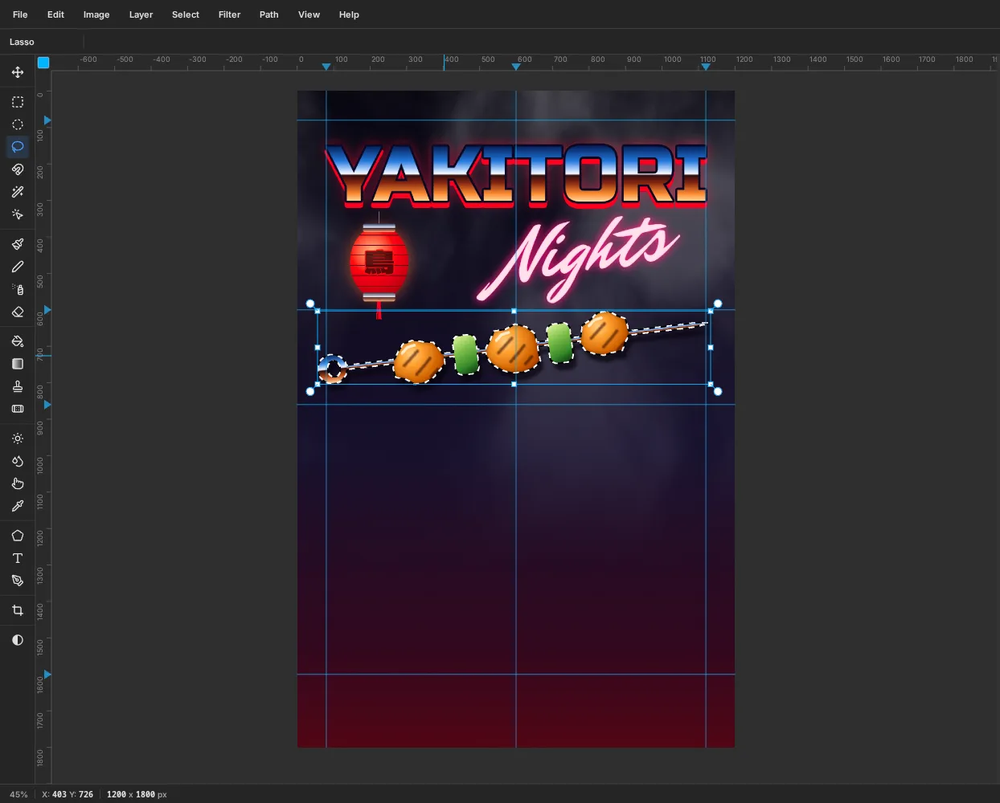

1. Click the `Rod` row, then click **Add Layer** and rename it `Skewer Shadow`. Drag its grip down so it sits under `Rod`.
2. [[Cmd]]-click the `Rod` thumbnail, then [[Cmd+Shift]]-click each chicken and scallion thumbnail to add them to the selection.
3. With `Skewer Shadow` active, fill with `#05030A` and press [[Cmd+D]].
4. Choose **Filter → Gaussian Blur…** with **Radius** `14`. With the **Move** tool, press [[Shift+Right]] once and [[Shift+Down]] twice to offset it, and set the layer opacity to `70%`.

Finally, click the `Skewer` group row and press [[Shift+Down]] once and [[Down]] six times to move the whole skewer 16 px lower. That gives the script and the skewer a little room from each other.

## Build the menu panel and its chrome frame

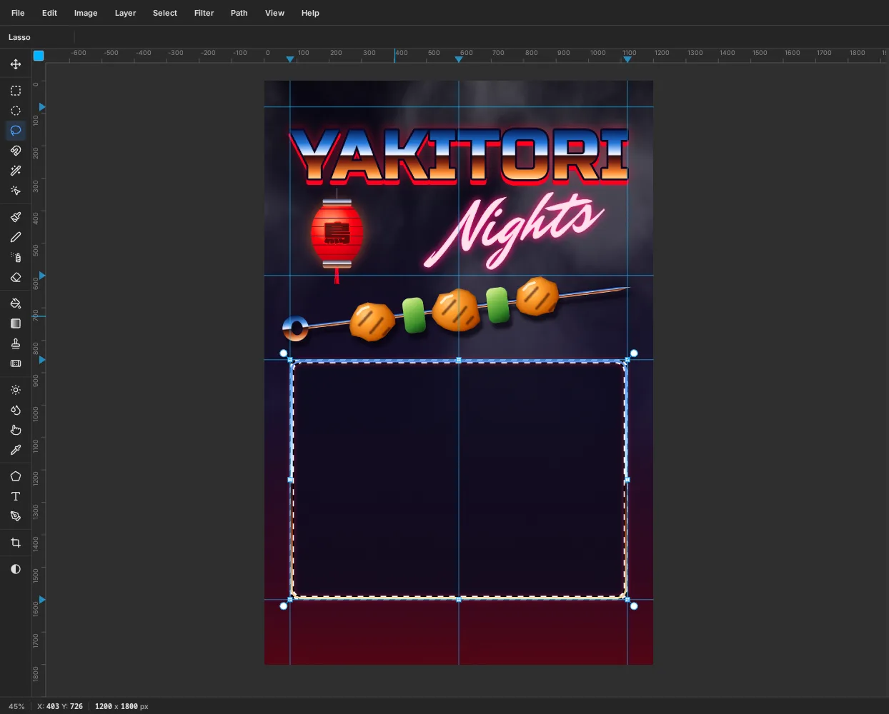

1. Collapse the `Skewer` group, keep its row selected, then click **Add Layer** and rename it `Menu Panel`.
2. Pick the **Shape** tool, **Rectangle**, **Corner Radius** `32`. Open the fill swatch, set it to `#0D0B1E` and drag its opacity bar to about 82%.
3. Press at the centre point `600, 1230` and drag out to where the x `1120` and y `1600` guides cross. The panel grows from the centre and fills the space between all four guides.
4. [[Cmd]]-click the `Menu Panel` thumbnail, click **Add Layer** and rename it `Menu Frame`.
5. Make a **Linear** gradient with six stops: `#7FA6FF`, `#E8F2FF` at 45%, `#FFFFFF` at 50%, `#2A0E10` at 52%, `#9A4320` at 72% and `#FFE2AE`. [[Shift]]-drag from the top of the panel to the bottom. The whole frame is one chrome sheet, with its horizon running across the middle.
6. Choose **Select → Shrink…** with `10`, press [[Delete]] to clear the middle, and press [[Cmd+D]]. A 10 px chrome frame is left.
7. Give `Menu Frame` an **Outer Glow**: Size `22`, Opacity `55`, colour `#FF2E4D`.

## Set the first column

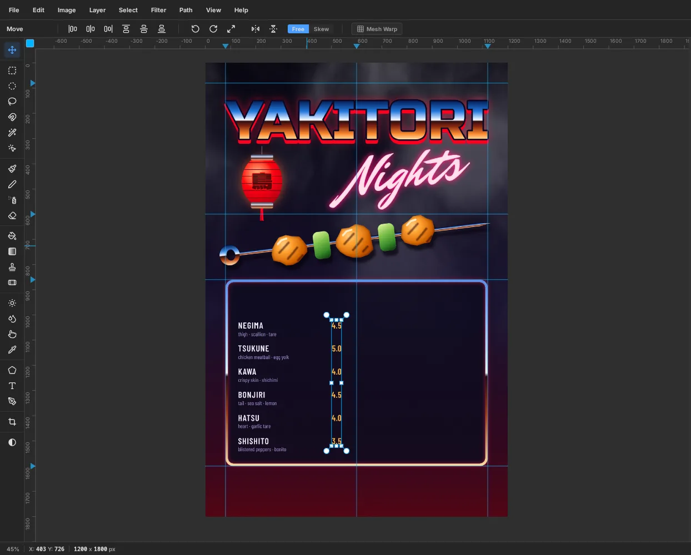

Each column is three text layers: dish names, descriptions and prices. They all use the same row pitch, so they line up.

> **Tip:** The options bar and the Text panel always edit the **active** text layer. Before you set up a new block, click a non-text row such as `Menu Frame`, then choose the font, size and colour.

1. **Descriptions.** Click `Menu Frame` and pick the **Text** tool. Set the colour to `#A99BD6` and choose **Barlow Condensed**, **Regular**, size `22`. Click at `130, 1062` and type the six descriptions, pressing [[Enter]] between them: *thigh · scallion · tare*, *chicken meatball · egg yolk*, *crispy skin · shichimi*, *tail · sea salt · lemon*, *heart · garlic tare*, *blistered peppers · bonito*. Press [[Tab]]. Open the **Text** panel and set **Line height** to `1.2` and **Paragraph spacing** to `65`. The descriptions go in first because a click inside an existing text block edits it; with them in place, the names block starts in clear space just above.
2. **Names.** Click `Menu Frame` again. Set the colour to `#F4F1FF` and choose **Barlow Condensed**, **SemiBold**, size `34`. Click at `130, 1020`, just above the first description, and type *NEGIMA*, *TSUKUNE*, *KAWA*, *BONJIRI*, *HATSU*, *SHISHITO* on separate lines. In the Text panel set **Line height** `1.2`, **Paragraph spacing** `51` and **Letter spacing** `2`. Each name now sits on its description. Both blocks share a 92 px row pitch (22 px × 1.2 + 65 for the descriptions, 34 px × 1.2 + 51 for the names), which keeps them paired all the way down.
3. **Prices.** Click `Menu Frame`. Set the colour to `#F2B85A`, keep **Barlow Condensed SemiBold** at `34`, and set **Align** to **Right**. Click at `540, 1025` and type *4.5*, *5.0*, *4.0*, *4.5*, *4.0*, *3.5* on separate lines. Use **Line height** `1.2`, **Paragraph spacing** `51` and **Letter spacing** `1`. Then use the Move tool's arrow keys to line the tops of the prices up with the tops of the names.

Writing every price with one decimal place keeps the column tidy.

## Set the second column

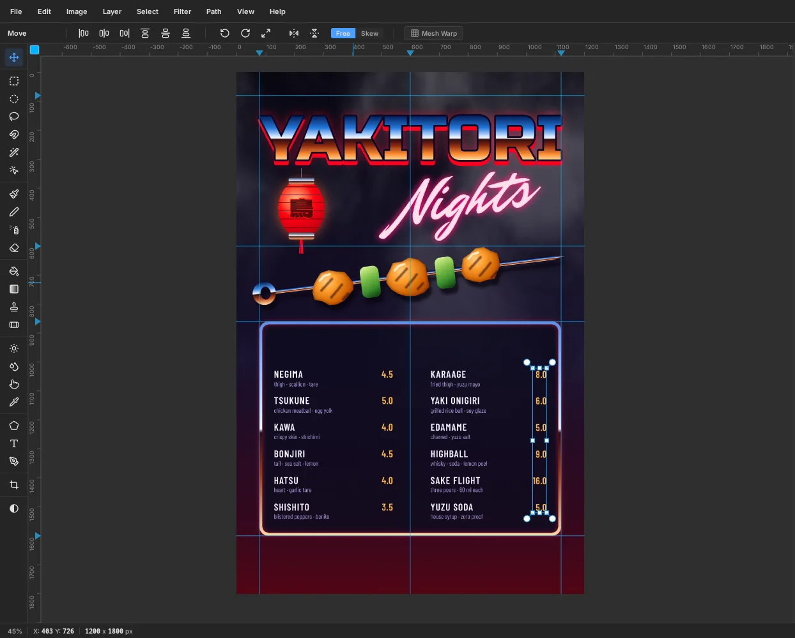

Repeat the three blocks for the right column, starting at x `670` with the prices right-aligned at x `1070`:

- Names: *KARAAGE*, *YAKI ONIGIRI*, *EDAMAME*, *HIGHBALL*, *SAKE FLIGHT*, *YUZU SODA*
- Descriptions: *fried thigh · yuzu mayo*, *grilled rice ball · soy glaze*, *charred · yuzu salt*, *whisky · soda · lemon peel*, *three pours · 60 ml each*, *house syrup · zero proof*
- Prices: *8.0*, *6.0*, *5.0*, *9.0*, *16.0*, *5.0*

Check the right blocks against the left ones. If a block came out a few pixels lower, select it and nudge it up with the arrow keys until both columns share the same rows.

## Chrome the section headings and add the rules

1. Click `Menu Frame`, pick the **Text** tool, set the colour to white and choose **Russo One** at `44` with **Letter spacing** `3`. Type `KUSHIYAKI` at `130, 912` and `SIDES & SAKE` at `670, 912`.
2. [[Cmd]]-click the `KUSHIYAKI` thumbnail and [[Cmd+Shift]]-click `SIDES & SAKE`. Add a layer named `Heading Chrome`, [[Shift]]-drag the small chrome gradient from the top of the letters to the bottom, press [[Cmd+D]], and hide the two white text layers.
3. Give `Heading Chrome` a **Drop Shadow** with Offset Y `4`, Blur `0` and colour `#E8112D`, the same hard red as the title.
4. Click `Menu Frame`, choose **Dela Gothic One** at `24` in `#FF6B8A`, set **Align** to **Right**, and type `串焼き` (kushiyaki, "grilled skewers") at x `540` and `おつまみ` (otsumami, "small plates") at x `1070`. Nudge them so they sit on the same line as the rules you'll draw next (y `972`).
5. Add a layer named `Rules`. With the **Pencil** at size `3` and `#FF2E4D`, click at `130, 972` and [[Cmd+Shift]]-click just short of the left label to draw a level line. Holding Cmd snaps the angle to 15° steps, so the line stays perfectly horizontal. Do the same on the right from x `670`.
6. Switch the Pencil to size `2` and draw two upright lines down the middle: click at `600, 1030` and [[Cmd+Shift]]-click at `600, 1187`, then click at `600, 1383` and [[Cmd+Shift]]-click at `600, 1540`. The gap is for the divider in the next step.

## Add the vertical divider

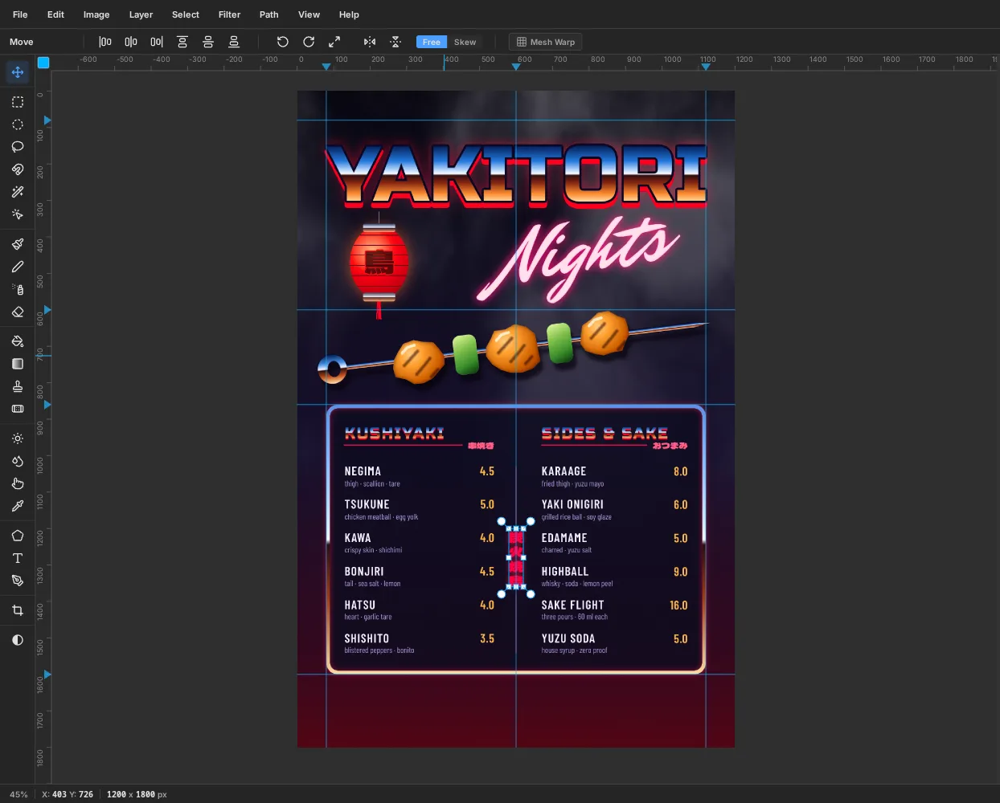

1. Click `Menu Frame`. Choose **Dela Gothic One** at `40` in `#FF2E4D` and click **Toggle vertical text** in the options bar.
2. Click in the gap and type `炭火焼鳥` (sumibi yakitori, "charcoal-grilled chicken"). Press [[Tab]].
3. Use the **Move** tool to centre it on x `600` and halfway between the two lines, about y `1285`. The gap above and below should be the same.
4. Give it an **Outer Glow**: Size `26`, Opacity `70`, colour `#FF2E4D`.

## Set the footer

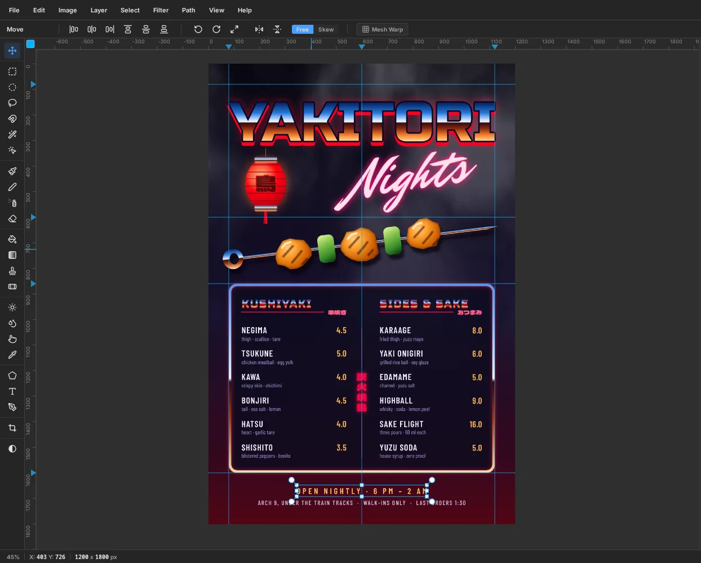

Click `Menu Frame`, pick the **Text** tool and set **Align** to **Center** so the click point becomes the middle of the line.

- `OPEN NIGHTLY · 6 PM – 2 AM` in **Barlow Condensed SemiBold** `32`, `#FFC46B`, **Letter spacing** `8`, clicked at `600, 1648`.
- `ARCH 9, UNDER THE TRAIN TRACKS  ·  WALK-INS ONLY  ·  LAST ORDERS 1:30` in **Barlow Condensed Medium** `24`, `#D8D0F5`, **Letter spacing** `3`, clicked at `600, 1700`.

The hours are the line people look for, so they get the larger, warmer type.

## Polish the title's metal

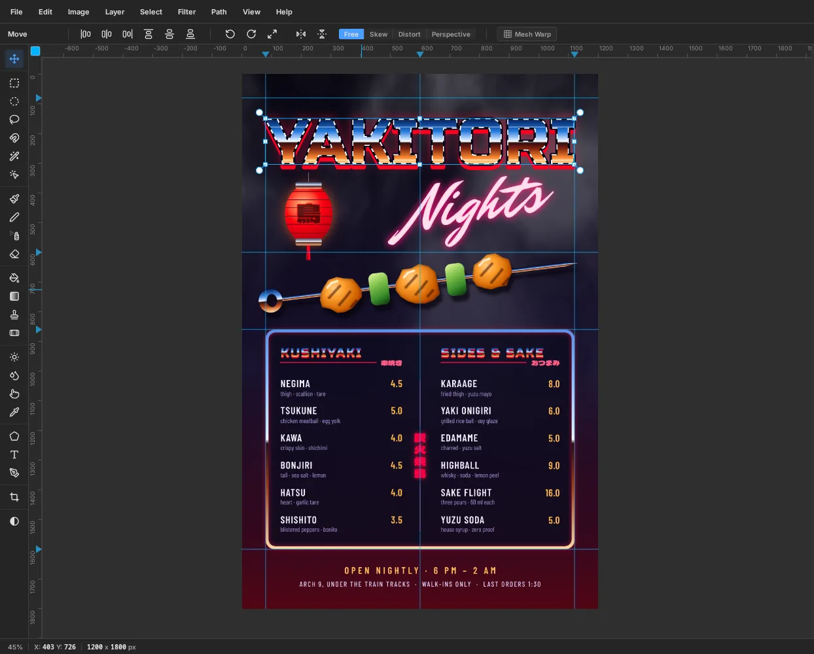

1. Add an **Inner Glow** to `Title Chrome`: Size `4`, Spread `0`, Opacity `70`, white. It puts a specular rim on every edge.
2. Click the `Title Chrome` row, [[Cmd]]-click its thumbnail, then click **Add Layer** and rename it `Title Shine`.
3. With the **Pencil** at size `4` in `#FFF3D6`, click left of the title about 15 px above the bottom of the letters (y `289`) and [[Cmd+Shift]]-click right of it. That's the sunset reflecting in the bottom curve of the letters. Switch to size `2` in `#DCEBFF` and draw another line about a third of the way down the sky half (y `178`) for a cloud reflection in the sky half.
4. Press [[Cmd+D]] and set `Title Shine` to `70%` opacity.

## Add a few star glints

1. At the top of the stack, add a layer named `Glints`. With the **Lasso**, click an eight-point star: four long points (up, right, down, left) and four very short ones between them. Fill it with white and press [[Cmd+D]].
2. Give `Glints` an **Outer Glow**: Size `22`, Opacity `85`, colour `#BFD8FF`.
3. Draw a marquee around the star, copy it, and paste it twice. Drag the copies onto the tip of the skewer and the top-right corner of the panel. Drag a corner handle with [[Cmd]] held, which keeps the star's proportions, to make each one a different size.
4. Select each pasted layer and choose **Layer → Merge Down** until they're all part of `Glints`, so they share its glow.

Three glints is enough. They mark the brightest points of the metal. A dozen would just look like confetti.

## Grade the colour

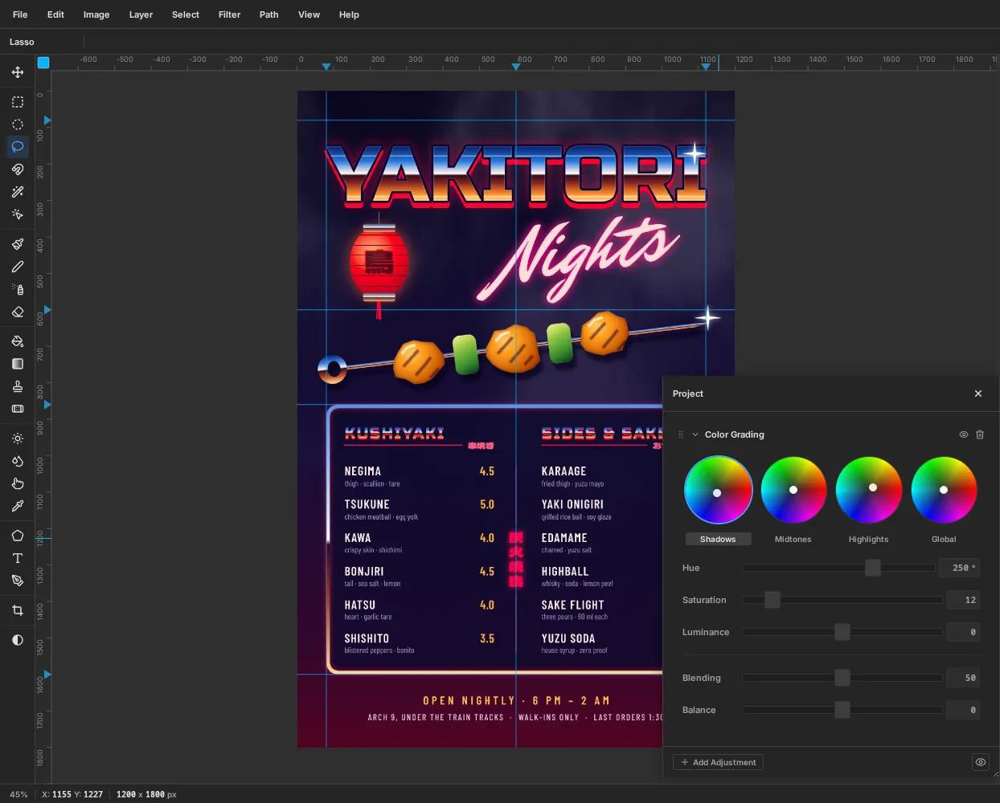

Click the effects button on the `Project` row at the top of the Layers panel to open its adjustments, click **Add Adjustment** and choose **Color Grading**.

- Click **Shadows** and set **Hue** to `250` and **Saturation** to `12`, a cool indigo.
- Click **Highlights** and set **Hue** to `28` and **Saturation** to `15`, a warm amber.

Cool shadows and warm highlights are the look of a night street lit by lanterns. Keep the shadow saturation low. Higher values tint the blacks a flat blue, because the grade adds colour even to pure black.

## Add grain and finish

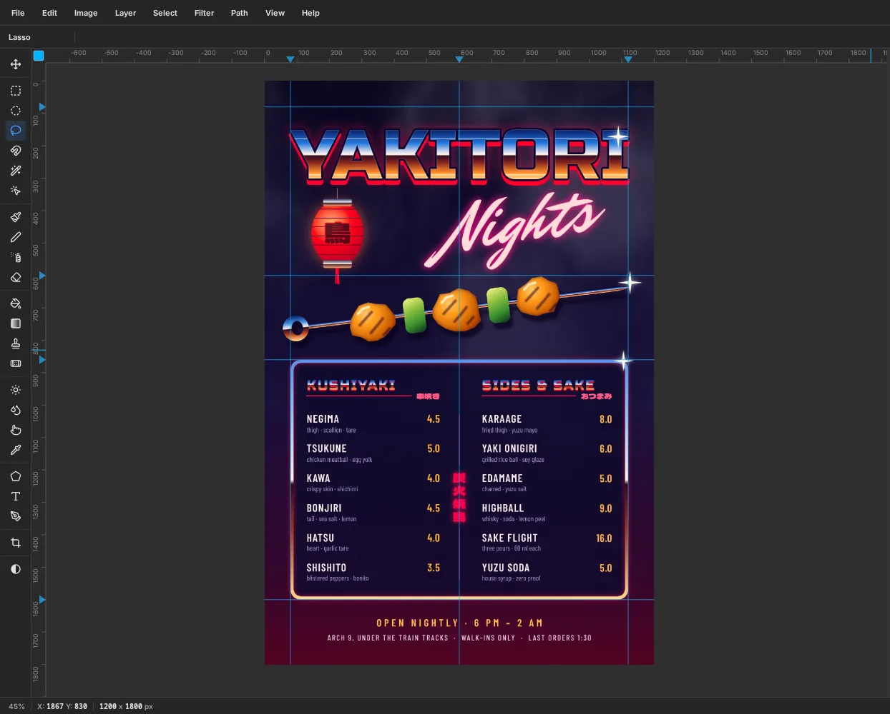

1. At the top of the stack, add a layer named `Grain`, fill it with `#808080`, and choose **Filter → Add Noise…** with **Amount** `30`, **Mono** and **Gaussian**.
2. Open its layer effects and set **Blend** to **Overlay**, then set the row's opacity to `35%`. Mid-grey disappears in Overlay, leaving just a fine print-like texture.
3. Lower `Smoke` to `20%` so the title has a little more contrast against it.

Export with **File → Quick Export PNG** and save the layered file with **File → Save Project**.
