Stop-motion studios plan their films with painted key frames: one still per
moment that fixes the set, the light and the palette before anyone sculpts a
puppet. They're presented letterboxed, with a slate line and a strip of
colour chips, so the whole crew paints from the same key.

In this tutorial you'll paint **Fishbowl City**, key frame 07 of an imaginary
claymation film. A tiny clay town sits inside a goldfish bowl on a kitchen
windowsill at 8:40 in the morning, and goldfish in bowler hats queue up for
their commute. The canvas is 1920 × 1080. Everything is built from flat
selection fills and given volume with one repeatable **clay recipe**: a
feathered highlight, an Inner Glow and a soft Drop Shadow. You'll sculpt the
goldfish by tracing a reference photo, then scale and rotate it into the
bowl. You'll finish with glass highlights, a tilt-shift blur that makes the
set look like a miniature, and the letterbox slate.

The goldfish reference is *Goldfish carassius auratus*, a public-domain
painting on Wikimedia Commons. Any clear side-on photo of a goldfish will do.
The project has around 60 layers in six groups, so name each layer as you
make it.

The palette:

- Wall `#FBD9C4` → `#F2B79E`
- Sky `#A8DCEF` → `#FFF0CC`, clouds `#FFF8EE`, sun `#FFD45C`
- Hills `#C3E8CF` / `#93D4B0`
- Cream clay `#FFF2DF`
- Sill top `#CFC2F5`, sill front `#B9A8EE` → `#8E79D2`
- Water `#B5EEE4` → `#56BDBD`, sand `#F4DA9E`
- Pebbles `#F7A8B9` / `#C6B3F6` / `#A8E6CB` / `#FFE29A`
- Houses `#FFD98A` / `#C3A9F0` / `#A6E3C7` / `#FFC9A8`
- Coral `#FF8E7C`, mint roofs `#8FDDBA`, lamp light `#FFE08A`
- Goldfish `#FF8A3D`, belly `#FFE3BF`, fins `#FFA54F`
- Navy `#3E4680`
- Letterbox `#241F33`, slate type `#FFF2DF` / `#C9B8F2` / `#8E80BC`

## Set up the canvas, guides and wall

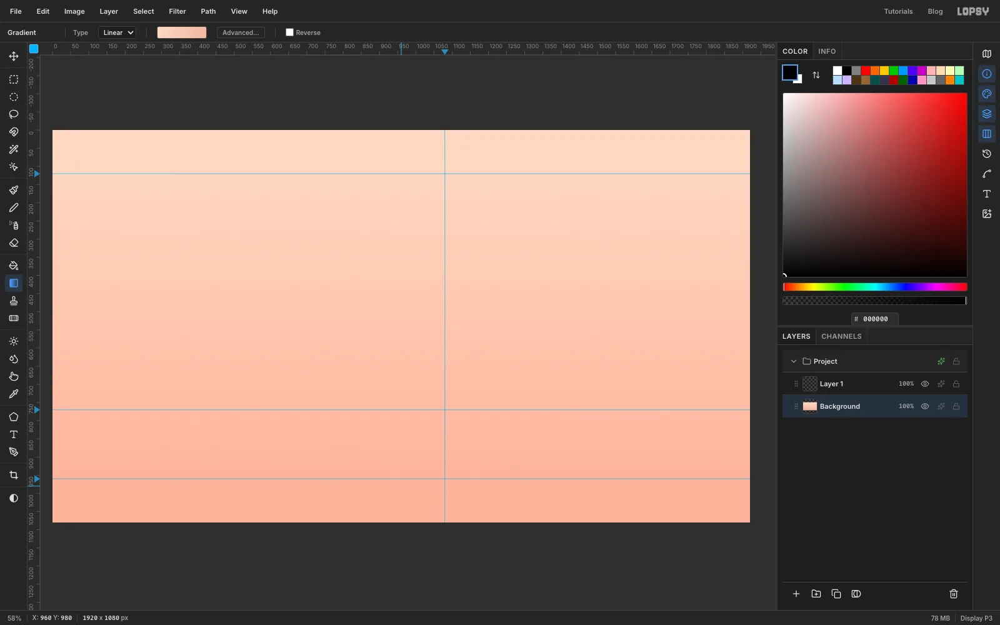

Choose **File → New**, make a **1920 × 1080** document and click **Create**.

The frame will be letterboxed like a widescreen film. Click the left ruler
at **120** and **960** for horizontal guides that mark the top and bottom of
the picture. Click it again at **770** for the top of the windowsill. Then
click the top ruler at **1080** for a vertical guide through the centre of
the fishbowl.

Select the **Background** layer and pick the **Gradient** tool from the
toolbox (it has no keyboard shortcut). Open the
gradient editor with **Advanced…**, set two stops, `#FBD9C4` at the left and
`#F2B79E` at the right, and click **Done**. Drag from just above the canvas
straight down to just below it. That's the plaster wall.

## Paint the sky and select the clouds

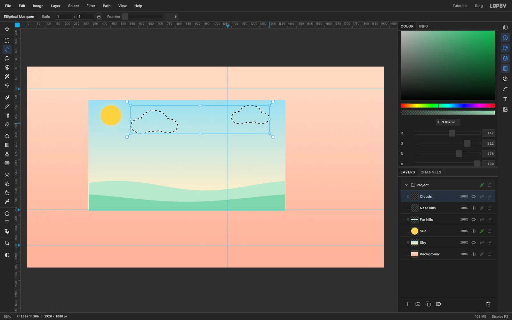

Rename **Layer 1** to **Sky**. Pick the **Rectangular Marquee** (M) and,
with nothing selected, click once on the canvas without dragging. That
opens the **Rectangular Selection** dialog, where you can type exact
corners: From **330, 180**, To **1390, 776**. This is the window opening.
Set a gradient from `#A8DCEF` to `#FFF0CC` and drag it from the top of the
selection to about two-thirds of the way down. Press [[Cmd+D]] to deselect.

Add a layer called **Sun**. With the **Elliptical Marquee**, hold [[Cmd]]
(for a perfect circle) and drag a circle about 108 px across in the
upper-left pane, fill it with `#FFD45C`
(**Edit → Fill**), and give it an **Outer Glow** (Size 40, Opacity 70,
colour `#FFE7A0`) from the layer's effects button.

Add **Far hills** and **Near hills** layers. On each, use the **Lasso** (L)
to draw a gentle rolling line across the window, from the left edge to the
right edge, then down and back along the bottom. Fill the far one with
`#C3E8CF` and the near one, lower down, with `#93D4B0`.

Add a **Clouds** layer. Drag one ellipse, then hold [[Shift]] and drag two
more that overlap it. Shift adds to the selection, so three ellipses become
one puffy cloud. Build a second, smaller cloud in the right pane the same
way, then fill both with `#FFF8EE`.

## Learn the clay recipe

Every object in this picture gets the same treatment, so learn it on the
clouds:

1. [[Cmd]]-click the **Clouds** thumbnail in the Layers panel to select the
   layer's shape, then click **Add Layer**.
2. Choose **Select → Shrink…** and enter about a fifth of the shape's
   height. For the clouds, use **14**.
3. With a marquee tool active, press [[Shift+Up]] and [[Shift+Left]] once
   each to nudge the selection 10 px toward the light.
4. **Select → Feather…** by about the same amount (14).
5. In the Color panel, set the colour to white and drag the **A** (alpha)
   slider down. Use 90 for the clouds and 30–60 for darker colours. Then
   **Edit → Fill**, and [[Cmd+D]]. Set **A** back to 100 straight away, or
   your next fills will come out see-through.
6. Choose **Layer → Merge Down** so the highlight becomes part of the
   clouds.
7. Open the effects drawer. Add an **Inner Glow** in a darker shade of the
   base colour (here `#BBD3E6`, Size 14, Opacity 80). This is the shading
   where the clay rolls under. Then add a **Drop Shadow** in a soft
   coloured shadow, not black: `#7FAFCB`, Offset 6 / 10, Blur 14,
   Opacity 40.

Repeat it on **Near hills**, with a green glow `#5FAE88` and the shadow
pointing slightly up (Offset Y −6) so the far hill darkens behind it. Do it
on the **Sun** too, with a warm `#F2A93B` glow and no shadow. **Far hills**
only needs an Inner Glow in `#93C9AA`.

> **Tip:** The light comes from the top left in this frame. Highlights
> always move up-left and shadows always fall down-right. Keep that
> consistent and the whole set reads as one sculpted world.

## Cut rounded window panes

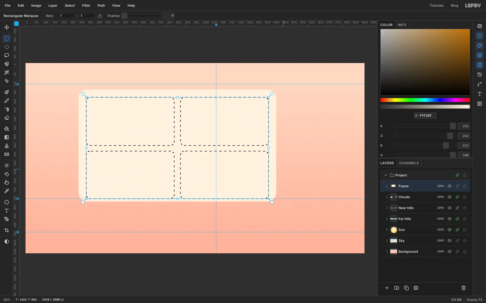

Select **Clouds** and add a layer called **Frame**. Click (without dragging)
to open the Rectangular Selection dialog again and enter From **300, 150**,
To **1420, 786**. To round its corners, choose **Select → Shrink…
50**, then **Select → Grow… 50**. Shrinking cuts the corners off, and growing
back adds them as curves. Fill it with `#FFF2DF`.

Now the panes. Click the top ruler at **842** and **878**, and the left
ruler at **468** and **500**, for guides along both sides of a 36 px
cross-shaped mullion. Drag the top-left pane from the inside corner of the
frame to where those guides cross; with **View → Snap to Guides** on, the
marquee snaps to them. Hold [[Shift]] and drag the other three panes the
same way. Then use **Shrink 22** and **Grow 22** to round all four pane
corners at once.

## Puff up the window frame

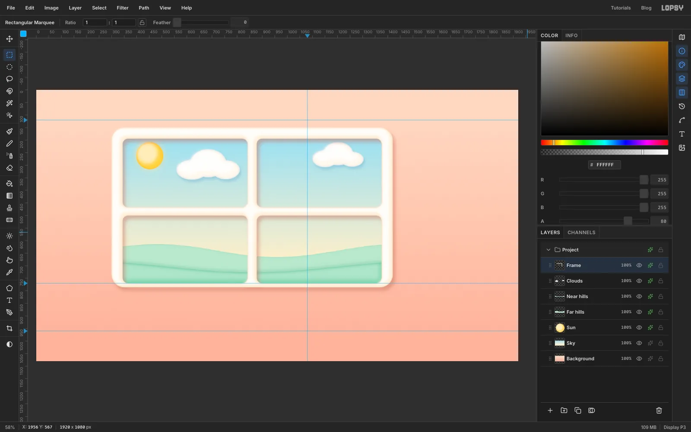

Press [[Delete]] to cut the panes out of the frame, and deselect.

Run the clay recipe on **Frame**. Use Shrink 8, a 6 px nudge (six
single [[Up]] / [[Left]] presses), Feather 8 and white at 80%. Add an Inner
Glow `#E5C9A6` (Size 10, Opacity 85) and a Drop Shadow `#B9705E` (Offset
10 / 14, Blur 22, Opacity 45). The shadow is a warm terracotta because it
falls on a peach wall.

## Group the window and build the sill

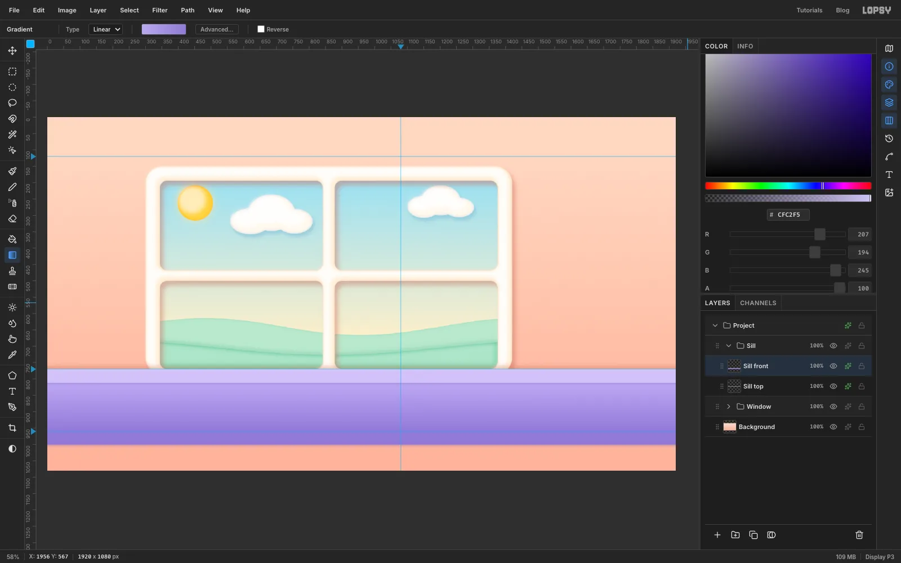

Click **Sky**, [[Shift]]-click **Frame**, and choose **Layer → Group
Layers**. Rename the group **Window** and collapse it with its arrow.

With **Window** still selected, click **New Group** at the bottom of the
Layers panel and name it **Sill**. Because the selected group is collapsed,
the new one appears above it rather than inside it.

Inside **Sill**, add a **Sill top** layer. Drag a band from just off the left
edge at the 770 guide to just off the right edge at about 818, and fill it
with `#CFC2F5`. Add **Sill front** and drag a band from 812 to below the
bottom of the canvas. Fill it with a gradient from `#B9A8EE` to `#8E79D2`,
dragging from the top of the band straight down to the 960 guide.

Give **Sill top** a white Inner Glow (Size 8, Opacity 60) for a bright lip,
and a Drop Shadow `#B9705E` with Offset Y **−8** so it darkens the wall just
above it. Give **Sill front** an Inner Glow `#8270C6` (Size 18).

## Sculpt the cactus and its pot

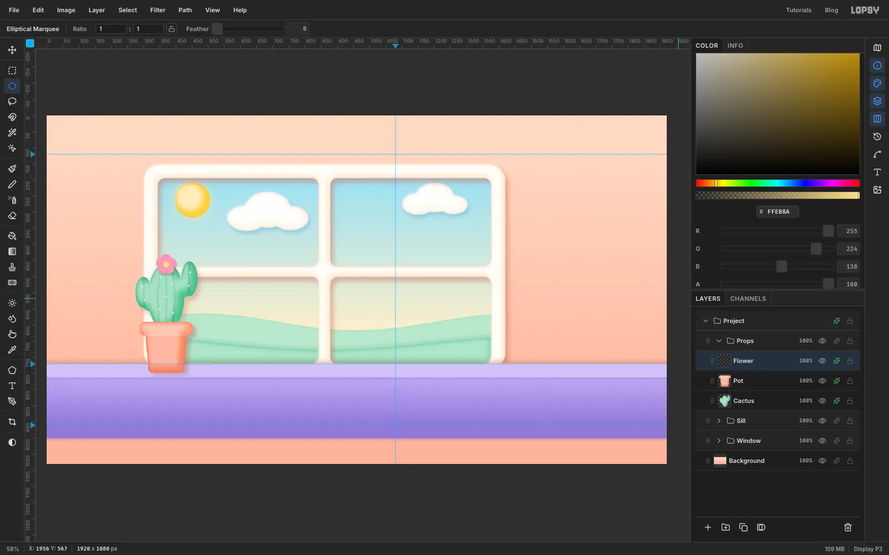

Collapse **Sill**, select it, and make a new group called **Props** above it.

Add a **Cactus** layer. Build the cactus from ellipses with [[Shift]]: a tall
body about 112 × 208 px standing on the sill at the left, two narrow arms
and two small sideways ellipses that join the arms to the body. Fill it
with `#73C597`.

[[Cmd]]-click the thumbnail so the next strokes stay inside the cactus. Pick
the **Brush** (B) at Size 7, Hardness 100, colour `#57AD80`, and drag three
slightly curved ribs down the body and one down each arm. Switch to
`#FFF2DF` at Size 6 and click a scatter of spines. Deselect, then run the
clay recipe (Inner Glow `#3E8E66`, Drop Shadow `#B9705E`).

Add a **Pot** layer. Lasso a slightly tapering pot under the cactus, round
it with Shrink 10 / Grow 10 and fill it with `#EE8E6C`. Then drag a wider
rounded rim across the top (Shrink 16 / Grow 16) and fill it with
`#F6A585`. Clay it with an Inner Glow `#C0603F`.

Finally, make a **Flower** layer: five overlapping 30 px circles in a ring on
top of the cactus, filled `#FF9DB8`, with a small `#FFE08A` centre.

## Move the whole plant at once

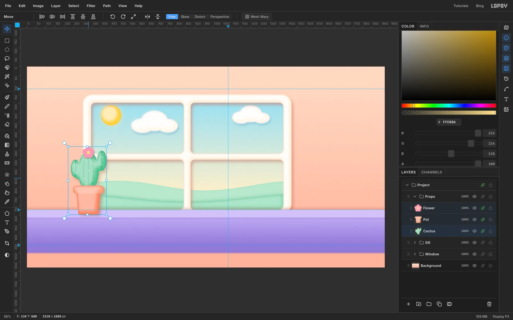

The pot's left edge lined up exactly with the window frame's edge. A tangent
like that pulls the eye, so move the plant.

Click **Cactus**, then [[Shift]]-click **Flower** to select all three layers.
With the **Move** tool (V), drag the plant about 40 px to the left. Every
selected layer moves by the same amount.

## Add a teacup with mirrored steam

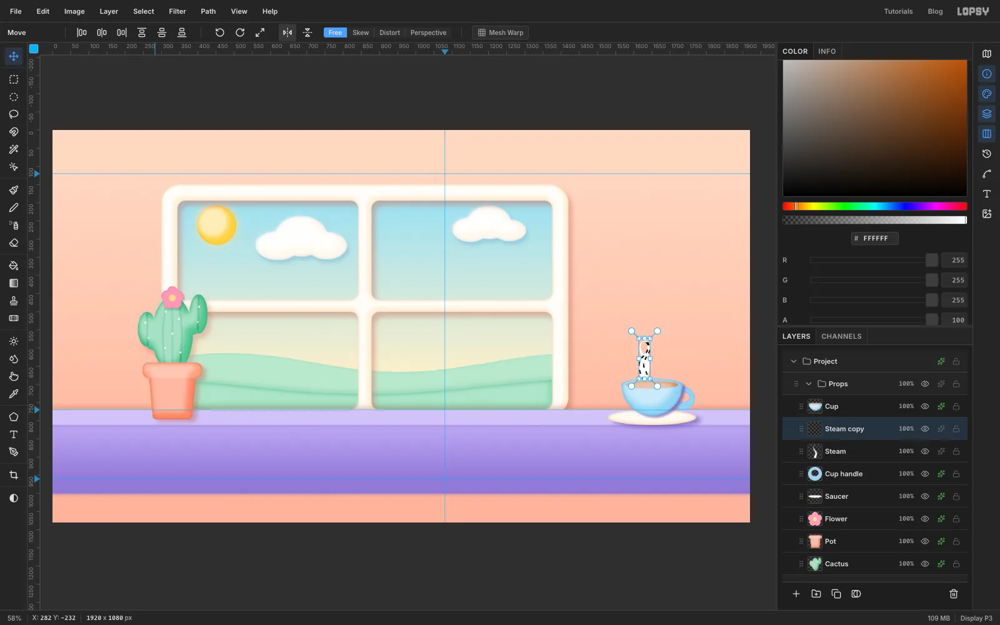

At the right end of the sill, make a **Saucer** layer: a 244 × 40 px
ellipse filled with `#FFF2DF`. Clay it with a stronger shadow
(`#5E4BA8`, Offset 14 / 8, Blur 16, Opacity 55) so it sits down firmly.

Make a **Cup handle** layer: drag a circle about 64 px across to the right
of where the cup will be, then [[Alt]]-drag a smaller circle inside it to
subtract the hole. Fill it with `#9FD2F2`.

Make a **Cup** layer above it. Lasso a half-circle bowl about 170 px wide,
[[Shift]]-add a flat ellipse across its top for the rim, and fill it with
`#9FD2F2`. Drop a slightly smaller ellipse into the rim and fill it with tea
`#C98A5B`. Clay the cup, giving it a tight dark shadow
(`#5E4BA8`, Blur 8, Opacity 60) so it presses into the saucer.

For steam, add a **Steam** layer. Set the Brush to white, Size 18. Click the
brush-tip thumbnail at the left of the options bar to open the **Brushes**
dialog, and on its Shape tab set **Taper** to 120. Taper thins the stroke over that many
pixels from where it starts, so start at the cup and drag a wavy wisp
upward. To get a matching second wisp, choose **Layer → Duplicate Layer**,
[[Cmd]]-click the copy's thumbnail, and click **Flip Horizontal** in the
Move tool's options bar. Deselect, press [[Shift+Right]] four times, and
**Merge Down**. Set the layer to 70% opacity and give it a 3 px **Gaussian
Blur**. Set Taper back to 0 before you paint anything else.

## Hang a clock at 8:40

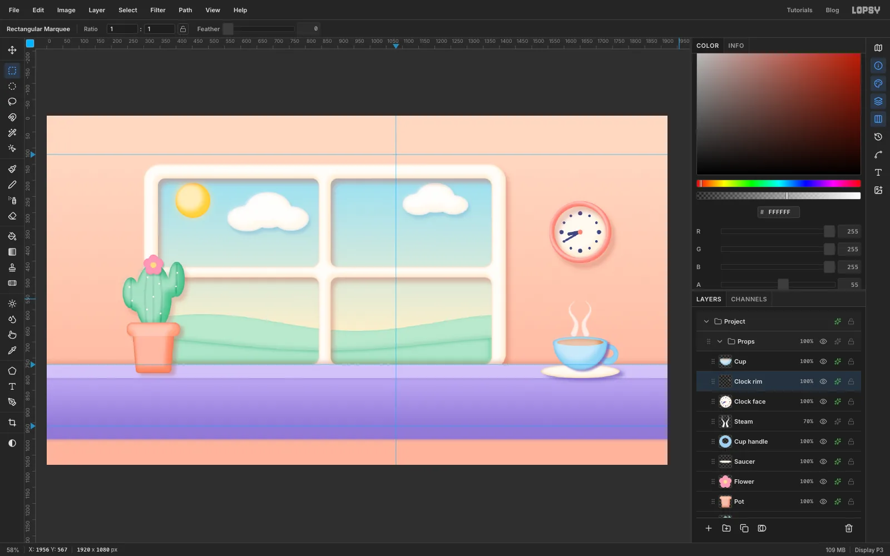

The frame is set at 8:40 am, so let a clock say it. Make a **Clock face**
layer: a 160 px circle on the wall above the cup, filled `#FFF2DF`, and clay
it.

Paint the face after the clay highlight so the marks stay crisp. With the
Brush in navy `#3E4680`, click twelve hour marks in a ring: Size 14 at 12, 3,
6 and 9, and Size 9 for the rest. For the hands, click the centre and
[[Shift]]-click to draw straight lines. The hour hand is short (Size 11) and
points most of the way from the 8 to the 9. The minute hand is longer
(Size 7) and points at the 8. Finish with a coral dot in the middle.

Add a **Clock rim** layer. [[Cmd]]-drag a 192 px circle centred on the
clock, then [[Cmd+Alt]]-click the **Clock face** thumbnail to subtract the
face, which leaves a ring. Fill it with `#FF8E7C`. Clay it, and give it a big wall
shadow (Offset 12 / 16, Blur 22).

## Add a snail and a tea towel

The front of the sill is a big empty band, and props give it scale and
story.

For the snail, make a **Snail body** layer and work just left of the
saucer, around x 1380–1500, sitting on the sill top. Use a long rounded rectangle (about 128 × 27, Shrink/Grow 13) with a
head ellipse [[Shift]]-added at the left, filled `#FFE2A8`. Draw two eye
stalks with Shift-click lines at Brush Size 6, and click navy eyes on the
ends. On a **Snail shell** layer, fill a 72 px circle with `#FF9DB8` and drag
a spiral in `#E0628A` with the Brush. Clay both.

For the **Tea towel**, lasso a cloth shape that hangs from the sill's top
edge down the front, with a wavy hem. Soften it with Shrink 4 / Grow 4 and
fill it with cream. For each stripe, drag a thin marquee band across it.
Then [[Cmd+Shift+Alt]]-click the towel's thumbnail to **intersect**, so the
band stays inside the towel. Fill two mint `#8FD3B4` stripes, a beige `#E9DCC4`
fold at the top and a coral hem at the bottom, then clay it.

## Shape the goldfish bowl

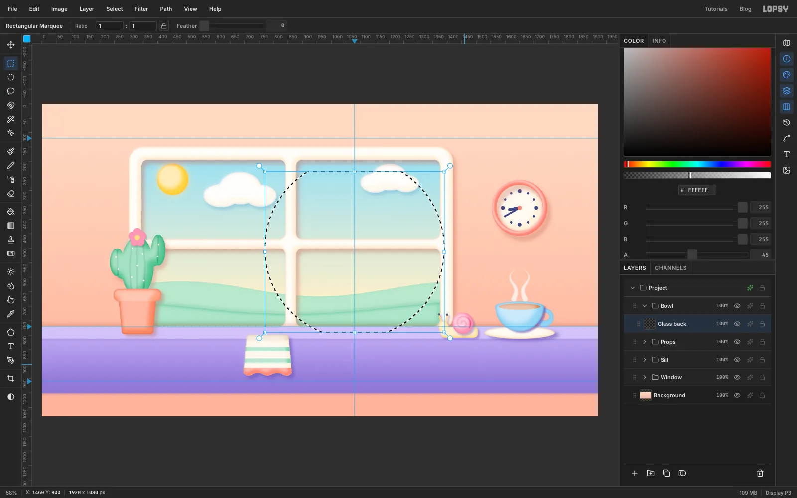

Collapse **Props**, select it, and make a new group above it called
**Bowl**. Add a **Glass back** layer.

With the Elliptical Marquee, click without dragging to open the
**Elliptical Selection** dialog and enter From **770, 190**, To
**1390, 810**: a 620 px circle centred on the vertical guide. A fishbowl is a sphere with the top and bottom sliced off,
so hold [[Alt]] and drag a rectangle over everything above y 235 to subtract
it. Then do the same for everything below y 790. Fill the shape with
`#E8FBF8` and set the layer to 40% opacity. That's the faint tint of empty
glass.

## Fill it with water

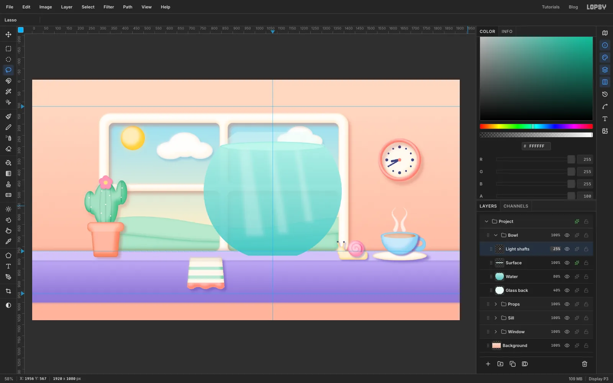

Add a **Water** layer. Make the same trimmed circle, but cut it off at
y 300, the waterline. Then [[Shift]]-drag a flat ellipse across the
waterline, as wide as the bowl there and 44 px tall. It rounds off the top
of the water so you see its surface in perspective. Fill it with a gradient
from `#B5EEE4` at the surface to `#56BDBD` at the base, and set the layer to
80%.

Add a **Surface** layer with just that ellipse, filled `#C9F4EC` with an
Inner Glow `#7FD4C8`.

Add **Light shafts**: three long thin lasso wedges slanting down from the
surface, held together with [[Shift]]. **Feather 16**, fill white, then set
the blend mode to **Screen** (the blend-mode dropdown at the top of the
effects drawer) and the layer opacity to 25%.

## Pile up the gravel mound

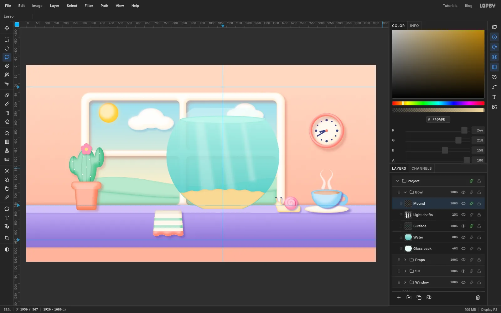

Add a **Mound** layer. With the Lasso, draw a gently rolling line across the
bowl at about y 690. Then follow the inside of the glass down to the base
and back up the other side. Fill it with `#F4DA9E` and give it an Inner Glow
`#D7AE62` (Size 14).

## Build the town

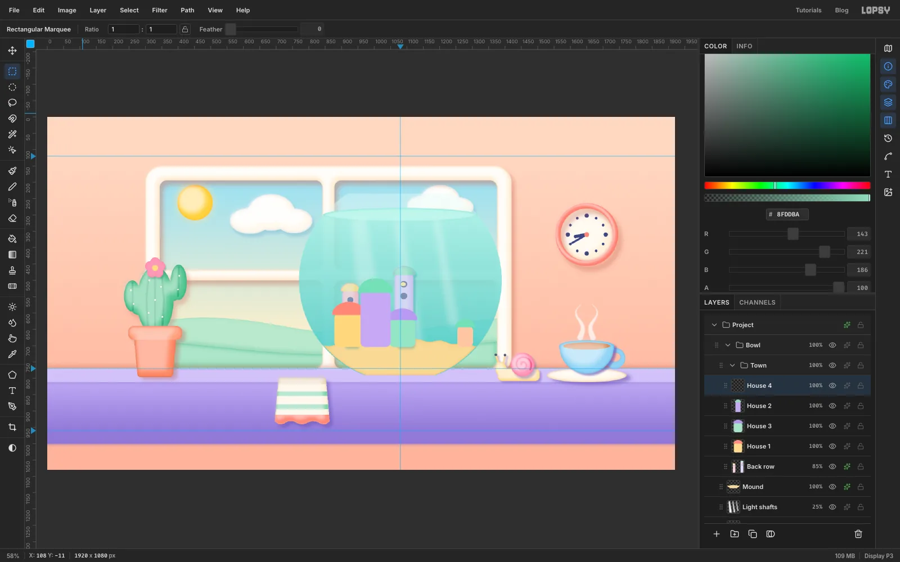

With **Mound** selected, make a group called **Town**. Every building is
the same two parts, a rounded body and a dome roof, so learn the dome once:
drag an ellipse over the top edge of the body, then [[Alt]]-drag a
rectangle over the ellipse's lower half so only the dome is left, and fill.

1. **Back row.** Add a **Back row** layer for two pale towers that peek over
   the others. Make two tall rounded rectangles (Shrink/Grow 12) about
   50 and 58 px wide, with tops at about y 530 and 480. Place the first a
   little left of centre in the bowl and the second just right of centre.
   Fill them `#F4C2CF` and `#D6C8F6`, and give them domes in `#FFE29A` and
   `#9FDCC2`. Add a few small navy windows, clay the layer and set it to
   85% opacity so it falls back.
2. **House 1.** A butter `#FFD98A` body about 90 px wide with its top at
   y 600, left of centre, with a coral `#FF8E7C` dome.
3. **House 3.** A small mint `#A6E3C7` house about 80 px wide, top at y 620,
   right of centre, with a lilac `#B39BEB` dome.
4. **House 2.** A tall lilac `#C3A9F0` house about 90 px wide between those
   two, top at y 535, with a mint `#8FDDBA` dome. Build it after House 3 so
   it overlaps both neighbours.
5. **House 4.** A little peach `#FFC9A8` house about 50 px wide, top at
   y 640, tucked into the right of the bowl where the lighthouse will stand
   beside it, with a mint dome.

Run every body down into the mound to about y 704, so the pebbles can bury
their feet later.

## Clay the houses and light the windows

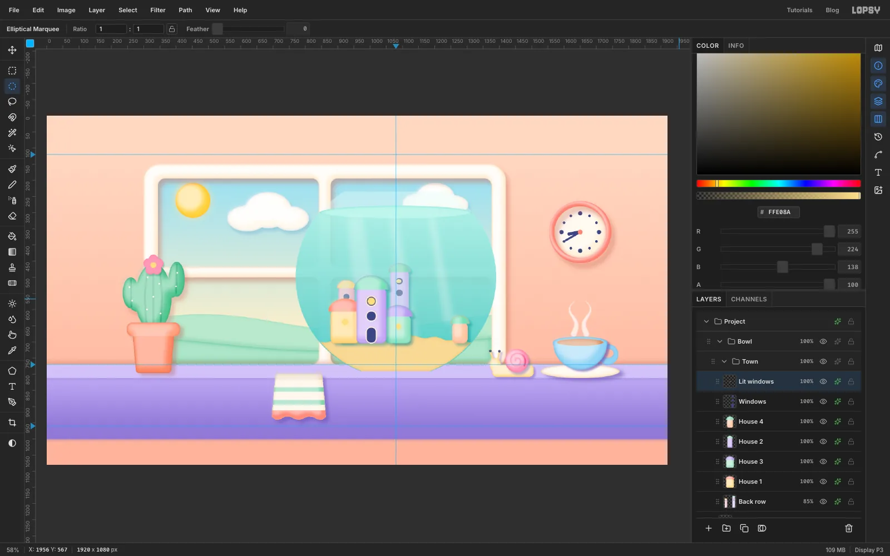

Run the clay recipe on each house, with an Inner Glow a shade darker than
the house's own colour. Use a teal Drop Shadow, `#1F7A80`, because shadows
underwater pick up the water's colour.

Add a **Windows** layer: round porthole windows and two rounded-top doors,
all [[Shift]]-added and filled navy. Give the layer a 3 px cream **Stroke**
effect for window frames.

Add **Lit windows** above it. Fill smaller circles inside three of the
windows with `#FFE08A` and give the layer an **Outer Glow** in the same
colour. Somebody's already up making coffee.

## Stripe the lighthouse

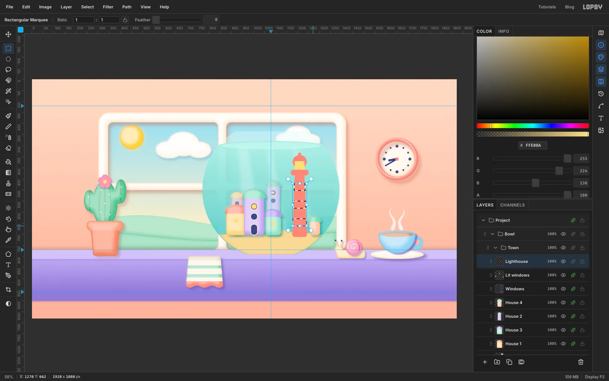

Add a **Lighthouse** layer. Lasso a tapering tower, then [[Shift]]-add a
rounded gallery (Shrink/Grow 10), a dome on top and a small finial circle.
Fill it with coral `#FF8E7C`. Marquee a small rectangle for the lamp room
and fill it with `#FFE08A`.

For the stripes, drag three marquee bands across the tower, holding
[[Shift]] for the second and third. Then [[Cmd+Shift+Alt]]-click the
**Lighthouse** thumbnail to intersect, and the bands are trimmed to the
tower's tapering sides. Fill with cream.

## Light the lamp

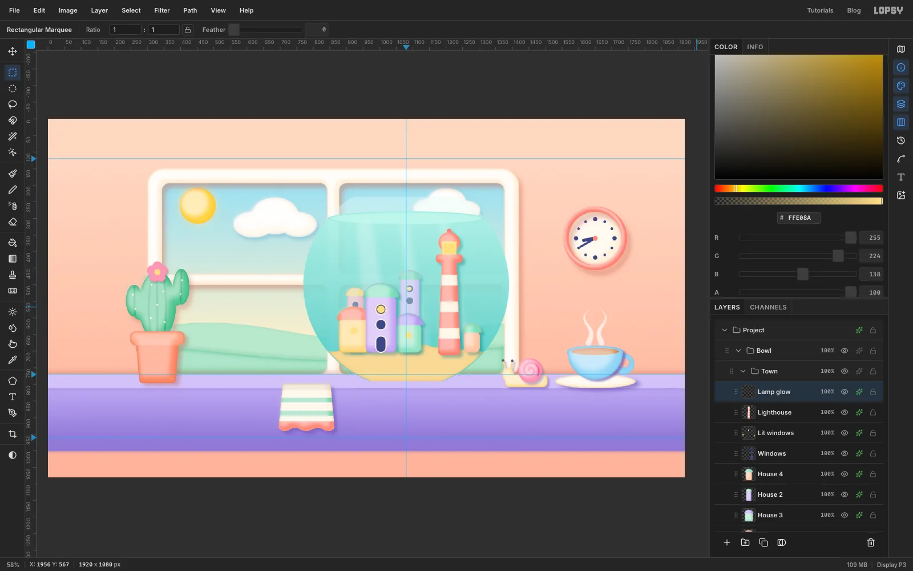

Deselect and clay the lighthouse (Inner Glow `#D9645A`, teal shadow).

Add a **Lamp glow** layer, fill the lamp-room rectangle again with
`#FFE08A`, and give it an **Outer Glow** in `#FFF1A8` at Size 40,
Opacity 90.

## Add seaweed and pebbles

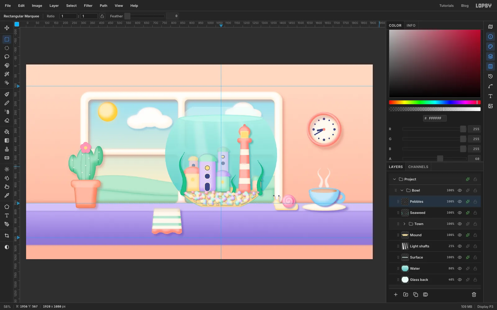

Collapse **Town**, select it and add a **Seaweed** layer. Set the Brush to
`#5CBF8D`, Size 30, Hardness 100 and **Taper 240**. Starting at the mound,
drag a wavy frond upward. Because the taper runs from the start of the
stroke, start at the root. Paint a second frond on the right (Size 26) and
a short one between the houses (Size 20, Taper 120). Give the layer an Inner
Glow `#2F8E64` and a teal shadow.

Add a **Pebbles** layer. [[Cmd]]-click the **Mound** thumbnail and **Shrink**
the selection by 10 so no pebble crosses the glass. In the **Brushes**
dialog, set Size 26 and Taper back to **0** on the Shape tab, Spacing 190,
then Scatter 35 and Size Jitter 30 on the Dynamics tab. Spacing over 100
leaves gaps between dabs, so every dab is its own pebble. Sweep three
rows across the mound in each of the four pebble colours, then deselect.
Afterwards, put Spacing back to 10 and Scatter and Size Jitter back to 0,
so later brush strokes come out as smooth lines again.

Run the clay recipe with tiny numbers: Shrink 3, a 3 px nudge and
Feather 3. The highlight is cut from the whole layer's shape, so every
pebble gets its own glint.

## Bring in a goldfish reference

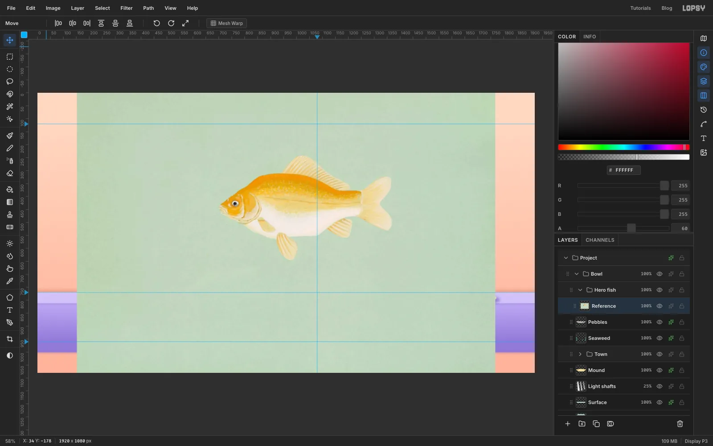

With **Pebbles** selected, make a group called **Hero fish**. Drag your
goldfish photo from your desktop onto the canvas. It arrives as a new layer
fitted to the canvas, so rename it **Reference**.

Sculpt the fish big, where it's easy to see, and scale it down into the
bowl later.

## Select the silhouette with the Magic Wand

Pick the **Magic Wand** (W), set Tolerance to **28**, and click the plain
background beside the fish. Choose **Select → Inverse** to flip the
selection onto the fish.

The empty strips beside the photo were selected too. To drop them, hold
[[Shift+Alt]] and drag a rectangle around the fish, which keeps only the
overlap. Then **Shrink 4** and **Grow 12**. Shrinking first removes thin
wisps, and growing further than you shrank swells the fins into plump clay
shapes.

## Fill the fins, body and belly

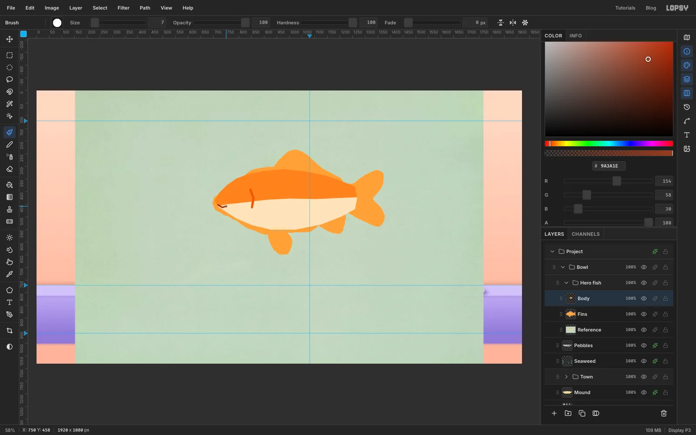

Click **Add Layer**, name it **Fins**, and fill the selection with
`#FFA54F`.

Add a **Body** layer above it. With the Lasso, trace the body itself,
following the photo from the nose along the back to the base of the tail
and back along the belly, but leave the fins and tail out. Smooth it with
Shrink 6 / Grow 6 and fill it with `#FF8A3D`.

For the belly, lasso a smooth, slightly curving line from below the nose to
the tail, running about a third of the way up the body. Close the shape
well below the fish. Then [[Cmd+Shift+Alt]]-click the **Body** thumbnail to
intersect, and fill with `#FFE3BF`. Press [[Cmd+D]]. Drawing this line by hand gives a
cleaner edge than wand-selecting the white belly in the photo.

Paint a short gill curve behind the head with the Brush in `#E0602A`
(Size 10), and a little smile at the mouth in `#9A3A1E` (Size 7).

## Give it a face and a bowler hat

1. Add a **Face** layer. [[Cmd]]-drag a 64 px circle on the head and fill
   it white for the eye.
2. Drag a smaller circle set slightly forward in the eye and fill it navy
   `#3E4680` for the pupil. Add a small white glint at its top left.
3. Drag a flat ellipse below and behind the eye and fill it pink
   `#FF8FA3` at 75% alpha for a cheek. Set **A** back to 100.
4. Add a **Hat** layer. Drag a tall ellipse sitting on the forehead, then
   [[Alt]]-drag a rectangle over its lower half to leave a domed crown.
5. [[Shift]]-drag a wide, flat ellipse across the bottom of the crown for
   the brim, and fill the hat navy.
6. Drag a marquee strip across the bottom of the crown, [[Cmd+Shift+Alt]]-click
   the **Hat** thumbnail to keep only the part inside the hat, and fill it
   cream `#FFF2DF` for the hatband. Deselect.

You don't need the photo any more, so select **Reference** and click
**Delete Layer**.

## Clay the fish

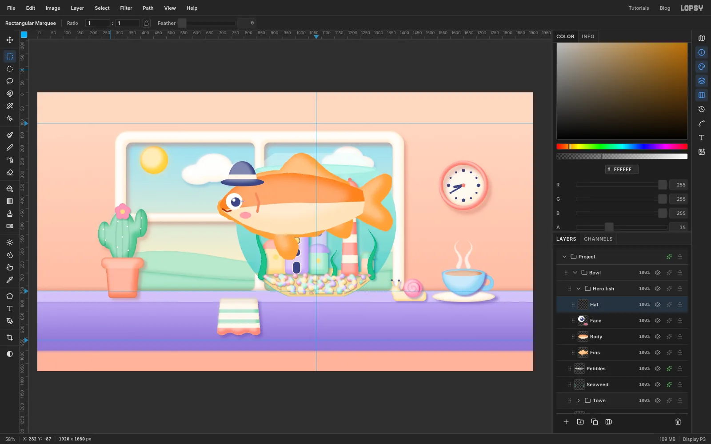

Run the first half of the clay recipe (the highlight only) on **Body**,
**Fins** and **Hat** at this large size:

- **Body:** Shrink 40, a 24 px nudge, Feather 30, white at 30%.
- **Fins:** Shrink 22, a 14 px nudge, Feather 22, white at 35%.
- **Hat:** Shrink 8, an 8 px nudge, Feather 10, white at 35%.

 Leave the effects until the fish
is at its final size, because effect sizes don't scale with the layer.

## Scale the fish into the bowl

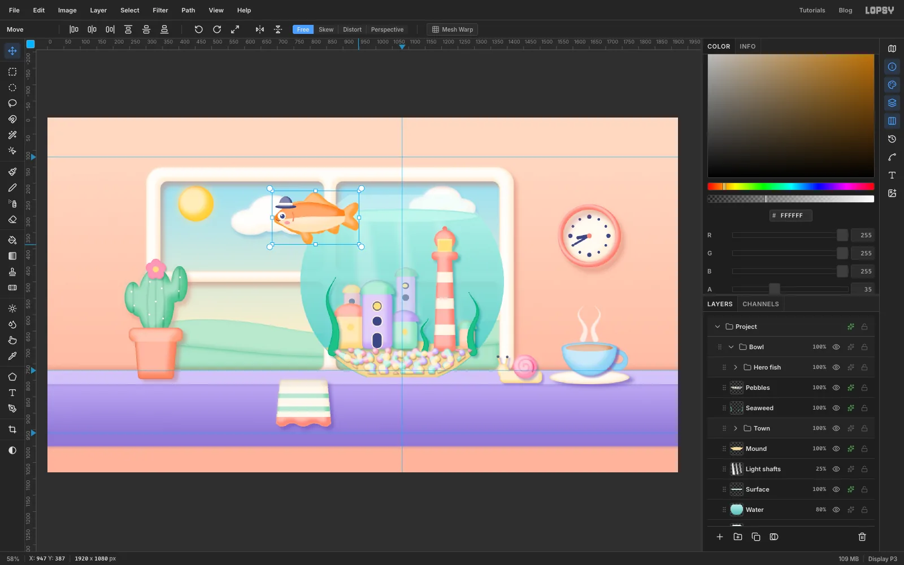

Collapse **Hero fish** and select the group. Pick the **Move** tool and drag
the bottom-right corner handle up and to the left, holding [[Cmd]] so the
fish keeps its proportions, until it's about 250 px long. Everything in
the group scales together.

## Tilt the hero

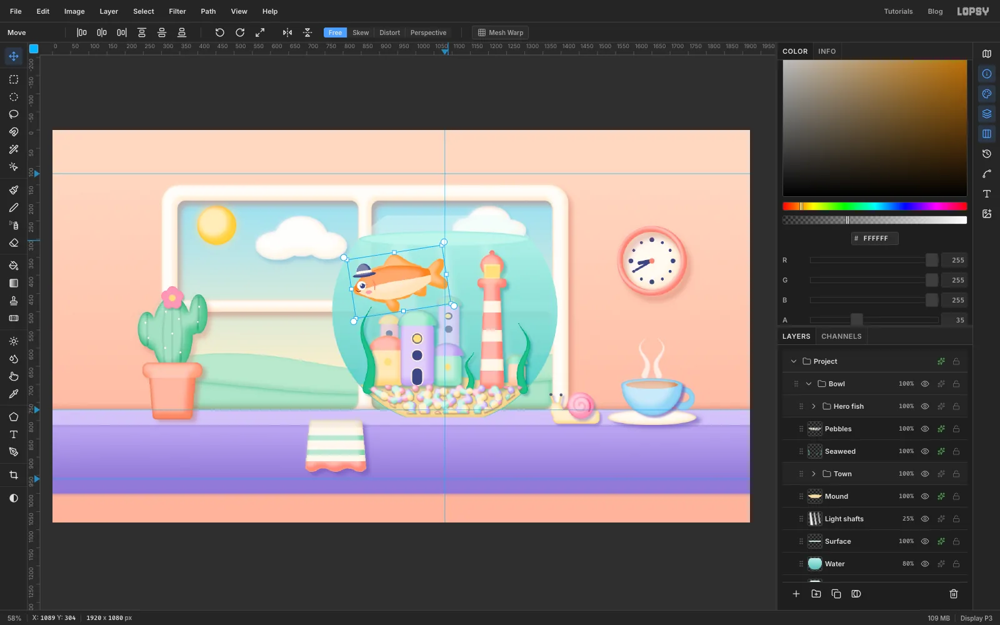

Drag the fish into the upper left of the bowl. Then move the pointer just
outside the box's top-right corner until it becomes a crosshair, and drag
counter-clockwise about 9° so the fish dips toward the glass as if it's
swimming. Press [[Cmd+D]] to commit.

Expand the group and add the effects you skipped:

- **Body:** Inner Glow `#C94F17` (Size 14, Opacity 80) and a teal Drop
  Shadow.
- **Fins:** Inner Glow `#D9732A` (Size 8).
- **Hat:** a 3 px cream Outer Glow so it doesn't disappear against the water.

## Add the commuters

Collapse **Hero fish**, select it, and choose **Layer → Duplicate Layer**.
Rename the copy **Commuters** and expand it. Select its top layer (**Hat
copy**) and choose **Layer → Merge Down** three times, until one layer is
left. Rename it **Fish B**. Merge Down keeps the bottom layer's effects
live, so the merged fish keeps its clay edge.

[[Cmd]]-click the **Fish B** thumbnail and [[Cmd]]-drag a corner handle to
halve its size. Deselect and drag it down and to the right, in front of the
lighthouse. Duplicate it, name the copy **Fish C**, [[Cmd]]-click its
thumbnail and [[Cmd]]-drag a corner in to shrink it a little more, deselect, and drag it to the right of the lighthouse, lower again. The three
fish now form a rising queue all heading the same way, like a commute.

> **Tip:** If a fish lands in the wrong place, [[Cmd+Z]] steps back through
> each move and scale, and [[Cmd+Shift+Z]] brings them back.

## Blow bubbles

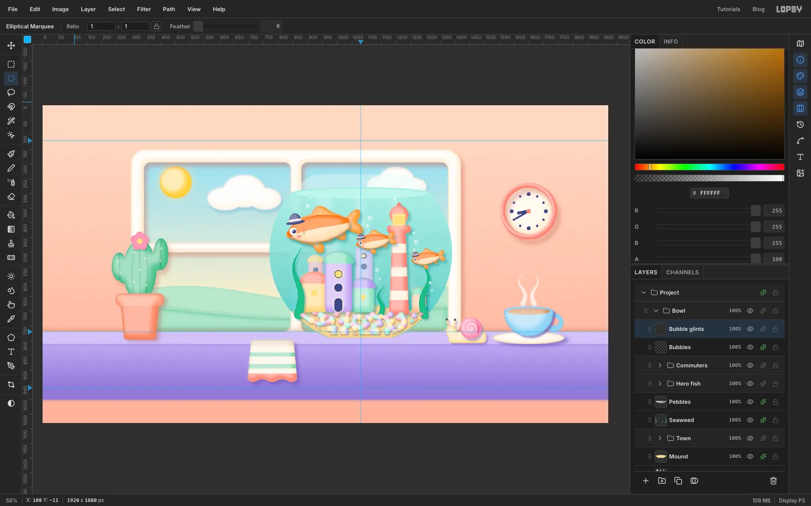

Collapse **Commuters**, select it and add a **Bubbles** layer. [[Shift]]-add a
dozen small circles, 8–22 px across, in little rising columns: above the
smallest fish's mouth, beside the lighthouse and between the houses. Fill
them white at **25%** alpha, then add a white **Inner Glow** (Size 4,
Opacity 100). The faint fill plus the bright rim reads as a bubble.

Add a **Bubble glints** layer with a tiny white dot at the top left of each
bubble.

## Make the glass shine

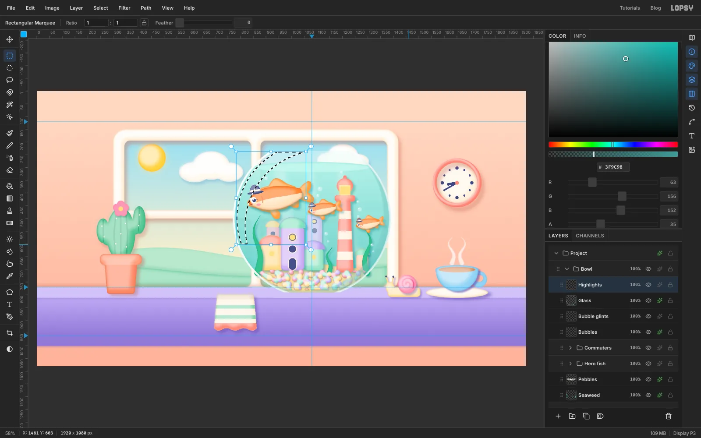

Add a **Glass** layer at the top of the Bowl group:

1. Make the trimmed bowl shape again (the 620 px circle with the top and
   base cut off) and fill it with white at 3%.
2. Hold [[Alt]] and drag a circle from (777, 197) to (1383, 803). That is
   14 px smaller and leaves a thin ring. Fill the ring white at 80%. Now
   the shoulders of the glass above the water show.
3. For shading, select the bowl circle again and [[Alt]]-subtract the same
   circle shifted about 25 px up and to the left. That leaves a crescent
   on the lower right. [[Alt]]-drag a rectangle over the base to trim it,
   **Feather 4**, and fill it with `#3F9C98` at 35%.
4. Set **A** back to 100, deselect, and give the layer a white Inner Glow
   (Size 34, Opacity 75).

Add a **Highlights** layer:

1. Select a circle 16 px inside the bowl's edge, then [[Alt]]-subtract the
   same circle shifted about 32 px down and to the right. That leaves a thin
   crescent along the upper left.
2. [[Shift+Alt]]-drag a rectangle over the upper-left quarter of the bowl to
   keep just that part of the crescent.
3. **Feather 3** and fill white at 85%.
4. Add a small white oval glint near the top left, and lasso a thin streak
   down the right edge filled white at 55%. Deselect.

## Add the lip and the foot

Add a **Lip** layer at the opening: a wide flat ellipse with a slightly
smaller one [[Alt]]-subtracted, filled `#E9FBF8`, with an Inner Glow
`#8FD3C8`. Add a **Foot** layer with a flat 224 × 24 ellipse at the base,
styled the same way.

## Slide the bowl clear of the frame

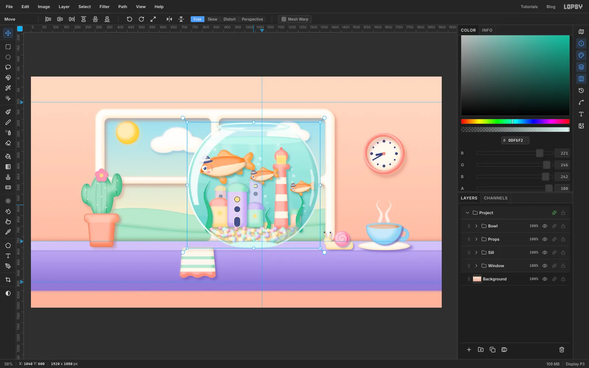

The bowl's right edge touched the right side of the window frame. Collapse
**Bowl**, select the group, and drag it about 40 px to the left with the
Move tool. The water, town, fish and glass all move together, effects and
all.

## Ground the bowl with shadows

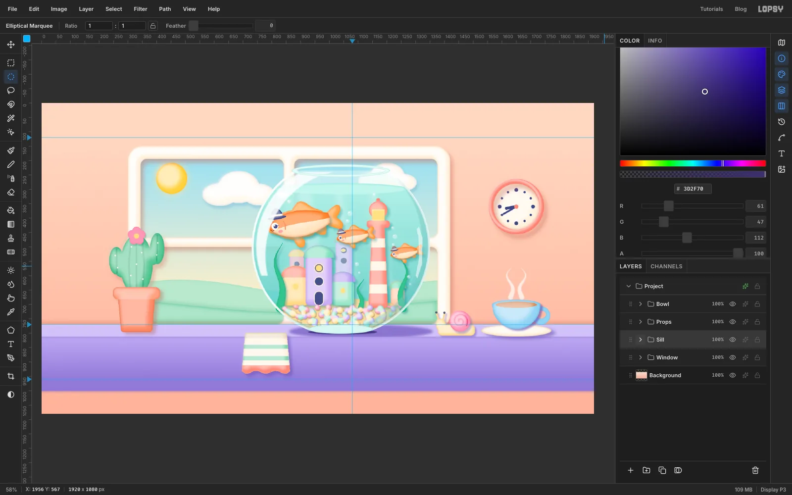

Expand **Sill**, select **Sill top**, and add a **Bowl shadow** layer: a wide
flat ellipse under the bowl, offset a little to the right, filled
`#6B57B3`. Deselect, apply **Gaussian Blur 12**, then set it to
**Multiply** (in the effects drawer's blend-mode dropdown) at 60% opacity.

Add a **Contact shadow**: a small ellipse right under the foot, filled
`#3D2F70`, Gaussian Blur 4, Multiply at 70%. That tight dark line is what
makes the bowl feel heavy.

## Add window light and clay grain

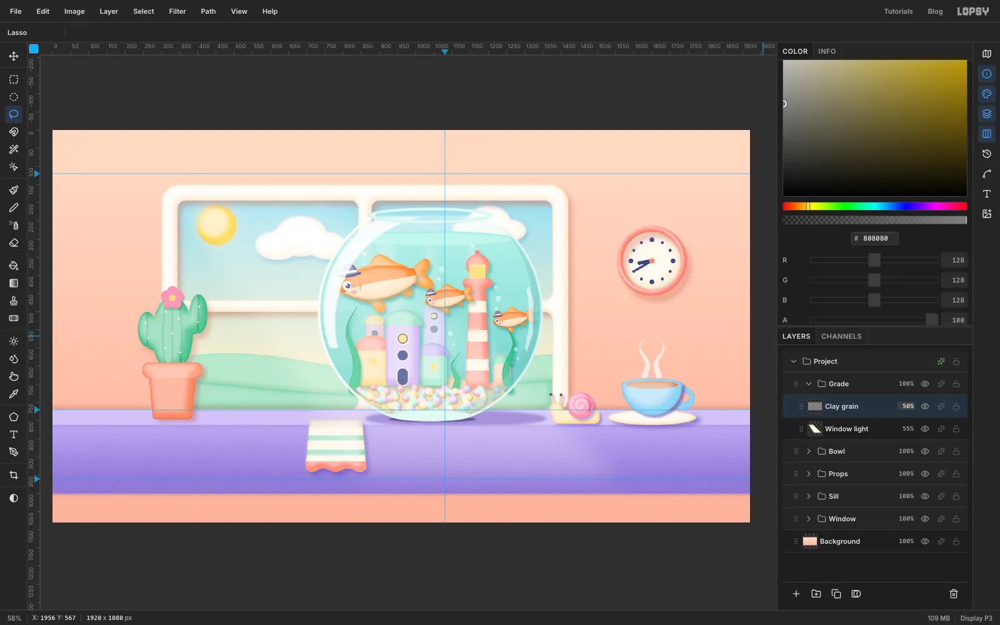

Collapse **Sill** and **Bowl**, select **Bowl** and make a **Grade** group
above it.

Add **Window light**. Lasso a wide band that starts across the top of the
left pane and widens as it falls diagonally down to the right across the
sill. **Feather 60**, fill `#FFFBEA`, and set the layer to **Soft Light** at
55%.

Add **Clay grain**. Fill the whole layer with `#808080`, then run
**Filter → Add Noise…** (Amount 40, Mono, Gaussian), **Gaussian Blur…**
(Radius 1) and **Emboss…** (Strength 40). Set it to **Overlay** at 50%. The
embossed noise reads as the tiny dents and fingerprints of real
modelling clay.

## Stake a name tag in the pot

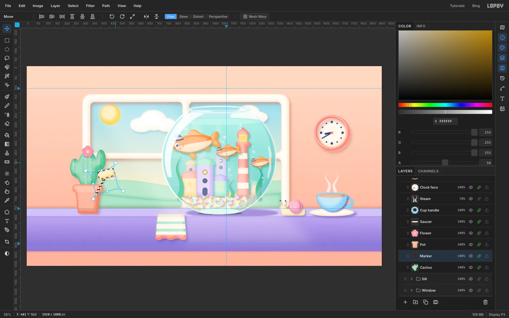

Expand **Props** and select **Cactus**, so the next layer goes between the
cactus and the pot. Add a **Marker** layer.

Draw a wooden stick with the Brush (`#C79A6B`, Size 7), starting inside the
pot and angling up to the right. The pot hides its base, so it looks pushed
into the soil. Make a rounded rectangle plate at the top
(88 × 40, Shrink/Grow 10), fill it with `#FFE29A` and clay it.

[[Cmd]]-click the thumbnail, switch to the Move tool, hold [[Cmd]] and drag
the rotation handle counter-clockwise. With Cmd held, it snaps to 15° steps,
so stop at 15°. Press [[Cmd+D]].

## Letter the marker

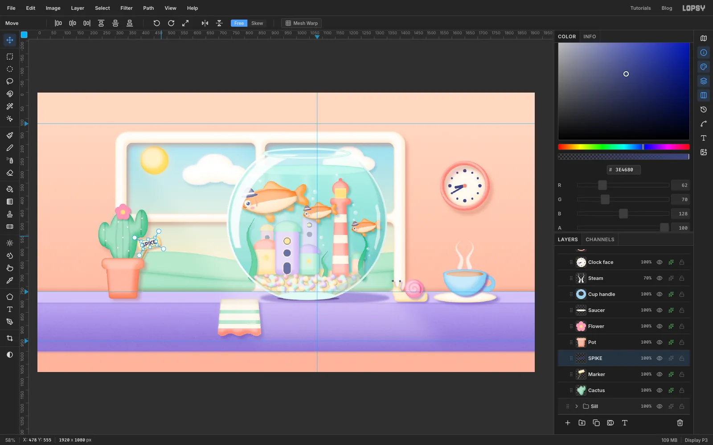

With **Marker** still selected, pick the **Text** tool (T). Set
**Fredoka**, **SemiBold**, Size **22**, Align **Center**, and the colour to
navy `#3E4680`. Click on the plate, type **SPIKE**, and press [[Tab]] to
commit.

With the Move tool, [[Cmd]]-drag the text's rotation handle 15°
counter-clockwise so it snaps to exactly the plate's angle. Then nudge it
with the arrow keys until the margins left and right of the word match and
it sits centred top to bottom.

## Give it a tilt-shift miniature focus

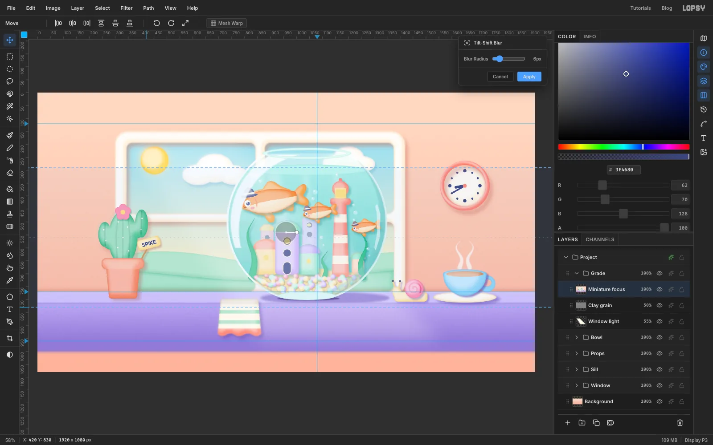

Real stop-motion sets are tiny, and the camera's shallow focus gives them
away. Fake it with a tilt-shift blur.

Collapse **Props**, expand **Grade** and select **Clay grain**. Choose
**Edit → Copy Merged** and then **Edit → Paste**. Name the new layer
**Miniature focus**. It's a flattened copy of the whole scene, so do it
after all the scene painting: anything you change underneath later won't
show through it.

Choose **Filter → Tilt-Shift Blur…**. Drag the upper dashed line up to the
water's surface, and the lower one down to the front of the sill. Set **Blur Radius** to 6 and click **Apply**. The wall and the sky
soften, while the town and the fish stay pin sharp.

## Add the letterbox and the slate

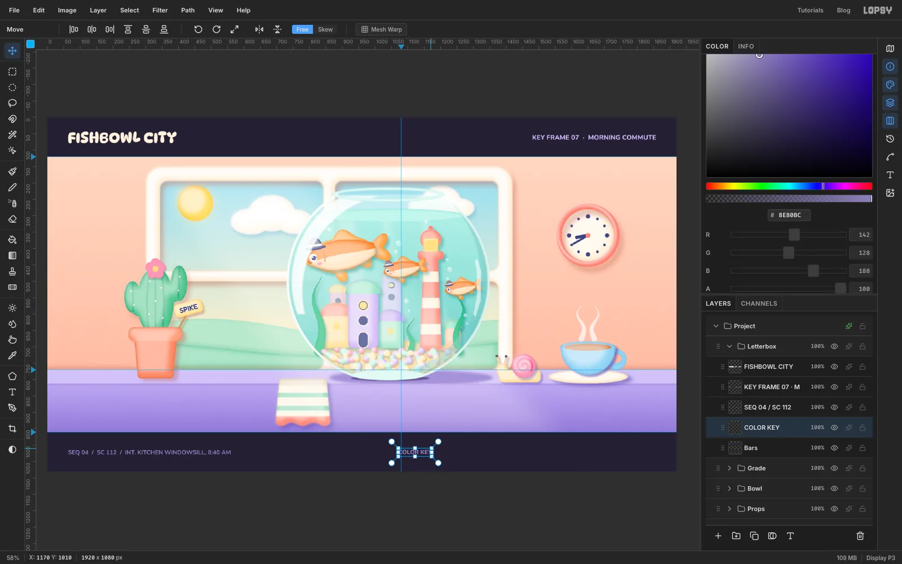

Collapse **Grade**, select it and make a **Letterbox** group. Add a
**Bars** layer. Drag a marquee from just off the top-left corner to just
past the right edge at the 120 guide, where it snaps. Then [[Shift]]-drag
another from the 960 guide to below the bottom-right corner. Fill both with
`#241F33`.

Click the top ruler at **64** and **1856** for margin guides.

Select **Bars** before each new piece of type, so the Text tool's settings
don't restyle the text you just made.

- **FISHBOWL CITY:** DynaPuff SemiBold, Size 46, `#FFF2DF`, Align Left.
- **KEY FRAME 07 · MORNING COMMUTE:** Nunito ExtraBold, Size 20,
  `#C9B8F2`, Align Right. Put two spaces either side of the middle dot
  (on a Mac, type it with [[Alt+Shift+9]]), and the same around the slashes
  on the next line.
- **SEQ 04 / SC 112 / INT. KITCHEN WINDOWSILL, 8:40 AM:** Nunito Bold,
  Size 18, `#8E80BC`, Align Left.
- **COLOR KEY:** Nunito ExtraBold, Size 18, `#8E80BC`, Align Right.

Line each one up on its margin guide and centre it vertically in its bar,
so the caps sit halfway down. Nudge with the arrow keys to get there. The **COLOR KEY** label goes in the bottom bar, just left of where
the chips will start.

## Lay out the colour key

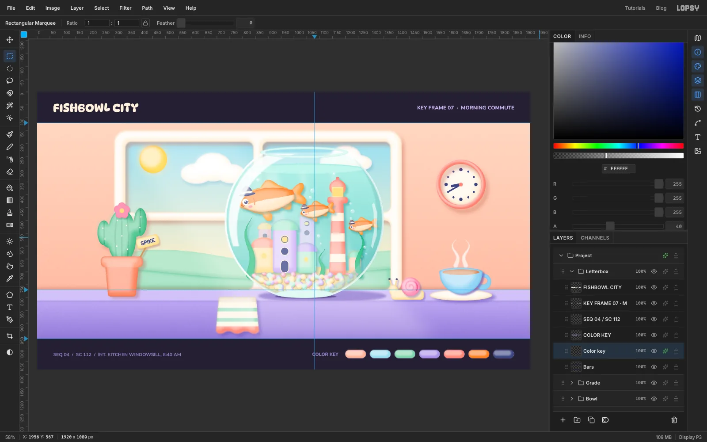

Add a **Color key** layer. Turn on **View → Show Grid**, leave the grid at
**16 px** and tick **Snap** in the options bar. The marquee now locks to the
grid, so every chip comes out the same size.

Drag seven chips, each 5 cells wide and 2 cells tall (80 × 32), with one
cell between them, ending at the right margin. Round each one with
**Shrink 15** / **Grow 15** to make a pill, and fill it with one of the
key colours: wall `#F2B79E`, sky `#A8DCEF`, hills `#93D4B0`, lilac
`#A792E2`, coral `#FF8E7C`, goldfish `#FF8A3D` and navy `#3E4680`.

Turn the grid off and run the clay recipe on the layer with small numbers:
Shrink 6, a 4 px nudge, Feather 5, white at 40%, and an Inner Glow
`#16121F` at Size 3, Opacity 50.
Finally, add a 1 px **Stroke** in `#6F6391` so even the navy chip stands out
from the dark bar. Save the project with **File → Save Project**, and export
the frame with **File → Quick Export PNG**.
