Every colour magazine photo you have ever seen is made of four inks:
**cyan, magenta, yellow and black**. Each ink is printed as its own grid
of dots, and each grid is turned to a different angle, usually 15°, 75°,
0° and 45°. Up close, the overlapping dots form little flower shapes
called **rosettes**. From arm's length, they blend back into a photo.

This tutorial makes that process the subject of the poster. You'll take
a photo of an Eastern Rosella, Australia's most colourful parrot, and
split it into four plates yourself. Then you'll screen each plate at its
own angle and print them on top of one another with the **Multiply**
blend mode. The poster is laid out like a printer's proof sheet. It has
a magnifying glass over the dots, a row of *progressive proofs* showing
each ink on its own, and crop marks, registration targets and a colour
bar in the margin. The poster is **2400 × 3200 px**.

The photo is [Platycercus eximius, The Briars](https://commons.wikimedia.org/wiki/File:Platycercus_eximius_-The_Briars-8_crop.jpg)
by Frankzed, cropped by Tony Wills, on Wikimedia Commons. It's licensed
**CC BY 2.0**, so credit the photographer if you share your poster. To
follow along, download the original (1047 × 1396 px) from its Commons
page. Any sharp photo of a bird against a plain, out-of-focus background
works the same way.

Along the way you'll use:

- the **Pen** tool and **Path to Selection** to cut out the bird
- the transform handles to scale the bird and the lens, and to tilt the magnifier's handle by 45°
- **Channel Mixer** and **Highlights & Shadows** adjustments on a group to make the separations
- **Copy Merged**, paste in place, and **Halftone** at four screen angles
- **Color Overlay**, **Rasterize Layer Style** and the **Multiply** blend mode for overprinting
- **Grow** to re-cut soft edges crisp, and **Select → Inverse**
- the **Gradient** tool, a knockout, **Merge Down** and the **Eraser**
- **Anton**, **IBM Plex Serif** and **IBM Plex Mono** type, with **Rotate 90°** and a misregistered duplicate
- guides, the grid with snapping, the **Pencil** for straight lines, and groups

The palette is four process inks on newsprint:

- Paper `#ECE4D2`, grain `#F4F4F4` (with noise)
- Cyan `#00A0DF`, magenta `#E4007C`, yellow `#FFE500`, black `#1D1A1B`
- Halo `#3C3C3C` → `#FFFFFF` (before screening)
- Handle `#5A5657` → `#2A2627` → `#0B0909`
- Ferrule `#DAD7D5` → `#8E8A8B` → `#3E3B3C`
- Overprint patches `#2B3990` / `#E31E24` / `#00A650`
- Black tints `#4A4748` / `#8B8889` / `#C7C4C2`

> **Tip:** Positions are in document pixels, written `x, y`. The status bar
> at the bottom shows where the pointer is. **Edit → Fill** fills the
> selection with the foreground colour, and [[Cmd+D]] deselects. New layers
> appear above the selected layer, so click the layer you want to build on
> first. For an exact rectangle or circle, pick the **Rectangular** or
> **Elliptical Marquee**, make sure nothing is selected, and click the canvas
> once without dragging. A dialog asks for the **From X / Y** and
> **To X / Y** corners. Effects and the **Blend** dropdown live in each
> layer's effects drawer, which opens from the sparkle icon on its row.

## Make the newsprint

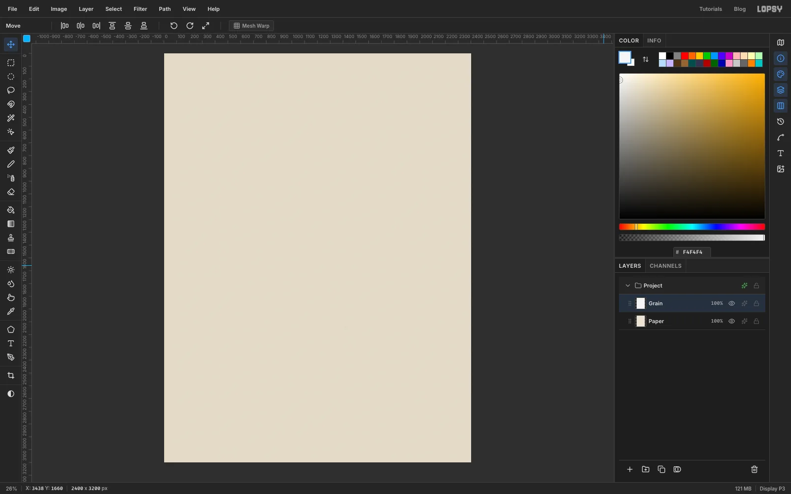

Choose **File → New**, enter **2400 × 3200** pixels and click **Create**.
Double-click the *Background* layer's name and rename it *Paper*. Set the
foreground to `#ECE4D2` and choose **Edit → Fill**.

Rename *Layer 1* to *Grain* and fill it with `#F4F4F4`. Choose
**Filter → Add Noise…**, set **Amount** to **32**, pick **Mono** and
**Gaussian**, and click **Apply**. In the layer's effects drawer, set
**Blend** to **Multiply**. The paper now has a faint newsprint tooth.

## Mark the trim and margins

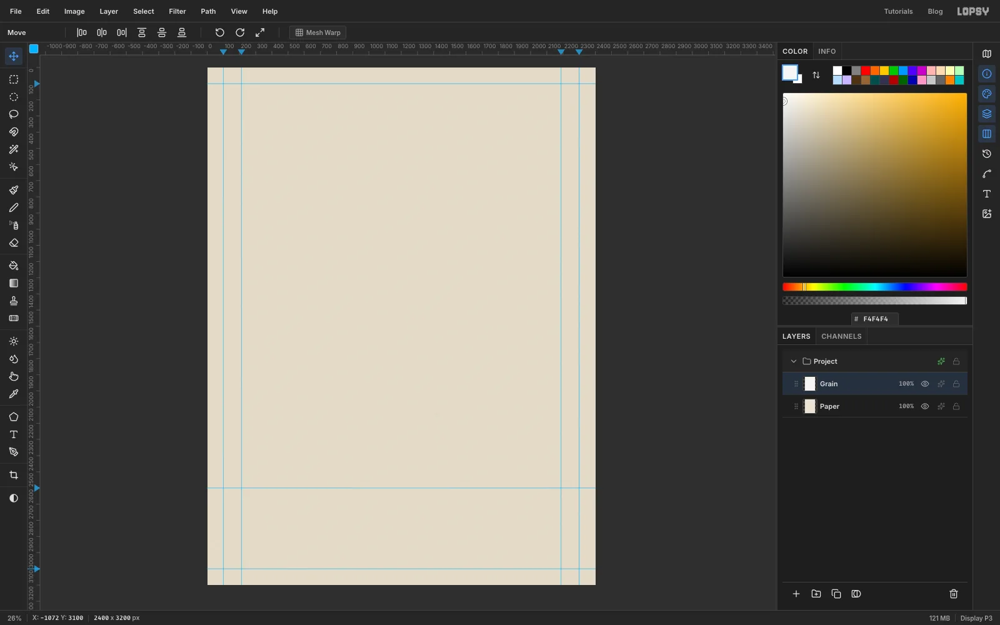

A proof sheet is bigger than the finished poster. The poster is trimmed
out of the middle, and the margin holds the printer's marks. Click the
top ruler at `100`, `212`, `2188` and `2300` to drop vertical guides.
Click the left ruler at `100`, `2600` and `3100`.

The outer guides are the **trim**. The `212` and `2188` guides are the
**margins** that all the type and the bird will line up on. The `2600`
guide is where the rule under the picture will go.

## Bring in the photo

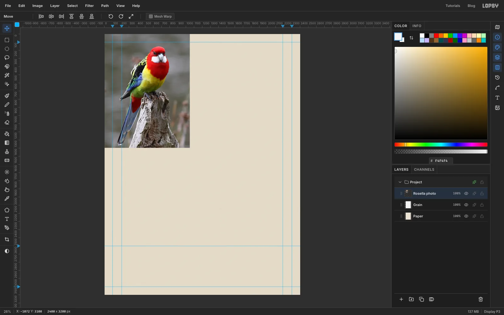

Click the *Grain* row, then drag the downloaded JPEG from your desktop
onto the canvas. It lands in the top-left corner at its full size. Rename
the new layer *Rosella photo*.

## Trace the bird with the Pen

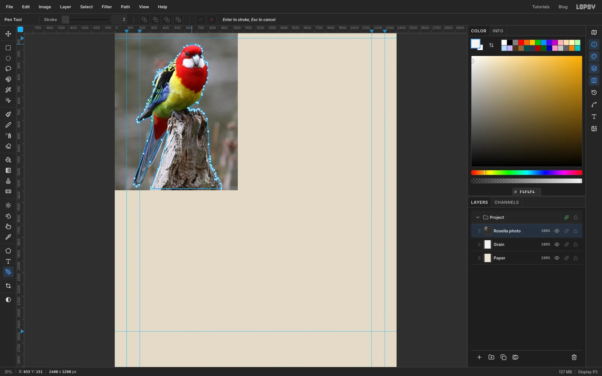

Zoom in with [[Cmd]] and the scroll wheel until the photo fills most of
the window. Pick the **Pen** tool (`P`) and click your way around the
bird, one anchor every 20–40 px. Start at the top of the head and go
down the back, around the wing tip and the long tail, back up the tail's
inner edge, and down the left side of the stump. Then cross the bottom
of the photo and go up the stump's right side to the chest.

Keep the anchors on the bird, not on the blurred background, and cut
straight across the bottom of the stump. Click the first anchor again to
close the path.

## Cut the bird out

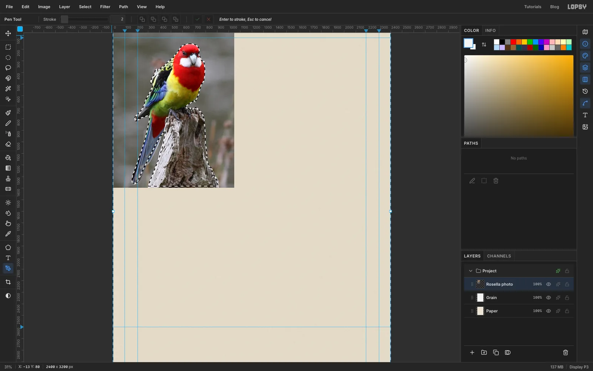

Open the **Paths** panel, select the new path and click
**Path to Selection** (the dashed-square button), then click **Delete Path**
(the bin). Choose
**Select → Inverse**, so everything except the bird is selected, and
press [[Delete]]. Press [[Cmd+D]] to deselect.

## Scale the bird up

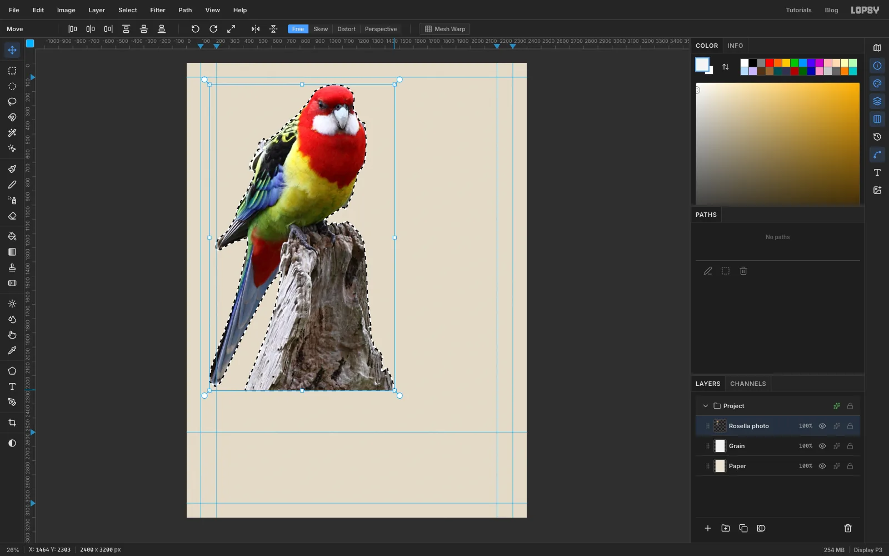

[[Cmd]]-click the *Rosella photo* thumbnail to select the bird, and press
`V` for the **Move** tool. Hold [[Cmd]], so the bird scales evenly, and
drag the bottom-right **white square** handle down and to the right.
Watch **Selection W** in the **Info** panel and stop when it reads about
**1305 px**, which is 175% of the original. Grab the square slightly inside its corner. The blue circle
just outside it is the rotate handle.

## Move it into place

Drag from inside the selection to move the bird. Put the tip of its tail
at about `x 880`, and the flat bottom of the stump on the `2600` guide.
Press [[Cmd+D]] to finish the transform.

## Put the photo in a Separation group

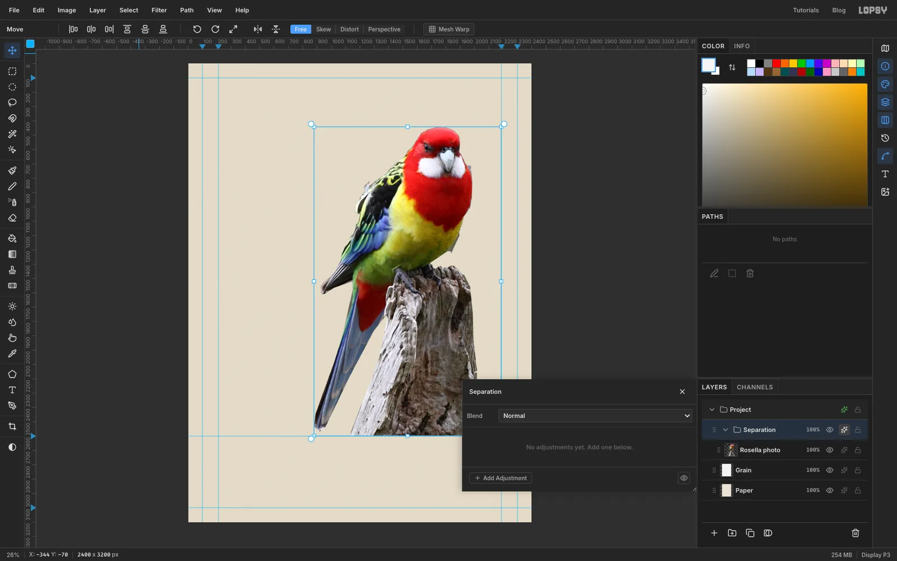

With *Rosella photo* selected, choose **Layer → Group Layers** and rename
the group *Separation*. Click the sparkle icon on the group's row. For a
group, the drawer holds **adjustments** instead of layer effects.

A plate is just a greyscale picture of how much of one ink the photo
needs. Cyan ink absorbs red light, so wherever a pixel has little red,
the cyan plate needs a lot of ink. So a grey copy of the **red channel**
is dark wherever cyan ink is needed. The halftone filter prints dark greys
as big dots and white as nothing, so that grey copy screens straight into
a cyan plate.

## Add three Channel Mixers

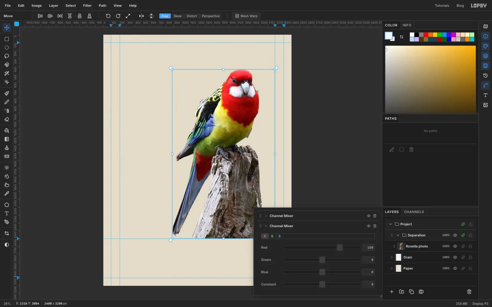

Click **Add Adjustment → Channel Mixer** three times. Each mixer controls
one output channel, chosen with the **R**, **G** and **B** tabs. Expand
the first mixer and leave it on **R**. Switch the second mixer to **G**
and the third to **B**. A mixer only writes the channel whose tab is
showing, so once a mixer is on its tab, leave it there.

## Lift the shadows

Click **Add Adjustment → Highlights & Shadows**. Set **Shadows** to
**15** and **Whites** to **−15**. This opens up the darkest feathers a
little, so they don't fill in solid. It also gives the white cheeks a
faint tint, so they print as a light speckle instead of a bare hole.

## Make the cyan separation

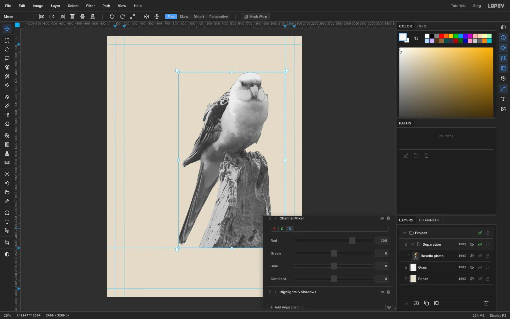

Set all three mixers to the same recipe: **Red 100**, **Green 0**,
**Blue 0**, **Constant 0**. Every output channel now copies the red
channel, so the bird turns grey. The red head goes almost white because
it needs no cyan at all.

[[Cmd]]-click the *Rosella photo* thumbnail, choose **Edit → Copy Merged**,
click the *Grain* row and choose **Edit → Paste**. The grey bird is
pasted in place on a new layer under the group. Rename it *Cyan plate*
and press [[Cmd+D]].

## Screen and ink the cyan plate

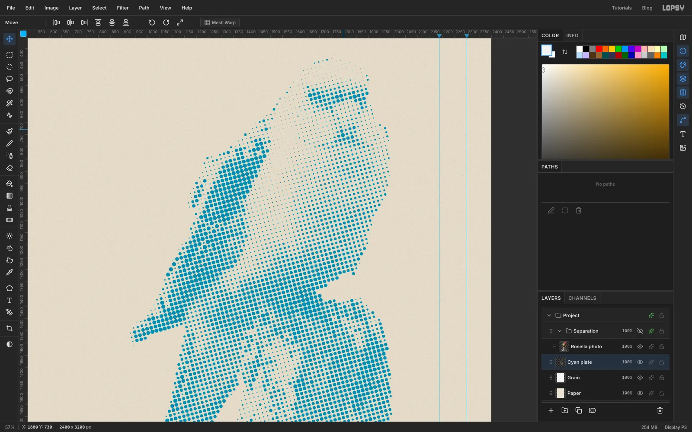

Choose **Filter → Halftone…** and set **Dot Size 20**, **Density 1.15**,
**Angle 15** and **Softness 1**. A density above 1 lets the darkest dots
just touch, so solid areas print solid.

The dots are still grey. In the layer's effects drawer, turn on
**Color Overlay** and set it to cyan `#00A0DF`. Set **Blend** to
**Multiply** and click **Rasterize Layer Style** to bake the colour in.
Hide the *Separation* group to check the cyan plate on its own, then
turn it back on. The next three plates are copied from it.

## Make the magenta, yellow and black plates

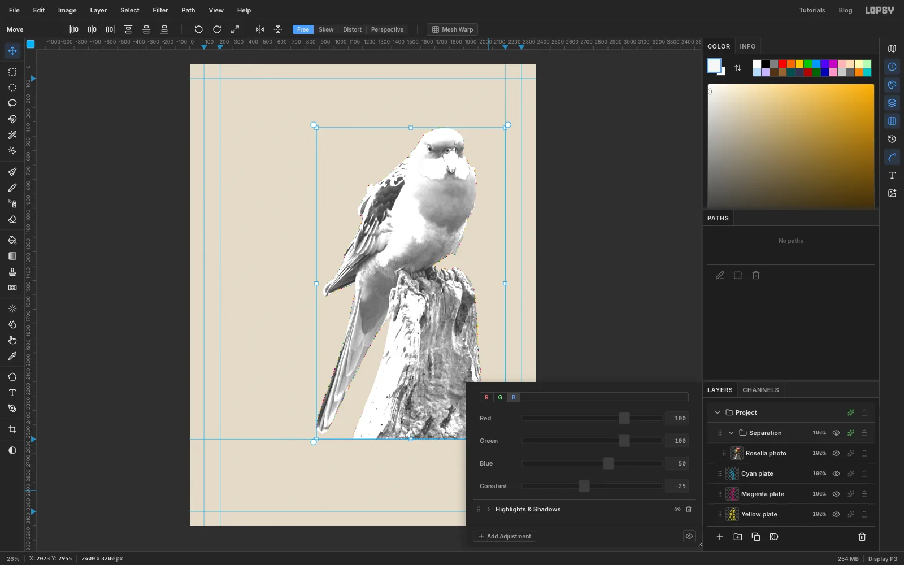

Repeat the last two steps three more times. Change the three mixers each
time, then Copy Merged, paste above *Grain*, screen and ink the new
plate:

1. **Magenta**: mixers set to **Green 100** (Red 0, Blue 0). Halftone
   **Angle 75**. Overlay `#E4007C`.
2. **Yellow**: mixers set to **Blue 100** (Red 0, Green 0). Halftone
   **Angle 0**. Overlay `#FFE500`.
3. **Black**: mixers set to **Red 100**, **Green 100**, **Blue 50** and
   **Constant −25**. Halftone **Angle 45**. Overlay `#1D1A1B`.

The black recipe adds red, green and half the blue, then subtracts a
quarter.
Red, yellow and green feathers are bright in at least one channel, so
they stay white and get no black. Only the truly dark feathers and the
cracks in the stump turn grey. Use the same **Dot Size 20**,
**Density 1.15** and **Softness 1** for every plate, set each to
**Multiply**, and rasterize each style.

## Hide the photo and look at the rosettes

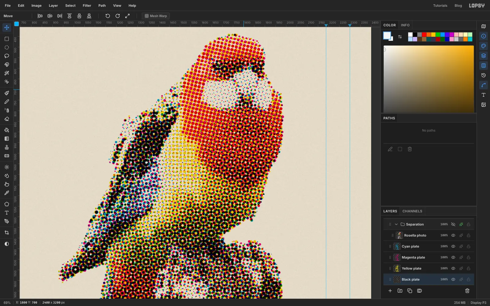

Click the eye on the *Separation* group to hide the photo. The four
plates show through, multiplied over one another, and the parrot comes
back in full colour. Zoom in on the head: magenta and yellow dots overlap
into red, cyan and yellow make green, and the dots cluster into rosettes
because every plate sits at a different angle.

## Start the halo with a gradient

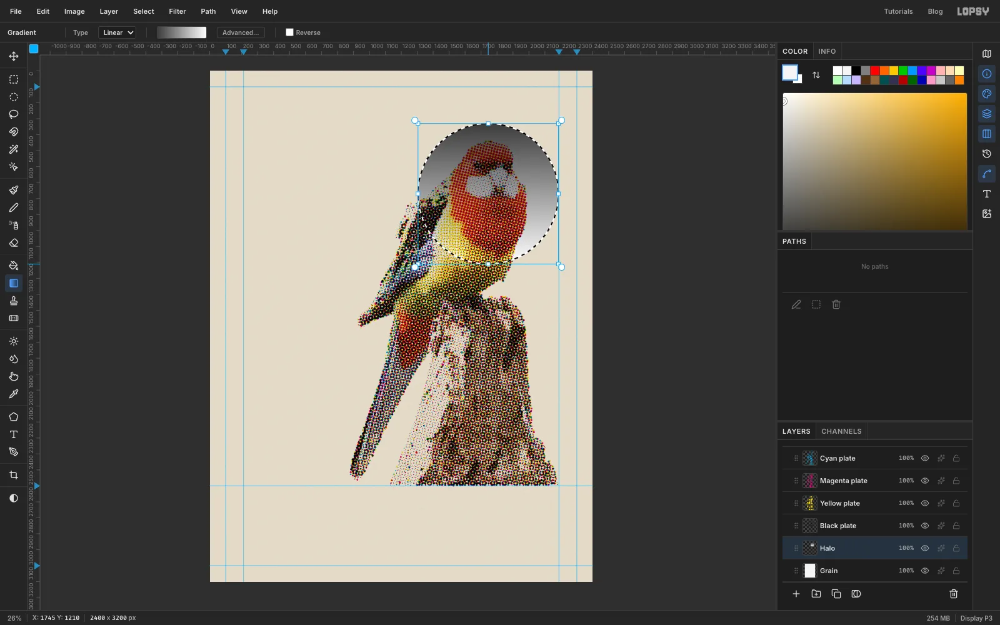

Click the *Grain* row and add a layer called *Halo*. With the
**Elliptical Marquee**, click once and enter From `1305, 330` To
`2185, 1210`.

Pick the **Gradient** tool, set **Linear**, and open **Advanced…**. Make
two stops: `#3C3C3C` on the left and white `#FFFFFF` on the right. Drag
from the top of the circle straight down to its bottom.

## Screen the halo

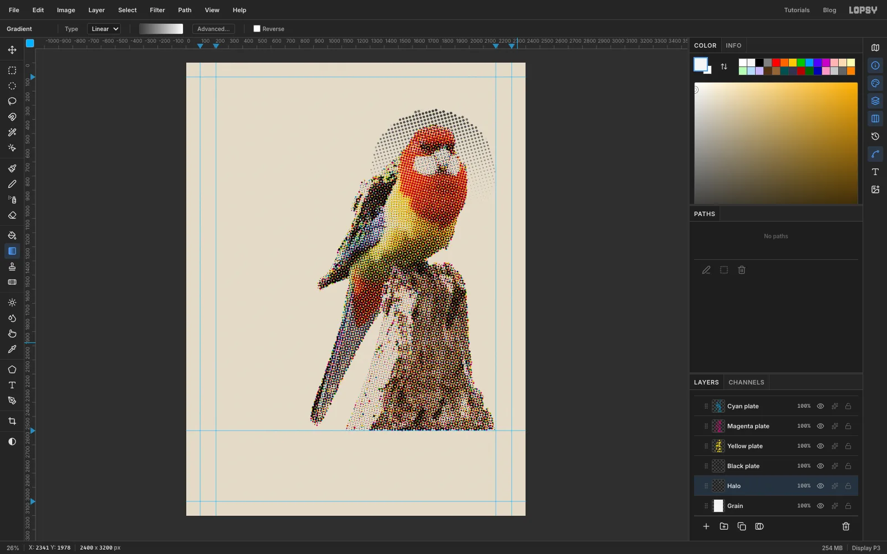

Press [[Cmd+D]], then choose **Filter → Halftone…** with
**Dot Size 24**, **Density 1**, **Angle 15** and **Softness 1**. The
dark top becomes big dots, and the white bottom prints nothing at all.

## Ink the halo cyan

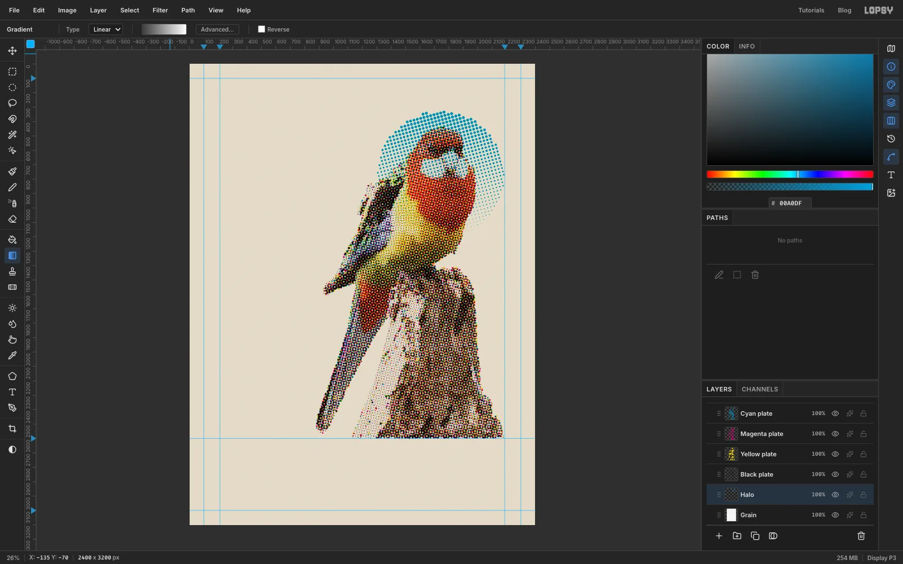

Add a **Color Overlay** in cyan `#00A0DF`, set **Blend** to **Multiply**
and click **Rasterize Layer Style**. The smallest dots at the faded edge
are only partly opaque, which looks like a pale tint. To make every dot
full-strength ink, [[Cmd]]-click the *Halo* thumbnail, choose
**Select → Grow…** with **1** px and fill with cyan `#00A0DF`. Then choose
**Select → Inverse**, press [[Delete]] to clear the soft fringe, and
deselect.

## Knock the halo out behind the bird

The cyan dots shouldn't print under the bird, or they would muddy the red
head. [[Cmd]]-click the thumbnail of the hidden *Rosella photo* to load
the bird's outline, choose **Select → Grow…** with **8** px, and press
[[Delete]] with *Halo* still selected. Printers call this a
**knockout**. The thin gap of bare paper around the bird is the *trap*.

## Draw the rule

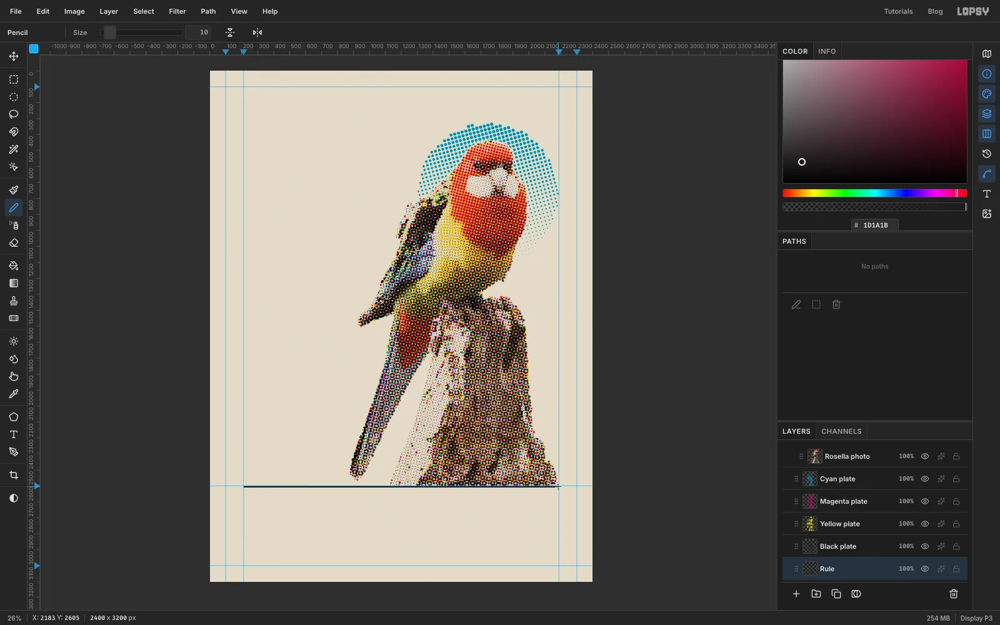

Click *Halo* and add a layer called *Rule*. Pick the **Pencil** (`N`),
set **Size** to **10** and the foreground to black `#1D1A1B`. Click at
`217, 2605`, then [[Shift]]-click at `2183, 2605` to draw a straight line
from margin to margin.

## Set the title

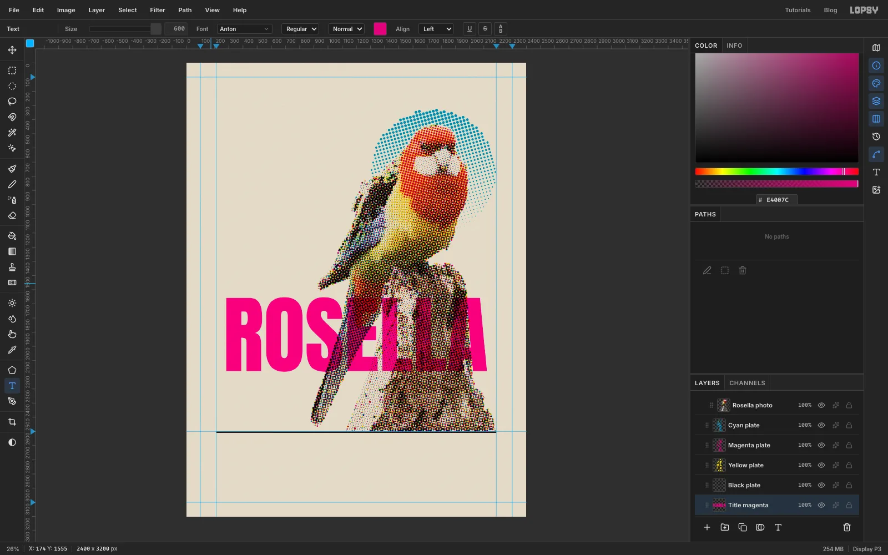

The Text tool's options restyle whichever text layer is selected, so
before you set up each new piece of type, click a pixel layer such as
*Rule*. Click *Rule* now, pick the **Text** tool (`T`) and set the font to **Anton**,
**Size 600** and the colour to magenta `#E4007C`. Click on the left side
of the canvas, type `ROSELLA`, and press the ✓ button to commit. Rename
the layer *Title magenta*.

## Turn the title on its side

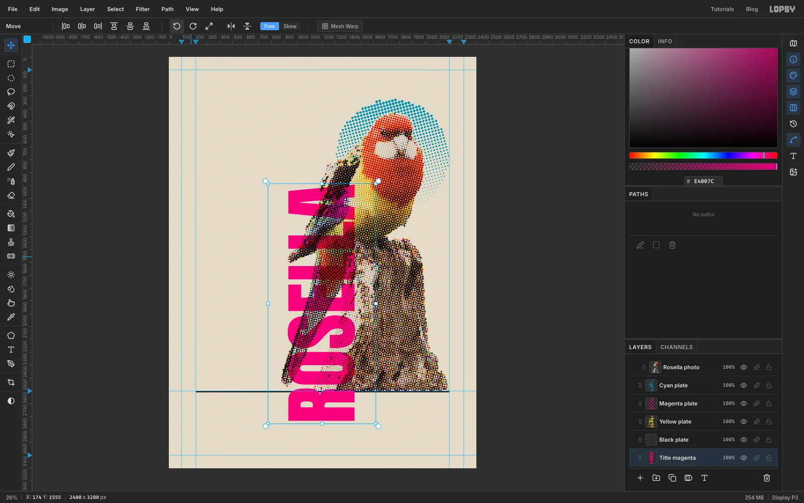

Press `V` for the **Move** tool and click **Rotate 90° CCW** in the
options bar. The word now reads upwards. Drag it so its left edge sits on
the `212` guide and the bottom of the R sits on the rule. Use the arrow
keys for the last few pixels. In the effects drawer, set **Blend** to
**Multiply**.

## Print the yellow slightly out of register

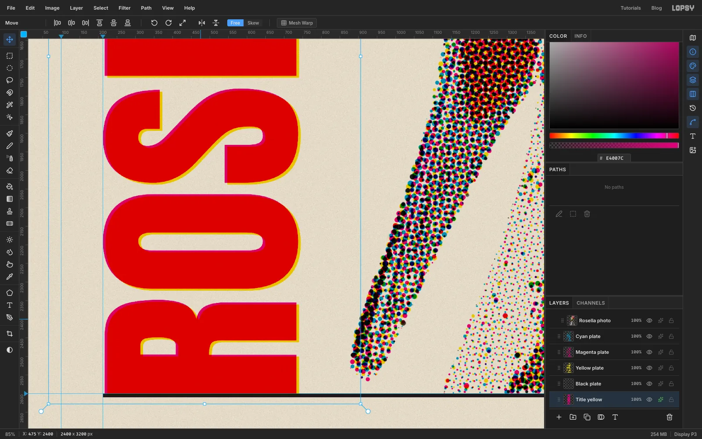

A red title in process printing is magenta plus yellow, and on a real
press the two plates never line up perfectly. Click **Duplicate Layer**
in the Layers panel and rename the copy *Title yellow*. Give it a
**Color Overlay** in yellow `#FFE500`. Then nudge it with the arrow keys
until it sits **7 px** to the right of and **5 px** below the magenta
layer.

Both layers multiply, so the overlap prints red. Thin magenta and yellow
edges peek out where the plates missed.

## Add the kicker and caption

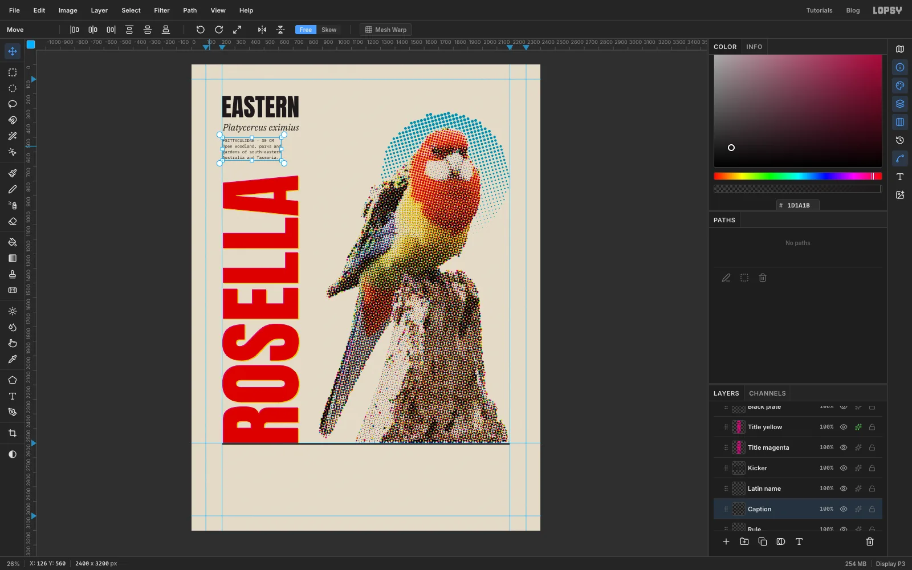

Click *Rule*, set the Text tool to **Anton**, **Size 171**, black
`#1D1A1B`, and type `EASTERN` near the top-left corner. At that size it's
exactly as wide as the ROSELLA column. Nudge it so its left edge is on the
`212` guide and its top is at `y 214`, and rename it *Kicker*.

Click *Rule* and add the Latin name, `Platycercus eximius`, in
**IBM Plex Serif**, **Italic**, **Size 62**, about 44 px below EASTERN,
and rename it *Latin name*. Click *Rule* and add a caption in
**IBM Plex Mono**, **Regular**, **Size 28**, named *Caption*. Press
[[Return]] between the lines:

`PSITTACULIDAE · 30 CM` / `Open woodland, parks and` /
`gardens of south-eastern` / `Australia and Tasmania.`

Line all three up on the `212` guide.

## Lay a paper disc and sample the first plate

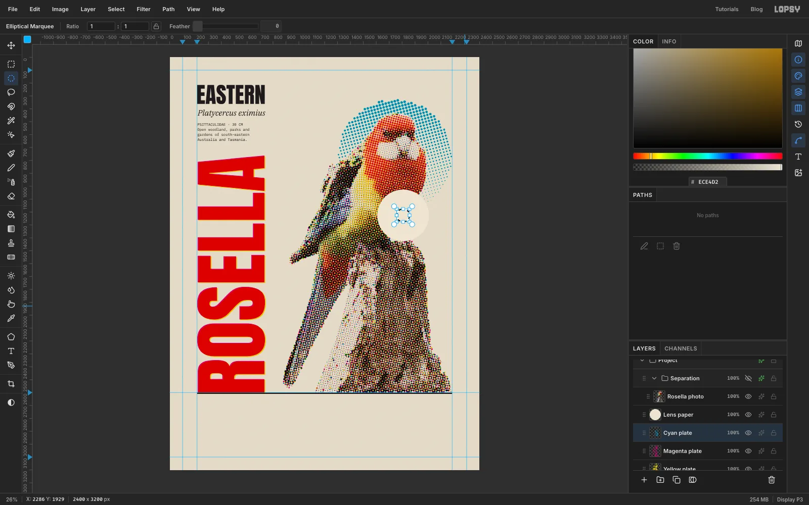

The magnifying glass shows the dots on the chest four times larger. Click
*Cyan plate* and add a layer called *Lens paper*. Select the circle From
`1608, 1026` To `2008, 1426`, fill it with the paper colour `#ECE4D2`,
and deselect.

Click *Cyan plate* again and select a small circle in the middle of that
disc, From `1758, 1176` To `1858, 1276`. Choose **Edit → Copy**, click
*Lens paper*, and choose **Edit → Paste**. Rename the pasted layer
*Lens cyan*.

## Magnify it four times

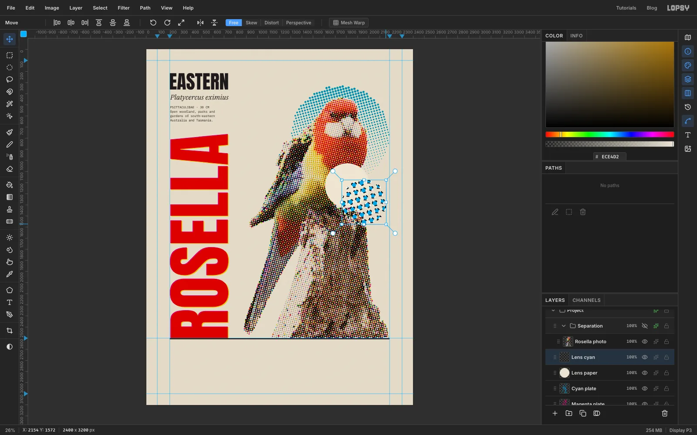

With the **Move** tool, hold [[Cmd]] and drag the bottom-right handle out
until the selection is four times its width, about **400 px**. Then drag
the enlarged piece so its centre sits on the centre of the paper disc,
`1808, 1226`, and press [[Cmd+D]].

## Re-cut the dot edges crisp

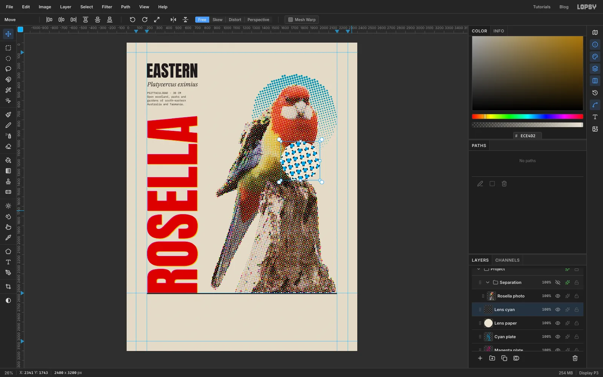

Scaling up blurred the dots' edges, and a magnifier should look sharper,
not softer. [[Cmd]]-click the *Lens cyan* thumbnail and choose
**Select → Grow…** with **1** px. Grow redraws the selection's edge
crisply at the halfway point of the blur. Fill it with cyan `#00A0DF`,
choose **Select → Inverse**, press [[Delete]] to clear the soft fringe,
deselect, and set the layer to **Multiply**.

## Magnify the other three plates

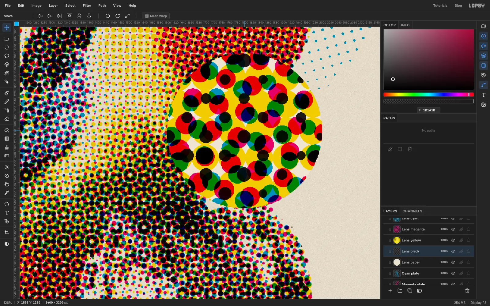

Repeat the last three steps for the *Magenta plate*, *Yellow plate* and
*Black plate*. Use the same small circle each time, and paste above
*Lens paper* as *Lens magenta*, *Lens yellow* and *Lens black*. Scale
each 4× onto the same centre, re-cut it with **Grow 1** and its own ink,
and set it to **Multiply**. Because every copy comes from the same spot
and lands on the same centre, the big dots overprint into rosettes just
like the small ones.

## Build the handle

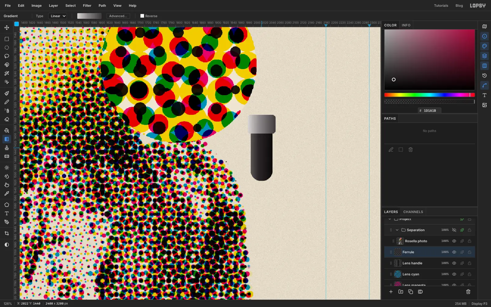

Click *Lens cyan* and add a layer called *Lens handle*. Pick the
**Shape** tool (`U`): **Rectangle**, fill black `#1D1A1B`, no stroke,
**Corner Radius 26**. Click once where the centre should go,
`2022, 1440`, and enter **56 × 170** in the size dialog.
[[Cmd]]-click the thumbnail. Pick the Gradient tool and open
**Advanced…**: set the end stops to `#5A5657` and `#0B0909`, click the
stop row to add a middle stop, drag it to 35% and make it `#2A2627`.
Drag across the bar from its left edge to its right edge, so it looks
round.

Add a layer called *Ferrule* and draw a **72 × 48** rectangle at
`2022, 1379` with **Corner Radius 8**. Select its pixels and give it a
grey metal gradient across (`#DAD7D5` → `#8E8A8B` at 40% → `#3E3B3C`).
Choose **Layer → Merge Down** to merge it into the handle.

## Tilt the handle

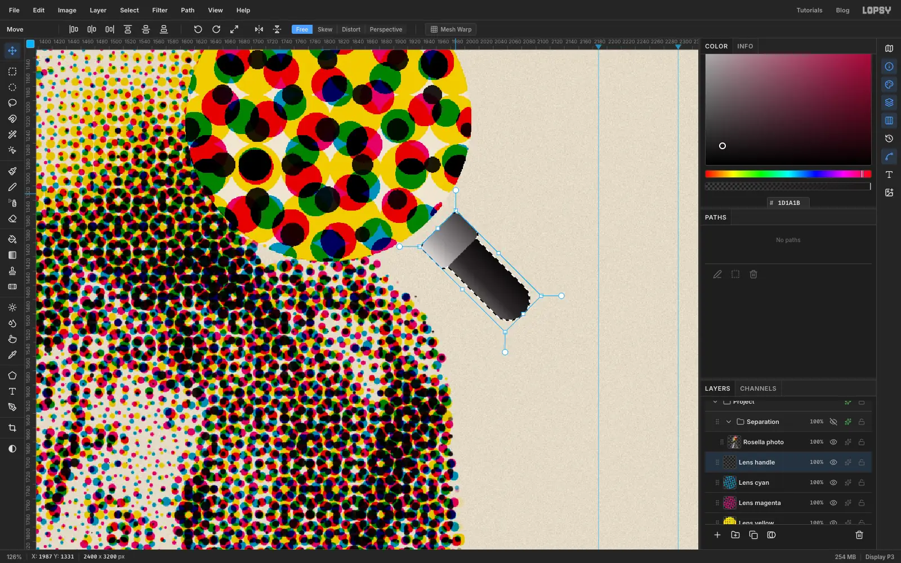

[[Cmd]]-click the *Lens handle* thumbnail and press `V`. Zoom in, then
drag the blue rotate circle beside the top-right corner with [[Cmd]]
held, which snaps to 15° steps. Turn it **45° anticlockwise**, so the
ferrule end points up at the lens. Press [[Cmd+D]].

## Add the rim

Add a layer called *Lens ring*. Set the Shape tool to **Ellipse** with no
fill and a black `#1D1A1B` **stroke**, **Width 18**. Click at
`1808, 1226` and enter **418 × 418**. The ring sits exactly over the
edge of the magnified dots.

## Add a glint to the glass

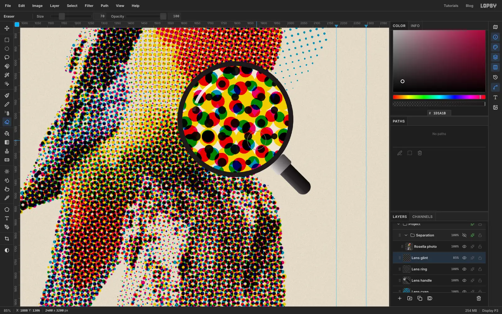

Add a layer called *Lens glint*. Draw an Ellipse with a white `#FFFFFF`
stroke, **Width 12**, **320 × 320**, at the same centre. Keep only its
upper-left arc. With the **Rectangular Marquee**, click once and enter
From `1748, 1026` To `2008, 1426`, and press [[Delete]]. Then select From
`1608, 1196` To `2008, 1426` and press [[Delete]] again.

Pick the **Eraser** (`E`), set **Size 70** and **Opacity 60**, and click
twice on each end of the arc to fade it out. Set the Eraser's opacity back
to 100, and set the layer's opacity to **85%**.

## Copy a patch of each plate for the proofs

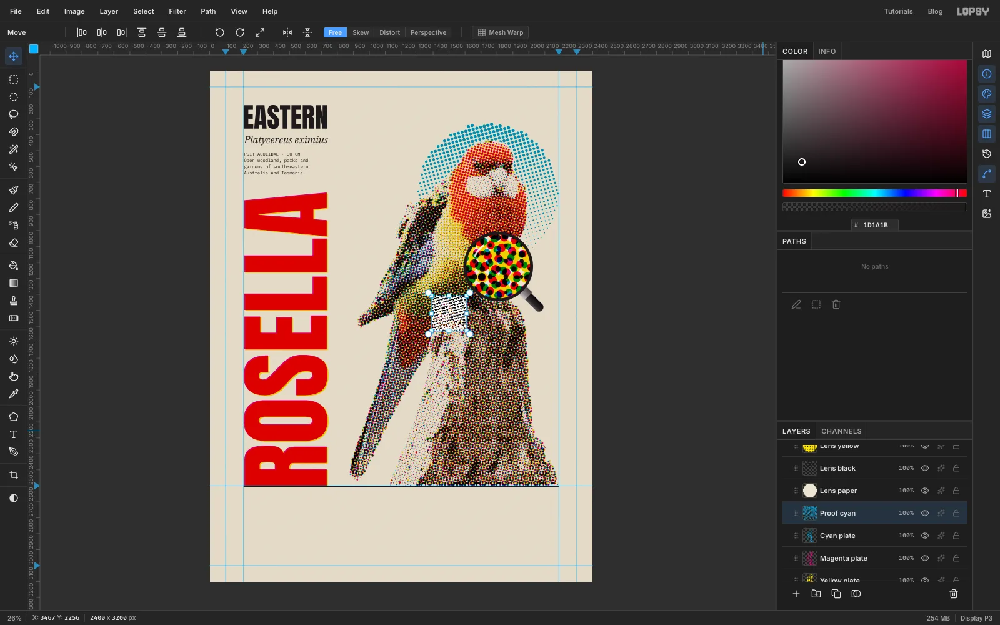

Printers check each ink on its own before printing the full colour sheet.
These checks are called **progressive proofs**. Select the square From
`1390, 1410` To `1610, 1630`, which takes in the belly, the feet and the
dark stump. Click *Cyan plate*, choose **Edit → Copy**, then
**Edit → Paste**. Rename the copy *Proof cyan* and set it to
**Multiply**.

## Line the proofs up under the rule

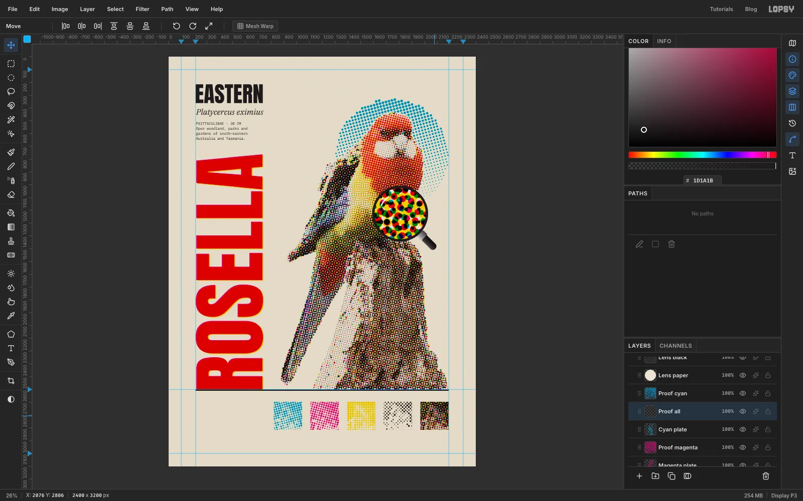

With the **Move** tool, drag *Proof cyan* down so its top-left corner
sits at `822, 2696`, and press [[Cmd+D]].

Now do the magenta plate the same way. Make the same square selection,
click *Magenta plate*, Copy and Paste, rename the copy *Proof magenta*,
set it to **Multiply**, and drag it to its slot. Then do yellow and
black:

- *Proof magenta* goes to `1108, 2696`
- *Proof yellow* goes to `1394, 2696`
- *Proof black* goes to `1680, 2696`

For the last tile, select the square again and use **Edit → Copy Merged**
instead, so you get all four inks together. Name it *Proof all* and move
it to `1966, 2696`.

## Frame the tiles

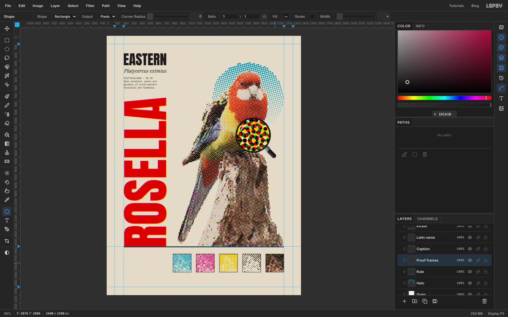

Click *Rule* and add a layer called *Proof frames*. Set the Shape tool to
**Rectangle**, no fill, black `#1D1A1B` stroke, **Width 4**,
**Corner Radius 0**. Click the centre of each tile and enter
**224 × 224**. The centres are at `y 2806` and `x 932`, `1218`, `1504`,
`1790` and `2076`.

## Label the proofs

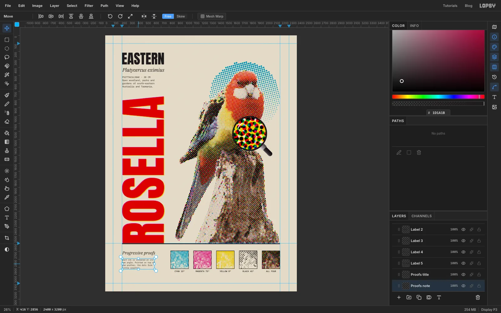

Click *Rule*, set the Text tool to **IBM Plex Mono**, **Medium**,
**Size 26**, **Align Center**, and click under the middle of each tile to
type its label: `CYAN 15°`, `MAGENTA 75°`, `YELLOW 0°`, `BLACK 45°` and
`ALL FOUR`. Name them *Label 1* to *Label 5*, click *Rule* before each
new one, and line them up about 20 px below the frames.

On the left, set **Align Left** and add `Progressive proofs` in
**IBM Plex Serif Italic**, **Size 54**, with its top level with the
tiles, and name it *Proofs title*. Under it, add a four-line note named
*Proofs note* in **IBM Plex Mono**, **Size 24**:
`Each ink is screened at its` / `own angle. Printed on top of` /
`one another, the dots form` / `little rosettes.` Line the bottom of the
note up with the bottom of the tiles.

## Draw the crop marks

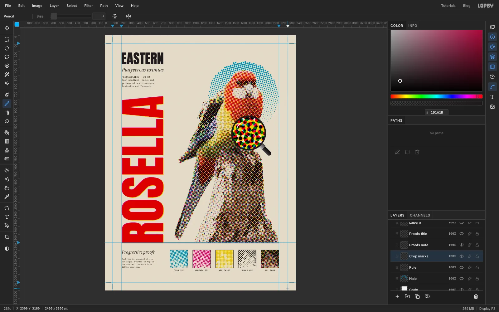

Crop marks show the printer where to cut, so they sit outside the trim.
Click *Rule* and add a layer called *Crop marks*. Pick the **Pencil**,
**Size 3**, black. For each corner, draw two short lines that point at
the trim line but stop 20 px short of it.

Top-left: click `20, 100` and [[Shift]]-click `80, 100`, then click
`100, 20` and [[Shift]]-click `100, 80`. Top-right: `2320, 100` to
`2380, 100`, and `2300, 20` to `2300, 80`. Mirror the same pairs at the
bottom corners, `100, 3100` and `2300, 3100`.

## Add registration targets

Add a layer called *Registration*. With the Shape tool set to
**Ellipse**, no fill, black stroke, **Width 3**, click each centre and
enter **40 × 40**. The centres are `1200, 50`, `1200, 3150`, `50, 1600` and
`2350, 1600`. Then use the Pencil (**Size 3**) to [[Shift]]-click a
68 px cross through the centre of each circle. On press, these targets
are printed in every ink, so they show whether the plates line up.

## Snap a colour bar to the grid

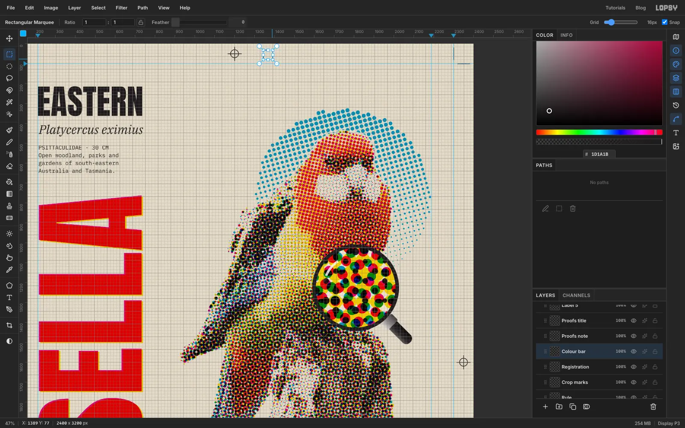

Add a layer called *Colour bar* and set it to **Multiply**. Press
[[Cmd+']] to show the grid. It's 16 px by default, and marquee drags snap
to it. Zoom in on the top margin.

Drag a three-cell square from `1344, 32` to `1392, 80` and fill it with
cyan. Skip one cell, drag the next square, and fill it with the next
colour. Repeat for all ten: cyan `#00A0DF`, magenta `#E4007C`, yellow
`#FFE500`, black `#1D1A1B`, the overprints `#2B3990`, `#E31E24` and
`#00A650`, and the black tints `#4A4748`, `#8B8889` and `#C7C4C2`. Press [[Cmd+']] again
to hide the grid.

## Add the slug lines

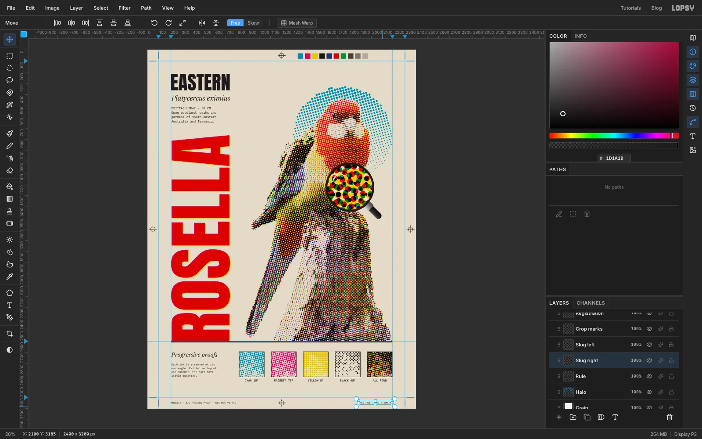

A slug line is the job information printed outside the trim. Click
*Rule*, and in **IBM Plex Mono**, **Size 22**, type
`ROSELLA · 4/C PROCESS PROOF · C15 M75 Y0 K45` and name it *Slug left*.
Line its left edge up with the `212` guide, with its top at `y 3140`.

For the right-hand slug, set **Align Right**, click near the right margin
and type `SHEET 01 · 600 × 800 MM`, named *Slug right*. Move it so it
ends on the `2188` margin, level with the first.

## Group everything

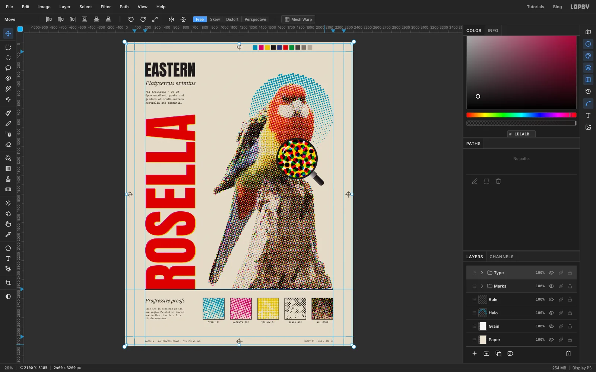

[[Cmd]]-click rows to select them, then click **Group Layers** to put
each set in its own group. Rename each group and collapse it:

- **Plates**: the four plate layers
- **Loupe**: the lens paper, the four lens plates, handle, ring and glint
- **Type**: the two title layers, the kicker, the Latin name and the caption
- **Proofs**: the proof tiles, frames, labels, title and note
- **Marks**: the crop marks, registration targets, colour bar and slugs

With a group selected, the Move tool frames everything in it, so you can
drag the whole footer or margin set as one.

## Add ink grain

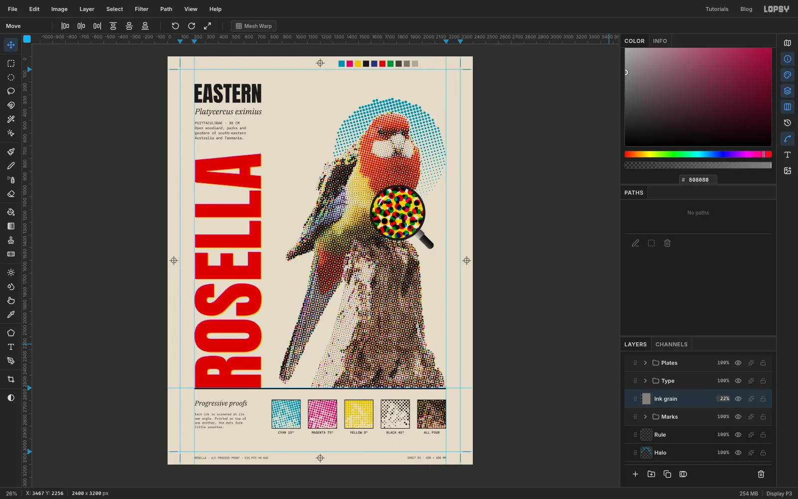

Ink on newsprint is never perfectly flat. Click the *Marks* group, add a
layer called *Ink grain*, and fill it with `#808080`. Run
**Filter → Add Noise…** with **Amount 40**, **Mono** and **Gaussian**.
Set **Blend** to **Overlay** and the layer opacity to **22%**. The grey
disappears under Overlay, and only a fine speckle is left. Because the
inks multiply over everything beneath them, the speckle shows through the
dots too.

Export with **File → Export…** and save the project with
**File → Save Project**.
