This tutorial builds a 1350 × 2000 px poster for an imaginary 1950s creature feature, **Locust Armada**. It's made the way a collage artist works on a table: torn sheets of coloured paper, a sun cut from a disc, and photos clipped out with scissors and glued down with a little lift. A giant locust dives at a lonely prairie grain elevator while its swarm pours in behind it.

You'll learn how to tear paper edges with the **Lasso**, turn a photo into newsprint with **Halftone**, cut photos off a white background with the **Magic Wand**, and make a **custom brush** from a photo so you can paint a whole swarm in a few strokes. You'll also group each title word with its paper strip, so you can rotate them together while the type stays editable.

Along the way you'll scale and rotate with the **Move** tool, grow and shrink selections, copy and paste tape, and lift every scrap of paper off the page with a **Drop Shadow**.

You need three photos from Wikimedia Commons:

- [Schistocerca gregaria - 0061.jpg](https://commons.wikimedia.org/wiki/File:Schistocerca_gregaria_-_0061.jpg) by Amada44, licensed CC BY-SA 3.0. It's a desert locust photographed side-on against pure white. Download the 1280 px wide version.
- [Obscure bird grasshopper on white.jpg](https://commons.wikimedia.org/wiki/File:Obscure_bird_grasshopper_on_white.jpg) by SwimSusan, licensed CC BY-SA 4.0. It's a grasshopper seen from above, which makes the swarm brush. Download the 1280 px wide version.
- [Grain elevators on Henry Sheffels' 6,000 acre wheat ranch, Cascade County, Montana](https://commons.wikimedia.org/wiki/File:Grain_elevators_on_Henry_Sheffels%27_6,000_acre_wheat_ranch._Cascade_County,_Montana_(LOC).jpg). It's a Farm Security Administration photo from the Library of Congress, with no known restrictions. Download the original (1024 × 776).

The fonts are free Google Fonts in Lopsy's font picker: **Ultra** for the title, **League Gothic** for the billing, and **Special Elite** for the typewriter labels.

The palette:

- Newsprint `#EEE4CD`, paper white `#F8F3E6`, ink `#1F1B17`
- Sky paper `#2F6F73`
- Sun `#D8532B` → `#8F2614`
- Field mustard `#E0A32E`
- Label paper `#F4ECD8`, masking tape `#E9CF8C`

> **Tip:** Positions are written as `x, y` in document pixels. Hover over the canvas and read the position in the status bar at the bottom of the window. Keys are Mac keys; on Windows and Linux use Ctrl for Cmd (and the Windows key for the Cmd-drag that keeps proportions). Torn edges and swarm strokes don't need to match the screenshots. Take more care with the type.

## Lay out the newsprint

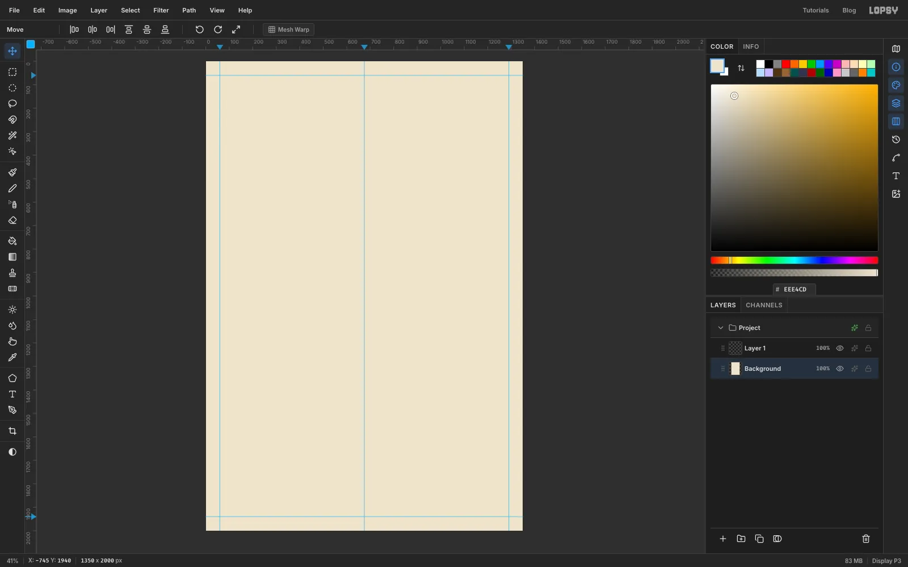

Open [Lopsy](/). In the **New Document** dialog, set **Width** to `1350` and **Height** to `2000`, then click **Create**.

1. Click the `Background` layer. In the **Color** panel, type `EEE4CD` into the hex field and choose **Edit → Fill**.
2. Choose **Filter → Add Noise…**. Set **Amount** to `6`, click **Mono** and click **Apply**. This adds a faint tooth to the newsprint.
3. Click the ruler along the top at `60`, `675` and `1290` to drop three vertical guides: the margins and the centre line.
4. Click the ruler on the left at `60` and `1940` for the top and bottom margins.

Leave the empty `Layer 1` where it is, at the top of the stack. It becomes the masking tape at the end.

## Tear a sheet of sky paper

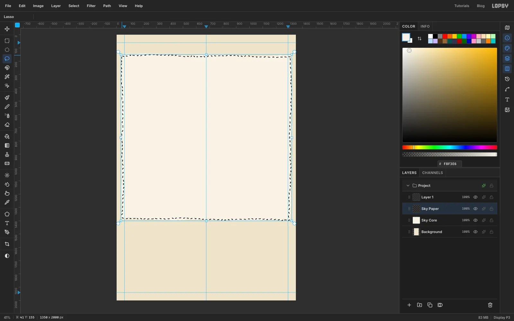

Real torn paper shows a thin white edge where the fibres pull apart. You get that by tearing two shapes: a white one, then a coloured one just inside it.

1. Click **Add Layer** at the bottom of the Layers panel. Double-click the new layer's name and call it `Sky Core`.
2. Press [[L]] for the **Lasso**. Drag a rough rectangle about 40 px in from each side, with its top near `y 150` and its bottom near `y 1390`. Tilt it very slightly: let the top-right corner sit about 10 px lower than the top-left. Don't drag straight lines. Jiggle the mouse every few pixels so the edges come out ragged, like torn paper.
3. Set the foreground to `F8F3E6` and choose **Edit → Fill**. Press [[Cmd+D]] to deselect.
4. Add another layer named `Sky Paper`. Zoom in to 100% ([[Cmd+1]]) and lasso a second ragged rectangle about 7 px inside the first, tearing it differently. Scroll around the edges as you go. The white sheet should peep out unevenly along every edge. Press [[Cmd+0]] to fit the canvas again.
5. Fill it with `2F6F73` and press [[Cmd+D]].

## Cut out the sun

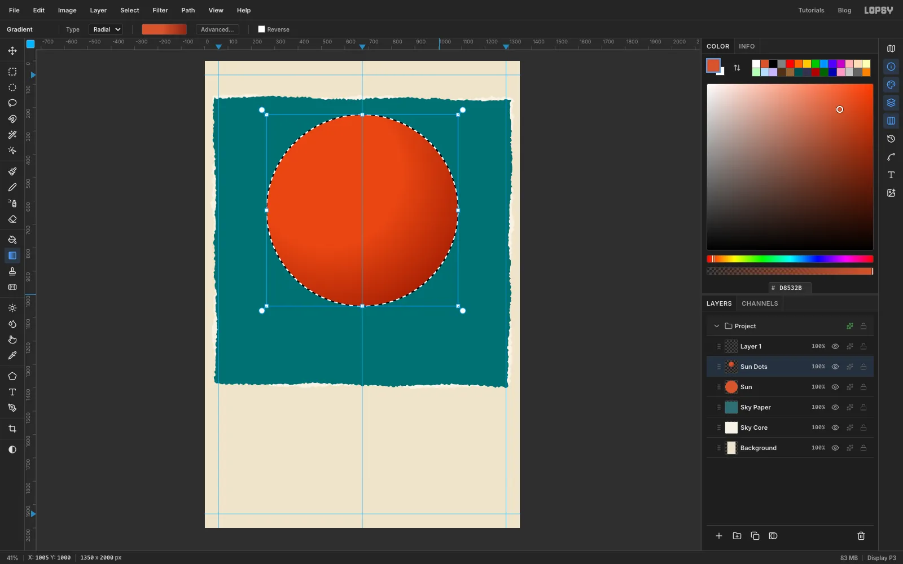

1. Add a layer named `Sun`.
2. Press [[M]] for the marquee, then pick the **Elliptical Marquee** from the toolbox. Drag from `265, 230` to `1085, 1050`. That square box makes a circle 820 px across, centred on the centre guide.
3. Set the foreground to `D8532B` and choose **Edit → Fill**.
4. Keep the selection and add a layer named `Sun Dots`.
5. Pick the **Gradient** tool (it has no shortcut) and set **Type** to **Radial**. Click **Advanced…**. Click the left stop and type `D8532B` in **Hex**. Click the right stop and type `8F2614`. Click the bar at about 45% to add a stop and type `D8532B` again. Click **Done**.
6. Drag from `525, 480`, up and left of the sun's centre, to `1005, 1000`, near its lower-right rim. The sun now darkens toward the lower right, like a ball lit from the upper left.

## Turn the shading into halftone dots

1. Press [[Cmd+D]], then choose **Filter → Halftone…**. Set **Dot Size** to `18`, **Angle** to `45` and **Softness** to `0.6`, leave **Density** at `1`, and click **Apply**.

Halftone draws each dot in its cell's own colour and sizes it by how dark the cell is. The centre colour matches the sun underneath, so those dots disappear. Only the darker rim prints, as a classic comic-book shading.

2. A few dots on the rim stick out past the circle. Cmd-click the `Sun` layer's thumbnail to select the disc. Choose **Select → Inverse**, click the `Sun Dots` row and press [[Delete]]. Press [[Cmd+D]].

## Drop in the grain-elevator photo

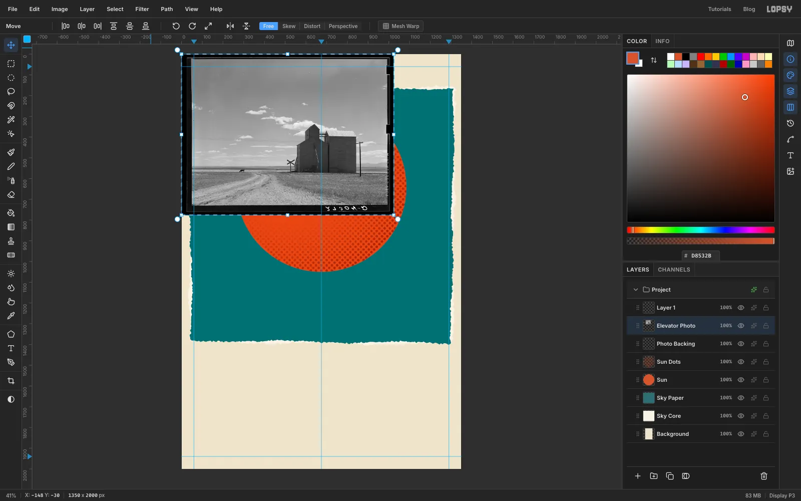

1. Click `Sun Dots` and add a layer named `Photo Backing`. Leave it empty for now. It will become the white paper the photo is glued to.
2. Drag the grain-elevator JPEG from your desktop onto the canvas. It lands in the top-left corner at its own size, selected, on a new layer above `Photo Backing`. Rename that layer `Elevator Photo`.
3. Press [[Enter]], then [[Cmd+D]].

## Scissor-cut the elevator and the land

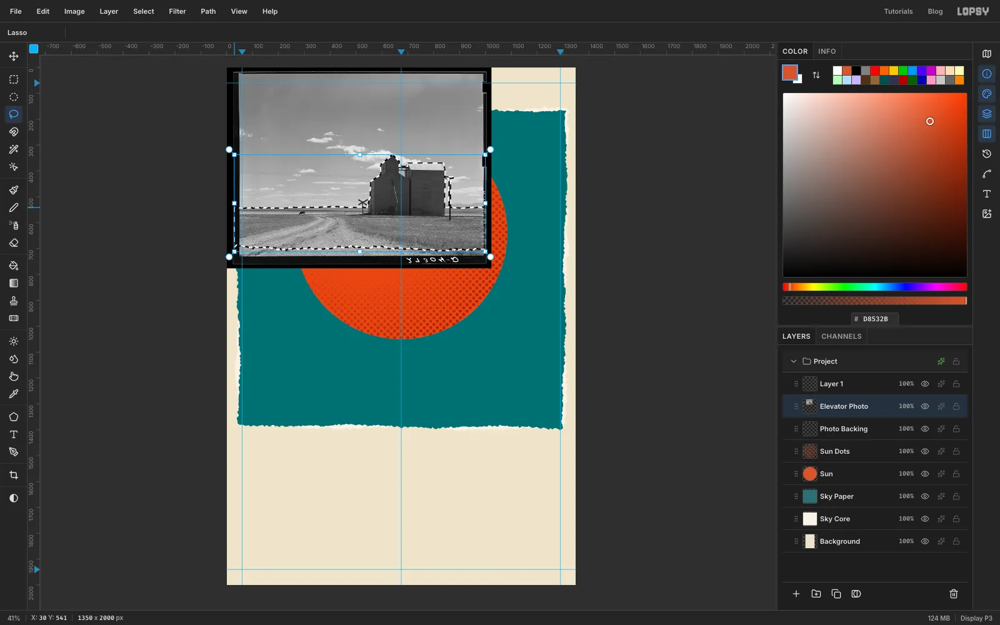

You'll keep the land below the horizon, the elevator and the telephone pole, and throw away the sky and the film border.

1. Press [[L]] for the **Lasso**. Start on the horizon at the photo's left edge, just inside the dark film border (about `30, 541`). Drag right along the horizon, letting it wobble a little.
2. At the elevator's left wall, go up and trace around the building with straight runs: up the low lean-to, along the roof slopes, over the peaked head-house, across the little bridge and along the big building's roof, then down its right wall to the horizon.
3. Trace up one side of the telephone pole, around its crossarm and down the other side. Then carry on along the horizon to the right edge of the photo (about `x 1000`).
4. Go down the right side to about `y 700` and tear a ragged line back to the left. Stay above the scratched lettering at the bottom of the film. Go up the left side to where you started.
5. Choose **Select → Inverse** and press [[Delete]]. Press [[Cmd+D]].

## Scale the photo and set it on the horizon

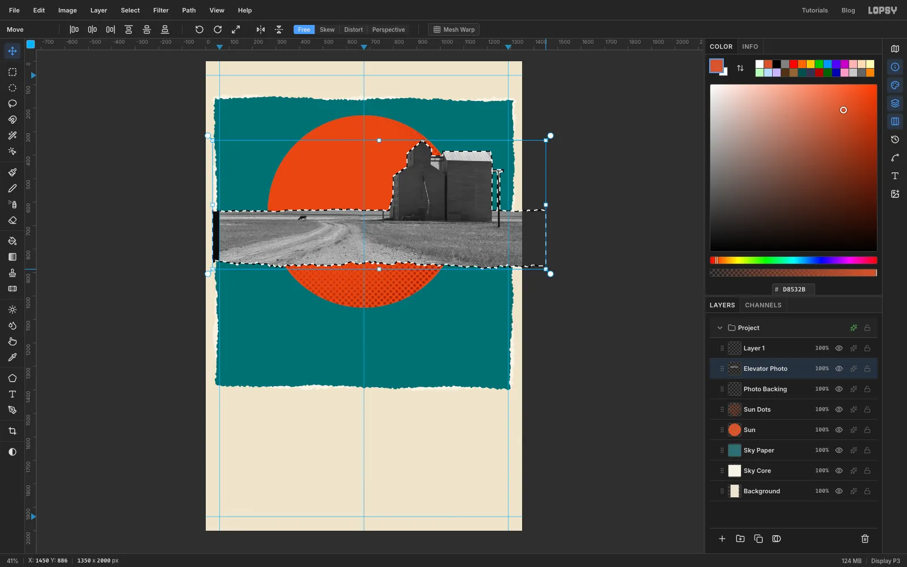

1. Cmd-click the `Elevator Photo` thumbnail. Press [[V]] for the **Move** tool, and handles appear around the cut-out.
2. Hold [[Cmd]] and drag the bottom-right handle down and to the right until the right edge of the cut-out reaches about `x 1450` on the top ruler. That makes it about 1420 px wide. Cmd keeps the proportions. Press [[Enter]], then [[Cmd+D]].
3. With nothing selected, drag the photo down and slightly left so the horizon sits at `y 1330` and the peak of the elevator's head-house is near `x 860`. The field overhangs both sides of the canvas, which is what you want. Use the arrow keys for the last few pixels.

## Back the photo with white paper

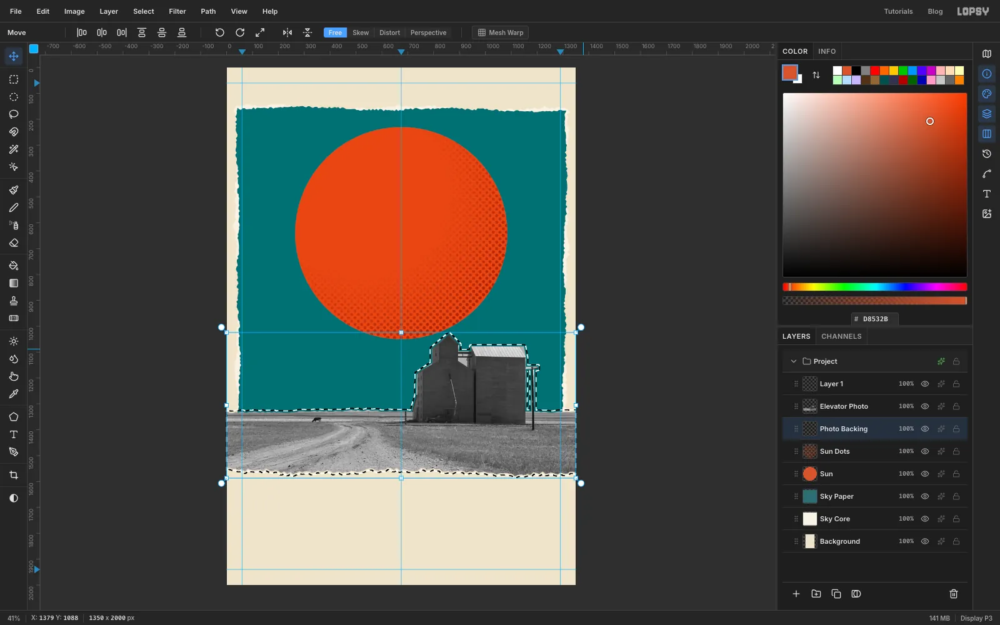

A clipped photo has a sliver of white paper around it. You'll make it on the empty layer below.

1. Cmd-click the `Elevator Photo` thumbnail, then click the `Photo Backing` row.
2. Choose **Select → Grow…**, enter `7` and click **Apply**.
3. Fill with `F8F3E6` and press [[Cmd+D]]. The elevator and the torn edges now have a white margin.

## Print the photo as newsprint

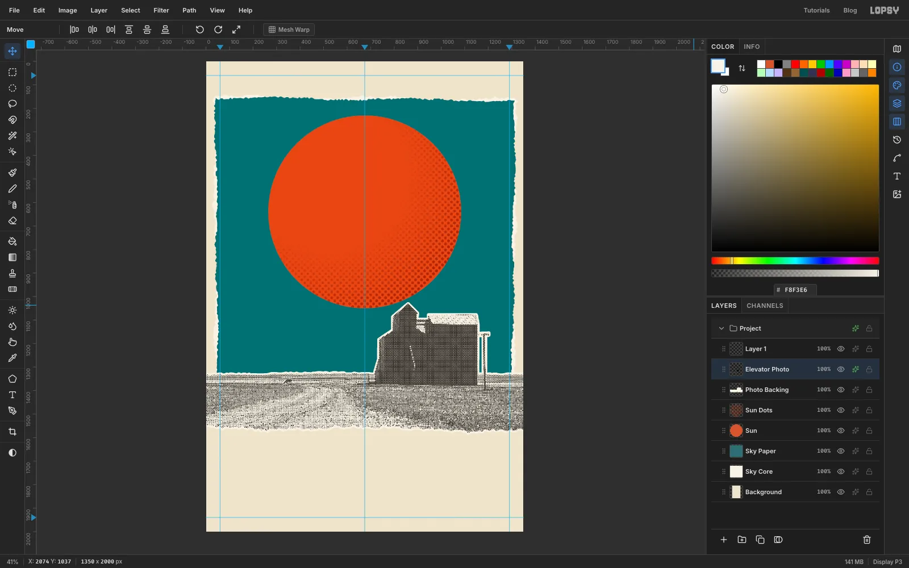

1. Click `Elevator Photo`. Choose **Filter → Brightness/Contrast…**, set **Brightness** to `-20` and **Contrast** to `32`, and click **Apply**. Darkening it keeps dots on the pale roofs.
2. Choose **Filter → Unsharp Mask…**, set **Radius** to `3` and **Amount** to `1.4`, and click **Apply**. This brings the siding and windows forward.
3. Choose **Filter → Halftone…**, set **Dot Size** to `5`, **Angle** to `45` and **Softness** to `0.4`, and click **Apply**.
4. The dots are still grey. Click the layer's effects button (the sparkle icon on its row), tick **Color Overlay** and set its colour to `1F1B17`. Every dot now prints in the same ink, like a real newspaper picture. Close the drawer.

## Tint the field mustard

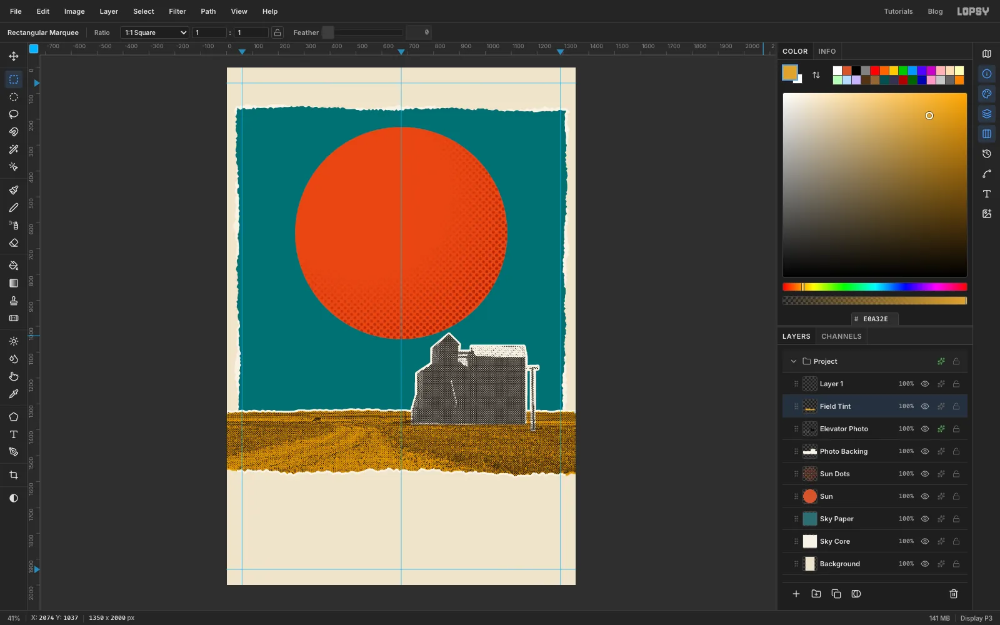

1. Add a layer named `Field Tint` above `Elevator Photo`.
2. You need the photo's outline, but the halftone has filled `Elevator Photo` with see-through gaps, so its thumbnail would only select dots. Use the backing instead: Cmd-click the `Photo Backing` thumbnail, choose **Select → Shrink…**, enter `7` and click **Apply**. That's the photo's own outline again, torn horizon included.
3. Press [[M]] for the **Rectangular Marquee**. Hold [[Alt]] and drag from above the top-left corner of the canvas across to the right edge, stopping just above the horizon (about `y 1318`). That takes away the elevator and the sky. The building's base and the foot of the pole still dip below the horizon, so Alt-drag a box over each, from just above the horizon down to where they meet the ground (about `y 1380` for the elevator and `1406` for the pole). The mustard now stops at the building.
4. Fill with `E0A32E`.
5. Shrink also pulls in from the canvas edges, so a 7 px strip of field is missing at each side. Drag a narrow marquee down the left edge of the field, from just below the horizon to below the torn bottom edge, starting off the canvas. Hold [[Shift]] and drag a matching one down the right edge, then choose **Edit → Fill** again.
6. Trim the spill: Cmd-click the `Photo Backing` thumbnail, choose **Select → Inverse**, click `Field Tint` and press [[Delete]]. Press [[Cmd+D]].
7. Open the effects drawer and set **Blend** to **Multiply**. The ink dots stay dark and the paper between them turns to wheat.

## Cut out the locust with the Magic Wand

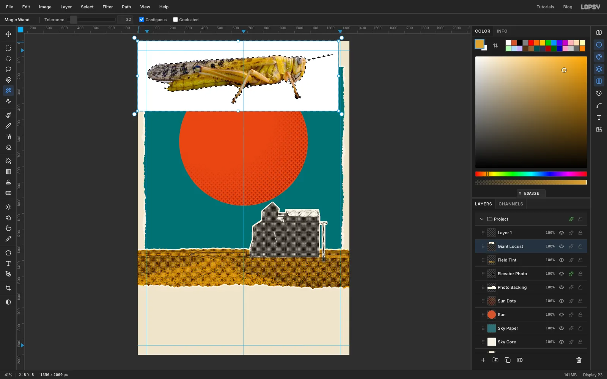

1. Click `Field Tint`, then drag the desert-locust JPEG onto the canvas. Rename the new layer `Giant Locust`, press [[Enter]], then [[Cmd+D]].
2. Press [[W]] for the **Magic Wand**. Set **Tolerance** to `22` and leave **Contiguous** on. Click the white background near the top-left corner of the photo.
3. Choose **Select → Grow…** and enter `1`. This takes the pale fringe along the edge with the background. Press [[Delete]] and [[Cmd+D]].
4. The tip of the abdomen, at the far left under the wing, has a notch that looks like a broken cut once the photo is enlarged. Lasso around the notch and the small lobe above it, so the line runs smoothly from the underside of the wing down to the pointed tip. Press [[Delete]], then [[Cmd+D]].

## Tilt the locust into a dive

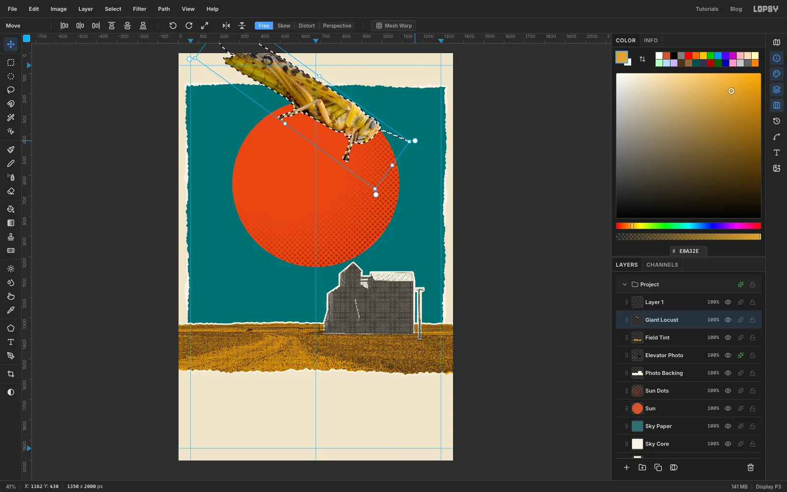

1. Cmd-click the `Giant Locust` thumbnail and press [[V]].
2. Hold [[Cmd]] and drag the bottom-right handle in a little, about 80 px to the left, to make it slightly smaller.
3. Move the pointer just outside the top-right corner until it turns into the rotate cursor. Drag clockwise until the locust is diving steeply, about 36°: its head points down to the right and the wing tip rises above the top of the canvas. Press [[Enter]].

The wing tip now sticks out above the top of the canvas. That's fine: Lopsy keeps pixels that go past the edge.

## Place the locust over the sun

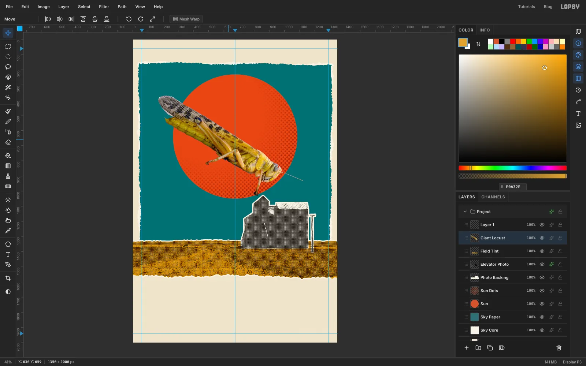

1. Press [[Cmd+D]] so that nothing is selected.
2. With the **Move** tool, drag the locust down until its body is centred on about `645, 700`. Its front foot should hang just above the elevator's head-house.

> **Tip:** Move it with nothing selected. A thumbnail selection only covers the part of the layer that's on the canvas, so dragging with one can leave the off-canvas wing tip behind.

## Make a grasshopper brush

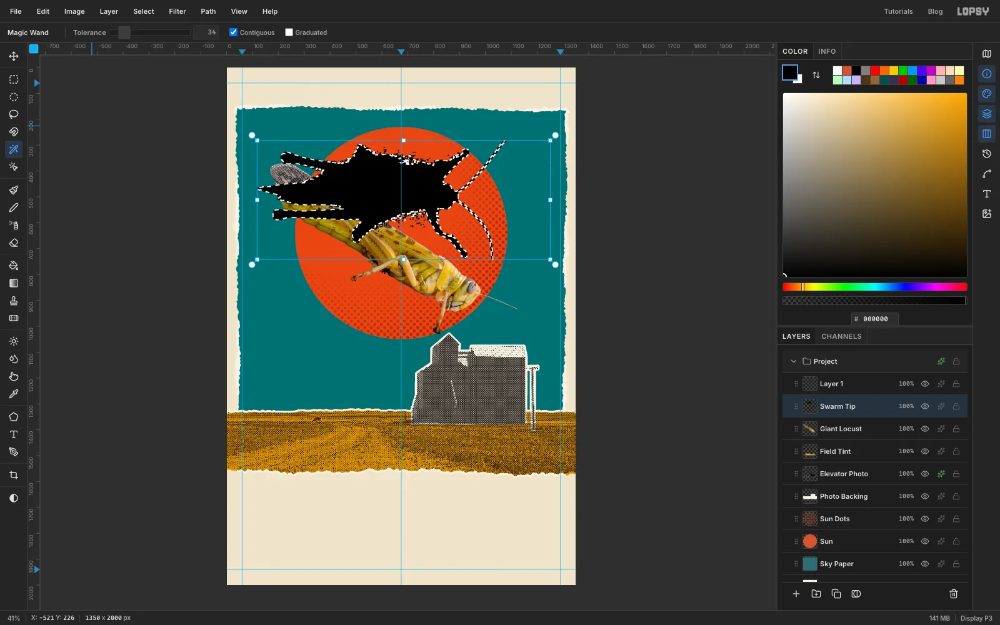

A swarm painted one silhouette at a time would take all day. Make the silhouette a brush tip instead.

1. With `Giant Locust` selected, drag the top-view grasshopper photo onto the canvas. Rename it `Swarm Tip`, press [[Enter]] and [[Cmd+D]].
2. Press [[W]], set **Tolerance** to `34`, click the white background near a corner and press [[Delete]]. Press [[Cmd+D]].
3. Cmd-click the `Swarm Tip` thumbnail, set the foreground to `000000` and choose **Edit → Fill**. **Define Brush** makes dark pixels solid and light ones see-through, so a black silhouette gives a solid tip.
4. Keep the selection and choose **Edit → Define Brush…**. Name it `Locust Swarm` and click OK. It becomes the active brush.
5. Press [[Cmd+D]], then click the trash icon at the bottom of the Layers panel to delete `Swarm Tip`. You only needed its shape.

## Set up the swarm brush

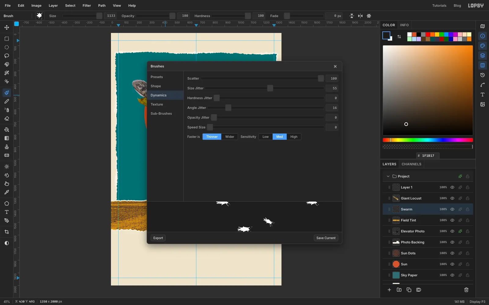

1. Click `Field Tint` and add a layer named `Swarm`. It sits under the locust, so the giant flies in front of its swarm.
2. Press [[B]] for the **Brush** and set the foreground to `1F1B17`.
3. Click the brush-tip thumbnail at the left of the options bar to open **Brushes**. On the **Shape** tab, set **Spacing** to `125` and click the **Angle** dial at about `14°`, just below its right-hand side. The insects now fly right and slightly down.
4. On the **Dynamics** tab, set **Scatter** to `100`, **Size Jitter** to `55` and **Angle Jitter** to `16`. Close the window.

Scatter throws each insect sideways off the stroke, Size Jitter varies their size, and Angle Jitter turns each one a little, so they don't all point the same way.

## Paint the swarm

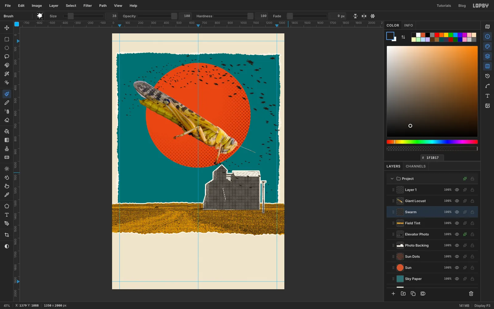

Paint from the distance toward the viewer. Use small sizes on the left and bigger ones as the swarm comes forward.

1. Start small and far away. At **Size** `22`, drag three or four gentle arcs from the left edge of the sky (around `y 400`–`640`) up toward the top of the sun.
2. Make each next stroke a little bigger and further right: about `26`, `30`, `38`, `46`, then around `60` as the swarm crosses the top of the sun toward the upper-right corner. Overlap the strokes so the river looks thick in the middle and thin at its edges.
3. Add one stroke at **Size** `88` near the top-right corner. These are the insects closest to the viewer.
4. Bring the swarm down onto its target. At **Size** about `50`, drag two strokes down the right side of the sky, curving in toward the elevator's roof. Finish with two short strokes at about `36` along the roofline and across the elevator's wall.
5. Choose **Filter → Gaussian Blur…**, set **Radius** to `1` and click **Apply**. This softens the stamped edges a touch, like printed ink.

## Tear the LOCUST strip and set the word

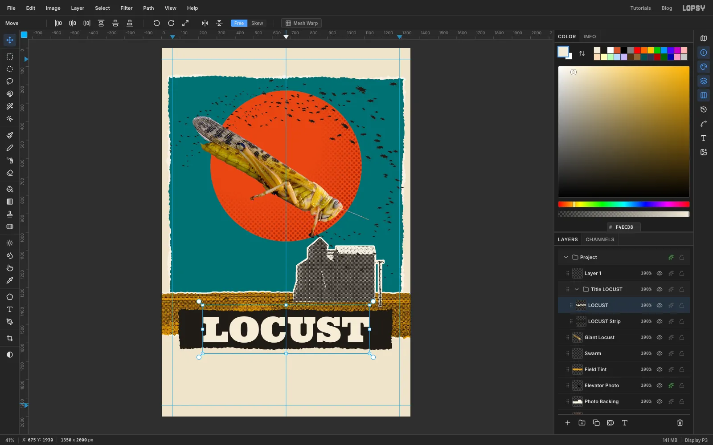

Each title word gets its own torn strip, and each strip and word share a group so they can be turned together.

1. Click `Giant Locust`, then click **New Group** at the bottom of the Layers panel. Name the group `Title LOCUST`.
2. With the group selected, add a layer named `LOCUST Strip`. It goes inside the group.
3. Lasso a torn strip from about `96, 1422` to `1254, 1632`. Make the long sides gently ragged and the ends more torn. Fill it with `1F1B17` and press [[Cmd+D]].
4. Press [[T]] for the **Text** tool. In the options bar, choose **Ultra**, set **Size** to `188` and **Align** to **Center**, and set the foreground to `F4ECD8`.
5. Click an empty spot of sky that has no other text on it, such as `675, 1300`, and type `LOCUST`. Press [[Tab]] to finish, then double-click the new layer's name and call it `LOCUST`.
6. Press [[V]] and drag the word down onto the strip. Then use the arrow keys ([[Shift]] moves 10 px) to centre it. Leave the same gap on the left and right (about 130 px) and on the top and bottom (about 40 px).

## Rotate the strip and word together

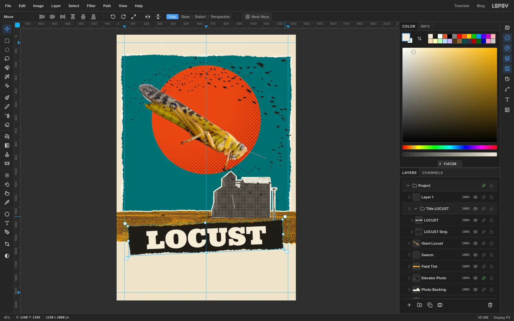

1. Click the `Title LOCUST` group row and press [[V]]. Handles appear around everything in the group.
2. Drag from just outside the top-right corner a short way upward, counterclockwise, until the strip's right end sits about 50 px higher than its left end (about 2.5°). Check the heights in the status bar. Press [[Enter]].

The word is still live text. You can double-click to retype it and it stays tilted with its strip.

## Add the ARMADA strip

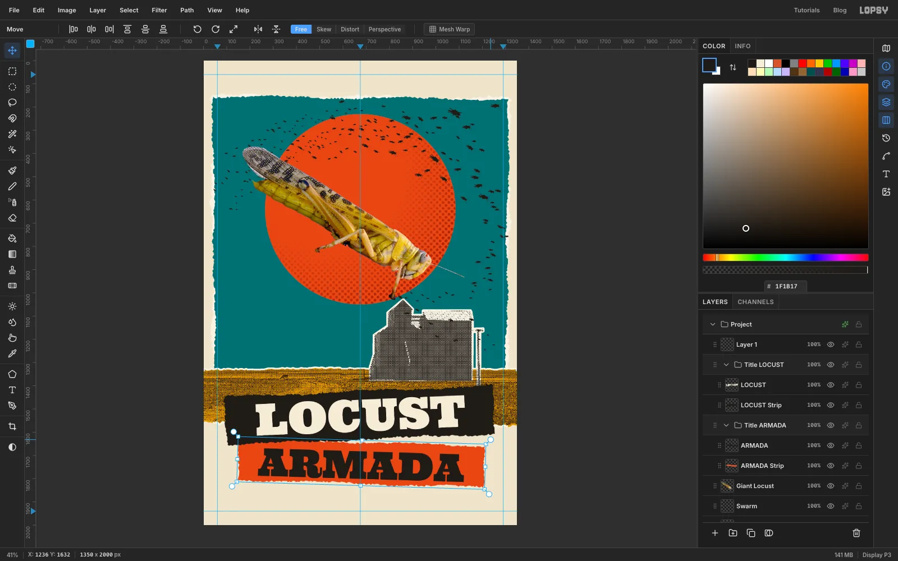

1. Click `Giant Locust` again and click **New Group**. Name it `Title ARMADA`. It sits below the LOCUST group, so the black strip overlaps the red one.
2. Add a layer named `ARMADA Strip`. Lasso a torn strip from `146, 1642` to `1210, 1822`, fill it with `D8532B` and press [[Cmd+D]].
3. Make a text layer with **Ultra** at **Size** `165` in `1F1B17`, starting on the empty sky again, type `ARMADA` and name the layer `ARMADA`.
4. Drag it onto the strip and centre it, then nudge it about 10 px lower. The black strip covers the top of the red one, so the word needs to sit lower to look centred in the red that shows.
5. Select the `Title ARMADA` group and rotate it clockwise, the opposite way to LOCUST, until the right end sits about 35 px lower than the left (about 1.8°). Press [[Enter]].

## Set the top line and billing block

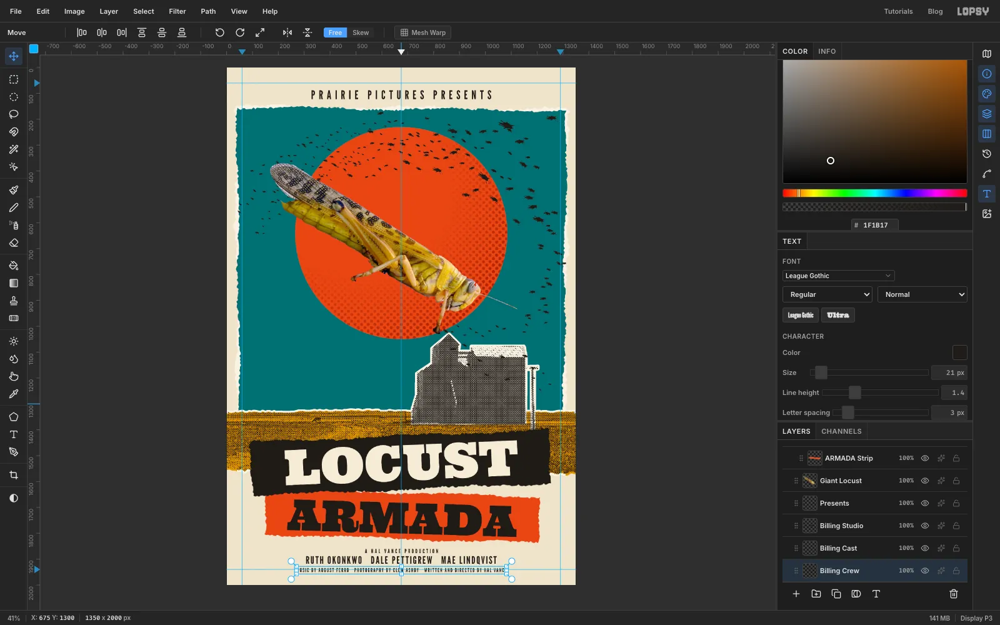

Make each line of type by clicking `Swarm` first and then clicking an empty spot of sky with the **Text** tool. That way every text layer stacks above `Swarm` and none of them ends up inside a title group. Use **League Gothic**, set **Align** to **Center** and the colour to `1F1B17` for all of them. After each one, name the layer (`Presents`, `Billing Studio`, `Billing Cast`, `Billing Crew`), then press [[V]] and drag it into place so its centre is on the centre guide at `x 675`.

1. `PRAIRIE PICTURES PRESENTS` at **Size** `46`. In the **Text** panel, set **Letter spacing** to `14`. Centre it at `y 104`, halfway between the top guide and the sky sheet.
2. `A HAL VANCE PRODUCTION` at **Size** `22`, letter spacing `6`, centred at `y 1868`.
3. `RUTH OKONKWO   DALE PETTIGREW   MAE LINDQVIST` (three spaces between names) at **Size** `40`, letter spacing `4`, centred at `y 1903`. The stars get the biggest line in the billing block.
4. `MUSIC BY AUGUST FERRO   PHOTOGRAPHY BY CLEM ASHBY   WRITTEN AND DIRECTED BY HAL VANCE` at **Size** `21`, letter spacing `3`, centred at `y 1941`.

## Type the tagline on label strips

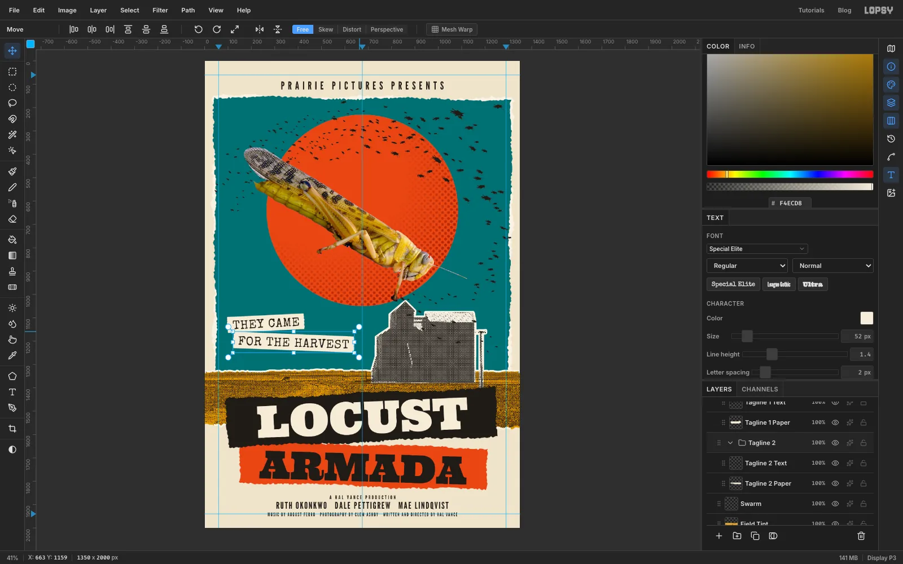

1. Click `Swarm`, click **New Group** and name it `Tagline 1`. Add a layer named `Tagline 1 Paper` inside it.
2. With `Tagline 1 Paper` still selected, make a text layer in **Special Elite** at **Size** `52`, colour `1F1B17`, **Letter spacing** `2`. Click an empty spot such as `262, 1300`, type `THEY CAME`, press [[Tab]] and name the layer `Tagline 1 Text`. Then move it so it's centred on `262, 1122`.
3. Click `Tagline 1 Paper` and lasso a strip that leaves about 22 px either side of the words and 16 px above and below. Keep the long edges straight and tear the short ends. Fill it with `F4ECD8` and press [[Cmd+D]].
4. Select the `Tagline 1` group and rotate it about 3° counterclockwise. Press [[Enter]].
5. Repeat for `FOR THE HARVEST`, in a group named `Tagline 2`, centred on `380, 1204` and rotated about 2° clockwise.

## Stick down masking tape

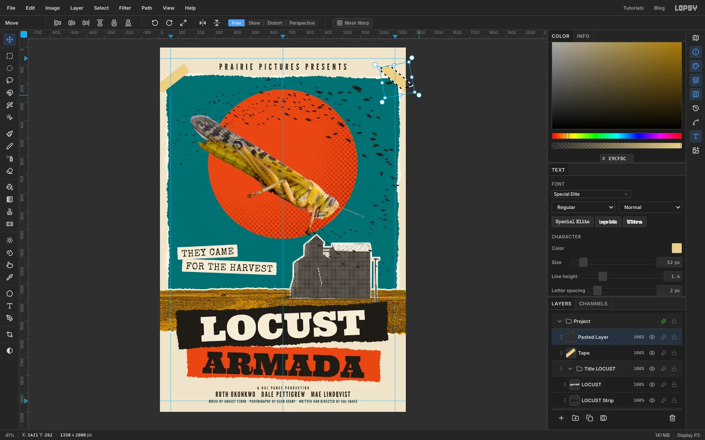

Draw one piece of tape, then copy and paste it for the rest.

1. Double-click the empty `Layer 1` at the top of the stack and rename it `Tape`.
2. Lasso a strip about 200 × 54 px across the sky sheet's top-left corner, tilted about 38° counterclockwise. Keep the long sides straight and give the short ends small zigzags, like tape torn off a roll. Fill it with `E9CF8C`.
3. Press [[Cmd+C]], then [[Cmd+V]]. The copy is pasted in place on a new layer, selected, with the **Move** tool ready. Drag it from its middle (dragging an edge would scale it) to the sky sheet's top-right corner. Drag just outside a corner to turn it until it leans the other way, mirroring the first piece. Press [[Enter]], then choose **Layer → Merge Down**.
4. Paste three more the same way: over the left end of the LOCUST strip, nearly upright; over the right end of the ARMADA strip; and over the left end of the THEY CAME label, clear of the T. Merge each one down.
5. Press [[Cmd+D]]. Choose **Filter → Add Noise…**, set **Amount** to `8`, click **Mono** and click **Apply**. Set the layer's opacity to `78%`. Click the `100%` on its row to get the slider.

## Lift the paper with shadows and a scissor edge

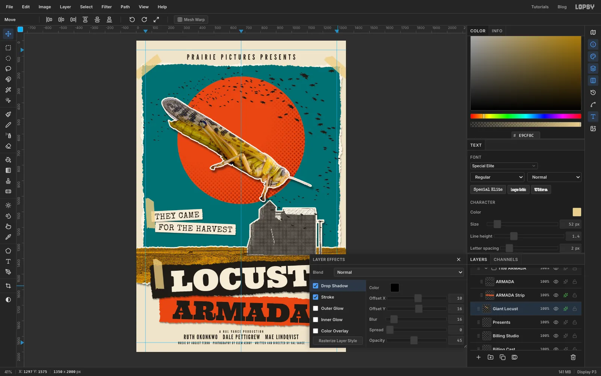

Pasted-down paper casts a small shadow. Keep every shadow falling down and to the right, so the light comes from one place.

1. Open the effects drawer for each layer below, tick **Drop Shadow**, and set **Offset X**, **Offset Y**, **Blur** and **Opacity**:
   - `Sky Core`: `3`, `6`, `10`, `30`
   - `Photo Backing`: `6`, `10`, `12`, `45`
   - `LOCUST Strip` and `ARMADA Strip`: `4`, `7`, `8`, `40`
   - `Tagline 1 Paper` and `Tagline 2 Paper`: `3`, `5`, `6`, `35`
2. For `Giant Locust`, tick **Stroke**. Set **Width** to `7`, the colour to `F8F3E6` and the position to **Outside**. That's the white margin scissors leave.
3. Still on `Giant Locust`, tick **Drop Shadow** with `10`, `16`, `16`, `45`. The giant is the closest piece of paper, so it gets the biggest lift.

Add effects last. Painting and filtering are slower on layers that already carry effects.

## Add newsprint grain

1. Click `Tape` and add a layer named `Paper Grain`.
2. Press [[Cmd+A]], fill with `808080` and press [[Cmd+D]].
3. Choose **Filter → Add Noise…**, set **Amount** to `40`, click **Mono** and **Gaussian**, and click **Apply**. Then choose **Filter → Emboss…**, set **Strength** to `30` and click **Apply**.
4. Set the layer to **Overlay** at `70%`. Mid-grey disappears in Overlay, so only the tiny embossed bumps show, on every colour at once.

## Fold the poster

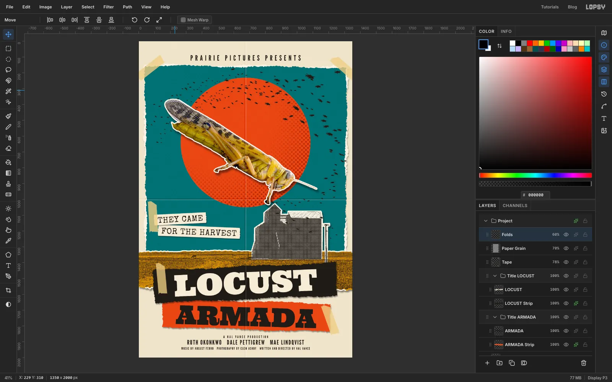

Posters were mailed folded, so give it two creases.

1. Add a layer named `Folds`.
2. Press [[N]] for the **Pencil** and set **Size** to `4`. Set the foreground to `FFFFFF`. Click at `677, 2`, then hold [[Shift]] and click at `677, 1998`. Draw a horizontal line the same way along `y 1003`.
3. Set the foreground to `2A2A2A` and draw a second pair of lines 5 px away, at `x 672` and `y 998`.
4. Choose **Filter → Gaussian Blur…**, type `2.5` into **Radius** and click **Apply**. Set the layer to **Soft Light** at `60%`.
5. Press [[Cmd+;]] to hide the guides so you can see the creases.

Each crease is now a soft highlight beside a soft shadow, like a real fold.

Choose **File → Quick Export PNG** to save the poster and **File → Save Project** to keep the layers. Credit the three photographers if you share it.
