A spice shop sells things that are old, faraway and a bit romantic: seeds that people once sailed round the world for. A cut-paper collage carries that story better than a clean layout does. In this tutorial you'll make the grand-opening flier for **Nutmeg & Ginger**, an invented neighbourhood spice shop, on a 1200 × 1600 px page (letter-shaped, ready to print or post).

The collage is built from a few kinds of material:

- a torn scrap of a 1630 map of the Spice Islands, stained with tea
- the shop name on torn paper strips, set in two different poster typefaces
- a turmeric-yellow paper disc with two botanical prints cut out of their plates
- photo cut-outs of a cinnamon stick and a star anise
- a luggage tag on red twine for the event details, and a handwritten note for the offer
- masking tape, a black embossed label, paper grain and a warm colour grade

You'll need four images from Wikimedia Commons:

- [Blaeu - Moluccae Insulae Celeberrimae.jpg](https://commons.wikimedia.org/wiki/File:Blaeu_-_Moluccae_Insulae_Celeberrimae.jpg), Willem Blaeu's map of the Moluccas, about 1630. Public domain. Download the original (1400 × 1072 px).
- [Köhler Myristica.jpg](https://commons.wikimedia.org/wiki/File:K%C3%B6hler_Myristica.jpg), the nutmeg plate from *Köhler's Medizinal-Pflanzen* (1887). Public domain. Download the 1920 px-wide version.
- [Zingiber officinale - Köhler–s Medizinal-Pflanzen-146.jpg](https://commons.wikimedia.org/wiki/File:Zingiber_officinale_-_K%C3%B6hler%E2%80%93s_Medizinal-Pflanzen-146.jpg), the ginger plate from the same book. Public domain. Download the 1920 px-wide version.
- [Gewuerze 004 2024 08 10.jpg](https://commons.wikimedia.org/wiki/File:Gewuerze_004_2024_08_10.jpg), cinnamon, star anise and cloves on white, by Friedrich Haag, licensed [CC BY-SA 4.0](https://creativecommons.org/licenses/by-sa/4.0/). Download the 1920 px-wide version. The screenshots and the project file that show this photo share that license.

Along the way you'll use:

- ruler **guides**, the **grid** with **Snap**, **Add Noise**, **Clouds** and **Fibers** for the paper
- the **Lasso** for every torn edge and cut-out, with [[Shift]] to add and [[Alt]] to subtract
- dropping in photos, the **Magic Wand**, **Grow**, **Shrink** and **Select → Inverse**
- **Cut** and **Paste** to lift pieces onto their own layers, and the **Eraser** for clean-up
- scaling, rotating and flipping with the **Move** tool's handles, on layers and on whole groups
- live text in **Abril Fatface**, **Alfa Slab One**, **Staatliches**, **Special Elite** and **Caveat**, including centred area text
- **Hue/Saturation** to quieten the map
- the **Drop Shadow** and **Color Overlay** effects, **Multiply**, **Soft Light** and **Overlay** blend modes, and the **Pencil** and **Brush**
- the document's **Color Grading** and **Vignette** adjustments

The palette:

- Kraft paper `#B48A5C`, torn-edge white `#FBF6EA`
- Paprika `#A33A26`, cardamom `#3D5A3A`, turmeric `#D69A3A`
- Cream paper and type `#F3E8CF`, note paper `#F3EAD6`
- Clove ink `#231A18`, Dymo tape `#18181A`
- Masking tape `#E6D8A6`, tea stain `#C8955A`, twine `#A93226`
- Dymo letters `#EFEEE6` / `#D9D7CD`, eyelet brass `#C9A56E`, note rule `#9DB4C8`

> **Note:** Shortcuts are written for a Mac. On Windows use [[Ctrl]] wherever it says [[Cmd]].

Positions are given in document pixels as `x, y` where things need to line up. The status bar at the bottom of the window shows the pointer's **X** and **Y**. Torn edges and cut-outs only need to be roughly right.

I renamed layers as I went (double-click a name), so the screenshots show names like `Tag Headline` and `Note Words`. Yours can keep the names Lopsy gives them.

Four habits will save you trouble:

- **A single layer has no transform handles until something is selected.** To scale, rotate or flip one layer, first [[Cmd]]-click its thumbnail in the Layers panel to select its pixels, then use the **Move** tool's handles. Hold [[Cmd]] while you drag a corner handle to keep the proportions. A whole group shows handles without a selection. Press [[Esc]] to finish a transform: it keeps the change, it doesn't cancel it.
- **Collapse each group when you finish it.** A new layer or group goes *inside* a selected group that's open, and *above* one that's collapsed.
- **Click a raster layer before you set up new text.** If a text layer is still selected, changing the font, size or colour restyles *that* layer. New text also borrows the last text layer's settings, so set the font, size, colour *and* letter spacing every time, even when you want `0`.
- **Start new text in an empty patch of canvas**, then move it into place. A click on existing text edits that text.

## Lay down the kraft paper

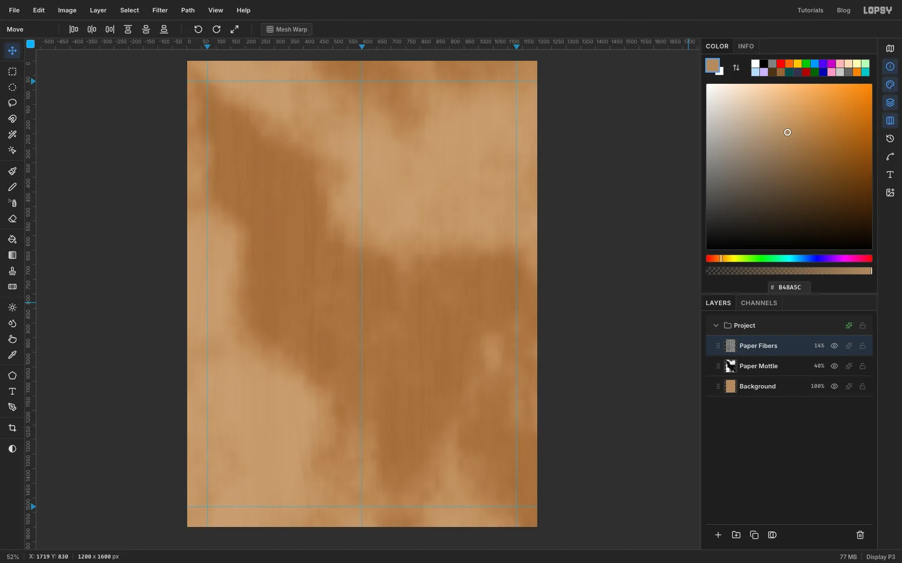

1. Choose **File → New** and make a **1200 × 1600** px document.
2. Click the top ruler at `x 70`, `600` and `1130` to drop three vertical guides, and the left ruler at `y 70` and `1530` for two horizontal ones. They mark a margin and the centre line.
3. Click **Background**, set the foreground to `#B48A5C` and choose **Edit → Fill**. Choose **Filter → Add Noise…** with **Amount** `7`, **Mono** and **Gaussian**.
4. Double-click **Layer 1** and rename it `Paper Mottle`. Choose **Filter → Clouds…** with **Scale** `4`. Open the effects drawer (the ✦ button on the layer's row), set the blend mode to **Soft Light** and close the drawer. Click the opacity figure on the row and set it to `40%`.
5. Click **Add Layer**, name it `Paper Fibers`, choose **Filter → Fibers…** and click **Apply**. Set it to **Soft Light** at `14%`.

## Drop in the map

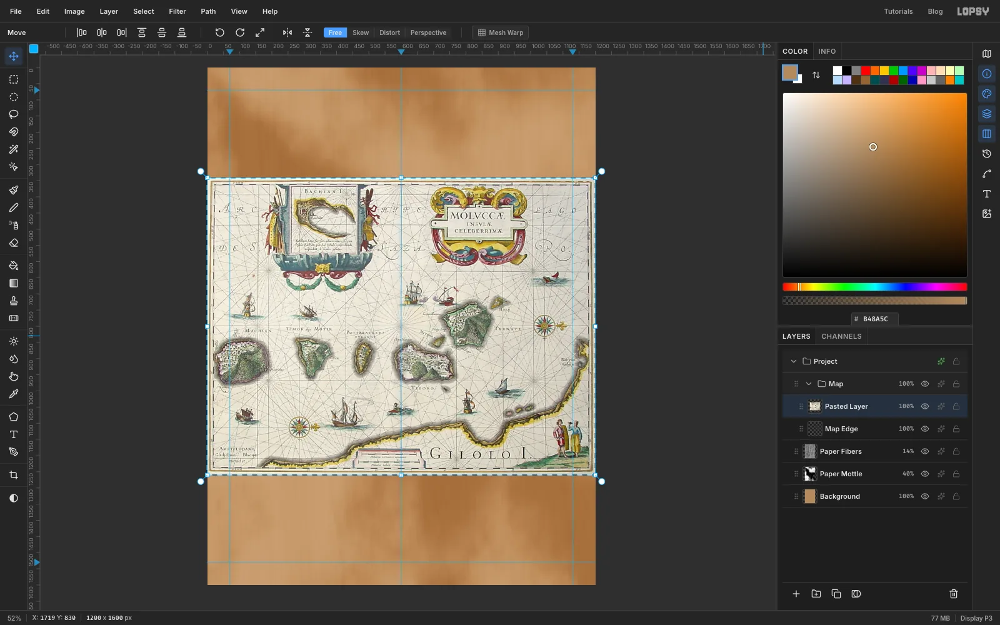

1. Click **New Group** at the bottom of the Layers panel and name it `Map`. Click **Add Layer** (it goes inside the group) and name it `Map Edge`. It stays empty for now.
2. Drag the Blaeu map file from your desktop onto the canvas. Lopsy shrinks it to fit the page width and puts it on a new layer above `Map Edge`. Rename it `Blaeu Map`.
3. Press [[Cmd+D]], pick the **Move** tool and drag the map straight up by about 300 px, so the two cartouches sit just under the top of the page.

## Tear it out

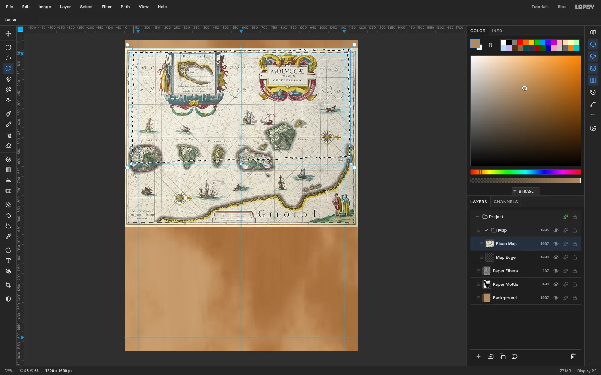

1. Pick the **Lasso**. Draw a torn rectangle just inside the map's left, top and right edges, coming back across a little below the middle (around `y 600`), with the right side a touch higher than the left. Wiggle the pointer a few pixels in and out as you go. Small, irregular steps look torn.
2. Choose **Select → Inverse** and press [[Delete]], then [[Cmd+D]].
3. Choose **Filter → Hue/Saturation…** and set **Saturation** to `-40` and **Lightness** to `4`. That softens the hand-colouring so the map sits back behind the type.

## Give it a torn white edge, a tea stain and a tilt

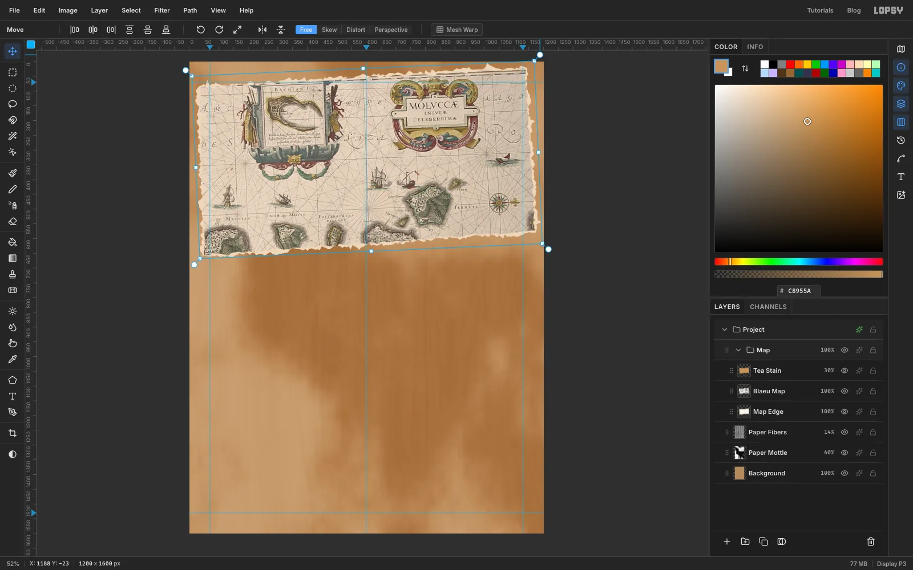

Real torn paper shows a white core along the rip. You'll fake that with a slightly bigger white shape underneath.

1. Click `Map Edge`. Set the foreground to `#FBF6EA`. Lasso the same torn rectangle again, about 7 px further out all round and a little rougher, then **Edit → Fill** and [[Cmd+D]]. The white peeks out unevenly around the map.
2. Click `Blaeu Map` and **Add Layer**. Name it `Tea Stain`. [[Cmd]]-click the `Map Edge` thumbnail to select the whole scrap, fill it with `#C8955A` and deselect. Set it to **Multiply** at `30%`. The map's cool greys warm up to match the kraft.
3. Click the `Map` group row and pick the **Move** tool. Handles appear around the whole scrap. Drag the round rotation handle at the top-right corner a little upward to tilt the scrap about `2.5°` anticlockwise, then press [[Esc]].
4. Click the arrow on the `Map` row to collapse the group.

## Cut a turmeric paper disc

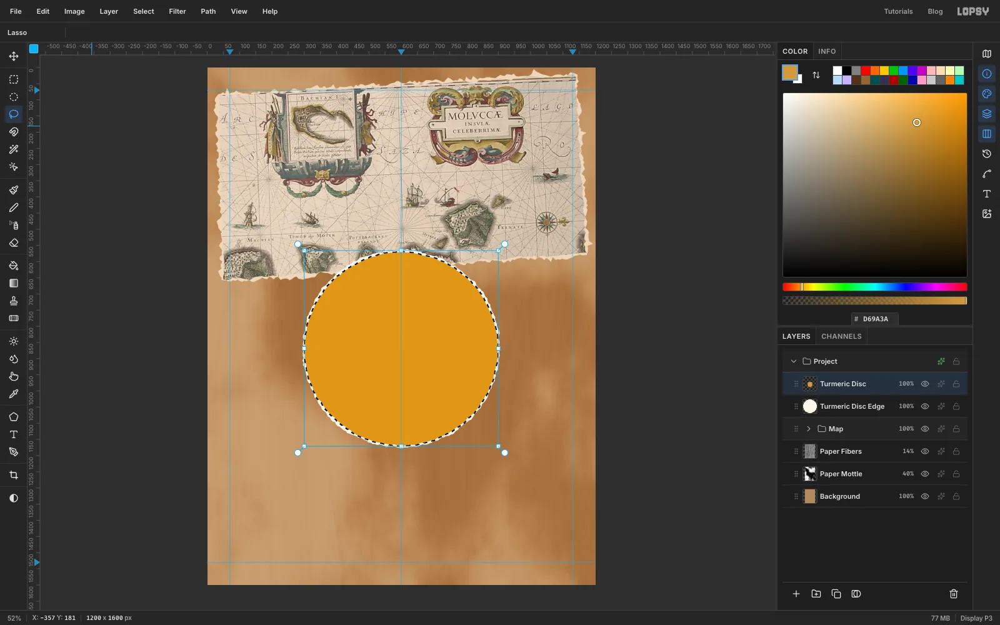

1. With the collapsed `Map` group selected, click **Add Layer** and name it `Turmeric Disc Edge`. It goes in above the group, not inside it.
2. With the **Lasso**, draw a rough circle about 610 px across, centred on `600, 870`. It overlaps the bottom of the map a little. Fill it with `#FBF6EA` and deselect.
3. **Add Layer**, name it `Turmeric Disc`, and draw a slightly smaller, smoother circle (about 600 px) on the same centre. Fill it with `#D69A3A`. While it's still selected, choose **Filter → Add Noise…** with **Amount** `14`, **Mono** and **Gaussian**, then deselect.
4. Click `Turmeric Disc Edge`, open the effects drawer and turn on **Drop Shadow**: **Offset X** `6`, **Offset Y** `10`, **Blur** `14`, **Opacity** `45`.

The shadow goes on the lowest layer of the disc, so it falls under the white rim as well.

## Drop in the nutmeg plate and wand out the white

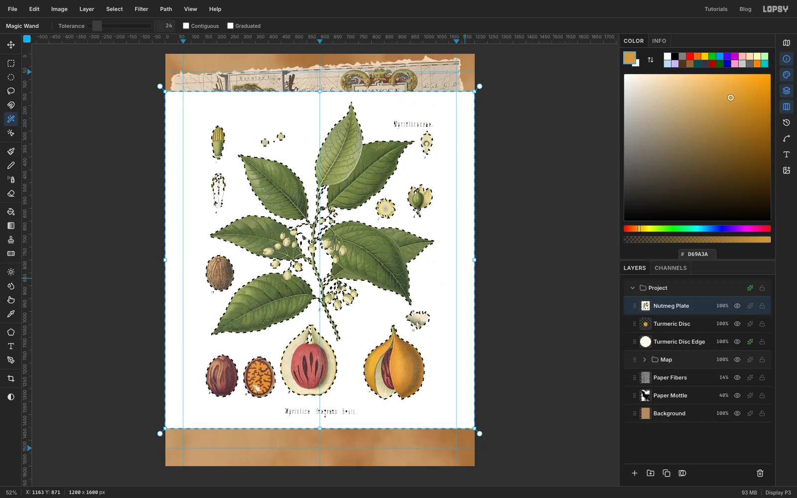

1. Click `Turmeric Disc`, then drag the nutmeg plate onto the canvas. Rename the new layer `Nutmeg Plate`.
2. Pick the **Magic Wand**. Set **Tolerance** to `24` and untick **Contiguous**, so one click catches every patch of white, including the gaps between the leaves. Click the white near the top-left corner.
3. Choose **Select → Grow…**, enter `1` and click **Apply**. The extra pixel eats the pale fringe the JPEG leaves around every edge.
4. Press [[Delete]] and [[Cmd+D]]. Everything on the plate is now a cut-out on transparency.

## Lift the fruit studies onto their own layers

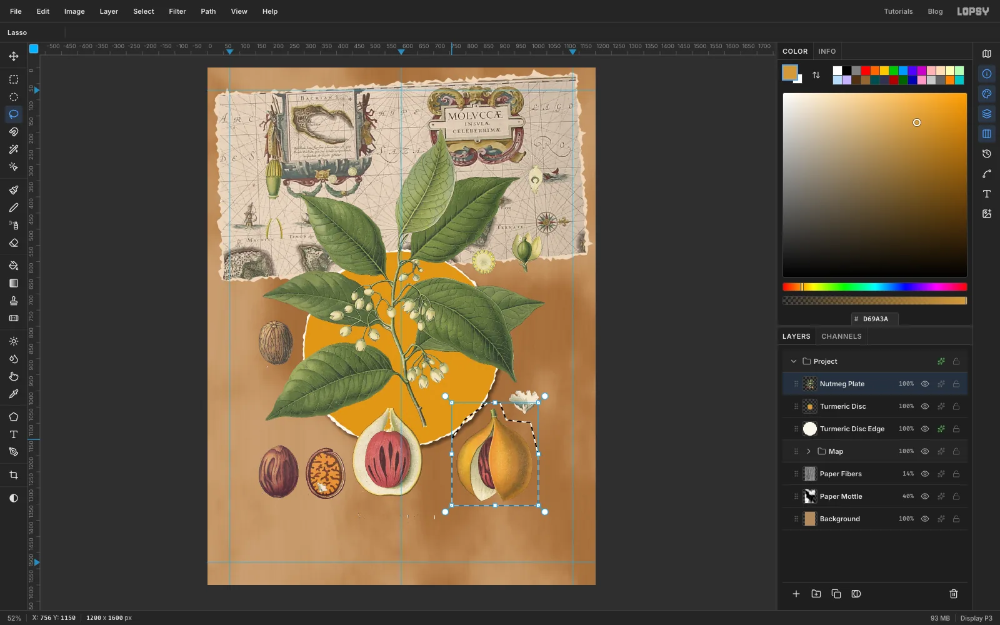

Three of the fruit studies around the bottom of the plate become separate pieces for later.

1. With the **Lasso**, draw loosely around the opened yellow fruit at the bottom right. Keep the little white crinkled diagram above it outside your line. Press [[Cmd+X]], then [[Cmd+V]]. The fruit pastes back in exactly the same place on its own layer. Rename it `Nutmeg Fruit`.
2. Pick the **Eraser**, set its **Size** to `22`, and click once on the small plate number `7` printed beside the fruit.
3. Click `Nutmeg Plate` again. Lasso the halved fruit with the red mace (bottom centre). Keep your line below the end of the branch's stem, which comes down just above it. Cut, paste, rename it `Mace Half`, and erase its number `8`.
4. Click `Nutmeg Plate`. With the **Elliptical Marquee**, drag an oval around the pale, veined whole nutmeg halfway up the left side (not the darker ones at the bottom). Cut, paste, rename it `Whole Nutmeg`, and erase the `10` under it.
5. Click the eye on each of the three new layers to hide them for now. They come back near the end.

## Cut out the branch

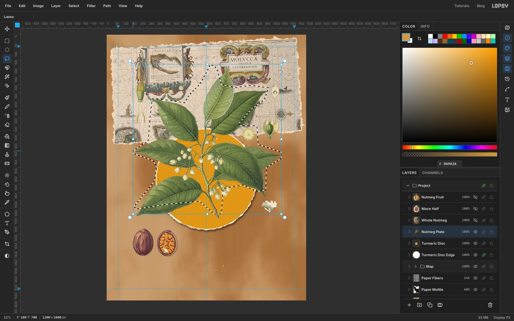

1. Click `Nutmeg Plate`. With the **Lasso**, draw around the branch: out round each leaf tip, in close to the stem, and around (not through) the little numbered diagrams and the plate's title. You don't need to hug the leaves. The background is already transparent, so a loose line is fine.
2. Choose **Select → Inverse** and press [[Delete]]. The diagrams, labels and title disappear.
3. One diagram, the round pollen disc on the right, sits so close to a leaf that the Lasso can't get between them. Drag an **Elliptical Marquee** over just the disc and press [[Delete]].
4. Deselect and rename the layer `Nutmeg Branch`.

## Scale the branch onto the disc

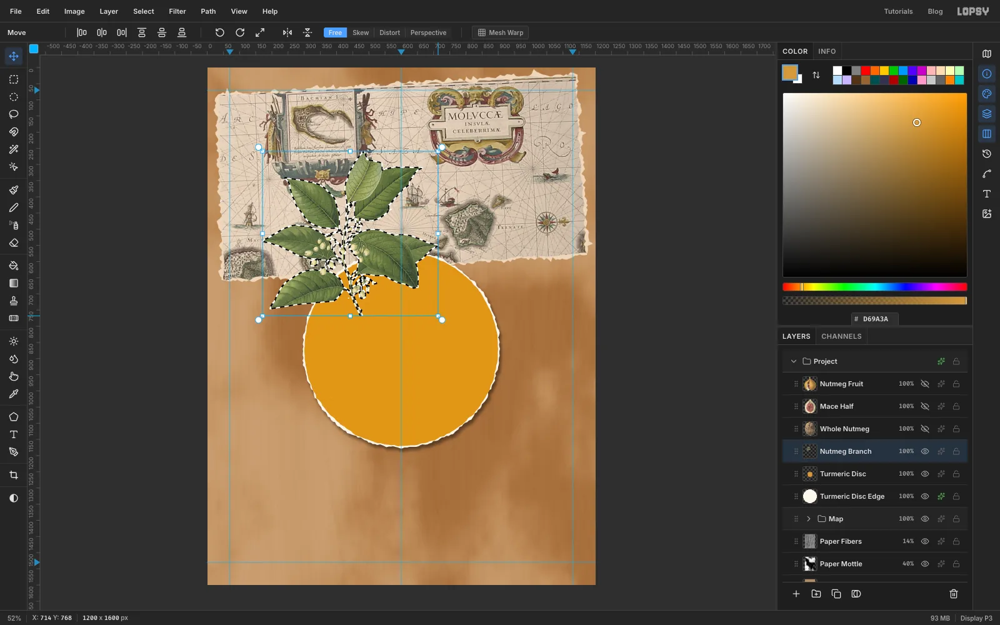

1. [[Cmd]]-click the `Nutmeg Branch` thumbnail and pick the **Move** tool.
2. Hold [[Cmd]] and drag the bottom-right handle in towards the top-left until the branch is about 62% of its size (roughly 550 px across). Press [[Esc]].
3. Drag the branch so it's centred on about `400, 850`, over the left half of the disc. Its top leaves tuck up towards the map.
4. Deselect, open the effects drawer and add a **Drop Shadow**: **Offset X** `5`, **Offset Y** `8`, **Blur** `10`, **Opacity** `40`.

## Cut out the ginger plant

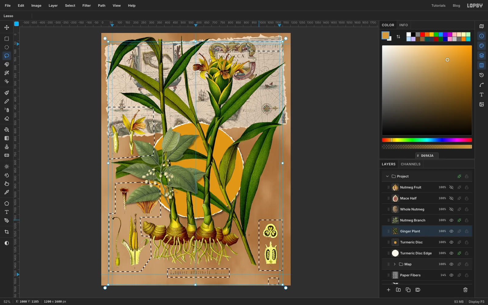

1. Click `Turmeric Disc` (so the ginger goes behind the branch) and drop in the ginger plate. Rename it `Ginger Plant`.
2. Wand out the white exactly as before: **Tolerance** `24`, **Contiguous** off, click the white, **Grow** `1`, [[Delete]], [[Cmd+D]].
3. This plate's diagrams are scattered around the plant, so loop each one instead of tracing the plant. With the **Lasso**, draw a loose loop around the three flower diagrams at the left. Then hold [[Shift]] and loop each of the other groups: the petal and stamen diagrams lower down on the left, the two seed sections at the bottom right, the caption under the roots, the page number and the plate title at the top right. [[Shift]] adds each loop to the selection.
4. Press [[Delete]] and [[Cmd+D]].

## Scale and turn the ginger

1. [[Cmd]]-click the `Ginger Plant` thumbnail. With the **Move** tool, [[Cmd]]-drag the bottom-right handle until the plant is about 40% of its size, then press [[Esc]].
2. Drag it so it stands to the right of the nutmeg branch, centred on about `910, 900`. The two plants should only just meet, not tangle.
3. [[Cmd]]-click the thumbnail again and drag the top-right rotation handle down a little to lean the plant about `6°` clockwise. Press [[Esc]].
4. Add a **Drop Shadow** like the branch's, with **Opacity** `35`.

## Trim the root hairs

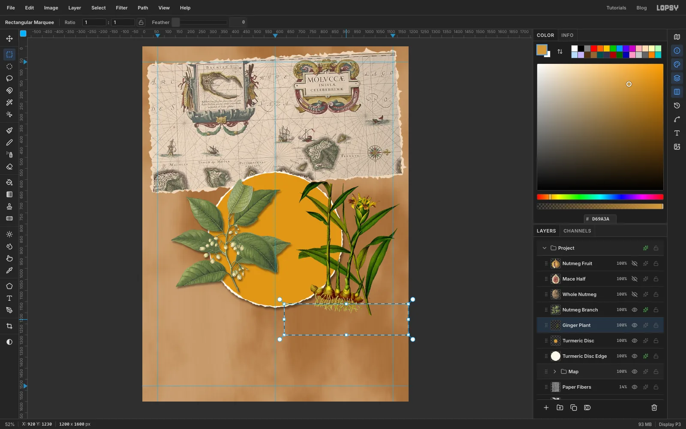

The ginger's long root hairs would run straight into the fruit studies you'll put below. They'll be hidden under the offer note later, so a straight cut is fine.

1. Drag a **Rectangular Marquee** from about `640, 1160` to past the right edge of the page at `1200, 1300`, just under the knobbly rhizome.
2. Press [[Delete]] and [[Cmd+D]].

## Tear the NUTMEG strip

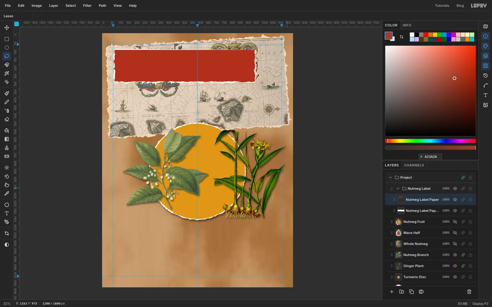

The title goes on two strips of torn paper, each built in its own group so you can tilt it as one piece.

1. Click the top row in the Layers panel (`Nutmeg Fruit`). Click **New Group** and name it `Nutmeg Label`.
2. **Add Layer** inside it, called `Nutmeg Label Paper Edge`. Lasso a strip about 880 × 200 px centred on `520, 205`: a straight top edge (it was cut with scissors) and ragged ends and bottom. Fill it with `#FBF6EA`.
3. **Add Layer** called `Nutmeg Label Paper`. Lasso the same strip about 6 px smaller on the torn sides, and fill it with `#A33A26`. While it's selected, add noise: **Amount** `14`, **Mono**, **Gaussian**. Deselect.

## Set NUTMEG

1. With `Nutmeg Label Paper` selected, pick the **Text** tool. Set **Abril Fatface**, size `172`, colour `#F3E8CF`.
2. Click in an empty patch near the bottom-left of the page and type `NUTMEG`. Press [[Tab]] to finish.
3. In the **Text** panel, set **Letter spacing** to `6`.
4. With the **Move** tool, drag the word onto the strip and centre it. Use the arrow keys for the last few pixels. Aim for equal space above and below the capitals (about 45 px).

## Tilt the label

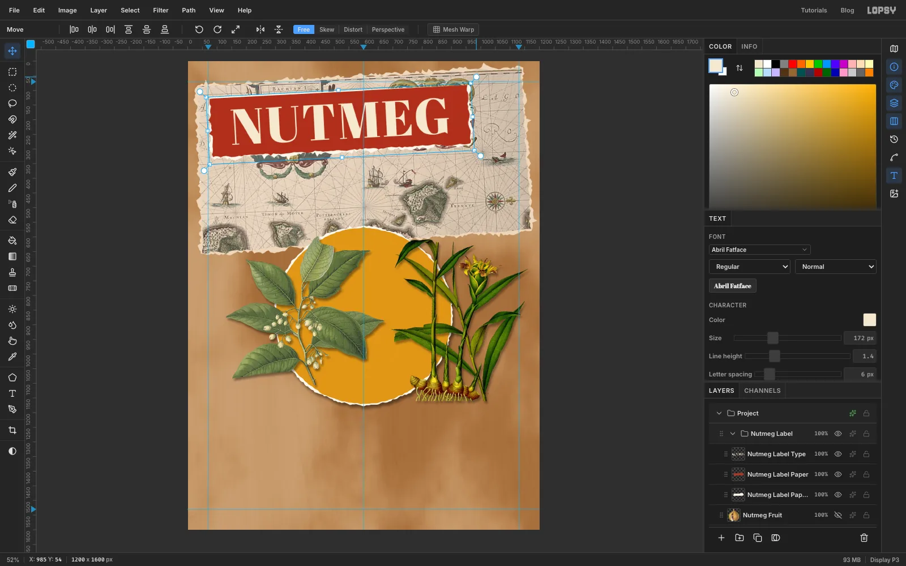

1. Click the `Nutmeg Label` group row. With the **Move** tool, drag the top-right rotation handle up a little to tilt the whole label about `3°` anticlockwise. The type rotates with its paper and stays editable.
2. Press [[Esc]] and collapse the group.

## Make the GINGER label

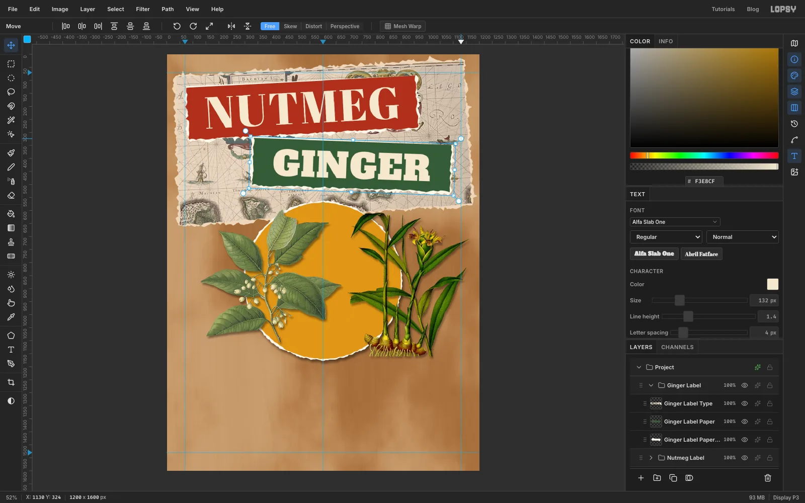

Repeat the last three steps for a second label, so the two names look as if they were cut from different printed papers:

1. Click the collapsed `Nutmeg Label` row and add a group called `Ginger Label`.
2. Build an edge layer and a paper layer as before: a strip about 760 × 180 px centred on `710, 425`, filled with `#3D5A3A`, with noise `14`.
3. Type `GINGER` in **Alfa Slab One**, size `132`, colour `#F3E8CF`, letter spacing `4`, and centre it on the strip.
4. Tilt the group about `2°` clockwise and collapse it.

## Add the ampersand

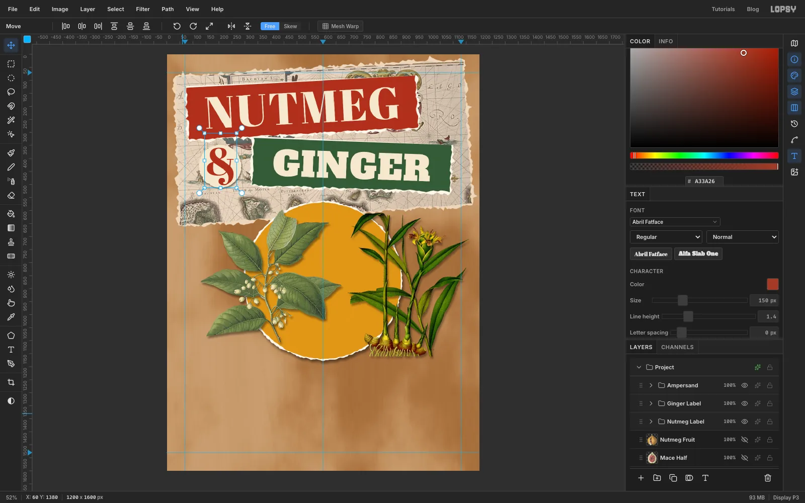

1. Click the collapsed `Ginger Label` and add a group called `Ampersand`. Inside it, add a layer called `Ampersand Paper`.
2. Lasso a slightly rough circle about 164 px across, centred on `205, 430`, in the gap left of the GINGER strip. Fill it with `#F3E8CF`, deselect, and add a **Drop Shadow**: **Offset X** `3`, **Offset Y** `5`, **Blur** `6`, **Opacity** `45`.
3. Type `&` in **Abril Fatface**, size `150`, colour `#A33A26`, letter spacing `0`. Centre it on the disc, then collapse the group.

Abril's ampersand is bold enough to read at a distance. A thin script ampersand at this size reads as a squiggle.

## Punch a Dymo label

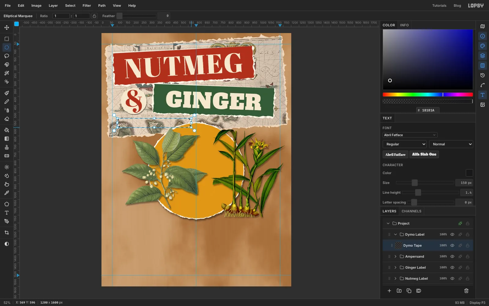

1. Click `Ampersand`, add a group called `Dymo Label`, and inside it a layer called `Dymo Tape`.
2. Drag a **Rectangular Marquee** about 410 × 58 px under the left half of the title, from about `130, 538`.
3. Switch to the **Elliptical Marquee**. Hold [[Shift]] and drag a circle 58 px across over the left end of the rectangle, centred on its end. Do the same at the right end. You get a rounded strip, like label tape.
4. Fill it with `#18181A`, add noise **Amount** `3` (Mono, Gaussian), and deselect. Add a **Drop Shadow**: **Offset X** `2`, **Offset Y** `4`, **Blur** `4`, **Opacity** `50`.

## Give the tape a sheen

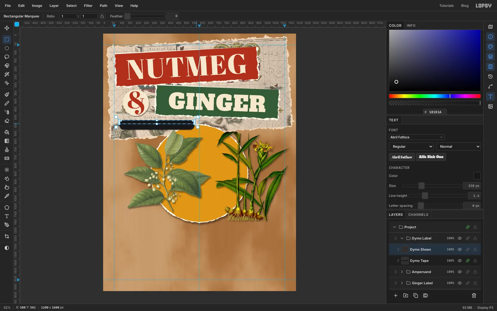

1. **Add Layer** called `Dymo Sheen`. [[Cmd]]-click the `Dymo Tape` thumbnail.
2. With the **Rectangular Marquee**, hold [[Shift]] and [[Alt]] together and drag a rectangle over the top half of the tape, a little wider than it. [[Shift+Alt]] keeps only the overlap, so you're left with the tape's top half.
3. Fill it with white, deselect, and set the layer to `18%`. That's the glossy plastic catching the light.

## Raise the letters

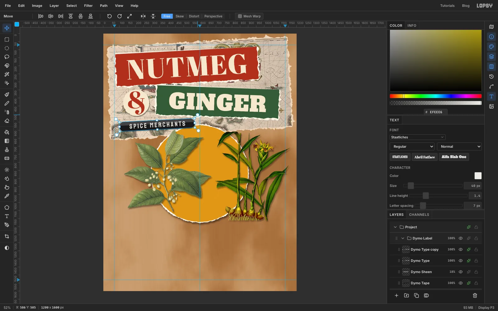

1. Click `Dymo Sheen`. Type `SPICE MERCHANTS` in **Staatliches**, size `40`, colour `#EFEEE6`, letter spacing `7`, and centre it on the tape. Name the layer `Dymo Type`.
2. Add a **Drop Shadow** with **Offset X** `0`, **Offset Y** `2`, **Blur** `1`, **Opacity** `70`. That's the dark lower edge of each pressed letter.
3. Choose **Layer → Duplicate Layer**. On the copy, turn on **Color Overlay** in `#D9D7CD`.
4. Click the original `Dymo Type` underneath, turn on **Color Overlay** in white, pick the **Move** tool and press [[Up]] once. A 1 px white edge now shows along the top of every letter, like embossed tape.
5. Click the `Dymo Label` group, tilt it about `3°` anticlockwise, and collapse it.

## Drop in the spice photo

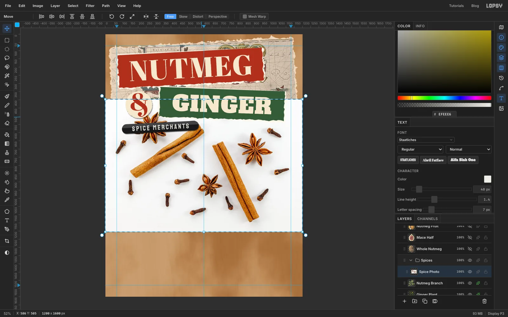

1. Click `Nutmeg Branch` and add a group called `Spices`. It sits above the botanicals but under the three fruit studies.
2. Drop the spice photo onto the canvas. Rename it `Spice Photo`.

## Wand out the backdrop

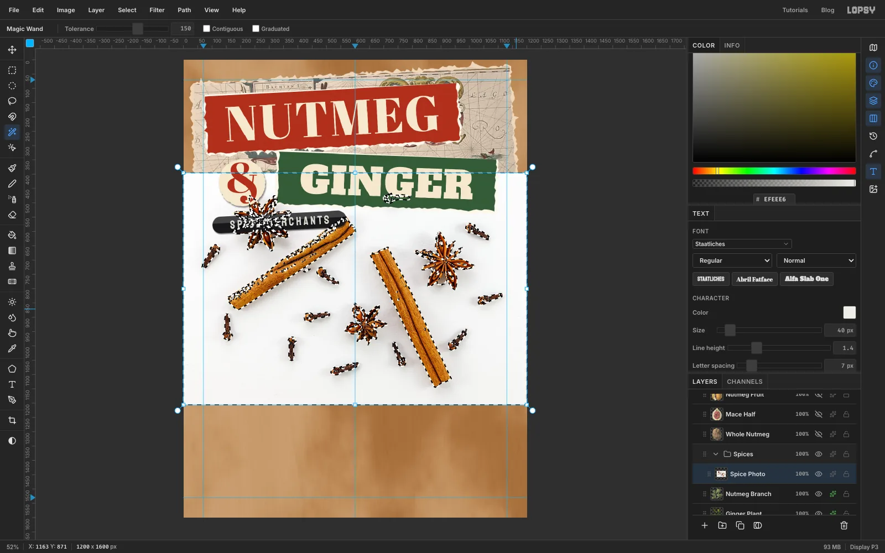

This photo has soft grey shadows on its white backdrop, so it needs a much wider tolerance than the plates.

1. Pick the **Magic Wand**, set **Tolerance** to `150` with **Contiguous** off, and click the white near the top-left of the photo.
2. **Grow** by `1`, press [[Delete]] and [[Cmd+D]].

## Trim the shadow fringe

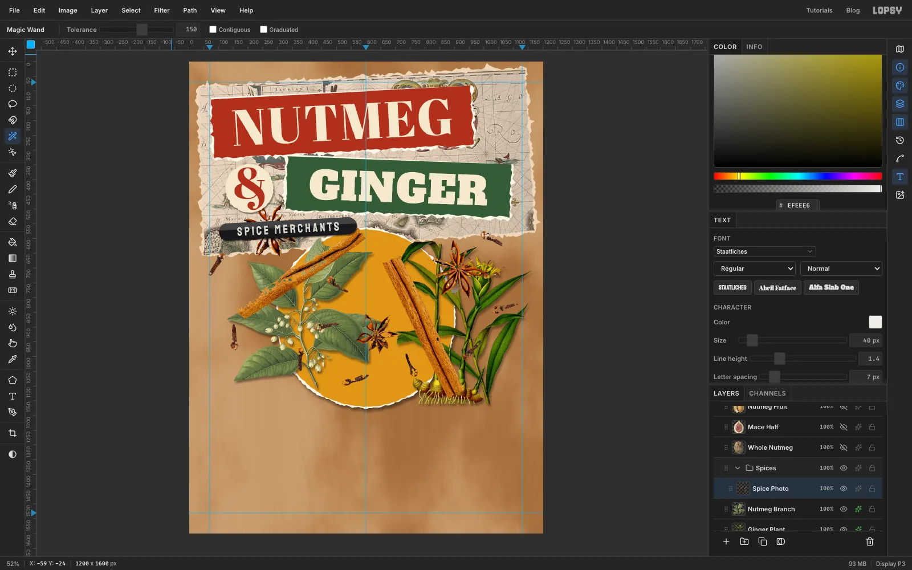

A little grey contact shadow still clings to the bottom of each piece.

1. [[Cmd]]-click the `Spice Photo` thumbnail.
2. Choose **Select → Shrink…**, enter `2` and click **Apply**.
3. Choose **Select → Inverse**, press [[Delete]], then [[Cmd+D]]. The outer 2 px of every piece goes, and the grey goes with it.

## Cut the spices apart

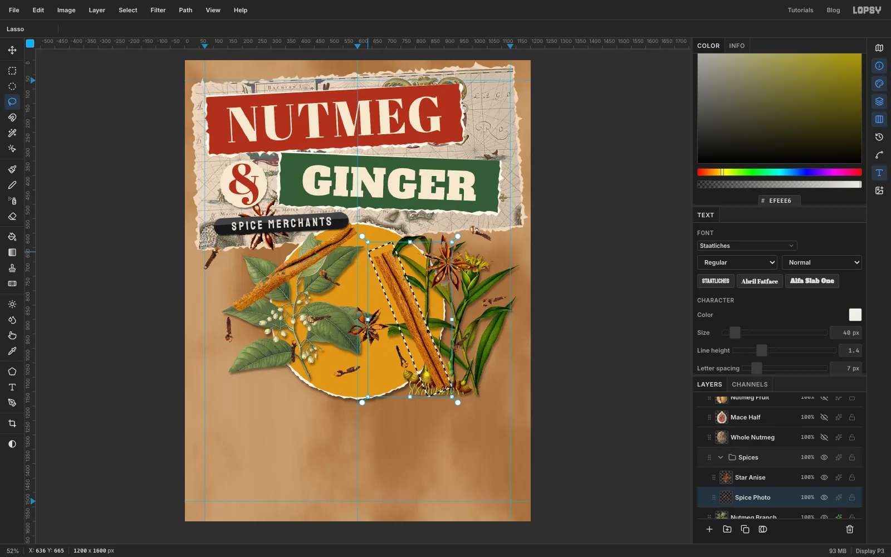

You only need two pieces from this photo.

1. With the **Lasso**, draw a loose shape around the right-hand star anise, keeping the clove just above its top-right arm outside your line. Cut and paste it, and name it `Star Anise`.
2. Click `Spice Photo`. Lasso a narrow band along the right-hand cinnamon stick only, leaving out the small star anise next to it. Cut and paste it, and name it `Cinnamon Stick`.
3. Click `Spice Photo` and click the bin icon at the bottom of the Layers panel to delete the rest.

## Place the cinnamon

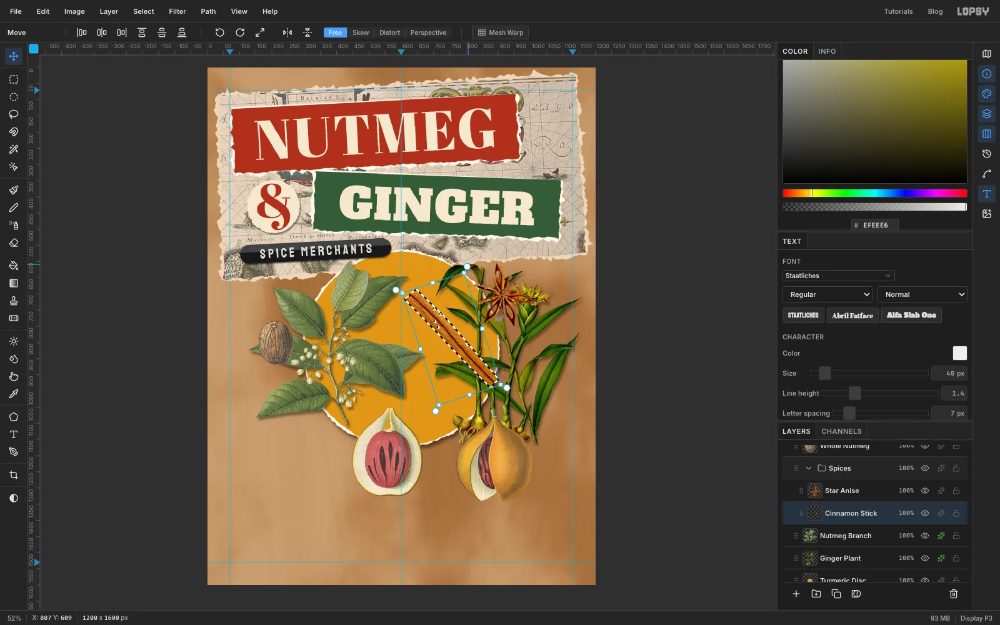

1. First click the eyes on `Nutmeg Fruit`, `Mace Half` and `Whole Nutmeg` to show them again. You'll place them in the next step.
2. [[Cmd]]-click the `Cinnamon Stick` thumbnail. With the **Move** tool, [[Cmd]]-drag the bottom-right handle to scale it to about 75%.
3. Drag the top-right rotation handle to turn it about `18°` anticlockwise. Press [[Esc]].
4. Drag it into the empty kraft on the left, centred on about `165, 985`, so it runs from the left edge across the branch's lowest leaf.

## Bring back the fruit studies

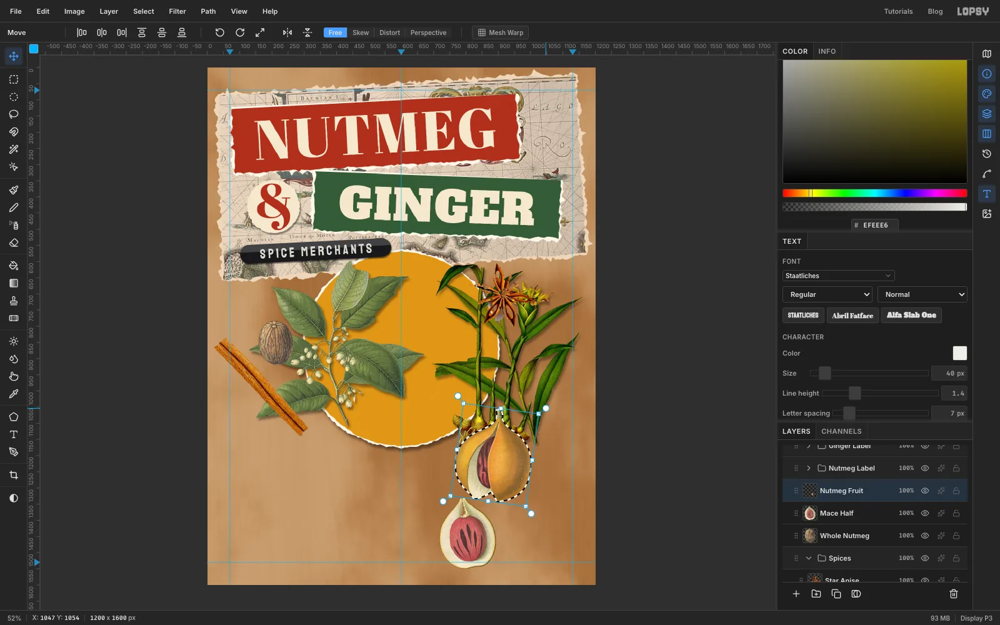

Place each study the same way: [[Cmd]]-click its thumbnail, scale it with the corner handle, turn it with the rotation handle, press [[Esc]], then drag it into position.

- `Mace Half`: about 80%, turned about `10°` anticlockwise, low in the bottom-right quarter, just right of where the tag will go (around `x 800`).
- `Nutmeg Fruit`: full size, turned about `8°` clockwise, to its right, near the corner.
- `Whole Nutmeg`: about 70%, turned about `25°` clockwise, tucked into the gap above the other two.

Keep the three studies about 40 px clear of the ginger above. If they touch, the fruit looks as if it's growing out of the ginger root.

## Flip the star anise

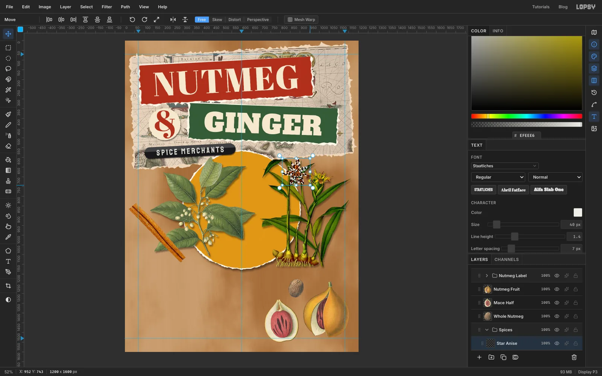

1. [[Cmd]]-click the `Star Anise` thumbnail and click **Flip Horizontal** in the Move tool's options bar. A mirrored copy looks less like the same photo pasted twice. Press [[Esc]].
2. [[Cmd]]-click it again, scale it to about 70% and drag it to `92, 700`, just under the left end of the map.

## Lift the cut-outs off the page

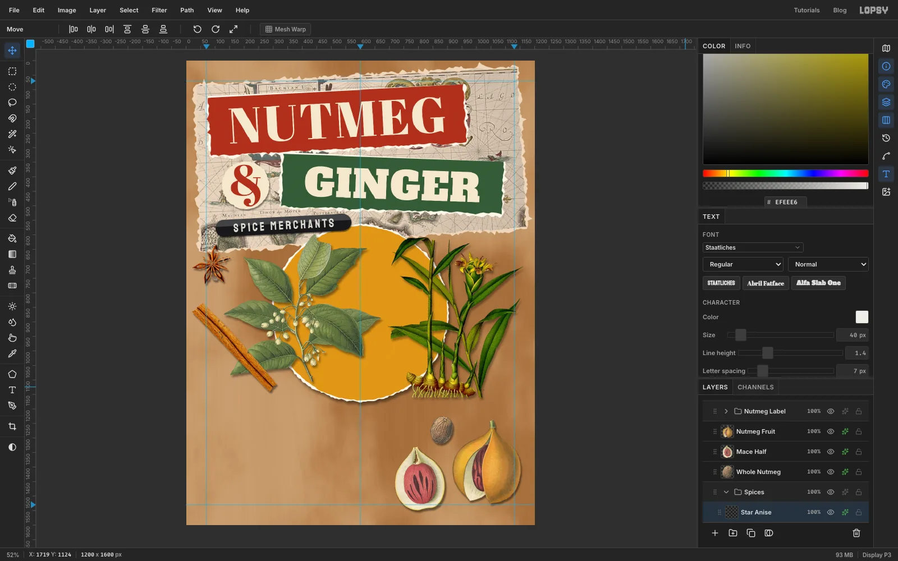

Give `Cinnamon Stick`, `Star Anise`, `Mace Half`, `Nutmeg Fruit` and `Whole Nutmeg` the same **Drop Shadow**: **Offset X** `4`, **Offset Y** `7`, **Blur** `7`, **Opacity** `45`. Keeping every shadow falling down and to the right is what makes separate pieces look like one pile of paper on one table.

## Draw the tag card on the grid

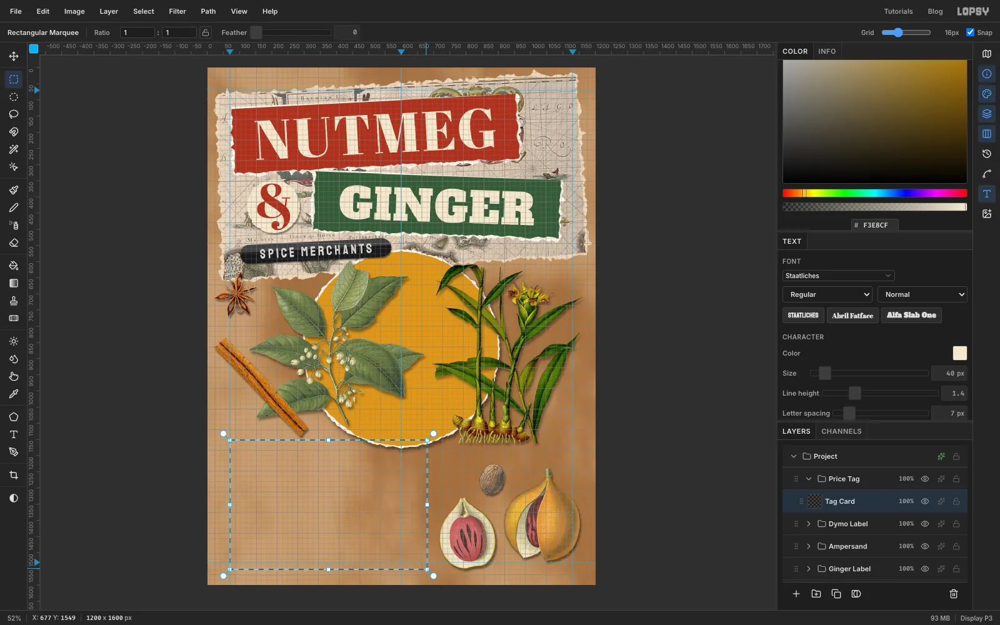

1. Click `Dymo Label`, add a group called `Price Tag`, and inside it a layer called `Tag Card`.
2. Press [[Cmd+']] to show the grid, and make sure **Snap** is ticked in the options bar. Drag a **Rectangular Marquee** from about `56, 1152` to `680, 1552`. The corners click onto grid lines, so the card comes out square and even.

## Clip the corners

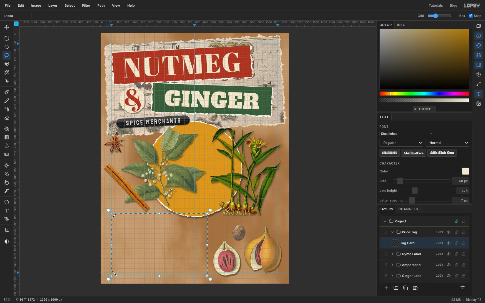

1. Pick the **Lasso**. Hold [[Alt]] and draw a triangle over the top-left corner of the selection, cutting about 48 px off each side. Release, then do the same at the bottom-left corner. [[Alt]] subtracts from the selection.
2. Fill it with `#F3E8CF`, add noise **Amount** `4` (Mono, Gaussian), and deselect. Press [[Cmd+']] to hide the grid.

## Punch the eyelet

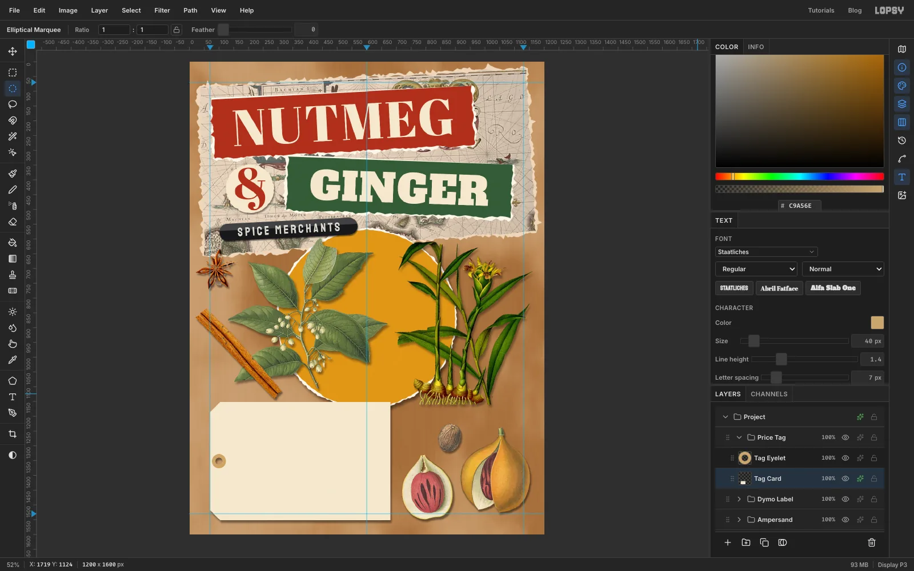

1. **Add Layer** called `Tag Eyelet`. With nothing selected, click once (no drag) with the **Elliptical Marquee** to open its exact-size dialog, and enter `76, 1328` to `124, 1376` for a 48 px circle. Fill it with `#C9A56E`.
2. Click `Tag Card`. Make a 24 px circle on the same centre (`88, 1340` to `112, 1364`) and press [[Delete]]. Click `Tag Eyelet` and press [[Delete]] again, so the hole goes through both layers. Deselect.
3. Give `Tag Card` a **Drop Shadow**: **Offset X** `4`, **Offset Y** `8`, **Blur** `9`, **Opacity** `45`.

## Set the headline

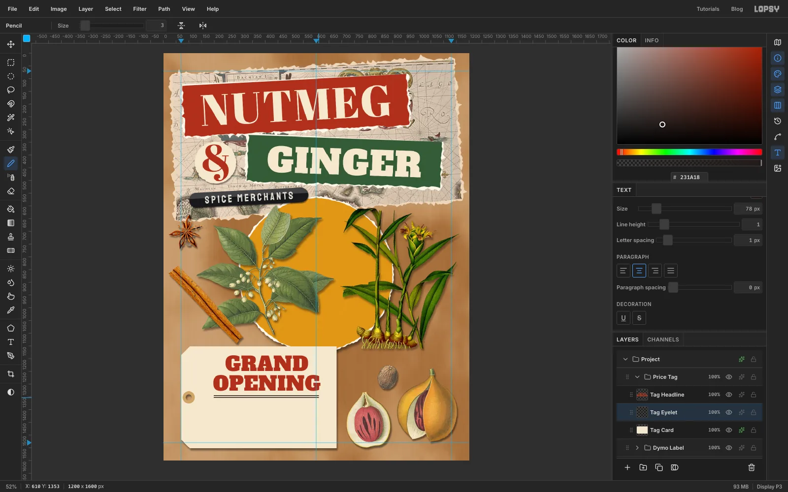

This is the second thing anyone should read after the shop's name, so make it big.

1. Click `Tag Eyelet`. Pick the **Text** tool and set **Alfa Slab One**, size `78`, colour `#A33A26`. In the **Text** panel, click **Align center**.
2. Drag a text box from `140, 1172` to `670, 1330`. That makes area text, which centres each line in the box. Type `GRAND`, press [[Return]], type `OPENING`, and press [[Tab]].
3. In the Text panel, set **Line height** to `1` and **Letter spacing** to `1`. Nudge the block so it sits centred on the tag's body, to the right of the eyelet (about `x 405`).
4. Click `Tag Eyelet` (the rule can share that layer: both are printed on the card). Pick the **Pencil**, size `3`, colour `#231A18`. Click just under the left end of `OPENING` and [[Shift]]-click under its right end, then draw a second line a few pixels below the first.

## Type the details

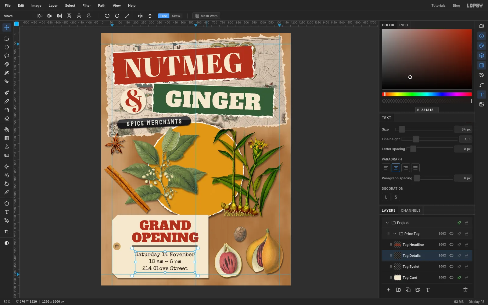

1. Click `Tag Eyelet`. Set **Special Elite**, size `34`, colour `#231A18`, with **Align center** still on.
2. Drag a text box from `140, 1372` to `670, 1520` and type three lines: `Saturday 14 November`, `10 am – 6 pm` and `214 Clove Street`. Press [[Tab]].
3. Set **Line height** `1.3` and **Letter spacing** `0`. Centre the block under the rule, leaving about 50 px below the last line.

## Thread the twine and tilt the tag

1. Click `Tag Card` and **Add Layer** called `Twine`.
2. Pick the **Brush**: size `6`, hardness `80`, colour `#A93226`. Drag a gentle curve from the eyelet up and out past the left edge of the page.
3. Give it a small **Drop Shadow** (**Offset Y** `4`, **Blur** `3`, **Opacity** `45`).
4. Click the `Price Tag` group, tilt it about `3°` anticlockwise, and collapse it.

## Write the offer on a scrap of notebook paper

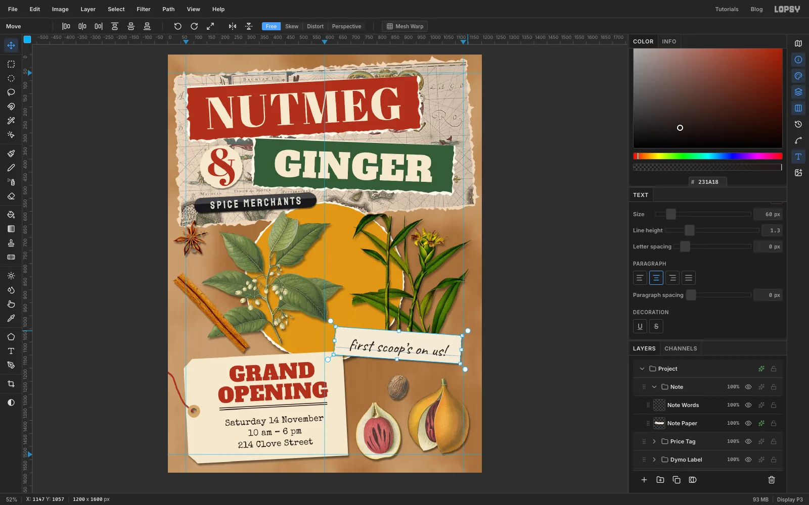

1. Click `Price Tag`, add a group called `Note`, and inside it a layer called `Note Paper`.
2. Lasso a strip about 480 × 108 px centred on `880, 1112`, with straight long sides and torn short ends. It covers the cut ends of the ginger roots. Fill it with `#F3EAD6`, add noise **Amount** `6`, deselect, and add a **Drop Shadow** (**Offset X** `3`, **Offset Y** `5`, **Blur** `6`, **Opacity** `40`).
3. With `Note Paper` still selected, pick the **Pencil** at size `2` in `#9DB4C8`. Click near the left end of the strip, a little below its middle, and [[Shift]]-click near the right end.
4. Type `first scoop's on us!` in **Caveat**, size `60`, colour `#231A18`, letter spacing `0`. Move it so the bottoms of the letters sit right on the blue rule. Only the `p` should dip below it.
5. Click the `Note` group, tilt it about `4°` clockwise, and collapse it.

## Tape it all down

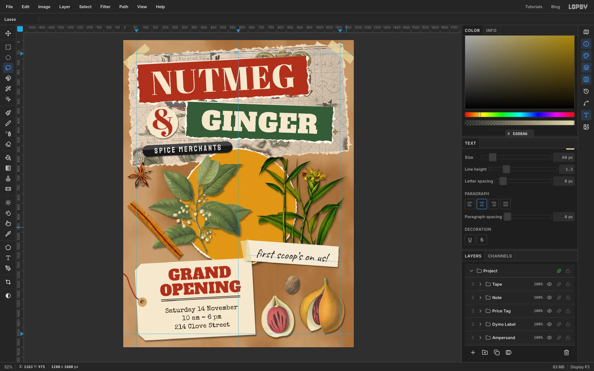

1. Click `Note` and add a group called `Tape`. Each strip goes on its own layer inside it.
2. For each strip, Lasso a long thin rectangle about 40 px wide with straight long sides and ragged short ends, as if torn off a roll. Fill it with `#E6D8A6`, add noise **Amount** `6`, deselect, and set the layer to `78%` so the paper shows through.
3. Make three: one 150 px long across the map's top-left corner (turned about 40° anticlockwise), one across its top-right corner (turned the other way), and a shorter one standing almost upright over the left end of the note. Collapse the `Tape` group.

## Add grain and fibres over everything

One shared texture over the top makes the photos, prints and papers look printed together.

1. Click the collapsed `Tape` group and **Add Layer** called `Paper Grain`. Fill it with `#808080`, add noise **Amount** `18` (Mono, Gaussian), and set it to **Overlay** at `22%`.
2. **Add Layer** called `Top Fibers`. Run **Filter → Fibers…** and set it to **Soft Light** at `12%`.

## Warm it with Color Grading

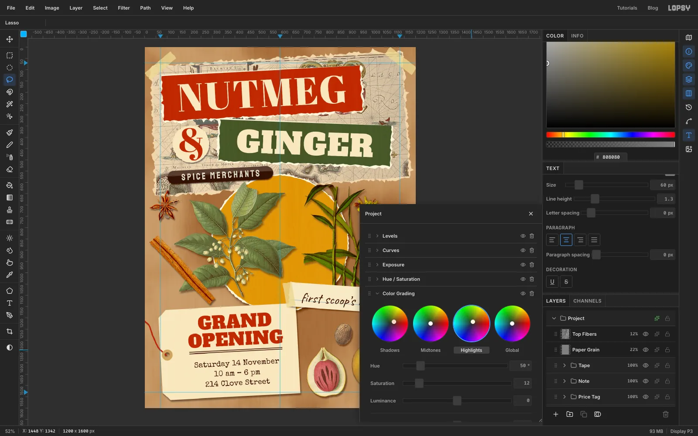

1. Click the green sparkle button at the right of the `Project` row (the top row of the Layers panel) to open the document's adjustment stack.
2. Expand **Color Grading**. Click the **Shadows** tab and set **Hue** `22` and **Saturation** `24`. Click **Highlights** and set **Hue** `50` and **Saturation** `12`.

The shadows warm towards brown and the highlights towards gold, which pulls the cool map and the green prints into the same light as the kraft.

## Finish with a light vignette

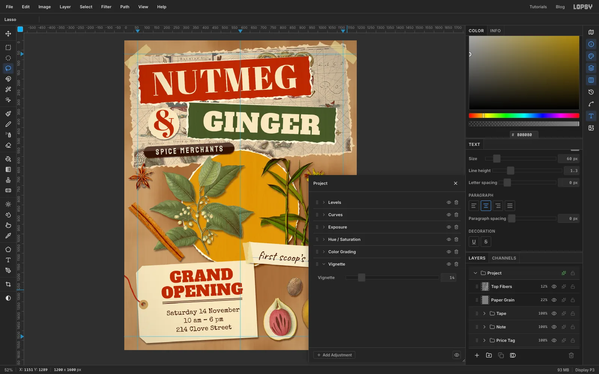

1. Click **Add Adjustment** at the bottom of the drawer and choose **Vignette**. Set its **Vignette** slider to `14`. Keep it light. Much more and the corners start to look like dirty glass.
2. Close the drawer, press [[Cmd+;]] to hide the guides, and step back.

Export the flier with **File → Quick Export PNG**, and save it with **File → Save Project** so you can change the date for the next event.
