Collage is a good fit for anything that's run by volunteers. A homepage made of torn paper, tape and rubber stamps says "this is homemade and you're welcome here", which is exactly what a free community music club wants to say. In this tutorial you'll mock up the desktop homepage for **Ukulele Sundays**, an invented weekly ukulele jam. Under the paper it's still a real website layout, with a nav bar, a hero with a headline and buttons, a stats row, event cards and a footer, on a 1440 × 1720 px page (1440 px is the usual desktop design width).

The collage pieces are:

- a torn-paper nav strip and footer, each with a white fibrous edge showing where the paper ripped
- a paper sun with a radial gradient and a halftone dot texture that fades out across it
- big Matisse-style cut-paper leaves
- an old photo of palm trees, printed in teal halftone on torn paper and taped down
- a ukulele photo cut out of its backdrop and given a thick sticker border
- a round rubber stamp with its words set on a circle
- three event cards cut from the same paper, each tilted slightly and pinned with tape

You'll need two public-domain photos from Wikimedia Commons:

- **Ukulele 105.jpg** by Villanueva, a ukulele on a plain white backdrop. Download the original (559 × 1119 px).
- **Boat and Palm tree outline at a Hawaiian beach LCCN2011631266.tif** by Carol M. Highsmith (Library of Congress). Download the 960 px-wide JPEG version.

Along the way you'll use:

- ruler **guides**, **Add Noise**, **Clouds** and **Fibers** for the paper
- the **Lasso** for every torn edge and leaf, and **Edit → Fill**
- the **Elliptical Marquee**, **Shrink**, **Grow** and **Select → Inverse**
- the **Gradient** tool, a **layer mask**, and the **Halftone**, **Desaturate** and **Brightness/Contrast** filters
- dropping in photos, the **Magic Wand**, and scaling and rotating with the **Move** tool's handles
- **Copy**, **Paste**, **Duplicate Layer** on a whole group, and rotating groups
- the **Shape** tool making a path, and **text on a path**
- live text in **Shrikhand**, **Archivo Black**, **Courier Prime** and **Caveat Brush**
- the **Stroke**, **Drop Shadow** and **Color Overlay** effects, and the **Multiply**, **Overlay** and **Soft Light** blend modes

The palette:

- Kraft paper `#EFE5CF`, torn-edge cream `#FBF5E8`
- Deep teal `#12545A`
- Coral `#EE5E45`, sun gradient `#F57A5C` → `#E2492F`, sun dots `#B83A26`
- Lime `#C6D23E`, blush `#F3B1A4`
- Ink `#1E1B19`
- Masking tape `#E9D79A`
- Dark coral for small text `#C2300F`, stat numbers `#D93A1C`

> **Note:** Shortcuts are written for a Mac. On Windows use [[Ctrl]] wherever it says [[Cmd]].

Positions are given in document pixels as `x, y` wherever things need to line up. The status bar at the bottom of the window shows the pointer's **X** and **Y**. Freehand shapes like the torn edges and leaves only need to be roughly right.

One habit will save you a lot of trouble with text. Before you start a new piece of text, click a raster layer (any layer that isn't text). If a text layer is still selected, picking a font, size or colour restyles *that* layer instead of setting up the new one. Each step says which layer to click. Also, start every new piece of text by clicking in an empty patch of canvas, then move it into place with the **Move** tool. A click on or just under existing text edits that text instead of starting a new one.

I renamed layers as I went (double-click a name), so the screenshots show names like `Date`, `Venue` and `Stat 52`. Yours can keep the names Lopsy gives them. Lopsy names text layers after their text, and a dropped photo arrives as a new raster layer.

A new group goes inside whichever group is selected when you click **New Group**. In this tutorial that means each section's group ends up nested inside the one before it (`Hero Copy` inside `Hero Art`, `Stamp` and `Jams` inside `Hero Copy`, and so on). That's expected. It doesn't change how anything looks, and collapsing groups keeps the panel tidy.

## Set up the paper and guides

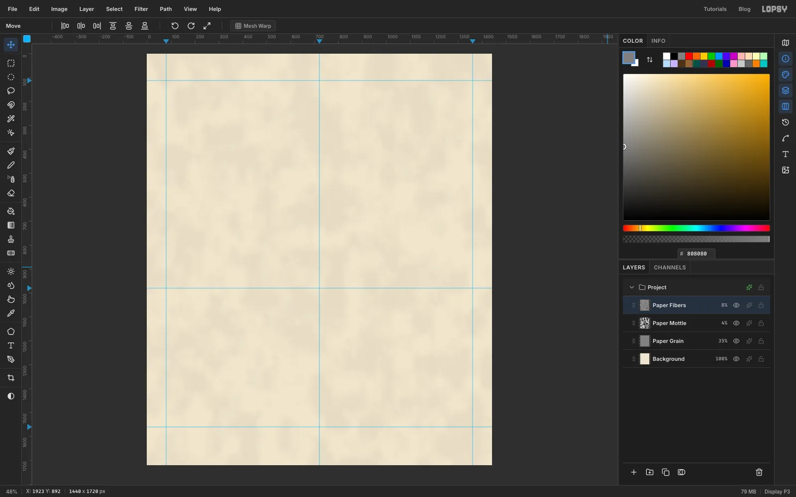

1. Choose **File → New** and make a **1440 × 1720** px document.
2. Click the top ruler at `x 80`, `720` and `1360` to drop three vertical guides. The outer two are the page margins and the middle one splits the hero into text on the left and pictures on the right. Click the left ruler at `y 112` (the bottom of the nav), `980` (the bottom of the hero) and `1560` (the top of the footer).
3. Click **Background**, set the foreground colour to `#EFE5CF` and choose **Edit → Fill**.
4. Double-click **Layer 1** and rename it `Paper Grain`. Fill it with `#808080`, then choose **Filter → Add Noise…** with **Amount** `16`, **Mono** and **Gaussian**, and click **Apply**. Click the ✦ button on the layer's row to open the effects drawer and set the blend mode to **Overlay**. Then click the opacity figure on the layer's row and drag it to `35%`. The grey disappears and only the speckle is left.
5. Click **Add Layer** and name it `Paper Mottle`. Choose **Filter → Clouds…** with **Scale** `20`. Set it to **Multiply** at `4%` for a faint unevenness, like real paper.
6. Add one more layer called `Paper Fibers`. Choose **Filter → Fibers…** and click **Apply** with the defaults. Set it to **Soft Light** at `8%`. This layer stays at the very top of the Layers panel the whole time (every new group goes in below it), so the faint fibres run across every scrap of paper you add.

## Tear the nav strip

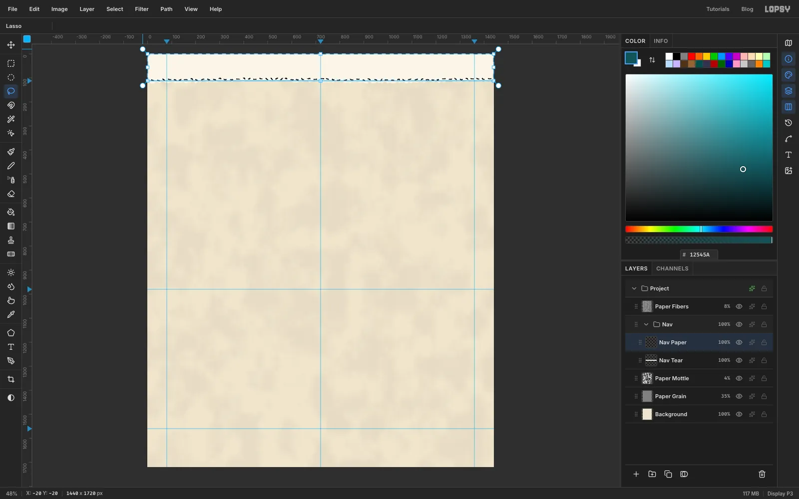

Torn paper shows a white core along the rip. You'll fake that with two lassos: a cream one, and a teal one just above it with a slightly different tear.

1. Click `Paper Mottle`, then click **New Group** at the bottom of the Layers panel and name it `Nav`. Click **Add Layer** (it goes inside the group) and name it `Nav Tear`.
2. Pick the **Lasso**. Start off the canvas above the top-left corner, go across above the top edge to past the top-right corner, come down to `y 125`, then drag back to the left along a slightly ragged line around `y 120`. Wiggle the pointer up and down a few pixels as you go: small, irregular steps look torn. Finish off the canvas and let go. Set the foreground to `#FBF5E8`, choose **Edit → Fill** and press [[Cmd+D]].
3. Add a layer called `Nav Paper`. Draw the same shape again with the Lasso, but bring the ragged edge about 10 px higher (around `y 110`). Fill it with `#12545A` and deselect.

The cream strip peeks out unevenly below the teal, like the white core of torn card.

## Build the nav bar

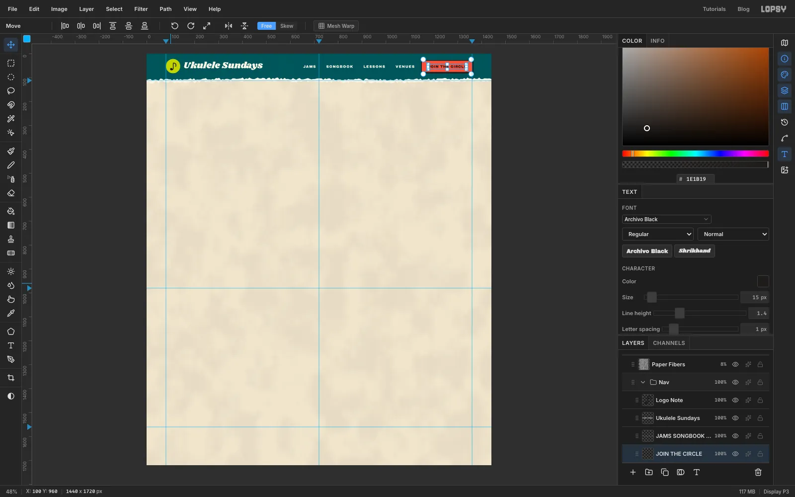

1. Add a layer called `Logo Sun`. With the **Elliptical Marquee**, drag a 60 × 60 circle from `80, 22` to `140, 82`. Fill it with `#C6D23E` and deselect.
2. With `Logo Sun` still selected, pick the **Text** tool and set **Archivo Black**, size `40`, colour `#1E1B19`. Click in an empty part of the page and type a music note, ♪. (Copy it from this page and paste it with [[Cmd+V]].) Press [[Tab]] to finish. With the **Move** tool, drag it into the middle of the lime disc.
3. Click `Logo Sun` again. Set **Shrikhand**, size `38`, colour `#FBF5E8`, and type `Ukulele Sundays`. Move it so it starts at `x 156`, lined up with the middle of the disc.
4. Click `Logo Sun`. Set **Archivo Black**, size `15`, and type `JAMS      SONGBOOK      LESSONS      VENUES` with six spaces between the words. Open the **Text** panel and set **Letter spacing** to `2`. Move the links so they end at `x 1118`, level with the logo.
5. Add a layer called `Join Button`. Click once with the **Rectangular Marquee** (no drag) to open its size dialog, and enter `1150, 30` to `1360, 76`. Fill it with `#EE5E45` and deselect.
6. Open the effects drawer for `Join Button`. Turn on **Stroke** with **Width** `3` in `#1E1B19`, and **Drop Shadow** with **Offset X** `4`, **Offset Y** `4`, **Blur** `0`, **Opacity** `75` and colour `#1E1B19`. A shadow with no blur reads as a solid block behind the button, the way a paper cut-out casts a shadow.
7. Click `Join Button`. Type `JOIN THE CIRCLE` in Archivo Black `15`, `#1E1B19`, letter spacing `1`, and centre it on the button.
8. Click the arrow on the `Nav` row to collapse the group.

## Cut the back leaves

These are the big Matisse-style leaves that sit behind the sun. Each one is a single Lasso shape: a stem, then pointed, curving lobes that alternate down both sides and lean toward the tip.

1. Click `Paper Mottle` and add a group called `Hero Art`. Inside it, add a layer called `Fronds Back`.
2. Draw the lime leaf with the Lasso. Start off the right edge of the page at about `y 1000` and aim the leaf up and to the left, so its tip ends around `970, 670`. Work up one side first, swinging out to a point and back in to the stem five times. Round the tip, then come back down the other side with the lobes set halfway between the first side's lobes. The widest lobes, about 120 px out from the stem, are in the middle of the leaf. Fill it with `#C6D23E`.
3. Draw a teal leaf the same way, starting off the top-right corner and hanging down to the left, with its tip near `1075, 360`. Give it four lobes a side. Fill it with `#12545A` and deselect.

Most of each leaf will end up behind the sun. Only the lobes that stick out past it matter.

## Draw the paper sun

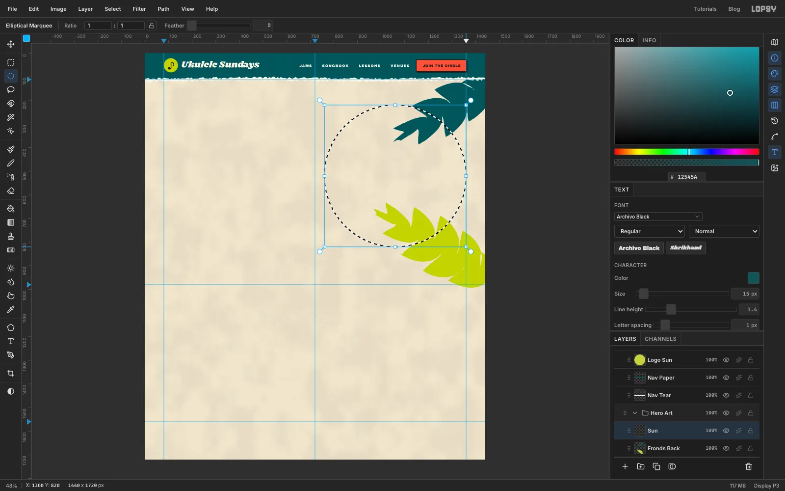

1. Add a layer called `Sun`.
2. With the **Elliptical Marquee**, drag a 600 px circle from `760, 220` to `1360, 820`. Its centre is `1060, 520`. Hold [[Cmd]] while you drag if you want it to stay a perfect circle. Don't use [[Shift]]: with a selection tool, [[Shift]] adds to the selection.

## Fill the sun with a gradient

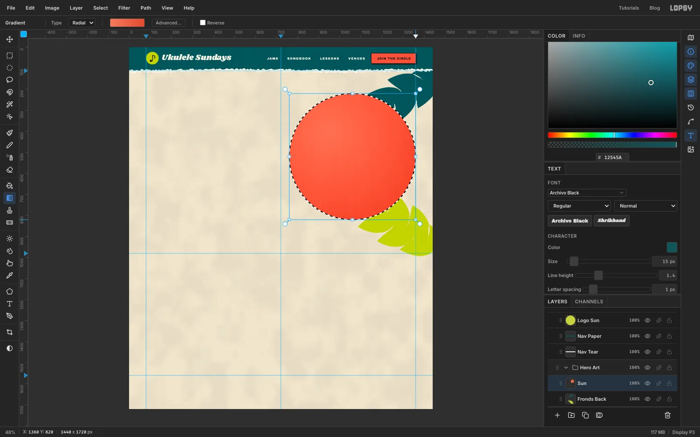

1. Pick the **Gradient** tool and set **Type** to **Radial**. Click **Advanced…**, click the left stop and type `#F57A5C` into the **Hex color** field, then click the right stop and make it `#E2492F`. Click **Done**.
2. Drag from about `950, 400`, up and to the left of the centre, out to the bottom-right edge of the circle at about `1360, 820`. The gradient only fills inside the selection, so you get a disc that looks lit from the top left.
3. Press [[Cmd+D]].

## Add halftone dots and fade them with a mask

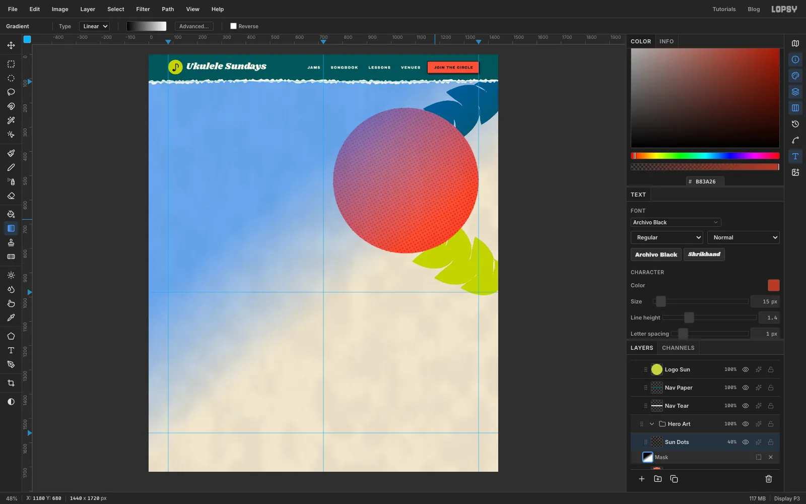

1. Add a layer called `Sun Dots`. [[Cmd]]-click the `Sun` thumbnail to load the disc as a selection. Fill it with `#B83A26` and deselect.
2. Choose **Filter → Halftone…** with **Dot Size** `9`, **Density** `0.7` and **Angle** `30`, and click **Apply**. The solid disc turns into dots.
3. Set `Sun Dots` to **Multiply** at `40%`. It looks like a second print colour laid over the paper.
4. Click **Add Mask** at the bottom of the Layers panel, then click the mask thumbnail on the row to edit the mask. The canvas shows a blue tint while you work on a mask.
5. Pick the **Gradient** tool, set **Type** to **Linear**, and make a black-to-white gradient in **Advanced…** (`#000000` on the left stop, `#FFFFFF` on the right). Drag from the top left of the sun, about `860, 300`, to about `1180, 680`. The dots fade away on the lit side and stay strong at the bottom right.

Click the layer thumbnail (not the mask) when you're done, so later fills go on pixels.

## Add the front leaf

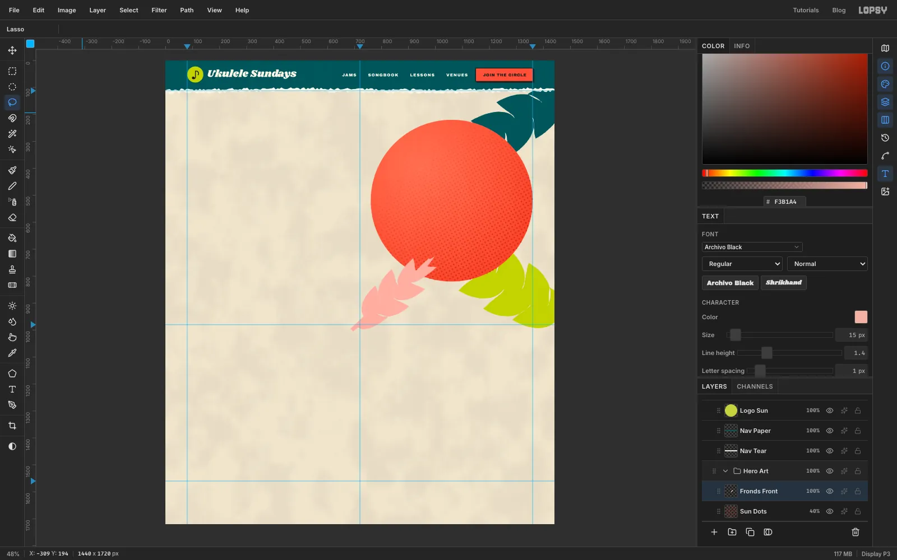

Add a layer called `Fronds Front` above `Sun Dots`. Lasso a smaller leaf with four lobes a side, starting at about `690, 1000` and pointing up and to the right toward the sun's lower-left edge. Fill it with `#F3B1A4` and deselect.

## Drop in the palm photo

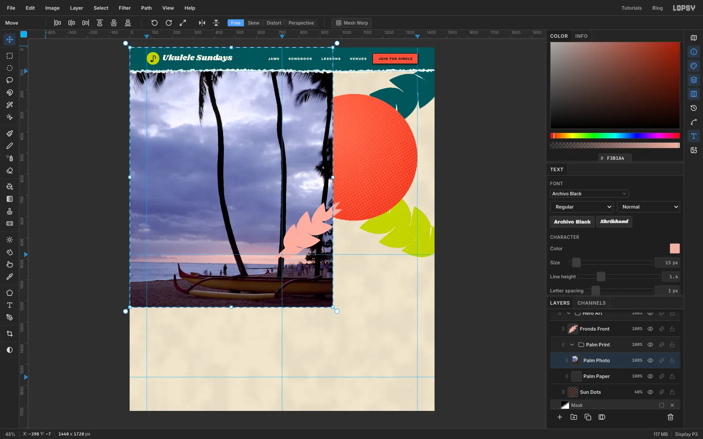

1. Click `Sun Dots`, then click **New Group** and name it `Palm Print`. Inside it, add a layer called `Palm Paper`. Leave it empty for now.
2. Drag the palm tree JPEG from your computer onto the canvas. It lands in the top-left corner at its full size, already selected, with the **Move** tool active. Rename the new layer `Palm Photo`.

## Scale the photo down

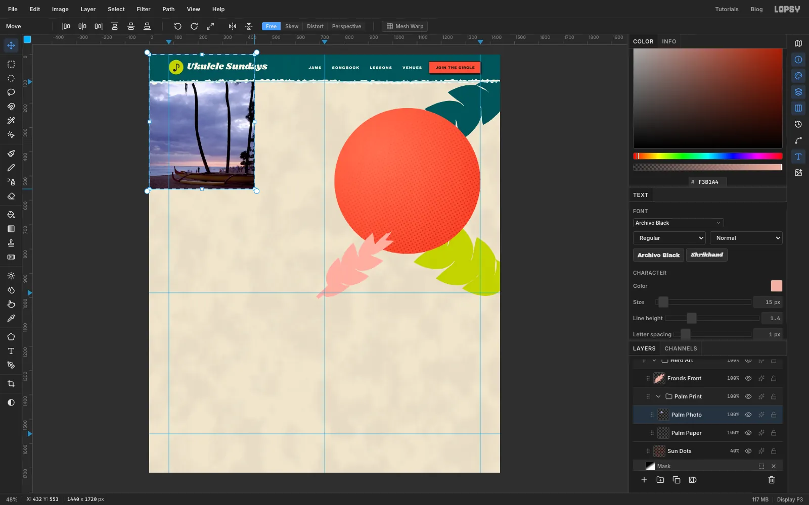

Hold [[Cmd]] and drag the bottom-right corner handle up and to the left until the photo is about **432 × 553** px. Holding [[Cmd]] keeps the proportions. Press [[Cmd+D]] to finish the transform.

## Print it in teal halftone

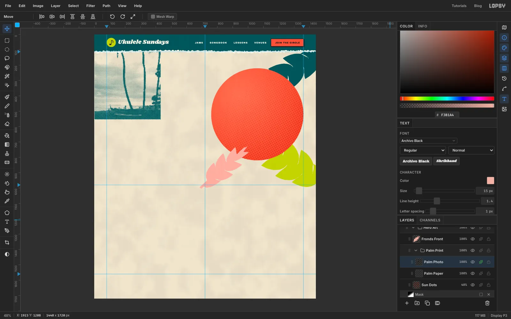

1. Choose **Filter → Desaturate**.
2. Choose **Filter → Brightness/Contrast…** with **Contrast** `55` and **Brightness** `4`. The trunks get darker while the sky stays light, which gives the halftone something to work with.
3. Choose **Filter → Halftone…** with **Dot Size** `5`, **Density** `1.2` and **Angle** `45`. The white areas between the dots become transparent.
4. Open the effects drawer and turn on **Color Overlay** in `#12545A`. Every dot is now teal ink.
5. With the **Move** tool, drag the photo so it's centred at about `990, 585`, over the left half of the sun.

## Tear the photo's edges

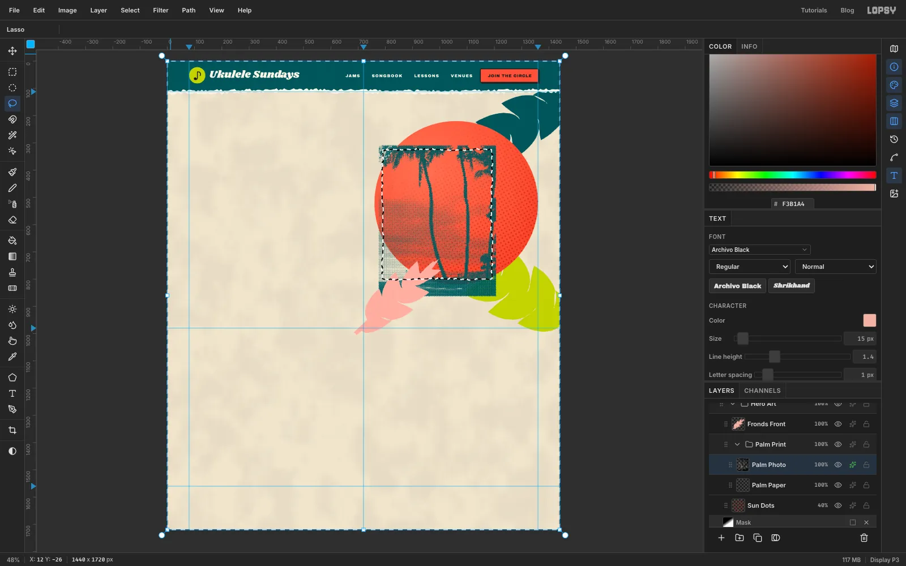

1. With the **Lasso**, draw a ragged rectangle about 16 px inside the photo's edges. Bring the bottom edge up about 60 px from the bottom so you lose the busy, dark beach at the bottom of the shot.
2. Choose **Select → Inverse** and press [[Delete]]. Press [[Cmd+D]].

## Back the print with paper

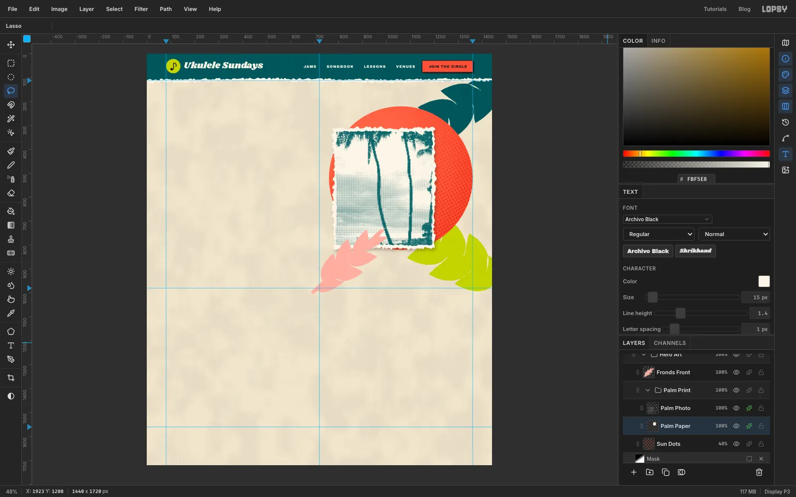

1. Click `Palm Paper`. Lasso a ragged rectangle just a few pixels outside the photo's torn edge, fill it with `#FBF5E8` and deselect. The uneven cream margin makes the print look like it was torn out of a book.
2. Give `Palm Paper` a **Drop Shadow**: **Offset X** `6`, **Offset Y** `9`, **Blur** `16`, **Opacity** `30`, colour `#3B2A1C`. A soft, warm shadow lifts the paper off the page without looking digital.

## Tilt the whole print

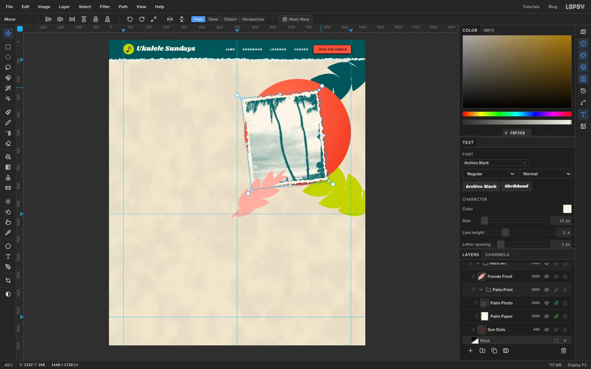

1. Click the `Palm Print` group row and pick the **Move** tool. A transform box appears around both layers.
2. Hover just outside the top-right corner until the pointer turns into a crosshair, then drag a short way to the left to turn the print about **6°** counter-clockwise. Press [[Cmd+D]].

Turning the group keeps the photo and its paper backing together.

## Cut the ukulele out of its backdrop

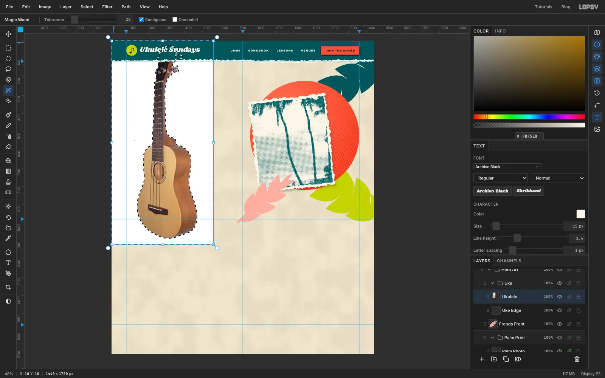

1. Click `Fronds Front` and add a group called `Uke`. Inside it, add a layer called `Uke Edge` and leave it empty.
2. Drag the ukulele photo onto the canvas and rename its layer `Ukulele`. Press [[Cmd+D]].
3. Pick the **Magic Wand**, set **Tolerance** to `28` and click the white backdrop near the corner. The white backdrop all round the ukulele is selected in one click.
4. Press [[Delete]], then [[Cmd+D]].

## Scale the ukulele

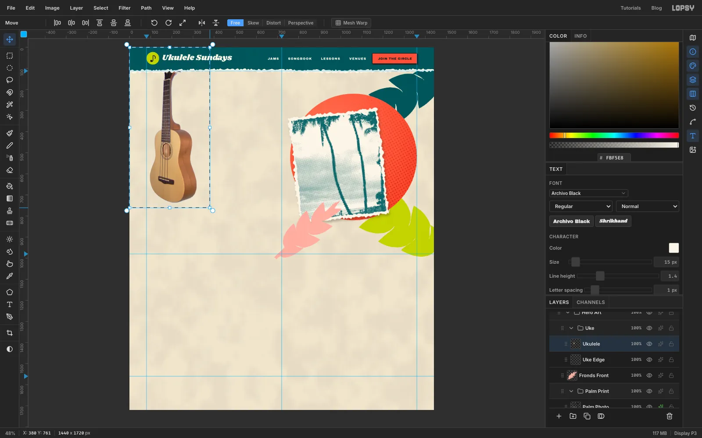

1. With the **Rectangular Marquee**, select the whole photo area (the top-left `559 × 1119` px), then switch to the **Move** tool so the transform handles appear.
2. Hold [[Cmd]] and drag the bottom-right handle in until the ukulele is about **380 × 761** px, 68% of its size. Press [[Cmd+D]].
3. With the **Move** tool, drag the ukulele across so it's centred at about `1150, 600`, over the right side of the sun.

Move it before you rotate it. If you rotate it up in the corner, its tilted body would hang off the canvas.

## Lean the ukulele

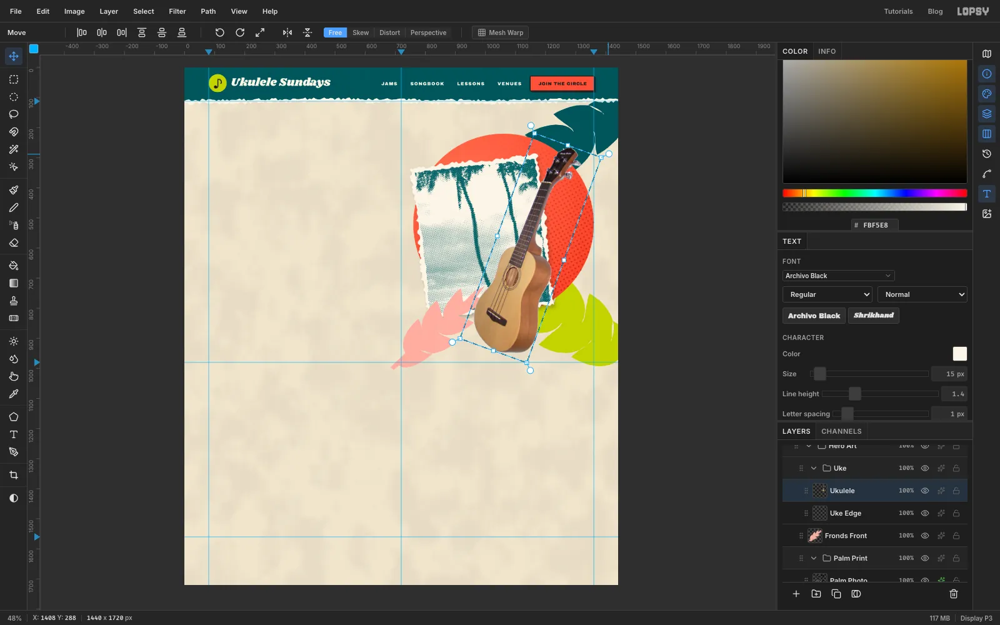

Marquee around the ukulele and switch to the **Move** tool. Hover just outside the top-right corner of the box until the pointer becomes a crosshair, then drag to turn it about **20°** clockwise. Its headstock leans out over the top of the sun. Press [[Cmd+D]].

## Give it a sticker border

1. [[Cmd]]-click the `Ukulele` thumbnail to select its outline.
2. Choose **Select → Grow…**, enter `10` and click **Apply**.
3. Click `Uke Edge`, fill it with `#FBF5E8` and deselect. Because `Uke Edge` sits under the ukulele, you only see a 10 px cream rim.
4. Give `Uke Edge` a **Drop Shadow** with **Offset X** `10`, **Offset Y** `14`, **Blur** `18`, **Opacity** `35` and colour `#3B2A1C`. The ukulele is now a sticker sitting on top of the collage.

## Pin things down with masking tape

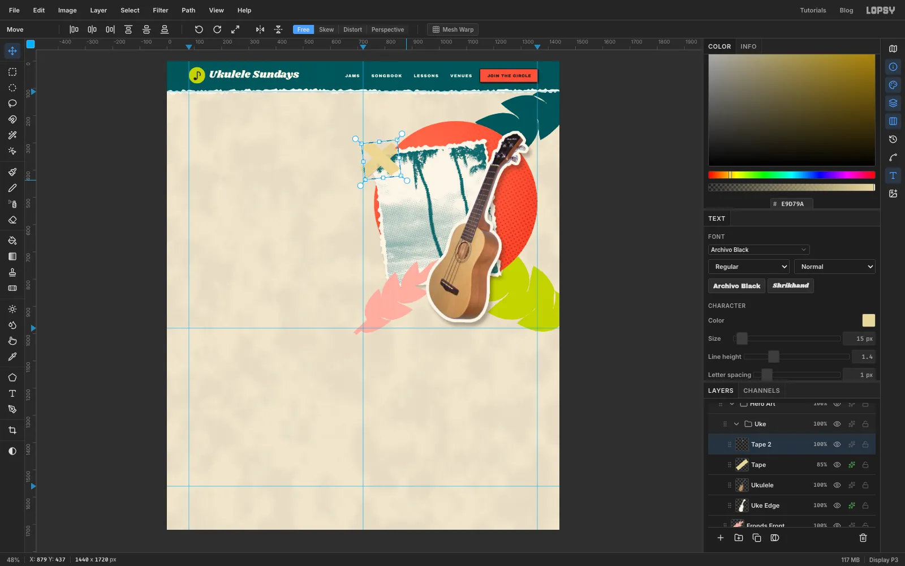

1. Click the `Ukulele` layer and add a layer called `Tape` (it goes at the top of the `Uke` group).
2. Lasso a strip about 150 × 42 px with roughly straight long sides and ragged short ends, tilted about 40° so it runs from lower left to upper right. Place its centre about 30 px in from the print's top-left corner, so it covers the corner and holds it down. Fill it with `#E9D79A` and deselect.
3. Set `Tape` to `85%` opacity so the print shows through a little. Add a **Drop Shadow** of **Offset X** `1`, **Offset Y** `2`, **Blur** `3`, **Opacity** `22` in `#3B2A1C`, just enough to lift the tape's edge.
4. [[Cmd]]-click the `Tape` thumbnail, press [[Cmd+C]] then [[Cmd+V]]. The copy pastes in place on a new layer. Rename it `Tape 2`.
5. The paste selects the copy and switches to the **Move** tool for you. Drag from just outside its top-right corner to turn it about 80° clockwise. Press [[Cmd+D]], then drag it up onto the ukulele's headstock at about `1170, 296`.
6. Set `Tape 2` to `85%` and give it the same small shadow.

## Add the kicker label

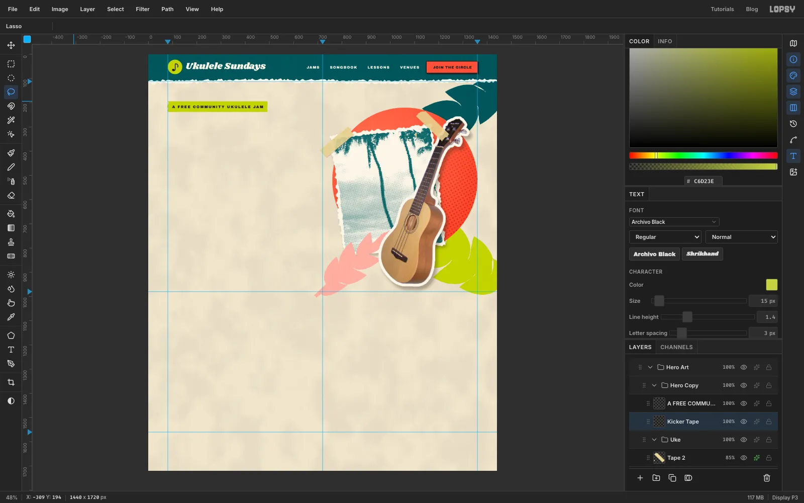

1. Collapse `Hero Art`. Click it and add a group called `Hero Copy`. Inside it, add a layer called `Kicker Tape`.
2. With `Kicker Tape` selected, type `A FREE COMMUNITY UKULELE JAM` in **Archivo Black**, size `15`, colour `#1E1B19`, letter spacing `3`. Move it so it starts at `x 98` and sits centred on `y 216`.
3. Click `Kicker Tape`. Lasso a strip from `x 80` to about 18 px past the end of the text, from `y 194` to `y 238`, with ragged left and right ends. Fill it with `#C6D23E` and deselect.

## Set the headline

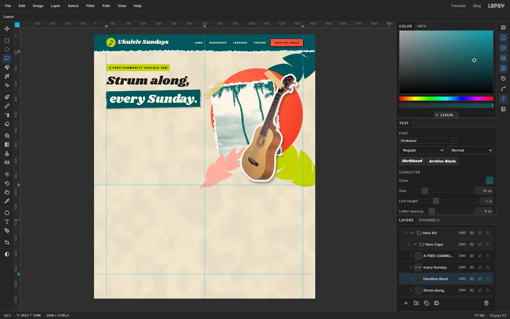

1. Click `Kicker Tape`. Type `Strum along,` in **Shrikhand**, colour `#1E1B19`, letter spacing `0`. Start at size `96`, then lower the **Size** until the line fits between the `x 80` guide and about `x 620`. That's about `78` px. Move it so its left edge is on the `x 80` guide and the top of the capital S is at `y 268`.
2. Add a layer called `Headline Band` directly above the headline text.
3. With `Headline Band` selected, type `every Sunday.` in Shrikhand at the same size, in `#FBF5E8`. Move it so it starts at `x 102`, with enough room under the g in "along" for the teal strip to fit between the two lines.
4. Click `Headline Band`. Lasso a teal strip that leaves about 22 px around the words on the left and right and about 20 px above and below. Give it ragged ends and tilt it a degree or so, as if it were glued down by hand. Fill it with `#12545A` and deselect.
5. Give `Headline Band` a **Drop Shadow**: **Offset X** `4`, **Offset Y** `6`, **Blur** `10`, **Opacity** `25`, colour `#3B2A1C`.

## Write the body copy and buttons

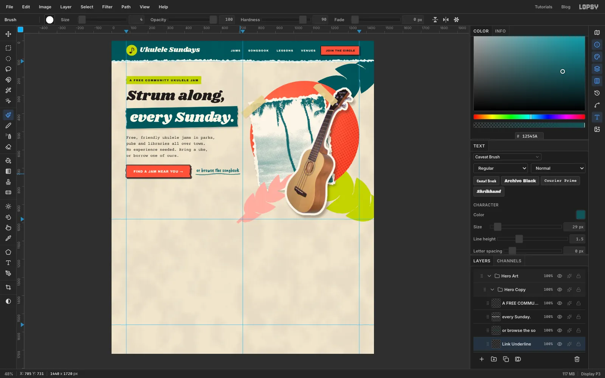

1. Click `Headline Band`. Pick **Courier Prime**, size `22`, colour `#1E1B19`, and make sure **Letter spacing** is `0`. Letter spacing carries over from the last text you set. Type these four lines, pressing [[Enter]] between them:

   `Free, friendly ukulele jams in parks,`
   `pubs and libraries all over town.`
   `No experience needed. Bring a uke,`
   `or borrow one of ours.`

   In the **Text** panel, set **Line height** to `1.5`. Move the text to `x 80`, about 64 px below the teal strip.
2. Add a layer called `CTA Button`. Lasso a 350 × 66 px rectangle at `x 80`, about 48 px under the paragraph, with ragged short ends. Fill it with `#EE5E45`, deselect, and give it the same **Stroke** (`3`, `#1E1B19`) and solid **Drop Shadow** as the nav button, but with both offsets at `6`.
3. Click `CTA Button`. Type `FIND A JAM NEAR YOU →` in Archivo Black `18`, `#FBF5E8`, letter spacing `1` (paste the arrow), and centre it on the button.
4. Add a layer called `Link Underline` above the button text. Type `or browse the songbook` in **Caveat Brush**, size `29`, colour `#12545A`. Place it 36 px to the right of the button, level with the button's middle.
5. Click `Link Underline`. Set the foreground to `#12545A`, pick the **Brush** at **Size** `4`, set **Hardness** to `90` in the brush settings, and drag a loose, slightly wavy line under the link from one end to the other.

## Add a stats row

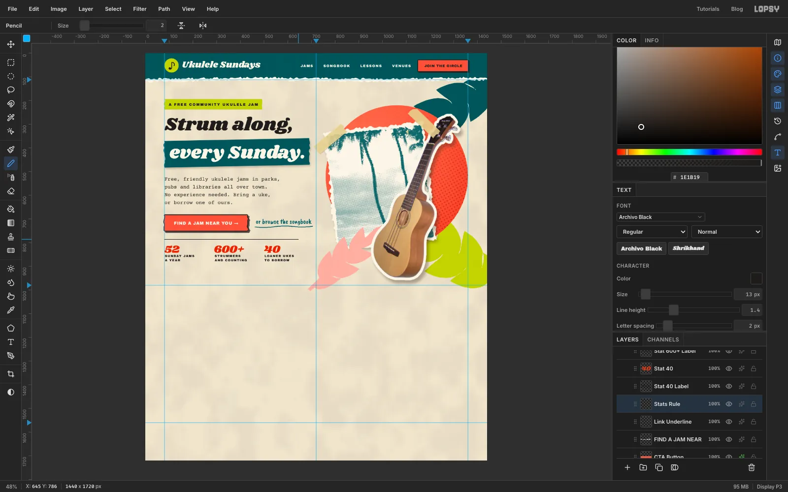

Websites love a row of numbers. It also fills the space under the buttons.

1. Add a layer called `Stats Rule`. With it selected, type `52` in Shrikhand `46`, colour `#D93A1C`. That's darker than the button coral so it reads better as small type on cream. Move it to `x 80`, with its top at `y 812`.
2. Click `Stats Rule` and type `SUNDAY JAMS` [[Enter]] `A YEAR` in Archivo Black `13`, `#1E1B19`, letter spacing `2`. Put it 10 px below the number.
3. Repeat for `600+` with `STRUMMERS` / `AND COUNTING` at `x 290`, and `40` with `LOANER UKES` / `TO BORROW` at `x 500`. Click `Stats Rule` before each one.
4. Click `Stats Rule`. Set the foreground to `#1E1B19`, pick the **Pencil** at **Size** `2`, click at `80, 786` and [[Shift]]-click at `645, 786` to draw a straight rule above the stats.

## Make the stamp rings and a circle path

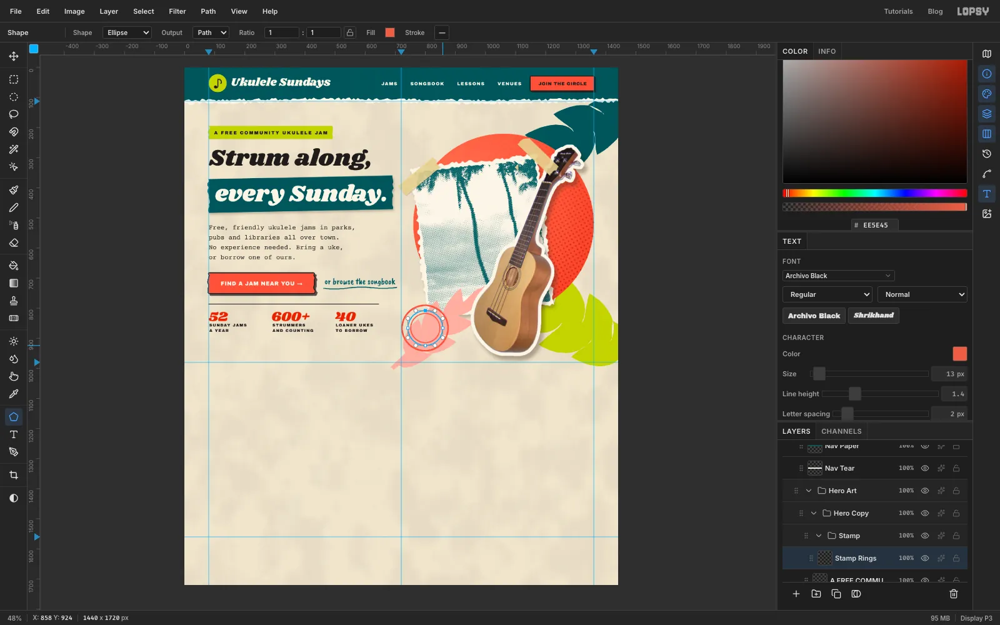

1. Collapse the open groups, click `Hero Copy` and add a group called `Stamp`. Inside it, add a layer called `Stamp Rings`.
2. With the **Elliptical Marquee**, drag a circle from `722, 788` to `878, 944` (centre `800, 866`). Fill it with `#EE5E45`. Choose **Select → Shrink…**, enter `5`, and press [[Delete]]. That leaves a 5 px ring. Deselect.
3. Drag a 100 px circle from `750, 816` to `850, 916`, fill it, shrink it by `3` and press [[Delete]] for the inner ring. Deselect.
4. Pick the **Shape** tool. Set **Shape** to **Ellipse** and **Output** to **Path**. Shapes are drawn from the centre outward, so press at the stamp's centre, `800, 866`, and drag to `858, 924`. That makes a circle path with a radius of about 58 px, running between the two rings.

## Set the stamp text on the circle

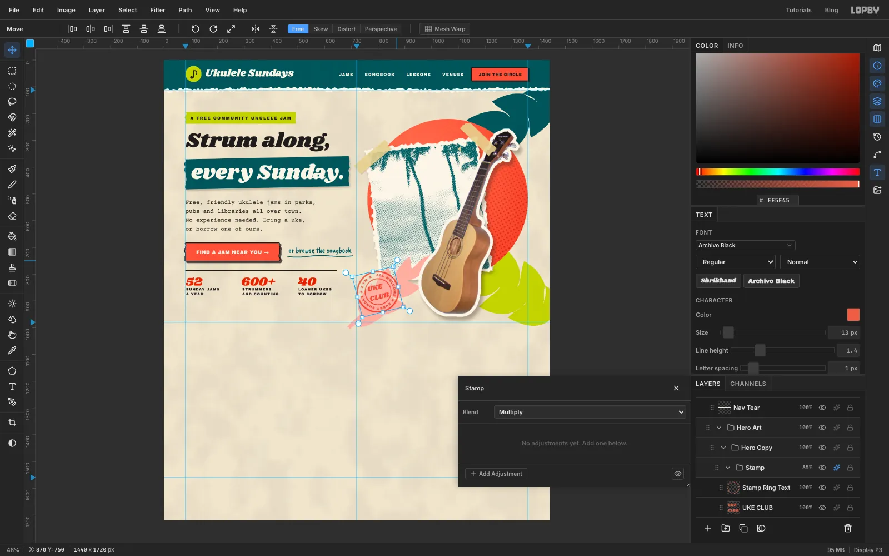

1. Click `Stamp Rings`. Type `ALL WELCOME ★ EVERY SUNDAY ★ 2 PM ★` in Archivo Black `13`, `#EE5E45`, letter spacing `1`. Paste the stars.
2. With the new text selected, choose the circle in the **Path** dropdown on the Text tool's options bar, and set **Align** to **Center**. The words wrap around the ring. If the end runs into the start, lower the size or the letter spacing a little.
3. Click `Stamp Rings`, set **Align** back to **Left**, and type `UKE` [[Enter]] `CLUB` in Shrikhand `26`, `#EE5E45`. The two lines share a left edge, so the longer CLUB steps out to the right a little, which suits a hand-cut rubber stamp. Move the block into the middle of the stamp.
4. Click the ✦ button on the `Stamp` group's row to open its drawer, and set the blend mode to **Multiply**. Click the group's opacity figure and set it to `85%`. The ink now darkens whatever it's stamped on, like real ink.
5. Text on a path can't be turned along with the rest of a group, so bake it first. Click the ring text layer (Lopsy names it `ALL WELCOME ★ …`) and click **Rasterize Layer** at the bottom of the Layers panel. Open the **Paths** panel, click the circle path and click **Delete Path**. You don't need the path any more.
6. Click the `Stamp` group and, with the **Move** tool, drag from just outside the top-right corner to turn it about **14°** counter-clockwise. Press [[Cmd+D]].

## Add a music-note sticker

1. Open the `Hero Art` and `Uke` groups and click `Tape 2`, so the note lands at the top of the `Uke` group. (The project file also has an empty `Note Base` layer here. It only marks the spot, and you can skip it.)
2. Type ♫ in Archivo Black `72`, `#1E1B19`. Move it to about `1385, 222`, on the teal leaf in the top-right corner.
3. Give it a **Stroke** of `6` in `#FBF5E8` and a **Drop Shadow** with **Offset X** `4`, **Offset Y** `6`, **Blur** `8`, **Opacity** `30` in `#3B2A1C`. That's the same die-cut sticker look as the ukulele.
4. With the **Move** tool, hover just outside the note's top-right corner until you see the crosshair, and drag to tilt it about **14°** clockwise. Text stays live while you rotate it.

## Head the events section

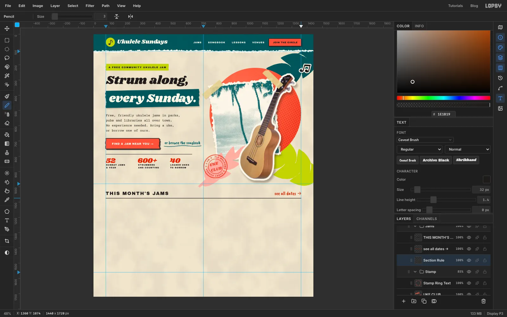

1. Collapse everything, click `Hero Copy` and add a group called `Jams`. Inside it, add a layer called `Section Rule`.
2. With `Section Rule` selected, type `THIS MONTH'S JAMS` in Archivo Black `30`, `#1E1B19`, letter spacing `4`. Move it to `x 80` with its top at `y 1032`.
3. Click `Section Rule` and type `see all dates →` in Caveat Brush `32`, `#C2300F`. Line its right end up with the `x 1360` guide, level with the heading.
4. Click `Section Rule`. Set the foreground back to `#1E1B19`, pick the **Pencil** at **Size** `3`, click at `80, 1072` and [[Shift]]-click at `1360, 1072`.

## Build the first card

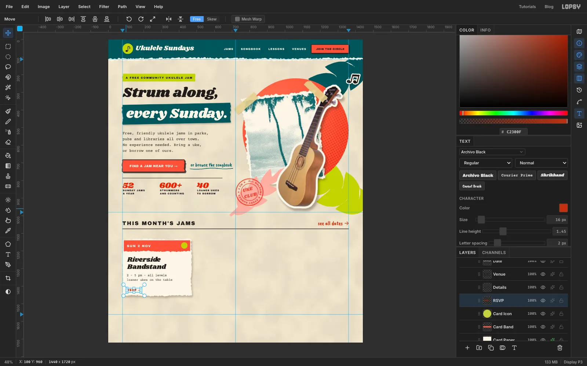

1. Click `Section Rule`, add a group called `Card 1`, and inside it a layer called `Card Paper`.
2. Lasso a ragged rectangle from `80, 1134` to `470, 1454` (390 × 320 px). Fill it with `#FBF5E8`, deselect, and give it a **Drop Shadow** of `6` / `10`, **Blur** `16`, **Opacity** `28`, in `#3B2A1C`.
3. Add a layer called `Card Band`. Lasso a band across the top of the card, about 60 px tall, keeping its sides just inside the card's torn edges so no coral pokes out. Give it a ragged bottom edge. Fill it with `#EE5E45`.
4. Add a layer called `Card Icon`. With the **Elliptical Marquee**, draw a 36 px circle near the band's right end, from `412, 1151` to `448, 1187`, fill it with `#C6D23E` and deselect.
5. With `Card Icon` selected, add the text, clicking `Card Icon` before each new piece:
   - `SUN 2 NOV` in Archivo Black `18`, `#FBF5E8`, letter spacing `3`, at `x 106`, centred on the band.
   - `Riverside` [[Enter]] `Bandstand` in Shrikhand `38`, `#1E1B19`, **Line height** `1.1`, at `x 106`, with its top at `y 1232`.
   - `2 – 5 pm · all levels` [[Enter]] `loaner ukes on the table` in Courier Prime `18`, `#1E1B19`, **Line height** `1.45`, 30 px below the title.
   - `RSVP →` in Archivo Black `16`, `#C2300F`, letter spacing `2`, near the bottom of the card with a comfortable margin under it.

## Duplicate it for the other two dates

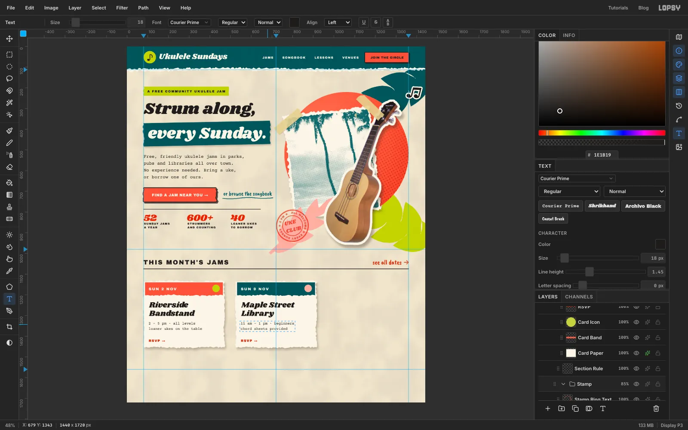

1. Click the `Card 1` group row and choose **Layer → Duplicate Layer**. The copy lands exactly on top of the original. Rename it `Card 2`.
2. With the **Move** tool, drag the copy to the right so its left edge sits at `x 525`, which is 445 px along. Watch **X** in the status bar as you drag, and finish with the arrow keys. The whole card moves as one.
3. Recolour the band: [[Cmd]]-click the `Card Band copy` thumbnail, click that layer, set the foreground to `#12545A` and choose **Edit → Fill**. Do the same for the icon with `#F3B1A4`. Deselect.
4. Retype the text. Click a raster layer in the card, pick the **Text** tool, click inside `SUN 2 NOV` on the new card, press [[Cmd+A]] and type `SUN 9 NOV`. Press [[Tab]]. Do the same for the title (`Maple Street` [[Enter]] `Library`) and the details (`11 am – 1 pm · beginners` [[Enter]] `chord sheets provided`).
5. Duplicate `Card 2` to make `Card 3` (its layers are named `… copy copy`), move it another 445 px right to `x 970`, and recolour its band to `#1E1B19` and its icon to `#EE5E45`. Change the text to `SUN 16 NOV`, `Lantern Night` [[Enter]] `on the Pier`, and `6 – 9 pm · bring a light` [[Enter]] `sing-along set list`.

## Tilt the cards

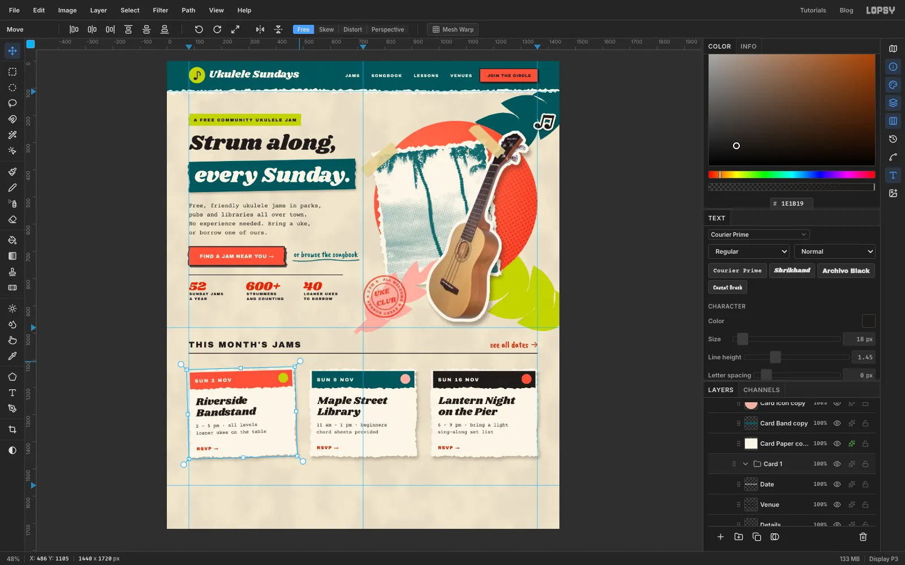

Paper that's been pinned up by hand is never quite straight. Click each card group in turn and, with the **Move** tool, drag from just outside its top-right corner to turn it a little:

- `Card 1`: about **1.5°** counter-clockwise
- `Card 2`: about **1°** clockwise
- `Card 3`: about **1°** counter-clockwise

Press [[Cmd+D]] after each one. The text inside turns with its card and stays editable.

## Tape the cards up

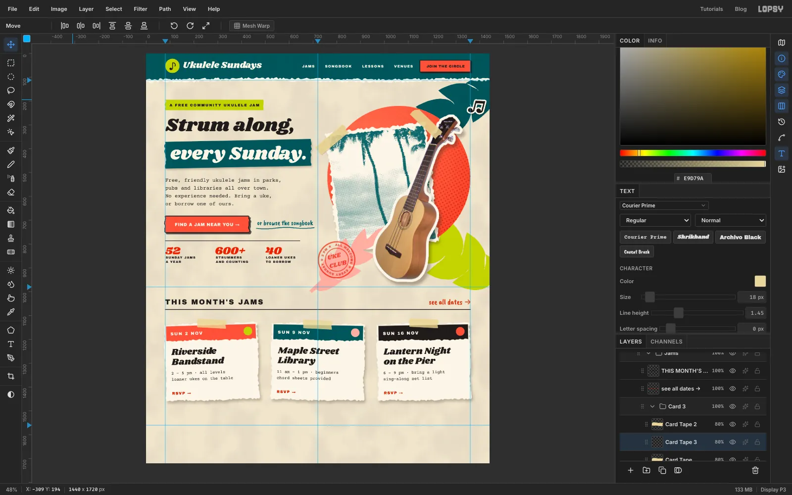

1. Click the `Card 3` group row and click **Add Layer**. The new layer goes inside the group, at the top. Name it `Card Tape`. All three strips will live together here, above every card. If you'd rather each card carried its own tape when you move it, add each strip inside its own card's group instead.
2. Lasso a 120 × 36 px strip across the top centre of the first card, half on the card and half above it, with ragged ends and a very slight tilt. Fill it with `#E9D79A`, deselect, and set the layer to `80%`.
3. Click `Card Tape`, [[Cmd]]-click its thumbnail, and press [[Cmd+C]] and [[Cmd+V]]. With the **Move** tool, drag the copy across onto the top of the second card, a few pixels lower than the first so the strips don't look stamped out. Use the arrow keys for the last few pixels. Set it to `80%`.
4. Do it once more for the third card.

## Tear the footer

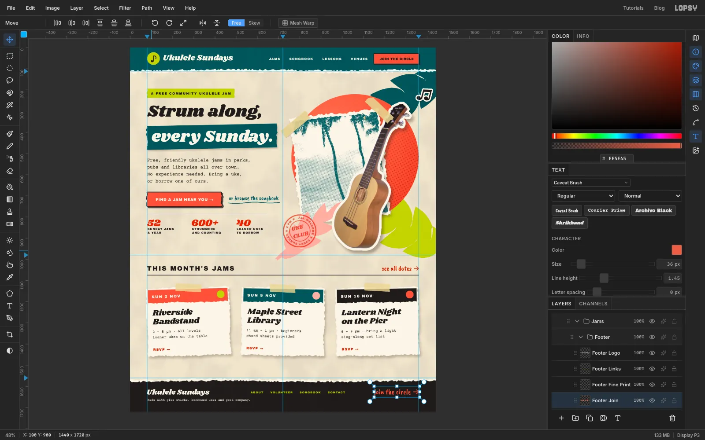

1. Collapse the groups, click `Jams` and add a group called `Footer`. Inside it, add `Footer Tear` and `Footer Paper` layers, the same way as the nav.
2. On `Footer Tear`, Lasso from below the bottom of the page up to a ragged top edge around `y 1568`, and fill it with `#FBF5E8`. On `Footer Paper`, draw the same shape with its ragged edge about 8 px lower and fill it with `#1E1B19`.
3. Click `Footer Paper` before each piece of text:
   - `Ukulele Sundays` in Shrikhand `34`, `#FBF5E8`, at `x 80`, centred on `y 1628`
   - `ABOUT     VOLUNTEER     SONGBOOK     CONTACT` in Archivo Black `13`, `#C6D23E`, letter spacing `2`, centred on `x 790` at the same height
   - `Made with glue sticks, borrowed ukes and good company.` in Courier Prime `15`, `#FBF5E8`, 14 px under the wordmark
   - `join the circle →` in Caveat Brush `36`, `#EE5E45`, ending at the `x 1360` guide. Bright coral is fine here, because it's on black.

## Finish with a print grain

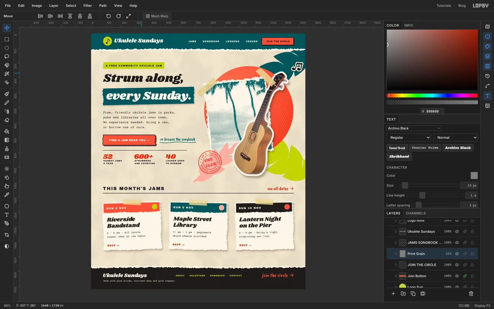

1. Open the `Nav` group, click `JOIN THE CIRCLE` and add a layer called `Print Grain`. The `Nav` group sits above all the others, so the grain covers everything except the nav's own text above it.
2. Fill it with `#808080`, choose **Filter → Add Noise…** with **Amount** `12`, **Mono** and **Gaussian**, set it to **Overlay** at `22%`.
3. Choose **View → Show Guides** to hide the guides and look at the page as a whole.

One shared grain makes the separate photos, papers and inks look like they were printed together. Export it with **File → Quick Export PNG**, and save the project with **File → Save Project** so you can come back and change the dates next month.
