Every August, someone on the street has more zucchini than they know what
to do with. This flier invites the neighbours to a potluck to deal with it,
and it's made the way you'd make one at the kitchen table: cut and torn
paper, photos snipped out of a magazine, letters clipped from different
headlines, a bit of masking tape and a marker.

Collage looks good when it looks like real material. In this tutorial
you'll fake each material in Lopsy. Torn edges show a white fibre core,
cut-outs get a white scissor border and a shadow, scraps get a little
grain, and nothing sits perfectly straight. The flier is a US-letter page
at **1275 × 1650 px**.

Along the way you'll use:

- **Add Noise**, **Fibers** and **Clouds** for kraft paper
- **Define Pattern** and **Fill with Pattern** for a gingham tablecloth
- the **Lasso** for torn paper, and a radial **Gradient** plus **Halftone** for printed dots
- the **Magic Wand**, **Grow**, **Shrink** and **Select Inverse** to cut photos out
- the Move tool's **Flip**, scale and rotation handles
- **Stroke** and **Drop Shadow** effects for cut-out borders
- **Hue/Saturation**, **Merge Down**, copy and paste, groups and blend modes
- live text in eleven Google fonts, rotated with the Move tool

You'll need three photos. Any zucchini photographed on white will do. I
used two public-domain photos by Evan-Amos on Wikimedia Commons
(*Zucchini-Whole* and *CSA-Striped-Zucchini*) and a courgette flower by
Ruth Hartnup (*Courgette flower*, CC BY 2.0), cropped and scaled to about
900, 860 and 600 px wide.

The palette:

- Kraft paper `#CDB48E`, paper core `#FBF7EE`, notebook paper `#FCFAF3`, scissor border `#FFFDF6`
- Gingham `#B8322B` / `#E79C8F` / `#FBF6EC`
- Disc orange `#F4A417`, halftone `#FFFFFF` → `#D2601E`
- Leaf green `#2E5E3B`, vein green `#1B4127`
- Ink black `#1E1A17`, POTLUCK yellow `#FFCB3D`, tomato red `#C7362B`
- Scraps sky `#A9CBE3`, newsprint `#DAD5C8`, sage `#86A957`, cream `#FBF8F0`
- Letter yellow `#F2B42C`, letter cream `#F6EEDB`
- Tape `#EFE3B5`, ballpoint blue `#1F3F8A`, rule blue `#8DB5D9`, margin red `#D8605A`
- Shadow brown `#3A2A14` / `#2A1A08`
- Grain grey `#808080` (disappears in Overlay, so only the speckle shows)

> **Tip:** Positions are in document pixels, written `x, y`. The status bar
> at the bottom shows where the pointer is. **Edit → Fill** fills the
> selection with the foreground colour, and [[Cmd+D]] deselects. New layers
> appear directly above the selected layer, and inside a group when the
> selected row is an *expanded* group. Each layer row has a sparkle icon
> that opens its effects drawer; the **Blend** dropdown is in there too.

> **Tip:** The Move tool shows scale and rotation handles around a
> selection, so to transform a whole layer, [[Cmd]]-click its thumbnail
> first. That selects everything on the layer. Press [[Enter]] to apply a
> transform. Clockwise and anticlockwise are as you look at the screen.

> **Tip:** For exact rectangles, pick the **Rectangular Marquee**, make
> sure nothing is selected and click the canvas once without dragging. A
> dialog asks for the **From X / Y** and **To X / Y** corners.

## Set up the canvas and guides

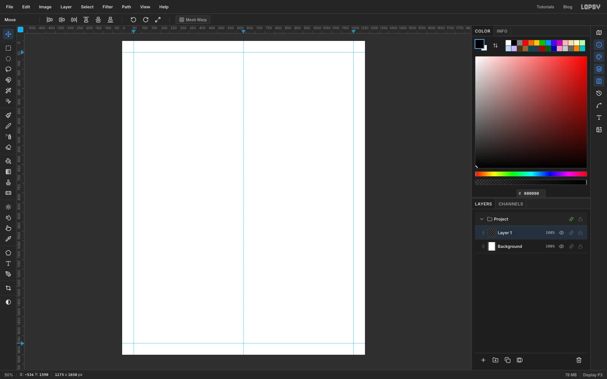

Choose **File → New**, set **Width** `1275` and **Height** `1650`, pick a
**White** background and click **Create**.

Click the top ruler at `60`, `637` and `1215` to drop three vertical
guides, and the left ruler at `60` and `1590` for two horizontal ones.
They mark the margins and the centre line, so you can see when something
is crowding an edge.

## Make the kraft paper

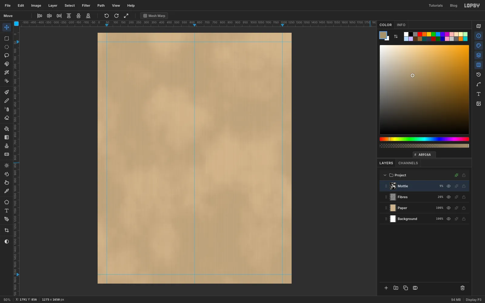

Double-click *Layer 1* and rename it *Paper*. Set the foreground to
`#CDB48E`, press [[Cmd+A]] and choose **Edit → Fill**. Deselect, then choose
**Filter → Add Noise…** with **Amount** `10`, **Mono** and **Gaussian**.

Add a layer named *Fibres*, fill it with any colour and run
**Filter → Fibers…** with **Variance** `4` and **Strength** `48`. The
filter replaces the layer with grey strands. Set its blend mode to
**Soft Light** and its opacity to **20%**.

Add one more layer, *Mottle*, fill it and run **Filter → Clouds…** at
**Scale** `6`. Set it to **Multiply** at **9%**. Real paper is never one
flat colour, and these two layers give it fibre and blotchiness.

## Draw a gingham tile

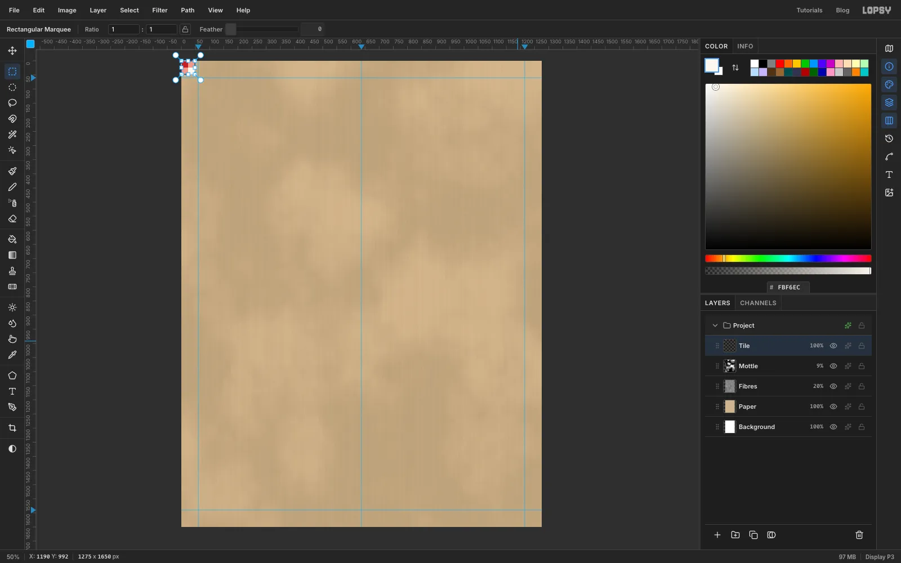

Gingham is two sets of see-through red stripes crossing. Where they cross
the red is dark, where only one stripe runs it's pink, and between them
it's cream. One 48 px tile captures that.

Add a layer named *Tile*. Use the exact-corners dialog to fill four 24 px
squares in the top-left corner:

- `0, 0` to `24, 24` in dark red `#B8322B`
- `24, 0` to `48, 24` and `0, 24` to `24, 48` in pink `#E79C8F`
- `24, 24` to `48, 48` in cream `#FBF6EC`

Select `0, 0` to `48, 48` and choose **Edit → Define Pattern**. Name it
*Gingham*. Deselect and delete the *Tile* layer with the bin button at the
bottom of the Layers panel. The pattern stays defined.

## Tear the tablecloth edge

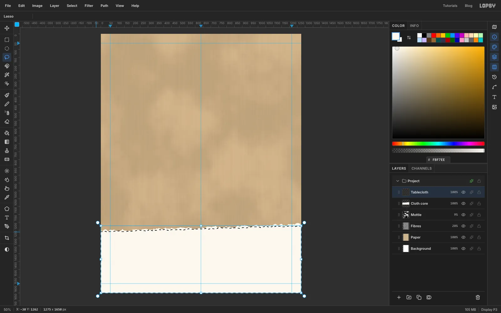

Torn paper has a white core that shows along the rip. So every torn piece
in this flier is two layers: a slightly bigger off-white one underneath and
the coloured one on top.

Add a layer named *Cloth core*. With the **Lasso**, drag a loop that starts
off the left edge at about `y 1260`, runs across to the right edge at about
`y 1222`, then goes down past the bottom of the canvas and back. Keep your
hand jittery along the top so the edge wobbles; the sides and bottom can
be rough because they're off the canvas. Fill it with `#FBF7EE` and
deselect.

Add a layer named *Tablecloth* and lasso the same shape again, a few pixels
lower along the top. Your hand won't follow exactly the same path, and
that's what makes the white core show in uneven slivers.

## Fill the tablecloth with gingham

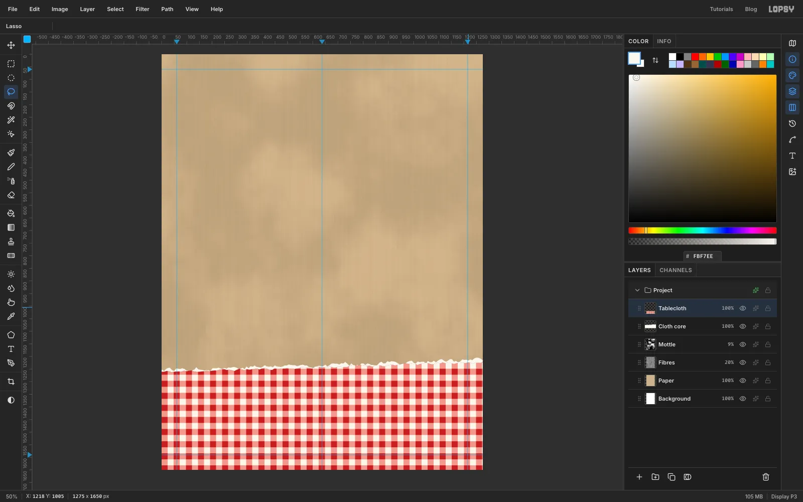

With the selection still active, choose **Edit → Fill with Pattern…**.
Click the gingham swatch, leave **Scale** at `100` and click **Apply**.
Deselect, then run **Filter → Add Noise…** at **Amount** `6`, **Mono**,
**Gaussian**, so the checks look printed rather than perfect.

## Tear a big orange disc

The disc is the stage for the zucchini. Click the *Mottle* row so the new
layers go under the tablecloth, and add a layer named *Disc core*. Lasso a
circle about `430` px in radius centred on `637, 640`, with a shaky edge.
Fill it with `#FBF7EE` and deselect.

Add a layer named *Disc*. Lasso a second circle, about `420` px in radius,
inside the first, and fill it with orange `#F4A417`. Keep the selection.

## Shade the disc with halftone dots

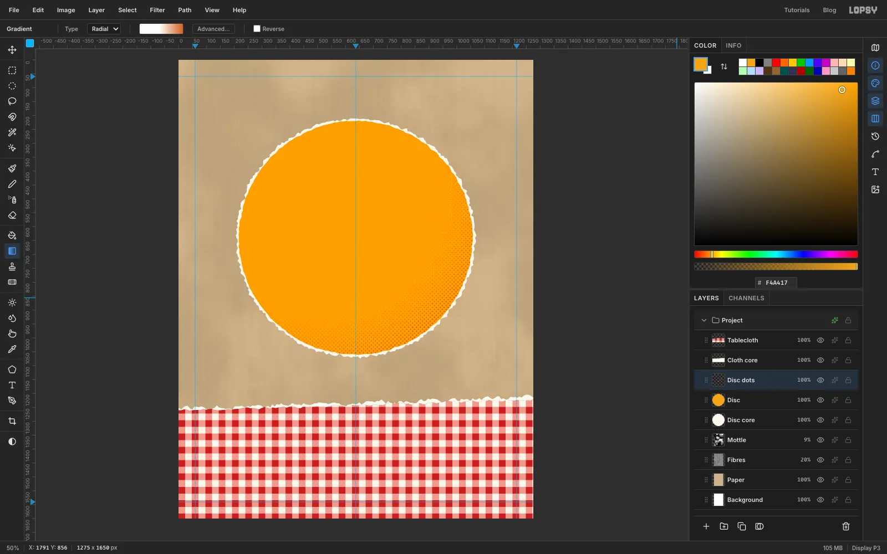

Add a layer named *Disc dots*; the disc selection is still active. Pick the
**Gradient** tool, set the type to **Radial** and click **Advanced…**. Make
three stops: `#FFFFFF` at 0%, `#FFFFFF` again at about 45%, and burnt
orange `#D2601E` at 100%. Drag from `520, 500`, up and left of centre,
down to `1010, 1010`.

Choose **Filter → Halftone…** with **Dot Size** `14`, **Density** `1.4`,
**Angle** `45` and **Softness** `0.4`. White prints no dots, so only the
lower right edge gets them. Deselect and set the layer's blend mode to
**Multiply**. The dots then darken the orange like ink on paper.

## Cut out a squash leaf

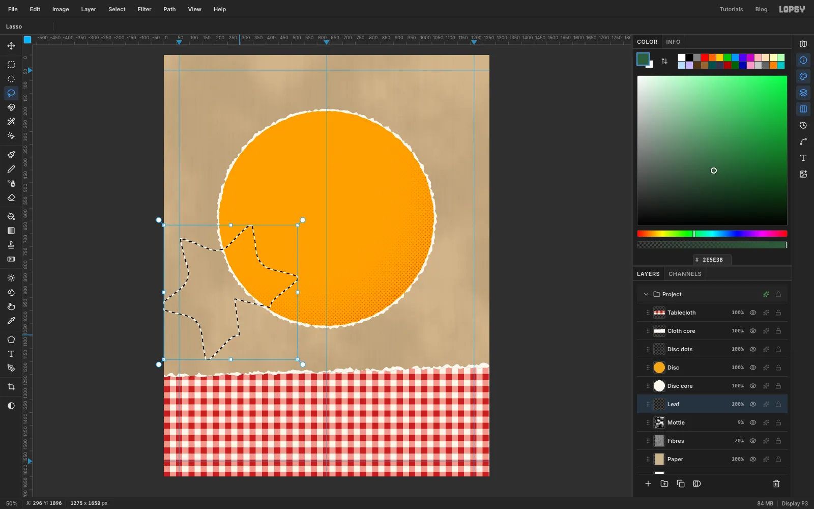

Click the *Mottle* row again so the leaves go behind the disc, and add a
layer named *Leaf*. A squash leaf has five broad, pointed lobes, a bit like
a maple leaf with softer corners. Lasso one centred on about `255, 930`,
roughly 570 px across, with its middle lobe pointing up and to the left.
It can run off the left edge of the canvas. Fill it with `#2E5E3B` and
deselect.

## Paint the veins

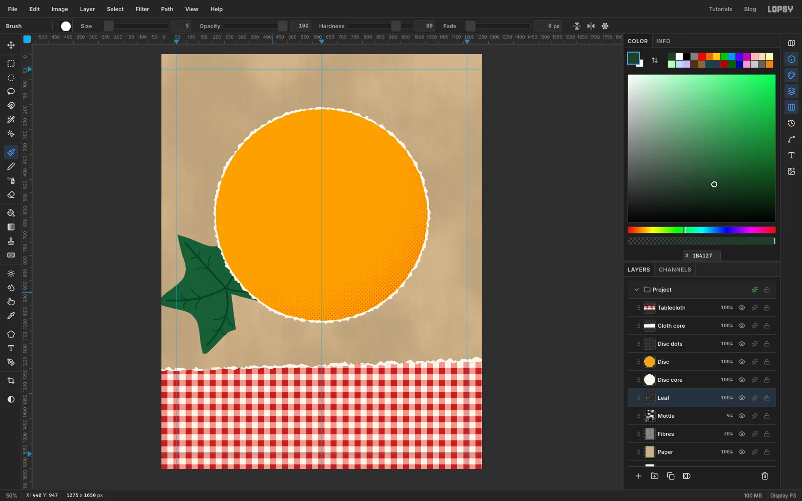

Pick the **Brush**, set the foreground to `#1B4127` and **Size** to `8`.
From the stem at the leaf's base, paint a gently curving midrib out to each
of the five lobe tips. Then set **Size** to `5` and paint two short side
veins on each side of every midrib, angled towards the tip.

## Copy the leaf and flip it

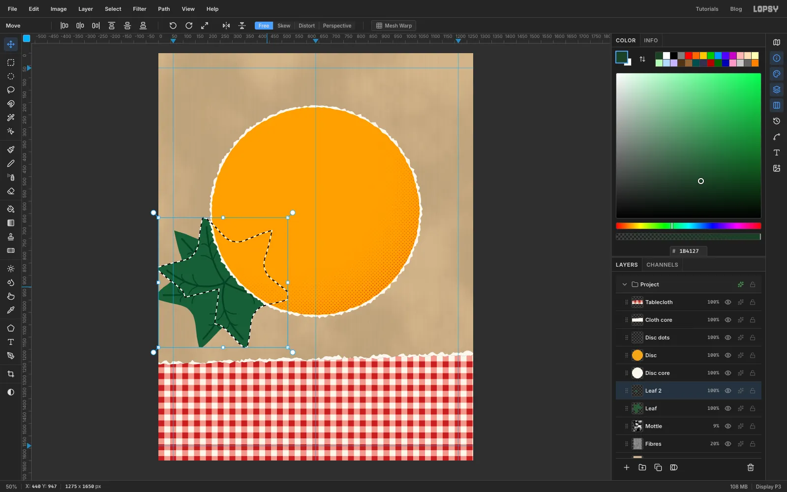

[[Cmd]]-click the *Leaf* thumbnail to select the leaf, then press
[[Cmd+C]] and [[Cmd+V]]. The copy is pasted in place as a new layer;
rename it *Leaf 2*. [[Cmd]]-click its thumbnail so it's selected, pick the
**Move** tool and click **Flip Horizontal** in the options bar.

## Scale the copy down

Hold [[Cmd]] and drag the top-right corner handle about 110 px down and
to the left. [[Cmd]] keeps the proportions.

## Rotate the copy

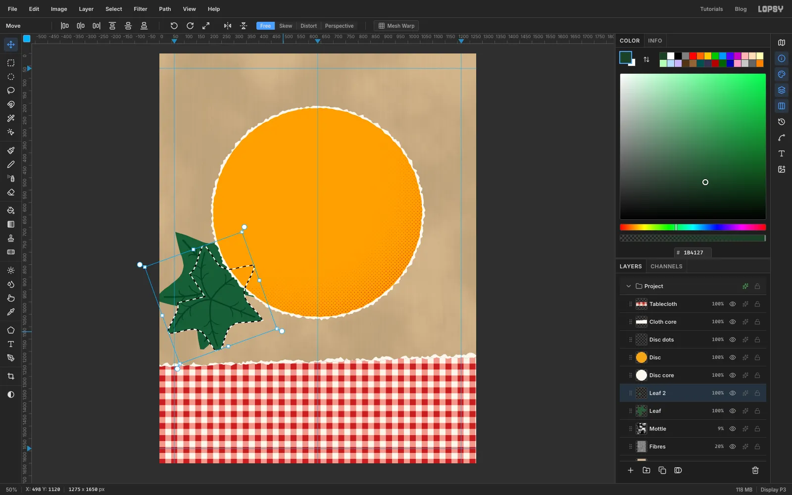

Hover just outside the top-right corner until the round rotation handle
lights up, then drag it about 70° clockwise. Press [[Enter]] to apply and
[[Cmd+D]] to deselect.

## Place and recolour the second leaf

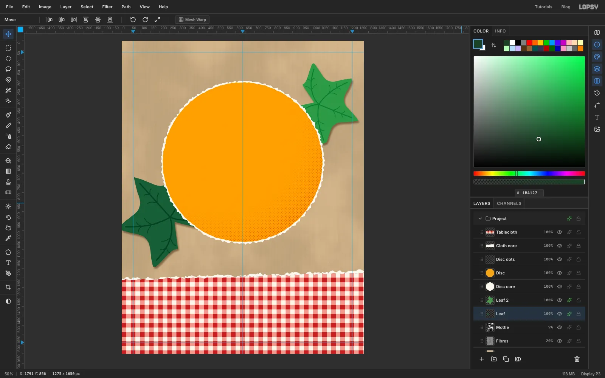

With the **Move** tool, drag the copy up to the top right so it peeks out
from behind the disc, centred around `1055, 330`.

Choose **Filter → Hue/Saturation…** with **Hue** `-16`, **Saturation**
`-8` and **Lightness** `18`. That gives a lighter, yellower green, and the
veins stay darker than the leaf. Open the effects drawer and turn on
**Drop Shadow**: **Offset X** `6`, **Offset Y** `10`, **Blur** `12`,
**Opacity** `55`, colour `#3A2A14`. Give the *Leaf* layer the same shadow.
Every piece in the flier casts its shadow down and to the right, as if one
lamp is shining on the table.

## Drop in the first zucchini photo

Click the *Tablecloth* row so the photos go above everything so far. Drag
the dark green zucchini photo from your desktop onto the canvas. It lands
in the top-left corner on a new layer; rename it *Zucchini*.

## Select the white background

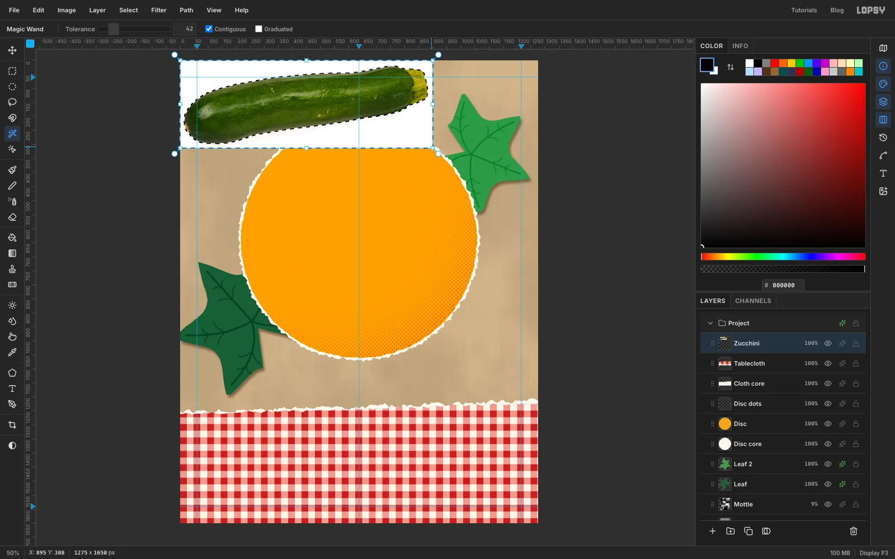

Pick the **Magic Wand**, set **Tolerance** to `42` and leave **Contiguous**
on. Click the white in the photo's top-left corner, then [[Shift]]-click
the white in the bottom-right corner to add the rest. Press [[Delete]] and
deselect.

## Trim the grey fringe

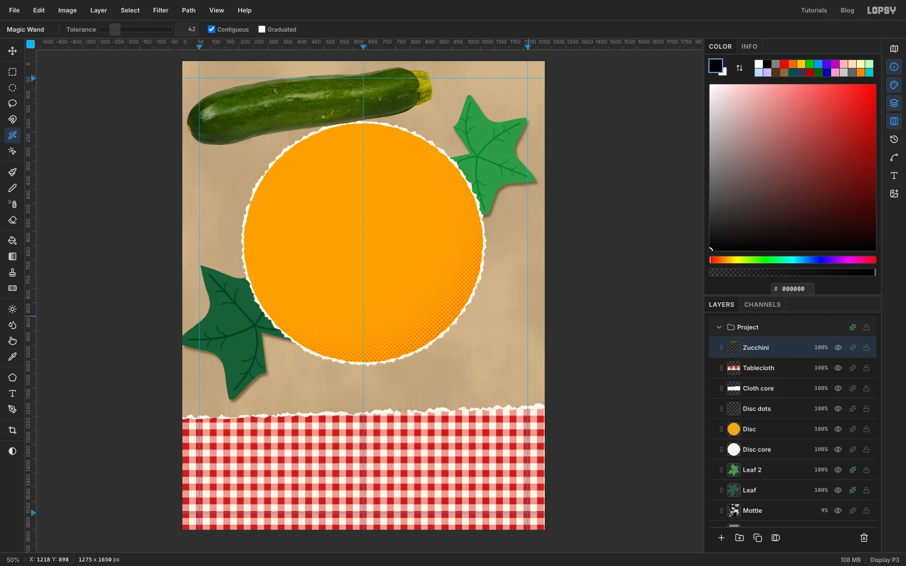

The photo's soft grey shadow leaves a faint rim. [[Cmd]]-click the
*Zucchini* thumbnail, choose **Select → Shrink…** with `2`, then
**Select → Inverse** ([[Cmd+Shift+I]]) and press [[Delete]]. Deselect.

## Scale the zucchini

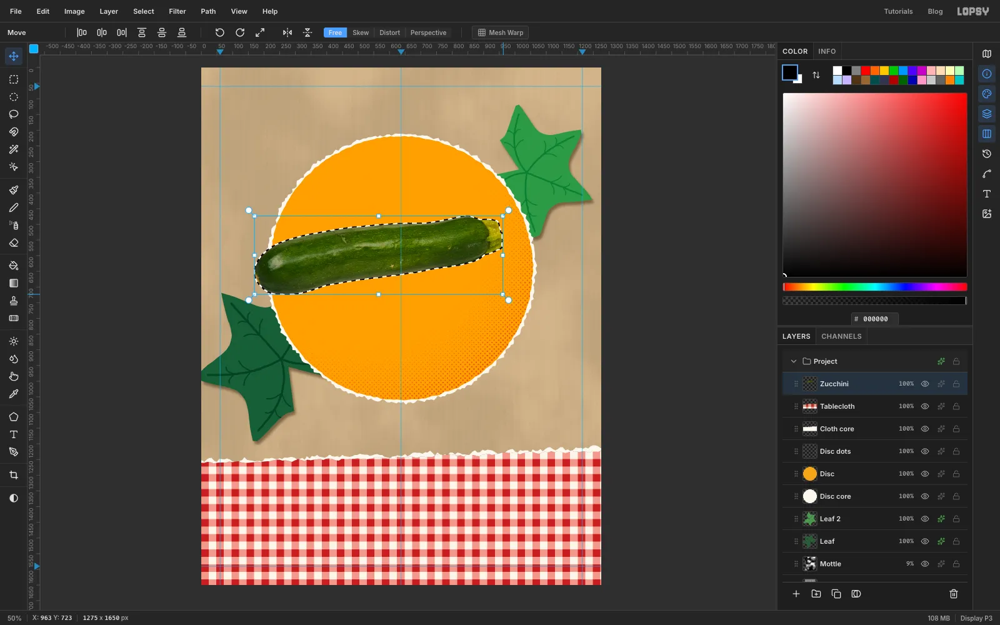

With the **Move** tool, drag the zucchini onto the disc, centred around
`600, 610`. [[Cmd]]-click its thumbnail, then [[Cmd]]-drag the
bottom-right corner handle about 70 px in to make it a little smaller.
Press [[Enter]] and deselect.

## Rotate it on the diagonal

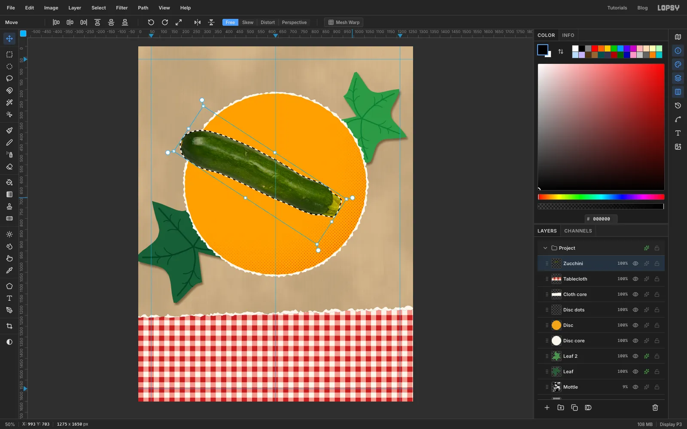

[[Cmd]]-click the thumbnail again and drag the rotation handle at the
top-right corner about 33° clockwise, so the zucchini runs from the upper
left of the disc towards the lower right. Press [[Enter]] and deselect.

## Give it a scissor border

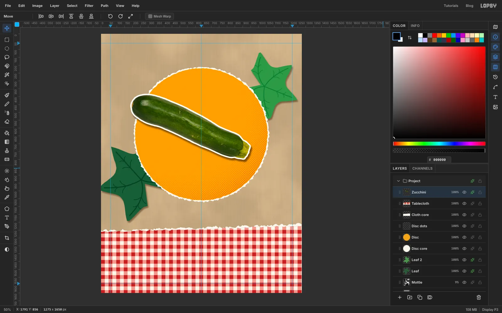

Open the effects drawer. Turn on **Stroke** with **Width** `9`, position
**outside**, colour `#FFFDF6`. That's the white margin you get when you cut
a photo out with scissors. Turn on **Drop Shadow** with **Offset X** `8`,
**Offset Y** `14`, **Blur** `12`, **Opacity** `60`, colour `#2A1A08`. The
photos sit higher off the page than the paper scraps, so their shadows are
deeper.

## Cut out the striped zucchini

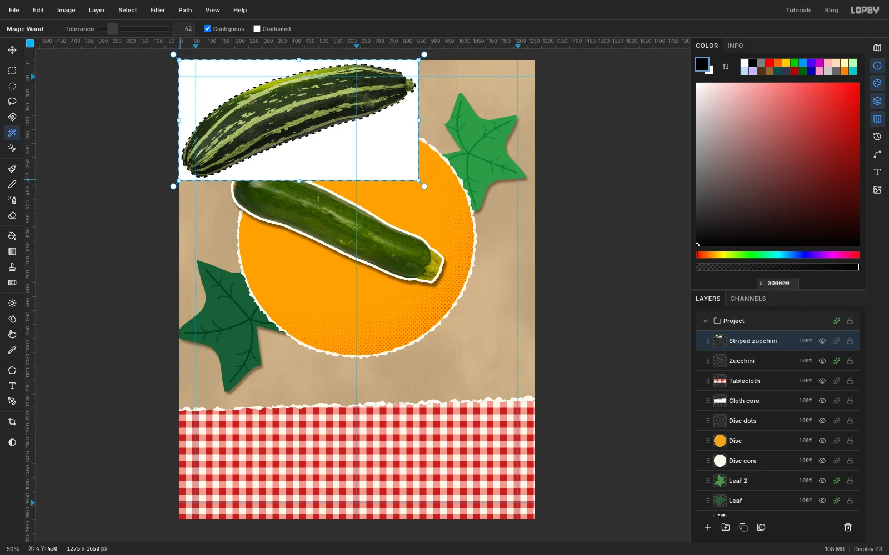

Drag in the striped zucchini photo and rename it *Striped zucchini*. Cut
it out the same way as the first. Click the white in one corner with the
**Magic Wand** (still at `42`), then [[Shift]]-click the white in the other
corners until the ants run all around the zucchini. Press [[Delete]] and
deselect. Then trim the fringe: [[Cmd]]-click the thumbnail,
**Shrink** `2`, [[Cmd+Shift+I]], [[Delete]], deselect.

## Cross it over the first one

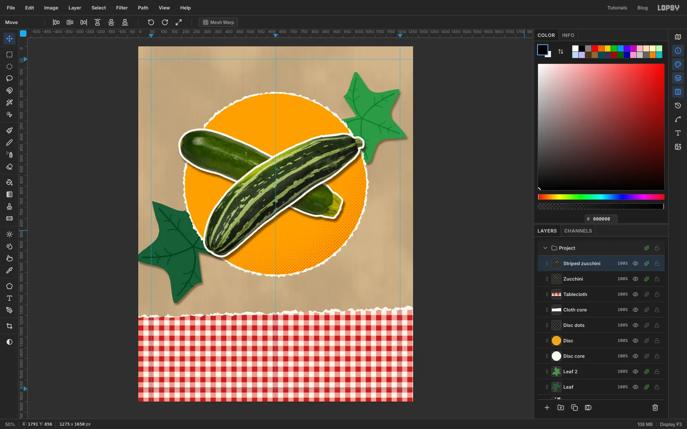

Drag it with the **Move** tool onto the disc, centred around `675, 680`.
The photo already lies on a slant, rising to the right, so it only needs a
small turn: [[Cmd]]-click its thumbnail and rotate it about 16°
anticlockwise until it crosses the first zucchini in a steep X. Press
[[Enter]], deselect, and give it the same **Stroke** and **Drop Shadow**
as the first.

## Select the blossom's petals

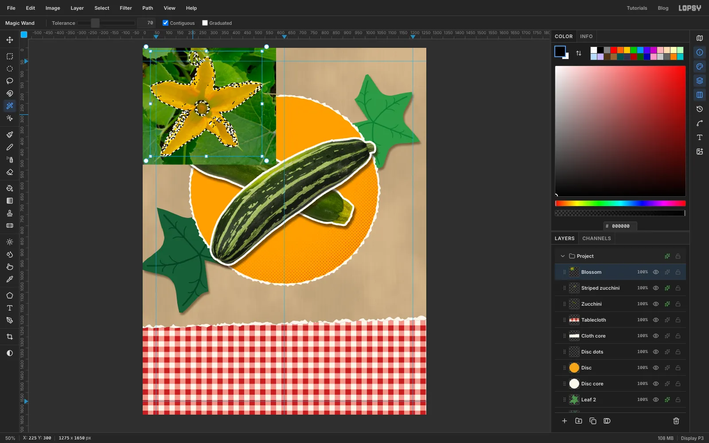

Drag in the courgette flower and rename it *Blossom*. This photo has leaves
behind it rather than white, so select the flower instead of the
background. Set the **Magic Wand** **Tolerance** to `70`, click one petal,
then [[Shift]]-click each of the other four petals and the green centre.

## Close the holes and cut it out

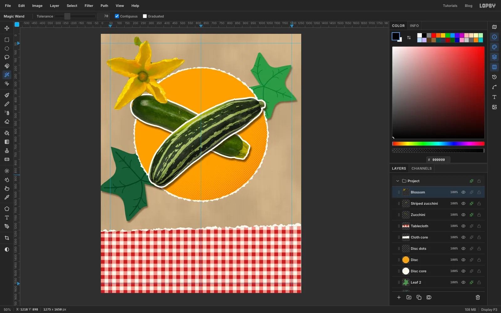

The bright, hairy petal edges leave little gaps in the selection. Choose
**Select → Grow…** `8`, then **Select → Shrink…** `10`. Growing closes the
gaps, and shrinking by a little more than you grew pulls the edge just
inside the green fringe. Press [[Cmd+Shift+I]], [[Delete]], and deselect.

## Pin the blossom where the zucchini cross

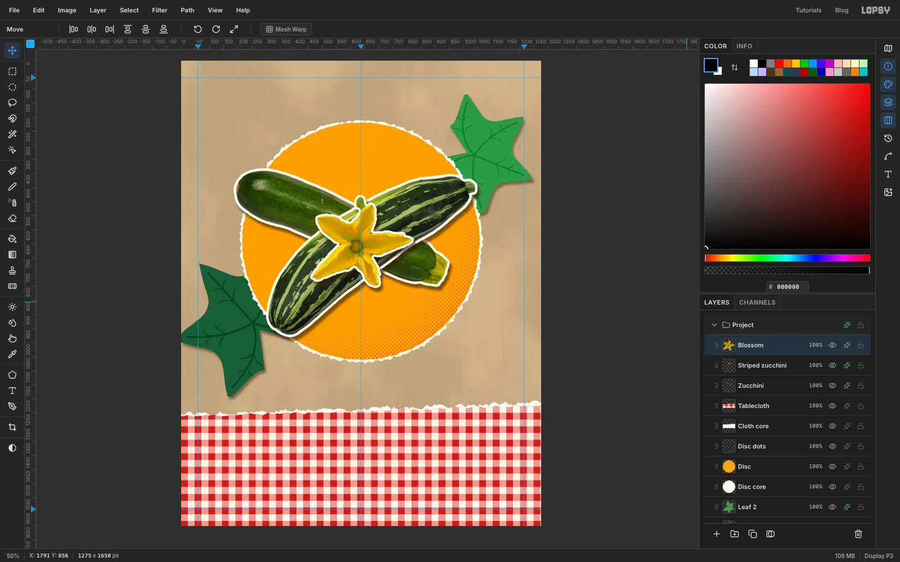

Move the blossom to the disc, then [[Cmd]]-click its thumbnail and
[[Cmd]]-drag a corner about 150 px inwards. Press [[Enter]], select it
again and rotate it about 14° clockwise. Move it so its centre sits right
where the zucchini cross, at about `640, 640`. Give it a **Stroke** of
**Width** `8` in `#FFFDF6` and the same deep **Drop Shadow** as the photos.

## Tear a black strip for POTLUCK

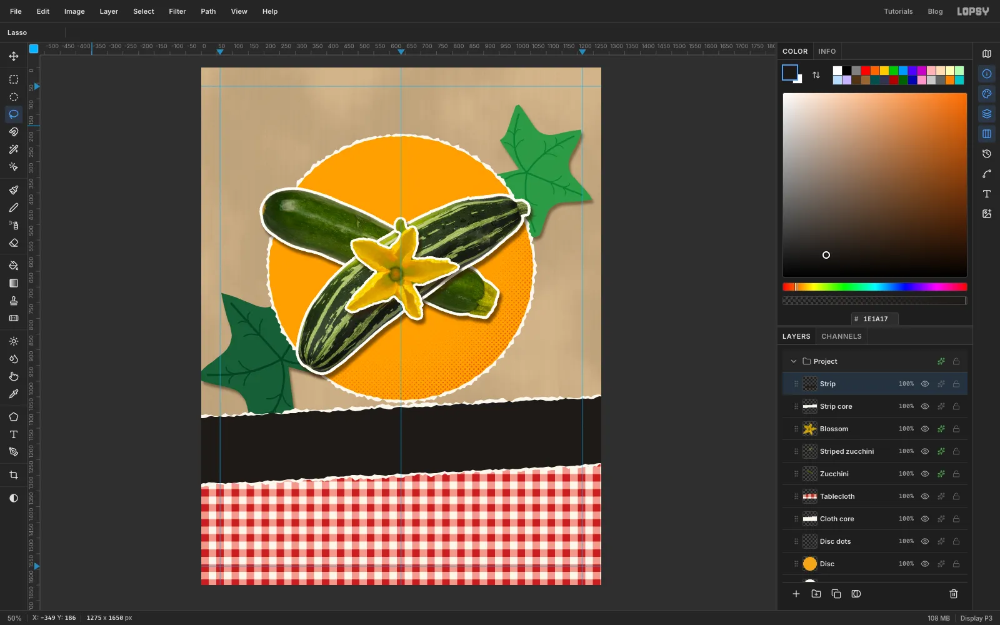

Click the *Blossom* row. As with the tablecloth, make an off-white
*Strip core* layer and a *Strip* layer on top of it. On *Strip core*, lasso a
band that runs slightly uphill, from about `y 1118` to `1330` at the left
edge up to `y 1050` to `1262` at the right. Wobble the top and bottom
edges; the ends run off the canvas. Fill it with `#FBF7EE` and deselect.
On *Strip*, lasso the same band again a little inside the first, fill it
with `#1E1A17` and deselect.

## Set POTLUCK

With *Strip* selected, pick the **Text** tool. Choose **Bowlby One** in
the font menu, set **Size** to `170` and the foreground to `#FFCB3D`.
Click on the strip, type `POTLUCK` and click the ✓ to commit.

With the **Move** tool, nudge it with the arrow keys
([[Shift]] + arrow moves 10 px) until the word is centred on `637, 1184`.

## Tilt POTLUCK to match the strip

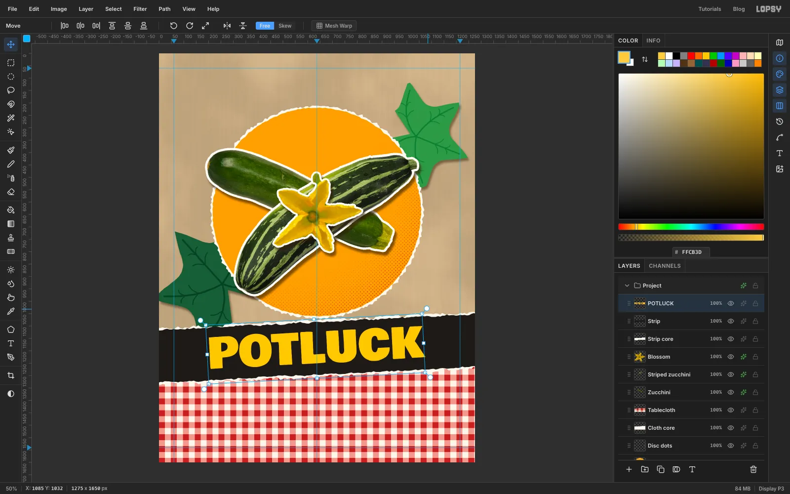

The strip climbs about 3°, so the word should too. With the text layer
selected and the **Move** tool active, drag the rotation handle at the top
right of its box about 3° anticlockwise. The text stays live and editable.
Press [[Enter]], then nudge it back to centre if it drifted.

## Start the ransom-note headline

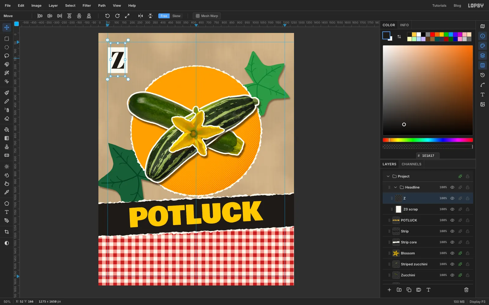

Each letter of ZUCCHINI gets its own scrap of paper and its own font, like
letters clipped from different magazines. Click **New Group** in the
Layers panel and name it *Headline*. With the group selected, click
**Add Layer** to start the first scrap inside it. I named the scraps
*Z0 scrap*, *U1 scrap* and so on, so the two Cs and two Is stay apart.

Select `62, 94` to `190, 262` with the exact-corners dialog and fill it
with cream `#FBF8F0`. Run **Filter → Add Noise…** at `9`, **Mono**,
**Gaussian** so it looks like paper. Then, with the scrap still selected
in the Layers panel, pick the **Text** tool, choose **Abril Fatface** at
`155` in black `#1E1A17`, click on the scrap, type `Z` and commit. Nudge
the letter with the arrow keys until it sits in the middle of the
scrap.

## Merge each letter and tilt its scrap

Once the letter sits on its scrap, choose **Layer → Merge Down**. The
letter is now printed on that piece of paper. [[Cmd]]-click the scrap's
thumbnail and drag a rotation handle a few degrees, about 6°
anticlockwise for the Z. Press [[Enter]] and deselect.

Give the scrap a small **Drop Shadow**: **Offset X** `4`, **Offset Y**
`7`, **Blur** `8`, **Opacity** `45`, colour `#3A2A14`. The screenshot shows
this a few letters later, with the H being tilted.

## Finish the headline

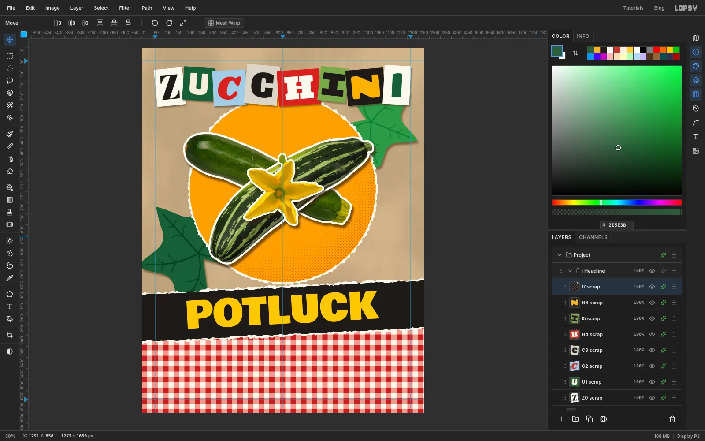

Do the other seven the same way. Before each one, click the previous
scrap's row and click **Add Layer**, so the new scrap lands on top. Each
scrap overlaps the one before by a few pixels. Alternate the tilt so the
word bounces:

- **U**: `186, 89` to `326, 239` in green `#2E5E3B`, Bungee `132` in cream
  `#F6EEDB`, a little clockwise
- **C**: `322, 102` to `472, 262` in sky `#A9CBE3`, Shrikhand `152` in red
  `#C7362B`, a little anticlockwise
- **C**: `468, 79` to `618, 257` in newsprint `#DAD5C8` (Add Noise `14`
  here), Alfa Slab One `142` in black, clockwise
- **H**: `615, 100` to `805, 260` in red `#C7362B`, Ultra `143` in cream
  `#FBF8F0`, anticlockwise
- **I**: `801, 89` to `929, 244` in sage `#86A957`, Rubik Mono One `143` in
  black, clockwise
- **N**: `925, 97` to `1097, 257` in black `#1E1A17`, Chango `147` in
  yellow `#F2B42C`, anticlockwise
- **I**: `1093, 81` to `1213, 257` in cream `#FBF8F0`, Titan One `154` in
  green `#2E5E3B`, a little clockwise

Step back and check that each letter sits in the middle of its scrap with
an even margin. If one looks low, nudge it before you merge.

## Select the POTLUCK letters

A cheap print job often has a second ink that doesn't quite line up. Click
the *Strip* row and add a layer named *Potluck red*, which sits between
the strip and the word. [[Cmd]]-click the *POTLUCK* thumbnail to select
the letters.

## Offset a red under-print

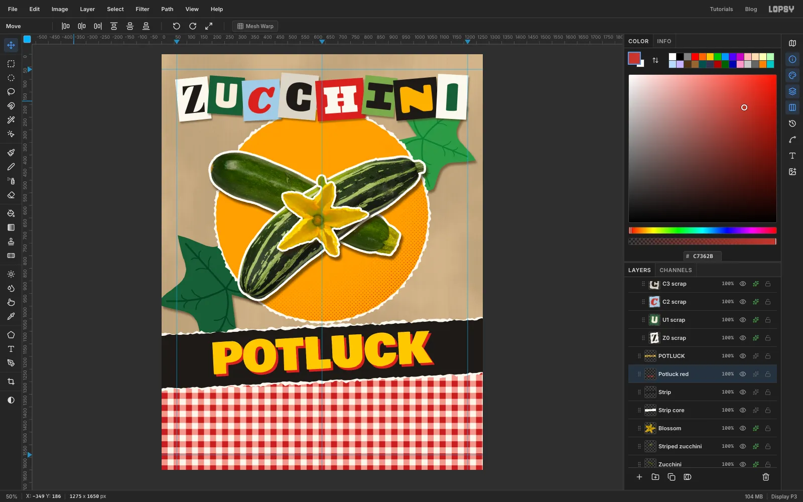

Fill the selection with tomato red `#C7362B` and deselect. Pick the
**Move** tool and press the right arrow and the down arrow 9 times each.
The red now peeks out from under the yellow like a misregistered second
colour.

## Type the details on paper slips

Click the arrow on the *Headline* group to collapse it, click its row, and
click **New Group**. Name the new group *Info*. The details go on slips
that look typed on a typewriter, in **Special Elite**:

- *Date slip*: `58, 1326` to `918, 1418` in cream `#FBF8F0`,
  `SATURDAY, AUGUST 29 · 5 PM` at size `54`, tilted a couple of degrees
  anticlockwise
- *Place slip*: `81, 1431` to `823, 1505` in sky `#A9CBE3`,
  `ELM STREET COMMUNITY GARDEN` at `42`, tilted a degree or two clockwise
- *Free slip*: `95, 1526` to `705, 1586` in yellow `#FFCB3D`,
  `FREE · ALL NEIGHBOURS WELCOME` at `32`, tilted about a degree
  anticlockwise

Build each one like a headline scrap: add a layer, fill the rectangle, run
**Add Noise** at `9`, type in black `#1E1A17`, centre the text,
**Merge Down**, rotate, and give it the small scrap shadow. The middle dot
is [[Option+Shift+9]] on a Mac (or paste it in).

## Rule a notebook page

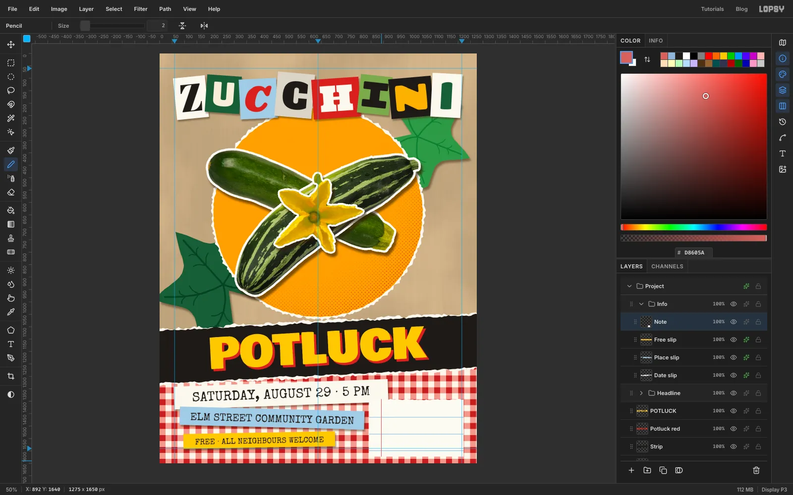

Click the *Free slip* row and add a layer named *Note*. Build it flat
first and tilt it at the end, so the lines and the handwriting tilt
together. Lasso a rectangle from about `842, 1393` to `1222, 1623`, wobbly
along the top where it was torn out of the pad. Keep the other sides as
straight as you can. Fill it with `#FCFAF3` and deselect.

[[Cmd]]-click the *Note* thumbnail so the lines stay on the paper. Pick
the **Pencil**, set **Size** to `2` and the foreground to `#8DB5D9`. For
each rule, click at the left edge and [[Shift]]-click at the right edge:
one at `y 1465`, one at `y 1532` and one at `y 1599`. Then draw the margin
in `#D8605A`: click at `892, 1380` and [[Shift]]-click at `892, 1640`.
Deselect.

## Write the note by hand

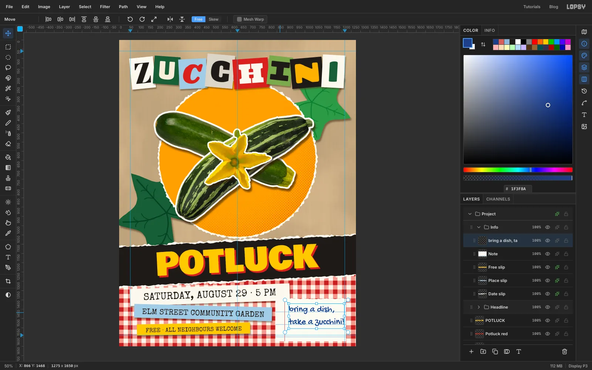

With the **Text** tool, choose **Gochi Hand** at size `48` and colour
`#1F3F8A`. Click inside the note, type `bring a dish,`, press [[Enter]],
type `take a zucchini!` and commit.

Gochi Hand at 48 has about the same line spacing as the rules, so both
lines can sit on them. Nudge the text until the bottom of the `!` rests on
the middle rule and the text starts just right of the margin, at about
`x 910`. Don't line up the bottom of the `z`. Gochi Hand's z has a tail
that drops below the line.

## Tilt the note

Choose **Layer → Merge Down** to put the writing on the paper.
[[Cmd]]-click the *Note* thumbnail and rotate it about 4° clockwise with a
rotation handle, then press [[Enter]] and deselect. Give it a **Drop
Shadow** with **Offset X** `5`, **Offset Y** `8`, **Blur** `10`,
**Opacity** `45` in `#3A2A14`.

## Tear a strip of masking tape

Add a layer named *Tape* above the note. Lasso a strip about 150 × 44 px
across the left end of the date slip, around `92, 1350`, tilted about 28°
uphill. Keep the long sides straight and make the short ends zigzag, the
way tape tears off the roll. Fill it with `#EFE3B5`, deselect, and run
**Filter → Add Noise…** at `10`, **Mono**, **Gaussian**.

## Copy the tape to the other corners

Click the *Tape* row, [[Cmd]]-click its thumbnail, then press [[Cmd+C]]
and [[Cmd+V]]. Copy takes pixels from the *selected layer* inside the
selection, which is why you click the row first. Rename the paste
*Tape 2*, deselect, and drag it with the **Move** tool to the top of the
note. [[Cmd]]-click its thumbnail and rotate it until it lies across the
note's top edge. Press [[Enter]] and deselect.

Do the same twice more, clicking the *Tape* row each time before you copy.
The pastes appear as *Tape 3* and *Tape 4*, under *Tape 2*. Put one piece
across the striped zucchini's top-right tip and one, standing almost
upright, across the green zucchini's left tip.

## Make the tape see-through

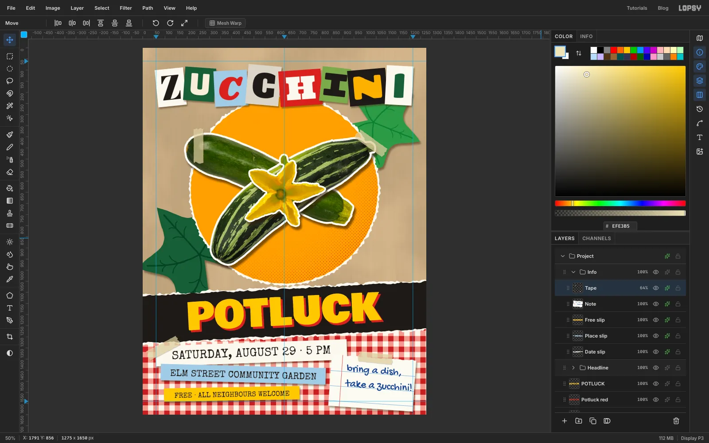

Click *Tape 2*, which is the top piece, and choose **Layer → Merge Down**
three times to collect all four pieces on *Tape*. Set its opacity to
**64%** so what's under it shows through. Then give it a tiny **Drop
Shadow**: **Offset X** `2`, **Offset Y** `2`, **Blur** `3`,
**Opacity** `25`.

## Add marker doodles

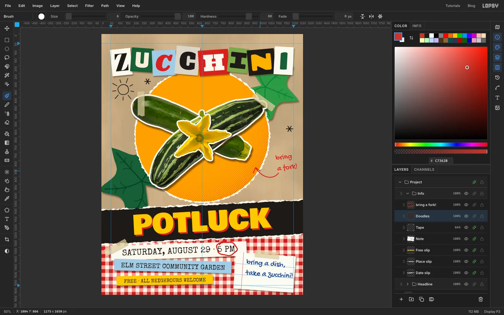

Add a layer named *Doodles*. Pick the **Brush**:

- In red `#C7362B` at **Size** `8`, draw one quick loop around **5 PM**,
  overshooting where it closes, like someone circled it with a marker.
- In black `#1E1A17` at **Size** `5`, draw a small circle at about
  `138, 352` and nine short rays around it with click and [[Shift]]-click.
- At **Size** `6`, draw asterisks at `292, 300` and `1190, 600`: three
  short crossing lines each.

With the **Text** tool, write `bring`, [[Enter]], `a fork!` in Gochi Hand
`48`, red, in the empty space right of the disc, centred near
`1168, 815`. Tilt it about 8° anticlockwise with the Move tool's rotation
handle. Click the *Doodles* row and, with the **Brush** at **Size** `6` in
red, draw a curved arrow from under `a fork!` to the green zucchini's tip.
Add two short strokes for the arrowhead.

## Add photocopy grain

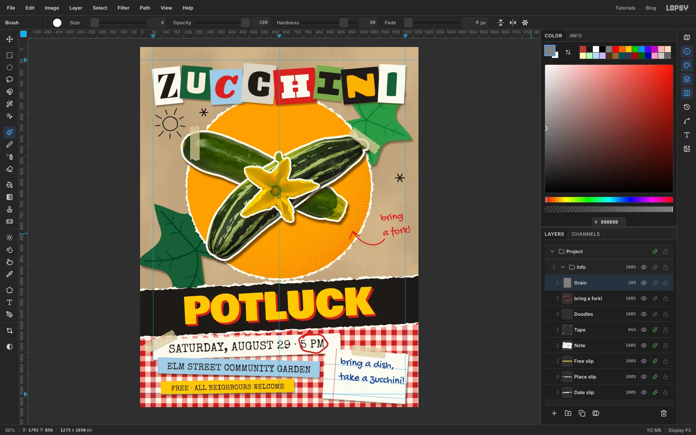

Click the *bring a fork!* row, the top row in the *Info* group, and add a
layer named *Grain*. Because *Info* sits at the top of the stack, the grain
covers everything below it too. Fill it with grey `#808080` and choose **Add Noise…** at
**Amount** `28`, **Mono**, **Gaussian**. Set it to **Overlay** at **30%**.
Mid-grey disappears in Overlay, so only the speckle remains, over the
photos, the paper and the type.

Turn off the guides with **View → Show Guides**. Export with
**File → Quick Export PNG** and keep the layered file with
**File → Save Project**.
