In the 1920s Alexander Rodchenko and El Lissitzky built posters from a short
list of parts: a cut-out photograph printed as hard black ink, flat red
circles and wedges, steep diagonals, and heavy condensed type set at an
angle. Radio was one of their favourite subjects. Vladimir Shukhov's
lattice broadcasting tower in Moscow, made from straight steel bars twisted
into a hyperboloid, turns up again and again.

In this tutorial you'll use that kit to make a flier for **Quartz Nights**, a
made-up weekly club where people build crystal radio sets. A 1921 photo of a
man holding an earpiece to his ear becomes a black and cream cut-out inside
a red disc. A pencil-drawn tower beams arcs toward him, and **QUARTZ NIGHTS**
runs across a black band tilted at −15°. You'll practise the **Lasso**,
**Threshold**, a non-contiguous **Magic Wand**, layer masks, Move-tool
transforms, live text rotation and Pencil straight lines. The document is
1200 × 1800 px.

You'll need one public-domain photo:

- **Man listening to an early radio LCCN2016887096.jpg** by Harris & Ewing (1921, Library of Congress) on Wikimedia Commons. Download the 1280 px-wide preview and resize it to **1200 px wide** before you start (for example with Preview's **Tools → Adjust Size** on a Mac), so it fits the canvas width when you drop it in.

The palette:

- Paper `#E9DFC8`
- Warm ink black `#1A1716`
- Vermilion `#C94B34`
- Grain base `#F6F6F6` (only for the texture layer)

> **Tip:** On a wide-gamut display, Lopsy treats the hex codes you type as
> Display P3. That's why `#C94B34` is the vermilion here: it exports as an
> orange-leaning red, about `#DA3E27` in sRGB. A pure red such as `#C62A22`
> would come out as an almost fluorescent red in the PNG.

## Lay down the paper and margins

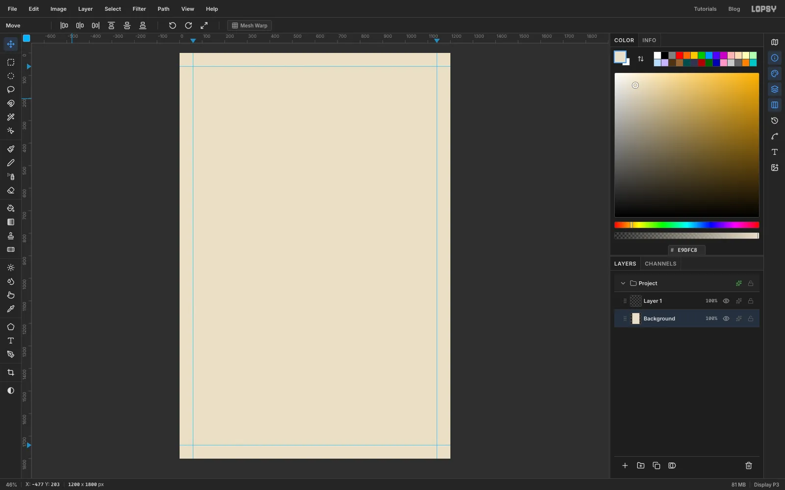

Choose **File → New**, check that **Unit** is **Pixels**, and enter
**1200 × 1800**. Set the foreground color to `#E9DFC8` in the Color panel,
select the **Background** layer and choose **Edit → Fill**.

Click the **top ruler** about 60 px in from the left and right edges, and
the **left ruler** about 60 px from the top and bottom. Each click drops a
guide. These four guides are your margins: text and the footer will line up
on them.

## Draw the red disc

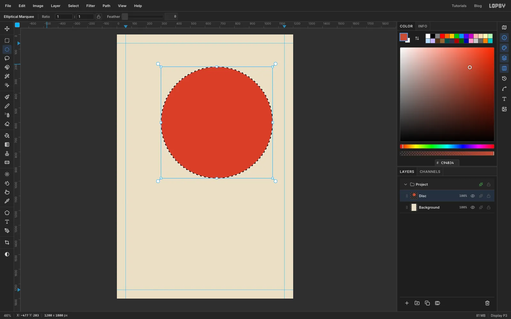

Rename *Layer 1* to `Disc`. Pick the **Elliptical Marquee**. With nothing
selected, a single click on the canvas (no drag) opens a dialog where you
can type the exact corners. Enter **From** `300`, `220` and **To** `1060`,
`980`. That gives a 760 px circle a little right of centre, reaching down
to just above the middle of the page. Set the foreground to `#C94B34`, choose
**Edit → Fill**, then deselect with [[Cmd+D]].

## Build the broadcast rings

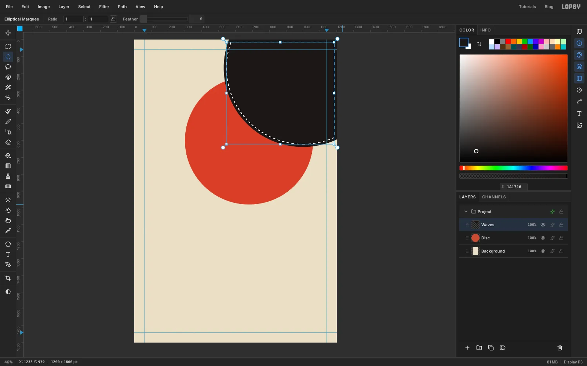

Click **Add Layer** and name it `Waves`. The radio tower's tip will sit at
about `x 1000`, `y 168`, and the rings radiate from there. Set the foreground
to ink `#1A1716`. Then build four rings, largest first:

1. Click once with the Elliptical Marquee and enter a circle centred on the tip, 470 px in radius: **From** `530`, `-302`, **To** `1470`, `638`. Parts of it run off the canvas, which is fine.
2. Choose **Edit → Fill**, then **Select → Shrink…** by `16` and press [[Delete]]. You're left with a 16 px ring.
3. Repeat with radii **390** (From `610`, `-222` To `1390`, `558`), **310** (From `690`, `-142` To `1310`, `478`) and **230** (From `770`, `-62` To `1230`, `398`).

Draw the biggest ring first. Filling a large circle covers everything inside
it, so if you drew the small rings first, the next fill would paint over
them.

## Trim the rings to a fan

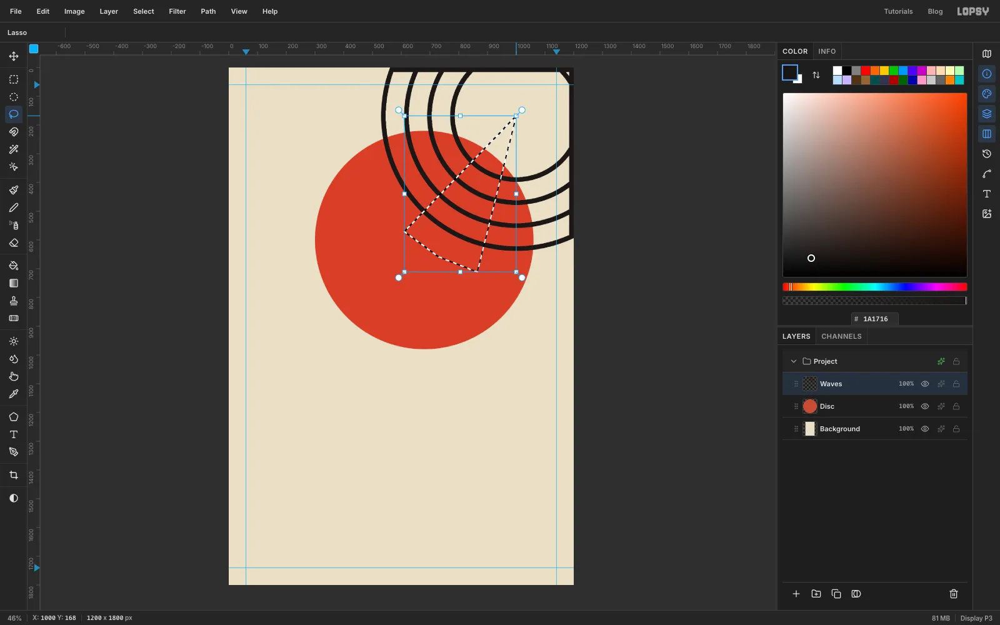

Choose the **Lasso**. Press at the tower tip and drag a 30°-wide fan down
and to the left: a straight line out to about `x 610`, `y 570`, a short
curve round through `x 730`, `y 660` to about `x 865`, `y 710`, and a
straight line back up to the tip. The fan points at where the listener's ear
will be, and its right edge stays clear of the tower. Choose
**Select → Inverse** and press
[[Delete]], then [[Cmd+D]]. You're left with four short arcs beaming out
from the tip.

## Draw the tower lattice with the Pencil

Add a layer called `Lattice` and pick the **Pencil** ([[N]]) at
**Size 3**. A Shukhov tower is a stack of hyperboloids. Each section is a
ring of straight bars, every bar leaning the same way around the circle,
crossed by a second set leaning the other way. You draw it with straight
lines: click a point, then [[Shift]]-click another to join them.

Work up the tower in four sections, all centred on `x 1000`:

1. From `y 860` up to `y 640`, narrowing from 135 px each side of centre to 88 px. Pencil **Size 3**.
2. From `y 640` to `y 470`, 88 px to 60 px each side. **Size 3**.
3. From `y 470` to `y 340`, 60 px to 42 px each side. **Size 2**.
4. From `y 340` to `y 240`, 42 px to 28 px each side. **Size 2**.

For each section, picture 14 bars spaced evenly around a circle, seen from
the side. Mark their feet on the bottom edge. Going once round the circle,
the marks sit at these fractions of the half-width from the centre line:
+0.94, +0.70, +0.32, −0.12, −0.54, −0.85, −0.99, then back across the far
side at −0.94, −0.70, −0.32, +0.12, +0.54, +0.85, +0.99. For section 1
(half-width 135) that's `x` 1127, 1094, 1043, 984, 927, 885, 866, 873, 906,
957, 1017, 1073, 1115 and 1134. Mark the top edge the same way using the top
half-width.

Join every bottom mark to the top mark **two places further along** that
list (wrapping round from the end to the start), then join every bottom mark
to the top mark **two places back**. That's 28 lines per section, about 110
in all. The bars cross in a diamond mesh and the section pinches in at the
waist on its own. Finish with the Pencil at **Size 6**: a vertical mast from
`y 240` up to `y 150`. The section 1 bars below about `y 830` end up hidden
behind the band, so they needn't be perfect.

## Add the ring beams and group the tower

Add a layer called `Rings`. At the top of each section, draw a flat
ellipse with the Elliptical Marquee, as wide as the section plus 3 px on
each side. Make them 32, 22, 16 and 14 px tall from the bottom ring up. For
example, the first is **From** `909`, `624` **To** `1091`, `656`. Fill it, choose **Select → Shrink…** by `3` and press
[[Delete]]. Then fill a 10 px-radius circle on top of the mast (**From** `990`, `140`
**To** `1010`, `160`) for the antenna ball.

Click **Add Layer** once more and name it `Photo Anchor`. Once the tower
is grouped, adding a layer while the group is selected would put it inside
the group, so this empty layer gives you something to click above it. Click `Lattice`, [[Shift]]-click `Rings`, choose
**Layer → Group Layers**, and rename the group `Tower`.

## Drop in the photo

Click `Photo Anchor` so the photo lands above it, then drag the resized
photo from your desktop onto the canvas. It arrives as a new layer at the
top-left corner, 1200 px wide. Rename it `Photo` and press [[Cmd+D]] to drop
the selection it comes in with.

## Lasso the listener

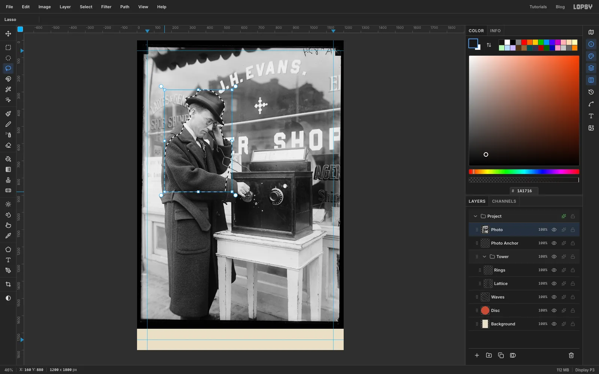

With the **Lasso**, trace the man in one drag. Start low on the left side
of his coat, go up over the shoulder and the back of his neck, and follow
the back of the ear and hair up to the hat brim. Go round the top of the
crown, down the right edge of the hat and the brim's point, and then follow
the outside of his raised hand and sleeve. Then run down the front of his coat
and cut straight across, level with his other hand on the radio dial.

Stay tight to the hat crown and the back of the head. Any bright window you
include will turn into a cream patch later. Leave out the wire to the radio.

## Copy the cut-out to its own layer

Press [[Cmd+C]] and then [[Cmd+V]]. The paste lands in place as a new
layer, still selected in the cut-out's shape. Rename it `Listener`. Select
`Photo` and click **Delete Layer**, then do the same for `Photo Anchor`,
which has done its job. Click `Listener` again. The selection can stay: the
next two filters only need to work inside the cut-out anyway.

## Turn the photo into ink

Choose **Filter → Gaussian Blur…** with **Radius 2**. It softens the film
grain so the next step doesn't leave speckle. Then choose
**Filter → Threshold…** with **Level 138**. Every pixel becomes pure black
or pure white. At 138 the hat, coat and shadows go solid black and the face,
hand and collar stay white. Try a few levels: lower ones bring back a pale
stripe on the hat band, higher ones swallow the face.

## Select every white pixel

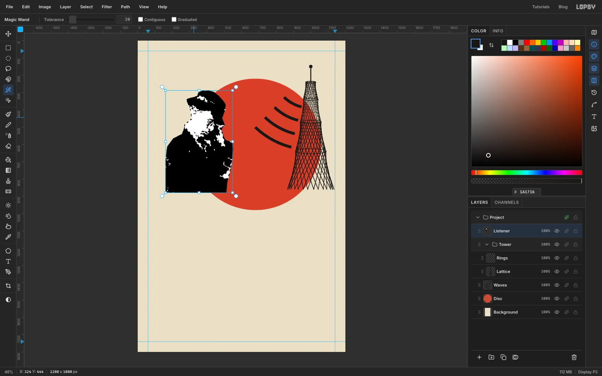

Pick the **Magic Wand** ([[W]]). In the options bar, set **Tolerance** to
`20` and **untick Contiguous**. Click once on his cheek. With Contiguous off,
the wand selects every white pixel on the layer, including the separate
patches of hand and collar.

## Recolor the whites and blacks

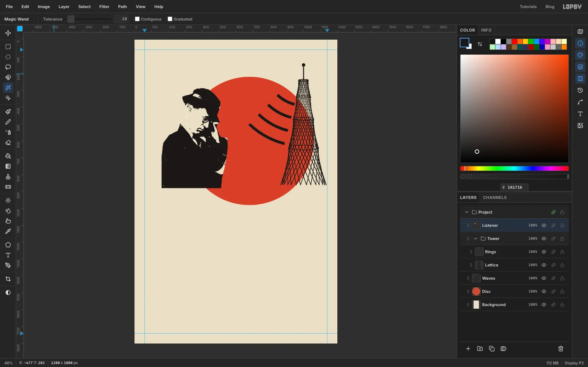

Set the foreground to `#E9DFC8` and choose **Edit → Fill**, so the whites
become paper cream. Press [[Cmd+D]], click the hat with the Magic Wand (still
non-contiguous), set the foreground to `#1A1716` and fill again. Threshold's
pure black would look colder than the warm black of the band and tower, and
the join where they meet would show. Deselect.

## Scale the listener up

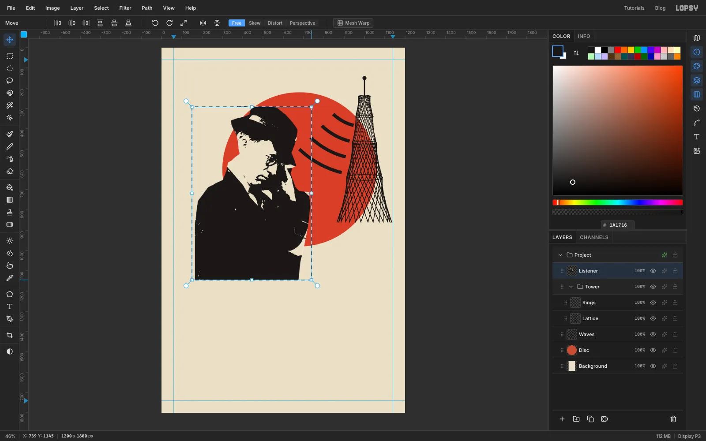

With the **Rectangular Marquee**, draw a box tight around the cut-out. Switch
to the **Move** tool ([[V]]). Hold [[Cmd]] and drag the **bottom-right**
handle down and to the right until the box is about 1.45 times its original
size (roughly 590 px wide). [[Cmd]] keeps the proportions, and the top-left
corner stays put.

## Move and tilt him into the disc

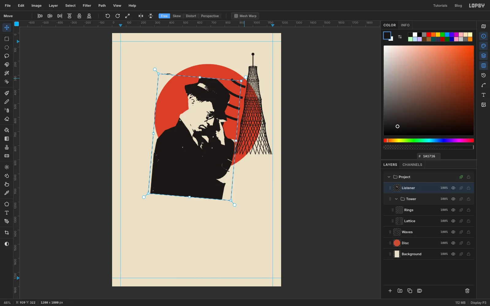

Still with the Move tool, drag from the middle of the selection to move him
about 140 px right and 20 px down, so his face sits in the left half of the
disc and his hand is near its centre. Then drag the **rotation handle**
outside the top-right corner clockwise by about **5°**, so he leans in
toward the tower. Press [[Cmd+D]] to commit.

## Mask him to the disc

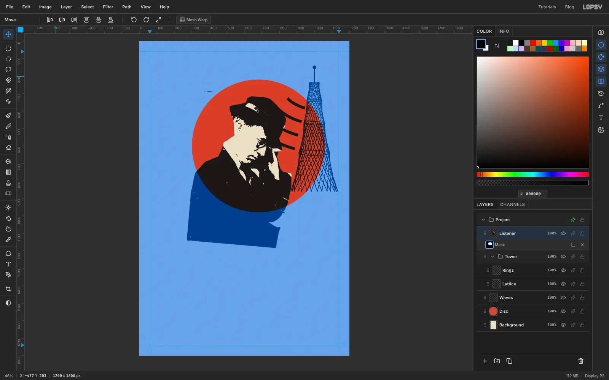

The coat hanging outside the disc looks untidy. Clip it with a mask:

1. With `Listener` selected, click **Add Mask**, then click the new mask thumbnail to edit the mask.
2. [[Cmd]]-click the `Disc` layer's thumbnail to select the disc's shape, and choose **Select → Inverse**.
3. Set the foreground to pure black `#000000` and choose **Edit → Fill**. The blue overlay shows the masked area: everything outside the disc.
4. Press [[Cmd+D]], then click the `Listener` layer name to stop editing the mask.

> **Tip:** Don't press [[Delete]] in a mask to hide pixels. In mask edit
> mode it fills with the background color, which is white, so nothing gets
> hidden. **Edit → Fill** with black does the job.

## Lay the diagonal band

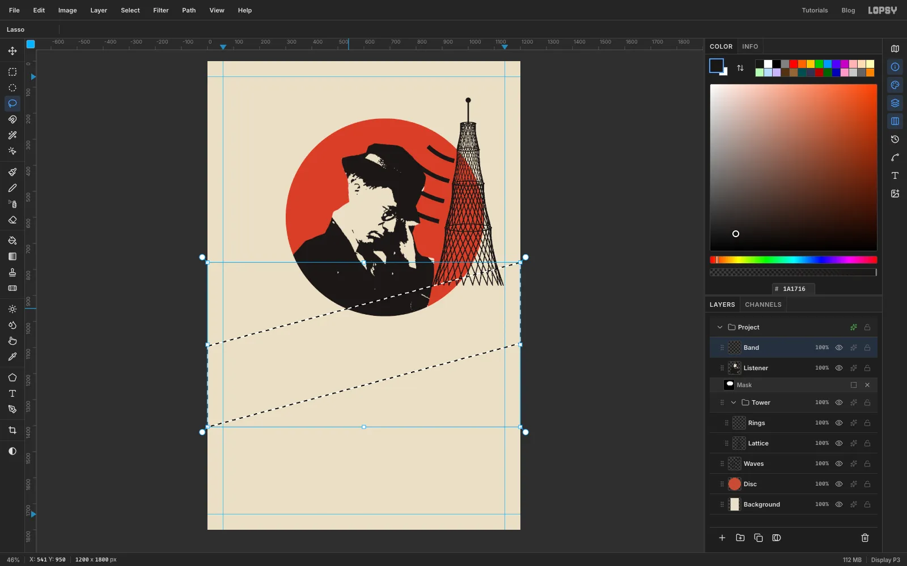

Add a layer called `Band`. With the **Lasso**, draw a long parallelogram
tilted at −15° (rising to the right). Its top edge runs from about
`y 1095` on the left edge of the page to about `y 773` on the right edge, and
it's about 310 px tall measured straight down. Start on the top edge in the
middle of the page, drag past the right edge and down, back across to the
left past the canvas edge, and up, so all four corners sit off the canvas.
Fill it with ink `#1A1716` and deselect. A freehand lasso won't give a
ruler-straight edge on its own, so zoom out until the whole band fits on
screen and drag slowly. The corners run off the canvas, so any wobble there
doesn't show. The band covers the bottom of the
tower and the bottom of the coat.

## Set QUARTZ on the band

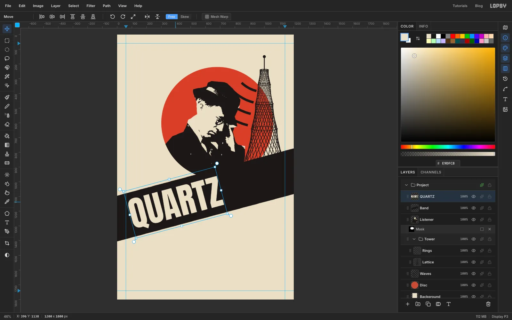

Select `Band` first, so the new text lands above it and the text options
don't restyle another text layer. Pick the **Text** tool ([[T]]), choose **Anton** at **235 px**, set the
foreground to cream `#E9DFC8`, click in an empty area, type `QUARTZ` and
press [[Tab]] to commit.

Switch to the **Move** tool. A live text layer gets its own handles. Hold
[[Cmd]] and drag the top-right rotation handle anticlockwise. [[Cmd]] snaps
the angle to 15° steps, so stop at **−15°**, the same angle as the band.
Then drag the word onto the band. Start the Q just inside the left margin
guide, with roughly equal black above and below the capitals (about
45 px each). The Q's tail hangs a little lower, so let the caps sit a touch
high.

## Add NIGHTS in red

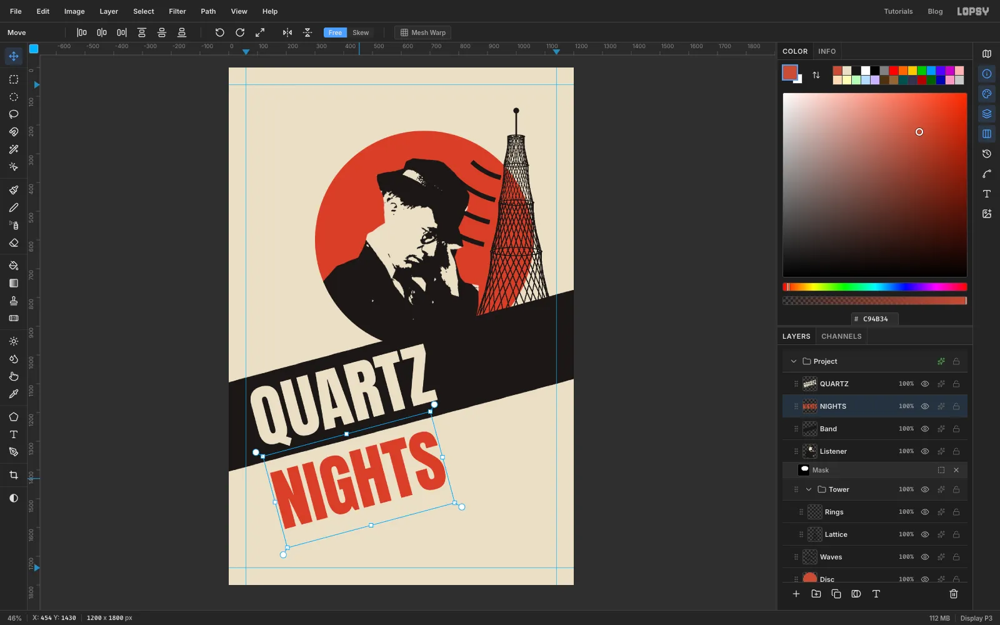

Click `Band` again. Set the foreground to `#C94B34`, keep Anton at 235 and
type `NIGHTS` in an empty area, then press [[Tab]]. Rotate it to −15° the same
way, and drag it into place just under the band. Keep about a 40 px gap
between the band's lower edge and the tops of the letters, with its left end
lined up with the Q above.

## Drive a wedge into the title

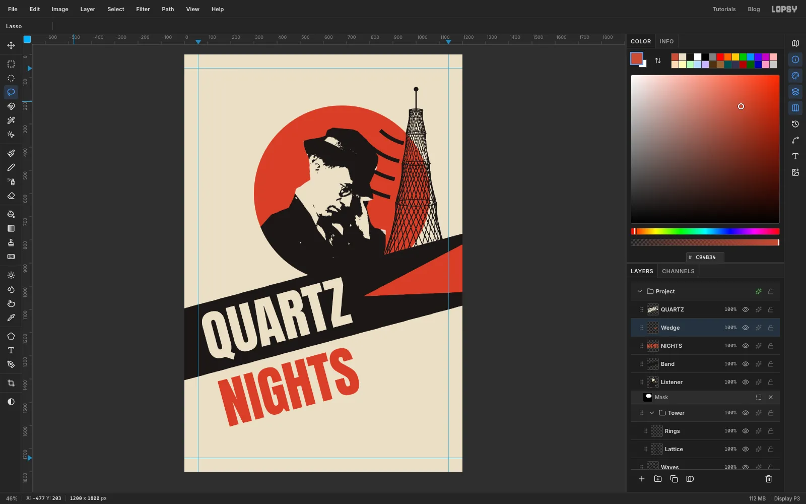

Add a layer called `Wedge`. Lasso a long thin triangle along the band. Put
its base off the right edge of the page, about three-quarters of the band's
height and centred on it, and its point on the band's centre line about 60 px past the Z. Fill it with
`#C94B34` and deselect. It's Lissitzky's red wedge, striking into the word.

## Cut the crystal facets

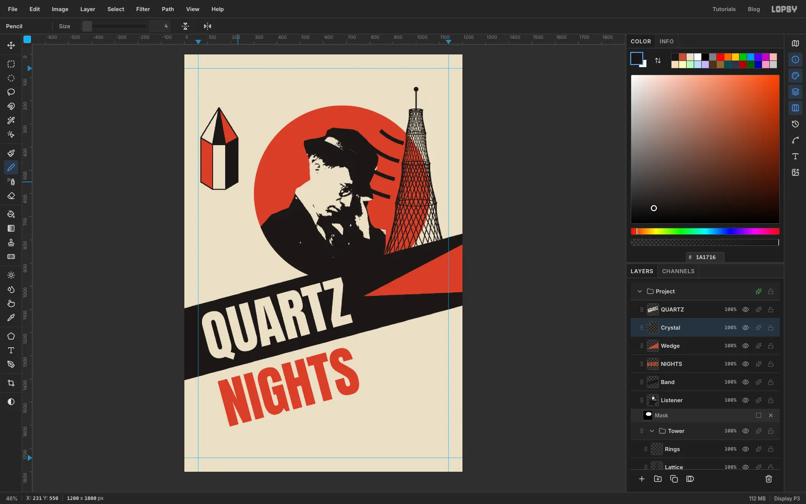

Add a layer called `Crystal`. It goes at the top left, under the header
you'll add later. A quartz crystal is a
hexagonal prism with a three-sided point, and you'll draw six shapes with
the **Lasso**, filling each with **Edit → Fill** as you go:

1. Three body faces side by side. The outer two run from `y 360` to `y 550`, at `x 71–123` on the left and `x 179–231` on the right. The middle face, `x 123–179`, sits about 30 px lower, from `y 390` to `y 582`. Its dropped top and bottom edges make the ends read as the near half of a hexagon. Fill the left face vermilion, the middle cream and the right black.
2. Three triangles from the tops of the faces up to a single point at `x 151`, `y 230`. Fill the left one cream, the middle one black and the right one vermilion, so no facet touches another of the same color.

Then set the **Pencil** to **Size 4** with ink black, and [[Shift]]-click a
line along every edge, inside and outside, so all the edges have the same
weight.

## Tilt the crystal and outline it

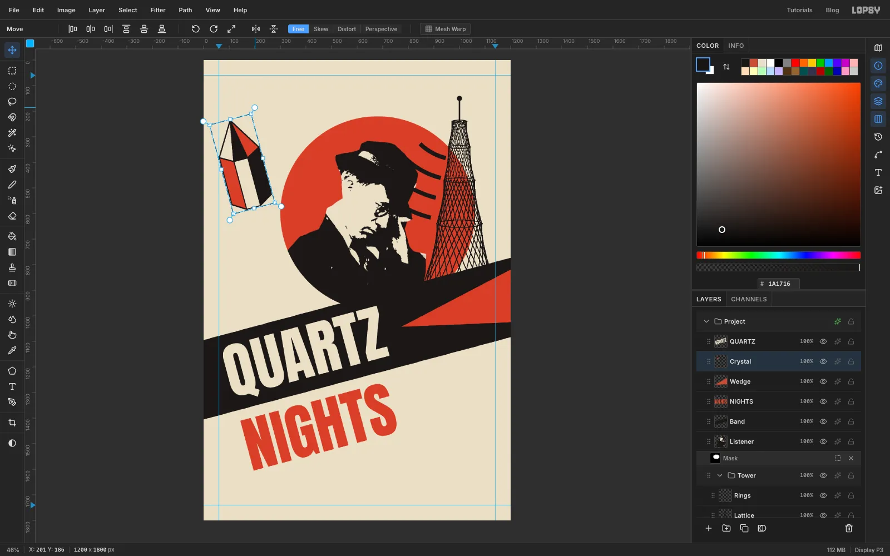

Draw a **Rectangular Marquee** around the whole crystal, switch to the
**Move** tool, hold [[Cmd]] and drag a rotation handle anticlockwise to
**−15°**, square to the band. Press [[Cmd+D]]. If it drifted, nudge it with
the arrow keys until its leftmost corner touches the 60 px margin guide. Open
the layer's effects (the effects button on its row), enable **Stroke** with **Width 2** in ink black, and
close the drawer. The stroke tidies the outline where the cream facet meets
the paper.

## Add the header and a red rule

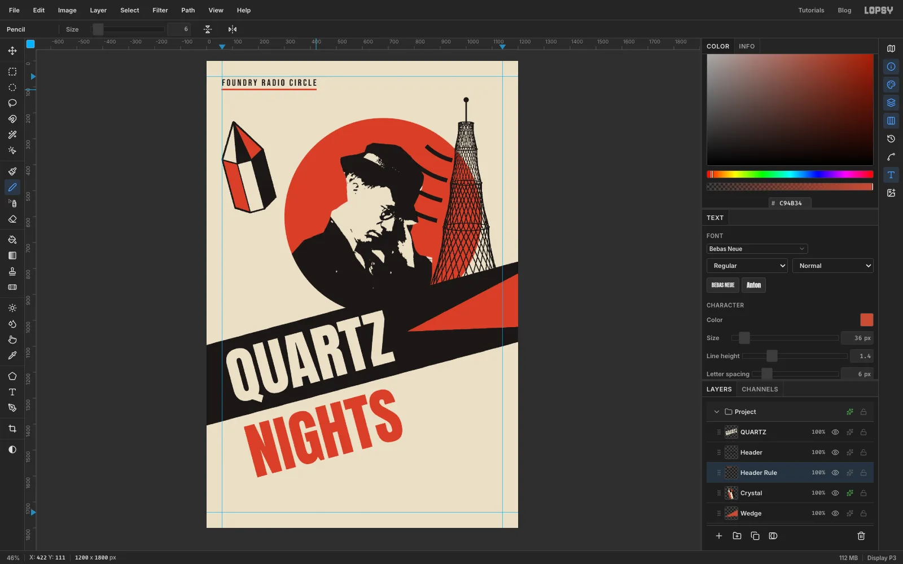

Add a layer called `Header Rule`. Pick the Text tool, choose **Bebas Neue**
at **36 px** in ink black, and set **Letter spacing** to `6` in the
**Text** panel (the T button in the panel strip on the right opens it). Click near the top-left margin, type `FOUNDRY RADIO CIRCLE`, press
[[Tab]], and nudge it so the capitals start on the left margin guide, about
70 px from the top.

Click `Header Rule`, pick the **Pencil** at **Size 6** with vermilion, click
16 px under the left end of the text and [[Shift]]-click under its right end.
That draws one straight rule as wide as the header.

## Stamp FREE ENTRY

Add a layer called `Stamp`. The stamp sits in the gap left of the disc, at
about `x 168`, `y 878`:

1. Set the foreground to ink `#1A1716` and fill a 112 px-radius circle centred 8 px right of and 8 px below that point (**From** `64`, `774` **To** `288`, `998`). It's a hard print shadow. Don't use a soft drop shadow: 1920s print didn't have them.
2. Fill a vermilion circle of the same size on the point itself (**From** `56`, `766` **To** `280`, `990`).
3. **Select → Shrink…** by `8` and fill cream, then **Shrink…** by `5` and fill vermilion. That leaves a thin cream ring.

Deselect. With `Stamp` selected, type `FREE` in **Anton 76** cream. It
keeps the 6 px letter spacing from the header, which suits it. Click `Stamp`
again and type `ENTRY` in **Anton 40** with **Letter spacing** `4`.
Rotate each to −15° with the Move tool's handles, then drag them into the
stamp, FREE just above the centre and ENTRY below it, both centred on the
same tilted line.

## Set the info column

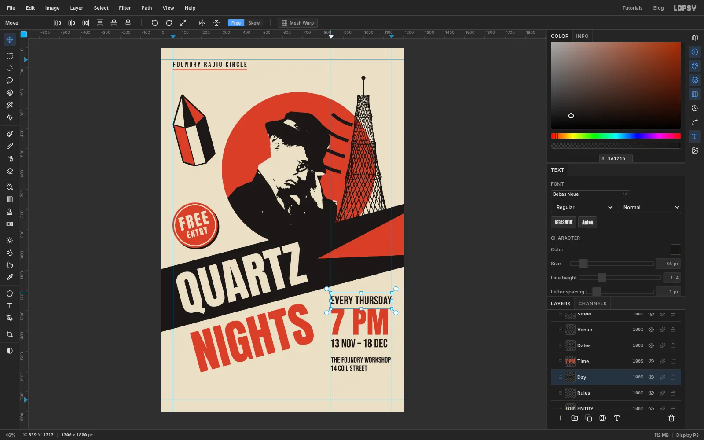

Click the top ruler at `x 840` for a guide. The column hangs off it. Add a
layer called `Rules`, and click it again before each line, so the text
tool never restyles the line before. Set **Letter spacing** back to `0` in
the Text panel first, because it carries over from ENTRY.

Make the lines from the bottom up, so each click lands above the lines
already set. A click inside an existing line's text box would edit it
instead.

The column starts about 45 px under the band and the lines are spaced 14 to
22 px apart. The numbers are where the top of each line's capitals goes (the
Info panel shows the cursor position):

- `14 COIL STREET`, Bebas Neue 39, ink, at `y 1570`
- `THE FOUNDRY WORKSHOP`, Bebas Neue 39, ink, just above it at `y 1528`
- `13 NOV – 18 DEC`, Bebas Neue 58, ink, at `y 1440`
- `7 PM`, Anton 150, vermilion, at `y 1290`
- `EVERY THURSDAY`, Bebas Neue 56, ink, letter spacing `1`, at `y 1228`

Line each left edge up on the 840 guide with the arrow keys.

## Add the rules and the footer bar

Click `Rules`. With the **Rectangular Marquee**, draw two 6 px-tall bars
from the 840 guide to the right margin, one under the dates (`y 1502`) and
one under the street (`y 1614`), and fill them with ink. Then marquee from the left margin to the right margin between
`y 1664` and the bottom guide at `y 1740`, fill it with vermilion and
deselect. Type the footer in **Bebas Neue 40**, cream, letter spacing `1`:

`GALENA, COPPER WIRE & CAT’S WHISKERS SUPPLIED  ·  BRING HEADPHONES`

Nudge it until it's centred both ways: about the same gap left and right,
and its capitals centred on `y 1702`.

## Finish with paper grain

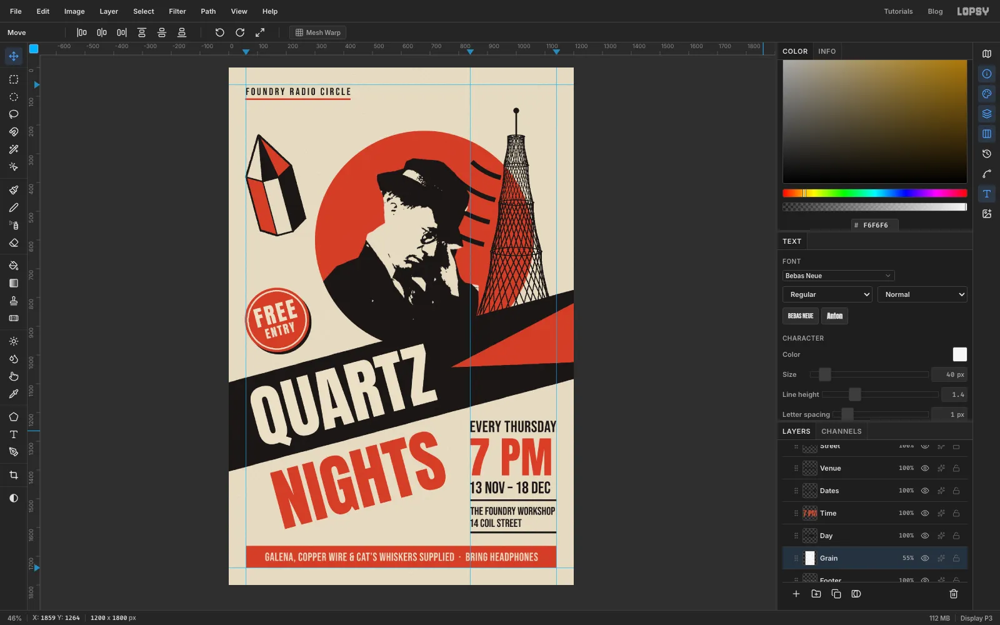

Click `Footer`, the text you just made, and add a layer called `Grain`. It
lands above everything except the five info-column lines, which stay
crisp on top. Fill it with `#F6F6F6`,
choose **Filter → Add Noise…** with **Amount 50**, **Mono** and
**Gaussian**, then **Filter → Gaussian Blur…** with **Radius 0.8**. In the layer's effects drawer, set **Blend** to **Multiply**, then set the
opacity on the layer's row to `55%`. Near-white noise in Multiply gives the cream
a soft paper tooth and barely touches the black. Avoid Fibers here: its
streaks all run one way and read as wood grain.

Hide the guides with **View → Show Guides**, export with
**File → Quick Export PNG**, and save the project with
**File → Save Project** so you can change the dates for next season.
