This tutorial makes a wrap-around bottle label for an imaginary ginger beer, **Agitprop**, in the style of Russian Constructivism. In 1923 the poet Vladimir Mayakovsky and the artist Alexander Rodchenko called themselves "advertising constructors". They sold biscuits, beer and cooking oil with flat red and black, photos cut out with scissors, heavy capitals and one big diagonal. That's the look here, at 2400 × 1200 px.

A wrap label has three panels. The **front** sits in the middle and is what you see on the shelf. The **back** is split in two, so you see one half when you turn the bottle left and the other half when you turn it right. Here the left back panel holds the ingredients and the right one holds a small manifesto and the barcode.

The front is a direct nod to El Lissitzky's 1919 poster *Beat the Whites with the Red Wedge*: a **red** wedge driving into a circle. Keep the wedge red. A black wedge into a red circle turns the slogan around.

The ginger is a real photograph, [Ginger Root.jpg](https://commons.wikimedia.org/wiki/File:Ginger_Root.jpg) by Sanjay ach on Wikimedia Commons, licensed **CC BY-SA 4.0**. Download the 1280 px wide version (1280 × 851). It's shot on a white sweep, so the background comes away cleanly with the Magic Wand. The licence asks for a credit, so the label carries one in small type on the right panel.

Along the way you'll use:

- ruler **guides**, **New Group** and moving a whole group with the arrow keys
- the **Rectangular** and **Elliptical Marquee**, the **Lasso**, and [[Shift]]-drag to add to a selection
- the **Magic Wand** with and without **Contiguous**, **Select → Shrink**, **Feather** and **Inverse**
- **Desaturate**, **Brightness/Contrast**, **Halftone**, **Add Noise**, **Gaussian Blur** and **Threshold**
- the **Move** tool's scale and rotate handles, with [[Cmd]] to keep proportions and snap the angle to 15°
- the **Stroke** and **Color Overlay** layer effects, and the **Overlay** blend mode
- the **Shape** tool for an outlined ring, and the **Pencil** for straight rules
- **Text** in Rubik Mono One, Anton, Fjalla One and IBM Plex Mono, turned to an angle

The palette:

- Paper `#E6DCC3`, cream type `#EDE3CC`
- Ink black `#1E1C1B`
- Agitprop red `#B03A2E`

> **Tip:** Positions are written as `x, y` in document pixels. The status bar at the bottom left shows where the cursor is, and the **Info** panel shows the size of the current selection. Key names use Mac keys. On Windows and Linux, use Ctrl for Cmd.

> **Tip:** "Fill with a colour" means set the foreground colour to it in the Color panel's hex field and choose **Edit → Fill**. Press [[Cmd+D]] to deselect before you draw each new marquee, so you start a fresh selection instead of moving the old one.

> **Tip:** New layers and new text appear just above whichever layer is active, so each step says which layer to click first. Before you make a new text layer, always click a picture layer (not another text layer). Otherwise the Text tool restyles the text you clicked.

> **Tip:** To make a text layer, pick the **Text** tool and set the font, size and colour in the options bar. Click in clear space on the canvas, type, and press [[Tab]] to commit. Then double-click the new layer's name to rename it, and set **Letter spacing** and **Line height** in the Text panel. A click inside an existing text box edits that text instead, so always start new text in an empty corner and move it into place afterwards. Text values below are given as font, size, colour, letter spacing.

## Set up the label and its folds

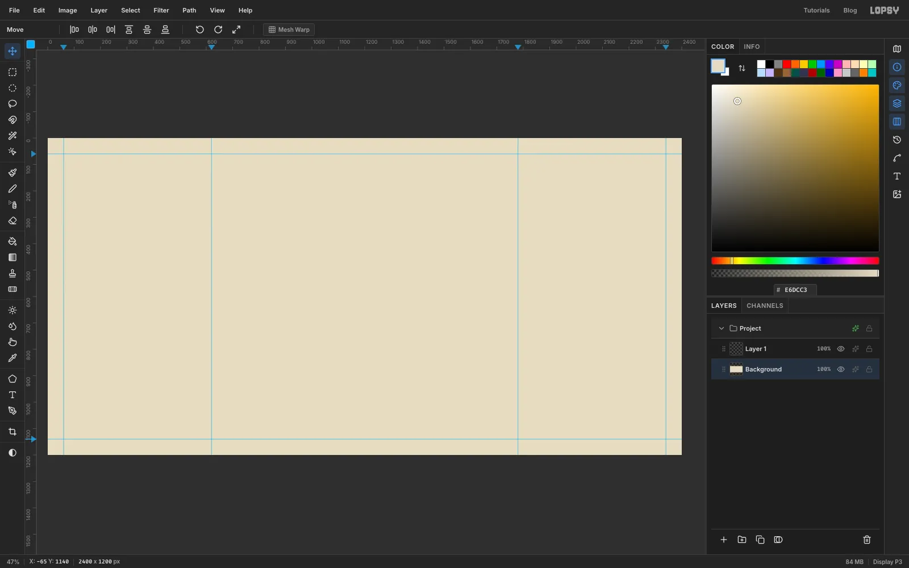

Open [Lopsy](/). In the **New Document** dialog, set **Width** to `2400` and **Height** to `1200` and click **Create**. You get a white `Background` and an empty `Layer 1`. Leave `Layer 1` alone. It becomes the paper grain at the very end.

1. Click the `Background` row, set the foreground colour to `#E6DCC3` and choose **Edit → Fill**.
2. Make guides by clicking the rulers. Click the **top** ruler at x `60`, `620`, `1780` and `2340` for four vertical guides. Then click the **left** ruler at y `60` and `1140` for two horizontal ones.

The guides at 620 and 1780 are the **folds**. Everything left of 620 is the left back panel, everything right of 1780 is the right back panel, and the front sits between them. The others are a 60 px margin.

## Paint the black back panel

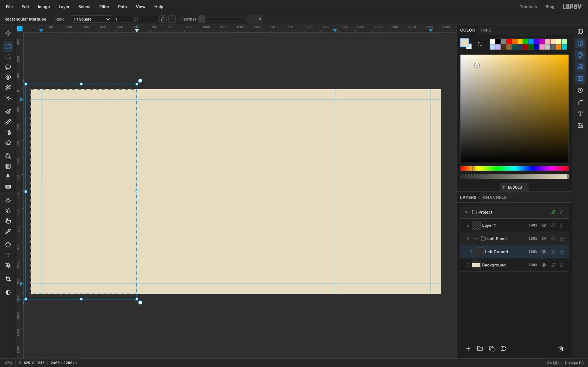

Each panel gets its own group, so you can move or hide a whole panel at once.

1. Click the `Background` row and click **New Group** at the bottom of the Layers panel. Rename the group `Left Panel`.
2. With the group selected, click **Add Layer**. The new layer goes inside the group. Rename it `Left Ground`.
3. Pick the **Rectangular Marquee** ([[M]]). Start the drag just outside the top-left corner of the canvas and drag down to the 620 guide, past the bottom edge. The marquee snaps onto the guide.
4. Fill it with `#1E1C1B` and press [[Cmd+D]].

## Add the red header and the right group

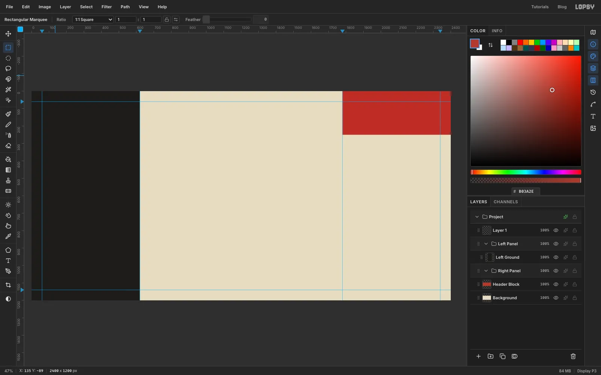

The red header on the right panel is a plain layer under that panel's group. Later you'll move the right panel's group to straighten its type, and the red block shouldn't move with it.

1. Click the `Background` row, click **Add Layer** and rename it `Header Block`.
2. Drag a marquee from the 1780 guide at the top of the canvas to just past the right edge, and down to y `250`. Fill it with `#B03A2E` and press [[Cmd+D]].
3. With `Header Block` still active, click **New Group** and name it `Right Panel`. It sits above the red, so the type you put in it later shows on top.

## Draw the red sun

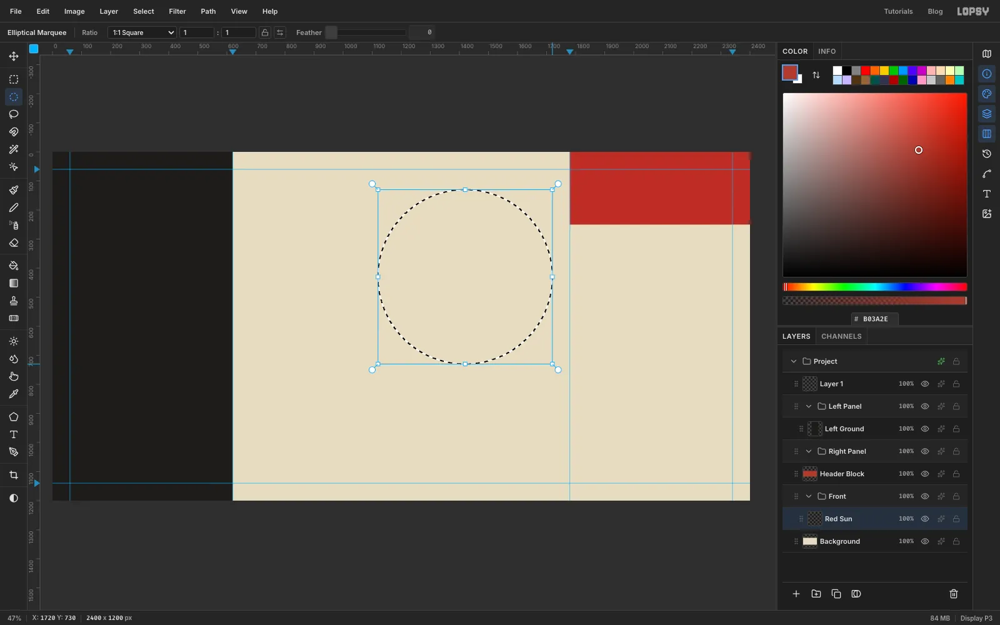

1. Click the `Background` row, click **New Group** and name it `Front`. Click **Add Layer** and rename it `Red Sun`.
2. Pick the **Elliptical Marquee**. Hold [[Cmd]] to keep it a perfect circle and drag from `1120, 130` to `1720, 730`. That gives a 600 px circle centred on `1420, 430`, with its top 130 px below the edge of the label.
3. Fill it with `#B03A2E` and press [[Cmd+D]].

## Draw the wedge

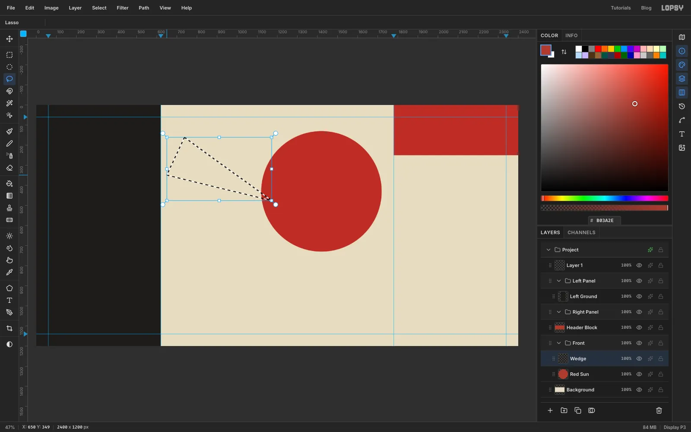

1. Click **Add Layer** and rename it `Wedge`.
2. Pick the **Lasso** ([[L]]). Drag it in straight lines around a long thin triangle: start at `738, 161`, go straight to the tip at `1172, 476`, then to `650, 349`, and back to the start.
3. Fill it with `#B03A2E` and press [[Cmd+D]].

The Lasso is freehand, so drag slowly in three straight runs. It doesn't have to be exact, just aim for those corners. The short side of the triangle isn't upright. It runs square across the wedge, so the wedge looks like a solid block that's been tipped over. A wedge cut off straight up and down would look clipped by the fold.

## Outline the wedge in ink

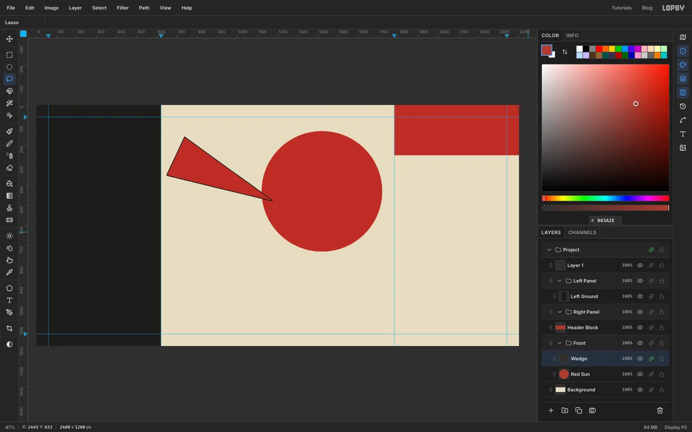

Red on red would make the wedge vanish where it crosses the sun, so it gets a keyline.

1. Click the **Layer effects** button (✦) on the `Wedge` row.
2. Turn on **Stroke**, set **Width** to `4` and the colour to `#1E1C1B`, then close the drawer.

The tip ends just inside the sun's left edge. That's where the ginger root will start, so the wedge looks like it's stabbing the root.

## Drop in the ginger photo

Click the `Red Sun` row, then drag the downloaded `Ginger Root.jpg` from your desktop onto the canvas. It lands at the top-left corner as a new layer just above `Red Sun`, with its pixels selected. Rename the layer `Ginger Photo`.

Part of it is hidden behind the black panel, because the `Left Panel` group sits higher in the stack. That doesn't matter. The pixels are still there, and you'll move the root to the sun once it's cut out. If you'd rather see the whole photo while you work on it, click the eye on the `Left Panel` row to hide the group, and turn it back on when the root is on the sun.

## Select the white background

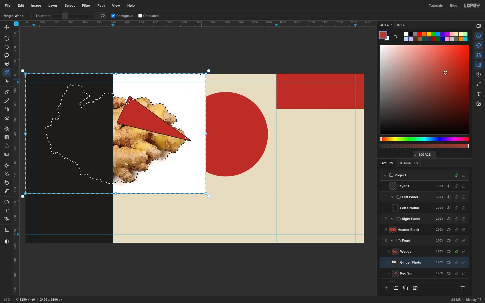

1. Press [[Cmd+D]] to clear the paste selection, then pick the **Magic Wand** ([[W]]).
2. In the options bar set **Tolerance** to `70` and leave **Contiguous** ticked. Tolerance 70 is high enough to grab the soft grey shadow under the root as well as the white. The root itself is yellow-brown, so it stays out.
3. Click the white in the photo's top-right corner. Then hold [[Shift]] and click the white at its bottom-right, and any other white patch the first click missed. The wand reads the whole layer, so white hidden under the black panel is picked up too.
4. Press [[Delete]], then [[Cmd+D]].

## Clean up the cut-out edge

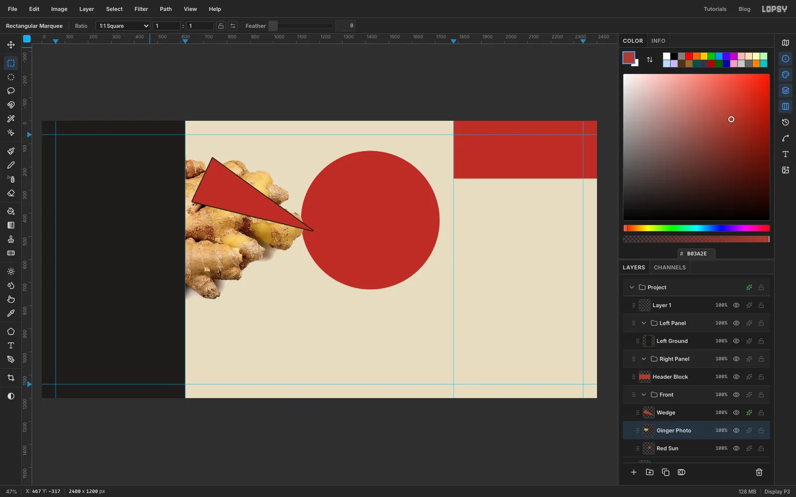

1. Zoom into the photo's top-right corner. A small green speck from the original photo survives the wand. Drag a Rectangular Marquee around it, press [[Delete]] and [[Cmd+D]].
2. The edge of the root still carries a pale rim from the white backdrop. [[Cmd]]-click the `Ginger Photo` thumbnail to select the root, choose **Select → Shrink…** and enter `3`.
3. Choose **Select → Inverse**, press [[Delete]] to clear the 3 px rim, then [[Cmd+D]].

## Turn the root black and white

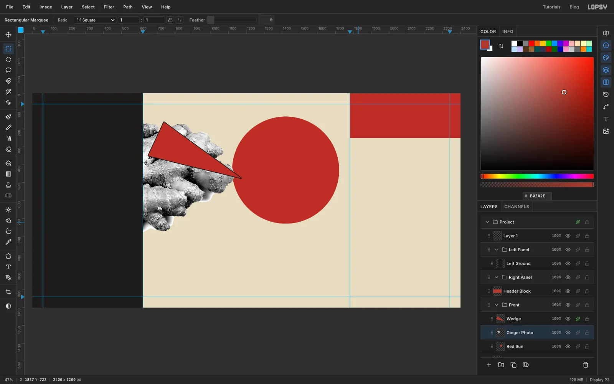

With `Ginger Photo` active:

1. Choose **Filter → Desaturate**.
2. Choose **Filter → Brightness/Contrast…**, set **Contrast** to `70` and click **Apply**.

Constructivist photomontage almost always uses black-and-white photos against flat colour. The extra contrast gives the halftone something to bite on later.

## Scale the root down

1. Pick the **Move** tool ([[V]]).
2. [[Cmd]]-click the `Ginger Photo` thumbnail. The root's outline becomes the selection and the Move tool's handles frame it.
3. Hold [[Cmd]] so the proportions stay locked, and drag the bottom-right corner handle up and left until the root spans about `520` px on the top ruler.
4. Press [[Enter]] to apply, then [[Cmd+D]].

At 520 px the root sits inside the 600 px sun with red showing all round it. Any bigger and the sun just reads as a red rim behind a photo.

## Tilt the root

1. [[Cmd]]-click the `Ginger Photo` thumbnail again.
2. With the **Move** tool, hover just outside the top-right corner handle until you see the round rotation handle. Hold [[Cmd]] and drag it upwards. The angle snaps in 15° steps. Stop at the first step, so the root tilts 15° anticlockwise.
3. Press [[Enter]], then [[Cmd+D]].

Every tilted element on this label uses that same 15°. One shared angle is what makes a diagonal layout look planned.

## Move the root onto the sun

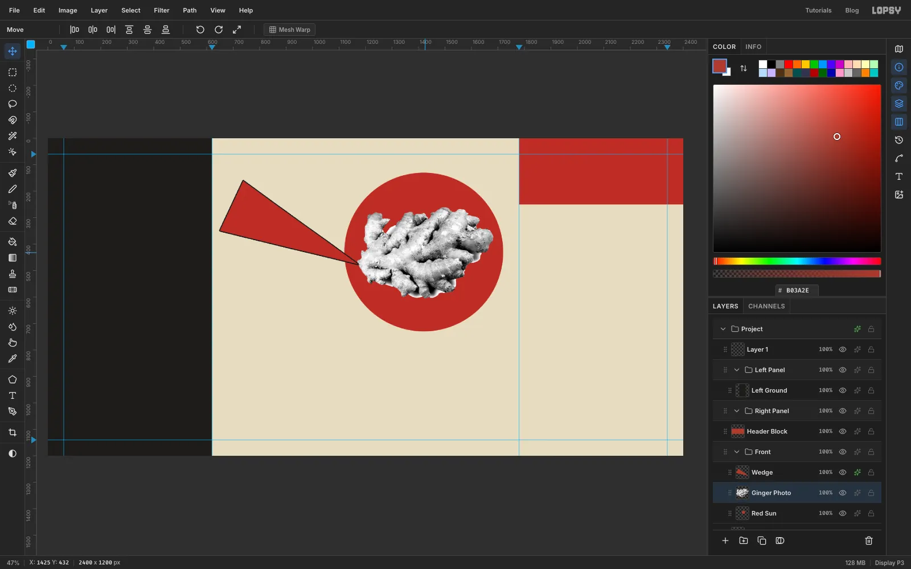

With the **Move** tool, drag the root onto the red circle so it's centred on the sun. Its left edge should just meet the tip of the wedge. The wedge sits above the root in the stack, so its tip overlaps the root's edge as if it's stabbing in. If you hid the `Left Panel` group, turn it back on now.

## Give the root a paper cut-out

In a real print the dots land on paper, not on red. So the root gets a paper-coloured silhouette underneath.

1. Click the `Red Sun` row and click **Add Layer**. Rename it `Root Paper`. It lands between `Red Sun` and `Ginger Photo`.
2. [[Cmd]]-click the `Ginger Photo` thumbnail to load the root's shape (the active layer stays `Root Paper`). Fill it with `#E6DCC3` and press [[Cmd+D]].
3. Open **Layer effects** on `Root Paper`, turn on **Stroke** with **Width** `3` in `#1E1C1B`, and close the drawer.

The keyline makes the silhouette read like it was cut out with scissors and pasted down.

## Halftone the photo

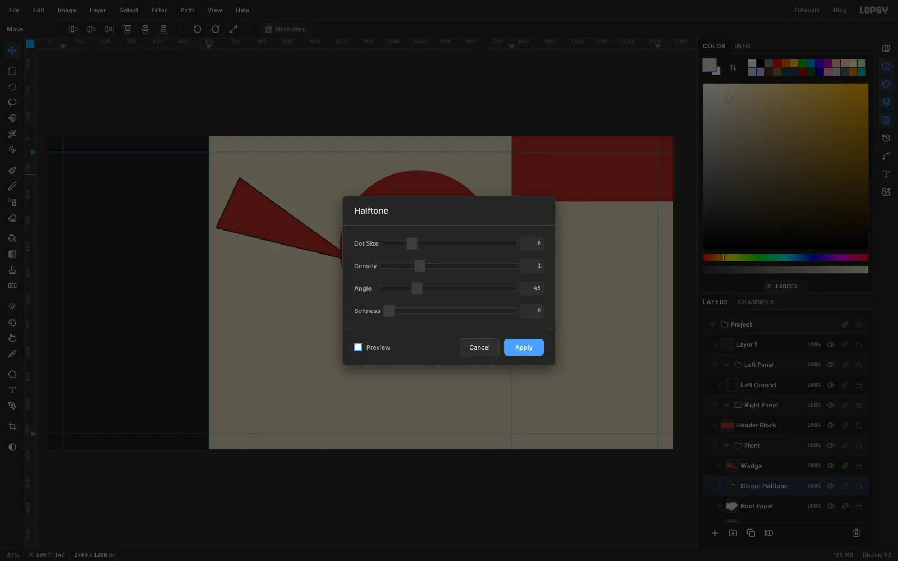

1. Click `Ginger Photo` and rename it `Ginger Halftone`.
2. Choose **Filter → Brightness/Contrast…** and set **Brightness** to `-25` and **Contrast** to `35`. Darkening first makes every tone print as a dot, so the highlights don't wash out into blank paper.
3. Choose **Filter → Halftone…** and set **Dot Size** `8`, **Density** `1`, **Angle** `45` and **Softness** `0`. Click **Apply**.

Halftone draws a dot per cell, big where the photo is dark and small where it's light. The gaps between the dots are transparent, so the paper silhouette shows through.

## Print the dots in ink

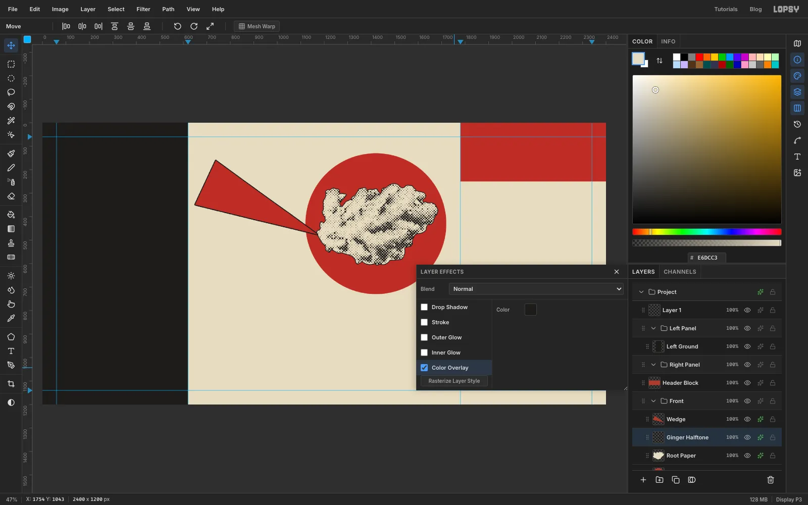

Each halftone dot keeps the grey of the photo under it. A printer only has one black ink, so:

1. Open **Layer effects** on `Ginger Halftone`.
2. Turn on **Color Overlay** and set its colour to `#1E1C1B`. Close the drawer.

Every dot is now solid ink.

## Trim the stray dots

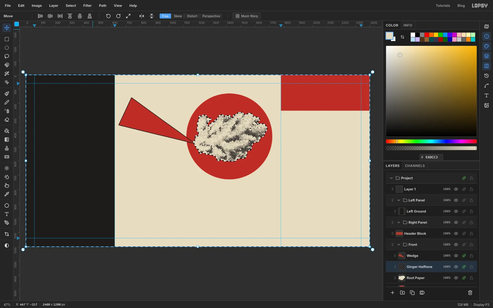

A few dots on the edge cells can poke out past the silhouette.

1. With `Ginger Halftone` active, [[Cmd]]-click the `Root Paper` thumbnail.
2. Choose **Select → Inverse**, press [[Delete]], then [[Cmd+D]].

## Check the printed root

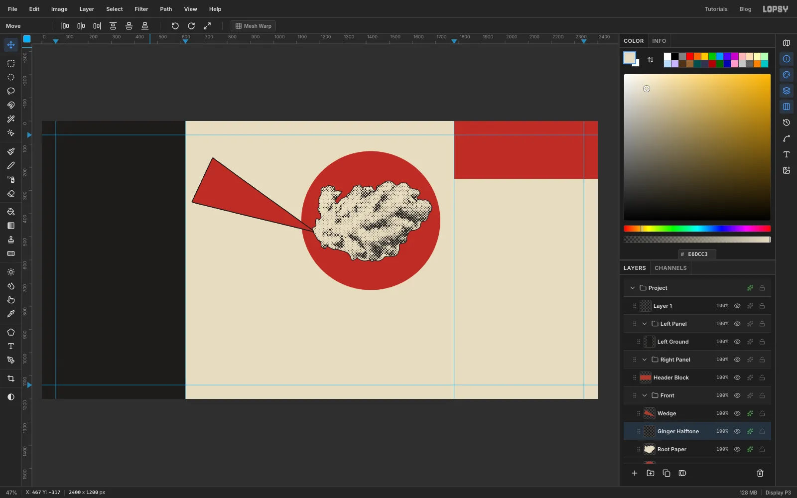

Zoom in for a look. You should see crisp black dots on a cream silhouette with a thin outline, sitting on red, and the wedge's tip touching the outline.

## Make the band

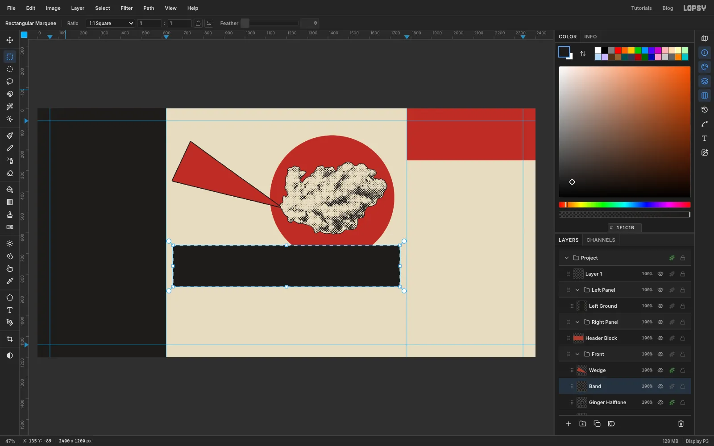

The band carries the brand name across the front.

1. Click the `Ginger Halftone` row, click **Add Layer** and rename it `Band`.
2. With the **Rectangular Marquee**, drag from `653, 660` to `1747, 860`. That's a 1094 × 200 bar centred on `1200, 760`.
3. Fill it with `#1E1C1B`. Keep the selection.

The length is chosen so that, once the bar is tilted, both ends finish 25 px inside the folds.

## Tilt the band 15°

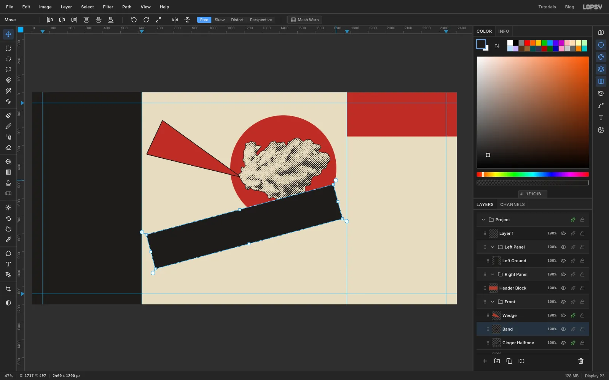

1. Pick the **Move** tool. Hold [[Cmd]] and drag the round rotation handle at the top-right corner upwards by one 15° step.
2. Press [[Enter]], then [[Cmd+D]].

The band now rises to the right and crosses the bottom of the sun. Its ends stay square to the band rather than cut straight up and down by the folds.

## Type the brand name

1. Click the `Band` row.
2. Make a text layer: **Rubik Mono One**, `144` px, `#EDE3CC`, letter spacing `4`. Click in the empty paper below the band and type `AGITPROP`. Rename the layer `Agitprop`.

It lands where you clicked. Don't worry that it's hard to see against the paper: it's going on the black band.

## Turn and seat the name

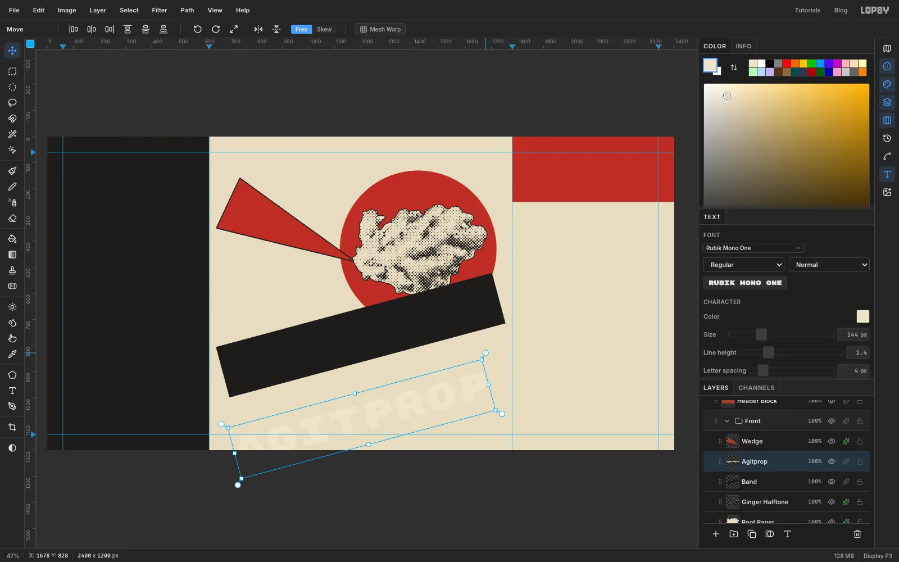

1. With the **Move** tool, hold [[Cmd]] and drag the text's top-right rotation handle up one 15° step. Press [[Enter]].
2. Drag the text onto the band. Line it up so there's the same gap of black at both ends (about 45 px) and the same above and below the letters.

Live text rotates without being turned into pixels, so you can still fix a typo later.

## Add GINGER BEER

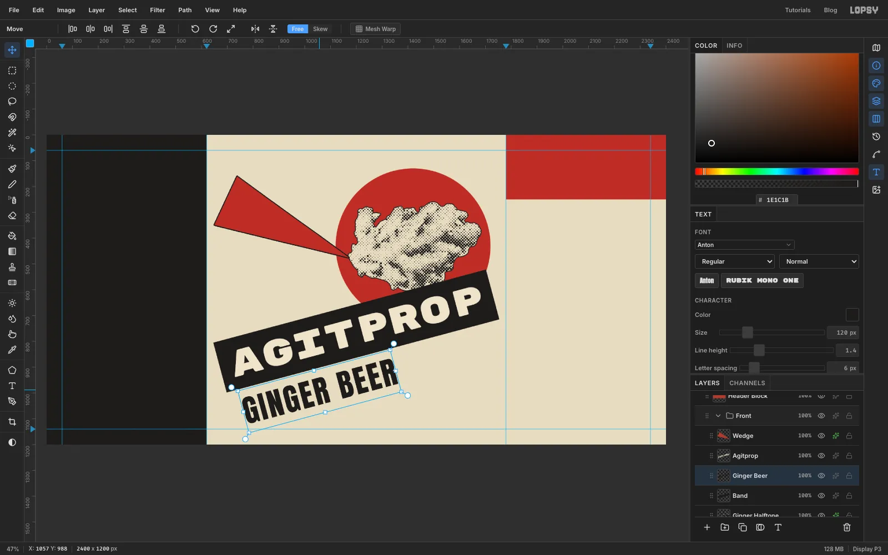

1. Click the `Band` row again.
2. Make a text layer: **Anton**, `120` px, `#1E1C1B`, letter spacing `6`. Type `GINGER BEER` and rename the layer `Ginger Beer`.
3. Rotate it 15° the same way, then drag it below the band. Leave about 35 px between the band and the tops of the letters, and line the **G** up under the **A** of AGITPROP, measured along the slope.

The brand is the loudest thing on the label. The product name is a step down in size and printed in plain ink.

## Add the tagline and its rule

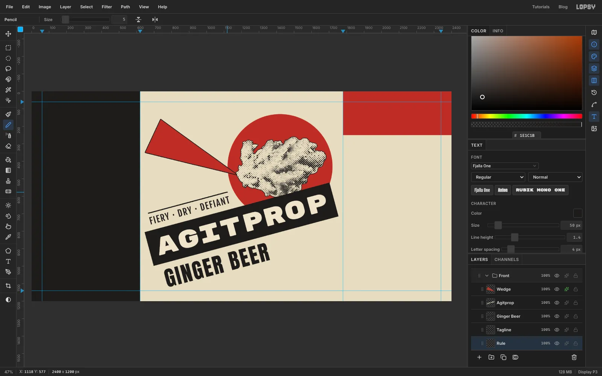

1. Click the `Band` row. Make a text layer: **Fjalla One**, `50` px, `#1E1C1B`, letter spacing `4`. Type `FIERY · DRY · DEFIANT` and rename it `Tagline`.
2. Rotate it 15°, then move it about 30 px above the band with its **F** on the same slanted line as the A and G below.
3. Click **Add Layer** and rename it `Rule`. Pick the **Pencil** ([[N]]), set **Size** to `5` and the colour to `#1E1C1B`.
4. Click just above the left end of the tagline, then hold [[Shift]] and click just above its last letter. The Pencil draws a straight line between the two clicks, parallel to the band.

## Draw the red ladder

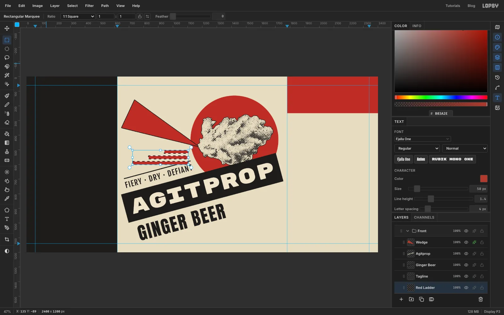

Three short red bars fill the empty corner between the wedge and the tagline and step up towards the sun. Draw them level first, then turn them all at once.

1. Click **Add Layer** and rename it `Red Ladder`.
2. Zoom in to 100% around the gap between the wedge and the tagline, so thin bars are easy to draw.
3. With the **Rectangular Marquee**, drag the bottom bar from `724, 579` to `1105, 601`. Hold [[Shift]] and drag two more above it, from `832, 541` to `1105, 563` and from `940, 503` to `1105, 525`. Each bar is 22 px tall and about 110 px shorter than the one below, with 16 px between them and the right ends lined up.
4. Fill with `#B03A2E` and keep the selection. Zoom back out ([[Cmd+0]] fits the label to the window).

## Turn the ladder

With the **Move** tool, [[Cmd]]-drag the rotation handle up one 15° step and press [[Enter]], then [[Cmd+D]]. The whole selection turns around its own centre, so the bars stay together and finish parallel to the band. Their right ends line up above the tagline's last letter. If they don't quite, nudge the layer with the arrow keys.

## Add the top line and the badge

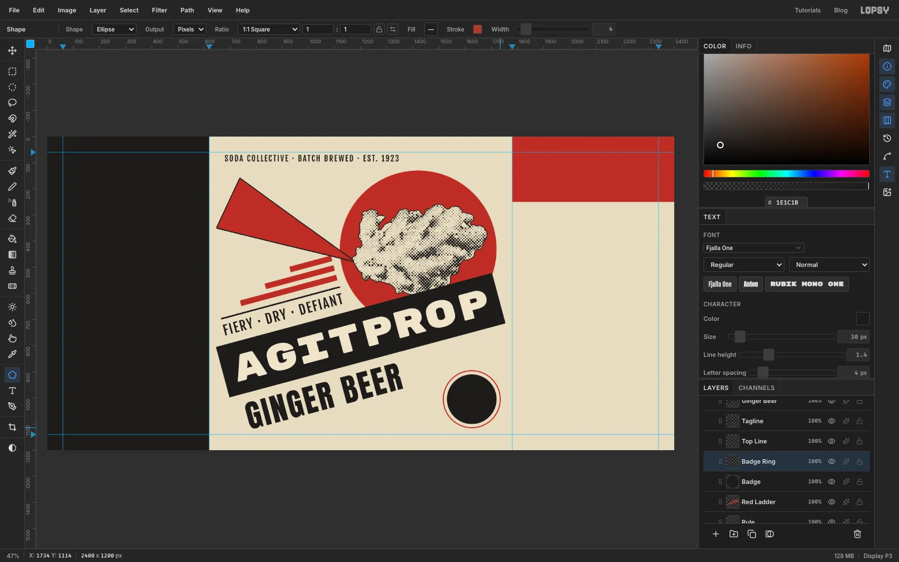

1. Click the `Red Ladder` row and make a text layer in **Fjalla One**, `30` px, `#1E1C1B`, letter spacing `4`, reading `SODA COLLECTIVE · BATCH BREWED · EST. 1923`. Rename it `Top Line`. Move it so it starts 60 px in from the fold (x `680`) and its top sits on the 60 px margin guide. It's the only level line on the front, which stops the tilted layout from looking like it's sliding off the label.
2. Click the `Red Ladder` row, click **Add Layer** and rename it `Badge`. With the **Elliptical Marquee** and [[Cmd]] held, drag a 190 px circle from `1530, 910` to `1720, 1100`. Fill it with `#1E1C1B` and press [[Cmd+D]].
3. Click **Add Layer** and rename it `Badge Ring`.
4. Pick the **Shape** tool ([[U]]). In the options bar choose **Ellipse** and **Pixels**. Click the fill swatch and choose **Remove fill**. Click the stroke swatch, set it to `#B03A2E`, and set **Width** to `4`.
5. Shapes draw out from their centre. Hold [[Cmd]] to keep it a circle, press on the disc's centre (`1625, 1005`), and drag diagonally down and to the right until the ring is about 14 px clear of the disc, roughly 218 px across.

## Number the batch

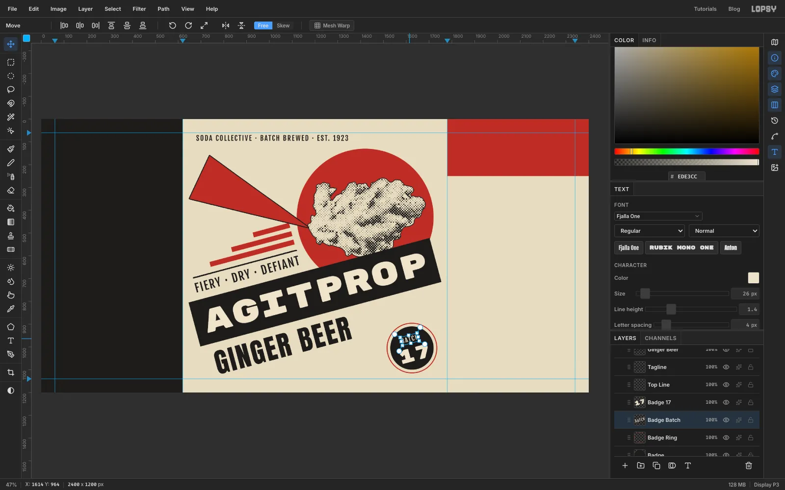

1. Click the `Badge Ring` row (a picture layer) and make a text layer in **Rubik Mono One**, `84` px, `#EDE3CC`, reading `17`. Rename it `Badge 17`.
2. Click `Badge Ring` again and make another: **Fjalla One**, `26` px, `#EDE3CC`, letter spacing `4`, reading `BATCH`. Rename it `Badge Batch`.
3. Rotate both 15° and move them into the disc, with BATCH above 17. Centre the pair as a block, a touch below the disc's middle, since the bigger number looks heavier.

## Set the ingredients and the nutrition table

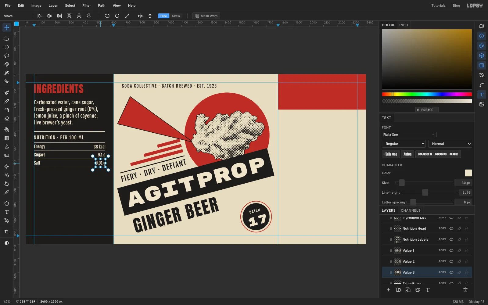

Before each new text layer on this panel, click a picture layer inside the `Left Panel` group: `Left Ground` to begin with, then `Table Rules` once you've made it. That keeps all the type in the group. Line everything up on the 60 px margin guide, and rename each text layer as you go.

1. `INGREDIENTS`: **Anton**, `72` px, `#B03A2E`, letter spacing `2`. Its top goes at y `70`. Name it `Ingredients`.
2. The ingredient list: **Fjalla One**, `34` px, `#EDE3CC`, letter spacing `1`. Press [[Enter]] between lines to type `Carbonated water, cane sugar,` / `fresh-pressed ginger root (6%),` / `lemon juice, a pinch of cayenne,` / `live brewer's yeast.` Its top goes at y `182`. Name it `Ingredient List`.
3. Click **Add Layer** and rename it `Table Rules`. Pick the **Pencil** in `#EDE3CC`. At **Size** `4`, draw a rule at y `405` from the margin guide to x `560` (click, then [[Shift]]-click). At **Size** `2`, draw four more at y `482`, `540`, `598` and `656`.
4. `NUTRITION · PER 100 ML`: **Fjalla One**, `32` px, cream, letter spacing `3`, between the thick rule and the first thin one. Name it `Nutrition Head`.
5. `Energy` / `Sugars` / `Salt` on three lines: **Fjalla One**, `30` px, cream, letter spacing `0`, with **Line height** `1.93` so the rows land 58 px apart, the same as the rules. Put its top at y `497` and name it `Nutrition Labels`.
6. The values go in a right-aligned column. Set **Align** to **Right** in the options bar: the point you click becomes the text's right edge. Make `38 kcal`, `9.1 g` and `0.01 g` as three text layers in the same style (`Value 1` to `Value 3`), one per row, each with its right edge on x `560`. Set **Align** back to **Left** afterwards.

## Finish the left panel

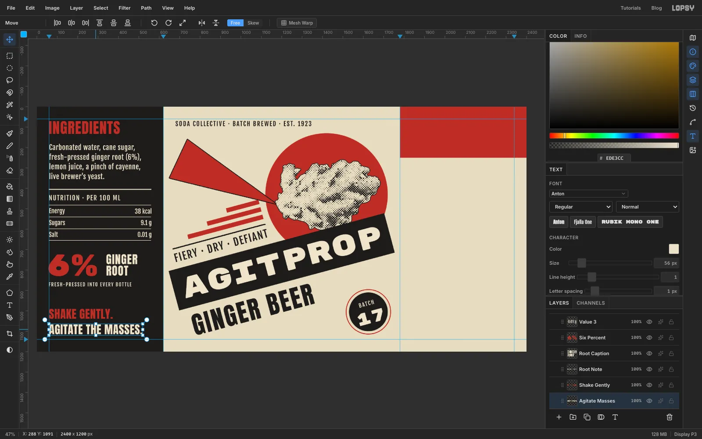

Click `Table Rules` before each one:

1. `6%`: **Rubik Mono One**, `150` px, `#B03A2E`, top-left at `56, 722`.
2. `GINGER` / `ROOT` on two lines: **Anton**, `56` px, cream, letter spacing `2`, **Line height** `1.0`. Put it about 48 px to the right of the % sign, tops lined up. With "ginger root" spelled out beside it, nobody will read the 6% as alcohol.
3. `FRESH-PRESSED INTO EVERY BOTTLE`: **Fjalla One**, `24` px, cream, letter spacing `3`, 30 px under the 6%.
4. `SHAKE GENTLY.` in **Anton** `56` px red at y `990`, and `AGITATE THE MASSES.` in **Anton** `56` px cream at y `1066`. Both have letter spacing `1`.

## Draw the barcode

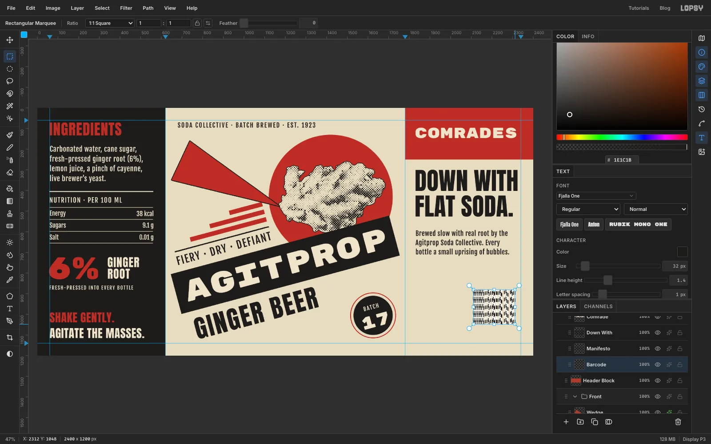

1. Click the `Right Panel` group and click **Add Layer**. The new layer goes inside the group. Rename it `Barcode`.
2. Zoom in to 200% on that corner, so the thinnest bars are easy to see. With the **Rectangular Marquee**, draw thin upright rectangles from y `880` to y `1048`, starting at x `2110`. Hold [[Shift]] for every one after the first. Start with two 4 px bars 4 px apart, then mix widths of 4, 8 and 12 px with gaps of 4 to 8 px until you reach about x `2306`.
3. Fill with `#1E1C1B`, press [[Cmd+D]] and zoom back out.

## Set the manifesto side

Click `Barcode` before each text layer so they all go in the group. Line the left edges up with each other at about x `1830`. Don't worry about hitting the margin guide exactly: once everything's set, you'll move the whole block onto it in one go.

1. `COMRADES`: **Rubik Mono One**, `71` px, cream, letter spacing `2`, top at y `95` inside the red header.
2. `DOWN WITH` / `FLAT SODA.`: **Anton**, `118` px, ink, **Line height** `1.05`, top at y `300`.
3. `Brewed slow with real root by the` / `Agitprop Soda Collective. Every` / `bottle a small uprising of bubbles.`: **Fjalla One**, `32` px, ink, letter spacing `1`, line height `1.4`, top at y `590`.
4. `330 ML`: **Anton**, `70` px, ink, letter spacing `1`, top at y `880`.
5. `0.5% VOL` / `SERVE COLD` / `PLEASE RETURN` / `THE BOTTLE`: **Fjalla One**, `24` px, ink, letter spacing `2`, line height `1.3`, top at y `970`.
6. `4 601923 170017`: **IBM Plex Mono**, `22` px, ink, letter spacing `1`, under the bars at x `2110`. Sit its bottom on the same line as the bottom of `THE BOTTLE`.
7. The credit, `Ginger photo: Sanjay ach, Wikimedia Commons, CC BY-SA 4.0`: **Fjalla One**, `17` px, ink, letter spacing `1`, top at y `1118`.

## Move the whole right panel onto the guide

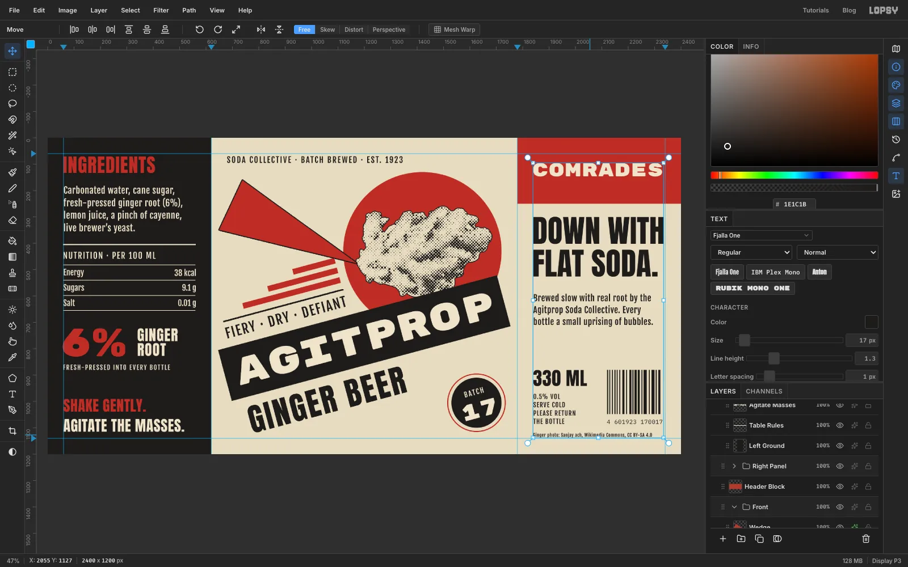

Check the left edges of the right panel's type against the margin guide at x `1840`. Here they sit 10 px short, so:

1. Click the arrow on the `Right Panel` row to collapse the group, then click the group's name to select it.
2. Pick the **Move** tool and press [[Shift+→]] once. Everything in the group moves 10 px right onto the margin guide in one step.

The red header doesn't move, because it's outside the group.

## Add paper grain

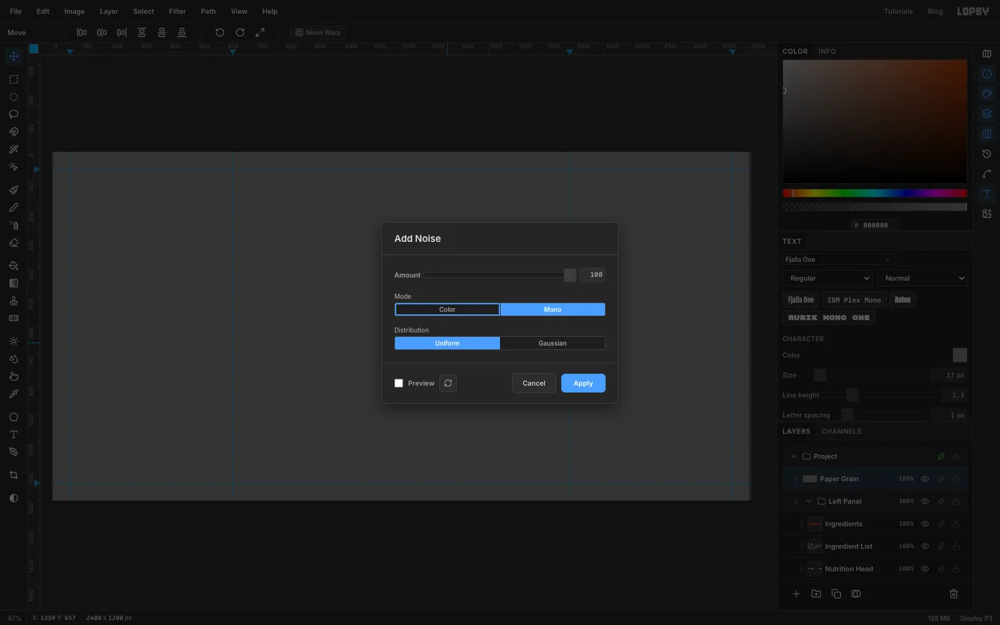

1. Click `Layer 1` at the top of the stack and rename it `Paper Grain`. Fill it with `#808080`. The whole label turns grey for a moment.
2. Choose **Filter → Add Noise…**, set **Amount** to `100`, and pick **Mono** and **Uniform**. Click **Apply**.
3. Choose **Filter → Gaussian Blur…**, set **Radius** to `1` and click **Apply** to soften the grain.

## Blend the grain in

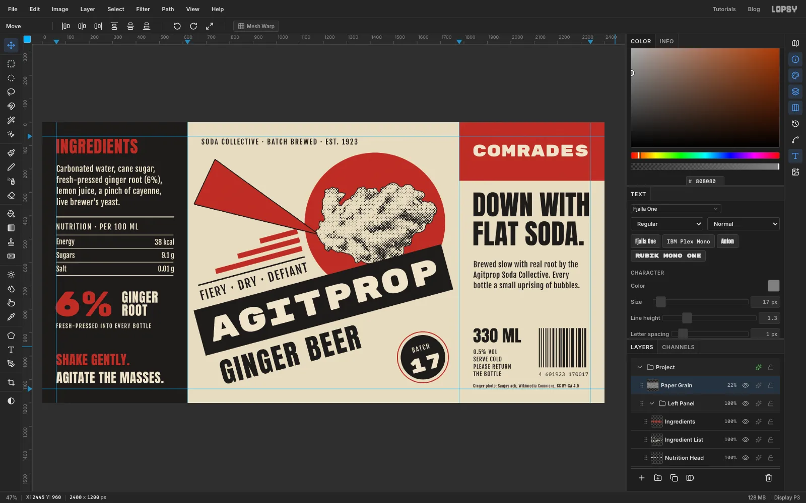

Open **Layer effects** on `Paper Grain`, set the blend mode to **Overlay**, and close the drawer. Then click the `100%` on the `Paper Grain` row to open its opacity slider and set it to `22`. Overlay leaves 50% grey invisible and only lets the noise lighten and darken what's underneath.

## Make a map of worn spots

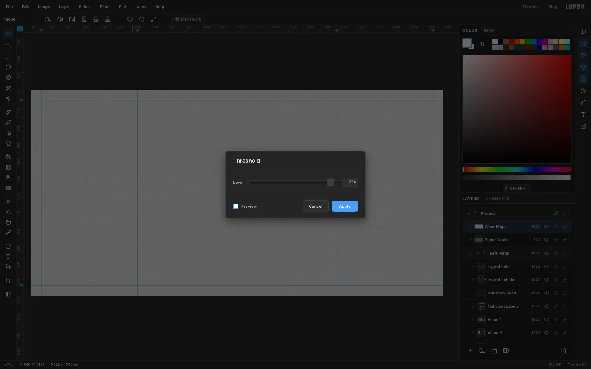

Letterpress solids never print perfectly. Little flecks of paper show through where the ink didn't take. You'll punch those flecks out of the biggest solids.

1. With `Paper Grain` active, click **Add Layer** and rename it `Wear Map`. Fill it with white.
2. **Filter → Add Noise…**: **Amount** `100`, **Mono**, **Uniform**, then **Apply**.
3. **Filter → Gaussian Blur…**: **Radius** `6`, then **Apply**. The blur clumps the noise into soft blobs.
4. **Filter → Threshold…**: drag **Level** until only a few small black blobs are left scattered over white. That's `236` here. Click **Apply**.

## Check the spots

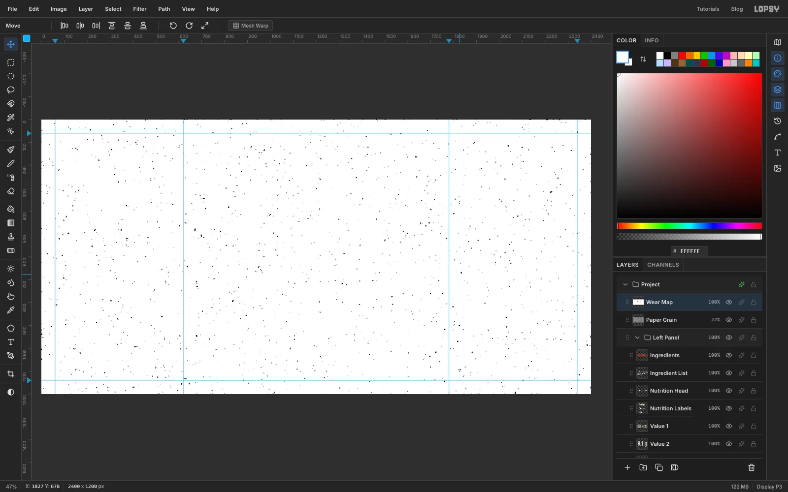

Zoom in. You want sparse, irregular blobs a few pixels across. If the map looks like pepper, undo the Threshold and lower the level. If there are hardly any spots, raise it.

## Select every spot at once

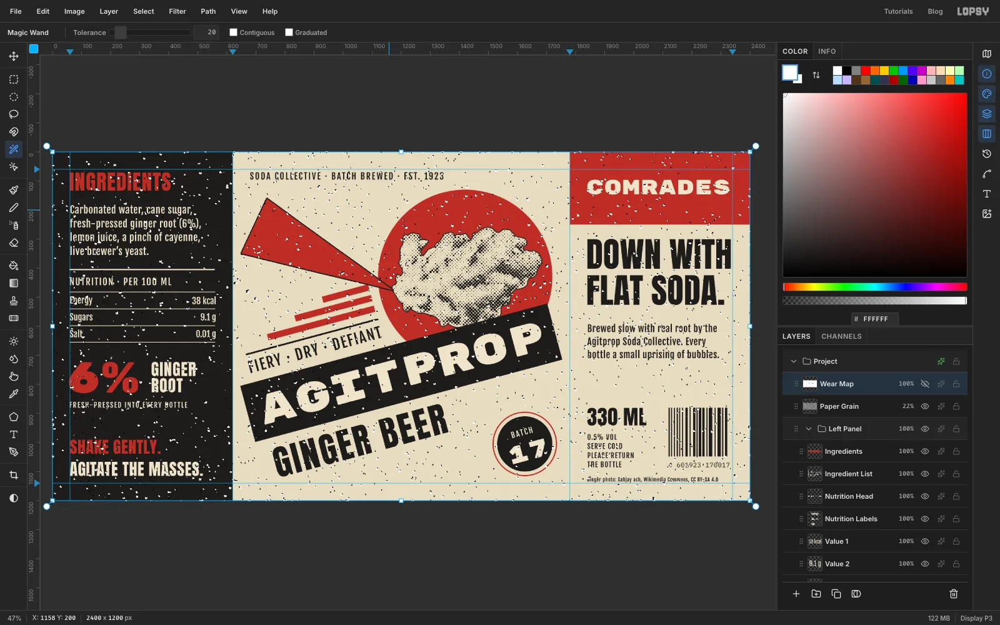

1. Pick the **Magic Wand**. Set **Tolerance** to `20` and **untick Contiguous**, so one click selects every black spot on the layer, not only the one you click.
2. Click any black blob.
3. Click the eye on the `Wear Map` row to hide it. The selection stays.
4. Choose **Select → Feather…** and enter `1`, so the specks have soft edges like worn ink rather than square pixels.

## Knock the specks out of the solids

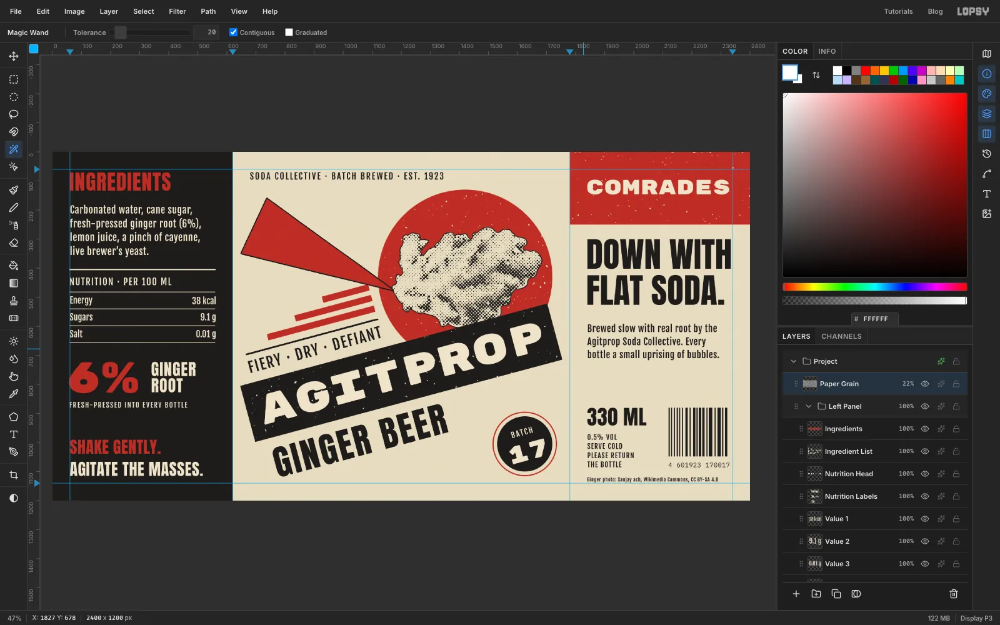

With the selection still live, click each of these rows in turn and press [[Delete]]: `Band`, `Red Sun` and `Header Block`. Then press [[Cmd+D]].

Leave the small type and the black left panel alone. Specks between words look like stray punctuation, and nutrition copy has to stay clean. Leave the wedge alone too: its Stroke effect would outline every hole.

Finally:

1. Click the `Wear Map` row and delete it with the trash button.
2. Pick the **Magic Wand** and tick **Contiguous** again. It's a sticky setting and you'll want it back next time.
3. Choose **File → Save Project** to keep a layered `.lopsy` copy, and **File → Quick Export PNG** for the print file.
