This tutorial makes a brand sheet for an imaginary 1928 sleeper train, **Baltic Xpress**, which runs overnight from Rīga to Tallinn. It's a 2400 × 1600 px logo sheet in the style of Russian Constructivism. Think of Alexander Rodchenko's posters and trademarks for the airline Dobrolet: a photo cut out and set against flat colour, one strong diagonal, heavy sans-serif capitals and only a few inks.

The sheet has four panels. The big **primary mark** on the left is the full emblem. On the right are the **monogram** at three sizes, a **horizontal lockup** for letterheads and tickets, and the **colour** chips with the two typefaces.

The engine is a real photograph, [Steam locomotive P36-0147 (51170739681).jpg](https://commons.wikimedia.org/wiki/File:Steam_locomotive_P36-0147_(51170739681).jpg) by Ilya Onofriychuk, from Wikimedia Commons. It's in the **public domain**. Download the 1280 px wide preview (1280 × 1381). It's a perfect photomontage source: the engine is shot dead-on along the track, so it looks like it's driving straight out of the page.

Along the way you'll use:

- ruler **guides**, the 16 px **grid** and the exact-corners marquee dialog
- the **Shape** tool for filled and outlined rectangles and circles, with the click-to-size dialog
- the **Lasso**, **Select → Inverse**, **Feather** and [[Shift]]-drag to add to a selection
- **Desaturate**, **Brightness/Contrast** and **Halftone**
- a radial **gradient**
- the **Move** tool's scale and rotate handles, with [[Cmd]] to keep proportions and snap the angle
- the **Perspective** transform mode
- the **Pen** tool and **Path to Selection**
- the **Pencil** with a [[Shift]]-click straight line
- **Text** in Big Shoulders and IBM Plex Mono, with one letter coloured differently
- the **Drop Shadow** and **Color Overlay** layer effects, and the **Multiply** blend mode
- copy, paste, **Flip Horizontal**, **Merge Down** and **Copy Merged**
- **New Group**, and moving a whole group at once

The palette:

- Newsprint `#E9E4D8`
- Signal red `#D3202A`
- Engine black `#151515`
- Baltic steel `#3D5A75`

> **Tip:** Positions are written as `x, y` in document pixels. The status bar at the bottom left shows where the cursor is, and the **Info** panel shows the size of the current selection. Key names use Mac keys. On Windows and Linux, use Ctrl for Cmd.

> **Tip:** "Select **From** … **To** …" means the exact-corners dialog. Pick the Rectangular (or Elliptical) Marquee, make sure nothing is selected ([[Cmd+D]]), and click once on the canvas without dragging. Type the two corners and press Enter. "Fill with a colour" means set the foreground colour to it in the Color panel's hex field and choose **Edit → Fill**.

> **Tip:** New layers and text appear just above whichever layer is active, so each step says which layer to click first. Before you make a new text layer, always click a picture layer (not another text layer), or the Text tool restyles the text you clicked.

> **Tip:** To make a text layer, pick the **Text** tool, set the font, weight, size and colour in the options bar, click on the canvas roughly where the text will go, type, and click ✓ (or press [[Tab]]) to commit. Then rename the layer and set its **Letter spacing** in the Text panel. Click in clear space: a click inside an existing text box edits that text instead. Every text value below is given in the order font, weight, size, colour, letter spacing.

## Set up the sheet and the guides

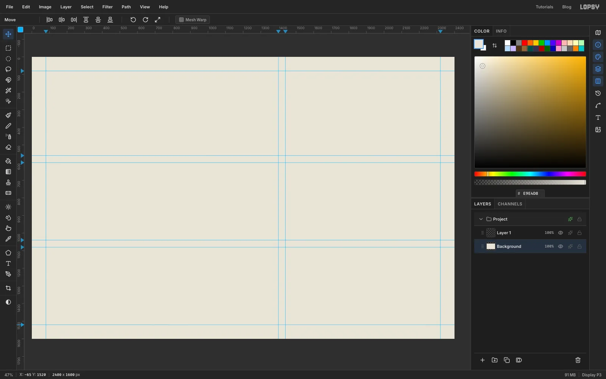

Open [Lopsy](/). In the **New Document** dialog, set **Width** to `2400` and **Height** to `1600` and click **Create**. You get a white `Background` and an empty `Layer 1`. Leave `Layer 1` alone for now. It becomes the paper grain at the very end.

1. Click the `Background` row, set the foreground colour to `#E9E4D8` and choose **Edit → Fill**.
2. Click the top ruler at x `80`, `1400`, `1440` and `2320` to drop four vertical guides.
3. Click the left ruler at y `80`, `560`, `600`, `1040`, `1080` and `1520` for the horizontal guides.

That's a 40 px gap between every panel and an 80 px margin all round.

## Draw the four panel frames

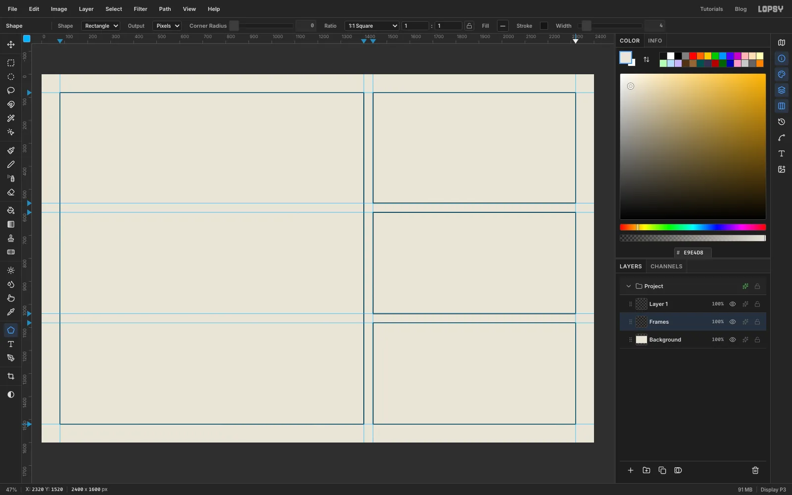

1. Click **Add Layer** and rename the new layer `Frames`.
2. Pick the **Shape** tool. In the options bar set **Shape** to **Rectangle** and **Output** to **Pixels**. Click the **Fill** swatch and choose **Remove fill**. Click **Stroke**, type `151515` into its hex field, and set **Width** to `4`.
3. Shapes grow from where you press, so press in the middle of a panel and drag out to its bottom-right guide corner, where it snaps. The centres are **740, 800** for the left panel and **1880, 320**, **1880, 820** and **1880, 1300** for the three cells. Watch the size in the Info panel: the left panel is `1320` × `1440`, the top cell `880` × `480`, and the other two `880` × `440`.

## Make the red sun

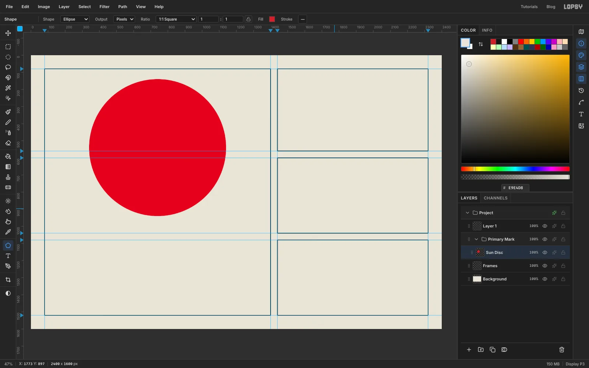

1. With `Frames` active, click **New Group** at the bottom of the Layers panel and name it `Primary Mark`. Everything in the emblem goes inside it.
2. Click **Add Layer** and rename it `Sun Disc`.
3. With the **Shape** tool, set **Shape** to **Ellipse**, set the **Fill** to `D3202A` and remove the stroke.
4. Click once at **740, 540** without dragging. In the **Shape Size** dialog type `800` × `800` and confirm.

## Give the sun an offset shadow

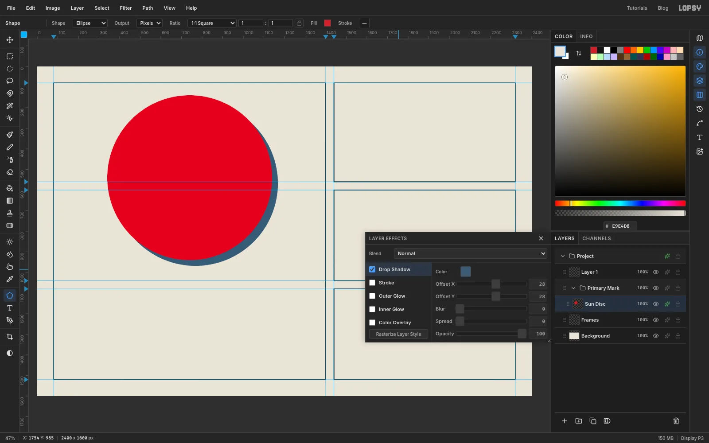

Click the effects button (✦) on the `Sun Disc` row and turn on **Drop Shadow**. Set the colour to `#3D5A75`, **Offset X** and **Offset Y** to `28`, **Blur** and **Spread** to `0`, and **Opacity** to `100`. Close the drawer.

A hard offset like this is how a second ink, printed slightly out of register, looks on a 1920s poster.

## Bring in the locomotive photo

Drag the downloaded photo onto the canvas. It lands at the top-left corner as a new layer above `Sun Disc`. Rename it `Locomotive`, then press [[Cmd+D]] to drop the selection it arrives with.

## Trace round the engine

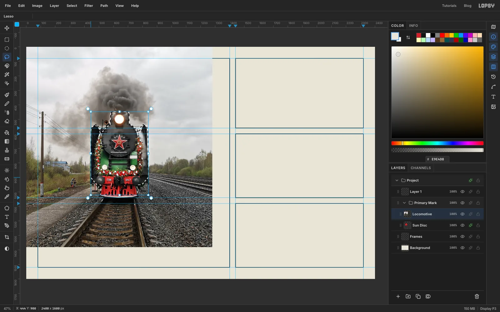

Zoom in and trace the engine with the **Lasso**. Go up the outer edge of the left smoke deflector, over the chimney and headlamp, down the right deflector and round the buffer beam. Keep just inside the edges so no grey sky gets in. Where the deflectors end, cut diagonally in towards the buffers rather than straight across. Under the buffers, follow the sides of the red buffer beam closely so no gravel comes along, and run along its bottom just above the thin white stripe. Against the halftone dots later, that stripe would look like a cut-out halo. Leave the smoke and the track out.

## Cut it out

Choose **Select → Inverse**, press [[Delete]], then [[Cmd+D]].

## Paint out the old emblem

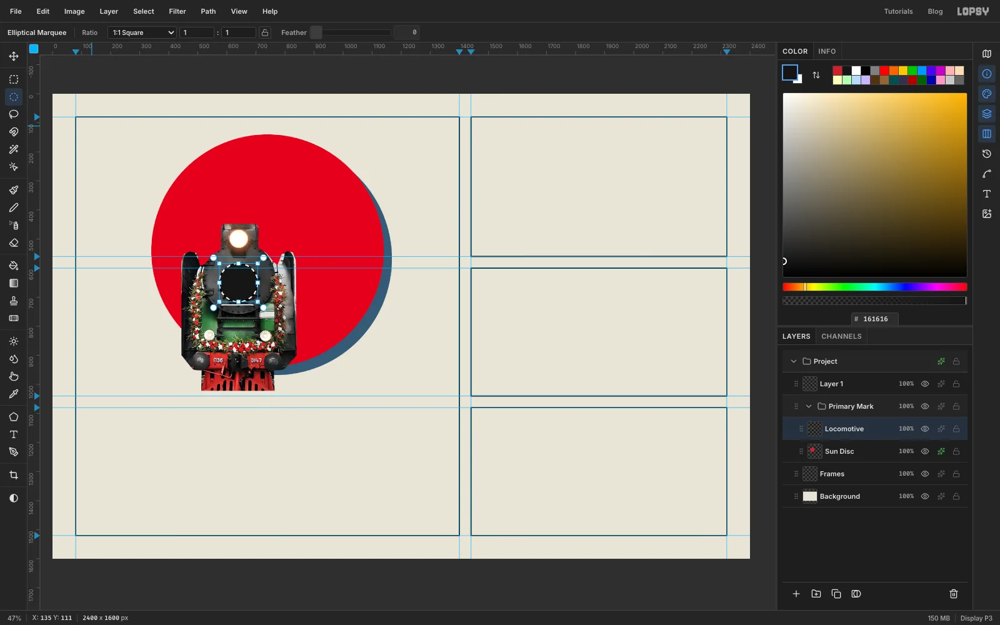

The smokebox door carries an old star badge, and our own roundel goes there instead. With the **Elliptical Marquee**, select **From** `574, 584` **To** `706, 716`. Fill it with `#161616`, then press [[Cmd+D]].

## Turn it into a press photo

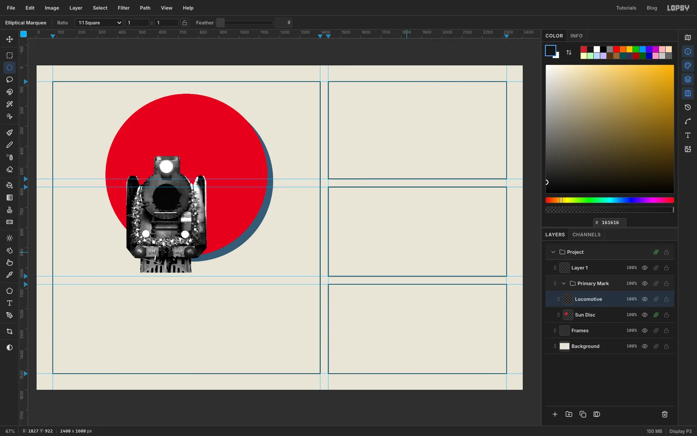

1. Choose **Filter → Desaturate**.
2. Choose **Filter → Brightness/Contrast…** and set **Brightness** to `8` and **Contrast** to `35`.

Constructivist photomontage was almost always printed in black only, with the colour coming from flat shapes around the photo.

## Scale the engine up

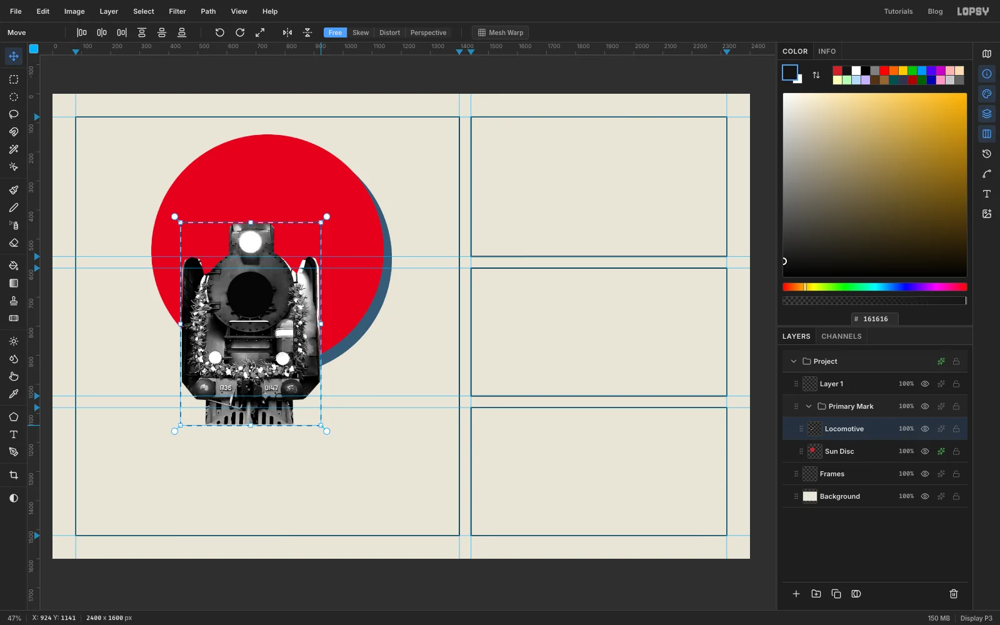

1. With the **Rectangular Marquee**, drag a box that just encloses the engine. If you followed the trace above it's about `400` × `592`, from about **440, 443**.
2. Pick the **Move** tool. Hold [[Cmd]] and drag the bottom-right handle outward until the box is 120% of its size: about `480` px wide and `710` px tall.
3. Press Enter, then [[Cmd+D]].

## Centre the smokebox on the sun

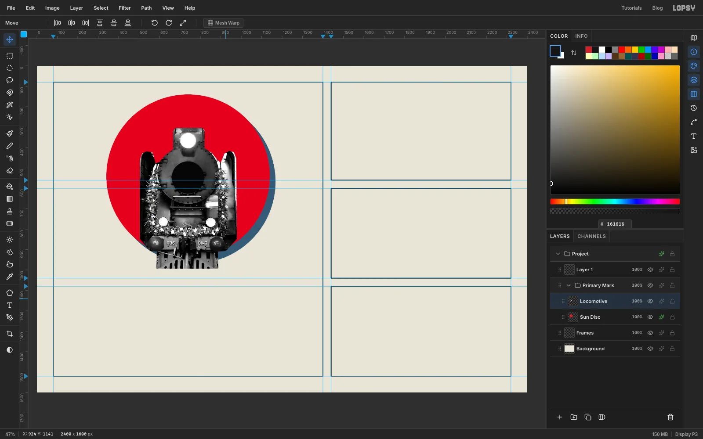

With the **Move** tool, drag the engine until the dark disc on its smokebox door sits on the centre of the sun, **740, 540**. Finish with the arrow keys. The top of the chimney ends up near y `295` and the buffer beam near y `1000`, just below the sun.

## Select the sleepers

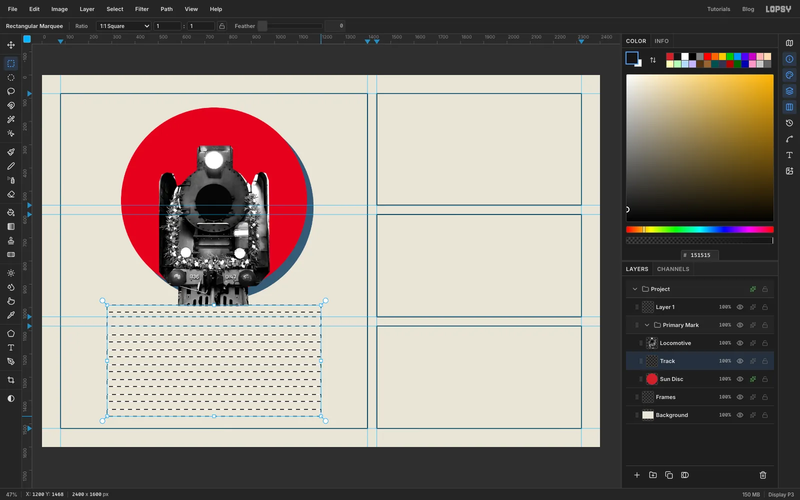

You draw the track flat first, like a ladder, then tilt it into perspective.

1. Click `Sun Disc`, click **Add Layer** and rename it `Track`. It sits under the engine.
2. Select **From** `280, 990` **To** `1200, 1020`. That's the first sleeper.
3. Hold [[Shift]] and drag seven more bars, each `920` × `30` and 64 px lower than the last: the next starts at y `1054`, then `1118`, `1182`, `1246`, `1310`, `1374` and `1438`. Zoom in and watch the Info panel while you drag. A few pixels out won't show once the track is in perspective.
4. Fill with `#151515`, then press [[Cmd+D]].

## Add the rails

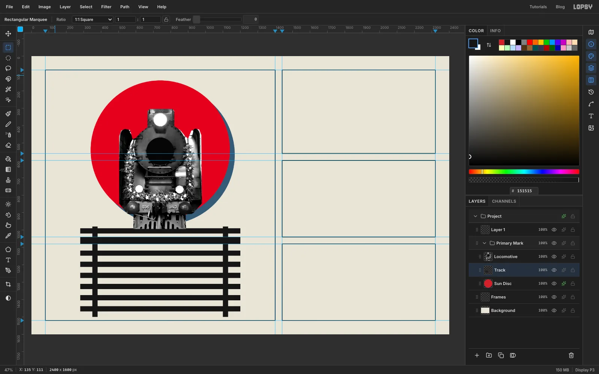

Select **From** `350, 980` **To** `380, 1500`. Hold [[Shift]] and drag a second rail from `1100, 980` to `1130, 1500`. Fill with `#151515` and press [[Cmd+D]].

## Pull the track into perspective

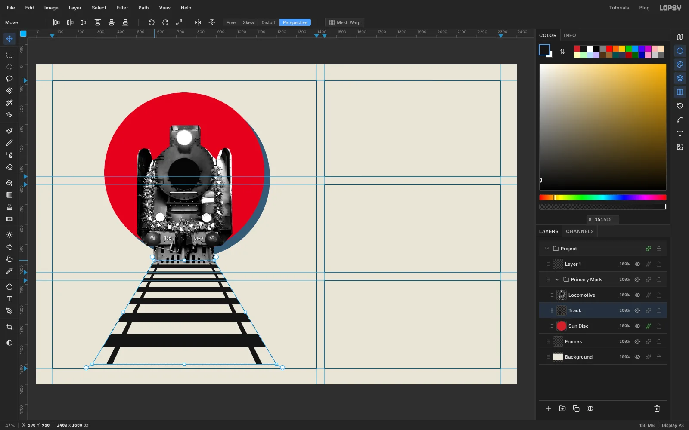

1. Select **From** `280, 980` **To** `1200, 1500` round the whole ladder.
2. Pick the **Move** tool and click **Perspective** in its options bar.
3. Drag the top-left handle right by about `310` px, to x `590`. The top-right handle moves in by the same amount, so the top edge shrinks to about `300` px and lines up with the engine's buffers.
4. Press Enter, click **Free** to put the mode back, and press [[Cmd+D]].

The Perspective mode squeezes the far sleepers closer together on its own, so the track really recedes.

## Rotate the black bar

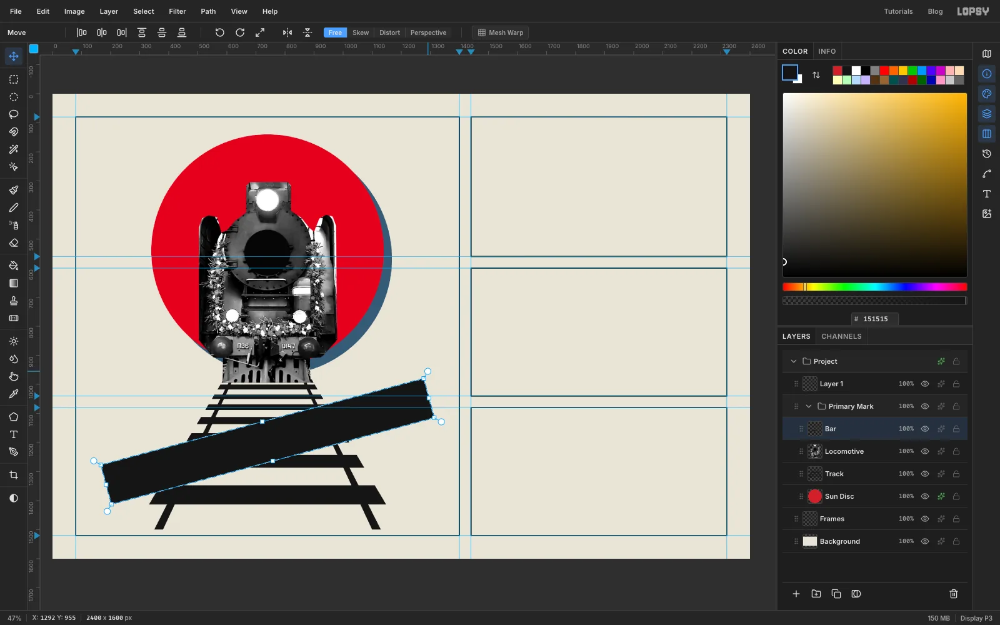

1. Click `Locomotive`, click **Add Layer** and rename it `Bar`.
2. Select **From** `165, 1126` **To** `1315, 1266` and fill it with `#151515`.
3. With the **Move** tool, hold [[Cmd]] and drag a corner rotation handle counter-clockwise until it snaps to **−15°**. Press Enter, then [[Cmd+D]].

−15° is the classic Constructivist tilt. It reads as forward motion, rising to the right.

## Add the steel band

1. Click **Add Layer** and rename it `Steel Band`.
2. Select **From** `224, 1274` **To** `1314, 1330` and fill it with `#3D5A75`.
3. Rotate it to **−15°** exactly as before, press Enter and [[Cmd+D]].

It's 60 px shorter than the bar, so the bar overhangs it at both ends.

## Trace a trim line with the Pen

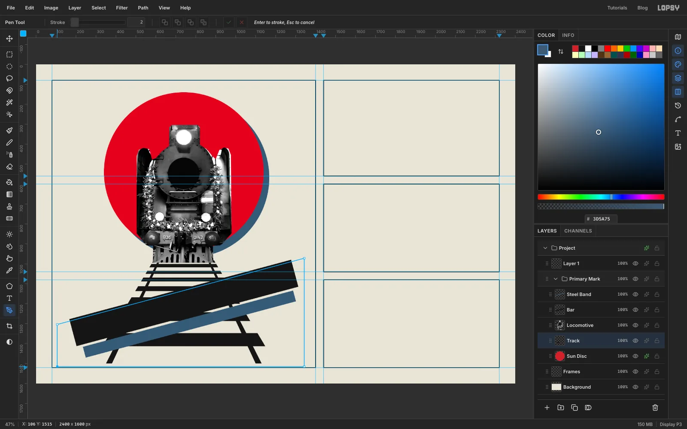

The track still pokes out under the bar. It should look as though it runs into the bar and stops.

1. Click `Track`. Pick the **Pen** tool.
2. Click once just inside the bar's top edge near its left end (about `106, 1304`), then once just inside it near the right end (about `1343, 972`).
3. Click two points well below the track (`1343, 1515` and `106, 1515`), then click the first anchor again to close the path.

## Trim the track

Open the **Paths** panel, click **Path to Selection**, then **Delete Path**. Press [[Delete]] to clear that part of the track, then [[Cmd+D]].

## Add the smokebox roundel

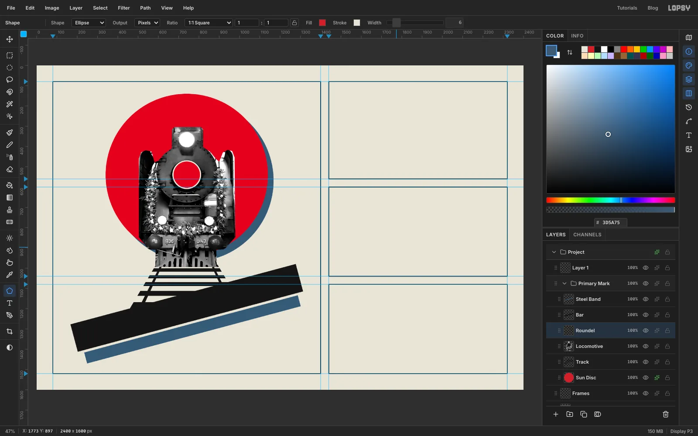

1. Click `Locomotive`, click **Add Layer** and rename it `Roundel`.
2. With the **Shape** tool on **Ellipse**, set the **Fill** to `D3202A`, then turn on a **Stroke** of `E9E4D8` with **Width** `6`.
3. Click once at **740, 539** and make it `136` × `136`.

## Type the wordmark with a red X

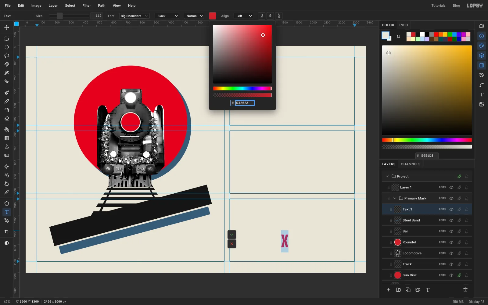

1. Click `Steel Band`. Pick the **Text** tool and set the font to **Big Shoulders**, weight **Black**, **Size** `112`, colour `#E9E4D8`.
2. Click in the empty bottom-right cell (about **1500, 1300**), out of the way, and type `BALTIC XPRESS`. The letters are newsprint on newsprint, so you'll hardly see them yet.
3. Select just the **X**: press [[Left]] five times, then [[Shift+Left]] once.
4. Click the **Text color** swatch in the options bar and type `D3202A`. Click the swatch again to close it, then click ✓ to commit.
5. Rename the layer `Wordmark` and set **Letter spacing** to `8` in the Text panel.

## Rotate the wordmark

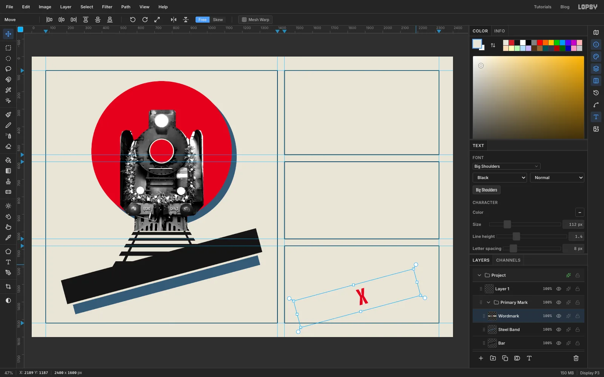

Pick the **Move** tool. Hold [[Cmd]] and drag one of the wordmark's rotation handles counter-clockwise until it snaps to **−15°**, the same as the bar. Press Enter. The text stays live and editable.

## Seat it on the bar

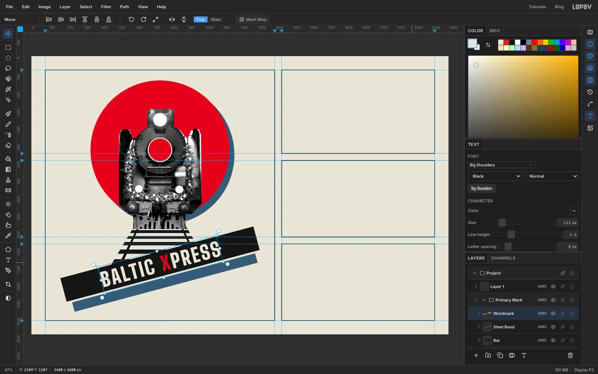

Drag the wordmark onto the bar so its letters sit in the middle of it, centred on **740, 1196**, the bar's centre. Nudge with the arrow keys until the space above the capitals matches the space below. It's about 26 px each side when measured square to the bar.

## Add the tagline

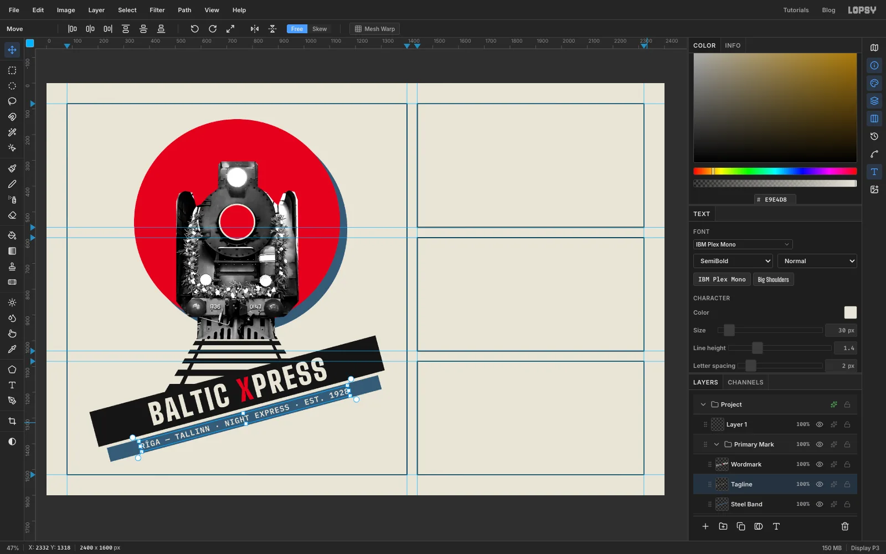

1. Click `Steel Band`. With the **Text** tool, choose **IBM Plex Mono**, weight **SemiBold**, **Size** `30`, colour `#E9E4D8`.
2. Click in the empty bottom-right cell again, a little below where you started the wordmark (about **1500, 1450**), and type `RĪGA — TALLINN · NIGHT EXPRESS · EST. 1928`. If your keyboard has no Ī, paste it in. Commit it. Rename the layer `Tagline` and set **Letter spacing** to `2`.
3. Rotate it to **−15°** with [[Cmd]] as before, press Enter, and centre it on the band at **768, 1302**.

## Letter the roundel

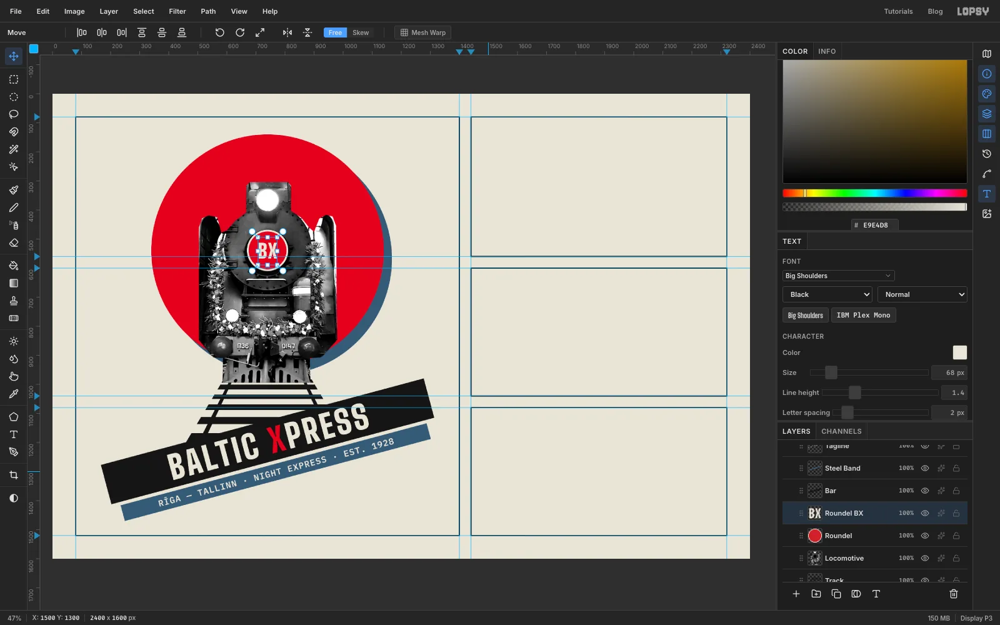

Click `Roundel`. Make a text layer in **Big Shoulders** **Black**, **Size** `68`, colour `#E9E4D8`, letter spacing `2`, reading `BX`. Rename it `Roundel BX` and centre it on **740, 539**.

## Check that the emblem moves as one

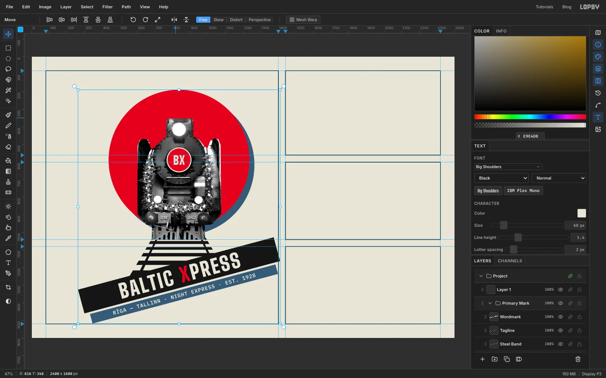

Before going on, make sure every piece of the emblem landed inside the group. Click the `Primary Mark` group row and drag on the canvas with the **Move** tool. The sun, engine, track, bars and all three texts should move together, shadow included. If something stays behind, it was made outside the group: drag its row into `Primary Mark`. Press [[Cmd+Z]] to put the emblem back, since it's already centred in its panel.

## Lay a radial gradient for the halo

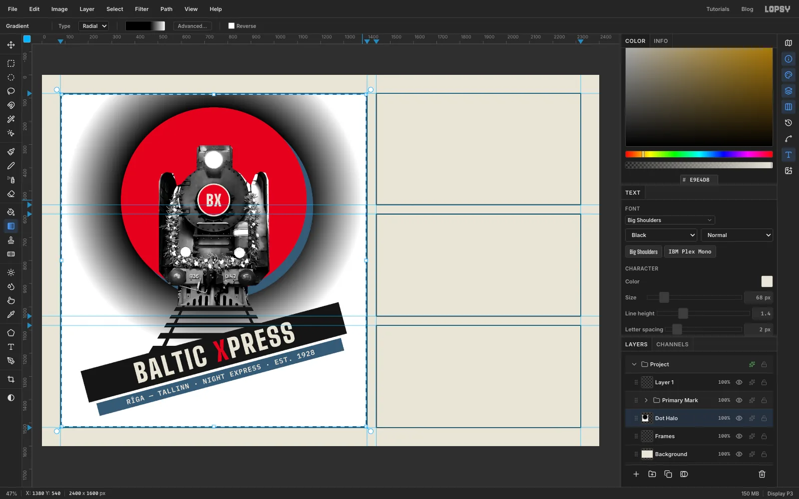

1. Click the collapse arrow on `Primary Mark`, then click `Frames`. Click **Add Layer** and rename it `Dot Halo`. It sits under the whole emblem.
2. Select **From** `84, 84` **To** `1396, 1516`, just inside the panel frame.
3. Pick the **Gradient** tool and set **Type** to **Radial**. Click **Advanced…**. Click the left stop and type `000000` in the hex field, click the right stop and type `FFFFFF`, then click the gradient bar at about 62% of the way along to add a third stop and type `000000` for it too. Click **Done**.
4. Drag from the sun's centre, **740, 540**, straight right to **1380, 540**. Black fills the sun's area and fades to white about 240 px outside it, so the dots die out before they reach the frame.

## Screen it with Halftone

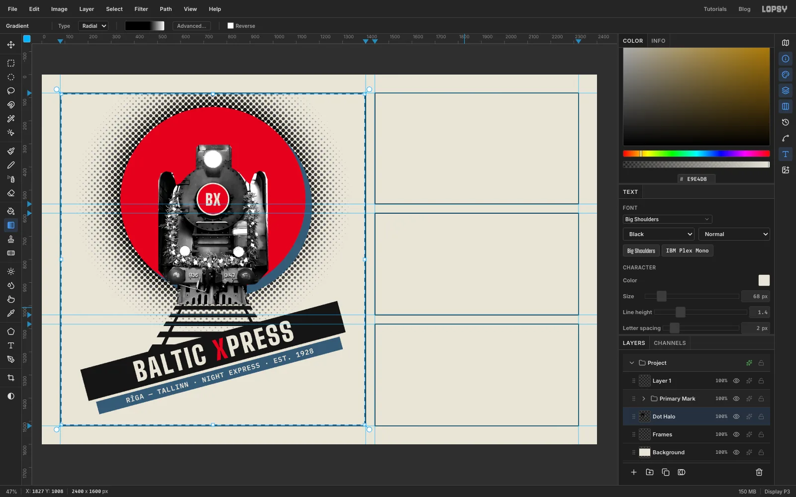

Keep the selection so no dot crosses the frame. Choose **Filter → Halftone…** with **Dot Size** `18`, **Density** `1`, **Angle** `45` and **Softness** `0.4`, and click **Apply**. Then press [[Cmd+D]].

Halftone draws each dot from the tone under it. Pure white prints nothing, so the light areas become transparent.

## Fade out the top

The panel label goes in the top-left corner, so the dots should fade out before they reach it.

1. Select **From** `84, 84` **To** `1396, 160`.
2. Choose **Select → Feather…**, set it to `40` and click **Apply**.
3. Press [[Delete]], then [[Cmd+D]].

## Colour the dots steel

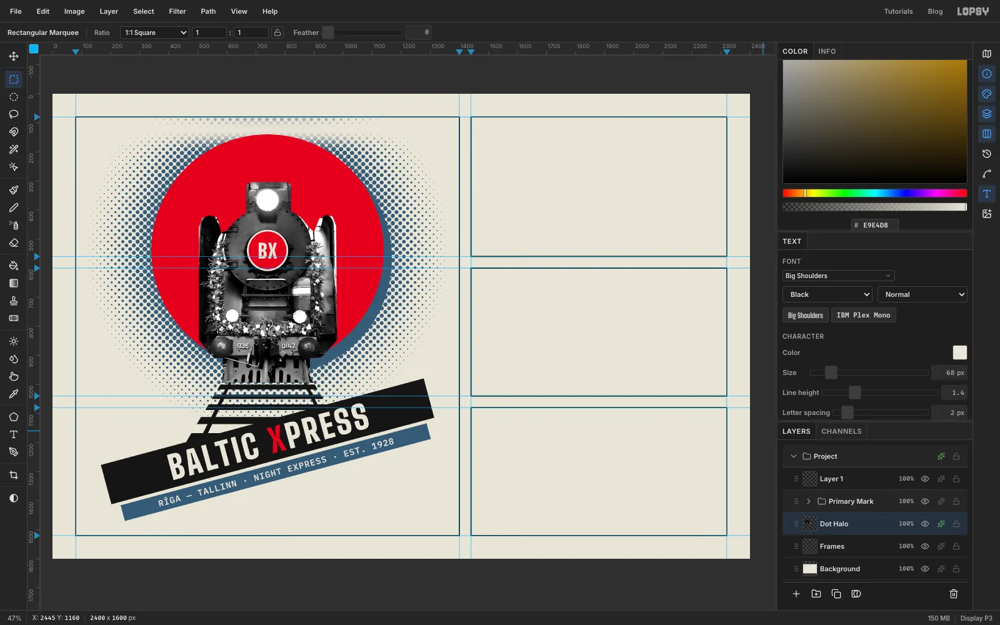

Open the effects drawer on `Dot Halo`, turn on **Color Overlay** and set its colour to `#3D5A75`. Close the drawer.

## Build the monogram badge

1. Click the `Primary Mark` group row (still collapsed) and click **New Group**. Name it `Monogram`.
2. Click **Add Layer** and rename it `Badge`. With the **Shape** tool on **Rectangle**, set the **Fill** to `151515`, remove the stroke, click once at **1658, 340** and make it `340` × `340`.
3. With `Badge` active, make a text layer in **Big Shoulders** **Black**, **Size** `250`, colour `#E9E4D8`, reading `B`. Rename it `Monogram B`.
4. Move it so the left edge of the B sits 22 px inside the badge (x `1510`), centred top to bottom on y `340`.

## Make one bar of the crossbuck

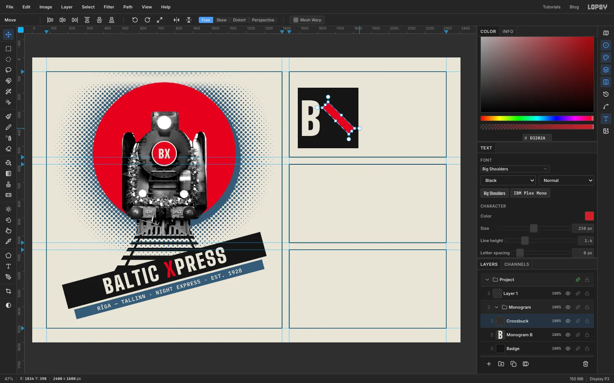

The X is a railway crossbuck, the X-shaped sign at a level crossing.

1. Click **Add Layer** and rename it `Crossbuck`.
2. Select **From** `1611, 317` **To** `1821, 363` and fill it with `#D3202A`.
3. With the **Move** tool, hold [[Cmd]] and rotate it clockwise until it snaps to **45°**. Press Enter, then [[Cmd+D]].

## Copy, paste and flip the second bar

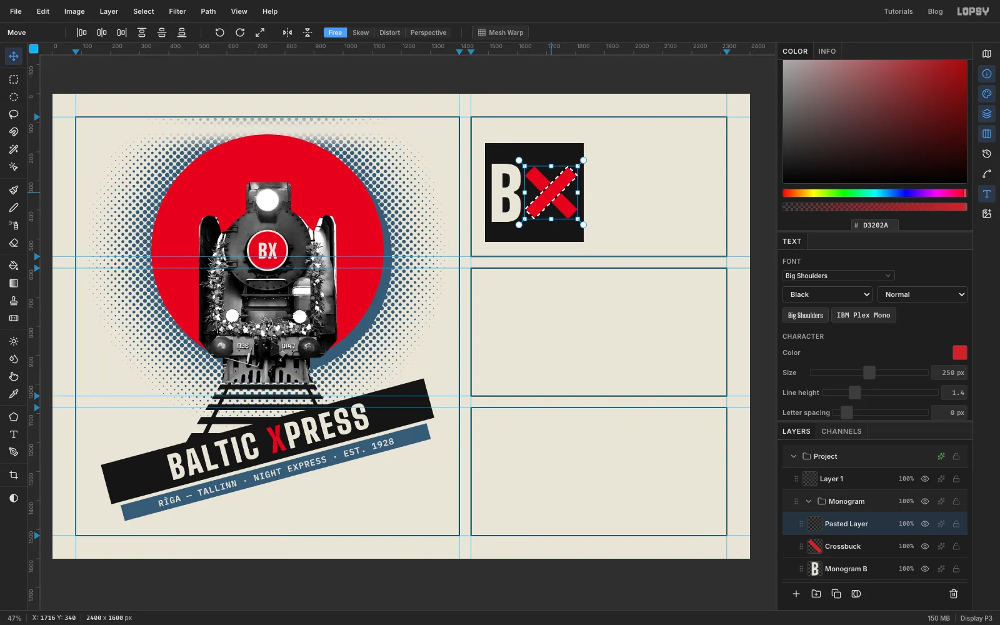

1. Drag a **Rectangular Marquee** round the red bar and press [[Cmd+C]], then [[Cmd+V]]. The copy lands on a new layer in the same place, with the Move tool active.
2. Click **Flip Horizontal** in the Move tool's options bar. The copy mirrors in place and the two bars now cross.
3. Press Enter, then [[Cmd+D]].

## Merge the crossbuck

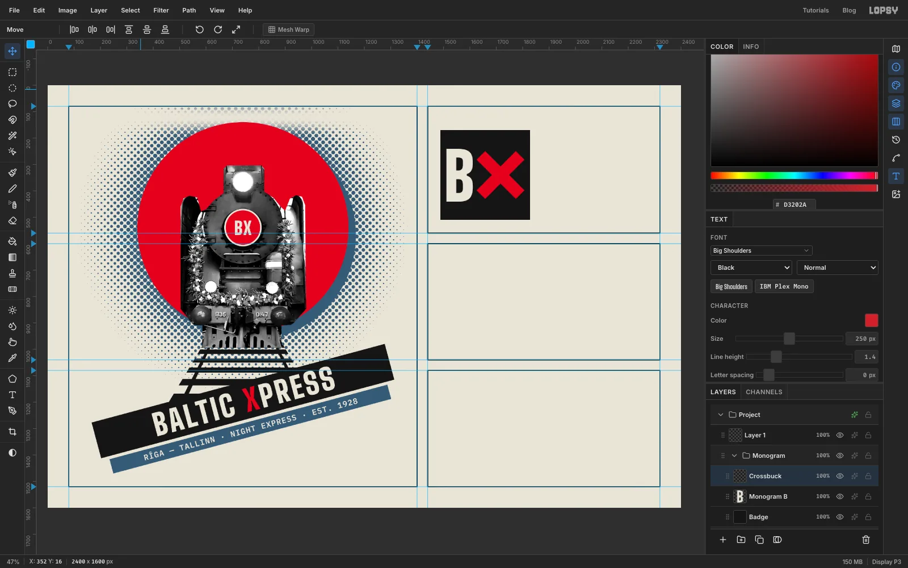

Choose **Layer → Merge Down** to merge the pasted bar into `Crossbuck`. The X ends 22 px inside the badge's right edge, the same margin as the B on the left.

## Make the reduced sizes

A logo sheet shows that the mark still works small.

1. Click `Crossbuck`. Select **From** `1484, 166` **To** `1832, 514` round the badge.
2. Choose **Edit → Copy Merged**, then press [[Cmd+V]]. Rename the new layer `Badge 50%`.
3. Drag a marquee round the pasted copy. With the **Move** tool, hold [[Cmd]] and drag the bottom-right handle in until the copy is half size, about `174` px square. Press Enter and [[Cmd+D]].

## Place the small badges

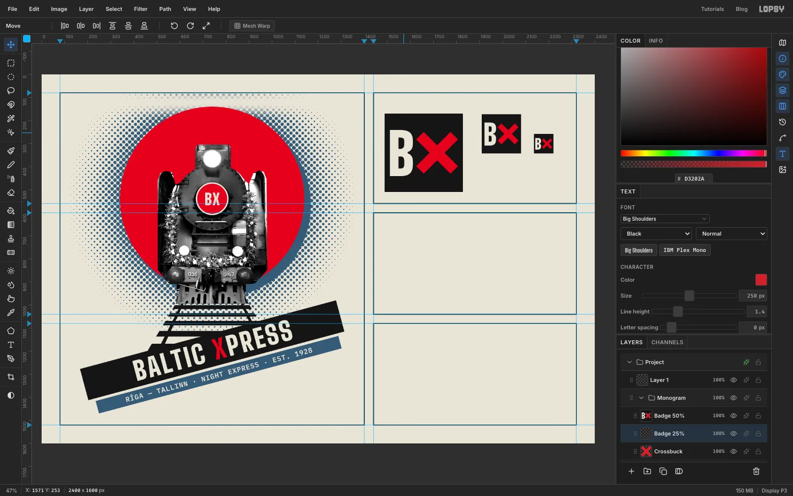

1. Move `Badge 50%` so its top-left corner is at about **1908, 171**.
2. Repeat steps 1 to 3 of the last section for a quarter-size copy, `Badge 25%`, about `87` px square. Place it to the right at about **2135, 257** so its bottom lines up with the half-size copy's.

## Paste the round mark for the lockup

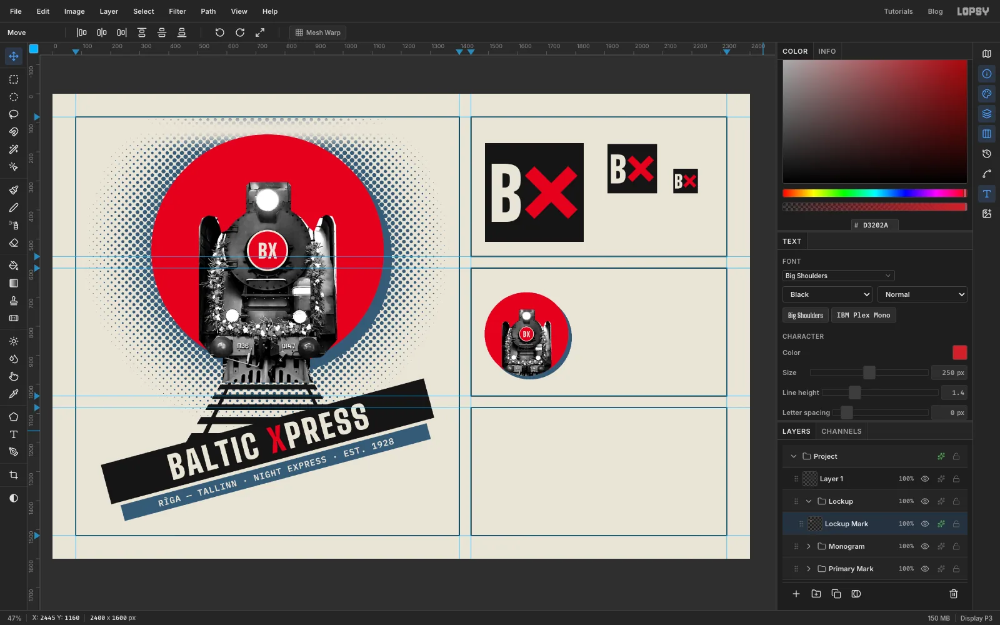

1. Collapse `Monogram`, click its row and click **New Group**. Name it `Lockup`.
2. With the **Elliptical Marquee**, select **From** `340, 140` **To** `1140, 940`, exactly round the sun.
3. Choose **Edit → Copy Merged** and press [[Cmd+V]]. Rename the layer `Lockup Mark`.
4. Scale it down with [[Cmd]] on a corner handle to about `288` px across, press Enter and [[Cmd+D]], and centre it on **1630, 826**.
5. Click its effects button (✦), turn on **Drop Shadow** and set the colour to `#3D5A75`, **Offset X** and **Offset Y** to `12`, **Blur** and **Spread** to `0`, and **Opacity** to `100`. Close the drawer.

## Set the lockup type

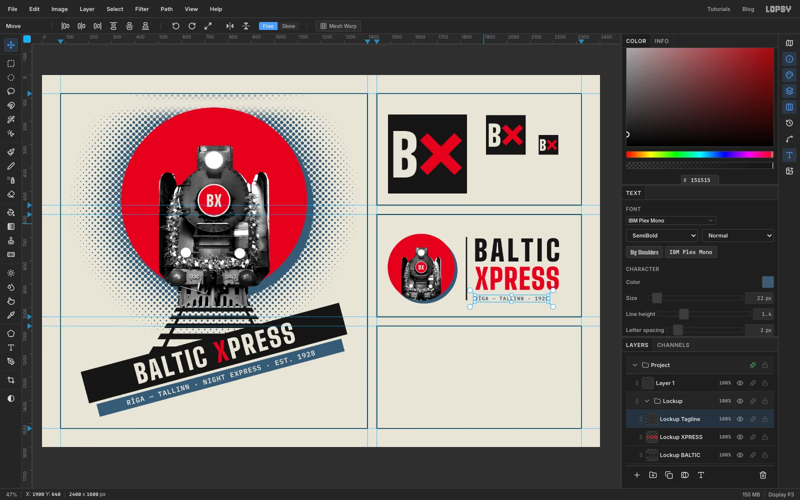

1. Click **Add Layer** and rename it `Lockup Rule`. Pick the **Pencil**, set **Size** to `6` and the colour to `#151515`. Click at **1826, 700**, then [[Shift]]-click at **1826, 966** for a straight vertical rule.
2. Make three text layers, clicking `Lockup Rule` before each one. Work from the bottom up, clicking a little to the right of the rule each time, so no click lands in an earlier text box:
   - `RĪGA — TALLINN · 1928` in **IBM Plex Mono** **SemiBold**, size `22`, `#3D5A75`, letter spacing `2`. Click at about **2000, 1000**.
   - `XPRESS` in **Big Shoulders** **Black**, size `124`, `#D3202A`, letter spacing `4`. Click at about **1900, 830**.
   - `BALTIC` in **Big Shoulders** **Black**, size `124`, `#151515`, letter spacing `13`. Click at about **1900, 640**.
3. Line up the left edges of all three at x `1862`. Put the middle of BALTIC's capitals at y `751`, XPRESS at `873` and the tagline at `958`.

BALTIC has two letters fewer than XPRESS, which is why it gets the wider letter spacing. That way the two words come out almost the same width.

## Draw the colour chips on the grid

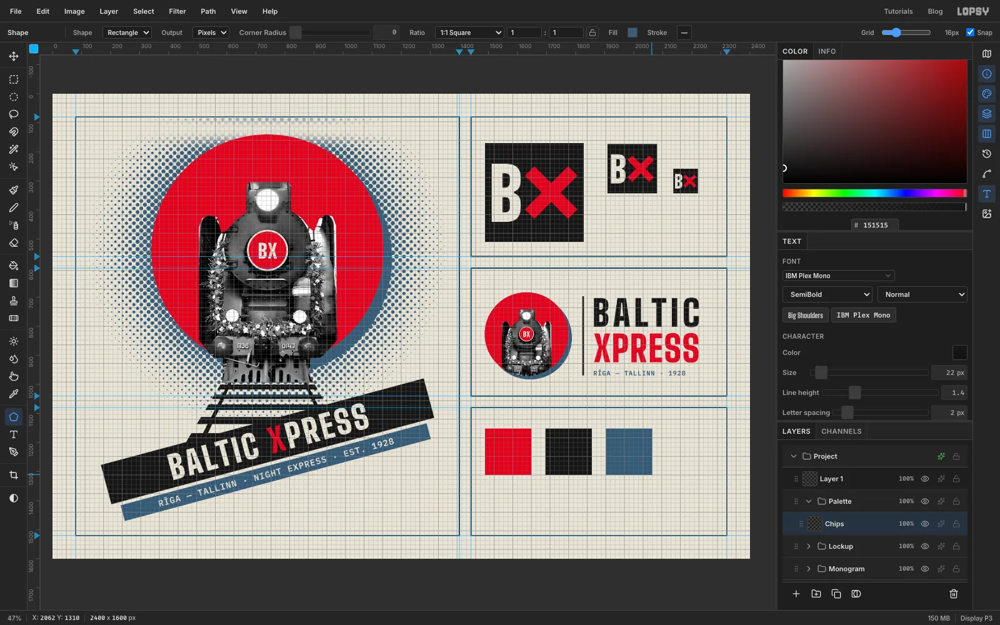

1. Collapse `Lockup`, click its row and click **New Group**. Name it `Palette`. Click **Add Layer** and rename it `Chips`.
2. Choose **View → Show Grid**. The grid is 16 px and turns on snapping.
3. With the **Shape** tool on **Rectangle**, draw four 160 px squares. For each, press on its centre and drag 80 px down and right to its corner; both points snap to the grid. The centres are **1568, 1232**, **1776, 1232**, **1984, 1232** and **2192, 1232**, so the squares start at x `1488`, `1696`, `1904` and `2112`, all from y `1152`. Change the **Fill** before each one: `D3202A`, `151515`, `3D5A75`, then `E9E4D8` with a black **Stroke** of **Width** `3` so the newsprint chip shows.
4. Choose **View → Show Grid** again to hide it.

## Label the palette

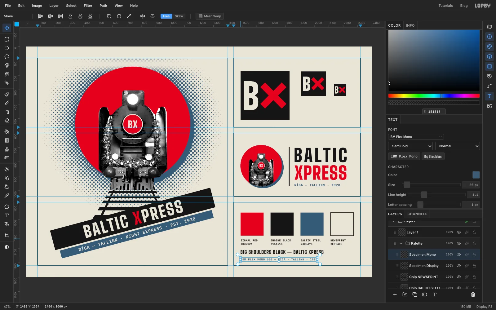

Click `Chips` before each new text layer. Start with the lowest text:

1. `IBM PLEX MONO 600 — RĪGA · TALLINN · 1928` in **IBM Plex Mono** **SemiBold**, size `20`, `#3D5A75`, letter spacing `1`, left edge at x `1488`, centred on y `1474`.
2. `BIG SHOULDERS BLACK — BALTIC XPRESS` in **Big Shoulders** **Black**, size `34`, `#151515`, letter spacing `2`, at x `1488`, y `1424`.
3. Under each chip, two lines in **IBM Plex Mono** **SemiBold**, size `18`, `#151515`, letter spacing `1`, with [[Enter]] between the lines. Work right to left, clicking just under each chip: `NEWSPRINT` / `#E9E4D8`, `BALTIC STEEL` / `#3D5A75`, `ENGINE BLACK` / `#151515`, then `SIGNAL RED` / `#D3202A`. Line each one up with its chip's left edge, with its top at y `1338`.

## Add the panel labels and captions

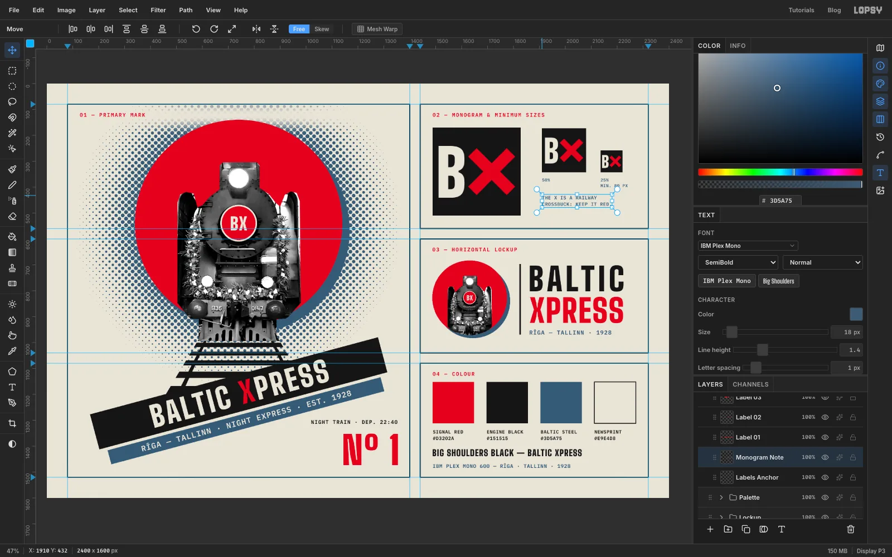

1. Collapse `Palette`, click its row, click **New Group** and name it `Labels`. Click **Add Layer** and rename it `Labels Anchor`. Click it before each text layer below, and start from the bottom of the sheet.
2. **Train number.** The bottom-right corner of the main panel is empty, and a big number balances the bar's lower-left end. Type `Nº 1` (on a Mac, [[Option+0]] types º) in **Big Shoulders**, **Black**, `150`, `#D3202A`, letter spacing `2`. Line its right edge up 48 px inside the frame (x `1352`), with its foot at y `1472`. Above it, type `NIGHT TRAIN · DEP. 22:40` in **IBM Plex Mono**, **SemiBold**, `20`, `#151515`, letter spacing `2`, right edge at x `1350`, centred on y `1306`.
3. **Captions.** Under the small badges, in **IBM Plex Mono**, **SemiBold**, `16`, `#3D5A75`, letter spacing `1`, type `25%`, [[Enter]], `MIN. 80 PX` flush with the quarter-size badge (x `2136`), then `50%` flush with the half-size badge (x `1910`). Put both tops at y `367`.
4. **Note.** Below the captions, also at x `1910` with its top at about y `434`, type `THE X IS A RAILWAY`, [[Enter]], `CROSSBUCK: KEEP IT RED.` in the same font at size `18`, `#3D5A75`, letter spacing `1`.
5. **Panel labels.** Last, the four labels in **IBM Plex Mono**, **SemiBold**, `20`, `#D3202A`, letter spacing `3`. Each sits 48 px in from its frame's left edge and is centred 40 px below its frame's top edge: `01 — PRIMARY MARK` at **128, 120**, `02 — MONOGRAM & MINIMUM SIZES` at **1488, 120**, `03 — HORIZONTAL LOCKUP` at **1488, 640** and `04 — COLOUR` at **1488, 1120**.

## Add paper grain, then save and export

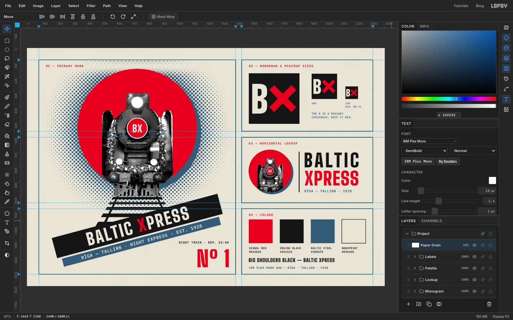

1. Collapse `Labels` and click `Layer 1`, which has been sitting at the top of the stack all along. Rename it `Paper Grain`.
2. Fill it with `#FFFFFF`. Choose **Filter → Add Noise…** with **Amount** `22`, **Mono** and **Gaussian**, and click **Apply**.
3. Set its **Blend** mode to **Multiply** and its opacity to **40%**. The white disappears and only a faint speckle of grain stays over the flat colour.

Choose **File → Save Project** to keep a `.lopsy` with every layer and group, then **File → Quick Export PNG** for the finished sheet.
