In the 1920s the Stenberg brothers made Soviet film posters by enlarging film
stills and tilting them hard against flat colour. Alexander Rodchenko shot
pylons and towers from below until they turned into pure diagonals. A few loud
parts did the work: a red plane, a black circle, a wedge, a photograph cropped
far too big.

In this tutorial you'll use that language for a production-design board for a
made-up film, **Kilowatt Wolf**. In the winter of 1928 a lineman stringing the
first power line across Karelia is hunted by a wolf pack. This is key frame 41,
the moment the lead wolf bites the wire.

You'll build a sky from flat shapes, paint a forest with a brush tip you make
yourself, and trace a telephone pole from an archive photo. Then you'll turn
four photos into print: **Threshold** for solid ink shapes, **Halftone** for
fur, and a flat colour plate set slightly off register. A slate strip along the
bottom turns the picture into a concept board.

You'll need four public-domain photos from Wikimedia Commons. Download each one
at 1920 px wide or larger (the original file is fine). Lopsy shrinks anything
bigger than the canvas to fit and centres it, but a smaller download stays small
in the top-left corner and the sizes below won't match.

- [Lineman climbing telephone pole](https://commons.wikimedia.org/wiki/File:Lineman_climbing_telephone_pole_-_NARA_-_285836.jpg), U.S. National Archives
- [Wolf portrait](https://commons.wikimedia.org/wiki/File:Wolf_portrait_taken_from_a_vehicle_in_a_pullout_%2838346221956%29.jpg), Jacob W. Frank, National Park Service (the big head)
- [Wolf 7 in Rose Creek pen](https://commons.wikimedia.org/wiki/File:Wolf_7_in_Rose_Creek_pen_%28f7a254ff-1dd8-b71b-0b9f-fb05a210333b%29.jpg), Jim Peaco, National Park Service (the running wolf, by a fence)
- [Wolf in Lamar Valley](https://commons.wikimedia.org/wiki/File:Wolf_in_Lamar_Valley_%287437502698%29.jpg), Yellowstone National Park (the black wolf on snow)

The palette:

- Paper `#E7DFCA`, snow `#D6CCB2`
- Red `#B8382A`, oxide `#83261C`
- Ink `#14120F`
- Arc yellow `#DBB440`

A few habits come up in almost every step:

- **Deselect before the next selection.** Press [[Cmd+D]] when you finish with one. A marquee drag that starts inside a live selection moves it instead of making a new one.
- **Exact shapes use a dialog.** With nothing selected, click once with a marquee tool without dragging. A dialog opens where you type the **From** and **To** corners. Negative numbers are fine.
- **Straight-edged shapes use the Pen.** Press [[P]] and click each corner, starting from the left-most one, because the path's floating ✓ and ✗ buttons sit just left of the first anchor. Click the first anchor again to close the shape. In the **Paths** panel, click **Path to Selection**, then **Delete Path**. Then choose **Edit → Fill** and press [[Cmd+D]].
- **Transforms need the Move tool.** Press [[M]] and draw a marquee around the pixels, press [[V]], then drag the handles. Hold [[Cmd]] on a corner to keep the proportions. Press [[Cmd+D]] to commit before you start the next transform.
- **Positions are document pixels.** The status bar at the bottom left shows the cursor's X and Y, and the rulers track it too. "About" means judging by eye is fine.

## Set up the board and cut the picture window

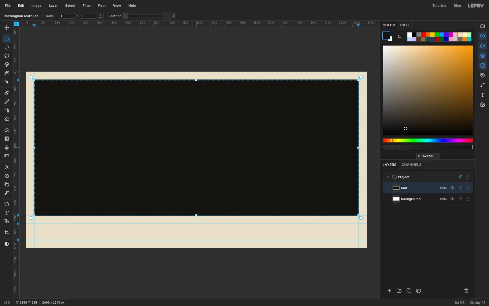

Open [Lopsy](/). In the **New Document** dialog, set **Width** to `2400` and
**Height** to `1240`, choose Pixels and a White background, and click
**Create**.

Click the top ruler at `60` and `2340` to drop two vertical guides. Then click
the left ruler at `60`, `1010`, `1070` and `1184` for four horizontal ones. The
picture goes between the first pair, the slate between the second.

The active layer is `Layer 1`. Double-click its name and call it `Mat`. This
layer is a paper mount with a window in it, and it will trim everything you
paint below it.

1. Set the foreground to paper `#E7DFCA` and choose **Edit → Fill**.
2. Press [[M]] for the **Rectangular Marquee** and click once on the canvas. Enter From `56, 56` and To `2344, 1014`, then press [[Enter]].
3. Set the foreground to ink `#14120F`, choose **Edit → Fill**, and press [[Cmd+D]].
4. Click once again and enter From `60, 60` and To `2340, 1010`.
5. Press [[Delete]], then [[Cmd+D]].

That leaves a window with a thin black keyline around it.

## Build the red sky with a sunburst

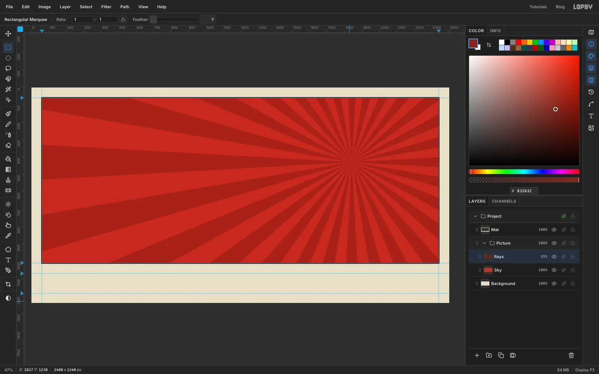

Click the `Background` row, set the foreground to paper `#E7DFCA` and choose
**Edit → Fill**.

Click **New Group** at the bottom of the Layers panel. It lands above Background
and under Mat. Name it `Picture`. Everything you add next goes inside it.

Click **Add Layer**, name it `Sky`, set the foreground to red `#B8382A` and
choose **Edit → Fill**.

Add a layer named `Rays` and set the foreground to oxide `#83261C`. Open
**Filter → Sunburst** and enter:

- **Rays** `28`
- **Length** `150`
- **Width** `50`
- **Center X** `76.7`
- **Center Y** `34.7`

Click **Apply**, then click the opacity figure on the layer's row and set it to
`55%`. The rays lead the eye to the spot where the wolf's head will go.

## Draw two signal rings

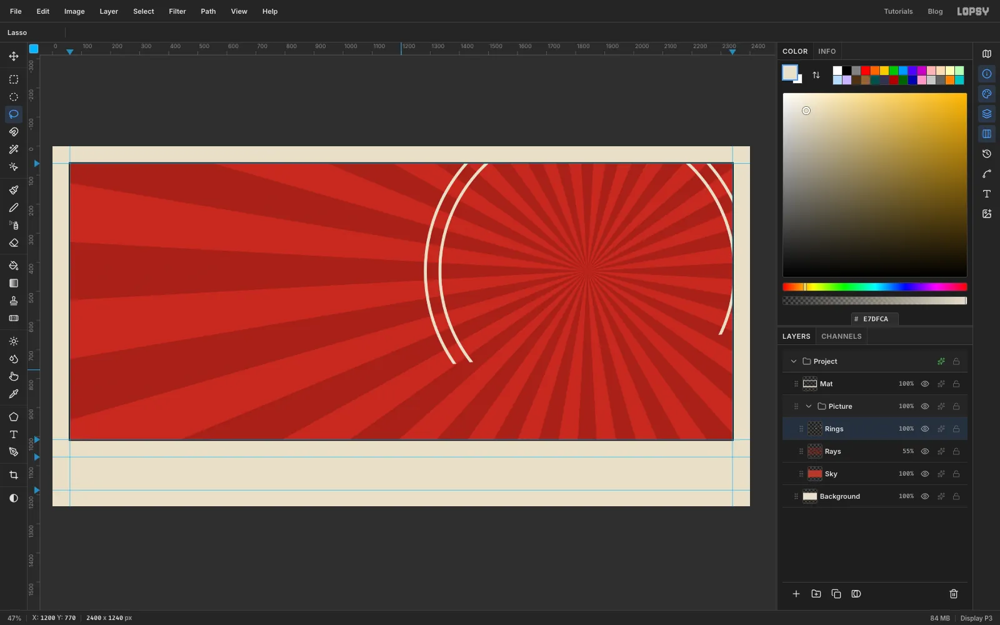

Concentric circles are a Stenberg signature, and here they also read as a radio
signal. They run off the top of the canvas, so the corner dialog is the easy way
to get them exact.

Add a layer named `Rings` and set the foreground to paper `#E7DFCA`. Pick the
**Elliptical Marquee** in the toolbox and click once for each of these:

1. Enter From `1278, -132` and To `2402, 992`, choose **Edit → Fill**, then press [[Cmd+D]].
2. Enter From `1288, -122` and To `2392, 982`, press [[Delete]], then [[Cmd+D]].
3. Enter From `1328, -82` and To `2352, 942`, choose **Edit → Fill**, then press [[Cmd+D]].
4. Enter From `1338, -72` and To `2342, 932`, press [[Delete]], then [[Cmd+D]].

The forest will stand in front of the rings' lower ends, and they'd show through
the gaps between its trees. Press [[L]] for the **Lasso** and drag around
everything below a line running from `1200, 770` on the left to the right edge of
the canvas at about `y 640`. Press [[Delete]], then [[Cmd+D]].

## Add the black disc

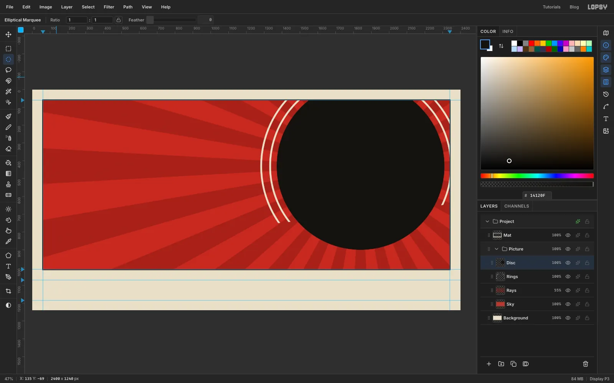

Add a layer named `Disc` and set the foreground to ink `#14120F`. With the
**Elliptical Marquee**, click once and enter From `1370, -40` and To `2310, 900`.
Choose **Edit → Fill**, then press [[Cmd+D]].

The light fur of the wolf will stand out against this black.

## Cut the yellow beam

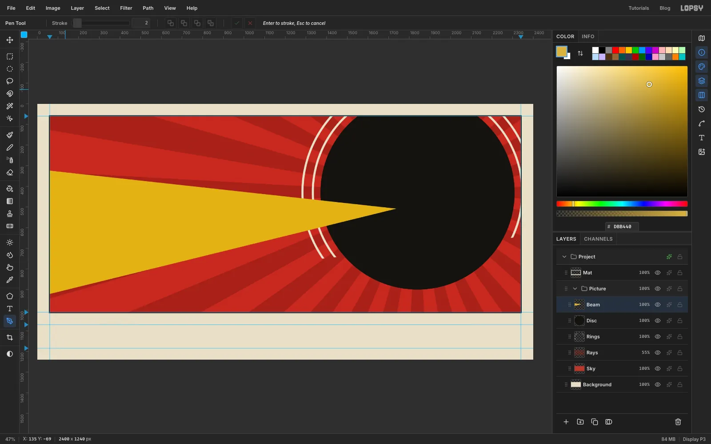

Add a layer named `Beam` and set the foreground to arc yellow `#DBB440`.

Press [[P]] and draw a long, thin triangle with the Pen. Start at the left edge
of the canvas at about `y 320`. Click the tip at `1738, 508`, inside the disc,
which is where the wolf's eye will sit. Click the left edge again at about
`y 930`, then click the first anchor to close it. Going past the left guide is
fine, because the Mat trims it.

Make it a selection in the **Paths** panel, delete the path, choose
**Edit → Fill**, then press [[Cmd+D]].

## Make a spruce brush tip

Add a layer named `Spruce Tip` and set the foreground to ink. With the **Pen**,
draw a fir tree about 300 px tall in empty sky: a stepped outline with three
tiers, wider at each step down. Fill it the same way.

Press [[M]] and drag a marquee just outside the tree. Choose
**Edit → Define Brush...**, name it `Spruce` and confirm. Press [[Cmd+D]], then
click **Delete Layer** at the bottom of the Layers panel to throw the drawing
away. The new tip stays on the brush.

## Paint the far forest

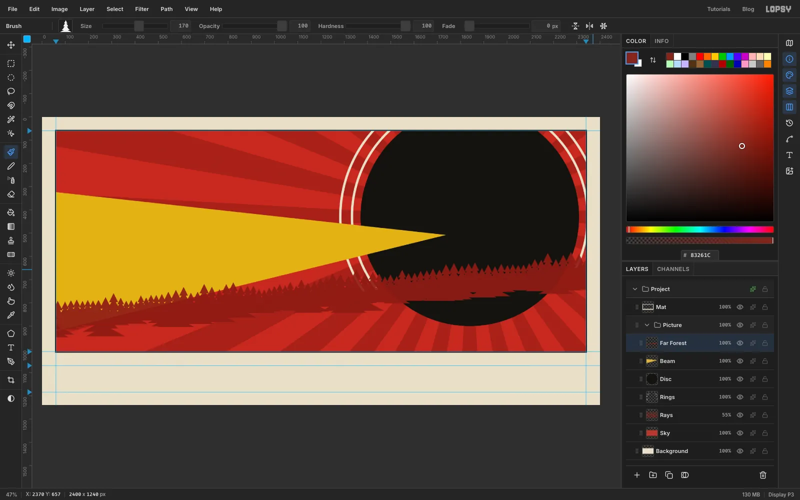

Click the `Beam` row, then add a layer named `Far Forest`. Set the foreground to
oxide `#83261C` and press [[B]] for the **Brush**.

Click the brush thumbnail at the left of the options bar to open **Brushes**. On
the **Shape** tab set **Size** to `170` and **Spacing** to `22`. On the
**Dynamics** tab set **Scatter** to `6` and **Size Jitter** to `45`. Close the
window.

Click the left edge of the canvas at about `y 860`. Hold [[Shift]] and click the
right edge at about `y 655`. A straight stroke of mixed trees climbs the frame,
and this slope is the composition's main diagonal.

## Paint the near forest

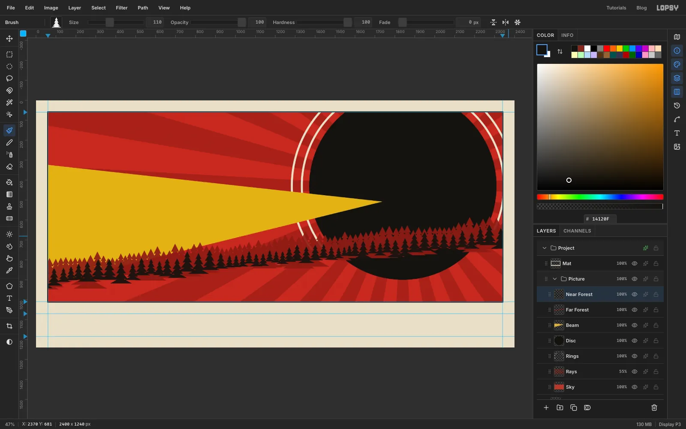

Add a layer named `Near Forest` and set the foreground to ink. In **Brushes**, set
**Size** to `110`, **Spacing** to `55`, **Scatter** to `8` and **Size Jitter** to
`60`. Close the window.

Click the left edge at about `y 885`, then [[Shift]]+click the right edge at about
`y 680`. These smaller, sparser, darker trees sit in front of the oxide ones and
give the treeline depth.

## Lay the snow slope

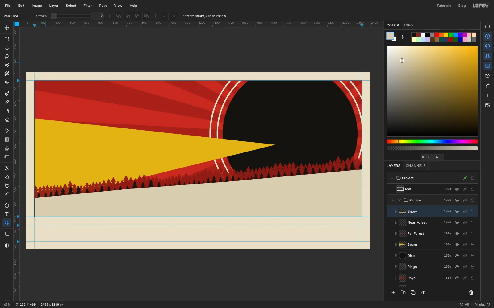

Add a layer named `Snow` and set the foreground to snow `#D6CCB2`.

With the **Pen**, start at the left edge of the canvas at about `y 880` and click
up to the right edge at about `y 680`, through the bottom of the near trees so
their trunks disappear. Then click down the right edge to below the frame, across
to the left edge, and back to the start. Fill it the same way.

The snow is one step darker than the paper, so the picture still reads as a closed
rectangle.

## Bring in the lineman photo

Click the `Mat` row and add a layer named `Pole`. It sits above Mat, so it can
break out of the frame.

Drag the lineman photo from your computer onto the canvas. It's taller than the
document, so Lopsy shrinks it to fit and centres it. It arrives selected on a new
layer above Pole. Press [[Cmd+D]] and rename the layer `Figure`.

Click the ✦ button on its row to open the effects drawer, set **Blend** to
**Multiply** and close the drawer. You'll draw on the layer underneath, and
Multiply lets those black shapes show through the photo as you trace.

## Trace the pole shaft

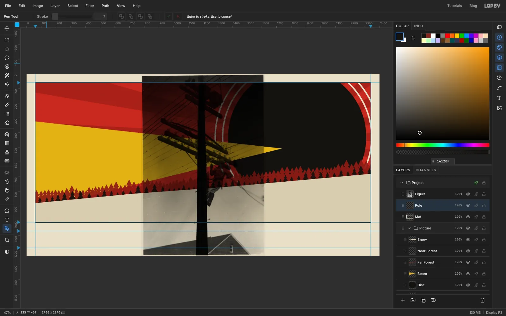

Thresholding this pole gives a crumbly, burnt-looking shape, because the sky in
the photo gets dark near the top. Constructivist work wants ruled geometry, so
trace it with clean flat shapes instead.

Click the `Pole` row and set the foreground to ink. With the **Pen**, draw a tall,
narrow taper down the middle of the photo's pole. Start about 75 px below the top
of the canvas, where it's about 40 px wide, and widen it to about 80 px at the
bottom of the canvas. Fill it.

## Trace four crossarms

With the **Pen**, draw a long bar about 30 px thick over each of the three
crossarms in the middle of the photo, following their slant, and fill each one.

Then draw a fourth bar higher up, around where the transformers hang in the photo,
at the same angle. It replaces that clutter with a clean crown and becomes the top
line of the pole.

## Add insulators and braces

Press [[B]], click the brush thumbnail, and on the **Presets** tab pick **Hard
Round**. That also clears the Spruce settings. Close the window and set **Size** to
`15` in the options bar.

Click six dots along the top edge of each crossarm, three on each side of the
shaft. Keep them evenly spaced, so the regular beat reads as insulators.

Set **Size** to `7`. For each brace, click on the shaft below the lowest arm, then
[[Shift]]+click up onto the arm. Do one on each side.

## Hide the photo

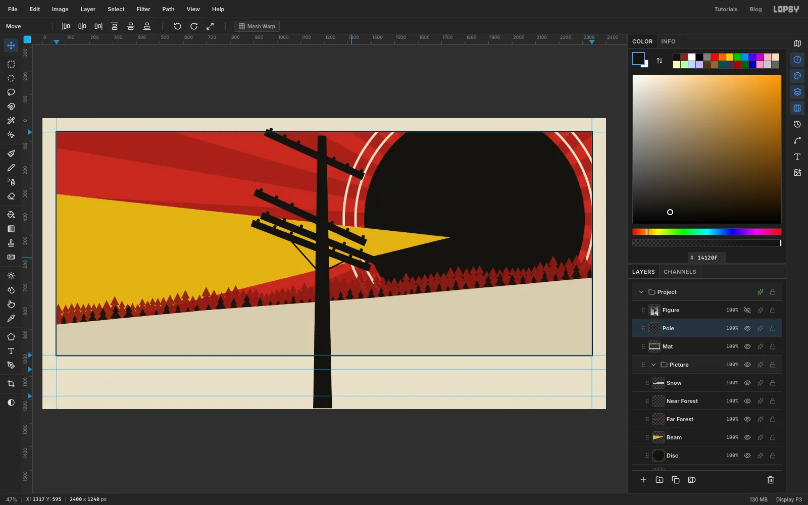

Click the eye on the `Figure` row to hide the photo for now, then click the `Pole`
row. You now have a clean drawing to reuse: three more copies of it will march away
across the snow.

## Make the first far pole

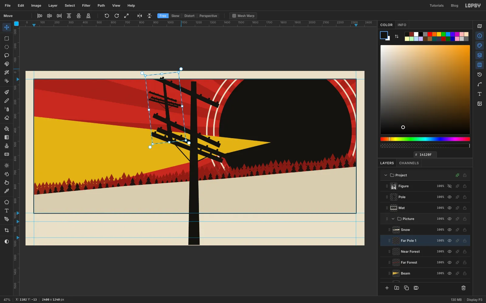

Press [[M]] and drag a marquee around the whole pole drawing. Press [[Cmd+C]], then
[[Cmd+D]]. Click the `Near Forest` row and press [[Cmd+V]]. The copy lands in place
above Near Forest, so it's inside the Picture group and behind the snow. Rename it
`Far Pole 1` and press [[Cmd+D]].

Now shrink and tilt it, one transform at a time:

1. Press [[M]] and marquee the copy, press [[V]], hold [[Cmd]] and drag the bottom-right corner handle inward until it's about 475 px tall (about 40%). Press [[Cmd+D]].
2. Press [[M]] and marquee the smaller copy, press [[V]], and drag the round handle just outside a corner to tilt it about 6° counter-clockwise, which moves the top sideways by about a tenth of its height. Press [[Cmd+D]].
3. With the **Move** tool, drag the pole so its base is on the snow line, about 340 px from the left of the canvas. The snow hides the foot.

## March the poles into the distance

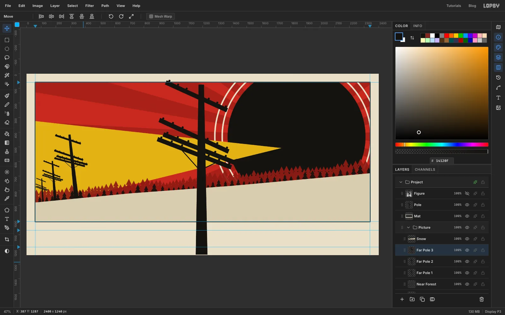

With `Far Pole 1` still active, press [[Cmd+V]] again and name the new layer `Far
Pole 2`. Press [[Cmd+D]], then repeat the same steps: about 300 px tall (25%), tilted
about 4°, with its base about 200 px from the left.

Do it once more for `Far Pole 3`: about 180 px tall (15%), tilted about 3°, with its
base about 110 px from the left.

The spacing and height both shrink as they go, which gives you perspective without
any construction lines.

## Tilt the main pole

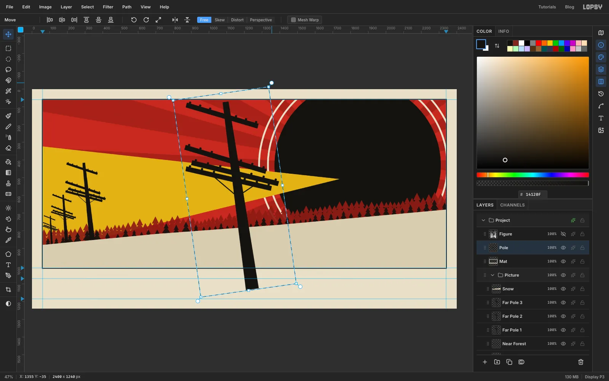

Click the `Pole` row. Press [[M]] and marquee the drawing, press [[V]], then
[[Cmd]]-drag the bottom-right corner inward until it's about 1095 px tall (about
92%). Press [[Cmd+D]].

Press [[M]], marquee it again, press [[V]] and use a round handle to rotate it about
8° counter-clockwise. Press [[Cmd+D]]. Tilting everything off the vertical is the
fastest way to make a picture feel constructivist.

## Plant the main pole

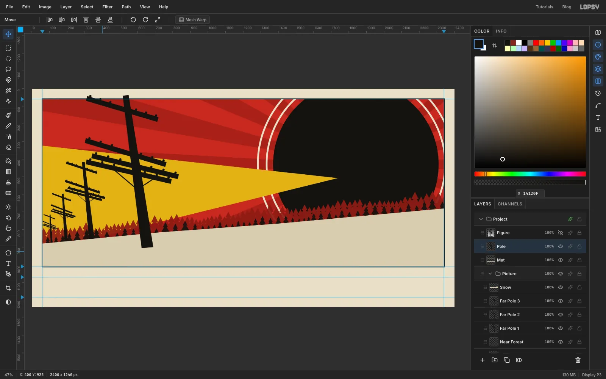

With the **Move** tool, drag the pole left until its base is about 650 px from the
left of the canvas. Its top should rise through the top of the frame and stop about
20 px short of the canvas edge. This break out of the frame is why the pole sits
above the Mat.

The foot now hangs over the snow and the margin. Press [[L]], lasso around the part
of the shaft below about `y 905`, press [[Delete]], then [[Cmd+D]].

## Threshold the lineman

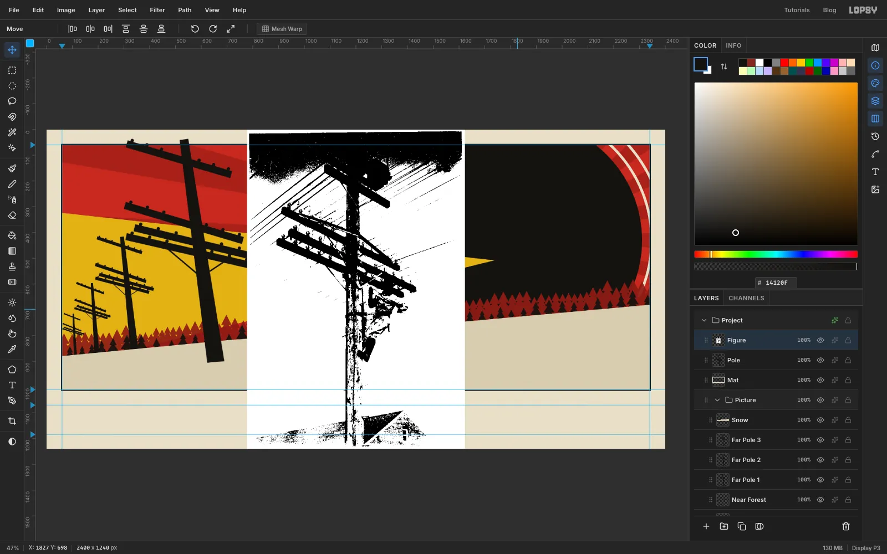

Click the eye on the `Figure` row to show it again and click the row. Open the ✦
drawer, set **Blend** back to **Normal** and close it.

Run **Filter → Gaussian Blur** with **Radius** `1`, which stops the edges coming out
hairy. Then run **Filter → Threshold** with **Level** `58`. At that level there's
enough white left in his jacket and trousers to show the folds.

## Cut the lineman out

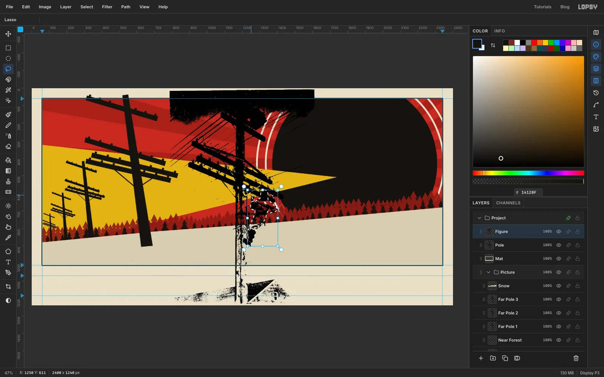

Press [[W]] for the **Magic Wand**, untick **Contiguous** in the options bar, and
click anywhere white. Every white pixel is selected. Press [[Delete]], then [[Cmd+D]].

Press [[L]] and lasso tightly around the man alone, from his cap to his boots, leaving
out the pole and the crossarms. Keep this selection live for the next step.

## Put a cream plate behind him

The holes in his clothes are see-through for now, so the yellow would show through
them. With the selection still live, click the `Pole` row and add a layer named
`Figure Plate`, which sits just under Figure. Set the foreground to paper `#E7DFCA`
and choose **Edit → Fill**.

Click the `Figure` row, choose **Select → Inverse** and press [[Delete]] to clear
everything outside him. Press [[Cmd+D]]. Then choose **Layer → Merge Down** and rename
the merged layer `Figure`.

## Scale the lineman up and put him on the pole

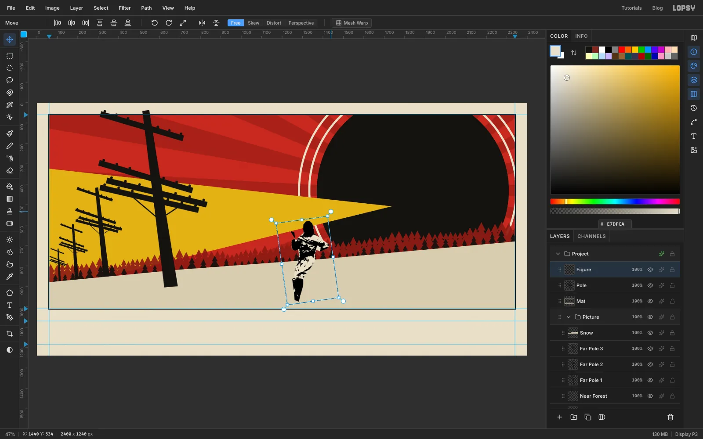

True to the photo, he'd be lost against the pole, so make him bigger than life:

1. Press [[M]] and marquee him, press [[V]], and [[Cmd]]-drag the bottom-right corner outward until he's about 390 px tall (about 120%). Press [[Cmd+D]].
2. Press [[M]], marquee him again, press [[V]], and rotate him about 8° counter-clockwise to match the pole. Press [[Cmd+D]].
3. Drag him so his lower boot and raised glove overlap the right edge of the pole, just below the lowest crossarm.

## Give him a climbing pose

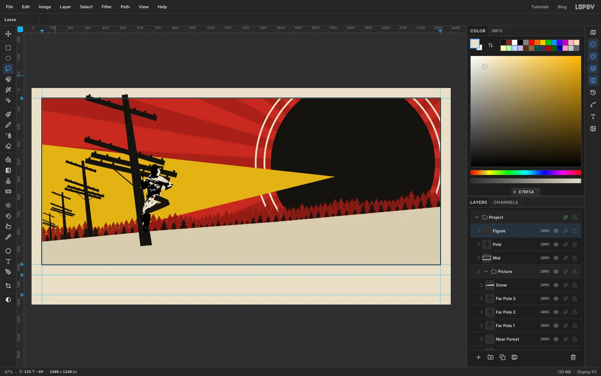

The photo gives you one visible leg and a dark head, which doesn't say "climbing".
Zoom in, because these shapes are only a few pixels on screen at fit-to-window. Paint
the rest directly on the `Figure` layer. Press [[L]], and use the **Lasso**, **Edit →
Fill** and [[Cmd+D]] for each shape:

1. With the foreground set to ink, draw a bent leg: from his hip out to the right to a knee, then back in to a pointed toe that digs into the pole.
2. Still in ink, draw a small triangle sticking out from the right of his head for a cap peak.
3. With the foreground set to paper `#E7DFCA`, draw a thin crescent down the right side of his head, which reads as a jaw lit by the wolf's beam.

## Add a keyline and safety belt

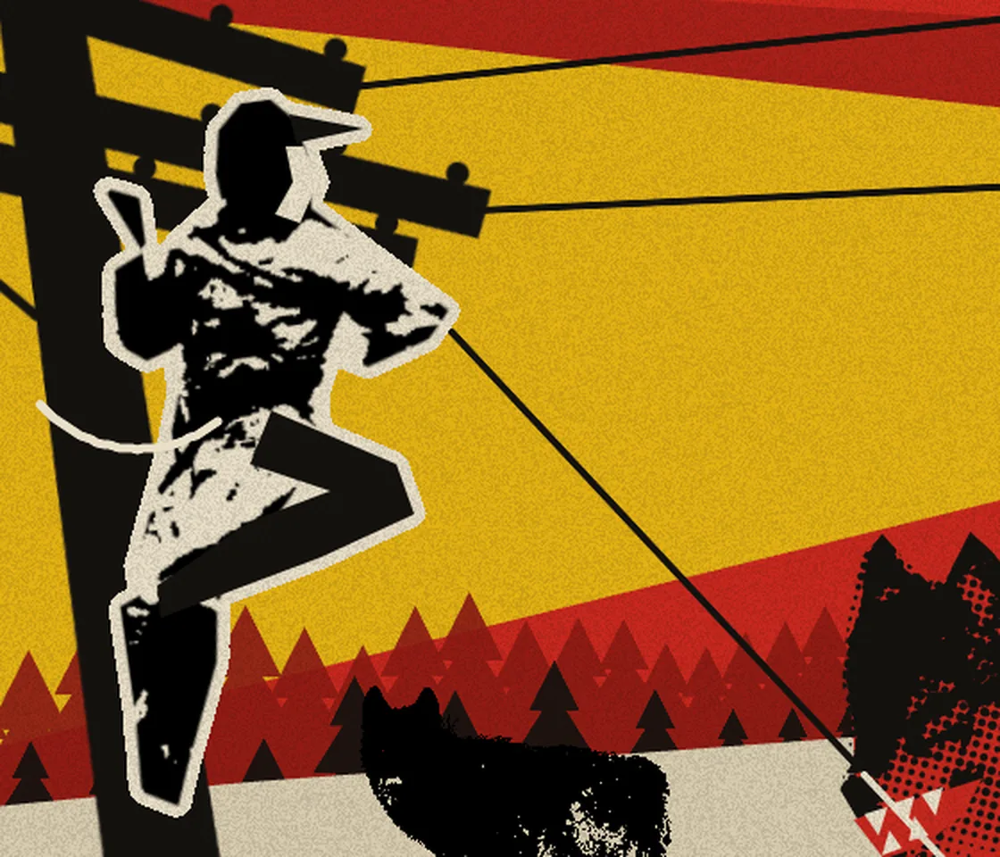

Open the ✦ drawer on `Figure`, turn on **Stroke**, set **Width** to `7` and the colour
to paper `#E7DFCA`, and close the drawer. The cut-paper outline holds him out from the
black pole and the busy forest.

Add a layer named `Belt`. With the foreground still on paper, press [[B]] and set
**Size** to `6`. Drag one curved stroke from his hip, sagging across the front of the
pole and out the far side. Now he's strapped on.

## Rule the power lines

Click the `Far Pole 3` row and add a layer named `Wires`, so they pass behind the snow
and the Mat. Set the foreground to ink and press [[B]]. The Brush is still on **Hard
Round**. For each wire, click one end, then [[Shift]]+click the other.

1. At **Size** `5`, join the left end of each of the main pole's lower three arms to the right end of the matching arm on Far Pole 1.
2. At **Size** `4`, do the same from Far Pole 1 to Far Pole 2.
3. At **Size** `3`, do the same from Far Pole 2 to Far Pole 3.
4. Back at **Size** `5`, start three wires from the right ends of the main pole's top three arms, and run each one to about `x 1560`, at `y 225`, `345` and `465`. The wolf's head will hide those ends.

## Select the disc without the beam

Those wires disappear black-on-black where they cross the disc, so that stretch needs
repainting in a light colour.

Hold [[Cmd]] and click the `Disc` layer's thumbnail to select the circle, then click
the `Wires` row. Press [[L]], hold [[Alt]] and lasso around the part of the beam that
crosses the disc, following the beam's edges. That subtracts it, so only black disc
stays selected.

## Repaint the wires in cream

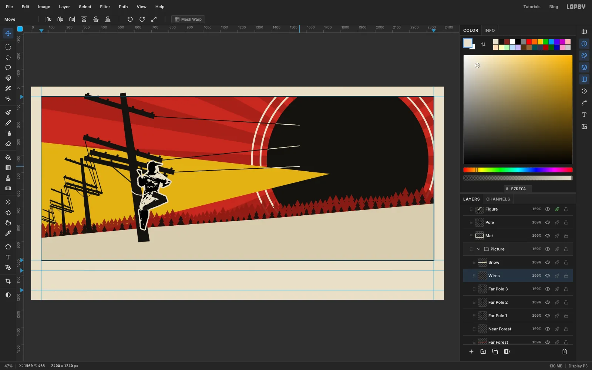

Set the foreground to paper `#E7DFCA` and press [[B]]. With **Size** still at `5`,
repaint the same three strokes: click at the arm, then [[Shift]]+click at `x 1560`.
Only the part inside the selection takes paint, so each wire switches cleanly from
black to cream at the disc's edge.

Press [[Cmd+D]].

## Bank snow at the pole and lasso the wolf's head

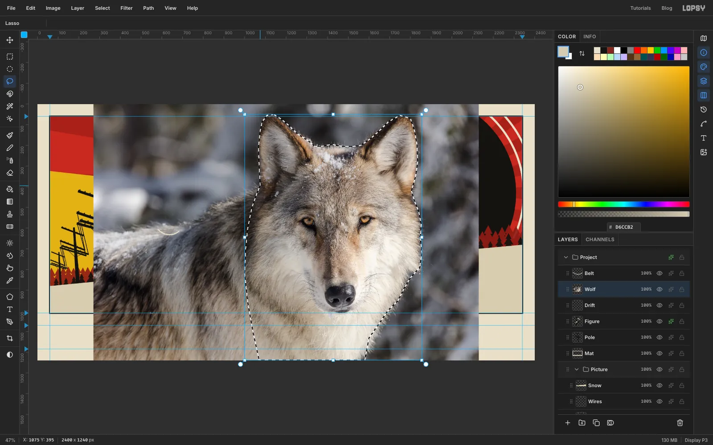

Click the `Figure` row and add a layer named `Drift`. Set the foreground to snow
`#D6CCB2`, press [[L]], lasso a low mound around the foot of the main pole, and choose
**Edit → Fill**. Press [[Cmd+D]]. This little bite of snow plants the pole.

Drag the wolf portrait onto the canvas. Press [[Cmd+D]] and rename the layer `Wolf`.

Press [[L]] and lasso around the head: over each ear, down the cheeks and fur, and
straight down both sides of the neck to the bottom of the photo. Use long, confident
lines down the neck. Think of it as a scissor cut, and let the edges stay clean.

## Cut out the head

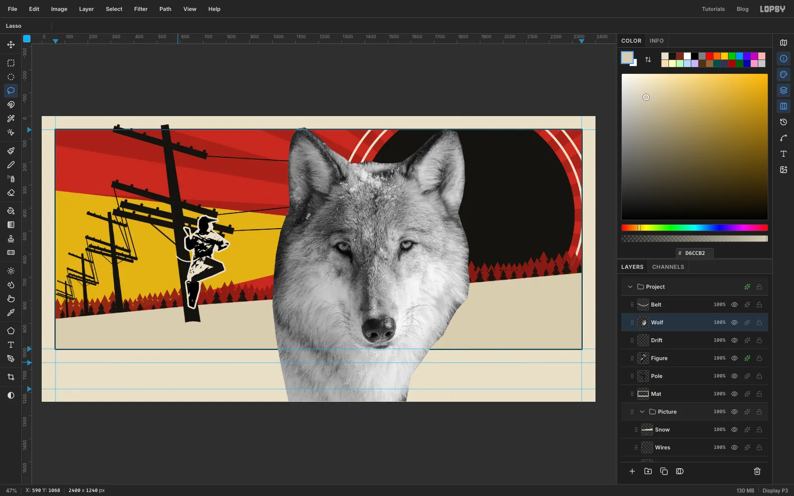

Choose **Select → Inverse**, press [[Delete]], then [[Cmd+D]]. Then choose **Filter →
Desaturate**.

## Scale and tilt the head

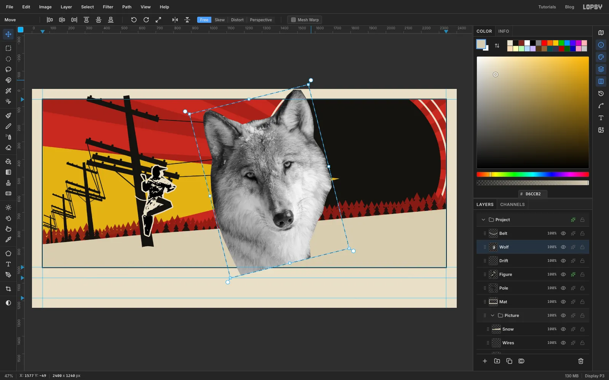

1. Press [[M]] and marquee the head, press [[V]], and [[Cmd]]-drag the bottom-right corner inward until it's about 955 px tall (about 80%). Press [[Cmd+D]].
2. Press [[M]], marquee it again, press [[V]], and rotate it about 14° counter-clockwise. A level, calm head looks like a nature photo, and this tilt makes it lean in. Press [[Cmd+D]].
3. With the **Move** tool, drag the head so its left eye, the one nearer the lineman, sits on the tip of the yellow beam. Its right ear should break the top of the frame and stop about 20 px short of the canvas edge.

Press [[M]], click once and enter From `1300, 1010` and To `2380, 1200`. Press
[[Delete]], then [[Cmd+D]]. That trims the neck at the bottom of the frame.

## Add a paper base

Hold [[Cmd]] and click the `Wolf` thumbnail to select its shape. Click the `Drift` row
and add a layer named `Wolf Base`, which sits just under Wolf. Set the foreground to
paper `#E7DFCA`, choose **Edit → Fill**, then press [[Cmd+D]].

Open the ✦ drawer, turn on **Stroke**, set **Width** to `3` and the colour to paper,
and close it. The rim stops the dark ear melting into the black disc.

## Print the fur as a halftone

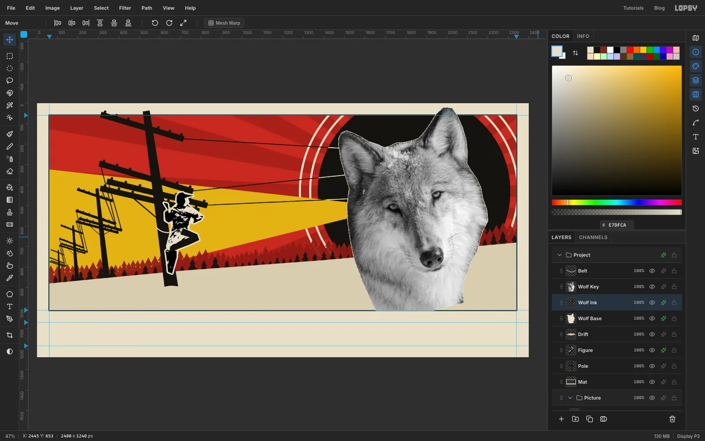

Click the `Wolf` row, choose **Layer → Duplicate Layer** and name the copy `Wolf Key`.
You'll come back to it in the next step. Click the `Wolf` row again and rename it
`Wolf Ink`.

1. Run **Filter → Brightness/Contrast** with **Brightness** `-32` and **Contrast** `34`. Without this, the pale cheek prints almost no dots.
2. Run **Filter → Halftone** with **Dot Size** `6`, **Angle** `75` and **Softness** `1`.
3. Open the ✦ drawer, turn on **Color Overlay**, set the colour to ink `#14120F` and close it. Halftone dots keep the photo's greys until you do.

Halftone can put dots just past the cut, so trim again. Press [[M]], click once, enter
From `1300, 1010` and To `2380, 1200`, press [[Delete]], then [[Cmd+D]].

## Light the eyes and add solid blacks

With `Wolf Ink` still active, add a layer named `Wolf Eyes` and set the foreground to
arc yellow `#DBB440`. Press [[L]] and lasso an almond over each iris, filling with
**Edit → Fill** and pressing [[Cmd+D]] after each one. Open the ✦ drawer, turn on
**Outer Glow**, set **Size** to `26`, **Opacity** to `80` and the colour to arc yellow,
then close it.

Click the `Wolf Key` row and run **Filter → Threshold** with **Level** `66`. Press [[W]],
check **Contiguous** is still off, click white, press [[Delete]], then [[Cmd+D]]. This
top layer holds the solid blacks: pupils, eyelids, nose and the deep fur. Now the face
has real weight, and the yellow is the only colour on it.

## Add halftone shadows on the snow

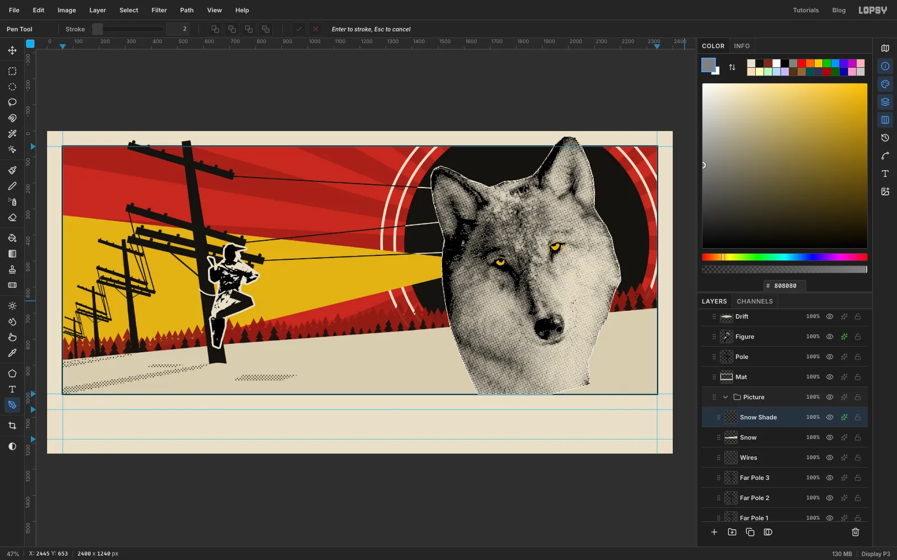

Click the `Snow` row and add a layer named `Snow Shade`. Set the foreground to grey
`#808080`. Draw and fill each of these shapes with the **Pen**:

- A long thin band from the foot of the main pole, running left and slightly downhill to the bottom-left corner of the frame.
- A shorter band from the foot of Far Pole 1, and a shorter one again from Far Pole 2, at the same angle.
- Two short flat patches on the snow, for the wolves you'll add soon: one left of the main pole and one to its right.

Run **Filter → Halftone** with **Dot Size** `8`, **Angle** `45` and **Softness** `1`.
Then open the ✦ drawer, turn on **Color Overlay** with ink `#14120F`, and close it. The
shadows print as dots of ink, so the palette gains no new grey.

## Pull the wire taut

Add a layer named `Cable` and set the foreground to ink. Press [[B]] and set **Size** to
`5`.

Click on the hand he's reaching out to the right, away from the pole, then
[[Shift]]+click on the snow near the middle of the picture, at about `1068, 839`. The
line comes out dead straight, and that matters: a slack curve reads as a man walking his
dog, and a taut one reads as a fight.

## Bring in the lead wolf

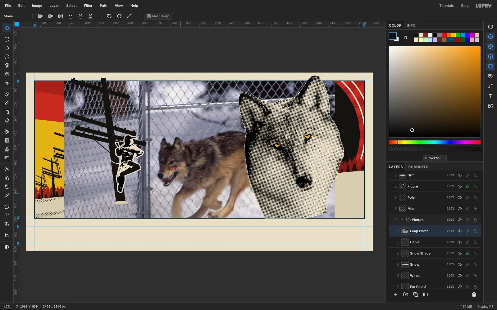

With `Cable` still active, drag the running wolf photo onto the canvas. It lands inside
the Picture group, so the frame and the head stay on top. Press [[Cmd+D]] and rename the
layer `Leap Photo`. This wolf is mid-stride with its jaws open, which suits the story.

Choose **Filter → Desaturate**, then **Layer → Duplicate Layer**, and name the copy
`Leap Key`.

## Print the lead wolf in ink

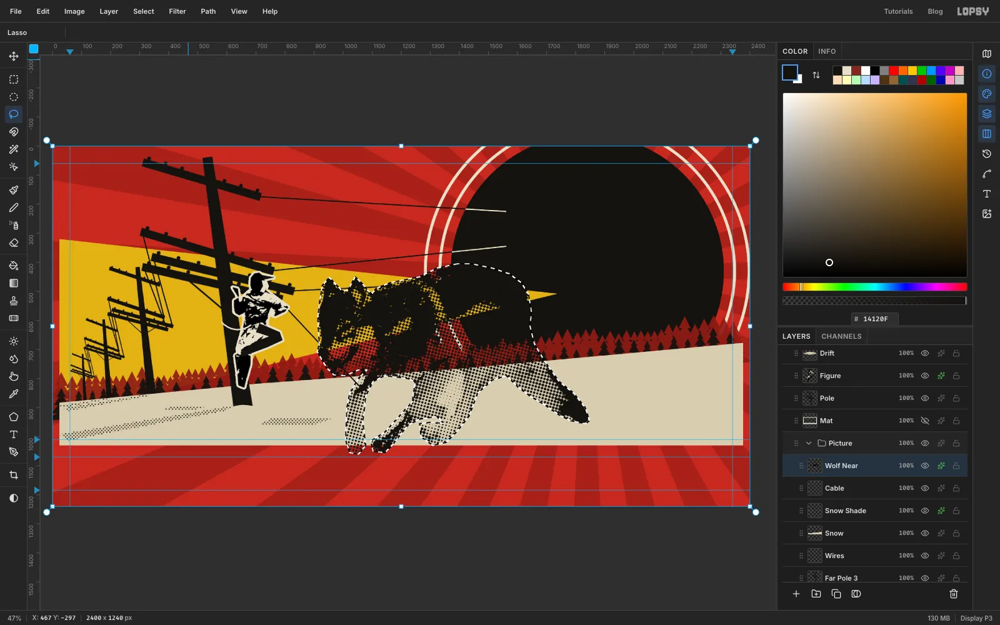

With `Leap Key` active:

1. Run **Filter → Gaussian Blur** with **Radius** `1.5`, then **Filter → Threshold** with **Level** `80`.
2. Press [[W]], click white with **Contiguous** off, press [[Delete]], then [[Cmd+D]].

Click the `Leap Photo` row. Run **Filter → Brightness/Contrast** with **Brightness**
`-14` and **Contrast** `40`, then **Filter → Halftone** with **Dot Size** `11`, **Angle**
`75` and **Softness** `1`. The dots are larger than the head's because they'll shrink
with the wolf.

Click the `Leap Key` row, choose **Layer → Merge Down**, and rename the result `Wolf Near`.
Open the ✦ drawer, turn on **Color Overlay** with ink `#14120F`, and close it.

The big head and the Mat are hiding the wolf's rump, tail and lower legs. Click the eyes
on `Wolf Base`, `Wolf Ink`, `Wolf Eyes`, `Wolf Key` and `Mat` to hide them for now, then
click the `Wolf Near` row.

Press [[L]] and lasso closely around the wolf, including its legs and tail and leaving out
the fence. Choose **Select → Inverse** and press [[Delete]]. Choose **Select → Inverse**
again to get the wolf's outline back, and keep it live.

## Slide a red plate underneath

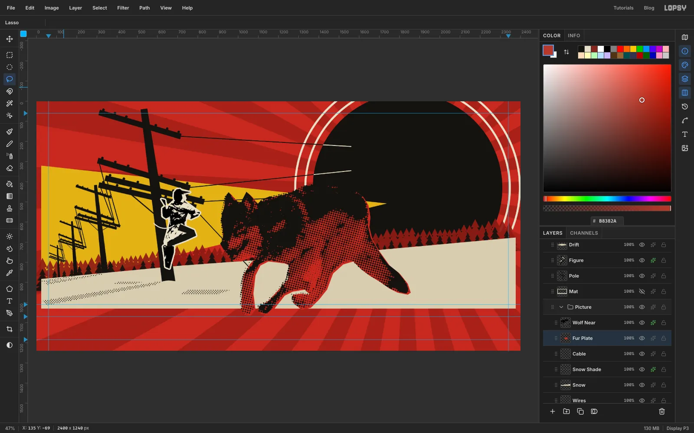

Click the `Cable` row and add a layer named `Fur Plate`. Press [[L]], then tap the arrow
keys 8 times right and 6 times down to slide the selection outline off the wolf. Set the
foreground to red `#B8382A`, choose **Edit → Fill**, then press [[Cmd+D]]. That small offset
is the misregistered second colour of a real print run.

Click the `Wolf Near` row, choose **Layer → Merge Down**, and rename the result `Wolf Near`.

## Send the wolf down the slope

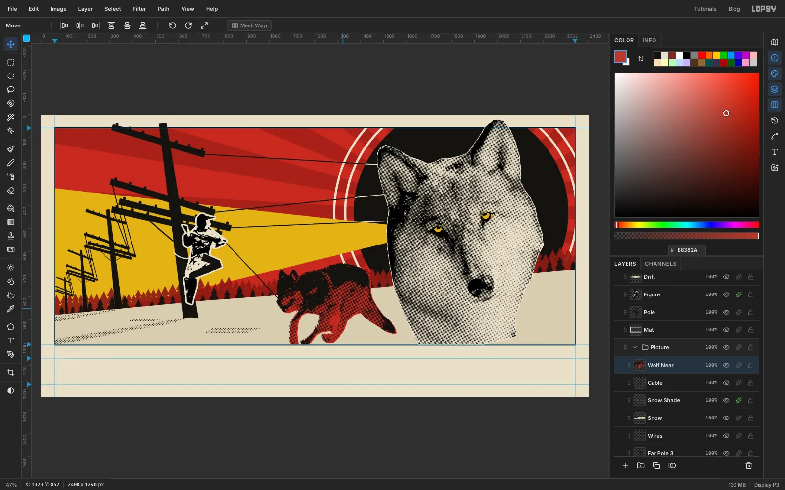

Press [[M]] and marquee the wolf, press [[V]], and [[Cmd]]-drag the bottom-right corner
inward until it's about 525 px wide (about 56%). Press [[Cmd+D]].

Click the same five eyes to bring those layers back.

With the **Move** tool, drag the wolf so the wire's end falls inside its open mouth. Don't
worry about its rump and back legs coming close to the big head, because a foreground shape
will cover them soon.

## Show the bite

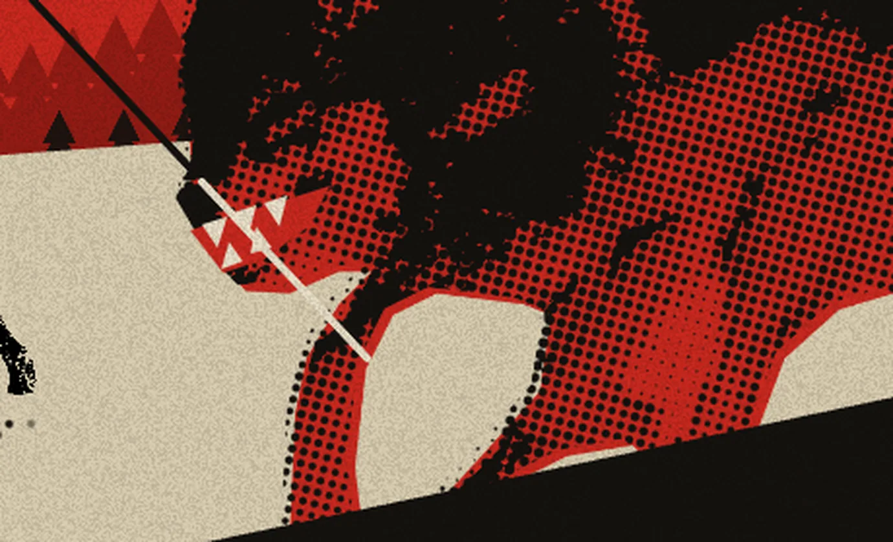

A black muzzle with a line touching it doesn't say "bite" yet. Click the `Wolf Near` row and
add a layer named `Bite`. Zoom in, because the teeth are only a few pixels on screen at
fit-to-window.

1. Set the foreground to red `#B8382A` and press [[L]]. Lasso a wedge for the open mouth, between the upper lip and the lower jaw, and fill it. Press [[Cmd+D]].
2. Set the foreground to paper `#E7DFCA`. Lasso three small triangles pointing down from the upper lip and two pointing up from the lower jaw, filling each one and pressing [[Cmd+D]].
3. Press [[B]] and keep **Size** at `5`. Click on the wire a little before the mouth, then [[Shift]]+click about 90 px past the mouth along the same line.

Now the wire goes in one side of the jaws in cream and comes out the other.

## Bring in the black wolf

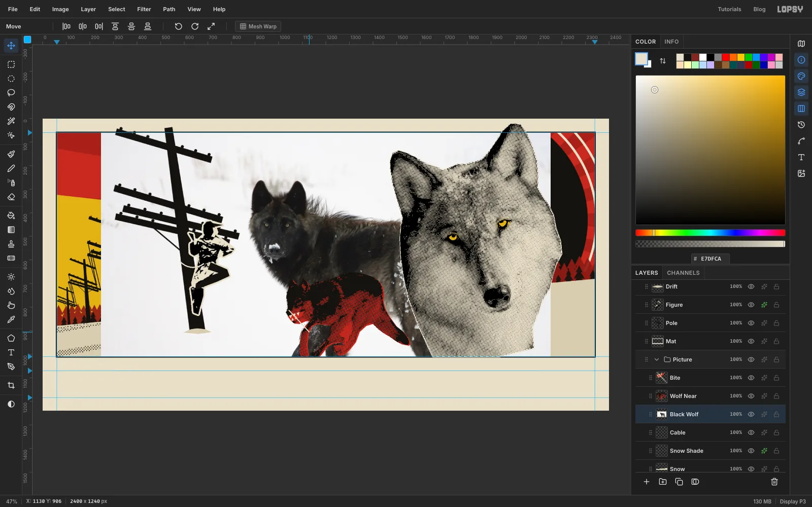

Click the `Cable` row and drag the black wolf photo onto the canvas. Press [[Cmd+D]] and rename
the layer `Black Wolf`. A dark animal on white snow is a ready-made silhouette, so this one
needs no careful lasso.

## Threshold the black wolf

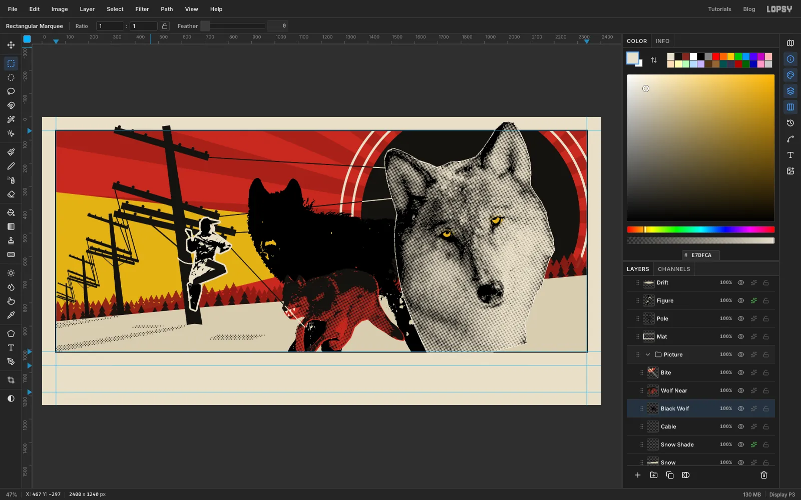

1. Choose **Filter → Desaturate**.
2. Run **Filter → Gaussian Blur** with **Radius** `1.5`, then **Filter → Threshold** with **Level** `110`.
3. Press [[W]], click white with **Contiguous** off, press [[Delete]], then [[Cmd+D]].
4. Press [[M]], click once and enter From `847, 240` and To `1967, 1215`. The box runs past the frame and behind the big head, because the rest of the wolf is back there. Choose **Select → Inverse**, press [[Delete]], then [[Cmd+D]]. This clears any stray specks from the snow.

## Place the rest of the pack

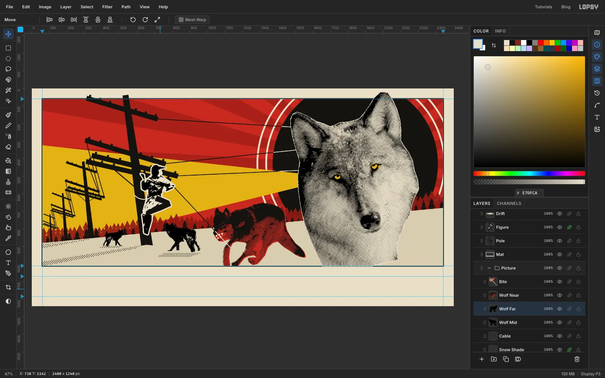

Press [[M]], click once and enter the same corners, press [[Cmd+C]], and keep the selection.
Rename the layer `Wolf Mid`.

1. Press [[V]] and [[Cmd]]-drag the bottom-right corner inward until the wolf is about 200 px wide (about 19%). Press [[Cmd+D]].
2. Drag it onto the snow just left of the red wolf, over the dotted patch to the right of the pole.
3. Press [[Cmd+V]] and name the new layer `Wolf Far`. Press [[Cmd+D]], then choose **Image → Flip Horizontal** so it faces the pole.
4. Press [[M]], click once and enter the same corners again, press [[V]], and [[Cmd]]-drag the corner inward until the wolf is about 115 px wide (about 11%). Press [[Cmd+D]].
5. Drag it to the other side of the pole, over the dotted patch to the left of it.

The lineman is now surrounded.

## Lay the foreground wedge

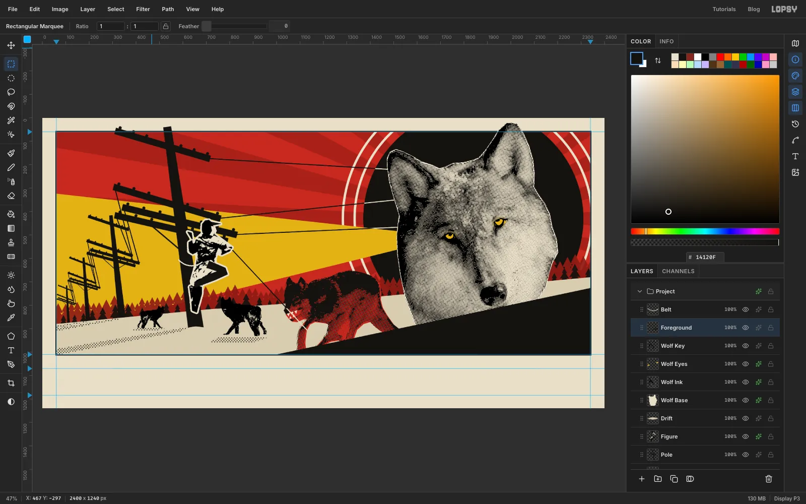

Click the `Wolf Key` row and add a layer named `Foreground`. Set the foreground colour to ink
`#14120F`. With the **Pen**, draw a shape whose top edge rises from about `1000, 1010` to the
right of the frame at about `y 726`, and let its bottom and right sides run past the keyline.
Fill it and press [[Cmd+D]].

This layer sits above the Mat, so trim the overshoot. Press [[M]], click once and enter From
`56, 56` and To `2344, 1014`. Choose **Select → Inverse**, press [[Delete]], then [[Cmd+D]].

The wedge seats the head, hides the lead wolf's rump so the animal seems to burst out from
behind it, and gives you a black field for the title.

## Set the title

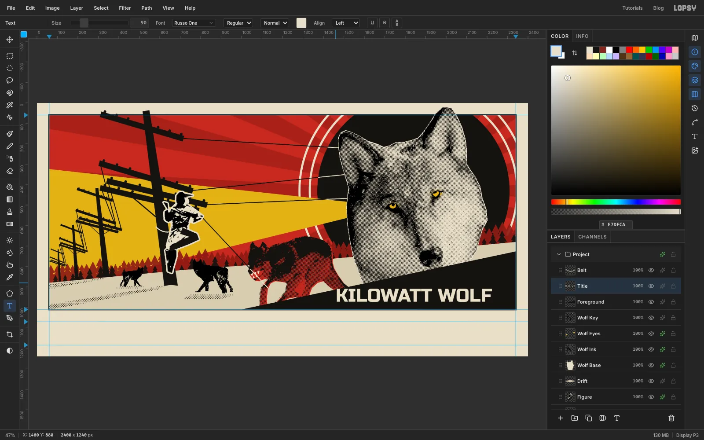

With `Foreground` active, press [[T]] for the **Text** tool. In the options bar, set **Size** to
`90`, choose the font **Russo One** and set the text colour to paper `#E7DFCA`.

Click at about `1460, 880`, type `KILOWATT WOLF` and press [[Tab]] to commit. Rename the layer
`Title`.

## Rotate the title and seat it in the wedge

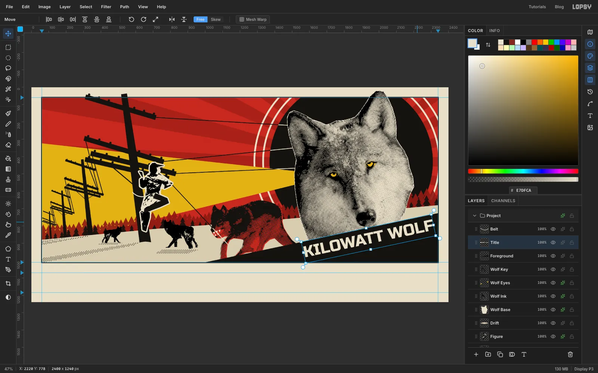

Press [[V]]. A text layer shows its transform box without a marquee, and it stays editable after
you rotate it. Drag the round handle at the top-right corner about 12° counter-clockwise, so the
text runs parallel to the wedge's top edge.

Nudge it with the arrow keys, adding [[Shift]] for 10 px steps. Aim for an even margin of about 30
px: above the letters along the slanted edge, between the F and the right of the frame, and below
the foot of the K. If you can't get all three, change the **Size** rather than crowding an edge.

## Block out the slate

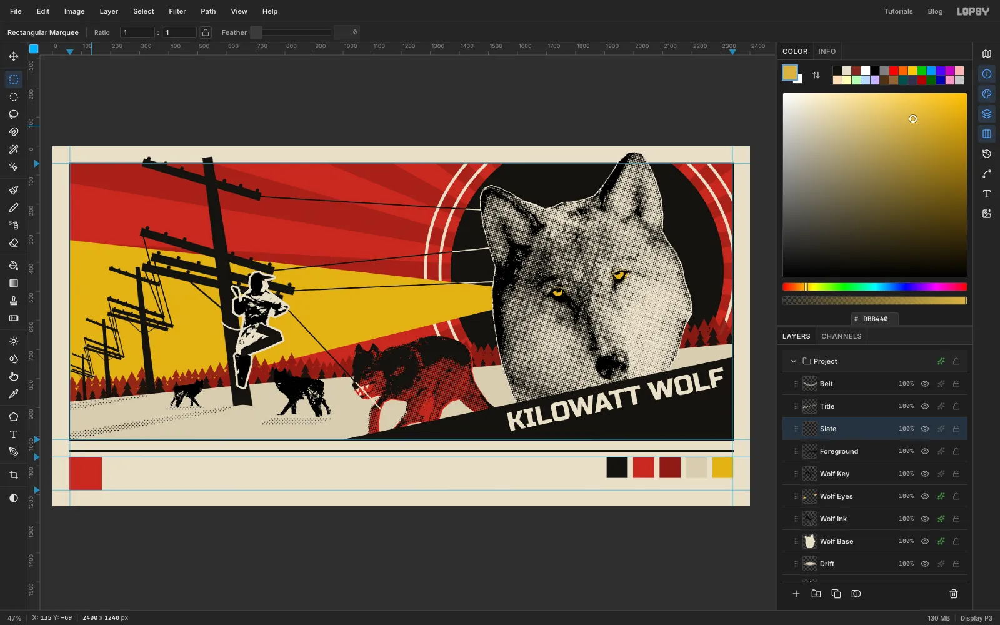

Click the `Foreground` row and add a layer named `Slate`, so the slate sits under the title.

For the rule, set the foreground to ink `#14120F` and press [[N]] for the **Pencil**. Set **Size** to
`8`, click at `60, 1050`, then [[Shift]]+click at `2340, 1050`.

Press [[M]] and use the click-once dialog for the rest, with **Edit → Fill** and [[Cmd+D]] each time.
The frame number box is red `#B8382A`, From `56, 1070` To `170, 1184`.

Then add five 72 px colour chips, all from `y 1070` to `y 1142`. They start at `x 1907`, `1998`,
`2089`, `2180` and `2271`, filled in that order with ink, red, oxide, snow and arc yellow.

## Set the slate type

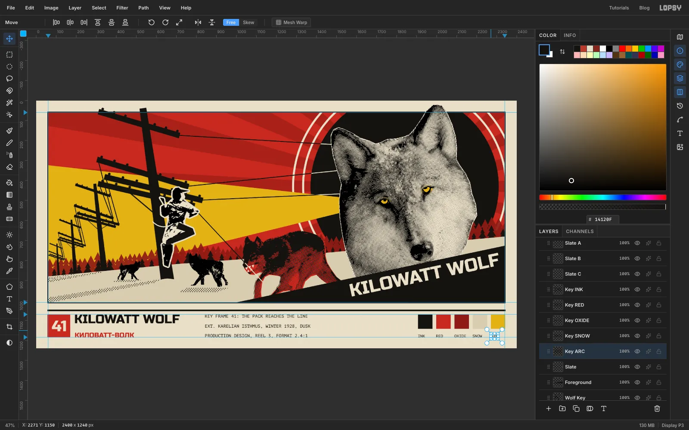

For each line below, click the `Slate` row first, so the Text tool starts a new layer instead of
restyling the last one. Press [[T]], set the font, size and colour in the options bar, click an empty
spot on the canvas, type the text and press [[Tab]]. Then press [[V]] and nudge with the arrow keys to
line it up. Text layers name themselves after their text. The screenshots show them renamed (`Slate
A`, `Key ARC` and so on), which is optional.

- `41` in **Russo One**, Size `76`, paper, centred in the red box.
- `KILOWATT WOLF` in **Russo One**, Size `62`, ink, 24 px right of the box with the tops of its letters on the `1070` guide.
- `КИЛОВАТТ-ВОЛК` in **Russo One**, Size `34`, red, directly below at the same left edge, with its base on the `1184` guide. Copy the text from this page and paste it with [[Cmd+V]] while the text is being edited.

In **PT Mono**, Size `22`, ink, set three lines at `x 844`, one layer each. Space them evenly, with the
first on the top guide and the last on the bottom guide:

- `KEY FRAME 41: THE PACK REACHES THE LINE`
- `EXT. KARELIAN ISTHMUS, WINTER 1928, DUSK`
- `PRODUCTION DESIGN, REEL 3, FORMAT 2.4:1`

Under the chips, in **PT Mono**, Size `20`, ink, label them `INK`, `RED`, `OXIDE`, `SNOW` and `ARC`, each
at its chip's left edge with its base on the bottom guide.

## Add a value study

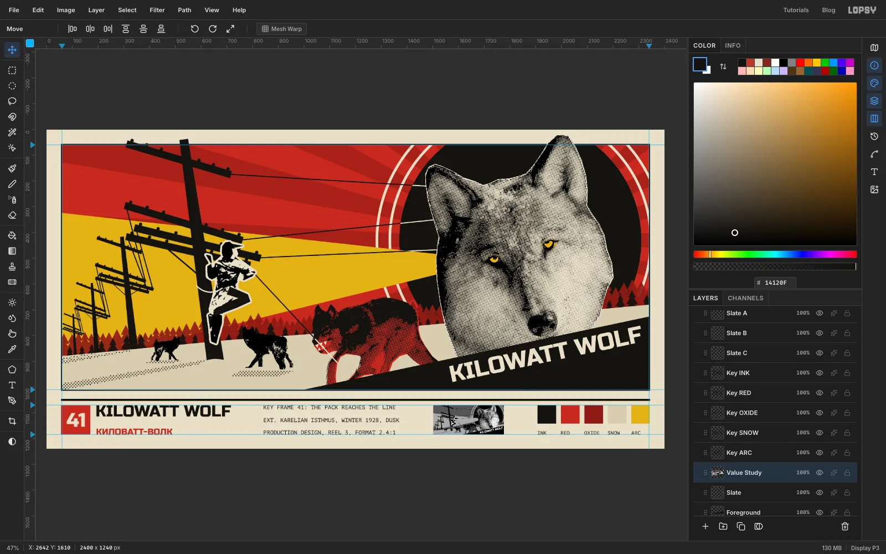

Concept artists check that a frame still reads with no colour at all, and yours can show its working.

1. Press [[M]], click once and enter From `60, 60` To `2340, 1010`.
2. Press [[Cmd+Shift+C]] for **Copy Merged**, then [[Cmd+D]].
3. Click the `Slate` row and press [[Cmd+V]]. Name the layer `Value Study` and press [[Cmd+D]].
4. Run **Filter → Desaturate**, then **Filter → Posterize** with **Levels** `4`.
5. Press [[M]], click once and enter From `60, 60` To `2340, 1010` again, press [[V]], and [[Cmd]]-drag the corner inward until it's 114 px tall (about 12%). Press [[Cmd+D]].
6. Drag it into the gap between the scene notes and the chips, with its top on the `1070` guide. Make the gap on each side about the same.

## Add paper grain and export

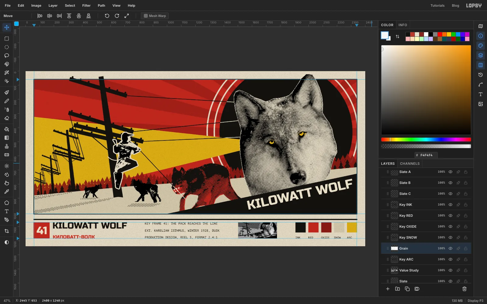

Click the `ARC` row, the last label you set, and add a layer named `Grain`. Set the foreground to
`#F4F4F4` and choose **Edit → Fill**.

Run **Filter → Add Noise** with **Amount** `45` and **Mono** selected. Open the ✦ drawer, set **Blend**
to **Multiply** and close it. The near-white layer only adds fine speckle, so the flat colours stop
looking like screen colours. The title and the slate lines above it stay crisp.

Choose **File → Save Project** to keep your layers, then **File → Quick Export PNG** for the finished
key frame.

For another take on this style, try the [constructivist zine
cover](/tutorials/constructivist-zine-cover/). For a different kind of film key frame, try [pixel-art
concept art of a sunken observatory](/tutorials/pixel-art-sunken-observatory-concept-art/).
