Copperplate is the formal, slanted script of the eighteenth-century English writing masters. It's written with a flexible pointed nib. Every stroke is a hairline until the writer presses on a downstroke, and then the nib opens into a thick, shaded swell. Later penmen added flourishes, which are long oval loops and spirals that spill off the letters, and they gilded the capitals.

In this tutorial you'll make a birthday card in that tradition, for someone you'd like to take out for tea. It's a 5 × 7 inch card (1500 × 2100 px) built like a page from a calligrapher's worksheet:

- faint **pencil ruling**, with ascender, waist and baseline lines and 60° slant guides
- **Happy Birthday** in a copperplate face, with **gilt capitals**
- a pen **flourish** that carries on from the last letter
- a pen-and-wash **teacup** with a rose garland, a hanging tea-bag tag and two chocolate éclairs
- a **mirrored divider**, a small-caps punchline, and a double gilt border with **corner flourishes**

Along the way you'll learn a pointed-pen trick that works for any hand-drawn ornament. Stroke the whole line as a thin hairline with the **Pen** tool. Then add the shade with two **tapered** brush strokes that run outward from the thickest point. Shade only the strokes that travel downward, the way a real nib does.

The tools you'll use:

- **guides**, the **grid**, and the Rectangular and Elliptical Marquee's exact-corner dialog
- the **Pen** tool, Enter-to-stroke, **Path to Selection** and **Stroke Path**
- the **Brush** (Hard Round and Soft Round, with Taper and Symmetry), **Pencil**, **Eraser** and **Gradient**
- the **Shape** tool's click-to-size dialog
- [[Cmd]]-click to load a layer's shape, the **Lasso** with add and intersect, and **Select → Shrink**
- **Copy**, **Paste**, the Move tool's **Flip**, **rotate** and **scale** handles, and **Merge Down**
- a **layer mask**, the **Multiply** blend mode, and the filters **Gaussian Blur**, **Fibers** and **Add Noise**
- the layer effects **Stroke** and **Drop Shadow**
- **groups**, and live text in Pinyon Script and Cormorant SC

The palette:

- Card stock `#F2E8D8`, edge tone `#E4D3B8`
- Ink `#2E1B14`, pencil `#A39888`
- Gilt `#6B4A14` → `#C99E45` → `#86601F` → `#DDBB66` → `#7A561B` → `#B88E3B`
- Flat gold `#C29A48` (filled first, then gilded)
- Porcelain `#FBF6EE`, porcelain shadow `#E3D3C2`, saucer underside `#E6D8C6`, saucer well `#F1E7DA`
- Rose `#C9727C` / `#E9BDBB` / `#9E4B57`, leaf `#6F8F63`
- Tea `#8A5636` / `#B98458`
- Choux `#D9A35A` / `#A86A2E` / `#F0C985`, chocolate `#3E2217`, crumb shadow `#3A2416`
- Tag card `#FBF3E6`

> **Tip:** On a wide-gamut (Display P3) screen, Lopsy reads typed hex codes as P3 colours. These codes were picked as P3 values, so they match the finished card. On an sRGB screen they come out a touch duller.

> **Note:** Shortcuts are written for a Mac. On Windows use [[Ctrl]] wherever it says [[Cmd]], and [[Alt]] for [[Option]].

## Start the card and set the guides

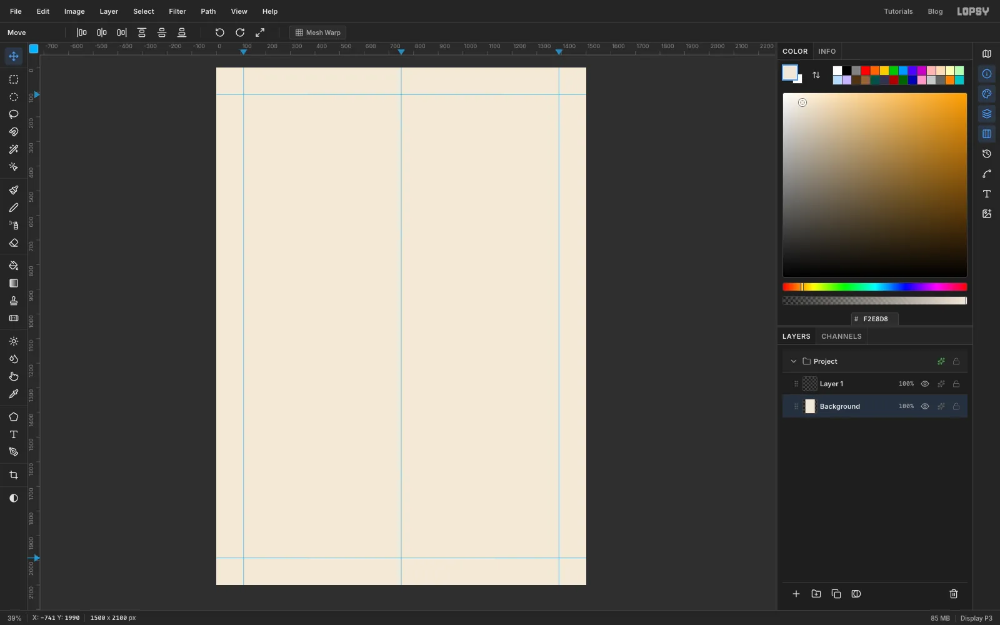

Choose **File → New**, keep the units on **Pixels**, and make the document **1500** wide and **2100** high. That's a 5 × 7 inch card at 300 ppi.

Set the foreground colour to card stock `#F2E8D8`, select the **Background** layer, and choose **Edit → Fill**.

Click the top ruler at **750**, **110** and **1390** to drop three vertical guides. The middle one is the centre line, and the outer two are the margins you'll keep the lettering inside. Click the left ruler at **110** and **1990** for the top and bottom margins.

## Warm the edges of the card stock

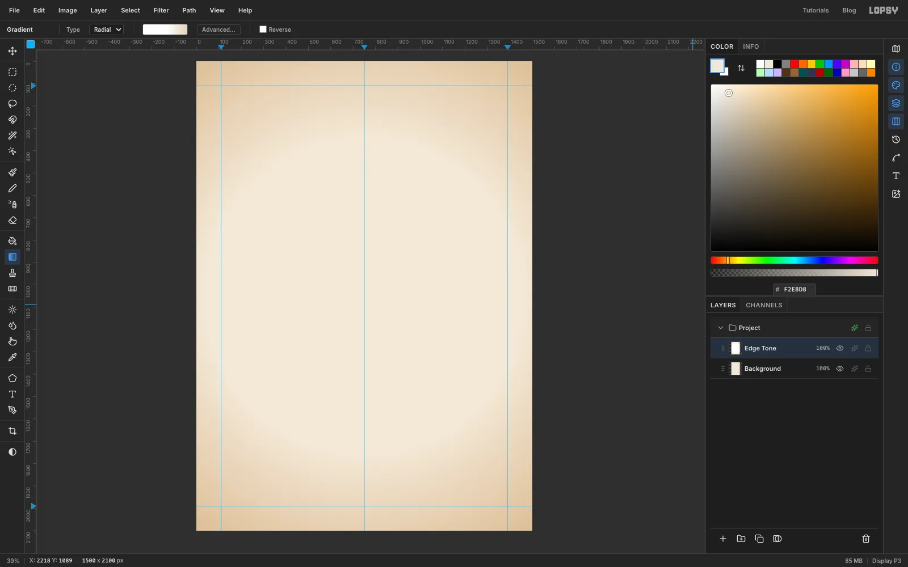

Old card stock is a little darker at the edges, where it's been handled. A new document comes with an empty **Layer 1** above the Background. Select it and rename it **Edge Tone** by double-clicking its name.

Pick the **Gradient** tool, set the type to **Radial**, and open **Advanced…**. Make three stops: white `#FFFFFF` at 0%, white again at 55%, and edge tone `#E4D3B8` at 100%. Drag from the centre of the card (**750, 1050**) straight out to the right, past the edge, to about **x 2040**.

Open the layer's effects (the ✦ button on its row) and set the blend mode to **Multiply**. White disappears in Multiply, so only the tan rim shows.

## Rule the lines like a calligraphy worksheet

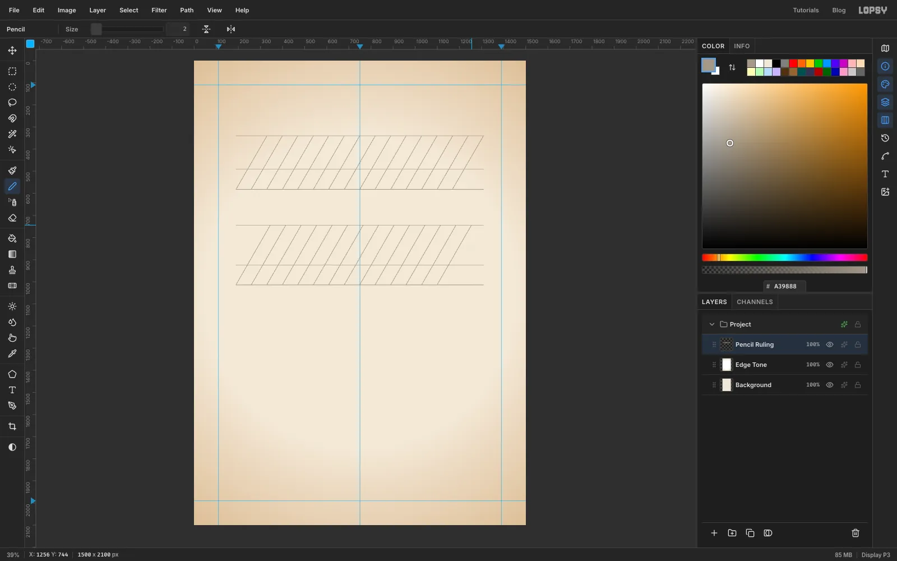

Calligraphers rule their paper before they write. Add a layer called **Pencil Ruling**, pick the **Pencil** tool (**N**), set its **Size** to **2** and the colour to pencil `#A39888`.

Each line of script gets three horizontal lines: the **ascender** line where the tall letters stop, the **waist** line at the top of the small letters, and the **baseline** the letters sit on. To draw a straight line, click at the left end, hold [[Shift]] and click at the right end. All six lines run from x **190** to x **1310**:

- for **Happy**: y **340**, **491** and **583**
- for **Birthday**: y **744**, **925** and **1014**

Now add the slant lines that keep copperplate's lean consistent. Click on a baseline, then hold [[Cmd]]+[[Shift]] and click up and to the right on the ascender line. [[Cmd]]+[[Shift]] snaps the line to 15° steps, so you can land it on **60°**. Start at x **190** on each baseline and repeat every **70 px** to the right, stopping before you pass x 1310. It's the slowest part of the card, about seventeen lines per band, so put some music on. Fewer lines still read as ruling if you'd rather space them wider.

## Fade the ruling back

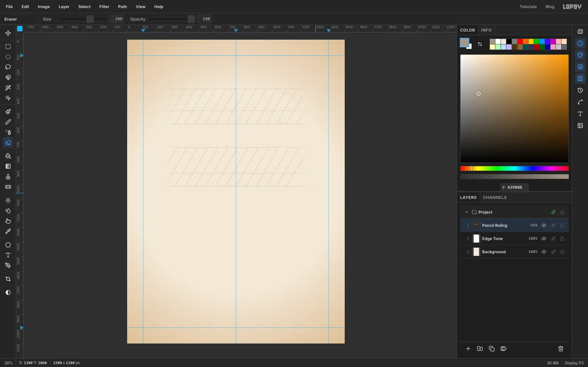

The ruling should whisper. Open the **Pencil Ruling** layer's opacity control on its row and set it to **45%**.

Pick the **Eraser**, set **Size** to **200** and **Opacity** to **55%**, and drag once straight down over the left ends of the lines and once over the right ends. The lines now fade out instead of stopping dead. Set the Eraser's Opacity back to 100% afterwards.

## Set "Happy Birthday" in copperplate

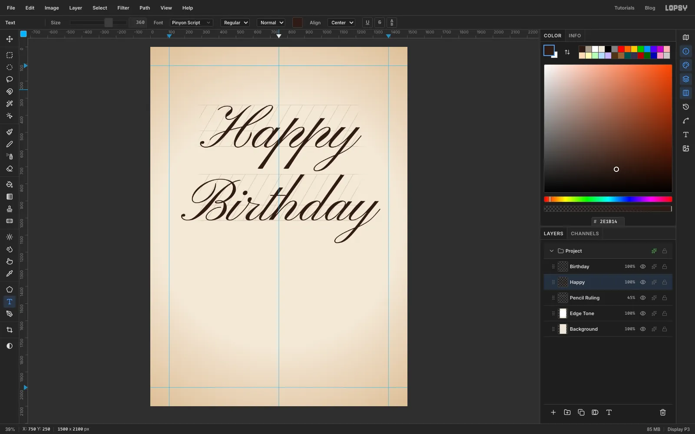

Pick the **Text** tool (**T**) and choose **Pinyon Script** in the font browser. It's a copperplate face with real thick-and-thin contrast. Set the alignment to **Center** and the colour to ink `#2E1B14`.

Write **Birthday** first, because Happy's text box reaches down to where Birthday goes, and a click inside an existing text box edits that layer. Set the size to **345** and click on the centre guide at y **690**. Type the word and press [[Tab]] to finish.

Click the **Pencil Ruling** layer in the Layers panel, so the next text settings don't restyle Birthday. Then set the size to **360**, click the centre guide at y **250**, type **Happy** and press [[Tab]].

Birthday is set slightly smaller than Happy because it's a wider word, but the two sizes give both words the same x-height. With these positions, both words sit on their pencil baselines and their small letters touch the waist lines.

## Isolate the H for gilding

Gilded capitals were a mark of the finest penmanship. You'll gild the **H** and the **B**.

Select the **Happy** layer and click **Rasterize Layer** at the bottom of the Layers panel, so its letters become pixels. Do the same for **Birthday**.

[[Cmd]]-click the **Happy** thumbnail. That loads the shape of the letters as a selection. You only want the H, so pick the **Lasso** (**L**), hold [[Shift]]+[[Option]] and drag a loop around the H. [[Shift]]+[[Option]] intersects, so the new selection keeps only the parts inside both. Keep your loop to the left of the **a**, but take in the H's whole top stroke, which reaches over it.

## Gild the capitals

With the H selected, add a new layer called **Gilt H**. Pick the **Gradient** tool, set the type to **Linear**, and in **Advanced…** make six stops for a burnished gold. They alternate dark and light so the metal catches the light more than once: `#6B4A14` at 0%, `#C99E45` at 22%, `#86601F` at 42%, `#DDBB66` at 60%, `#7A561B` at 80% and `#B88E3B` at 100%. Drag diagonally across the H from its top-left to its bottom-right.

Now select the **Happy** layer and press [[Delete]]. This takes the brown H out from under the gold, so no dark fringe shows round the edges. Press [[Cmd]]+[[D]] to deselect.

Repeat for the **B** of Birthday on a **Gilt B** layer. Keep your intersect lasso to the left of the **i**, which touches the B's bowl.

Gold hairlines can vanish against cream, so give each gilt layer two effects:

- **Stroke**: Width **1**, colour `#6B4A14`
- **Drop Shadow**: Offset X **2**, Offset Y **3**, Blur **3**, Opacity **40**, colour `#4A3210`

## Carry the y on into a swash

A copperplate flourish grows out of a letter. Add a layer called **Swash** above Gilt B.

Pick the **Pen** tool (**P**) and set its **Stroke** to **3**. Start at the bottom of the **y**'s loop (about **1080, 1141**), where the ink is heading left. Click and drag as you place each anchor, so the curve stays smooth. Sweep left in a long, shallow oval under the whole word: the lowest point of the sag is around **800, 1166**, and the line rises again under the **i**. Then curl back up and round into a small loop that closes below the B, at about **330, 1080**. That takes about a dozen anchors. Leave a clear gap between the loop and the B's tail. Press [[Enter]] to stroke the path in ink.

A pointed nib only swells on downstrokes. The underline runs sideways, so it stays a hairline. Only the right side of the closing loop travels downward, so that's the only part that gets a shade.

Pick the **Brush** (**B**) and click the brush-tip thumbnail at the left of its options bar to open the **Brushes** window. Choose **Hard Round** on the Presets tab, then on the **Shape** tab set **Size** to **7** and **Taper** to **40**, about half the length of the shade. Press in the middle of the loop's right side and drag down along the line to its end. Then press at the same middle point and drag up along the line the other way. Each stroke starts fat and thins to nothing, so together they make a swell.

> **Tip:** Choosing a preset resets Size, Opacity and Taper to the preset's own values. Pick the preset first, then set the numbers.

## Draw the double gilt border

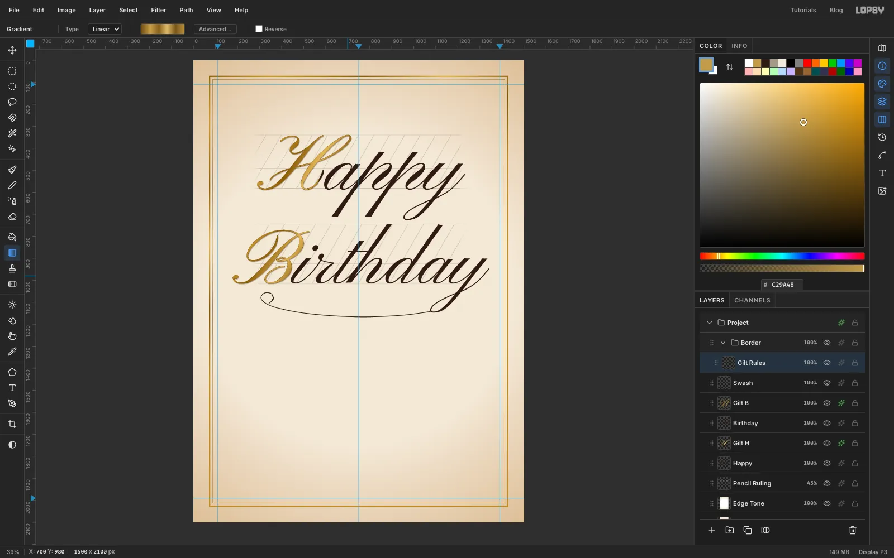

Select **Swash** and click **New Group** in the Layers panel. Name the group **Border**, then add a layer inside it called **Gilt Rules**.

Pick the **Rectangular Marquee** (**M**) and click once on the canvas without dragging. The exact-corner dialog opens. Enter From **70, 70** and To **1430, 2030**. Set the foreground to flat gold `#C29A48` and choose **Edit → Fill**. Choose **Select → Shrink…**, shrink by **6**, and press [[Delete]]. That leaves a 6 px frame.

Press [[Cmd]]+[[D]] to deselect (the exact-corner dialog only opens when nothing is selected). Do it again for a hairline just inside: corners **86, 86** to **1414, 2014**, Fill, Shrink by **2**, Delete.

[[Cmd]]-click the Gilt Rules thumbnail to select both rules. Use the Gradient tool with the same six gilt stops, and drag from the top-left corner of the card about halfway down towards the centre, so the bands sweep across the frame. Deselect.

## Draw a corner ornament

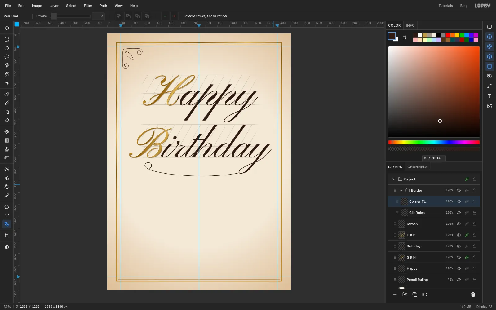

Add a layer called **Corner TL** in the Border group. Pick the **Pen** tool and set **Stroke** to **2**.

Draw the ornament as one continuous line, dragging each anchor so the curves stay smooth. Start inside a small spiral centred near **262, 152**, about 55 px across. Wind outward in about one and a half turns, with about four anchors per turn, and come out of the top heading left. Run along the top at **y 124**, about 38 px inside the border. Round the top-left corner in a smooth curve, run down the side at **x 124**, and wind into a matching spiral centred near **152, 262**. Press [[Enter]] to stroke it.

For the leaf, draw a pointed oval of six or seven anchors on the diagonal between the two spirals, from about **144, 144** to **212, 212**. Close it by clicking the first anchor, then press [[Enter]] to stroke it.

## Shade the downstrokes

Now the swells. With the **Brush** on **Hard Round**:

- The side arm is a downstroke, so give it a swell. Use **Size 6** with **Taper 55**, about half its length. Press halfway down the arm and drag down to the spiral, then press at the same point and drag up to the corner.
- Give the right side of the top spiral, where the line comes down, a smaller swell at **Size 5** and **Taper 35**.

Leave the top arm as a hairline. It runs sideways, and a pointed pen doesn't shade sideways strokes.

## Copy the corner and flip it

With the **Rectangular Marquee**, drag a box around the whole ornament. Press [[Cmd]]+[[C]] and then [[Cmd]]+[[V]]. The copy pastes in place on its own layer, still selected. Rename it **Corner TR**.

Pick the **Move** tool (**V**) and click **Flip Horizontal** in the options bar. Use the Move tool's button, not Image → Flip, because it flips the selection together with the pixels.

## Place all four corners

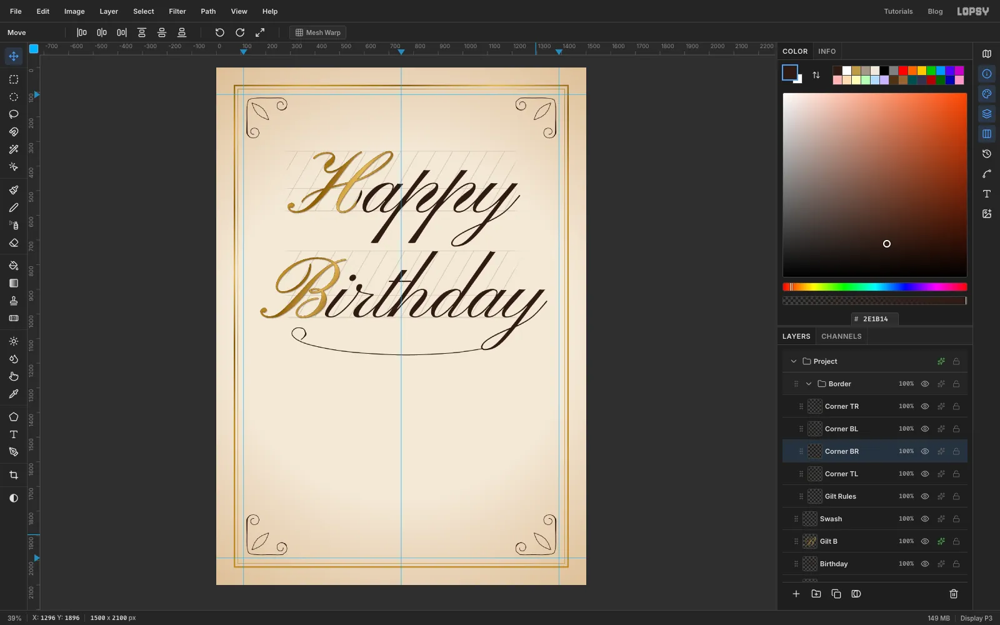

Drag the flipped copy into the top-right corner and press [[Cmd]]+[[D]]. To line it up exactly, drop two temporary guides on the rulers at x **1379** and y **122**, the mirror of the original's outer edges. Then nudge the ornament with the arrow keys ([[Shift]]+arrow moves 10 px) until its outer edges touch them.

For the bottom-left: select **Corner TL**, marquee round it, copy and paste, and rename the paste **Corner BL**. Click **Flip Vertical** and drag it into the bottom-left corner, with its outer edges on x **121** and y **1978**. For **Corner BR**, do the same with both flips, lined up on x **1379** and y **1978**. When you're done, remove the temporary guides by clicking each one's position on the ruler again.

## Set up the teacup group and draw the saucer

Collapse the **Border** group with its arrow. Select **Swash** and click **New Group** again, and name it **Teacup**. Everything for the cup goes in here, so you can move it as one piece later.

Choose **View → Show Grid** to help you judge the ellipses' proportions. Showing the grid also switches on **Snap to Grid**. Nothing in this step needs to snap, so turn that off in the View menu.

Add a layer called **Saucer**. Each of the next three fills uses the **Elliptical Marquee**: click once to open its exact-corner dialog, enter the corners, fill, and deselect.

- the underside: **395, 1610** to **1105, 1765**, filled with `#E6D8C6`
- the saucer top: **389, 1597** to **1111, 1755**, filled with porcelain `#FBF6EE`
- the well: **570, 1636** to **930, 1706**, filled with `#F1E7DA`

The underside peeks out below the top, which gives the saucer its thickness.

To outline the saucer, pick the **Shape** tool (**U**). Set Shape to **Ellipse** and Output to **Pixels**, remove the fill, and set the stroke to ink `#2E1B14` with **Width 3**. Click once at the saucer's centre (**750, 1676**). In the Shape Size dialog type **721** by **158**.

With the **Pen** tool at **Stroke 2**, draw a gentle arc along the back of the well. Then add a swell along the saucer's front edge, where the rim curves towards you: **Hard Round** at **Size 6** and **Taper 210**, two strokes outward from the front-centre. Turn the grid off again with **View → Show Grid**.

## Block in the cup

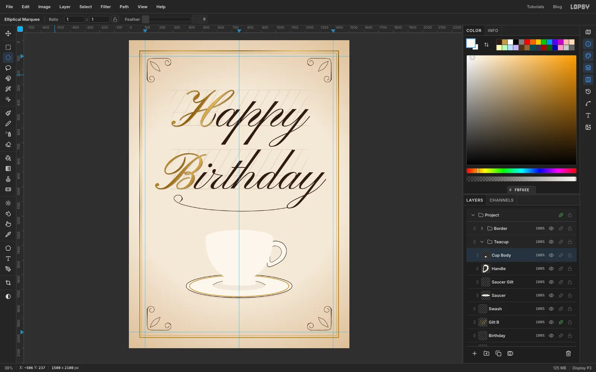

Add a layer called **Saucer Gilt**. Use the Shape tool again with a gold `#C29A48` stroke of **Width 5**, click the saucer centre, and enter **677** by **144**. You'll gild it in a later step.

Add a layer called **Handle**. With the **Pen**, drag six anchors round the outside of an ear-shaped loop. It leaves the right side of the cup near **966, 1385**, swings out to about **x 1072** and comes back in near **980, 1538**. Close the path on its first anchor. Open the **Paths** panel, click **Path to Selection**, and Fill with porcelain, then deselect. Draw the hole the same way, about 25 px inside the loop, and press [[Delete]] after Path to Selection.

To outline the loops, select each path in the Paths panel and click **Stroke Path**. Use **Width 3** for the outside and **2** for the hole.

Add a layer called **Cup Body**, above the handle so the bowl hides the handle's end:

- the foot: a four-anchor Pen path, about **x 669–831** at the top (y **1627**) and **x 647–853** at the bottom (y **1667**). Path to Selection, Fill, deselect.
- the bowl: a Pen path with dragged anchors. Start at the left end of the rim (**520, 1345**), go round the belly to its lowest point near **750, 1632**, and up to the right end (**980, 1345**). Come back along the front of the rim, dipping to about y 1397 in the middle. Path to Selection, Fill, deselect.
- the rim: the Elliptical Marquee dialog from **520, 1293** to **980, 1397**, filled with porcelain so the mouth of the cup is closed. Deselect.

## Ink the cup

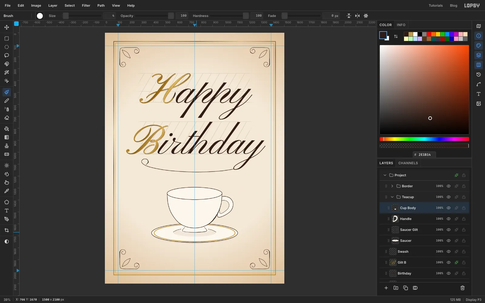

On **Cup Body**, use the **Pen** with **Stroke 3** to trace the bowl from rim to rim along the same anchors as before, and press [[Enter]]. Trace the sides and bottom of the foot with **Stroke 2**.

For the rim, use the **Shape** tool with an ink stroke of **Width 3**. Click the rim centre (**750, 1345**) and enter **460** by **103**.

Give the right side of the bowl a long swell with the Brush: **Hard Round**, **Size 8**, **Taper 170**, two strokes out from about halfway down. That's the shadow side, and the extra weight makes the cup feel round. Add a small swell on the right of the foot too, at **Size 4** and **Taper 30**.

## Pour the tea and shade the porcelain

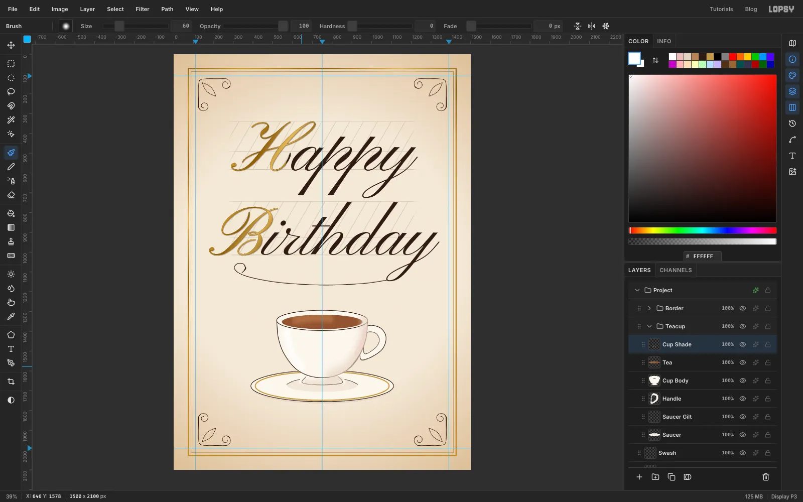

Add a layer called **Tea**. With the Elliptical Marquee dialog, select **546, 1316** to **954, 1389** and fill it with tea `#8A5636`. Keep the selection, pick the **Brush** with the **Soft Round** preset at **Size 80** and **Opacity 60**, and brush lighter tea `#B98458` across the back. Deselect.

Add a layer called **Cup Shade** and [[Cmd]]-click the **Cup Body** thumbnail. The selection keeps your shading inside the cup. With Soft Round:

- Use porcelain shadow `#E3D3C2` at **Size 130, Opacity 70**, and drag down the right side of the bowl and round under the belly. Do the same at a smaller size along the foot.
- Use a whisper of rose `#E9BDBB` at **Size 50, Opacity 25** along the right edge, so the porcelain picks up the pink of the garland.
- Use white at **Size 60, Opacity 80**, and drag a highlight down the left side of the bowl.

Deselect, and set Opacity back to 100%.

## Lasso the garland leaves

A garland painted on china follows the curve of the cup. It sags towards you in the middle and gets smaller towards the sides. Add a layer called **Garland**.

With the **Lasso**, draw a small pointed leaf about **30 px** long on the belly, about 60 px below the rim, along y ≈ **1460** at the sides. Hold [[Shift]] and draw its partner angled the other way, like a pair of wings. Keep adding pairs with [[Shift]] along a curve that dips about **40 px** in the middle. Make the pairs nearer the sides smaller and more squashed. That's eight pairs in all.

Fill them with leaf green `#6F8F63` and deselect.

## Paint the rosebuds

With the **Brush** on **Hard Round** and rose `#C9727C`, click once between each pair of leaves to drop a rosebud. Use **Size 30** for the middle one, stepping down to about **24** for the ones at the sides. The size change sells the curve.

Switch to dark rose `#9E4B57` at **Size 3**. On each bud, draw a small C-shaped curl just inside its edge, about three-quarters of a turn. That's the curl of the petals.

## Gild the rims

Add a layer called **Cup Gilt**. Use the **Shape** tool with a gold `#C29A48` stroke of **Width 5**, click the rim centre (**750, 1345**) and enter **446** by **95**.

Now gild both gold bands. Select **Saucer Gilt**, [[Cmd]]-click its thumbnail, and drag the six-stop gilt gradient diagonally across the cup and saucer, from upper left to lower right. Do the same on **Cup Gilt**.

## Raise the steam and fade it with a mask

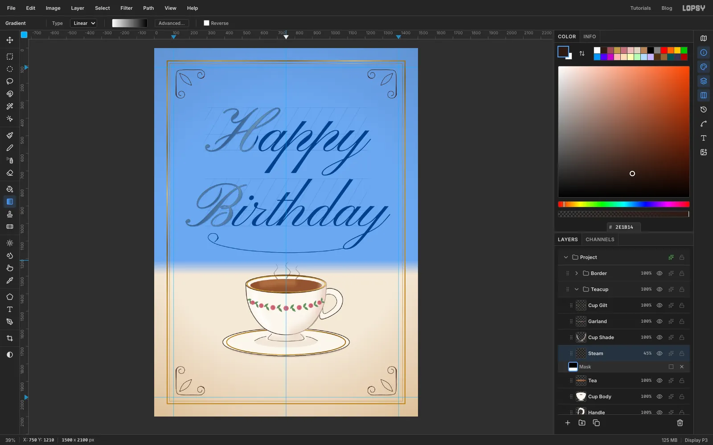

Add a layer called **Steam** just above **Tea**. With **Hard Round** in ink, set **Size 6** and a **Taper** about as long as each wisp (about **100**). Drag three gentle S-shaped wisps up out of the tea, from the bottom up. Taper thins a stroke from where it starts, so each wisp is thickest at the cup and thins as it rises. Make the middle one the tallest. Set the layer's opacity to **45%**.

To let the wisps melt away, click **Add Mask** in the Layers panel. A **Mask** row appears under Steam; click its thumbnail to edit the mask. Pick the **Gradient** tool, open **Advanced…**, delete the four middle stops, and set the two ends to white `#FFFFFF` and black `#000000`. Drag from just above the rim (y **1290**) up to y **1210**. Where the mask is black the steam disappears. Lopsy shows that part in blue while you're editing the mask.

Click the **Steam** layer's name to stop editing the mask.

## Hang a tea-bag tag

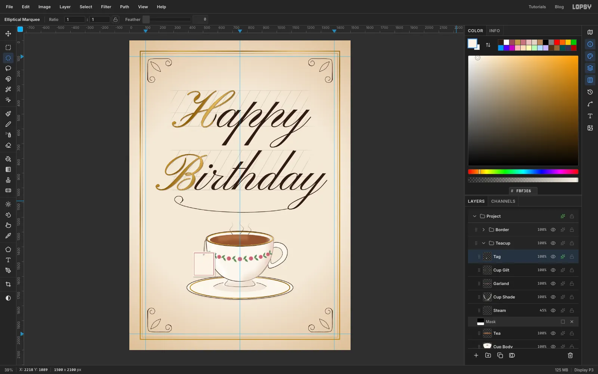

Select **Cup Gilt** and add a layer called **Tag**, so the tag hangs in front of the cup.

With the **Pen** at **Stroke 2** in ink, draw the string. Start just inside the rim on the left, come over the rim, and drop straight down to about **y 1450**.

With the Rectangular Marquee dialog, make the tag **150 × 170** px, hanging centred under the end of the string (**431, 1432** to **581, 1602**). Fill it with tag cream `#FBF3E6`. Shrink the selection by **8**, fill with dark rose `#9E4B57`, shrink by **2** more, and fill with cream again. That leaves a thin border inset from the edge. Deselect.

Punch the hole with the Elliptical Marquee dialog, a 14 px circle centred on the string's end (**499, 1447** to **513, 1461**), then press [[Delete]] and deselect. Give the layer a soft **Drop Shadow** (Offset **3, 4**, Blur **6**, Opacity **30**), so it stands off the porcelain.

## Write the tag's message

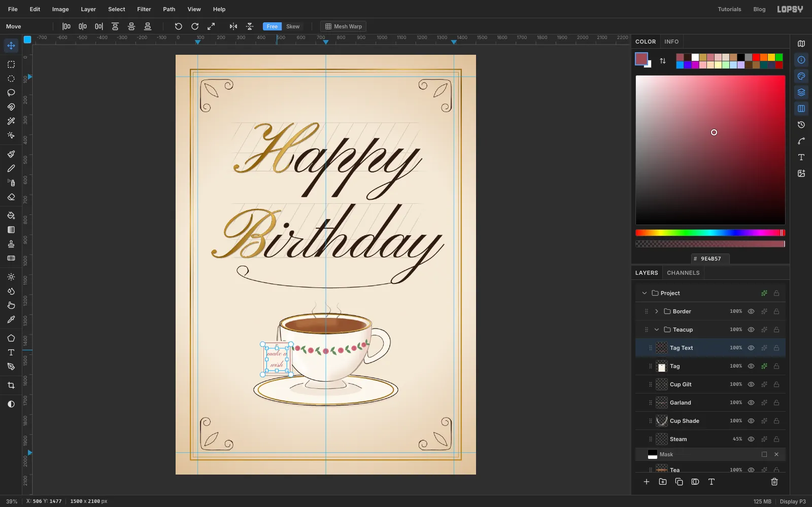

Use the **Text** tool with **Pinyon Script** at **40**, **Center** alignment and dark rose `#9E4B57`. Click in the middle of the tag. Type **make a**, press [[Enter]] for a second line, type **wish**, and press [[Tab]].

Seat it with the **Move** tool and the arrow keys. Centre it left to right, and centre it top to bottom in the space between the hole and the bottom of the border. A script's descenders and loops count as part of the word, so judge the gaps by the ink.

Click **Rasterize Layer**, then choose **Layer → Merge Down** to merge the words into the tag. The merged layer keeps the name **Tag**.

## Let the tag swing a little

Nothing hanging is ever perfectly still. Draw a **Rectangular Marquee** round the tag, pick the **Move** tool, and drag a rotation handle just outside a corner. Turn it about **3°** anticlockwise. Press [[Enter]] and deselect.

## Shape a choux éclair

Select **Tag** and add a layer called **Eclair**. Build the pastry's outline from simple selections:

1. Make a **Rectangular Marquee** on the front-left of the saucer with the exact-corner dialog: **482, 1695** to **718, 1769**.
2. With [[Shift]] held, add an **Elliptical Marquee** circle at each end, the same height as the box. That makes a capsule.
3. Keep [[Shift]] held and add six small ovals along the bottom edge, so it puffs out like piped choux pastry.

Fill it with choux `#D9A35A`.

## Bake and glaze it

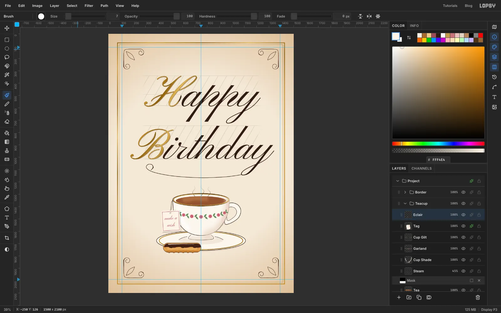

Keep the selection, and with the **Soft Round** brush:

- drag dark choux `#A86A2E` along the bottom at **Size 40**
- drag light choux `#F0C985` along the middle at **Size 28**

Then switch to **Hard Round** at **Size 3** and **70%** opacity. Draw a wavy baked crease just under where the glaze will sit, and two faint ridges along the lower half. Deselect. Add a **Stroke** effect (Width **2**, ink), then click **Rasterize Layer Style** in the effects drawer to bake it in.

Add a layer called **Glaze**. With the **Lasso**, trace the top half of the éclair just inside its outline, with a gently wavy bottom edge. Fill it with chocolate `#3E2217`. For the shine, use **Hard Round** at **Size 7** with a **Taper** of about **220**, cream `#FFF4E4` at **75%** opacity, and draw one stroke along the top of the glaze from left to right. Choose **Layer → Merge Down**; the result keeps the name **Eclair**.

Marquee round it, drag a Move-tool rotation handle about **8°** anticlockwise, press [[Enter]], and deselect.

## Make a second éclair from the first

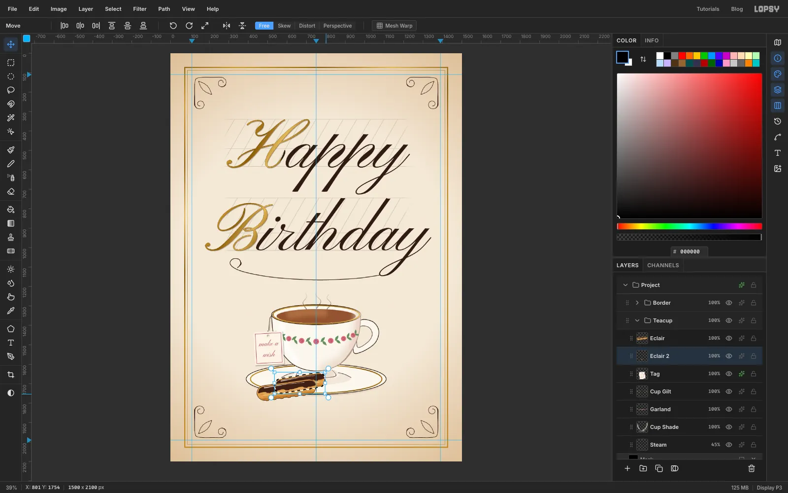

Marquee round the éclair and press [[Cmd]]+[[C]]. Select the **Tag** layer, then press [[Cmd]]+[[V]]. The paste lands just above Tag, so it sits behind the first éclair. Rename it **Eclair 2**.

With the Move tool, drag it back and to the right, about **90 px** right and **35 px** up, so it peeks out from behind. Then drag the right-hand edge handle inwards until it's about **15%** shorter. Turn it another **9°** with a rotation handle, so the two aren't parallel. Press [[Enter]] and deselect.

## Add contact shadows

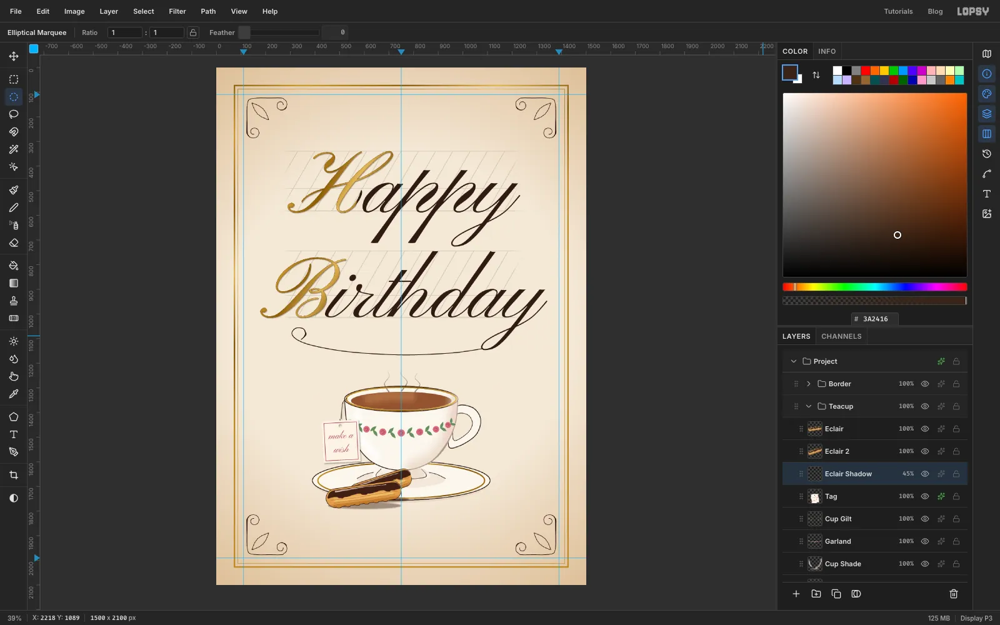

Things look stuck on until they cast a shadow. Select **Tag** again and add a layer called **Eclair Shadow**, which sits below both éclairs.

With the Elliptical Marquee, draw a thin oval along the bottom of each éclair, holding [[Shift]] for the second. Fill them with `#3A2416` and deselect. Run **Filter → Gaussian Blur…** at **6**, set the blend mode to **Multiply**, and drop the layer to **45%** opacity.

## Lift the whole teacup group

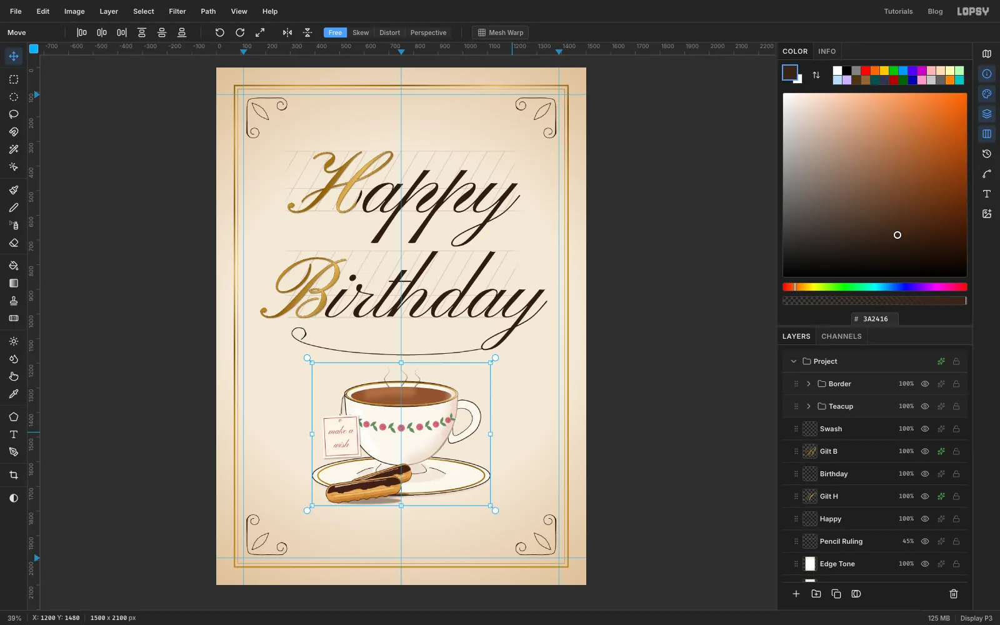

Step back and look at the spacing. The éclairs sit too close to where the divider and message will go. Collapse the **Teacup** group and click its row to make the whole group active. With the **Move** tool, press [[Shift]]+[[↑]] twice to lift it **20 px**. Every layer inside moves together: saucer, cup, garland, steam, tag and éclairs.

## Draw a mirrored divider

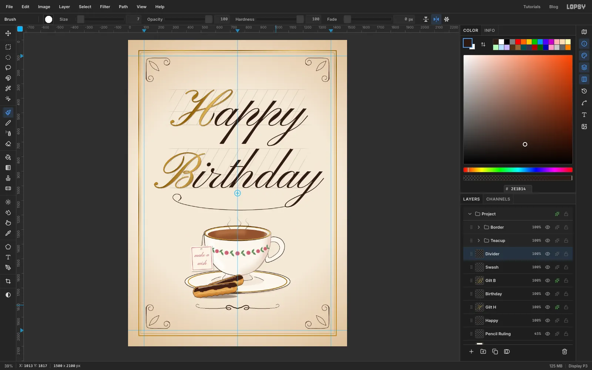

Select **Swash** and add a layer called **Divider**.

Pick the **Brush** with **Hard Round** at **Size 7**. Set the **Taper** to about the length of the stroke you're going to draw (about **330**). Click **Symmetry Vertical** in the options bar. That mirrors every stroke across the centre line.

Start on the centre guide at about **y 1840**. Draw the right half in one stroke: a small loop that crosses itself, then a long, gentle line out to the right, ending in a little curl. The mirror draws the left half as you go. The taper makes the stroke heaviest at the centre and finest at the curls.

Click **Symmetry Vertical** again to turn it off.

## Add the punchline

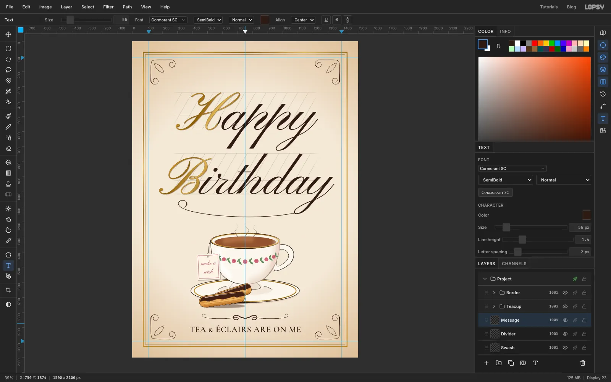

Pick the **Text** tool. Choose **Cormorant SC** at weight **SemiBold (600)**, size **56**, **Center** alignment, and ink colour. Click the centre guide at **y 1874** and type **TEA & ÉCLAIRS ARE ON ME**. Press [[Tab]], and in the **Text** panel set **Letter spacing** to **2**.

Check the gap on either side. The line should stay well clear of the bottom corner ornaments, about **100 px** each side. Small capitals keep the joke quiet next to all that script.

## Lay paper fibre over everything

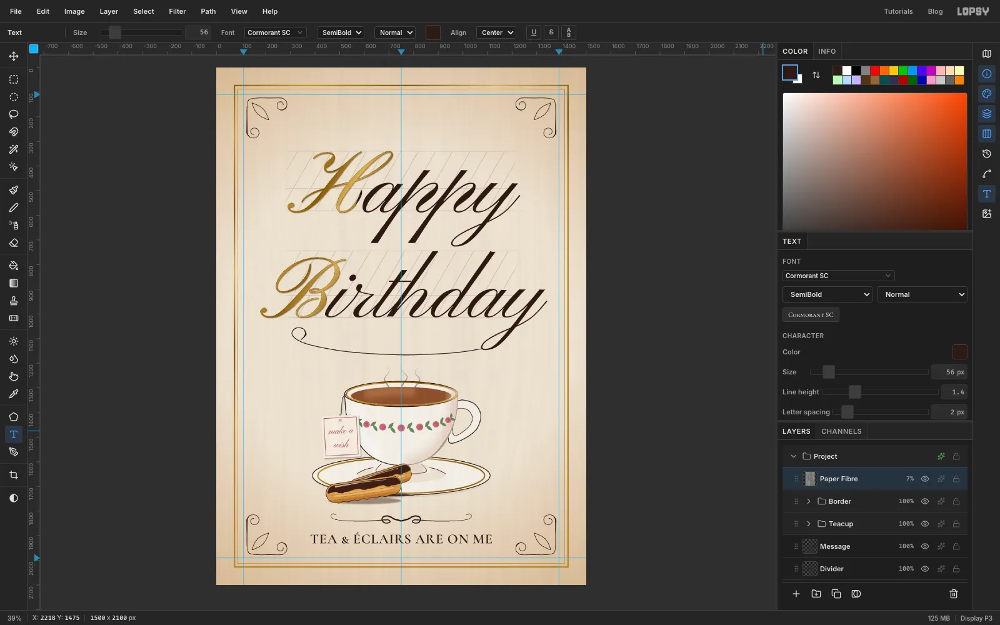

Collapse both groups and select **Border**. Collapsed, the new layer lands above the group instead of inside it. Add a layer called **Paper Fibre**.

Run **Filter → Fibers…** with **Variance 12** and **Strength 10**. Low strength gives tangled fibres rather than wood grain. Then run **Filter → Add Noise…** at **14**, **Mono** and **Gaussian**. Set the blend mode to **Multiply** and the opacity to **7%**. The texture now runs over the ink and gold as well as the card, so it all looks printed on the same stock.

Save the project, and export a PNG with **File → Quick Export PNG**.
