Most cyberpunk art is magenta and cyan. This one goes the other way, back to the amber monitors of old terminals. It keeps the genre's other habits:

- **one colour of light on black**, with a single red saved for the thing that matters
- **a HUD that frames the picture**: corner brackets, a ticker, tiny labels in monospace
- **a hologram**: the main chart floats over a grid floor, lit from a projector ring
- **a little menace** in the copy

You'll build **Espresso Shots**, a dashboard for a made-up megacorp that tracks how much coffee its night shift drinks. It has four small charts on one **2000 × 1250 px** board: a radial bar chart of shots per hour, a bar chart of districts, a line chart of heart rate and a ten-cell meter.

The tools you'll use:

- the **Pencil** with [[Shift]]-click lines and the Move tool's **Perspective** mode for the grid floor
- a **layer mask** with a gradient to fade the floor into the distance
- the **Shape** tool for rings, panels and hexagons, with its click-for-exact-size dialog
- the **Brush** with **Radial Symmetry** to draw 24 tick marks in one stroke
- the **Lasso** with [[Shift]] to add, a **Radial Gradient**, and [[Cmd]]-click plus [[Shift+Alt]] to intersect selections
- the **Pen** for an icon and a line chart
- text on a path, vertical text, and five Google fonts
- ruler **guides** that marquees snap to
- **Skew**, group rotation and arrow-key nudges
- **Outer Glow**, the **Screen** and **Overlay** blend modes, group **adjustments**, **Define Pattern**, **Add Noise** and **Copy Merged**

The palette is amber on black:

- Void `#2A1606` → `#120A05` → `#060403`
- Amber `#FFB000`, dim amber `#B36A00`, label amber `#C97A10`
- Pale `#FFF1B8`, cream `#FFE9B0`, ring light `#FFD070`
- Alert red `#FF3B1F`, readout red `#FF4A22`, deep red `#B81800`
- Skyline `#1C1009`, bar track `#4A2A08`, grid line `#5A3408`, panel `#0D0703`, band `#0A0502`
- Glow orange `#FF6A00`, glow amber `#FF8A00`, haze `#FF5A00`

The type is **Chakra Petch** Bold for the title and stamp, **VT323** for every number, **IBM Plex Mono** Medium for labels and **DotGothic16** for the katakana.

> **Note:** Shortcuts are written for a Mac. On Windows use [[Ctrl]] wherever it says [[Cmd]].

> **Tip:** The Text tool remembers the last settings you used, including the **Vertical** toggle, and a click inside an existing line edits that line. The easy routine is to click in an empty part of the floor, type, press [[Tab]], set the font and size, then drag the line into place with the **Move** tool.

## Start with a warm, dark background

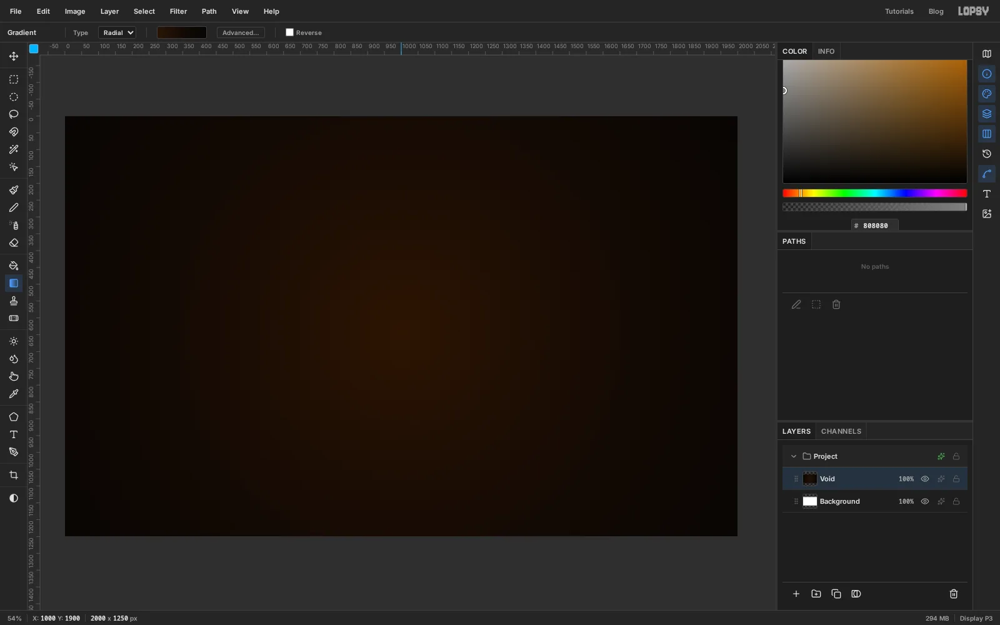

Choose **File → New** and make a document **2000** wide and **1250** high. Rename *Layer 1* to *Void*.

Pick the **Gradient** tool, set **Type** to **Radial** and click **Advanced…**. Give the gradient three stops: `#2A1606` at the left, `#120A05` a little past the middle and `#060403` at the right. Click **Done**, then drag from the centre of the canvas straight down until you're well past the bottom edge. The middle of the board ends up a touch warmer than the corners, which is all the light the background needs.

## Draw a flat grid with the Pencil

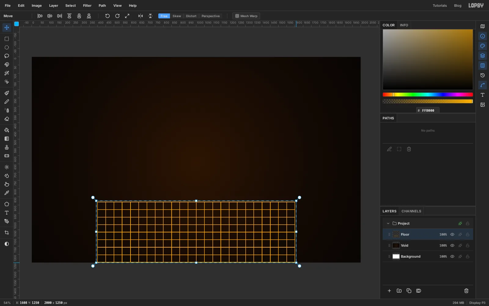

Add a layer called *Floor*. Take the **Pencil**, set **Size** to **3** and the foreground to `#FFB000`.

A click followed by a [[Shift]]-click draws a straight line between the two points. Draw about 25 vertical lines that way, roughly 50 px apart, across the middle of the bottom third of the canvas. Leave a fifth of the width empty on each side, because the next step stretches the grid outward. Then draw nine horizontal lines across them, evenly spaced, to make squares.

The grid looks wrong for a floor, and that's fine. Drag a **Rectangular Marquee** around the whole grid with a few pixels to spare, so you don't slice a line in half, and switch to the **Move** tool.

## Tip the grid into perspective

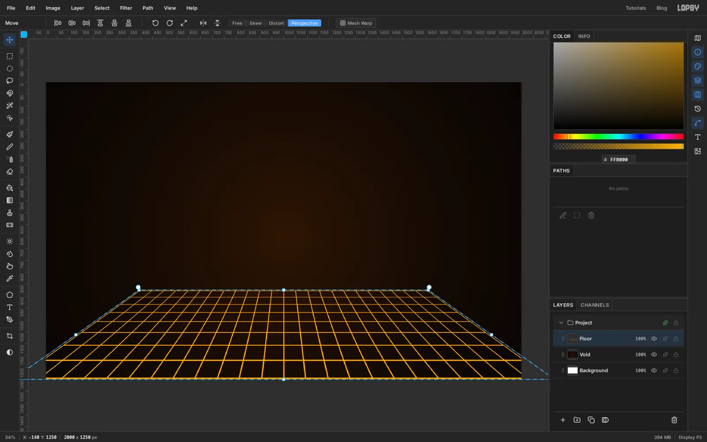

With the selection live, the Move tool's options bar shows four transform modes. Click **Perspective**, then drag the bottom-left handle straight out to the left, past the edge of the canvas. The bottom-right corner mirrors it, and the squares turn into floor tiles that get shorter as they recede.

Press [[Cmd+D]] to commit. If you undo at this point the flat grid comes back with its selection, so it's cheap to try a second time.

## Fade the floor into the distance

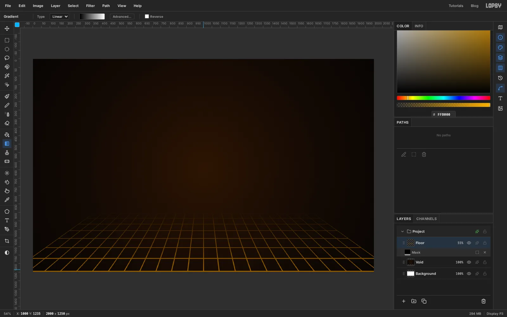

With *Floor* active, click **Add Mask** under the Layers panel. You're now painting on the mask, which the canvas shows with a blue tint. Take the **Gradient** tool and set it to **Linear**. It still holds the three brown stops from the background, so click **Advanced…**, delete the middle stop, make the two that are left black and white, and click **Done**. Drag from the horizon end of the floor down to the bottom edge. Black hides and white shows, so the far end of the grid melts away.

Click the *Floor* row to leave the mask, then click its opacity button and bring the layer down to **55%**.

## Block in a skyline with one selection

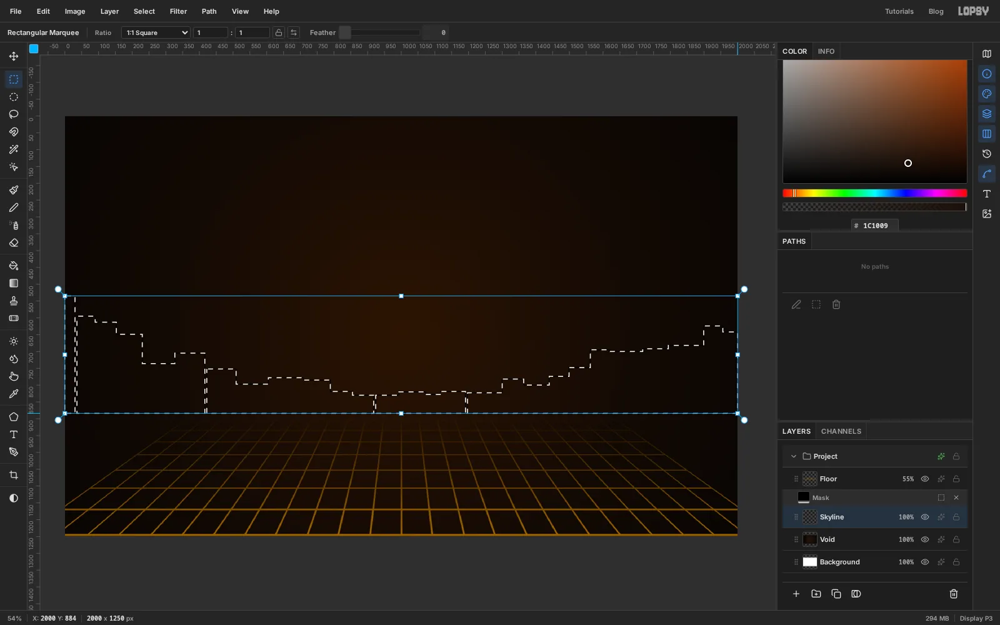

Click *Void* and add a layer above it called *Skyline*, so the city sits behind the floor.

Take the **Rectangular Marquee** and drag a tall, narrow box standing on the horizon at the far left. Hold [[Shift]] and drag the next building beside it, then keep going across the canvas. Make them tall at the edges and short in the middle, where the chart will go. Every [[Shift]]-drag adds to the same selection.

Set the foreground to `#1C1009`, choose **Edit → Fill** and press [[Cmd+D]]. Bring the layer down to **55%** so the buildings read as haze.

## Light the windows and the horizon

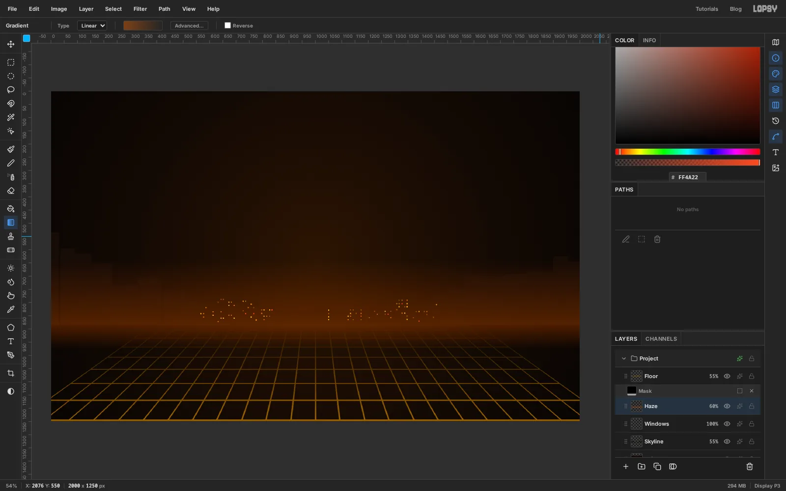

Add a layer called *Windows*. With the **Pencil** at **Size 4**, dot a hundred or so windows over the buildings in the middle of the canvas, in `#B36A00`, `#FFB000` and `#7A4300`, with a handful in `#FF4A22`. Keep them out of the outer quarter on each side. Those areas will hold text, and a stray dot next to a number reads as a decimal point.

Add a layer called *Haze*. Drag a marquee across the full width, from about a quarter of the way up the sky down to the horizon. In the **Gradient Editor** make a two-stop gradient of `#FF5A00` at **0%** opacity and `#FF6A00` at **40%**, and drag from the top of the selection to the horizon. Then select a shallow strip just under the horizon and drag the same gradient the other way, so the glow spills onto the floor instead of stopping at a hard line. Deselect, open the layer's effects (the sparkle button on its row), set the blend mode to **Screen** and lower the layer to **60%**.

## Draw the dial's rings

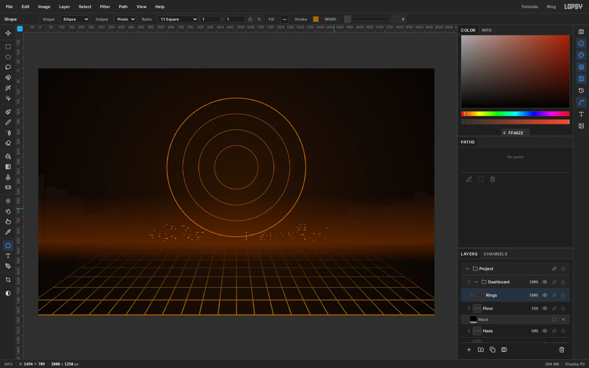

Click *Floor*, then click **New Group** under the Layers panel and name the group *Dashboard*. Add a layer inside it called *Rings*.

Pick the **Shape** tool and choose **Ellipse**. Click the **Fill** swatch and choose **Remove fill**, then add a **Stroke** of `#B36A00` with **Width 2**.

Click once, without dragging, a little above the centre of the canvas. A dialog asks for a size: enter **220 × 220** and click **Create**. Click the same spot twice more for **380 × 380** and **540 × 540**. Set **Width** to **4** and make the outer ring **700 × 700**. A shape made this way is centred on the click, so the four rings share a centre.

> **Tip:** Hover the centre and note the X and Y in the status bar. Everything on the dial is built around that point.

## Mark the hours with radial symmetry

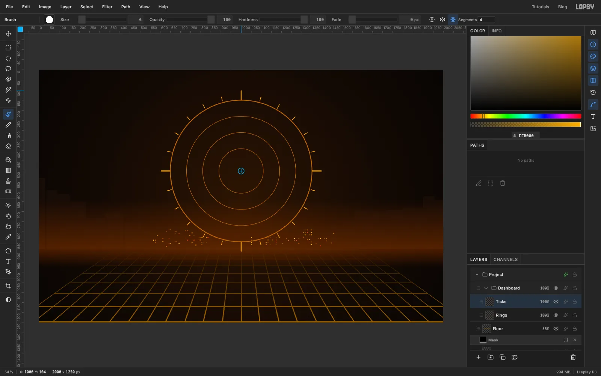

Add a layer called *Ticks*. Take the **Brush**, set **Size 4** and **Hardness 100**, and use `#FFB000`.

In the options bar click **Radial Symmetry** and type **24** into **Segments**. Symmetry turns around the centre of the canvas, which isn't the centre of the dial, so [[Cmd]]-click the middle of the rings to move it. A small crosshair shows where it is.

Now draw one short stroke outward from the top of the outer ring. All 24 hour marks appear at once. Change **Segments** to **4** and **Size** to **6**, and draw a longer stroke from the same place for the quarter marks. Click **Radial Symmetry** again to turn it off.

## Lasso one wedge for each hour

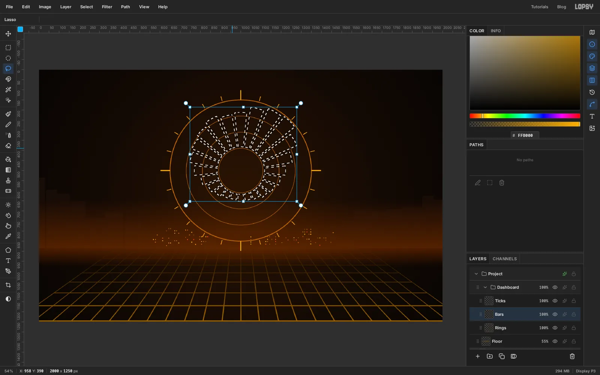

Click *Rings* and add a layer called *Bars*, so the bars sit under the ticks.

This is the data, the number of shots pulled in each hour from midnight:

- 00–05: 310, 365, 398, 412, 340, 255
- 06–11: 190, 150, 120, 96, 70, 58
- 12–17: 64, 52, 60, 84, 110, 150
- 18–23: 205, 250, 268, 290, 322, 296

With the **Lasso**, trace a wedge that starts on the inner ring at the 12 o'clock tick and runs outward. Each hour gets the space between two ticks, less a small gap. The busiest hour, 412 at three o'clock in the morning, should stop just short of the outer ring, and every other bar is that length in proportion. The rings help: the middle two sit at about 130 and 280 shots.

Hold [[Shift]] and trace the next wedge, and carry on clockwise around the dial. Each one is its own undo step, so a wobbly wedge costs you one [[Cmd+Z]].

## Fill the bars with a radial gradient

Keep the selection. Set the **Gradient** tool to **Radial** and build three stops: `#FF3B1F` about a third of the way along, `#FFB000` at two thirds and `#FFF1B8` at the end. Drag from the centre of the dial to the outer ring.

Because the gradient is centred on the dial, colour now means the same thing as length. Short bars stay orange and only the busy hours reach the pale end. Press [[Cmd+D]].

Open the layer's effects, tick **Outer Glow** and set **Size 22**, **Opacity 55** and the colour `#FF6A00`.

## Turn the peak hour red

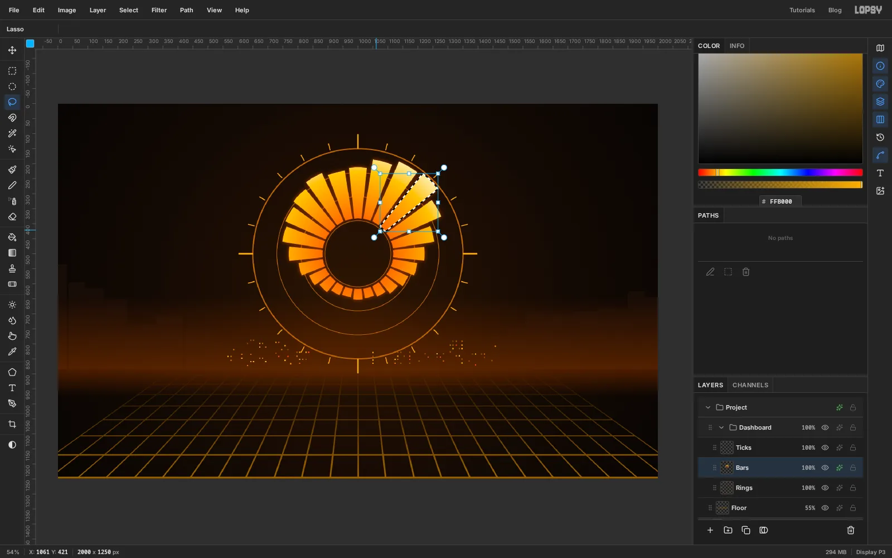

[[Cmd]]-click the *Bars* thumbnail to load every bar as a selection. Take the **Lasso**, hold [[Shift+Alt]] and draw a loose loop around the 03:00 wedge. Holding both keys keeps only the overlap, so you get a clean selection of that one bar however rough the loop is.

Drag a new **Radial** gradient from the centre to the outer ring, this time `#B81800` → `#FF3B1F` → `#FF9A6A`. Deselect. The one red bar is the point of the whole chart, and it will match a red readout on the right later.

## Draw the cup with the Pen

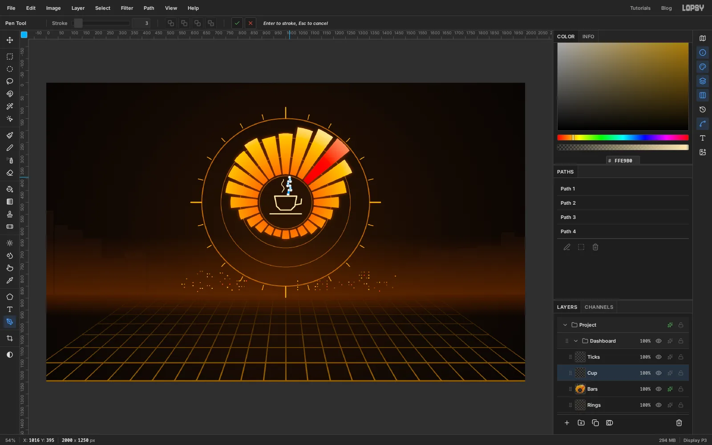

Add a layer called *Cup* and set the foreground to `#FFE9B0`. Take the **Pen** and set **Stroke** to **5**.

Click six points for the bowl of the cup: two for the rim, then down and around the base. Click the first point again to close the shape and press [[Enter]], which strokes the path in the foreground colour. Click four points for the handle and press [[Enter]], then two for the saucer and [[Enter]] again.

Set **Stroke** to **3** for the steam. This time drag a little as you place each of four points going upward. Dragging pulls curve handles out of the point, and nudging them left and right in turn gives the line its wobble. Press [[Enter]], then draw a second wisp beside it.

The last path stays highlighted in blue. Open the **Paths** panel and click its row to deselect it.

## Project the dial from the floor

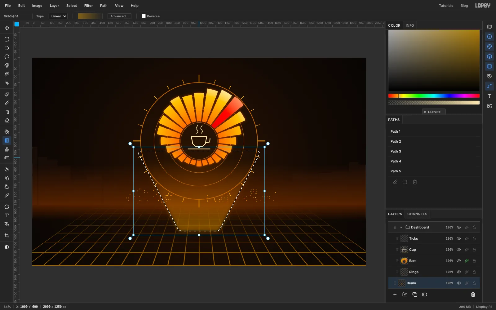

Click *Floor* and add a layer called *Beam*, so the light falls behind the dial.

With the **Lasso**, draw a tall trapezoid: narrow on the floor below the dial and as wide as the dial's middle at the top. Choose **Select → Feather…** and enter **24**. Drag a **Linear** gradient from the bottom of the selection to the top, from `#FFB000` at **42%** opacity to `#FF8A00` at **0%**. Deselect and set the layer to **Screen**.

## Add the projector ring

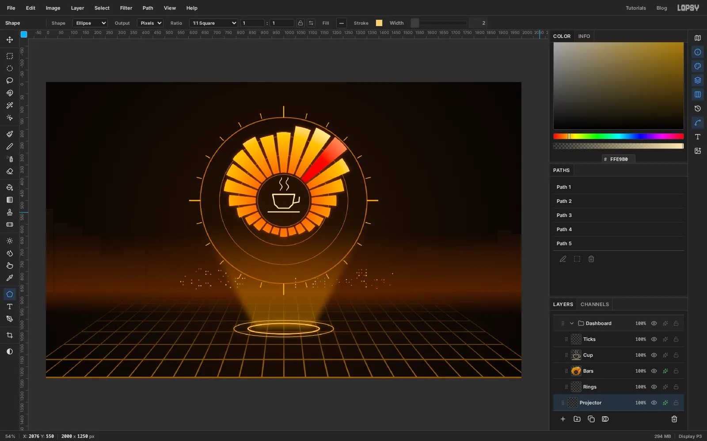

Add a layer called *Projector*. With the **Shape** tool still on **Ellipse** and no fill, set the stroke to `#FFD070` and **Width 4**. Click the floor at the foot of the beam and make an ellipse **300 × 44**. Change **Width** to **2**, click the same spot and make a second one **420 × 70**.

A circle seen from the side is a flat ellipse, so these two read as rings lying on the floor. Give the layer an **Outer Glow** of **Size 16**, **Opacity 70** in `#FF8A00`.

## Set the title

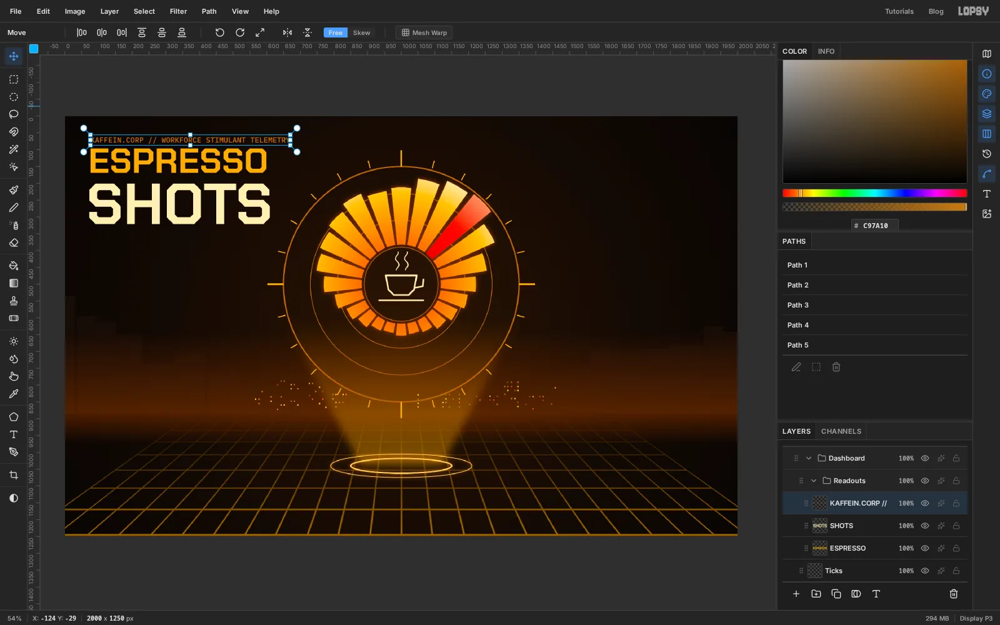

Click the *Dashboard* group and click **New Group** to make a second group inside it. Name it *Readouts*. All the type and the small charts go in here.

Type three lines with the **Text** tool and move each into the top-left corner:

- **ESPRESSO** in **Chakra Petch**, **Bold**, size **104**, colour `#FFB000`
- **SHOTS** in the same font at size **172**, colour `#FFF1B8`
- **KAFFEIN.CORP // WORKFORCE STIMULANT TELEMETRY** in **IBM Plex Mono**, **Medium**, size **22**, colour `#C97A10`

The two words have different lengths, so the sizes are chosen to make them the same width. Stack them with a small gap and line up their left edges, with the small line sitting just above.

## Slice a red ghost behind the title

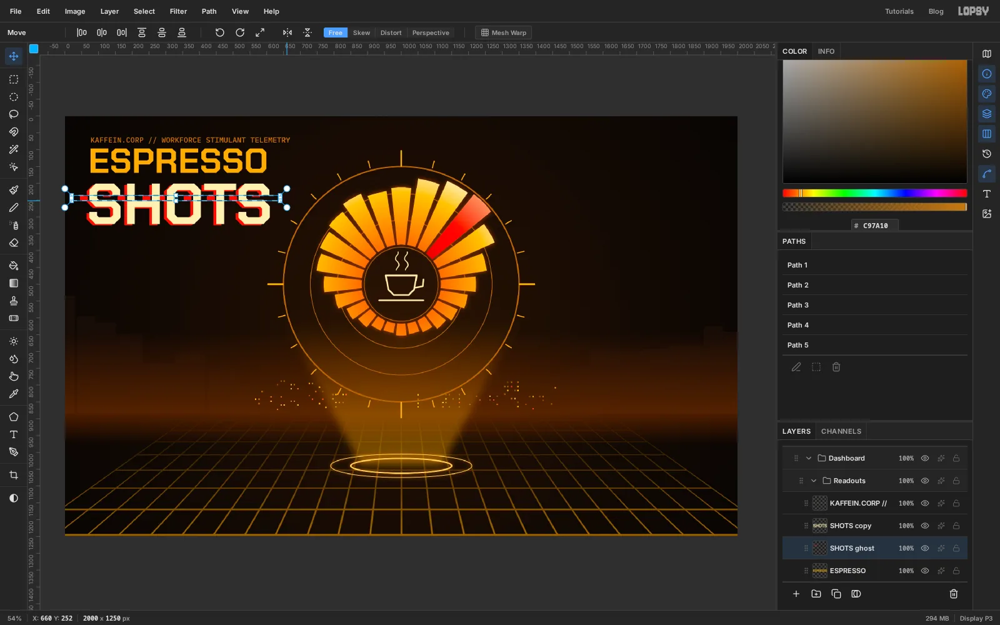

Click the *SHOTS* layer and choose **Layer → Duplicate Layer**. The copy lands on top, so work on the original underneath. Click it, and with the **Text** tool active click the **Text color** swatch in the options bar and enter `#FF3B1F`. Rename the layer *SHOTS ghost*.

Switch to the **Move** tool and tap [[←]] eight times and [[↓]] four times. A red edge appears down the left of every letter.

Click **Rasterize Layer** under the Layers panel, because the next part needs pixels. Drag a thin marquee across the upper part of the word, switch back to the **Move** tool and press [[Shift+←]] twice. Each press moves the selected strip 10 px, and the red slides out from behind the letters. Deselect.

## Finish the glitch

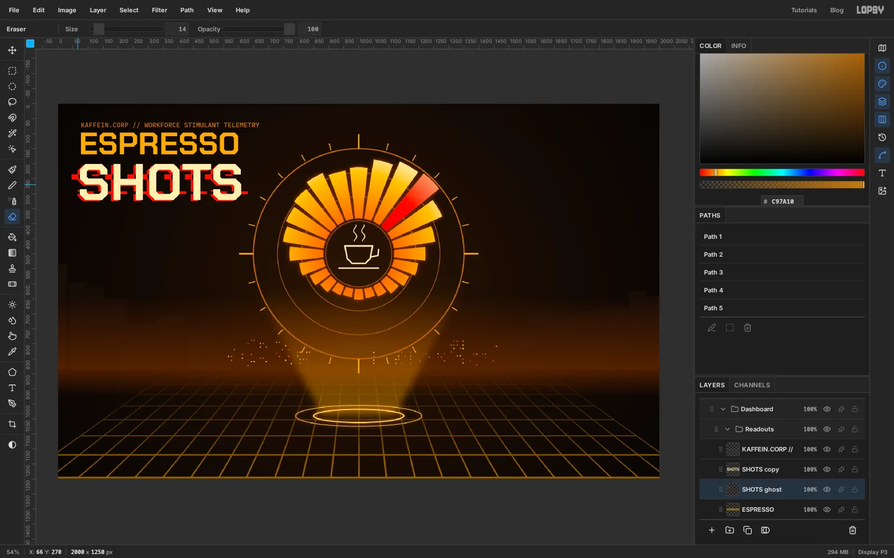

Drag a second, thinner marquee lower down, switch to the **Move** tool again and press [[Shift+→]] three times, then deselect. Two slices are enough. With the **Eraser** at **Size 14**, take a bite out of the red at the far left so the ghost isn't a perfect copy.

## Wrap a caption around the dial

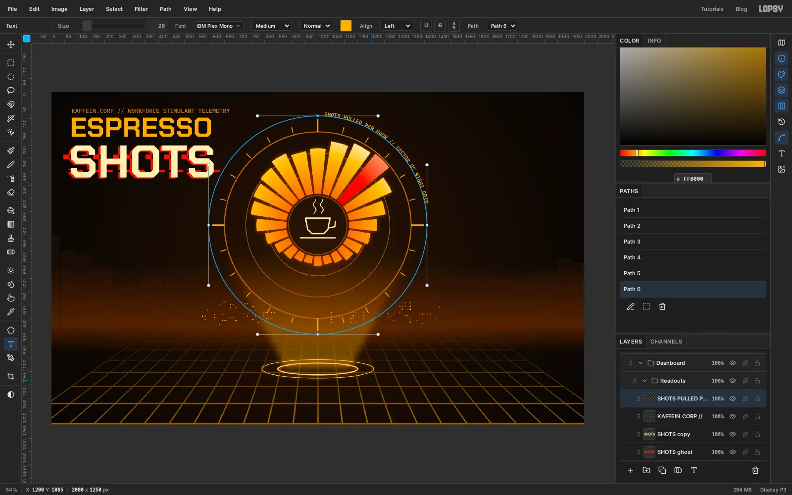

Text can follow any path, and the Shape tool can make paths. Pick the **Shape** tool, set **Output** to **Path**, hold [[Cmd]] to keep the shape a circle, and drag from the centre of the dial outward until it clears the long tick marks. Nothing is painted. The circle shows up in the **Paths** panel instead. Set **Output** back to **Pixels**.

Type **SHOTS PULLED PER HOUR // SECTOR 07 NIGHT GRID** in **IBM Plex Mono** Medium, size **20**, colour `#FFB000`, with two spaces in front. In the Text options bar, open the **Path** dropdown and choose the last path in the list. The line bends onto the circle, starting at the top and running clockwise. The two spaces move it clear of the 12 o'clock tick, and the caption is short enough to end before the tick at the right.

Deselect the path in the **Paths** panel.

## Label the hours and the scale

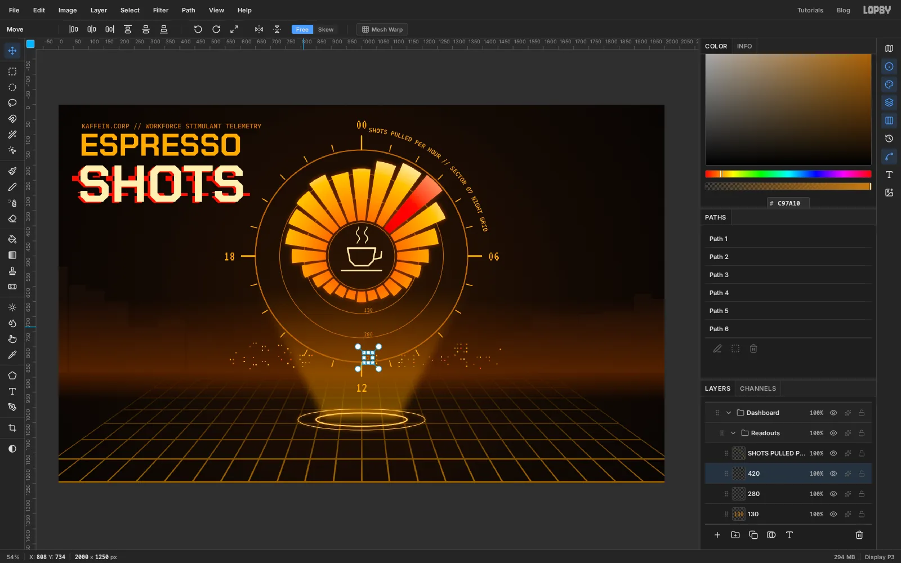

Type **00**, **06**, **12** and **18** in **VT323**, size **46**, colour `#FFB000`, and put one beyond each long tick. Keep the gap between tick and number the same on all four sides.

A radial chart needs a scale or the bars are only decoration. Type **130**, **280** and **420** in VT323 at size **24**, colour `#C97A10`, and sit each just inside its ring at the bottom of the dial, where the bars are shortest and leave room.

## Add the headline number and three small stats

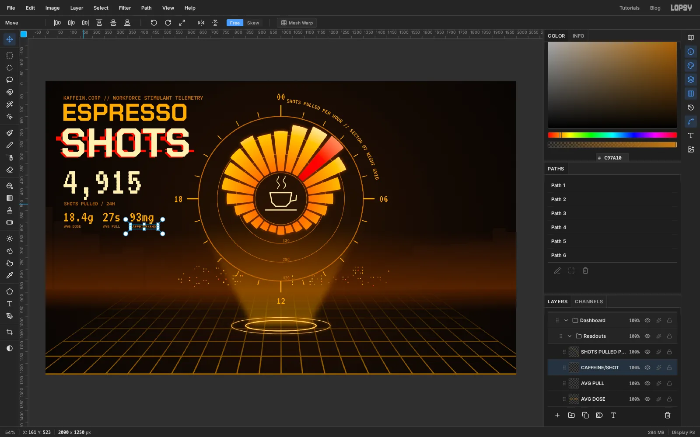

Under the title, type **4,915** in VT323 at size **170**, colour `#FFF1B8`. It's the sum of the 24 hourly values, so the board agrees with itself. Label it **SHOTS PULLED / 24H** in IBM Plex Mono Medium, size **20**, `#C97A10`.

Below that, type **18.4g**, **27s** and **93mg** in VT323 at size **64**, `#FFB000`, in a row with equal gaps between them. Give each a label in IBM Plex Mono at size **15**: **AVG DOSE**, **AVG PULL** and **CAFFEINE/SHOT**, with each label's left edge under its number's left edge.

## Rule the district chart with guides

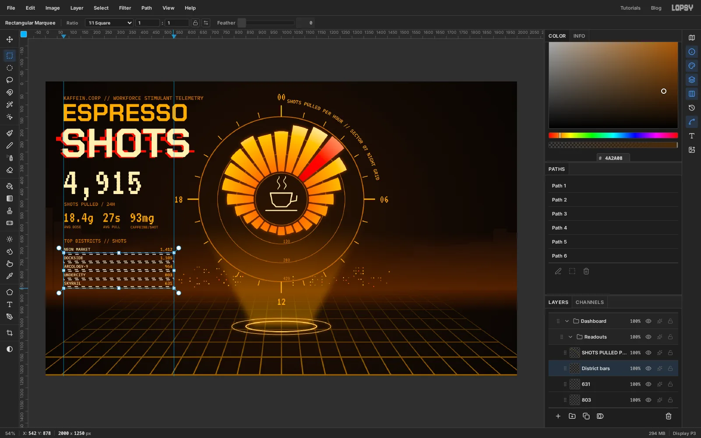

Type the heading **TOP DISTRICTS // SHOTS** (IBM Plex Mono, size **20**, `#C97A10`), then five names down the left in size **17**, colour `#FFE9B0`: **NEON MARKET**, **DOCKSIDE**, **ARCOLOGY-9**, **UNDERCITY** and **SKYRAIL**. Put their values at the right in `#FFB000`: **1,412**, **1,105**, **964**, **803** and **631**. Leave room under each row for a bar.

Click the top ruler above the left edge of the names, then above the right edge of the values. Each click drops a vertical guide.

Add a layer called *District bars*. With the **Rectangular Marquee**, drag a thin box under the first row from one guide to the other. You only need to get close, because the edges snap to the guides. Hold [[Shift]] and add a box under each of the other rows. Fill them with `#4A2A08`. These are the empty tracks.

## Fill the district bars

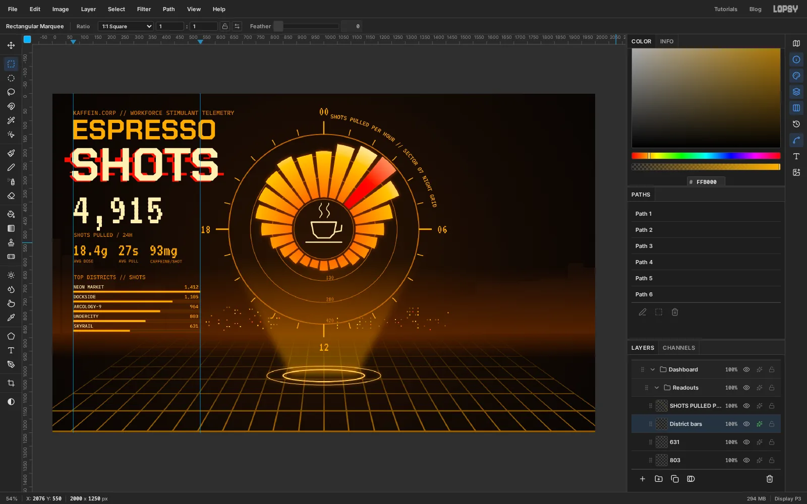

Deselect, set the foreground to `#FFB000`, and select five new boxes over the tracks, again with [[Shift]]. Start each on the left guide. The first runs the full width for 1,412 and the others stop in proportion: about 78%, 68%, 57% and 45% of the way across. Fill and deselect.

Give the layer an **Outer Glow** of **Size 8**, **Opacity 45** in `#FF6A00`. That's less than the dial gets, so the dial stays the brightest thing on the board.

## Build the pulse panel and its area

Add a layer called *Pulse panel*. With the **Shape** tool on **Rectangle**, set the fill to `#0D0703` at **70%** opacity and the stroke to `#B36A00`, **Width 2**. Click in the top-right corner and make a panel **450 × 310**.

With the **Pencil** at **Size 1** and `#5A3408`, [[Shift]]-click three horizontal gridlines across the panel, for 140, 100 and 60 beats a minute.

Add a layer called *Pulse area*. With the **Lasso**, trace the shape under the curve: high at the left where the night shift peaks, dipping to its lowest around midday, climbing again through the evening, then straight down the right side and back along the bottom gridline. Drag a **Linear** gradient down through it from `#FF8A00` at **55%** opacity to `#FF3B1F` at **0%**.

## Draw the line with the Pen

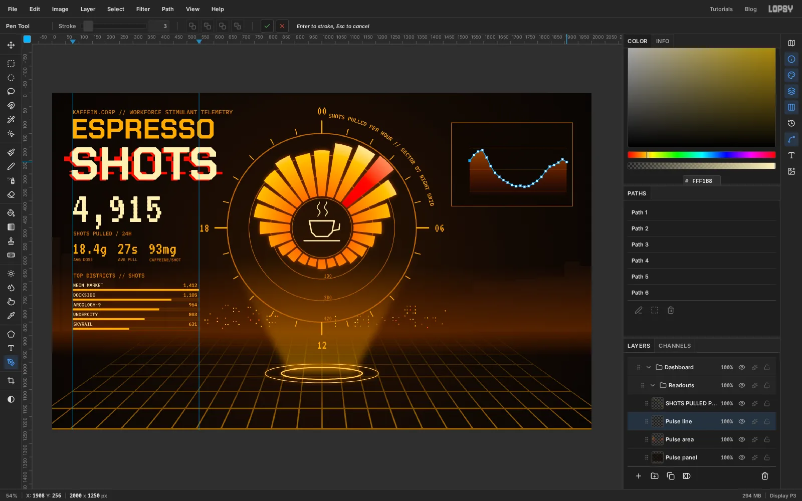

Deselect and add a layer called *Pulse line*. Set the foreground to `#FFF1B8`, take the **Pen** and set **Stroke** to **3**. Click along the top of the area from left to right, one point for each hour, then press [[Enter]] to stroke it. Deselect the path in the **Paths** panel.

Give the line an **Outer Glow** of **Size 10**, **Opacity 70** in `#FF8A00`.

## Label the panel

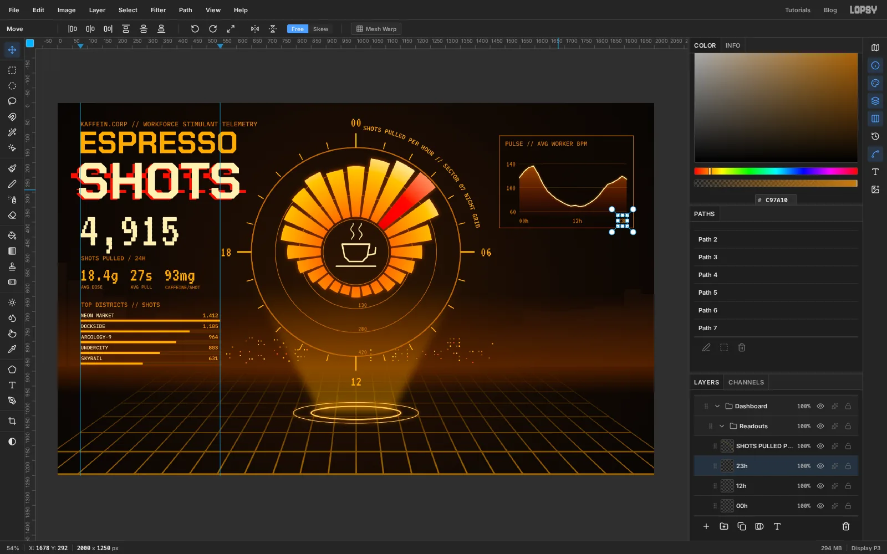

Type **PULSE // AVG WORKER BPM** in the panel's top-left corner (IBM Plex Mono, size **20**, `#C97A10`). In VT323 at size **26**, put **140**, **100** and **60** beside their gridlines, and **00h**, **12h** and **23h** under the plot. Line **00h** up with the left end of the curve and **23h** with the right end, and leave the same space below the labels as there is above the title.

## Add the hexagon meter and the peak readout

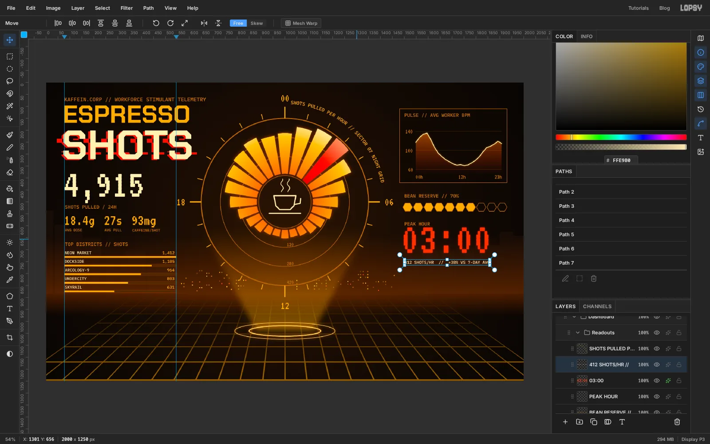

Type **BEAN RESERVE // 70%** under the panel in the label style. Add a layer called *Hex meter*, switch the **Shape** tool to **Polygon** and set **Sides** to **6**. Set the fill to `#FFB000` at full opacity (it is still at 70% from the panel) and keep the `#B36A00` stroke at **Width 2**. Click to make a **40 × 40** hexagon, then six more in a row, each 44 px along. Choose **Remove fill** and make three more, which come out as outlines. Seven of ten filled is 70%. Check that the row ends level with the right edge of the panel.

Under it, type **PEAK HOUR** as a label, then **03:00** in VT323 at size **190**, colour `#FF4A22`. Give it an **Outer Glow** of **Size 12**, **Opacity 45** in `#FF2A00`. Keep the glow small, because pixel type goes soft quickly. Finish with **412 SHOTS/HR  //  +38% VS 7-DAY AVG** in IBM Plex Mono at size **17**, `#FFE9B0`, tucked close under the digits.

The red here matches the red wedge on the dial, so the two read as one fact.

## Frame the board and skew the hazard stripes

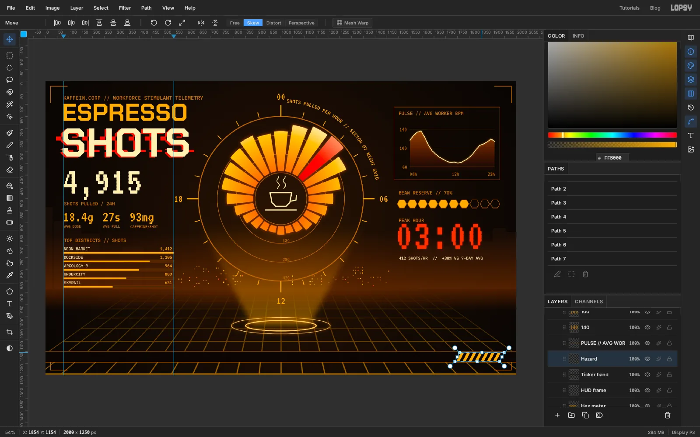

Add a layer called *HUD frame*. With the **Pencil** at **Size 3** and `#B36A00`, [[Shift]]-click an L-shaped bracket into each corner of the canvas, a little in from the edge.

Add a layer called *Ticker band*. Select a strip the full width of the canvas near the bottom and fill it with `#0A0502`. Deselect, then rule a **Size 2** pencil line along its top and bottom edges.

Add a layer called *Hazard*. At the right end of the band, select seven narrow upright bars with [[Shift]] and fill them with `#FFB000`. Deselect, drag one marquee around all seven, switch to the **Move** tool and click **Skew**. Drag the top-middle handle a short way to the right and the bars lean over into hazard stripes. Press [[Cmd+D]]. Check that the stripes end level with the right edge of the panel above.

## Write the ticker

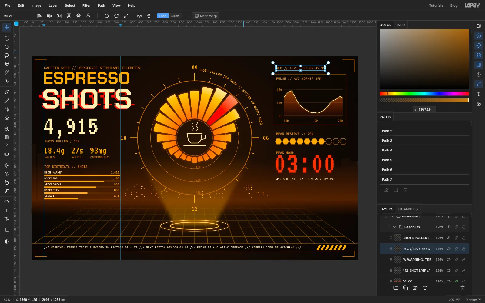

Click *Floor*, select everything below the band and press [[Delete]], so the grid stops at the ticker and the bottom brackets sit on clean black. Deselect, then click the top layer inside *Readouts*. New text lands just above the active layer, and the ticker has to sit above the band, not behind it.

Type the ticker in IBM Plex Mono Medium, size **18**, `#FFE9B0`:

**/// WARNING: TREMOR INDEX ELEVATED IN SECTORS 03 + 07 /// NEXT RATION WINDOW 04:00 /// DECAF IS A CLASS-C OFFENCE /// KAFFEIN.CORP IS WATCHING ///**

Centre it in the band's height and start it on the same left edge as the title. It should stop short of the stripes. Then type **REC // LIVE FEED 02:47:13** at size **20** in `#C97A10` above the pulse panel, level with the small line over the title.

## Seat the stamp text in its frame

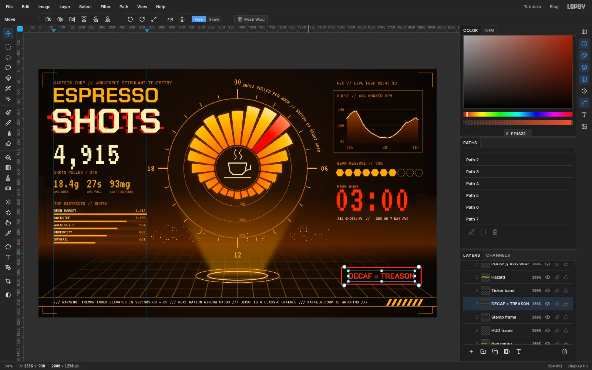

Add a layer called *Stamp frame*. With the **Shape** tool on **Rectangle**, set the fill to `#0A0502` at **75%** and the stroke to `#FF4A22`, **Width 5**, and make a box **400 × 84** on the floor at the lower right. The fill stops the grid showing through the lettering.

Type **DECAF = TREASON** in Chakra Petch Bold, colour `#FF4A22`. Size **38** leaves a comfortable margin at both ends. Move it until the space above the capitals matches the space below them, and the left and right margins match too.

## Rotate the stamp as a group

Click the text layer, [[Shift]]-click *Stamp frame* and choose **Layer → Group Layers**. Name the group *Stamp*.

With the group selected and the **Move** tool active, handles frame both layers. Drag just outside a corner to rotate the pair about **12°** anticlockwise, then press [[Cmd+D]]. The text stays live inside the rotated group, so you can still fix a typo.

## Distress the stamp

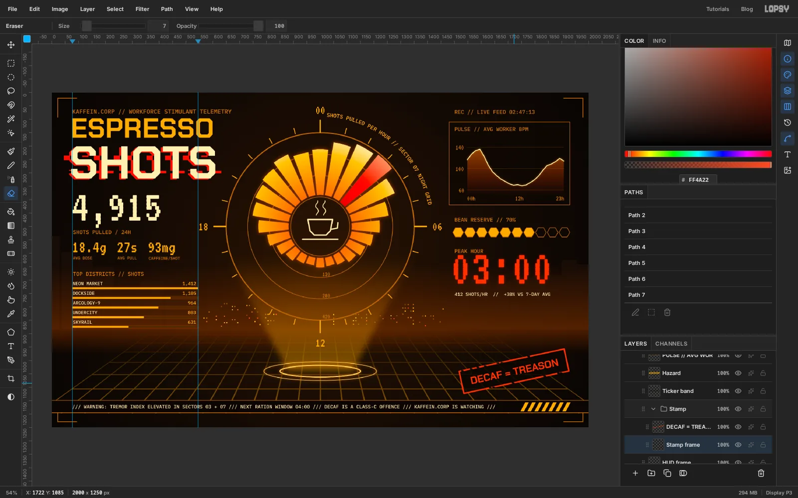

Click *Stamp frame* inside the group. With the **Eraser** at **Size 7**, dab a dozen short bites out of the outline, as if the ink didn't take everywhere.

## Add vertical katakana

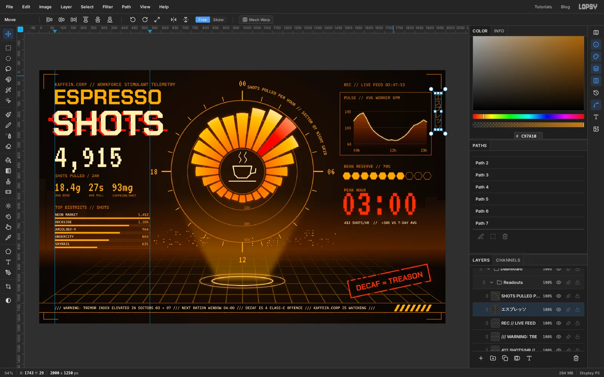

Type **エスプレッソ** (espresso) in **DotGothic16**, size **30**, colour `#C97A10`. With the layer active, click the **Vertical** toggle in the Text options bar, the stacked A over B. The characters stack downward. Move the column into the right margin beside the pulse panel, with its top level with the panel's top.

> **Tip:** Click the Vertical toggle off again before you type anything else, or your next line will come out stacked too.

## Grade the whole board

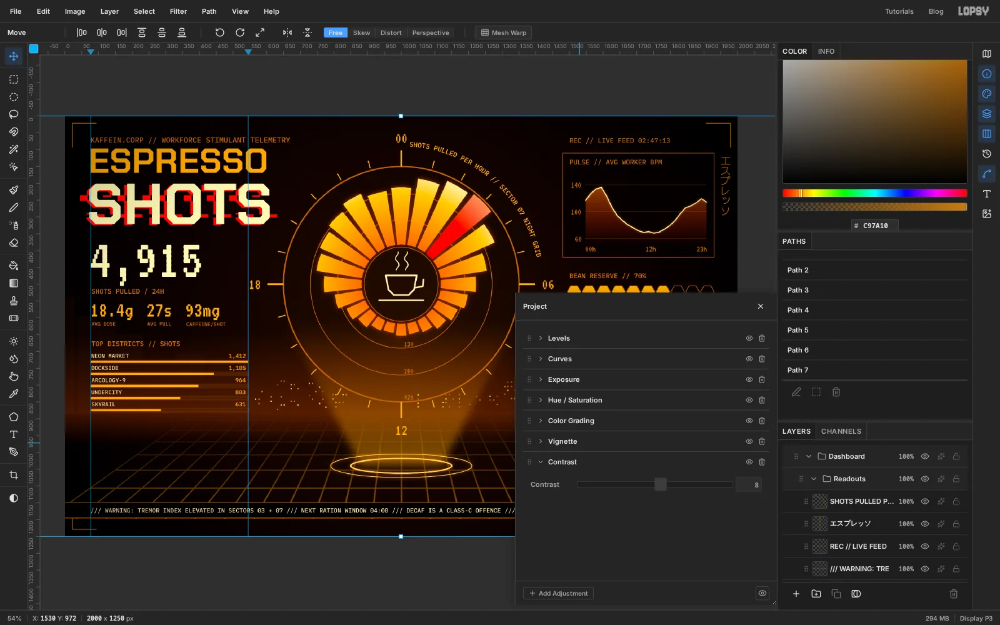

Choose **Layer → Adjustment Layer…**. Lopsy keeps adjustments on the *Project* group, where they apply to everything inside it without changing any pixels. Close the note that explains this. The drawer already lists Levels, Curves, Exposure, Hue / Saturation and Color Grading, all neutral; leave them alone. Click **Add Adjustment**, choose **Vignette** and set it to **40**. Add **Contrast** and set it to **8**. Close the drawer.

The vignette pulls the corners down so the eye stays on the dial.

## Make scanlines from a tiny pattern

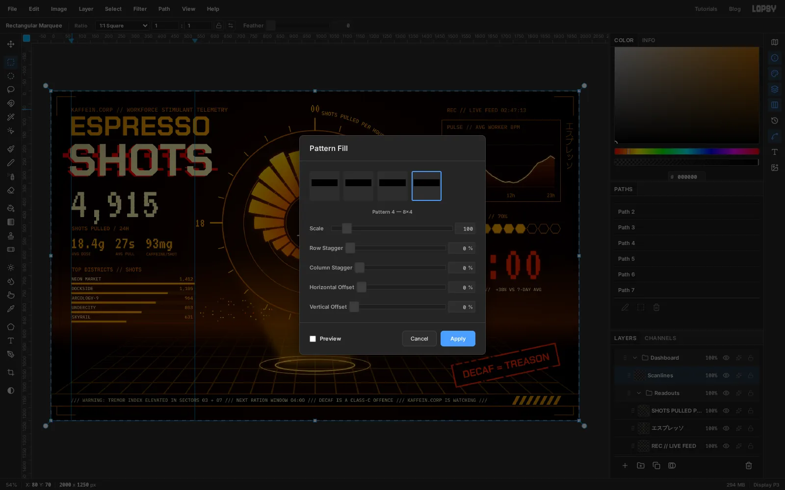

Click the *Dashboard* group and add a layer called *Scanlines*.

With the **Rectangular Marquee**, click once in the canvas without dragging. A dialog asks for the corners: enter **0, 0** to **8, 2** and click **Select**. Fill that sliver with black and press [[Cmd+D]]. Click once more and select **0, 0** to **8, 4**, which is the black strip plus the same height of nothing below it. Choose **Edit → Define Pattern**.

Press [[Cmd+A]], choose **Edit → Fill with Pattern…**, pick the new tile (it's the last one if you've defined patterns before) and click **Apply**. Deselect and lower the layer to **22%**.

## Add grain

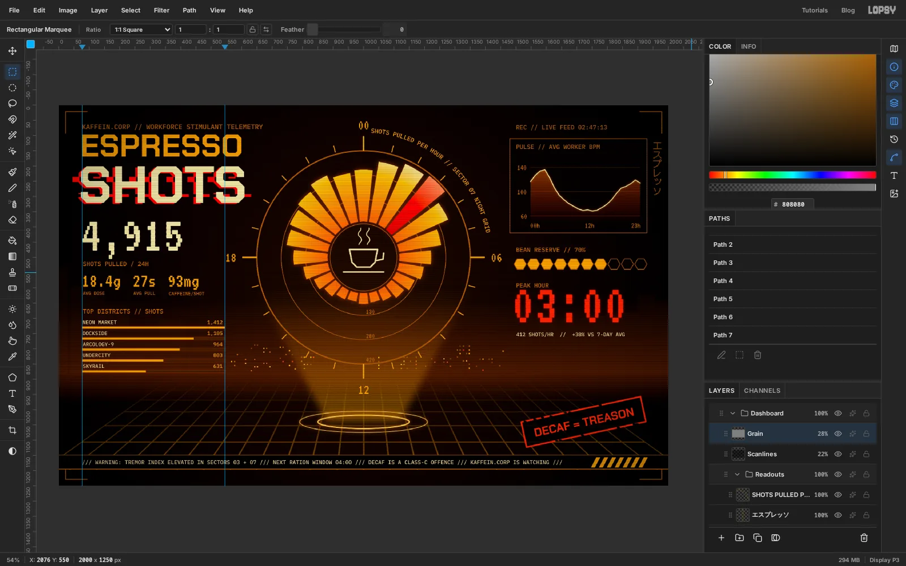

Add a layer called *Grain*. Press [[Cmd+A]], fill it with `#808080` and deselect. Choose **Filter → Add Noise…**, set **Amount** to **30**, choose **Mono** and click **Apply**. Set the layer to **Overlay** at **28%**. Mid-grey disappears in Overlay, so only the speckle is left.

## Finish with a bloom pass

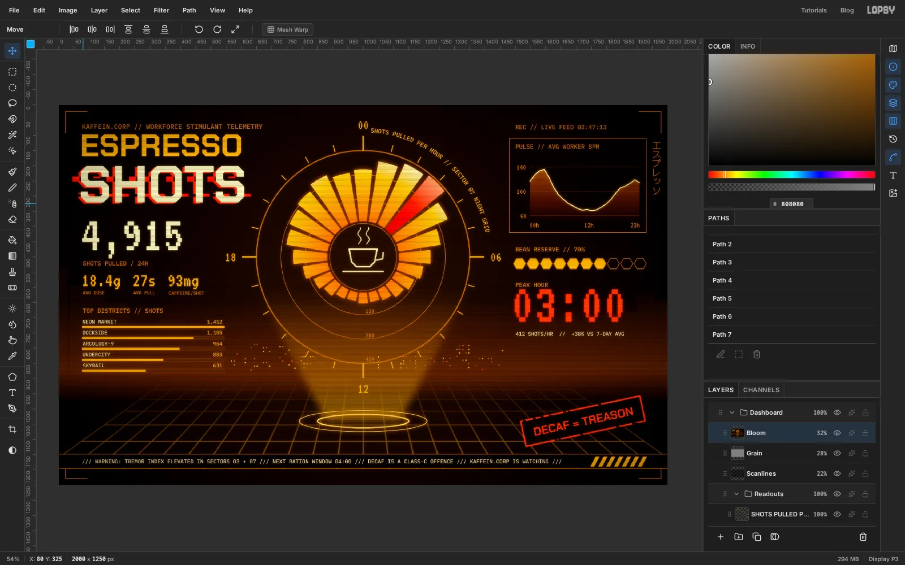

Press [[Cmd+A]], choose **Edit → Copy Merged** and press [[Cmd+V]]. You get a flat copy of the whole picture on a new layer. Deselect and rename it *Bloom*. Choose **Filter → Gaussian Blur…** with **Radius 14**, then set the layer to **Screen** at **32%**. Every bright thing now bleeds a little into the dark around it, the way a tube monitor does.

Choose **Edit → Clear Guides**, then **File → Quick Export PNG**.

To make the board your own, change the 24 numbers first. Redraw the wedges, move the red to your new peak, and update the total and the peak readout so the board still adds up.
