Cyberpunk lives at night, in the rain, under signs you can't quite read. As an interface style it borrows that mood and keeps the screens themselves clean:

- **neon on near-black**: hot magenta and electric cyan, with one acid yellow saved for the thing you should tap
- **glow everywhere it matters**: soft halos on type, routes and buttons, as if the light bleeds into wet air
- **glitch as decoration**: chromatic fringes and sliced, shifted letterforms
- **holograms and wireframes**: objects drawn as thin glowing lines instead of solid shapes

In this tutorial you'll use all four for **Night Cab**, a made-up robotaxi app for a city that never stops raining. The left column is the pitch. The centre phone shows a map with your cab's route, and a second, tilted phone shows the ride in progress with a hologram of the car. The board is **1600 × 1200 px**.

You'll need two photos from Wikimedia Commons, both released into the public domain (**CC0**):

- **Shinjuku - Shinjuku255.jpg** by lumoplank, a night street in Shinjuku covered in neon signs. Download the 1920 px version.
- **1991 Holden Caprice (VQ) armoured car side.jpg** by Epsom Rd Studios, a sedan photographed side-on against white. Download the 1920 px version.

The tools you'll use:

- **Color LUT**, **Gaussian Blur**, **Bloom** and the **Burn** tool to turn a busy photo into soft neon bokeh
- **Add Noise**, **Threshold** and **Motion Blur** to make rain
- **Chromatic Aberration** and arrow-key nudges on thin marquees for a glitch
- the **Shape** tool, with corner radius and its click-for-exact-size dialog, for phones, pills and rings
- the **Brush**, **Pencil**, **Pen**, **Gradient** and **Eraser** tools
- the **Magic Wand** and **Find Edges** to turn a car photo into a wireframe
- [[Cmd]]-click on a layer thumbnail, **Select → Inverse**, **Feather** and the **Elliptical Selection** dialog
- rotating and scaling with the Move tool's handles, on one layer, on two layers at once, and on whole groups
- layer effects (**Drop Shadow**, **Stroke**, **Inner Glow**, **Outer Glow**, **Color Overlay**) and the **Multiply**, **Screen** and **Lighten** blend modes
- **Copy Merged** for a final glow pass

The palette is violet night with neon accents:

- Night `#090616`, violet grade `#6B3FD9`
- Neon magenta `#FF2BD6`, electric cyan `#19E8FF`, acid yellow `#E8FF3A`
- Ice white `#EEF4FF`, muted lilac `#8C93C8`, label lilac `#B8B0D8`
- Phone body `#15132A`, rim `#4A4677`, screen `#070A19`, sheet `#120D2A`
- Map streets `#1D3F7A`, alleys `#142A55`, canal `#12335E`
- Track `#2A2456`, toast card `#1B1340`, search pill `#141A36`, grab handle `#3A3566`
- Pill outline `#2C4D7A`, toast outline `#4B3A8C`, bezel glow `#8C88D0`, home bar `#8F93BF`, map labels `#6E7CC0`

The type is five Google fonts: **Tektur** for the headline and buttons, **Oxanium** for numbers, **Rajdhani** for sentences, **Share Tech Mono** for small labels, and **DotGothic16** for the katakana.

> **Note:** Shortcuts are written for a Mac. On Windows use [[Ctrl]] wherever it says [[Cmd]].

> **Tip:** You don't have to hit exact sizes by dragging. Click once with the **Shape** tool, without dragging, and a dialog asks for the Width and Height. The shape is centred where you clicked. Click once with a **Marquee** and a dialog asks for the From and To corners.

> **Tip:** New text starts where you click, but a click inside an existing line of text edits that line instead. When two lines are stacked close together, type the lower one first, or type in empty space and move the text into place afterwards.

## Set up the board and drop in the street photo

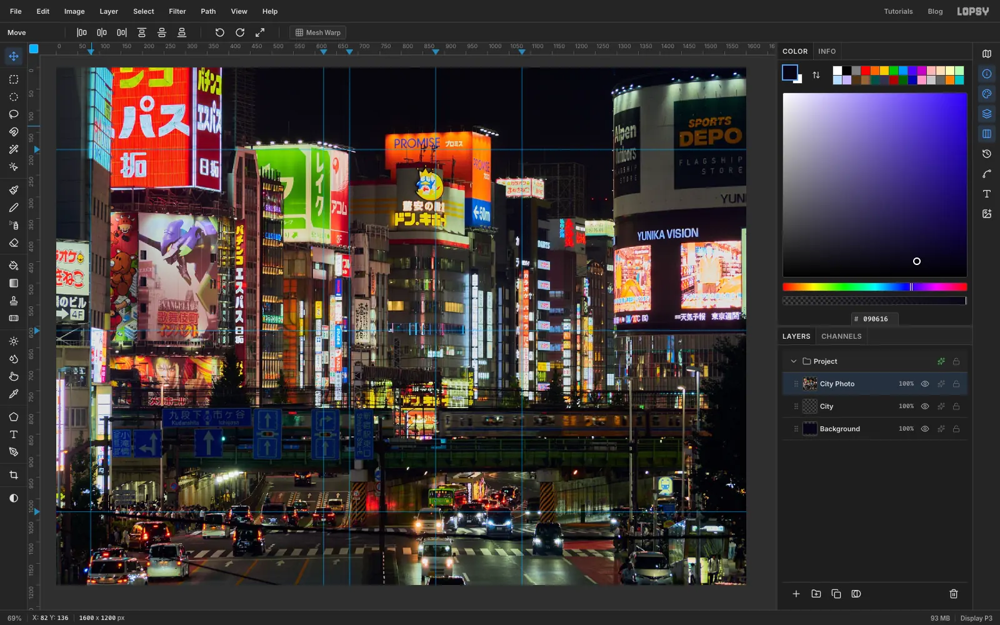

Choose **File → New** and make a document **1600** wide and **1200** high. Click the top ruler at **80**, **620**, **680**, **880** and **1080** to drop vertical guides, and the left ruler at **190**, **610** and **1030** for horizontal ones. The first two vertical guides frame the left column of type. The rest mark the edges and centre of the first phone.

A new document keeps all its layers inside a group called *Project*, with a *Background* layer and an empty *Layer 1*. Click *Background*, set the foreground to `#090616` and choose **Edit → Fill**.

Drag the Shinjuku photo from your desktop onto the canvas. Lopsy puts it on a new layer, scales it to fit the canvas (it's the same 4:3 shape) and selects it. Press [[Cmd+D]] and rename the layer *City Photo*. The empty layer underneath it (renamed *City* in the screenshot) isn't needed, so click it and delete it with the bin button under the Layers panel.

## Push the photo into neon

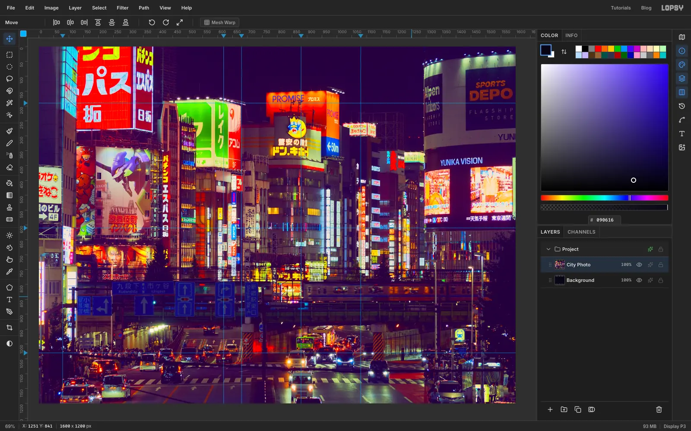

Choose **Filter → Color LUT…**, click the **Cyberpunk** preset and leave **Intensity** at **100%**. Click **Apply**.

A LUT is a colour lookup table. It remaps every colour in the photo at once, the way a film grade does. This one pushes highlights towards pink and shadows towards violet, which gets you most of the way to the cyberpunk palette in one click.

## Melt it into bokeh

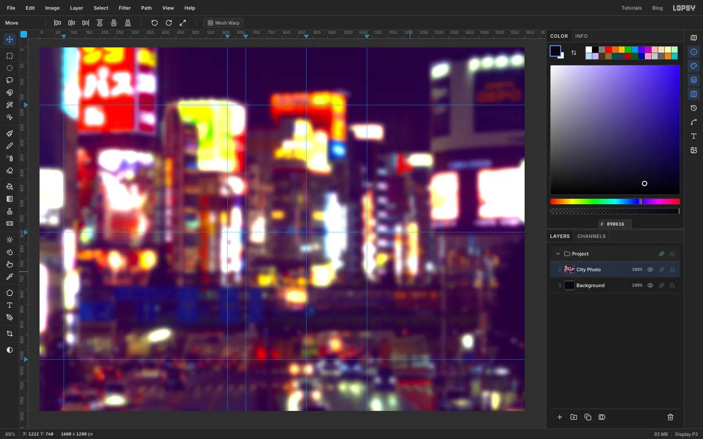

The phones are the subject, so the city should be atmosphere, not detail. Choose **Filter → Gaussian Blur…** with **Radius 22**. The signs dissolve into soft blobs and none of their lettering can be read any more.

Then choose **Filter → Bloom…** with **Threshold 55**, **Soft Knee 60**, **Radius 28** and **Intensity 130**. Bloom picks out only the brightest areas and adds a glow around them, so the lights look as if they're shining through wet air.

## Burn down the hot spots

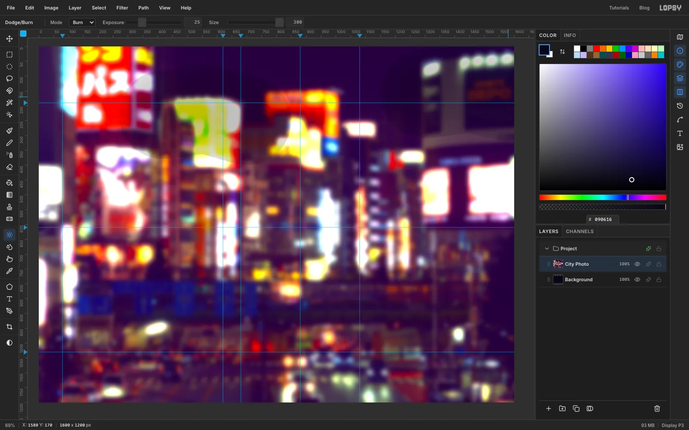

A couple of blobs are bright enough to fight the type that will sit over them. Pick the **Dodge** tool (O). In the options bar set the mode to **Burn**, **Exposure 25** and **Size 300**.

Make one slow sweep just under the top guide, from the middle of the left column across to the first phone guide. That's behind the right half of the headline, where the brightest red and yellow signs are. Then make one sweep across the bright block of signs in the top-right corner. Burn darkens what you paint over, a little more with each pass, so stop at one pass each.

## Grade it violet and shade the left side

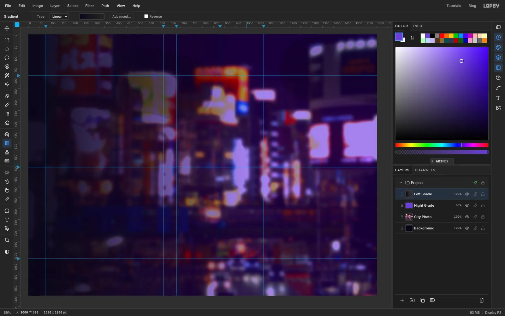

Click **Add Layer** and name it *Night Grade*. Fill it with violet `#6B3FD9`, then set its blend mode to **Multiply** and its opacity to **65%**. On Multiply, the violet tints everything below it without hiding it.

Add another layer called *Left Shade*. Pick the **Gradient** tool, set **Type** to **Linear** and click **Advanced…**. Set both stops to `#090616`, then give the left stop **92%** opacity and the right stop **0%**. Click **Done**. Drag horizontally across the middle of the canvas from about x 120 to x 1000. The left side, where the headline and body copy will go, fades to almost black.

## Make rain

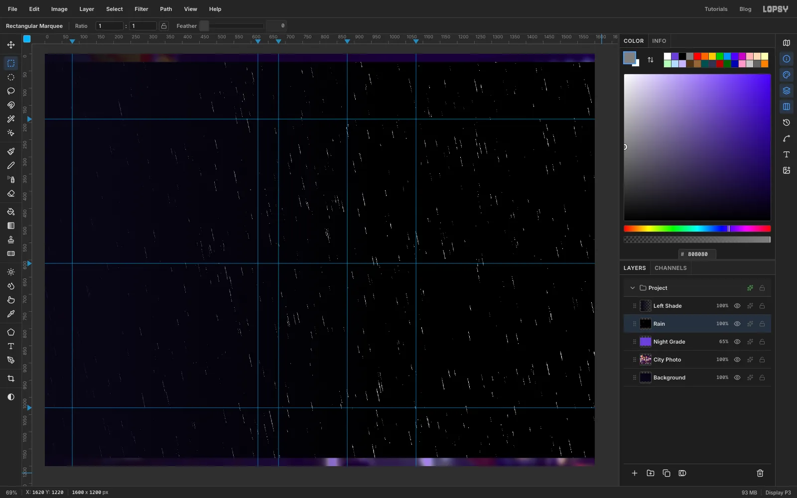

Click *Night Grade* and add a layer called *Rain*. It lands between the grade and the shade, so the shade will dim the rain behind the copy later. Fill it with mid-grey `#808080`.

Rain takes four filters:

1. **Filter → Add Noise…**: **Amount 100**, **Mono**, **Gaussian**. The grey turns to static.
2. **Filter → Gaussian Blur…** with **Radius 1**, then **Filter → Threshold…** with **Level 168**. Only the brightest specks survive as small white dots, about one pixel in two hundred.
3. **Filter → Motion Blur…**: **Angle 78**, **Distance 40**. Each dot is smeared into a faint, slanted streak.
4. **Filter → Threshold…** again, this time with **Level 12**. The faint streaks snap back to crisp white lines.

Motion Blur repeats the pixels at the canvas edge, so the top and bottom rows end up with a few smeared wedges. Draw a marquee across the full width of the top 24 px, press [[Delete]], do the same at the bottom, and deselect.

## Screen the rain

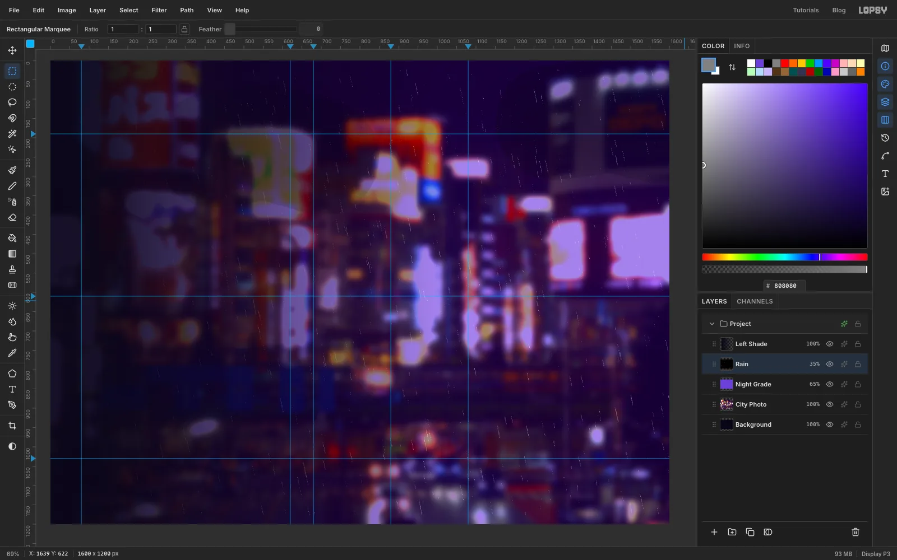

Set the *Rain* layer's blend mode to **Screen** and its opacity to **35%**. Screen drops out the black, so only the white streaks show. At 35% they read as fine rain rather than scratches. Because the layer sits under *Left Shade*, the rain fades out on the left.

## Set the headline

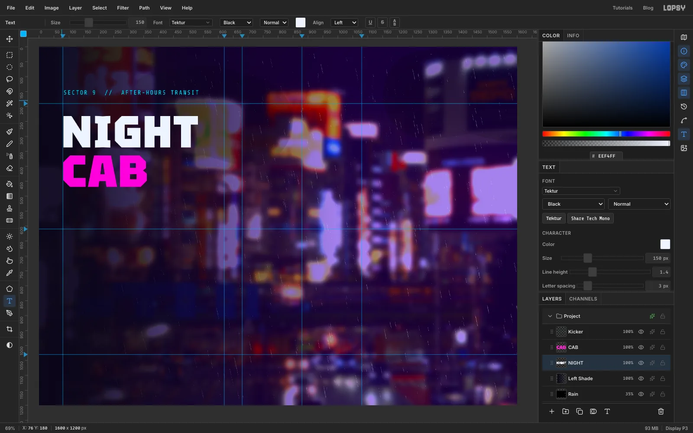

Click *Left Shade* so new type stacks above it. Pick the **Text** tool. Set **Share Tech Mono**, **Size 20**, colour cyan `#19E8FF`, and click at the top of the left column, just inside the first guide (about x 82, y 140). Type `SECTOR 9  //  AFTER-HOURS TRANSIT` and press [[Tab]] to finish. Name the layer *Kicker*, then open the **Text** panel and set **Letter spacing** to **3**.

The two headline words are big and close together, so type the lower one first. Click *Left Shade* again, set **Tektur**, weight **Black**, **Size 150** and colour `#FF2BD6`. Click just inside the first guide, about two thirds of the way down to the middle guide, type `CAB` and press [[Tab]]. Name it *CAB*. Then click *Left Shade*, set the colour to ice white `#EEF4FF` and click just inside the first guide, level with the top horizontal guide, for `NIGHT`. Name it *NIGHT*. The word spans most of the column, leaving a little air before the second guide.

New text picks up the settings of the last text you set, so both words keep the Kicker's 3 px letter spacing. That's fine here: a little tracking suits a wide display face.

## Glitch CAB

Keep the live text and glitch a copy. Click *CAB* and choose **Layer → Duplicate Layer**. Name the copy *CAB Glitch* and click **Rasterize Layer** at the bottom of the Layers panel.

Choose **Filter → Chromatic Aberration…** with **Amount 3** and **Direction 0**. It pulls the red and blue channels a few pixels apart, the classic fringe of a cheap screen.

Now slice it. Draw a thin **Rectangular Marquee** right across the word, wider than the letters, about 20 px tall and near the top. Press **V** for the Move tool and slide the strip **18 px** to the right: press [[Shift+Right]] once (10 px) and then [[Right]] eight times (1 px each). Then do two more strips the same way:

- a strip about 14 px tall through the middle of the word, moved **14 px left** ([[Shift+Left]] once, then [[Left]] four times). The screenshot shows this one selected, after the first strip has moved.
- a strip about 16 px tall through the lower third, moved **10 px right** ([[Shift+Right]] once)

Press [[Cmd+D]] when you're done.

## Make the headline glow

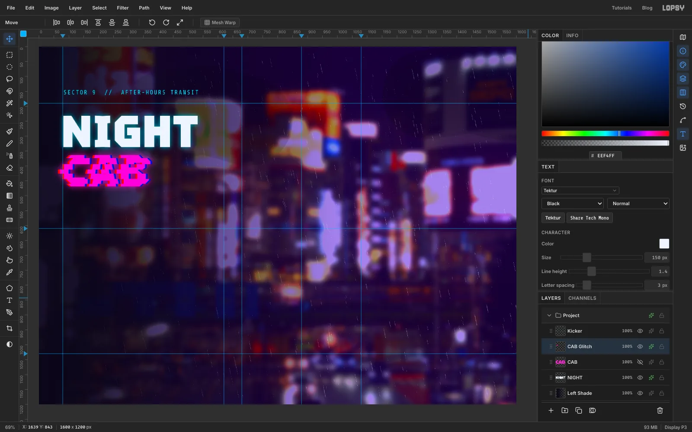

Click *NIGHT*, open its effects with the sparkle button on its row and turn on **Outer Glow**: colour `#19E8FF`, **Size 26**, **Spread 0**, **Opacity 70**. Give *CAB Glitch* an **Outer Glow** in `#FF2BD6`, **Size 30**, **Opacity 75**.

Hide the original *CAB* with its eye button. It stays in the file as an editable backup.

## Add the katakana, tagline and body copy

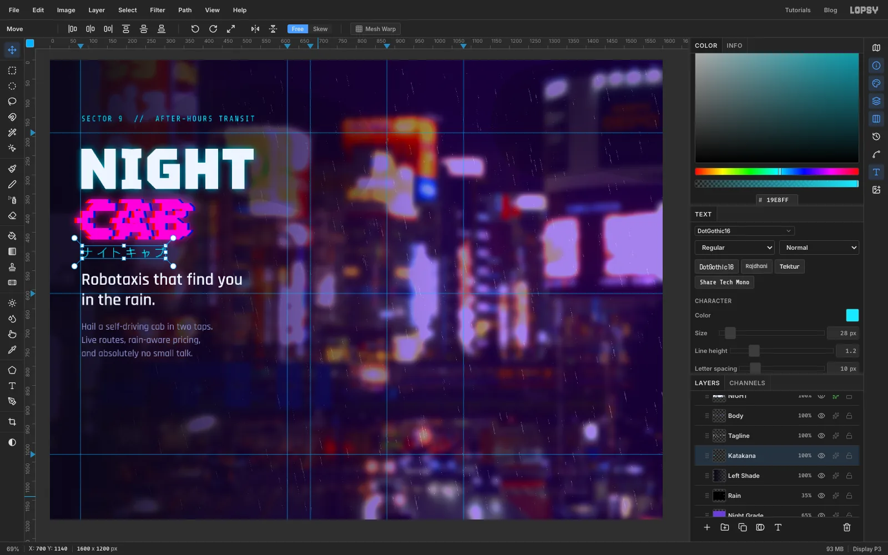

Work from the bottom up again. Click *Left Shade*, set **Rajdhani**, weight **Medium**, **Size 25**, colour `#8C93C8` and **Letter spacing 0**. Click just inside the first guide, a little more than halfway down the canvas (about y 680), and type the body copy on three lines, pressing [[Enter]] between them:

`Hail a self-driving cab in two taps.` / `Live routes, rain-aware pricing,` / `and absolutely no small talk.`

Name it *Body*. Then click *Left Shade*, set **SemiBold**, **Size 44** and `#EEF4FF`, click about 130 px above the body copy and type `Robotaxis that find you` [[Enter]] `in the rain.` Name it *Tagline* and set **Line height** to **1.2** in the Text panel, so the two lines hold together.

For the katakana, click *Left Shade*, set **DotGothic16**, **Size 28**, cyan `#19E8FF`, and click somewhere empty, such as the bottom of the canvas. Paste or type `ナイトキャブ` ("night cab"), press [[Tab]], name it *Katakana* and set **Letter spacing** to **10**. Then press **V** and drag it, finishing with the arrow keys, so it lines up with the left edge of the text column about 22 px under CAB.

## Add the stats row

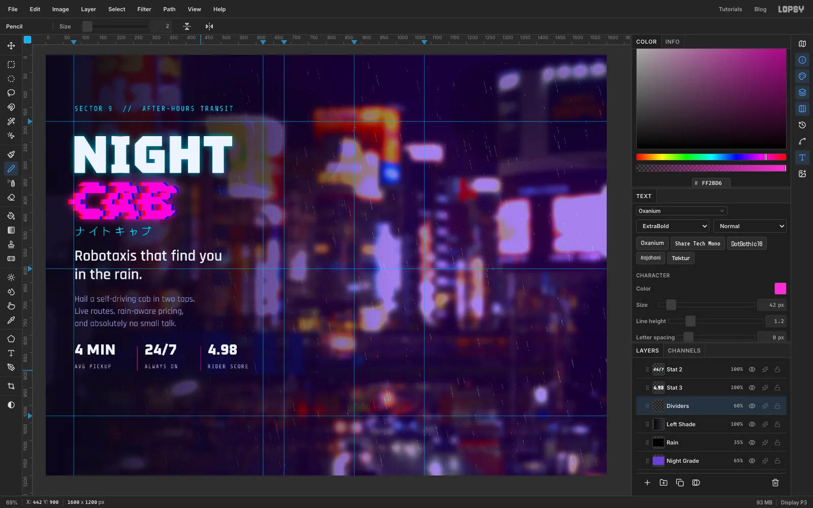

The labels go in first because they sit lower. Click *Left Shade*, set **Share Tech Mono**, **Size 16**, `#B8B0D8` and **Letter spacing 2**. Type `AVG PICKUP` at about x 82, y 880, `ALWAYS ON` at x 282 and `RIDER SCORE` at x 462, clicking *Left Shade* before each one.

Then the numbers: **Oxanium**, weight **ExtraBold**, **Size 42**, `#EEF4FF`. Type `4 MIN`, `24/7` and `4.98` at the same three x positions, at y 818. Oxanium's 7 and 4 are plain and easy to read, which matters for data.

For the dividers, add a layer called *Dividers*. Pick the **Pencil** at **Size 2** with magenta `#FF2BD6`. Click at x 262 level with the top of the numbers and [[Shift]]-click straight below it, level with the bottom of the labels. That draws a straight line. Do the same at x 442, then set the layer's opacity to **60%**.

## Draw two pill buttons

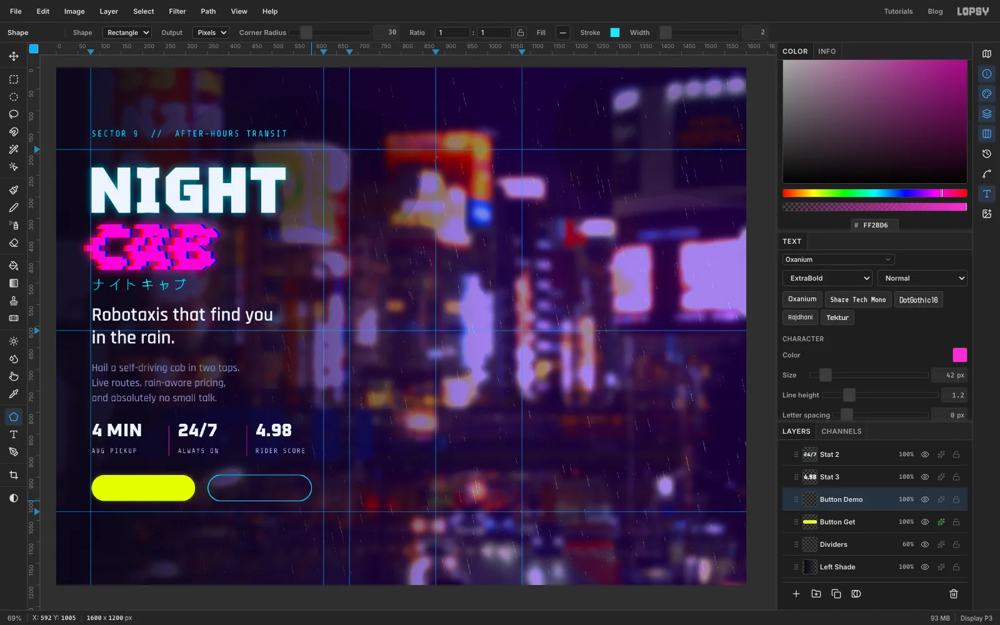

Add a layer called *Button Get*. Pick the **Shape** tool and set **Shape** to **Rectangle**, **Output** to **Pixels** and **Corner Radius** to **30**. Click the **Fill** swatch and type `E8FF3A`. If there's a stroke, click its swatch and **Remove stroke**.

Shapes grow outwards from their centre, which is where you press. Press at the centre of where the first button goes, about 120 px in from the first guide and 75 px below the stat labels, and drag out until the pill is **240 × 60**. A corner radius of half the height turns a rectangle into a pill. Give it an **Outer Glow** in `#E8FF3A`, **Size 16**, **Opacity 30**. Keep the glow small. A big yellow halo on violet turns muddy.

Add a layer called *Button Demo*. Remove the fill, set the stroke to cyan `#19E8FF` with **Width 2**, and drag another 240 × 60 pill from a point 270 px to the right of the first one's centre, leaving a 30 px gap between them.

## Label the buttons and add a footer

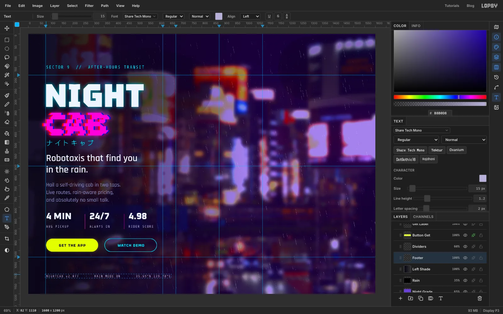

Type each label in empty space, then move it into its pill. Set **Tektur**, weight **Bold**, **Size 17**, **Letter spacing 2**. Type `WATCH DEMO` in cyan and `GET THE APP` in night `#090616`. Press **V** and drag each label into the middle of its pill, then nudge it with the arrow keys until the space above and below the letters is equal and the space on the left matches the space on the right.

Finish the column with a footer: **Share Tech Mono**, **Size 15**, `#B8B0D8`, **Letter spacing 2**, at about x 82, y 1110: `NIGHTCAB v2.077   ·   RAIN MODE ON   ·   35.69°N 139.70°E`.

## Draw the first phone from the guides

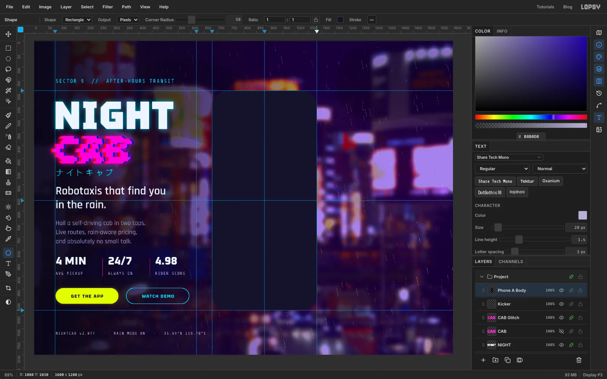

Click *Kicker*, the top layer, and add a layer called *Phone A Body*. Pick the **Shape** tool: **Rectangle**, **Corner Radius 58**, no stroke, fill `#15132A`.

Press exactly where the middle vertical guide crosses the middle horizontal guide, and drag to where the right guide crosses the bottom guide. Shapes snap to guides, so you get a 400 × 840 body standing precisely in its frame.

## Add the bezel effects and the screen

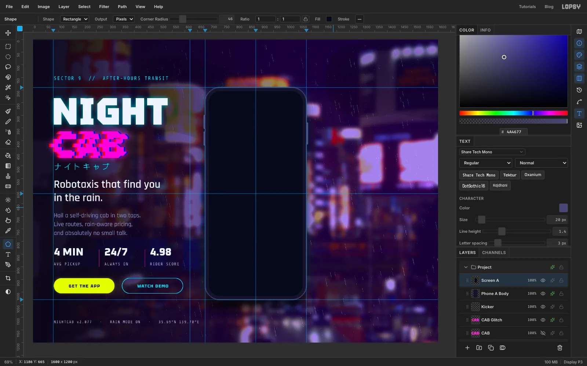

First the side buttons. Set the foreground to the rim colour `#4A4677`. Still on *Phone A Body*, draw three thin marquees just outside the body and choose **Edit → Fill** for each: one 5 px wide and about 84 px tall on the right edge, a third of the way down, and two shorter ones on the left edge for the volume keys. Because they're on the body's layer, they pick up its effects too.

Open *Phone A Body*'s effects and turn on four of them:

- **Drop Shadow**: black, **Offset X 0**, **Offset Y 40**, **Blur 60**, **Opacity 75**
- **Stroke**: `#4A4677`, **Width 2**, for a metal rim
- **Inner Glow**: `#8C88D0`, **Size 6**, **Opacity 60**, a soft highlight just inside the edge
- **Outer Glow**: cyan, **Size 50**, **Opacity 22**, the light of the city catching the phone

Add a layer called *Screen A*. Set the fill to `#070A19` and **Corner Radius** to **46**. Click once, without dragging, on the centre guide crossing. In the dialog type **372** × **812** and click **Create**. The screen sits exactly 14 px inside the body all the way round.

## Paint a street grid

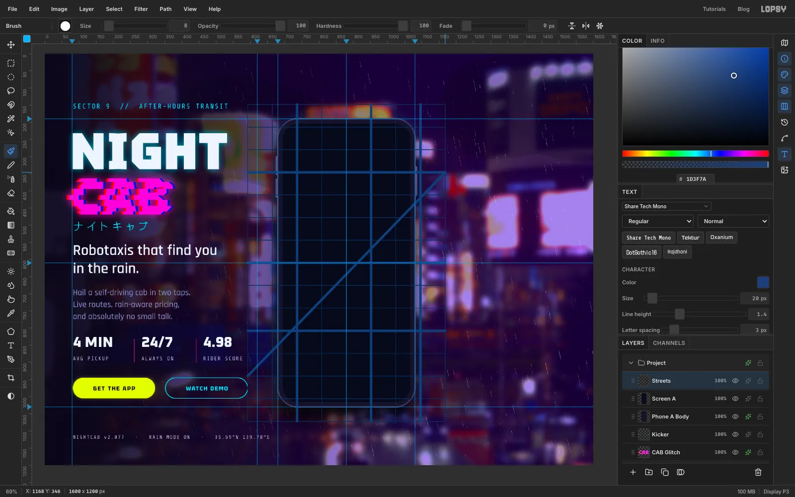

Add a layer called *Streets*. Pick the **Brush** and, in the Brushes panel, set **Hardness 100** and **Spacing 10** for clean lines.

The grid is drawn straight and much bigger than the phone, because it gets rotated and trimmed afterwards. Make it spill well past the phone on every side. Every line is a click at one end and a [[Shift]]-click at the other:

1. **Alleys.** Set **Size 3** and `#142A55`. Rule nine evenly spaced vertical lines, **72 px** apart, with the middle one on the phone's centre guide. Run them from just under the top of the canvas to just above the bottom. Then rule fifteen horizontal lines **66 px** apart, the middle one on the centre guide, across the same width.
2. **Avenues.** Set **Size 8** and `#1D3F7A`. Paint over three of the vertical lines (the second line left of the centre guide, the first line right of it, and the second line in from the right edge) and three of the horizontal ones (the middle one, one four blocks up and one three blocks down). Irregular spacing reads more like a real city.
3. **A boulevard.** Still at Size 8, draw one long diagonal from near the bottom-left corner of the grid to near its top-right corner.

You can skip the alleys where an avenue goes. It looks the same.

## Draw the route with the Pen

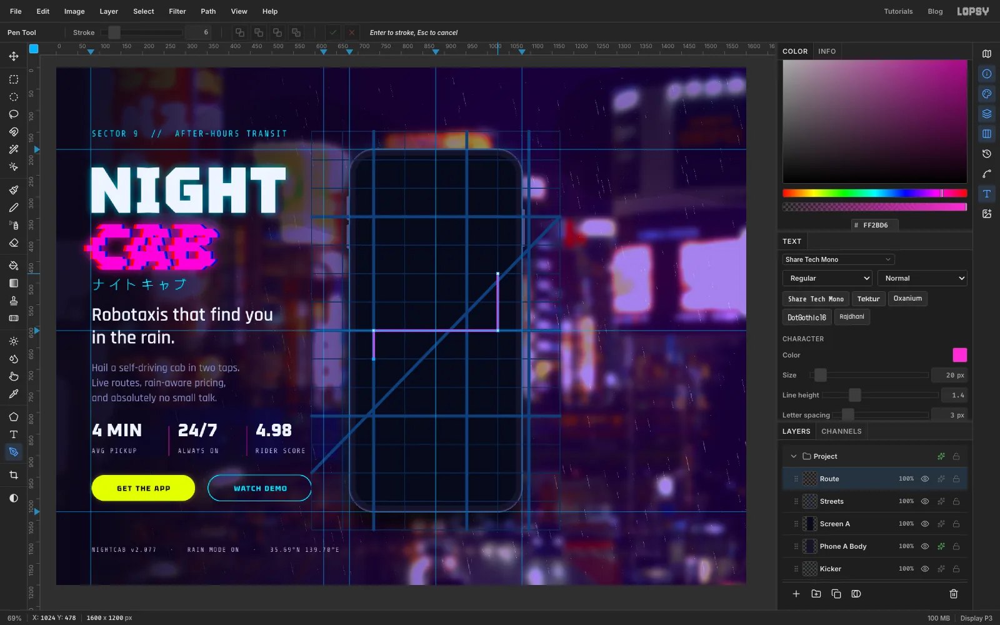

Add a layer called *Route* and set the foreground to magenta `#FF2BD6`. Pick the **Pen** (P) and set **Stroke** to **6** in the options bar.

The route follows the grid, turning at crossings. Click four corner points: start on the left-hand avenue one block below the middle street, go up to the middle street, turn right for four blocks, then go up two blocks. Press [[Enter]]. Lopsy strokes the path with the foreground colour.

## Rotate the streets and route together

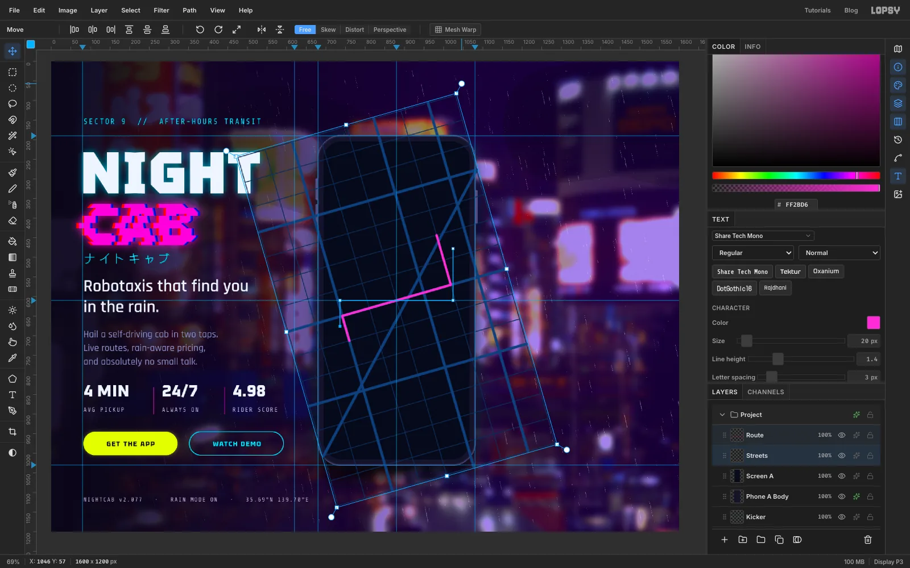

A map that runs square to the screen looks like graph paper. Tilting it makes it feel like a real city.

Press [[Cmd+D]]. In the Layers panel click *Streets*, then [[Cmd]]-click *Route*, so both are selected. Press **V**. With two layers selected and no marquee, the Move tool's handles frame both layers together. Drag the round rotate handle beyond a corner about **16°** anticlockwise and release. The route stays on its streets because they turn as one.

Open the **Paths** panel and delete the route path. You only needed it to draw the stroke.

## Trim the map to the screen

Click *Streets*. [[Cmd]]-click the *Screen A* thumbnail to load the screen's shape as a selection, choose **Select → Inverse** and press [[Delete]]. Press [[Cmd+D]], then do the same for *Route*.

Everything outside the rounded screen is gone, and the map fills it right to its corners.

## Add a canal and make the route glow

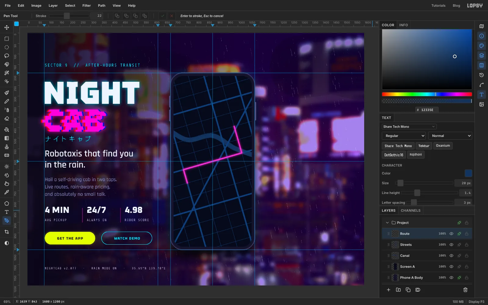

Click *Screen A* and add a layer called *Canal*, so it sits under the streets. Set the foreground to `#12335E` and the Pen's **Stroke** to **22**. Draw a gentle S-curve with five points, from just off the left edge of the screen, a little above the middle, to just off the right edge a little lower down. Press and drag a short way at each point so the curve stays smooth, then press [[Enter]]. Delete the path, then trim *Canal* to the screen the same way as before.

Click *Route* and give it an **Outer Glow** in magenta, **Size 14**, **Opacity 90**. The route now reads as light on a dark map.

## Add the pickup pin and a car marker

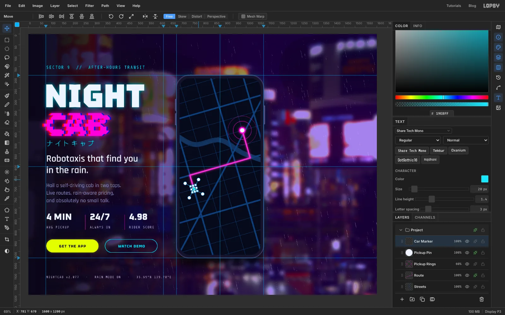

Add a layer called *Pickup Rings*. Pick the **Shape** tool with **Shape** set to **Ellipse**. Remove the fill, set the stroke to magenta with **Width 2**, and drag an 84 px circle from the end of the route. Draw a second, 132 px circle from the same point with **Width 1**. Set the layer to **60%** opacity.

Add *Pickup Pin* and draw a 20 px circle filled with `#EEF4FF` at the same point. Give it a magenta **Stroke** of **5** and an **Outer Glow** of **18**.

For the car, add a layer called *Car Marker*. With the **Pen**, click four corners of an arrowhead around the start of the route: the lower-left point, the tip about 30 px above it, the lower-right point, and a notch in the middle of the base. Click the first point again to close it. In the **Paths** panel click **Path to Selection** and then **Delete Path**. Fill with cyan and press [[Cmd+D]].

Now [[Cmd]]-click the *Car Marker* thumbnail, so the transform box hugs the arrow. (A selection made with Path to Selection spans the whole document, so its handles would sit at the canvas corners.) Press **V**, drag the rotate handle about **16°** anticlockwise so the arrow points up its street, and deselect. Add a cyan **Outer Glow** of **14**.

## Label two districts

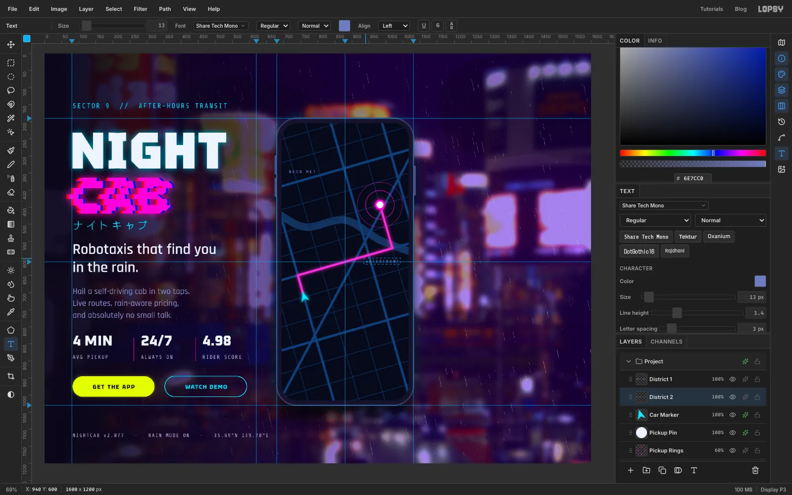

Click *Car Marker* and use **Share Tech Mono**, **Size 13**, `#6E7CC0`, **Letter spacing 3** to add `NEON MKT` near the top left of the map and `WATERFRONT` just under the canal on the right. Tiny, quiet labels make it read as a real map without competing with the route.

## Build the bottom sheet and the phone chrome

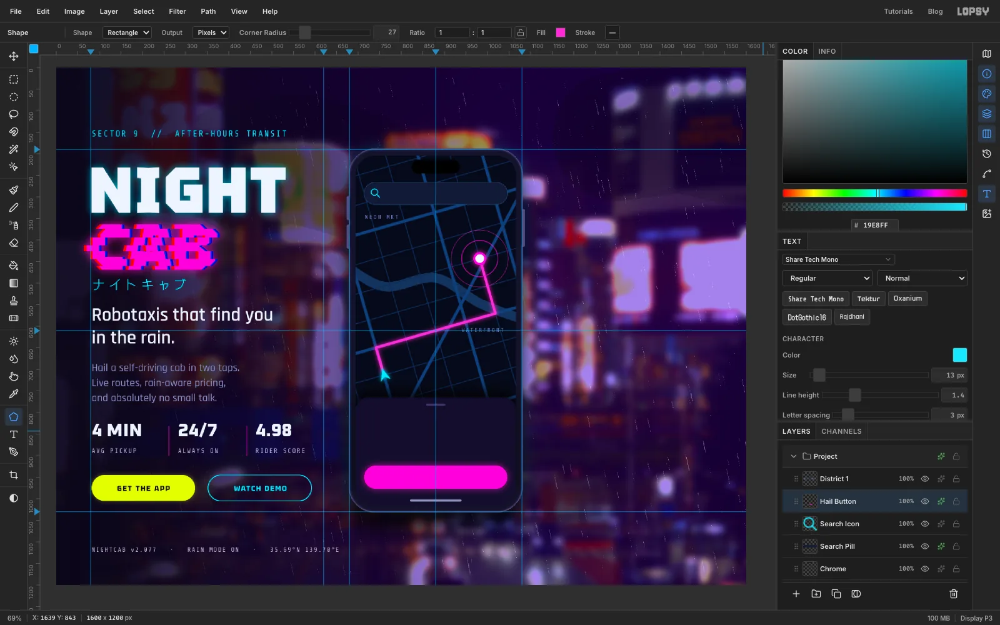

All of these are **Rectangle** shapes made with a single click and the size dialog, centred on the middle guide:

1. **Sheet.** Add a layer called *Sheet*. Fill `#120D2A`, **Corner Radius 30**, **372 × 280**, clicked at y 905. It runs off the bottom of the screen, so trim it to the screen the same way as the map. Give it a **Drop Shadow** with **Offset Y −18**, **Blur 36**, **Opacity 70**, so it lifts off the map.
2. **Chrome.** Add a layer called *Chrome* and make three shapes on it: a **44 × 5** grab handle in `#3A3566` at y 782, a **120 × 5** home indicator in `#8F93BF` at y 1004, and a **112 × 32** black camera notch at y 230. Use **Corner Radius 3** for the thin bars and **16** for the notch.
3. **Search pill.** On a layer called *Search Pill*: `#141A36`, **Radius 25**, **332 × 50** at y 292, with a 1 px **Stroke** in `#2C4D7A`.
4. **Search icon.** On a layer called *Search Icon*: a 15 px cyan ring (Ellipse, no fill, stroke 2) near the left end of the pill, and a short handle drawn with the **Pencil** at Size 2 in cyan, a click and a [[Shift]]-click going down and to the right.
5. **Hail button.** On a layer called *Hail Button*: magenta, **Radius 27**, **332 × 54** at y 950, with a magenta **Outer Glow** of **24** at **60%**.

## Type the map screen

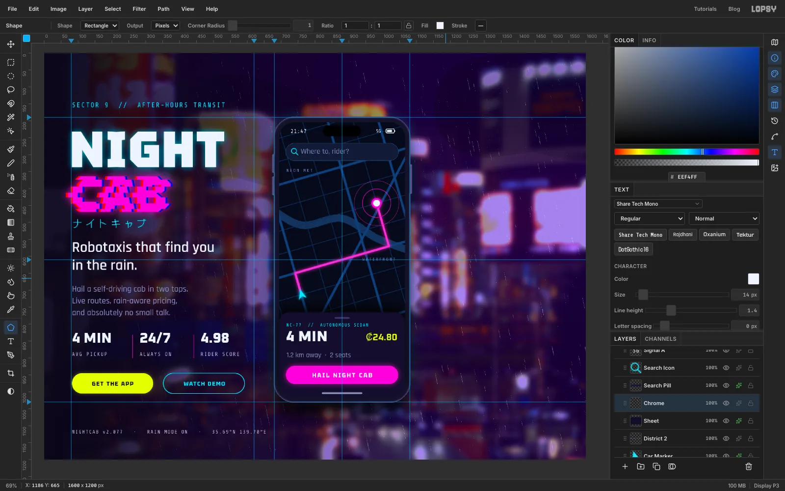

Click *Hail Button* before each new line, and type from the bottom of the sheet upwards:

- `HAIL NIGHT CAB` in **Tektur Bold 18**, ice white, **Letter spacing 3**, typed in empty space and dragged into the middle of the button
- `1.2 km away  ·  2 seats` in **Rajdhani Medium 21**, `#8C93C8`, under the ETA
- `₡24.80` in **Oxanium Bold 28**, acid yellow, moved so its right edge lines up with the sheet's right margin
- `4 MIN` in **Oxanium ExtraBold 44**, ice white, at the sheet's left margin. Then move the price up or down so the bottoms of the two numbers sit on the same line
- `NC-77  //  AUTONOMOUS SEDAN` in **Share Tech Mono 13**, cyan, **Letter spacing 2**, at the top of the sheet

Then click *Search Icon* and add `Where to, rider?` in **Rajdhani Medium 22** (`#7F88BC`) inside the pill, `21:47` in **Share Tech Mono 16** at the top left of the screen, and `5G` in **Share Tech Mono 14** at the top right, both in ice white `#EEF4FF`. Use `#7F88BC` for the search text, a touch dimmer than the body lilac, so it reads as a placeholder.

For the battery, click *Chrome* and use the Shape tool's size dialog three times next to the `5G`: a **24 × 12** outline (no fill, ice-white stroke 2, **Radius 3**), a **15 × 6** ice-white bar inside it, slightly left of centre, and a **2 × 5** nub on its right end.

## Start the second phone with a holo stage

Click the top layer in the Layers panel and add *Phone B Body*. Use the Shape tool's size dialog for a **370 × 780** body with **Corner Radius 54** in `#15132A`, clicked in the middle of the space right of the first phone, a little lower than its centre. Add a side button, then give it the same four effects as the first phone, but with a **magenta** Outer Glow. Add *Screen B*: **344 × 754**, **Radius 42**, `#070A19`, clicked at the same point.

Add a layer called *Chrome B* now too, with the same black notch and home indicator as the first phone. The battery icon comes later.

For the stage light, add a layer called *Stage Glow* and [[Cmd]]-click the *Screen B* thumbnail. Pick the **Gradient** tool, set **Type** to **Radial** and click **Advanced…**. Set both stops to magenta `#FF2BD6`, the left one at **55%** opacity and the right one at **0%**, then click **Done**. Drag from about a quarter of the way down the screen to about halfway down. The glow stays inside the screen because the selection limits it. Deselect.

Add a layer called *Holo Floor*. Draw an **Elliptical Marquee** about **320 × 84**, centred a little above the middle of the screen. Pick the **Brush** at **Size 2** in cyan. Pick a vanishing point about 120 px above the ellipse's centre. For each of thirteen fan lines, click on the vanishing point and then [[Shift]]-click a point 110 px below the ellipse's centre. Space those end points 60 px apart, so the fan spreads well past both sides. Then draw five horizontal lines across, bunched up near the back of the ellipse and spreading out towards the front. The selection keeps every stroke inside the ellipse, so you get a glowing floor in perspective. Deselect and set the layer to **45%** opacity.

## Add the platform ring

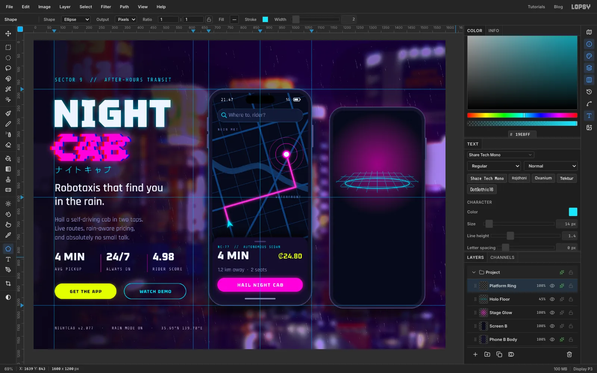

Add a layer called *Platform Ring*. Draw an **Ellipse** with no fill and a **2 px** cyan stroke, about **250 × 40**, centred on the floor. Give it a cyan **Outer Glow** of **12** at **90%**.

## Drop in the sedan and cut it out

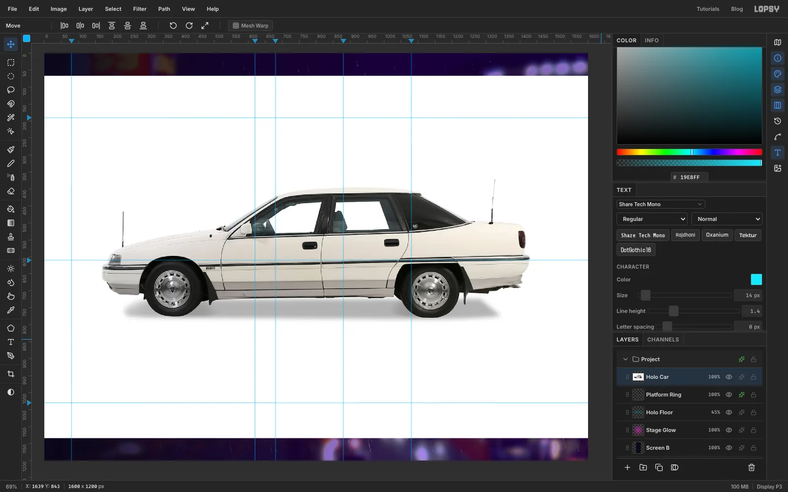

Drag the sedan photo onto the canvas. It arrives scaled to the canvas width and selected. Press [[Cmd+D]] and name the layer *Holo Car*.

Pick the **Magic Wand** (W) with **Tolerance 24** and **Contiguous** on. Click the white background and press [[Delete]], then deselect. The car is cut out. A soft grey ground shadow under the tyres stays behind, and that's fine: it becomes part of the hologram's base.

## Turn the car into a wireframe

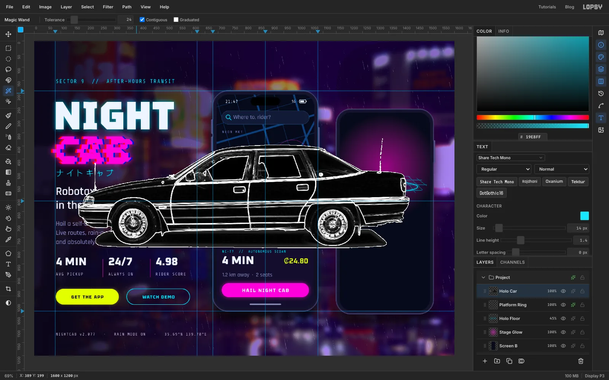

Choose **Filter → Desaturate**, then **Filter → Find Edges**. Find Edges marks the places where brightness changes sharply, so every panel line, window frame, wheel and badge becomes a thin white line. Everything flat turns black.

## Knock out the black

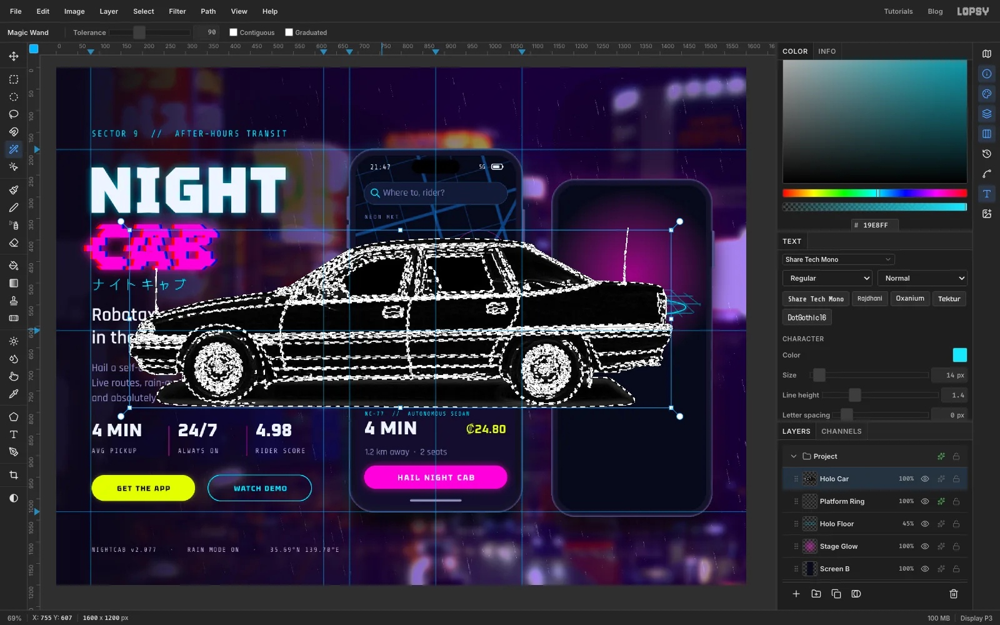

Pick the **Magic Wand** again. Set **Tolerance** to **90** and turn **Contiguous** off. Click in the middle of a large black panel, such as a door. With Contiguous off, the wand selects every dark pixel on the layer, not just the ones touching where you clicked. Press [[Delete]] and deselect.

Make sure you click solid black. If you land on one of the white lines, the wand selects the lines instead.

## Shrink the hologram onto the stage

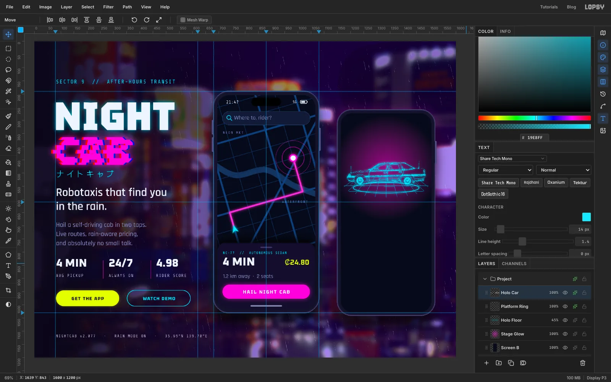

[[Cmd]]-click the *Holo Car* thumbnail to select its pixels. Press **V**, hold [[Cmd]] and drag the bottom-right corner handle inwards until the car is about **300 px** wide. Holding [[Cmd]] keeps its proportions. Scaling the wireframe down after Find Edges, rather than before, keeps the lines thin and clean. Press [[Enter]] and deselect.

Drag the car onto the stage so its wheels rest on the platform ring. Then give it a cyan **Color Overlay** and a cyan **Outer Glow** of **10** at **90%**. The white lines turn into glowing cyan light.

## Add a speed gauge and a progress bar

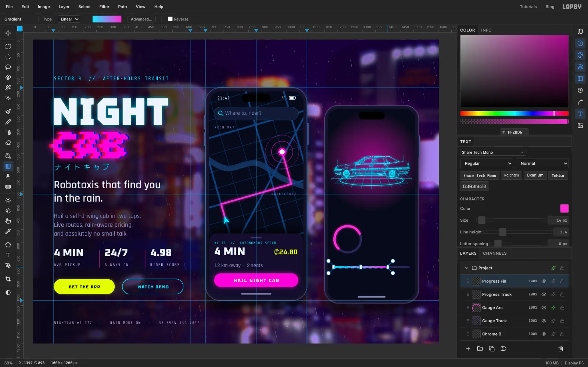

For the gauge, add *Gauge Track* and click a **104 × 104** Ellipse with no fill and a **9 px** stroke in `#2A2456`, at the left of the screen, its left edge lined up with the screen's text margin. Add *Gauge Arc*, set the foreground to magenta and the Pen's **Stroke** to **9**, and draw a curve over the ring's lower left round through the top to its right side, about 200° of the circle. Press [[Enter]], delete the path and add a magenta **Outer Glow** of **12**.

For the progress bar, add *Progress Track* and click a **300 × 8** rectangle in `#2A2456` with **Radius 4**, below the gauge. Add *Progress Fill* and draw a marquee over the left 70% of the track. Set the **Gradient** to **Linear**, click **Advanced…** and set the stops to cyan `#19E8FF` and magenta `#FF2BD6`, both at **100%** opacity (the stage glow's transparent stop is still in there otherwise). Drag from the left end of the marquee to its right end. Deselect, then add a 14 px ice-white dot at the end of the fill with a magenta glow.

Finish with *Share Button*: a **300 × 48** outlined pill (no fill, cyan stroke 2, **Radius 24**) near the bottom of the screen.

## Type the ride screen

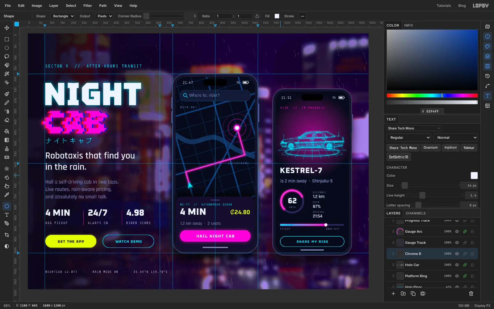

Click *Share Button* before each line. As before, type labels that sit below other text first:

- `SHARE MY RIDE` in **Tektur Bold 15**, cyan, **Letter spacing 3**, centred in its pill
- `PICKUP` and `DROP-OFF` in **Share Tech Mono 11**, `#8C93C8`, **Letter spacing 2**, under the two ends of the bar
- `1.2 km`, `87%` and `21:54` in **Rajdhani SemiBold 22**, ice white, stacked right of the gauge, then their labels `DISTANCE`, `RAIN` and `ARRIVAL` in **Share Tech Mono 11**, `#8C93C8`, **Letter spacing 2**, just above each one
- `KM/H` in **Share Tech Mono 11**, `#8C93C8`, and `62` in **Oxanium ExtraBold 36**, ice white, both centred in the gauge
- `is 2 min away  ·  Shinjuku-9` in **Rajdhani SemiBold 22**, `#8C93C8`, and `KESTREL-7` in **Oxanium ExtraBold 36**, ice white, above it, both at the screen's left margin
- `RIDE  //  IN PROGRESS` in **Share Tech Mono 13**, magenta, **Letter spacing 3**, under the notch
- `21:52` in **Share Tech Mono 16** and `5G` in **Share Tech Mono 14**, both ice white, in the status bar

Finally, click *Chrome B* and add the battery icon next to the `5G`, just as you did for the first phone.

## Group the second phone and tilt it

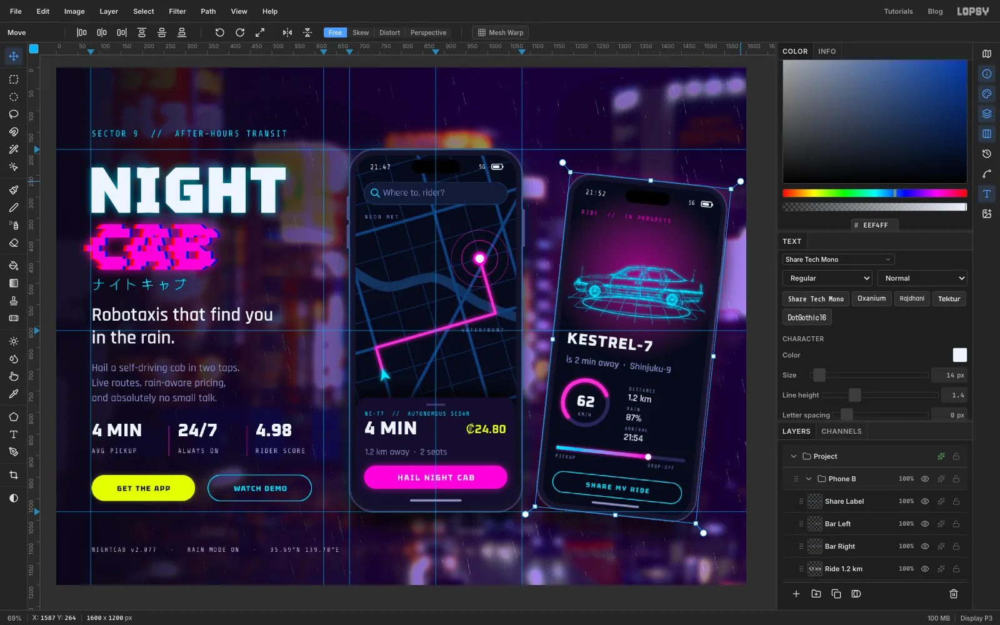

In the Layers panel click the topmost layer of the second phone, then [[Shift]]-click *Phone B Body* to select the whole range. Choose **Layer → Group Layers** and name the group *Phone B*.

With the group selected, press **V**. The handles frame everything in the group. Drag the rotate handle about **6°** clockwise. The text stays live and the effects turn with it. A tilted second phone is the classic app-store presentation: it breaks the grid and makes the pair feel picked up rather than pasted down.

## Group the rest and rebalance

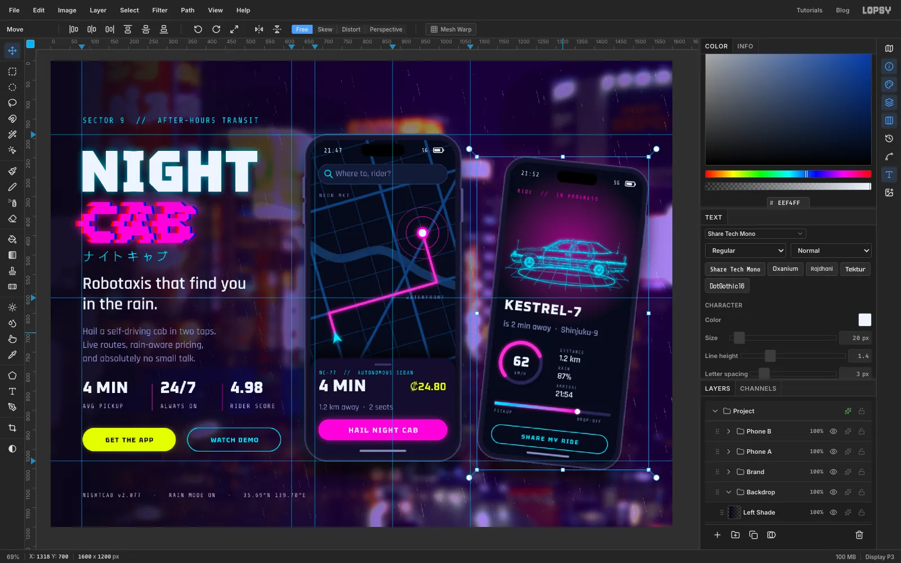

Collapse *Phone B*. Group the first phone's layers into *Phone A* the same way: click the row just under *Phone B* and [[Shift]]-click *Phone A Body*. Group the type and buttons of the left column (from *Kicker* down to the row just above *Left Shade*) into *Brand*. Group *Left Shade* down to *City Photo* into *Backdrop*.

Now look at the margins. The tilted phone sits closer to the right edge than the type does to the left. Click the *Phone A* group and drag the phone about **30 px** to the left, then click *Phone B* and drag it about **17 px** left. Moving a group moves everything in it, effects and live text included.

## Float a notification between the phones

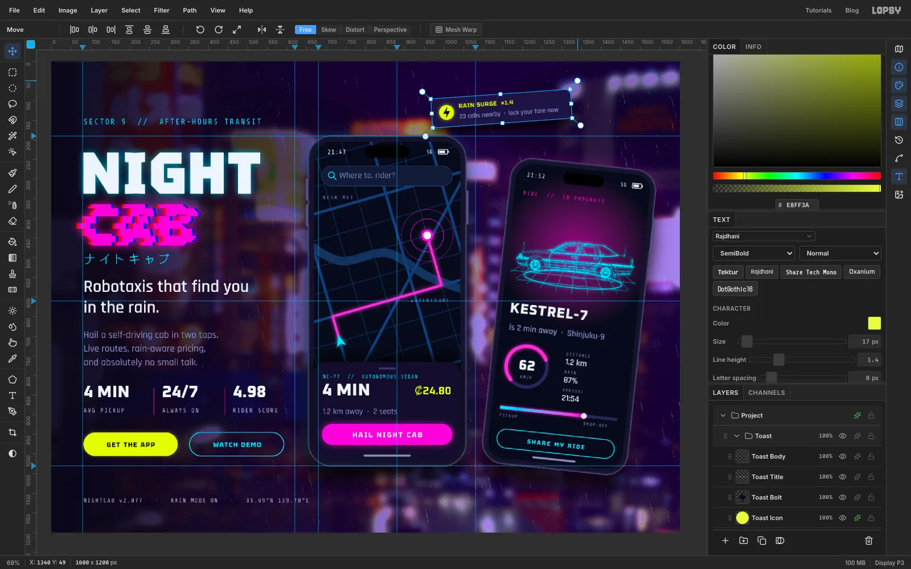

Click the *Project* group at the top of the Layers panel, then **Add Layer**. A new layer added while a group row is selected lands at the top of that group. Name it *Toast Card*, and click a **356 × 74** rectangle with **Radius 18** in `#1B1340` above the gap between the two phones. Give it a 1 px `#4B3A8C` **Stroke** and a **Drop Shadow** with **Offset Y 18**, **Blur 30**, **Opacity 70**.

Add *Toast Icon*: a **38 px** acid-yellow circle near the card's left end, with a yellow glow. For the lightning bolt, add *Toast Bolt* and make six **Pen** clicks for a zigzag bolt inside the circle. Close it, click **Path to Selection** and fill it with night `#090616`.

Type `RAIN SURGE  ×1.4` in **Tektur Bold 15**, acid yellow, and below it `23 cabs nearby  ·  lock your fare now` in **Rajdhani SemiBold 17**, `#8C93C8`, both starting just right of the icon.

Group the card's five layers into *Toast*, press **V** and rotate the group about **4°** anticlockwise. A slight tilt makes it look like it just popped up.

## Darken the edges with a feathered vignette

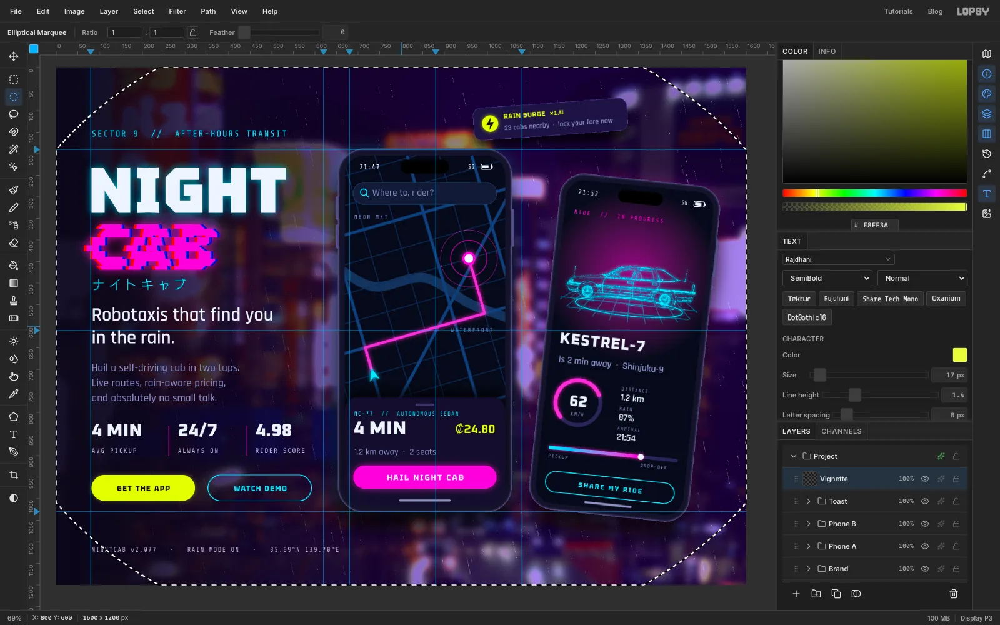

Click *Project* and add a layer called *Vignette*. Pick the **Elliptical Marquee** and click once on the canvas without dragging. In the **Elliptical Selection** dialog, type **From X −160, Y −140** and **To X 1760, Y 1340**. The box can run past the canvas, so the ellipse just clips the corners.

Choose **Select → Inverse**, then **Select → Feather…** with **200**. Fill with night `#090616`, deselect, and set the layer to **75%** opacity. The corners darken softly and pull the eye into the middle.

## Add a bloom glow pass

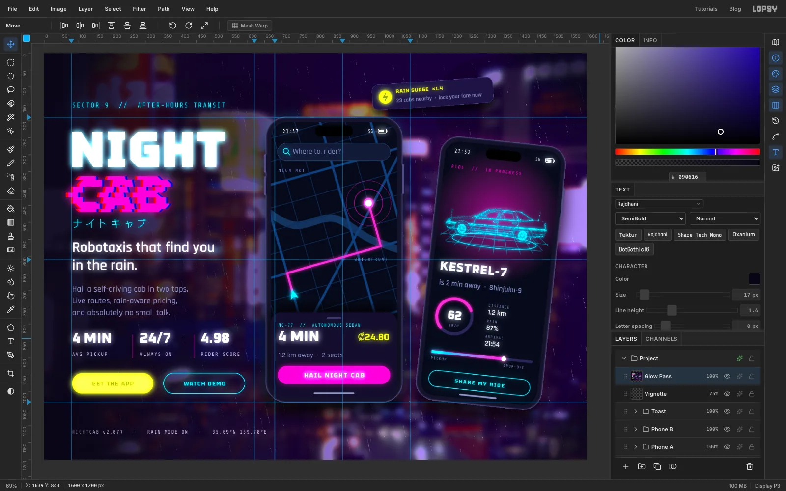

Neon in a photo glows a bit more than vector shapes do. Fake it with one more Bloom over a flattened copy of everything:

1. Press [[Cmd+A]], choose **Edit → Copy Merged**, then press [[Cmd+V]]. Copy Merged copies what you see, all layers combined, and the paste lands in place as a new layer. Name it *Glow Pass* and deselect.
2. Choose **Filter → Bloom…** with **Threshold 70**, **Soft Knee 40**, **Radius 26** and **Intensity 100**.
3. Set the layer's blend mode to **Lighten**.

Lighten only lets a pixel through where it's brighter than what's underneath. So the glow pass adds halos around bright things, but never darkens or muddies anything else.

## Wipe the glow off the buttons

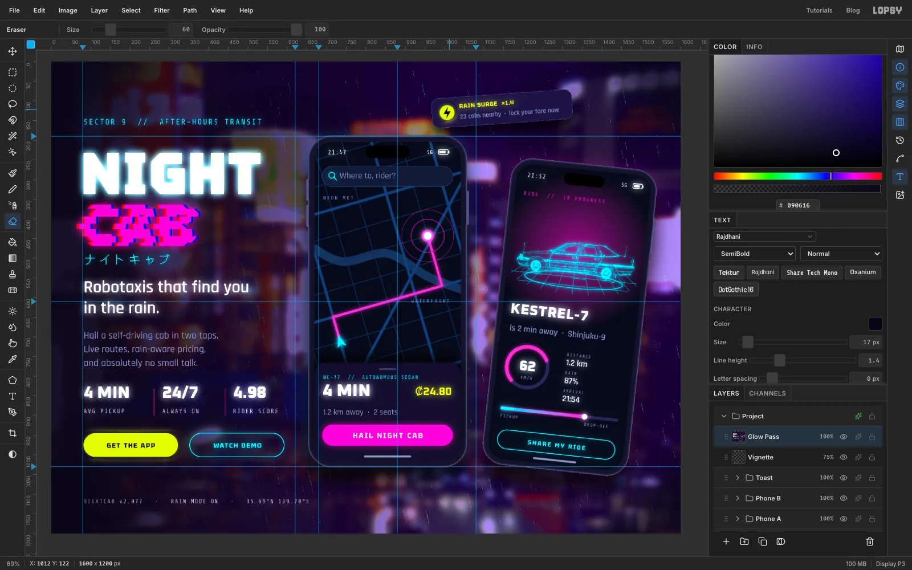

The bloom is lovely on the headline and the hologram, but it floods the two solid buttons and washes out their labels. Keep *Glow Pass* selected, pick the **Eraser** at **Size 80** and drag once along the GET THE APP pill. Switch to **Size 60** and drag once along the HAIL NIGHT CAB button. Give the toast's lightning icon a quick dab too. The buttons' own glows are still there underneath.

Choose **File → Save Project** to keep an editable copy, and **File → Quick Export PNG** for the finished image.
