**De Stijl** was the Dutch art movement of Piet Mondrian and Theo van
Doesburg. It used black lines, flat red, yellow and blue, and nothing that
wasn't horizontal or vertical. Mondrian ended his career in New York with
*Broadway Boogie-Woogie*. That painting drops the black lines for yellow
streets studded with little coloured blocks, like taxis and traffic lights
seen from above, set to jazz. Earlier, he had turned some square
canvases 45° and called them *lozenges*.

This poster puts the two ideas together for an imaginary 1948 jazz-club film,
**GIN JOINT**. A Boogie-Woogie street grid fills the middle, and a Mondrian
lozenge turns into a martini glass: blue gin in the bottom half, a black rim
across the middle, a stem, a foot and an olive on a pick. You'll build it at
**1280 × 1920 px**, the 2:3 shape of a cinema one-sheet.

Almost everything is a rectangle, so the **grid** does most of the work. At
16 px with **Snap** on, every marquee lands exactly on a grid line. Read
positions off the X/Y readout in the status bar as you drag: every number in
this tutorial is a grid line.

Along the way you'll use:

- **Show Grid** with **Snap**, ruler guides, and zooming in with [[Cmd]] + scroll
- the **Rectangular Marquee** with [[Shift]]-add and [[Shift]]+[[Alt]]-intersect, **Select → Inverse**, **Shrink** and the **Lasso**
- copy and paste in place, **Flip Horizontal**/**Flip Vertical**, **Rotate 90° CW** and **Merge Down**
- the **Move** tool's rotate handle with [[Cmd]] to snap rotations to 45° and 90°
- groups, a whole-group nudge, and undo and redo
- the **Stroke** layer effect, layer opacity, and the **Overlay**, **Soft Light**, **Multiply** and **Screen** blend modes
- text in **Rubik Mono One**, **Syncopate** and **League Gothic**: alignment, line height, letter spacing, per-letter colour and a rotated line
- **Add Noise**, **Motion Blur**, **Gaussian Blur**, and a **Hue / Saturation** adjustment on the whole document

The palette:

- Cream `#F6F2E8` (the paper and every white cell)
- Black `#161616` (bars, glass and type)
- Red `#C0332B`, blue `#26438C`, yellow `#EDC23E`
- Street grey `#B4B0A6`
- Billing grey `#86817A` (the small connecting words)

## Set up the canvas, grid and guides

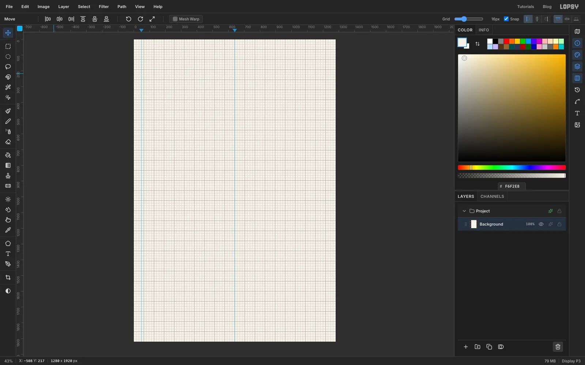

Choose **File → New**, enter **1280 × 1920** pixels and click **Create**.
Set the foreground to cream `#F6F2E8` in the Color panel's hex field, select
*Background* and choose **Edit → Fill**. The new document also comes with
an empty *Layer 1*. Select it and click the trash button at the bottom of
the Layers panel, because every part of this poster gets its own named
layer.

Choose **View → Show Grid**. The grid size slider in the options bar
should read **16px**, and **Snap** should be ticked. Then click the top
ruler at **48** and at **640** to drop two vertical guides. The first marks
the middle of the narrow side column you'll add later, and the second marks
the centre of the page.

## Paint the first Boogie-Woogie street

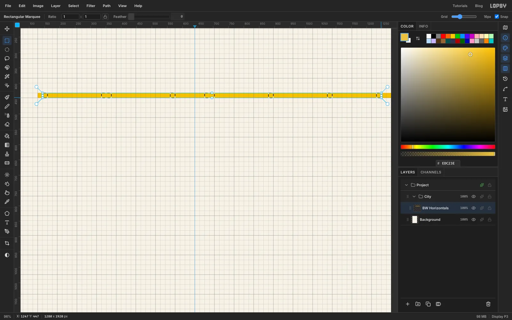

Select *Background* and click **New Group** at the bottom of the Layers
panel. Name the group *City*, then click **Add Layer** and name the new layer
*BW Horizontals*. It lands inside the group.

The street field will run from x **128** to the right edge, and from y
**384** down to **1504**. Hold [[Cmd]] and scroll up over the top of the
field until you're at about **100%**. Pick the **Rectangular Marquee** and
drag a strip **one grid cell tall** from x 128, y 432 to the right edge of
the canvas. Set the foreground to yellow `#EDC23E` and choose
**Edit → Fill**.

Now add the coloured blocks. Drag a one-cell square on the strip about one
cell in from the left end. Then hold [[Shift]] and drag more one-cell squares
along the strip, 2–5 cells apart, making every fifth one a two-cell dash.
[[Shift]] adds each square to the selection. Select roughly a third of the
block positions this way and fill them red `#C0332B`. Blue and grey go in
the gaps next.

## Finish the master street

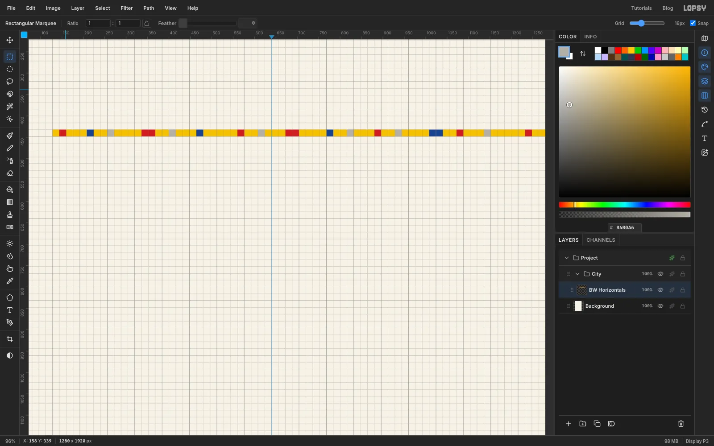

Do the same for blue `#26438C` and then for grey `#B4B0A6`. Start each colour
with a plain drag, then [[Shift]]-drag the rest of its squares into the gaps
the previous colours left. Fill each colour once and press [[Cmd+D]] to
deselect.

The spacing should look irregular, like traffic. You'll reuse this one strip
for every street, and flipping some of the copies hides the repeat. Choose
**View → Fit to Screen** when you're done.

## Copy the street down the page

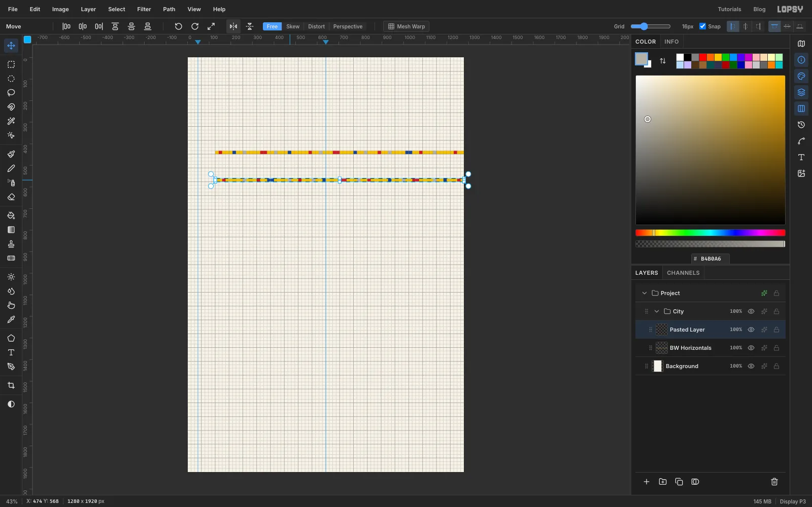

Marquee the whole strip again and press [[Cmd+C]], then [[Cmd+V]]. Lopsy
pastes the copy in place on a new layer, selects it and switches to the
**Move** tool. Drag the copy straight down to the next street at
y **560**. With Snap on, the drag moves in whole grid cells, so the copy
lands exactly on the line. Keep the pointer level as you drag so the copy
doesn't shift a cell sideways.

Click **Flip Horizontal** in the options bar so this copy's blocks run in
the opposite order. Press [[Cmd+D]], then choose **Layer → Merge Down** to
fold it into *BW Horizontals*.

## Add the other horizontal streets

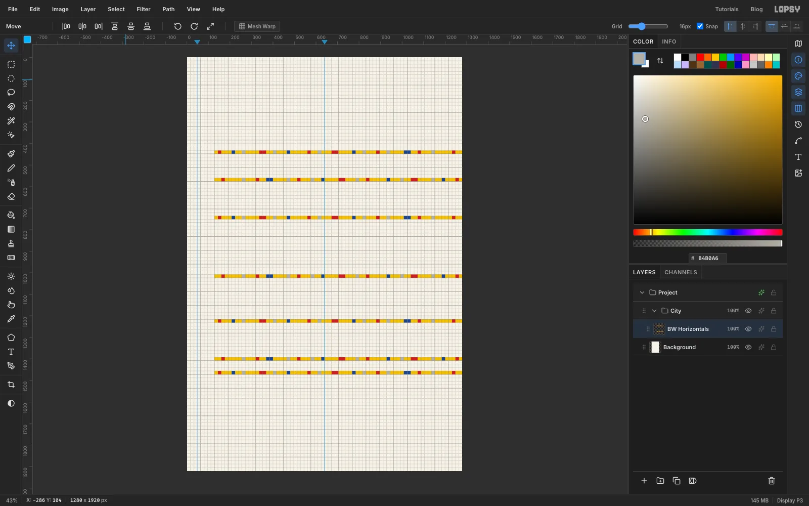

The clipboard still holds the master strip, so you can keep pasting it:
press [[Cmd+V]], drag the copy to the next street and merge it down. Put
streets at y **736**, **1008**, **1216**, **1392** and **1456**. Flip the
copies at **1008** and **1392**, as you did the one at 560, and leave the
rest as they are. The last two streets sit close together on purpose, like
Mondrian's busy bottom edge.

## Turn a copy into a vertical street

Marquee the top street again, copy it and paste it. Drag the copy down
until its top edge sits on y **944**, halfway down the field. Then click
**Rotate 90° CW** in the Move tool's options bar. The strip turns about
its centre and becomes a vertical street from the top of the field to
the bottom. Press [[Cmd+D]] and rename the pasted layer *BW Verticals*.

The strip is 72 cells long, so its centre is not on a grid line, and it lands
half a cell (8 px) left of the grid. Untick **Snap**, press [[Right]] eight times
so its left edge sits on x **704**, then tick **Snap** again.

## Fill in the vertical streets

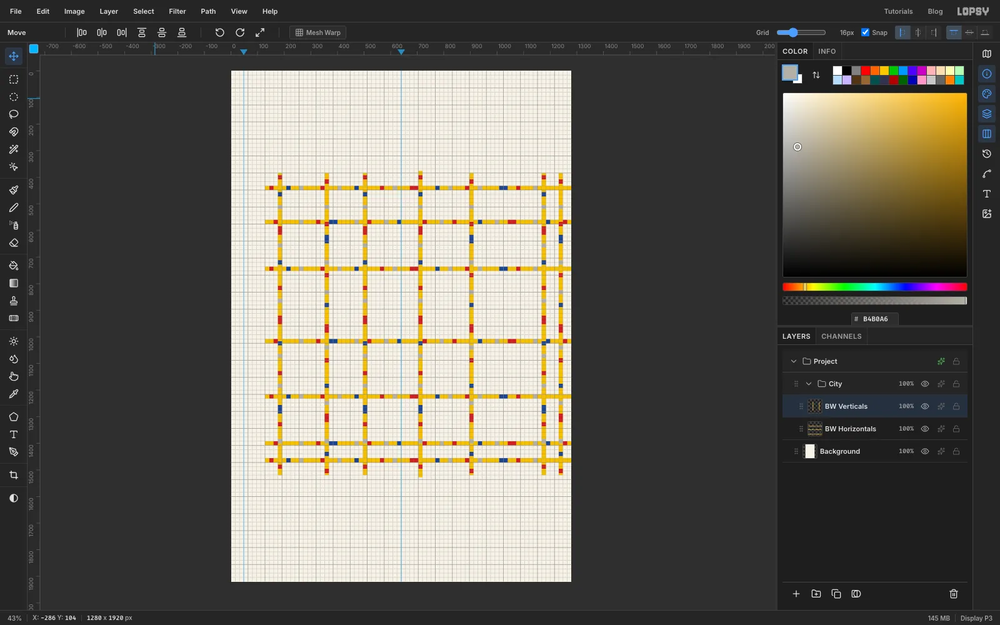

Drag a marquee around the whole vertical street, including the bits that
hang over the top and bottom of the field, and copy it. Paste it six times,
dragging each copy sideways so its left edge lands at x **176**, **352**,
**496**, **896**, **1168** and **1232**. Click **Flip Vertical** on the
copies at **352**, **896** and **1232**, and **Merge Down** after each one.

Don't worry that the verticals poke out a little above and below the field.
You'll trim them in a moment.

## Add the big Boogie-Woogie blocks

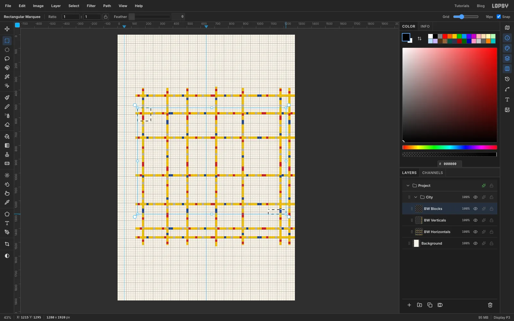

Add a layer called *BW Blocks*. *Broadway Boogie-Woogie* has a few larger
blocks, often with a smaller square of another colour centred inside. Make
four six-cell squares and one thin bar. Each sits *across* a street rather
than just touching one:

- **red**, x 144–240, y 528–624, with a grey inner square at x 176–208, y 560–592
- **blue**, x 1104–1200, y 400–496, with a yellow inner square at x 1136–1168, y 432–464
- **yellow**, x 1120–1216, y 976–1072, with a red inner square at x 1152–1184, y 1008–1040
- **blue**, x 176–272, y 1184–1280, with a cream inner square at x 208–240, y 1216–1248
- a thin **red** bar, x 1088–1216, y 1264–1296, with no inner square

[[Shift]]-drag both red outer shapes, then fill. Do the same for the two blue
squares, then the yellow one. Finish with the two-cell inner squares, filling
all the inner squares of one colour in one go.

## Trim the overhang with Inverse

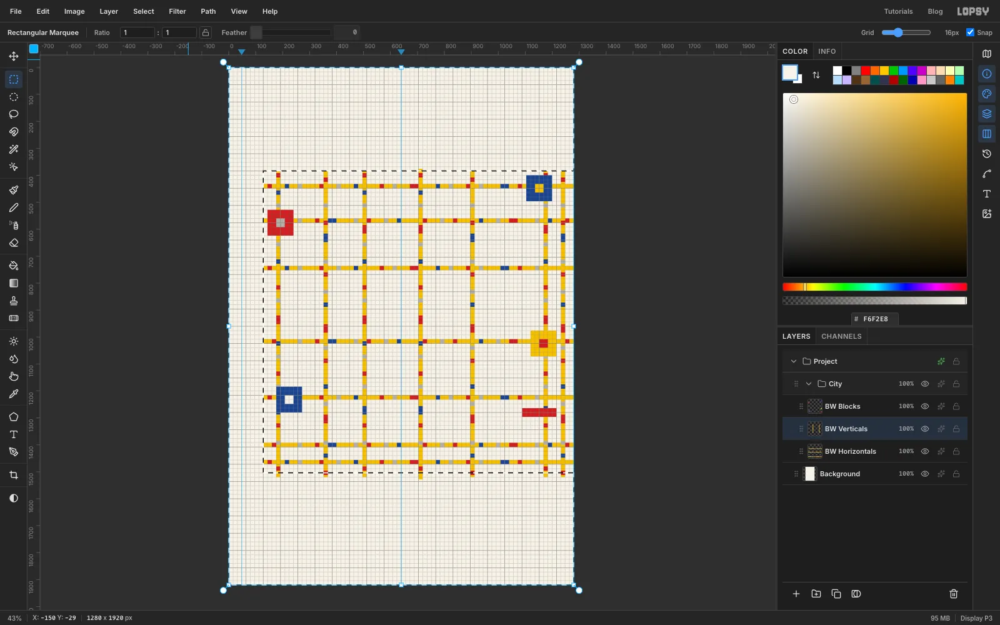

Select *BW Verticals*. Drag a marquee around the whole field, from x 128,
y 384 to the bottom-right corner of the field at y 1504. Choose
**Select → Inverse**: now everything *except* the field is selected. Press
[[Delete]], then [[Cmd+D]].

## Paint the colour cells

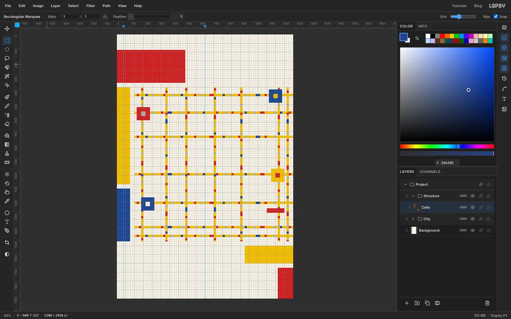

Collapse the *City* group with its arrow and click its row. Click
**New Group** and name it *Structure*. Because *City* is collapsed, the new
group goes above it rather than inside it. Add a layer called *Cells*.

These are the big Mondrian colour fields. Fill each one with a plain marquee
(use [[Shift]] to do both reds in one fill):

- **red**: the title cell at the top left, x 0–496, y 112–352
- **yellow**: the side column, x 0–96, y 384–1088
- **blue**: the rest of the side column, x 0–96, y 1120–1504
- **yellow**: the date cell, x 928 to the right edge, y 1536–1664
- **red**: the bottom-right corner, x 1168 to the right edge, y 1696 to the bottom

## Lay the black bars

Add a layer called *Bars*. Every bar is **two grid cells (32 px)** thick.
Drag the first one, then hold [[Shift]] for each of the rest:

1. across the page at y 80, under the cast line
2. across the page at y 352, under the title
3. down between GIN and JOINT, at x 496, from y 112 to y 352
4. down beside the side column, at x 96, from y 384 to y 1504
5. across the side column at y 1088, from x 0 to x 96
6. across the page at y 1504, under the field
7. down between the tagline and the date, at x 896, from y 1536 to y 1664
8. across the page at y 1664
9. down beside the red corner, at x 1136, from y 1696 to the bottom

Fill with black `#161616` and deselect. Every cell edge now has a bar on it.

## Draw the lozenge square

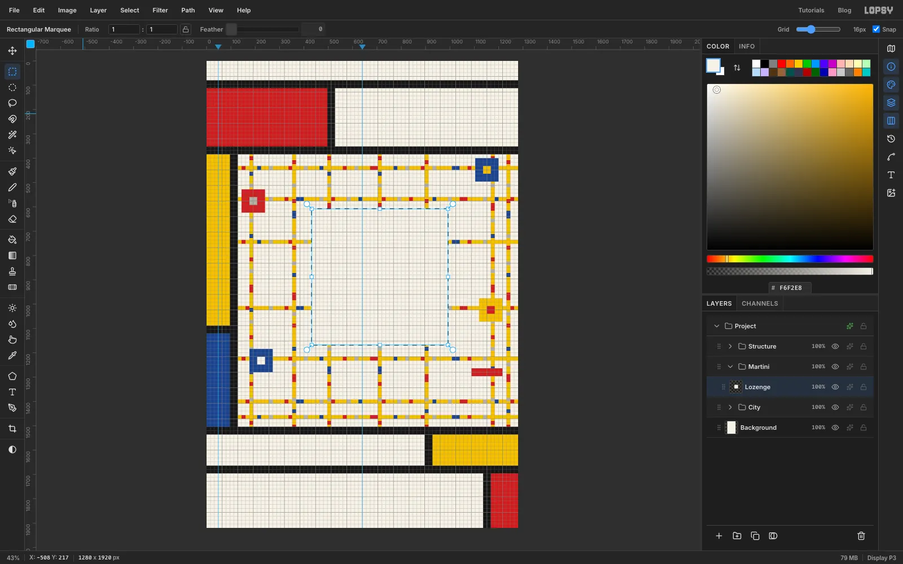

Collapse *Structure*, click the *City* row and click **New Group**. Name
it *Martini*. It goes between *City* and *Structure*. Add a layer called
*Lozenge*.

Drag a square marquee **35 cells** wide, from x **432**, y **608** to
x **992**, y **1168**. Fill it with cream `#F6F2E8`. Leave the selection
active.

You'll build the whole glass one grid cell higher than its final spot, so
nothing collides with a street while you work. At the end you'll drop the
finished group into place with a single nudge.

## Turn it 45° into a lozenge

With the **Move** tool, hover just outside the square's top-right corner
until the cursor becomes a rotate arrow. Hold [[Cmd]] and drag clockwise.
[[Cmd]] snaps the angle to 15° steps, so stop at the third step, **45°**. The
square stands on its corner. Press [[Cmd+D]] to commit.

> **Tip:** If you overshoot, press [[Cmd+Z]] to undo the turn and try
> again. [[Cmd+Shift+Z]] redoes it exactly.

## Fill the gin with an intersected selection

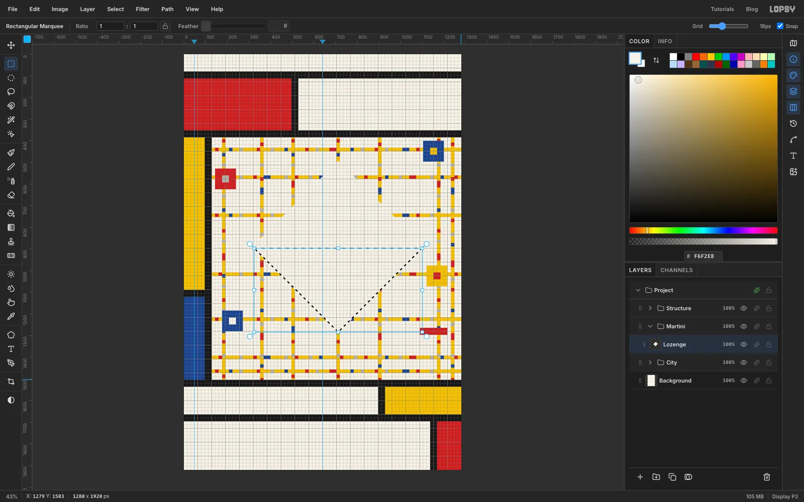

[[Cmd]]-click the *Lozenge* thumbnail in the Layers panel to select the
diamond. Pick the **Rectangular Marquee**, hold [[Shift]]+[[Alt]] and drag
from x 128, y **896**, just below the diamond's side corners, to the right
edge of the canvas below the diamond's bottom point. [[Shift]]+[[Alt]]
*intersects*, so only the lower triangle stays selected. The rim bar will
cover the thin cream strip left above it. That's the bowl of
the glass. Fill it with blue `#26438C` and deselect.

## Frame the lozenge with a Stroke effect

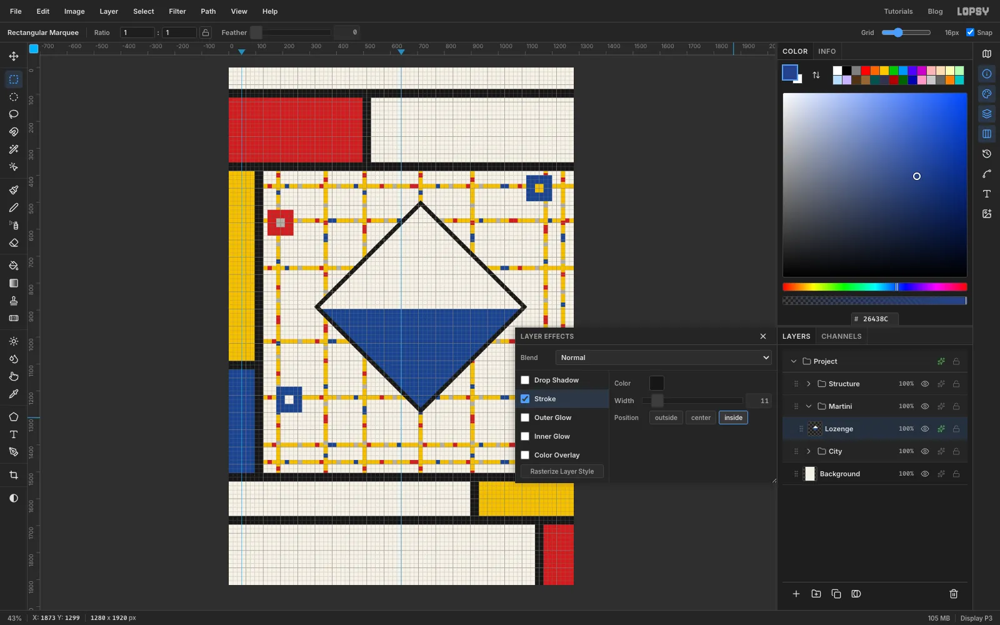

Click the effects button on the *Lozenge* row. Tick **Stroke**, set the
colour to black `#161616`, **Width 11** and position **Inside**. On these
45° sides, Width 11 draws a band about 16 px thick, the same weight as the
streets. The black frame runs round the whole diamond like the frame on one
of Mondrian's lozenge paintings. Close the drawer.

## Cut open the top of the lozenge

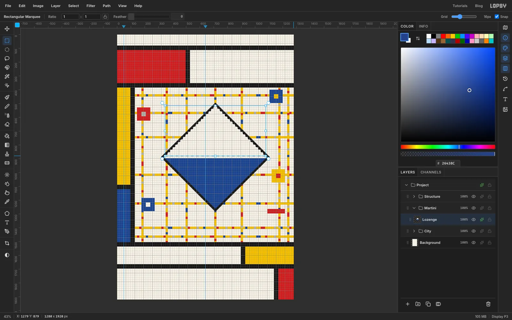

A solid cream top half reads as a hole in the poster. Opening it so the
streets show through reads better, because the top of a glass is air.

[[Cmd]]-click the *Lozenge* thumbnail, then choose **Select → Shrink…**
by **16** px. The selection now matches the inside edge of a 16 px frame.
With the **Rectangular Marquee**, [[Shift]]+[[Alt]]-drag from the top-left
of the field down to the right edge at y **880**, level with the top of where
the rim will go. Only the upper triangle inside the frame stays selected.
Press [[Delete]].

The Stroke effect follows the layer's new outline, so the frame stays solid
all the way round.

## Haze the upper triangle

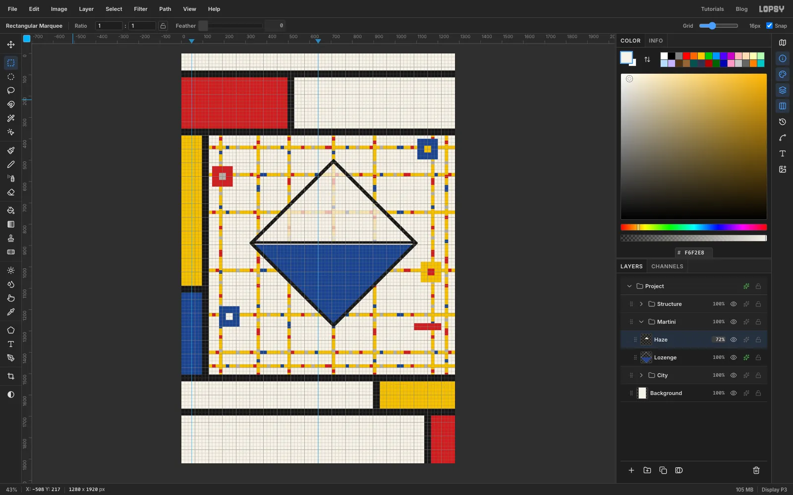

Keep the triangle selected and add a layer called *Haze*. Fill it with cream
`#F6F2E8`, deselect, and set the layer's opacity to **72%** from the
opacity button on its row. The streets now show faintly through the top of
the glass.

## Run the street through the gin

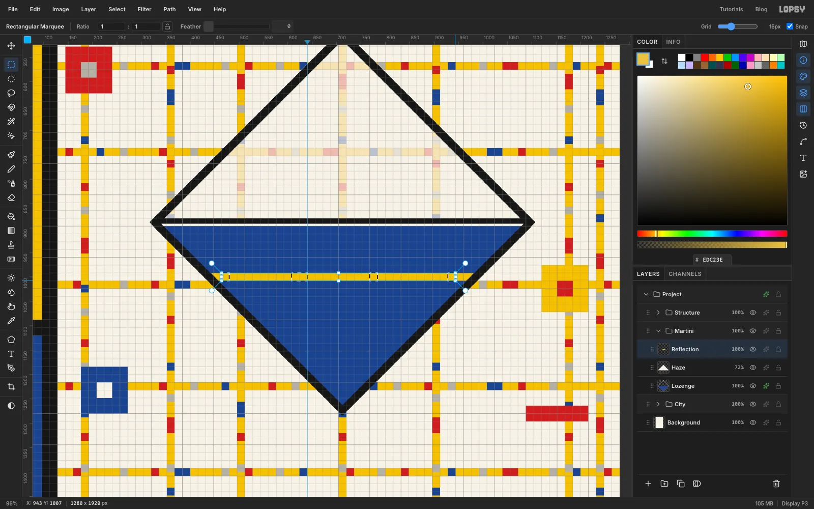

Add a layer called *Reflection*. [[Cmd]]-click the *Lozenge* thumbnail, then
choose **Select → Shrink…** by **16** px, so the stripe stops at the frame.
With the **Rectangular Marquee**, [[Shift]]+[[Alt]]-drag a one-cell band
across the whole field at y **992**. That's one cell above the y 1008
street, and it will line up with the street when you drop the glass at the
end. Fill it yellow `#EDC23E` and deselect.

Zoom in to about 100% and add the same kind of blocks as on the streets, in
red and grey only: blue would vanish into the gin. Space them about four
cells apart.

## Build the rim, stem and foot

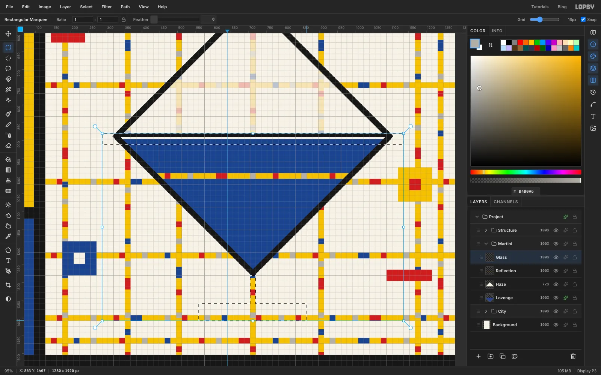

Add a layer called *Glass*. Zoom in to about 100% on the bottom of the glass and [[Shift]]-drag three
rectangles:

- the **rim**: x 288 to 1136, y 880 to 912. It sticks out a little past the
  diamond's side corners, like the lip of a glass.
- the **stem**: x 704 to 720, from the diamond's bottom point at y 1280
  down to y 1360. It's one cell wide, right under the point, and continues
  the vertical street at x 704.
- the **foot**: x 560 to 864, y 1360 to 1408. It's three cells tall, so it
  reads as a solid base.

Fill with black and deselect.

## Add the cocktail pick

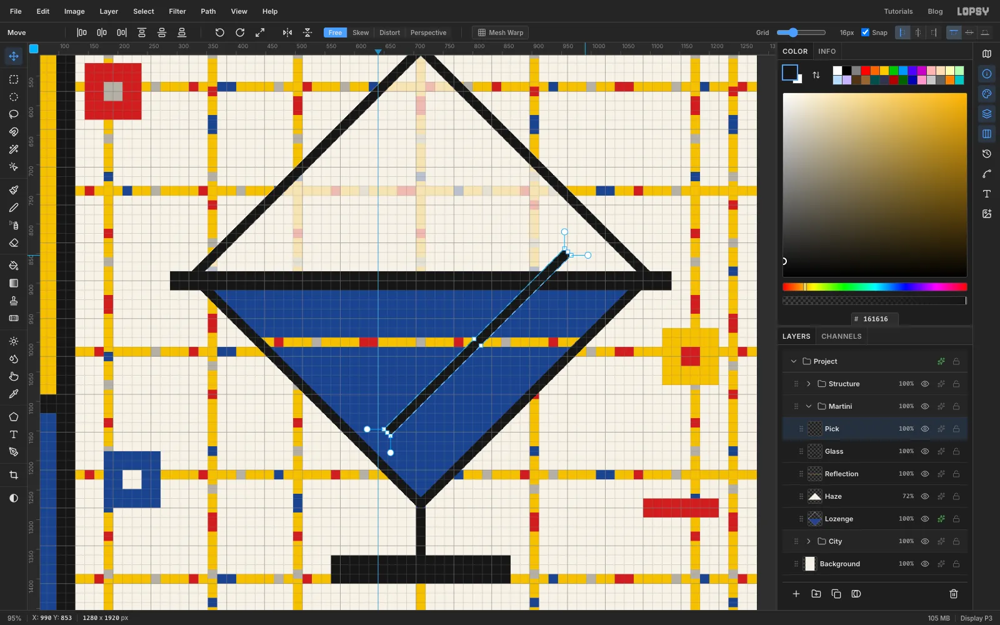

Add a layer called *Pick*. Drag a marquee
**one cell wide and 27 cells tall**, from x 800, y 784 to x 816, y 1216, and fill it black. With the
**Move** tool, [[Cmd]]-drag its rotate handle **45°** clockwise, just like the
lozenge, and press [[Cmd+D]]. The pick now runs from inside the top of the
glass down into the gin. Rotating a bar gives it square ends, which suit
De Stijl better than a round brush stroke.

## Spear the olive

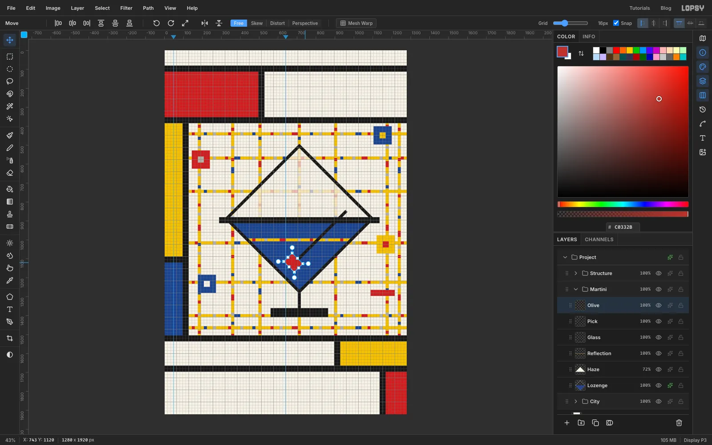

Add a layer called *Olive*. Drag a **four-cell** square from x 656, y 1088 to
x 720, y 1152, fill it red `#C0332B`, and turn it 45° with the [[Cmd]]-rotate
handle again. Its centre sits on the pick, and the pick's tail pokes out a
little below-left of the olive, as if it has been speared. Press [[Cmd+D]].

## Set the billing block

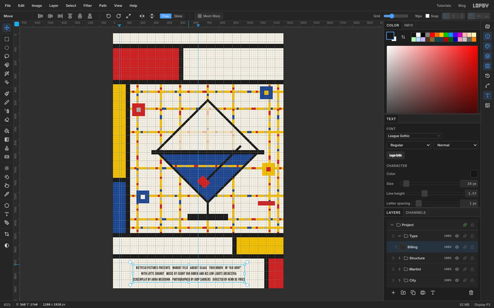

Collapse *Martini* and *Structure*, click the *Structure* row, and click
**New Group**. Name it *Type*. Untick **Snap** so you can place type to the
pixel.

Pick the **Text** tool. Set the font to **League Gothic**, size **28**,
**Align Center**, colour black. Click in the middle of the bottom cream cell
(x **568**) and type three lines, pressing [[Enter]] between them. Each
slash below marks **three spaces** between credits:

1. RIETVELD PICTURES PRESENTS / MARGOT VELD / AUGUST KLAAS / THEO RUBEN / IN “GIN JOINT”
2. WITH LOTTE BRANDT / MUSIC BY COUNT VAN DOREN AND HIS LOW-LIGHTS ORCHESTRA
3. SCREENPLAY BY ANNA MEERDINK / PHOTOGRAPHED BY JOOP SANDERS / DIRECTED BY HENK DE VRIES

Use curly quotes around GIN JOINT. On a Mac they're Option + [ and Option + Shift + [.
Press [[Tab]] to commit, and rename the layer *Billing*. In the **Text** panel
set **Line height** to **1.57** and **Letter spacing** to **1**. Then drag
the block with the **Move** tool until it's centred in the cell, at about
x 568, y 1808.

## Grey out the connecting words

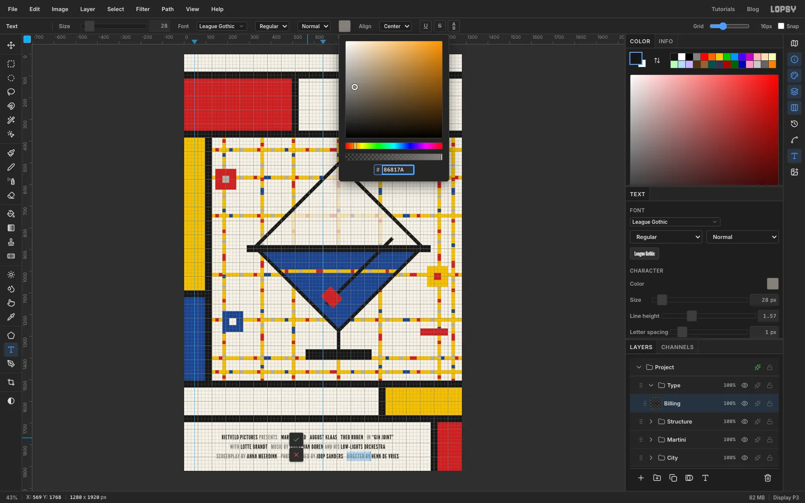

Real billing blocks set the small linking words lighter than the names.
With the **Text** tool, click into the billing block. Select
**PRESENTS** (drag across it, or use [[Shift]] + arrow keys), click the
**Text color** swatch in the options bar and type `86817A` in its hex field.
Only the selected letters change. Close the picker by clicking the swatch
again.

Repeat for **IN**, **WITH**, **MUSIC BY**, **AND HIS**, **SCREENPLAY BY**,
**PHOTOGRAPHED BY** and **DIRECTED BY**, then press [[Tab]].

## Add the tagline and date

Click the *Type* group row first, so the next text is a new layer instead of a
restyle of the billing block. Set **Syncopate**, weight **Bold**, size
**40**, **Align Center**, and click at the middle of the yellow date cell to
type **FALL 1948**. Commit with [[Tab]] and rename the layer *Date*. The
Text panel keeps the billing block's **Letter spacing 1**, which is what
you want here.

Click the *Type* row again, switch to **Align Left**, click near the left of
the band and type **EVERY NOTE HAD A PRICE.** Rename it *Tagline*. Click the
top ruler at **73** to drop a guide, the same margin GIN will have, and move
the tagline until its first letter touches the guide. Centre both lines on
y **1600**, the middle of the band.

## Set the side credit

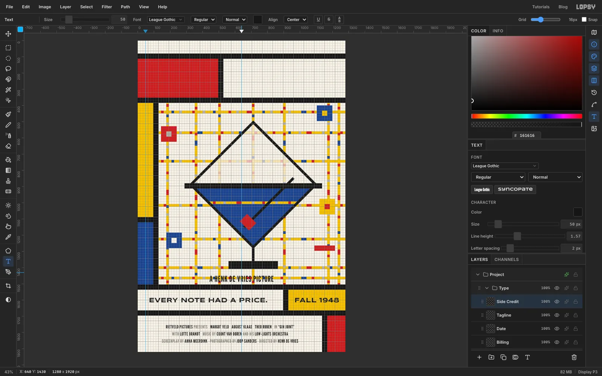

Click the *Type* row, then set **League Gothic**, size **50**,
**Align Center**. Click in an empty part of the field, away from the
other text, and type **A HENK DE VRIES PICTURE**. Commit, rename the layer
*Side Credit*, and set **Letter spacing** to **2** in the Text panel.

## Stand the side credit on end

With the **Move** tool, the text shows handles around its box. [[Cmd]]-drag
the rotate handle anticlockwise to **−90°**, so the line reads from bottom
to top. The text is still live and editable. Drag it into the yellow column
and centre it on the guide at x 48, halfway down the yellow part
(y **736**).

## Set the cast line and the title

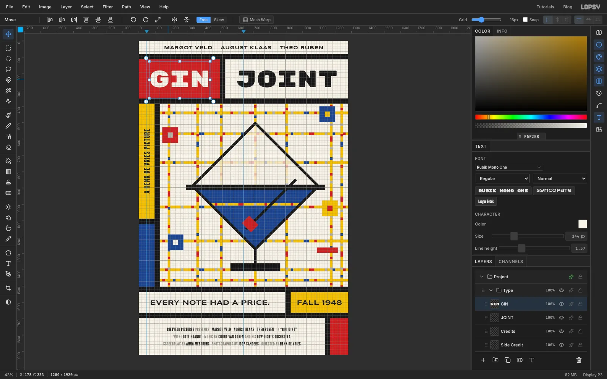

Click the *Type* row before each of these. All three keep
**Letter spacing 2** from the side credit.

1. **Cast line:** **Syncopate Bold**, **28**, **Align Center**. Click on the centre guide in the top strip and type
   **MARGOT VELD**, four spaces, **AUGUST KLAAS**, four spaces, **THEO RUBEN**. Rename it *Credits* and centre it in the strip.
2. **JOINT:** **Rubik Mono One** (Regular), **144**, black, **Align Center**. Click at the middle of the cream title
   cell and type **JOINT**. Rename it *JOINT* and centre it in the cell both ways.
3. **GIN:** the same font and size in cream `#F6F2E8`. Click at the middle of the red cell, type **GIN**, rename it
   *GIN* and centre it across the cell. Then nudge it up or down until its bottom lines up exactly with JOINT's.

With the red cell 496 px wide, GIN and JOINT both end up about **73 px** from
their bars, so the two cells look like a matched pair.

## Turn the O of JOINT red

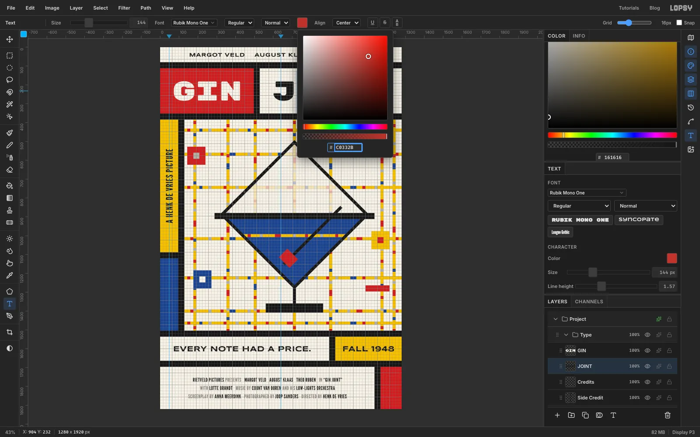

With the **Text** tool, click into JOINT, press [[Home]], then [[Right]]
once and [[Shift+Right]] once to select the **O**. Open the **Text color**
swatch and enter `C0332B`. The red O echoes the olive. Close the picker and
press [[Tab]].

## Nudge the whole glass down one cell

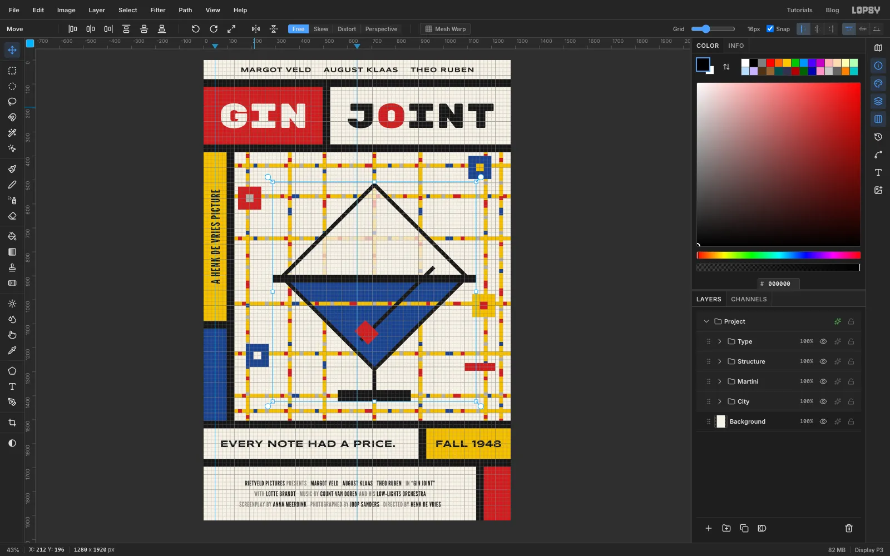

Look at the foot: it sits on top of the y 1392 street rather than across it.
Tick **Snap** again, collapse the *Martini* group, click its row, pick
the **Move** tool and press [[Down]] **once**. With the grid on, a nudge
moves a whole grid cell, so the entire glass drops 16 px as one piece. The
foot now straddles the street, the gin stripe lines up with the street at
y 1008, and the top of the glass sits clear of the street above it.

## Add a woven canvas texture

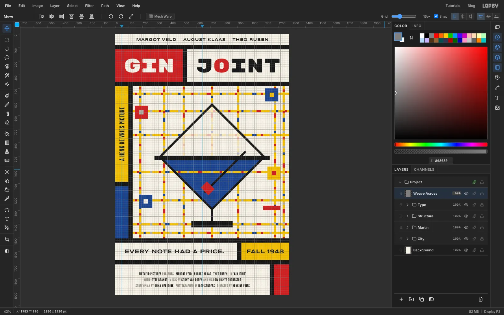

Collapse *Type*, click its row and click **Add Layer**. Name the layer
*Weave Across*. Fill it with `#808080`. Run **Filter → Add Noise…** with
**Amount 60**, **Mono** and **Gaussian**. Then run
**Filter → Motion Blur…** with **Angle 0** and **Distance 14**. In its
effects drawer set the blend mode to **Overlay**, then set the opacity to
**60%**.

## Cross the weave

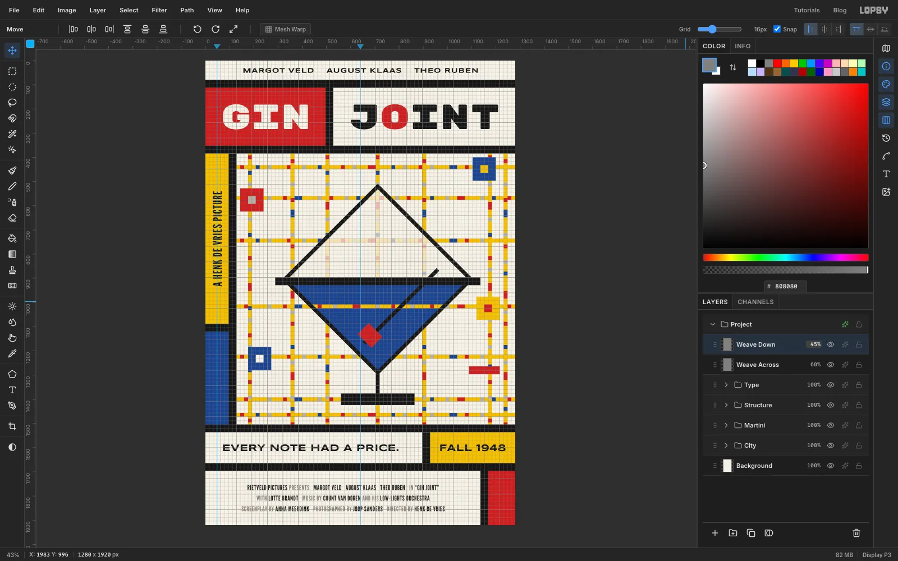

Add *Weave Down*. Fill it with `#808080`, **Add Noise** at **80**
(**Mono**, **Gaussian**), then **Motion Blur** at **Angle 90**,
**Distance 30**. Set it to **Soft Light** at **45%**. The two layers
together read like brushed paint on canvas.

## Add paper grain to the light areas

Overlay hardly changes near-white, so the cream still looks flat. Add a
layer called *Grain*, fill it with `#F2F2F2`, **Add Noise** at **60**
(**Mono**, **Gaussian**) and **Filter → Gaussian Blur…** at **1**. Set it to
**Multiply** at **45%**. Multiply can only darken, and only a little, so
the cream gets a printed speckle without changing colour.

## Add grain to the darks

Multiply doesn't show on black. Add *Grain Dark*, fill it with black,
**Add Noise** at **100** (**Mono**, **Gaussian**) and set it to **Screen**
at **30%**. Screen only lightens, so the bars and the blue cells pick up a
faint speckle and the light areas hardly change.

## Knock the inks back slightly

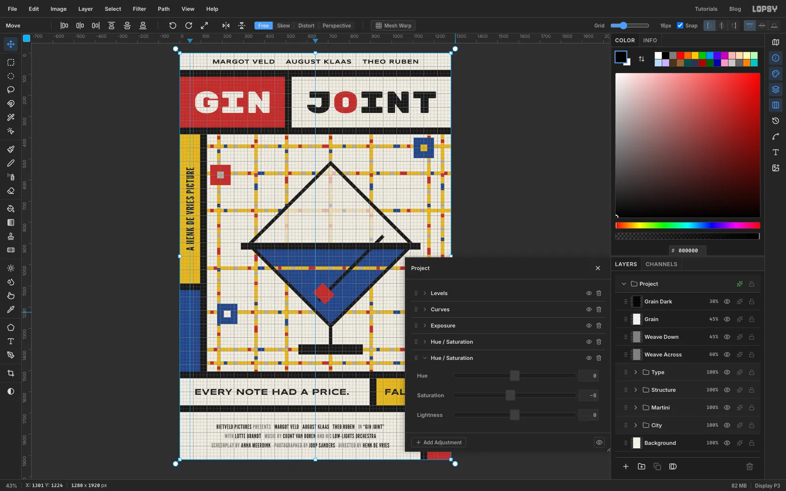

Click the effects button on the top **Project** row to open the
document's own adjustments. Click **+ Add Adjustment → Hue / Saturation**
and set **Saturation** to **−8**. This adds a second Hue / Saturation
node below the default one. The primaries drop from screen-bright to
printing-ink bright. Close the drawer.

## Check the poster, save and export

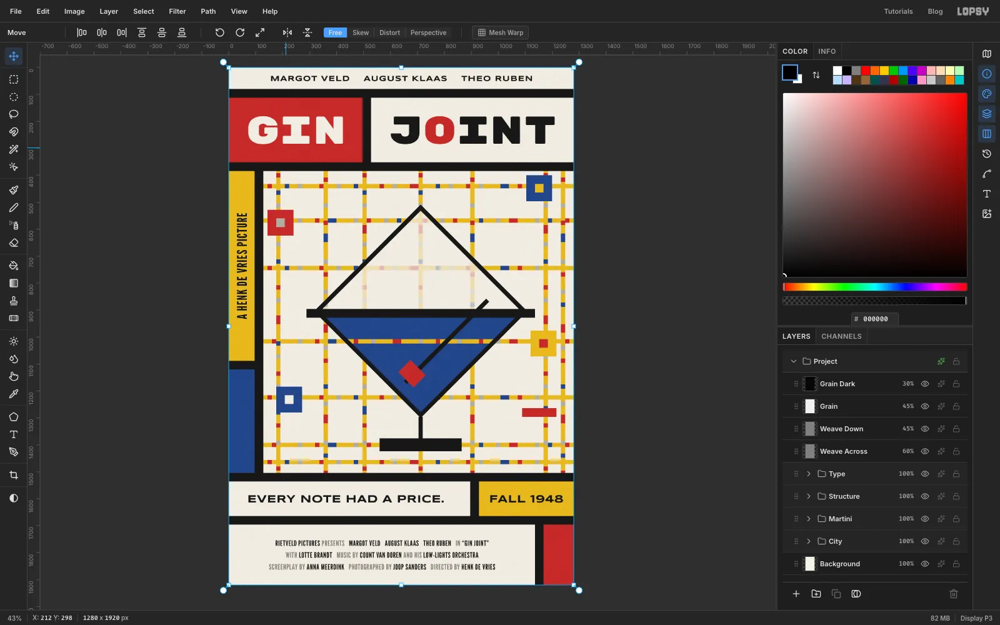

Choose **View → Show Grid** and **View → Show Guides** to hide them, and
look over the poster:

- no street ends exactly on a block's edge
- the glass's point, stem and the vertical street all share one centre line
- every line of type is centred in its cell

Save with **File → Save Project** and export with
**File → Quick Export PNG**.
