Deconstructivism started in architecture. In the 1980s, architects like
Zaha Hadid, Daniel Libeskind and Frank Gehry pulled buildings apart into
tilted planes and slabs that seemed to slide past each other. Graphic
designers at Cranbrook Academy of Art, and later David Carson, did the same
to the printed page. They sliced through words, broke the grid, and left the
construction lines showing.

This card takes that idea literally. It's a **quince upside-down cake**,
exploded like an architect's drawing:

- one wedge pulled out and turned
- one wedge flipped over to show its sponge underside
- a thin sliver knocked out of line

Because it's an upside-down cake, the word BIRTHDAY is set upside-down
too. The card says so at the bottom: *make a wish — then turn it over*.

The card is 1400 × 1960 px, a 5 × 7 in card at 280 dpi. Along the way
you'll use:

- **guides**, **Show Grid** and snapping, and the **Pencil** with
  Shift-click lines
- the **Move** tool's rotate handles, **Skew** mode and arrow-key nudges,
  on pixels and on live text
- **Filter → Kaleidoscope**, **Halftone**, **Add Noise** and **Gaussian
  Blur**
- **Edit → Copy Merged**, **Cut** and **Paste**, the **Lasso**, and
  **Select → Shrink**
- the **Inner Glow**, **Stroke**, **Drop Shadow** and **Color Overlay**
  effects, plus the **Multiply** and **Overlay** blend modes
- groups, the **Eraser**, and recolouring part of a word

The palette is a warm architect's paper with ruby, caramel and quince
yellow, plus ink and a drafting blue:

- Paper `#EDE6D6`, ink `#15130F`
- Ruby `#8E1F33`, quince yellow `#F4D63F`
- Caramel `#F0A93A` → `#D98C1F` → `#8A4A12`
- Quince slices `#E8875F` / `#B8424A`, heart `#F2C46A`
- Sponge `#F3DCA4` → `#D2A055`, crust `#9A5418`
- Drafting blue `#2340C8`

## Make the card

Choose **File → New**, set the unit to **Pixels**, and type **1400** for
the width and **1960** for the height. Click **Create**.

Select the *Background* layer, set the foreground colour to `#EDE6D6`, and
choose **Edit → Fill**. That's the paper. Every other colour in this
tutorial goes in the same way: type the hex code into the **Color**
panel's hex field.

## Set the margins

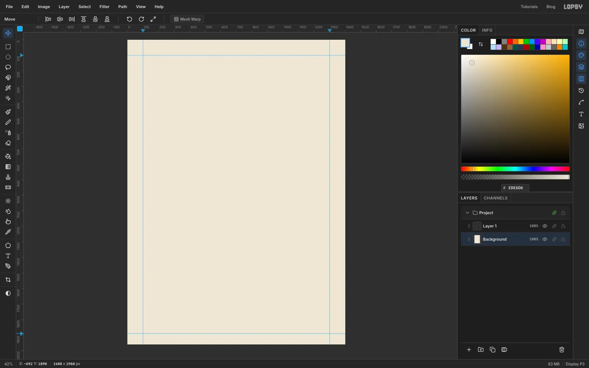

Click the top ruler at **100** and at **1300** to drop two vertical
guides. Then click the left ruler at **100** and **1890** for two
horizontal ones. Keep all the type inside this frame.

## Draw the construction lines

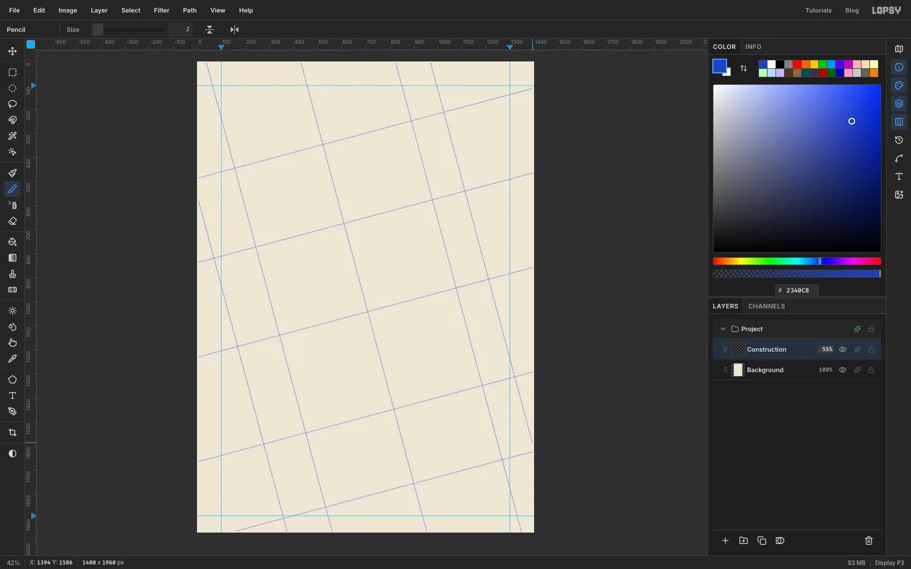

Deconstructivist layouts often show the drafting grid they were built on,
and here that grid is tilted. Rename *Layer 1* to *Construction*. Pick the
**Pencil**, set **Size** to **2** and the colour to drafting blue
`#2340C8`.

Click at one edge of the card, then hold [[Cmd+Shift]] and click at the
opposite edge. [[Shift]] draws a straight line and [[Cmd]] snaps its angle
to steps of 15°. Draw five lines that climb from left to right at
**15°**, spaced a few hundred pixels apart. Then draw five more at right
angles to them, steep and leaning the other way. Set the layer's opacity
to **55%**.

## Rotate the ruby slab

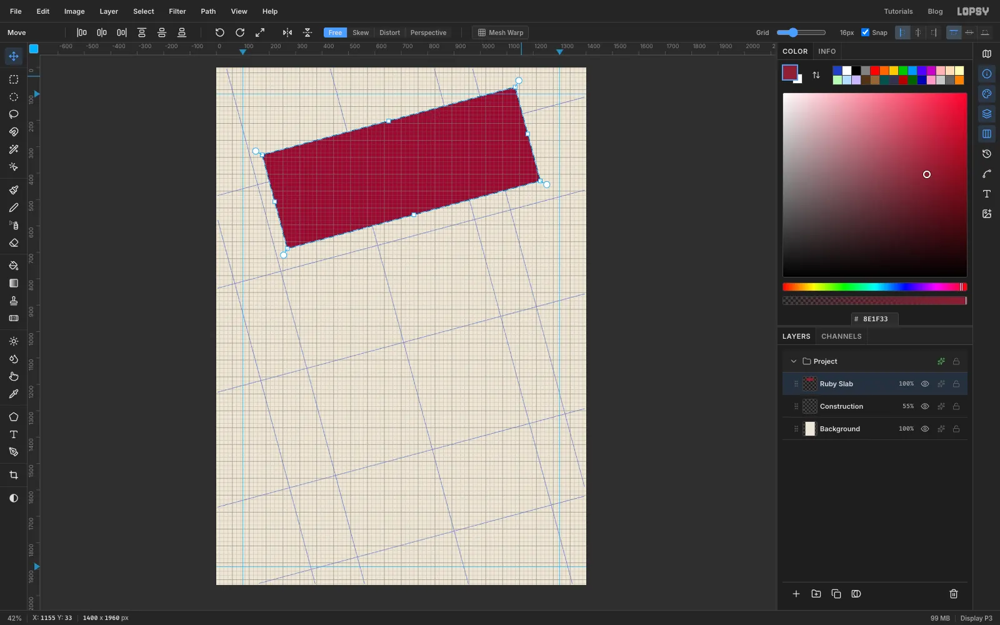

Turn on **View → Show Grid**. **Snap** switches on with it, so a marquee
lands exactly on the grid. Click **Add Layer** and name the new layer
*Ruby Slab*.

Pick the **Rectangular Marquee** and drag a wide box across the top third
of the card. Leave about 200 px of paper on each side, and make it a
little over a third as tall as it is wide. Set the colour to ruby
`#8E1F33` and choose **Edit → Fill**.

Switch to the **Move** tool. Hover just outside the box's top-right
corner until the cursor turns into a curved arrow, then drag upwards.
With the grid showing, the rotation clicks round in 15° steps. Stop at
**15°** counter-clockwise, the angle of the construction lines, and press
[[Cmd+D]] to drop it.

> **Tip:** Press [[Cmd+Z]] and then [[Cmd+Shift+Z]]. The slab goes back
> to level and returns exactly where it was.

## Rotate the ink bar

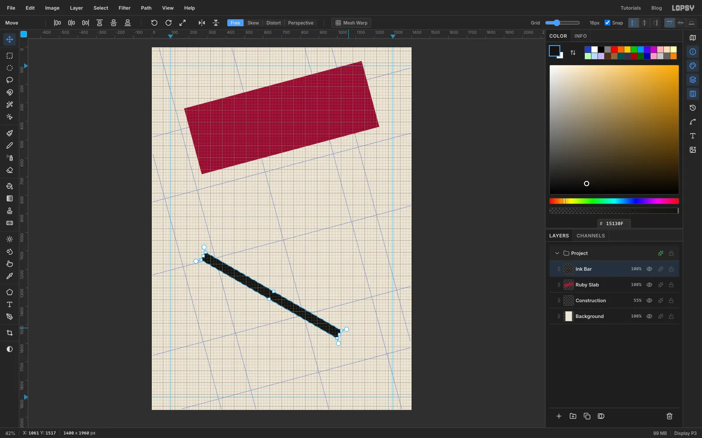

Add a layer called *Ink Bar*. Marquee a long, thin strip about 48 px tall
across the lower middle of the card, and fill it with ink `#15130F`.

With the **Move** tool, drag the rotate handle the other way, to
**30°** clockwise. The bar now cuts across the slab's direction. These
two opposing diagonals give the layout its tension.

## Shear the quince slab

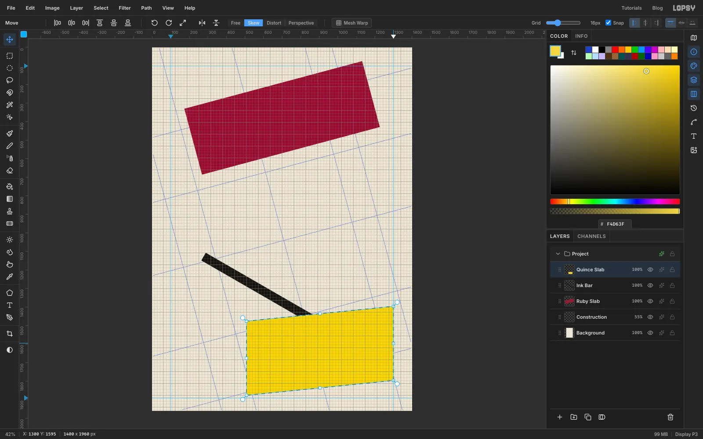

Add a layer called *Quince Slab*. Near the bottom of the card, marquee a
box that starts about a third of the way in from the left and runs to the
right margin. Fill it with quince yellow `#F4D63F`.

With the **Move** tool, click **Skew** in the options bar. Drag the handle
in the middle of the right edge straight up by about **80 px**. The right
side rises and the left side stays put. Click **Free**, then press
[[Cmd+D]].

Open the layer's effects with the ✦ button on its row and set the blend
mode to **Multiply**. That drawer is where every blend mode in this
tutorial is set. The ink bar now shows through where it crosses the slab.

## Pour the caramel

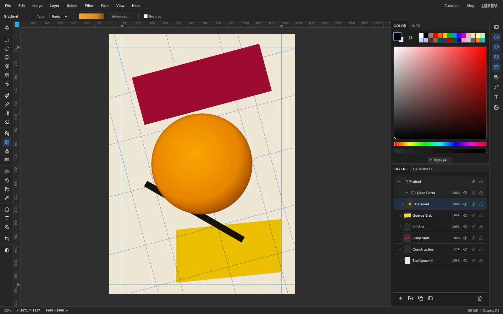

Turn the grid off again with **View → Show Grid**. Click **New Group**
at the bottom of the Layers panel and name it *Cake Parts*. Add a layer
inside it called *Caramel*.

Pick the **Elliptical Marquee**. Keep the options bar's **Ratio** at 1 : 1
and click its padlock, so the marquee stays a true circle. Drag out a
circle **760 px** across,
centred on the middle of the card. Watch the X and Y readout in the status
bar: start at about 320, 600 and finish at about 1080, 1360.

Pick the **Gradient** tool, set **Type** to **Radial** and click
**Advanced…**. Make three stops:

- light caramel `#F0A93A` on the left
- caramel `#D98C1F` at about 70%
- dark caramel `#8A4A12` on the right

Drag from just above and left of the centre out to the circle's right
edge, so the light falls from the top left. Deselect, then add an **Inner
Glow** in dark brown `#5C2C08` with **Size 36** and **Opacity 70**. This
darkens the rim like a baked edge.

## Lay the first ring of slices

The fruit goes on with **Filter → Kaleidoscope…**, so you only draw one
slice per ring. Kaleidoscope keeps the narrow slice of the layer just
clockwise of three o'clock, measured from the centre of the canvas, and
mirrors it all the way round. With 12 segments that slice is 15° wide,
and both of its edges are mirror lines. A shape centred on three o'clock,
or centred 15° below it, comes back as a clean ring.

Add a layer called *Quince Outer B*. With the **Lasso**, draw a crescent
with its centre about 15° below three o'clock, near X 990, Y 1060 in the
status bar. Its two tips should sit about 260 px out from the centre of
the cake, about 150 px apart. Bulge the outer curve out by about 60 px
and the inner curve by about 20 px, so the slice is about 40 px thick in
the middle. Fill it with dark quince `#B8424A`.

Choose **Filter → Kaleidoscope…**, set **Segments** to **12** and click
**Apply**. Then add an **Inner Glow** in dark red `#6E1822` (**Size 14**,
**Opacity 80**) and a 2 px **Stroke** in deep red `#5A1420`. The glow
reads as syrup pooling at the edges of each slice.

Now add a layer called *Quince Outer A*. Draw the same crescent centred
exactly on three o'clock, near X 1000, Y 980, and fill it with coral
`#E8875F`.

## Fan the outer ring

Run **Kaleidoscope** with **Segments 12** on the coral layer too. Give it
the same 2 px stroke and an **Inner Glow** in burnt orange `#A8402A`.

The coral ring sits half a slice round from the dark ring, so together
they overlap like fanned fruit.

## Add the inner ring

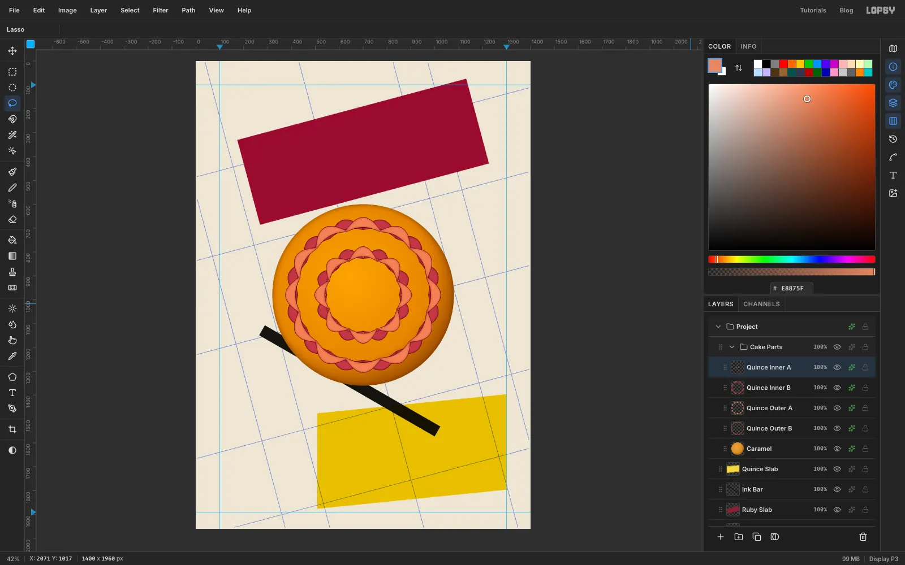

Repeat the last two steps for an inner ring. Name the layers *Quince
Inner B* and *Quince Inner A*. This time the tips sit about 140 px from
the centre and each slice is about 120 px from tip to tip.

With 8 segments the mirrored slice is 22.5° wide. Centre the dark slice
**22.5°** below three o'clock and the coral slice on three o'clock. Run
**Kaleidoscope** with **Segments 8** on each layer and give them the same
glows and strokes as the outer ring.

## Set the quince heart

Cut across the middle, a quince shows a five-pointed star of seed
chambers. Kaleidoscope can make that too.

Add a layer called *Quince Heart* and fill a 156 px circle in the centre
with `#F2C46A`. Give it an **Inner Glow** in `#C0703A` (**Size 18**) and
the same 2 px stroke.

Add a layer called *Seeds*. Lasso one small teardrop just right of the
centre, at three o'clock, pointing in towards the middle. Fill it with
dark brown `#3B1A10`. Run **Kaleidoscope** with **Segments 5** to get
five seeds.

## Glaze the top

Add a layer called *Glaze*. Pick the **Brush**, set **Size** to **46**
and the colour to white `#FFFFFF`. Drag one curved stroke along the upper-left part
of the outer ring, following its curve. Drop the size to **26** and add a
shorter arc over the inner ring.

Set the layer's blend mode to **Overlay** and its opacity to **28%**.
Keep the shine on the upper left. The light comes from there, and a
highlight on the shadow side would look wrong.

## Flatten the cake with Copy Merged

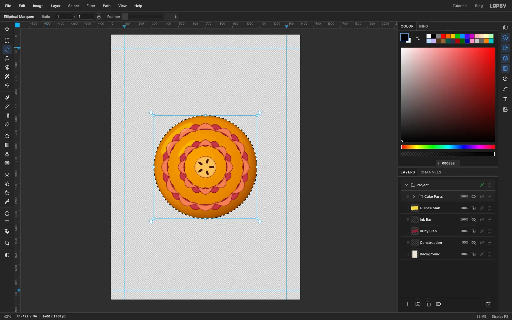

To slice the cake you need it on one layer. Collapse the *Cake Parts*
group with its arrow. Hide *Background*, *Construction*, *Ruby Slab*, *Ink
Bar* and *Quince Slab* with their eye icons, so only the cake is visible.

Draw a circular marquee just around the cake and choose **Edit → Copy
Merged**. This copies what you see, not just the active layer.

Click the *Quince Slab* row and choose **Edit → Paste**. The cake lands in
place on a new layer above it. Name that layer *Cake*. Hide the *Cake
Parts* group and turn the other layers back on.

## Lasso the first wedge

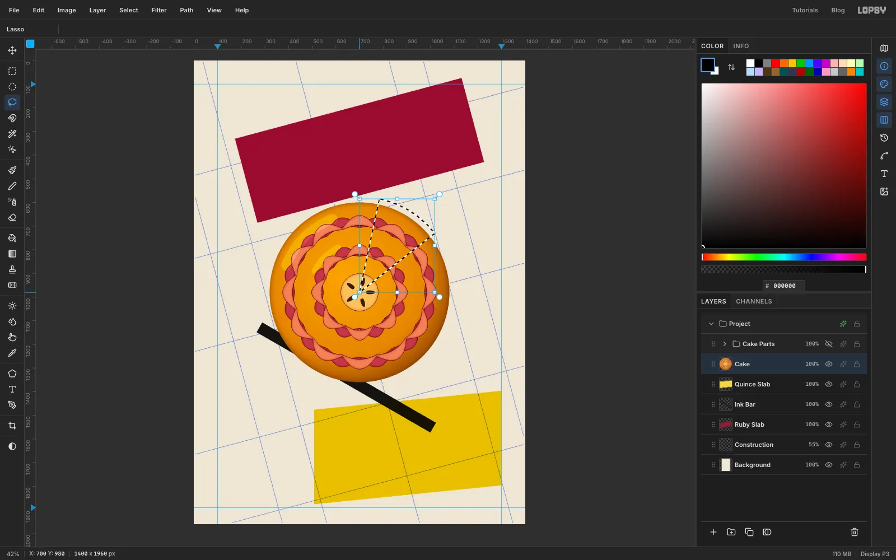

Select the *Cake* layer and pick the **Lasso**. Click in the exact centre
of the cake. Drag out past the rim at about half past twelve, round the
outside of the cake to about quarter to two, and back to the centre.

Choose **Edit → Cut** and then **Edit → Paste**. The wedge comes back on
its own layer in exactly the same spot, already selected. Paste also
switches you to the **Move** tool. Name the layer *Slice Up*.

## Pull the wedge out and turn it

With the **Move** tool, drag the wedge about **165 px** up and to the
right, straight out from the centre. Then drag its rotate handle to turn
it about **14°** clockwise and press [[Cmd+D]].

A gap opens in the cake where the wedge was. The paper and the ink bar
show through it.

## Turn a wedge upside-down

Back on the *Cake* layer, lasso a second wedge from the centre out
between about quarter past six and twenty to eight, at the lower left.
Cut and paste it as before and name it *Slice Flip*.

Hold [[Cmd]] and drag the rotate handle all the way round. [[Cmd]] snaps
the angle to steps of 15°, so it lands exactly on **180°**. Press
[[Cmd+D]], then drag the wedge about 220 px down and to the left, away
from the cake.

## Knock a sliver out of line

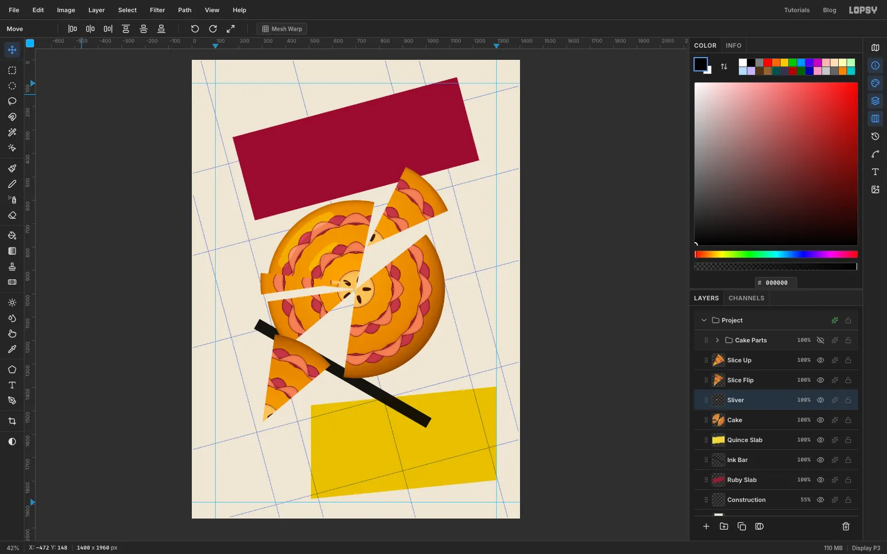

On *Cake* again, lasso a very thin wedge around nine o'clock, no more
than 15° wide. Cut and paste it as *Sliver*.

You're on the **Move** tool after the paste, so the arrow keys move the
pixels. Nudge the sliver about **28 px** left and **30 px** up. Hold
[[Shift]] for 10 px steps. That small, deliberate misalignment is
classic deconstructivism.

> **Tip:** Press [[Cmd+Z]] three times to undo the nudges and the paste,
> then [[Cmd+Shift+Z]] three times. The sliver goes back and returns
> exactly where it was.

## Add hard shadows

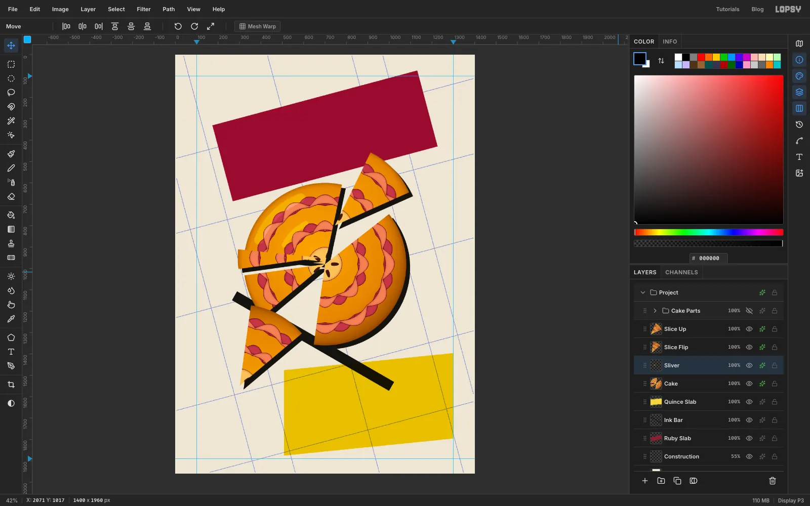

Hard shadows make the pieces look like solid blocks raised off the page.
Add a **Drop Shadow** to *Cake*, *Slice Up*, *Slice Flip* and *Sliver*.
Use the same settings on all four: **Offset X 18**, **Offset Y 18**,
**Blur 1**, **Spread 0**, **Opacity 100**, in ink `#15130F`.

Every piece then casts its shadow the same way, down and to the right,
which matches the light on the glaze.

## Show the sponge underside

The flipped wedge should show the bottom of the cake, not the fruit.
Click the *Slice Flip* row, then [[Cmd]]-click its thumbnail to select
its shape.

With the **Gradient** tool on **Linear**, set the stops to light sponge
`#F3DCA4` and toasted sponge `#D2A055`. Drag across the wedge.

Choose **Filter → Add Noise…**, pick **Mono** and set **Amount** to
**45**. Then soften it with **Filter → Gaussian Blur…** at radius **2**,
so the noise reads as crumb. Deselect.

Give the layer a brown **Inner Glow** (`#8A5420`, **Size 22**) and a
**Stroke** of **20** px in crust `#9A5418`, set to **Inside**.

## Draw a ghost of the cake

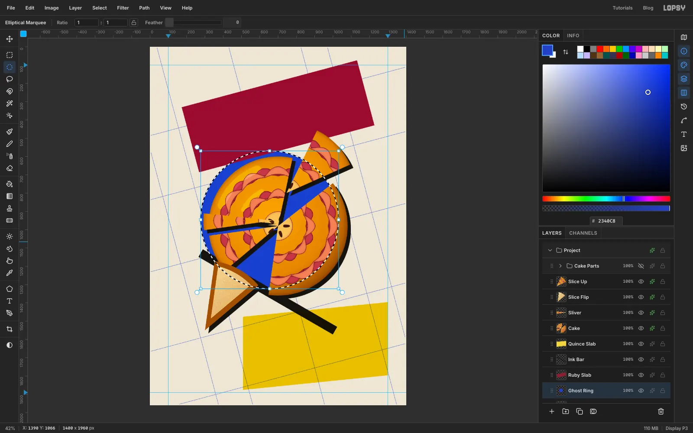

Architects draw where things *were*. Select *Construction* and add a
layer above it called *Ghost Ring*.

With the **Elliptical Marquee** (Ratio still locked at 1 : 1), draw a
circle the same size as the cake, but about 45 px to the left and 35 px
higher. Fill it with drafting blue. Choose **Select →
Shrink…**, set it to **3** px and click **Apply**. Then press [[Delete]].
Only a thin blue ring is left, peeking out from behind the cake. Press
[[Cmd+D]].

## Mark the cuts

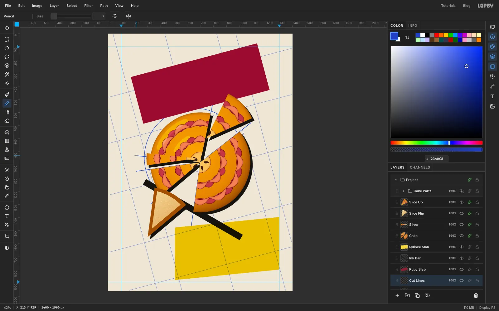

Add a layer called *Cut Lines*. With the **Pencil** at **Size 3** in
drafting blue, click the centre of the cake. Then [[Shift]]-click about
100 px past the rim along one cut edge.

Repeat for all six cut edges, two per piece. The lines show where each
piece came from.

## Screen a halftone panel

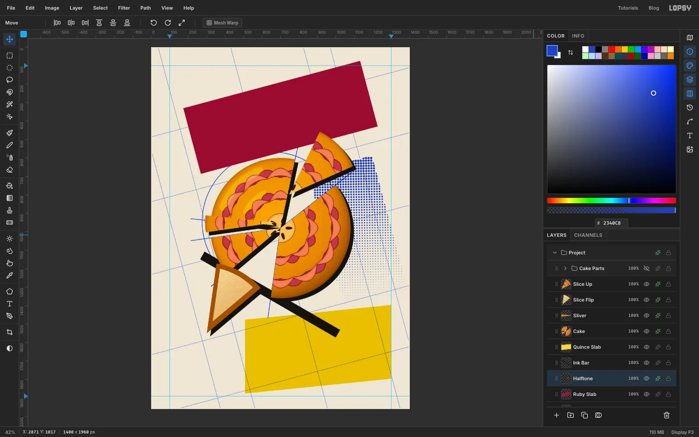

Click *Ruby Slab* and add a layer above it called *Halftone*. Marquee a
tall panel on the right side of the card, from just under the slab down
to about level with the bottom of the cake.

Fill it with a **Linear** gradient from near-black `#202020` at the top
to near-white `#F0F0F0` at the bottom. Choose **Filter → Halftone…**, set
**Dot Size** to **14** and **Angle** to **76**, and click **Apply**.

With the selection still live, turn the panel **15°** counter-clockwise
on its rotate handle, then deselect. Add a **Color Overlay** in drafting
blue and set the blend mode to **Multiply**.

## Set HAPPY on the slab

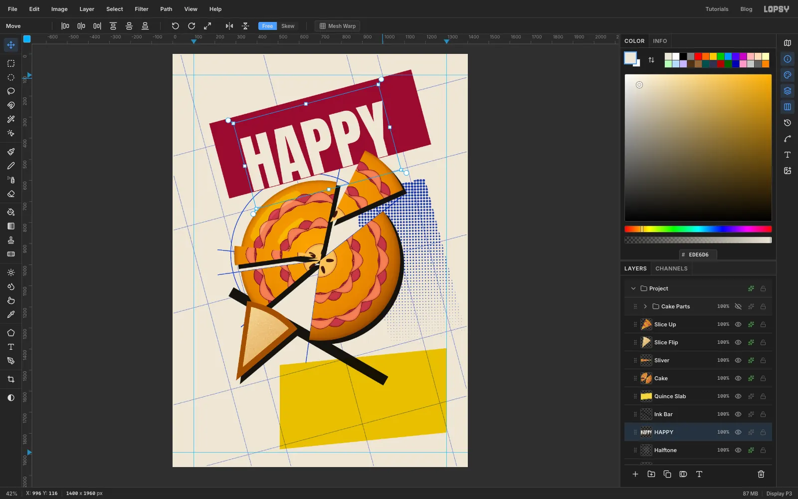

Click the *Halftone* row first. New layers land just above the active
one, so HAPPY goes above the slab but stays under the cake pieces.
Pick the **Text** tool, choose **Anton** in the font browser, set
**Size** to **300** and the colour to paper `#EDE6D6`. Click over the
left part of the slab, type **HAPPY** and press [[Tab]].

Switch to the **Move** tool. Live text gets its own transform box, so you
don't need a selection. Hold [[Cmd]] and drag the rotate handle to turn
the word **15°** counter-clockwise, parallel to the slab. Then drag it so it sits in the
middle of the slab.

## Set BIRTHDAY upside-down

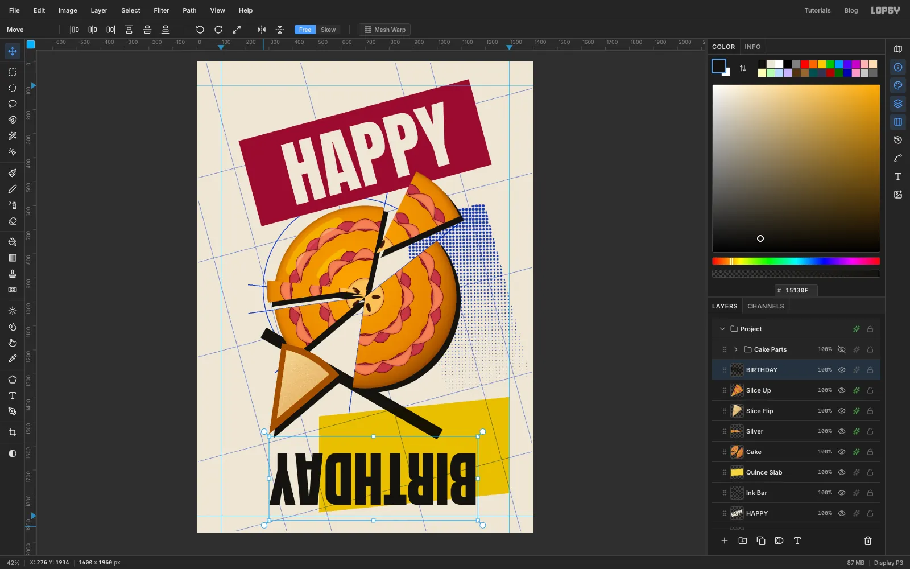

Click a picture layer such as *Slice Up* before you start new type. If a
text layer is active, changing the font and size restyles that layer
instead.

With the **Text** tool, keep **Anton**, set **Size** to **250** and the
colour to ink. Click in the lower left of the card, type **BIRTHDAY** and
press [[Tab]].

With the **Move** tool, hold [[Cmd]] and drag the rotate handle round to
**180°**. Drag the word onto the yellow slab. Its left end should run off
the slab onto the paper. Keep the whole height of the letters inside the
slab, including their baseline, which is now along the top.

## Run the title up the margin

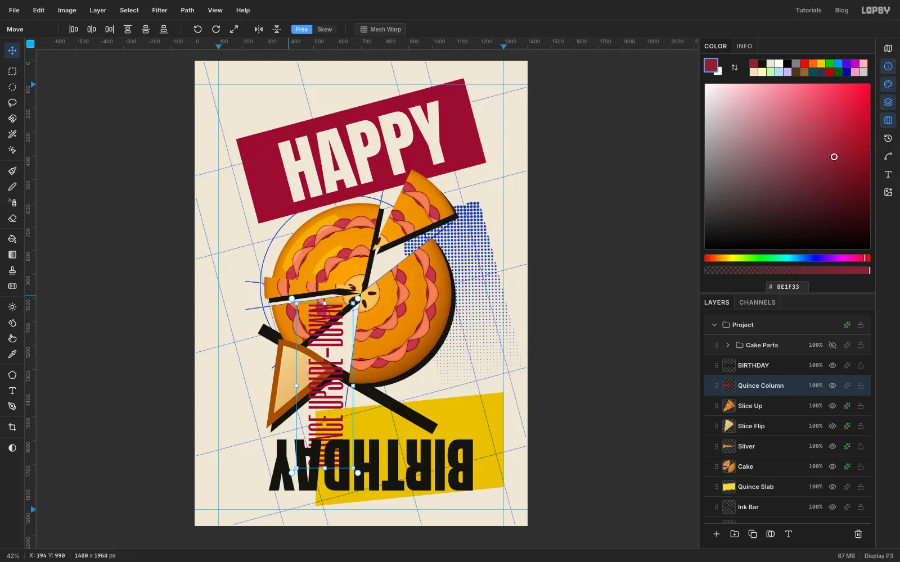

Click *Slice Up* again. Set the font to **Six Caps**, a very tall,
narrow face, at size **170** in ruby. Click in an empty area, type
**QUINCE UPSIDE-DOWN** and press [[Tab]].

Hold [[Cmd]] and rotate it **90°** counter-clockwise, so it reads from
bottom to top. Drag it against the left margin guide, centred beside the
cake.

## Write the greeting

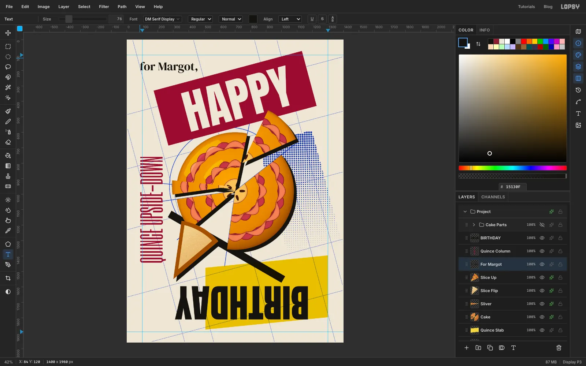

Click *Slice Up* once more. Choose **DM Serif Display** at size **76** in
ink. Click near the top-left margin and type **for Margot,** (or the
birthday person's name). Press [[Tab]].

Line up its left edge with the vertical title below it.

## Clear lines behind the type

Thin lines running through small type make it hard to read. Select the
*Construction* layer and pick the **Eraser**. At **Size 90**, sweep once
across behind *for Margot,*.

Drop to **Size 50** and sweep along the bottom edge under BIRTHDAY, where
a closing line will go later.

## Slice through HAPPY

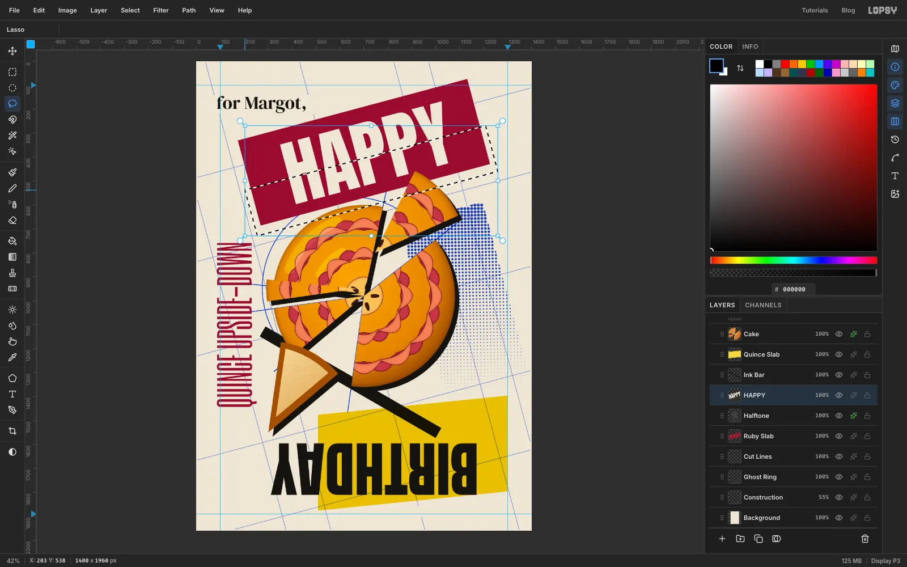

Slicing a word is a deconstructivist signature. Select *HAPPY* and click
**Rasterize Layer** at the bottom of the Layers panel. That turns the text
into pixels you can cut.

With the **Lasso**, click four corners to make a band parallel to the
slab. Its top edge should run just below the crossbar of the H, and its
bottom edge should sit below the letters.

Choose **Edit → Cut**, then **Edit → Paste**, and name the new layer
*HAPPY Lower*.

## Slide the lower half

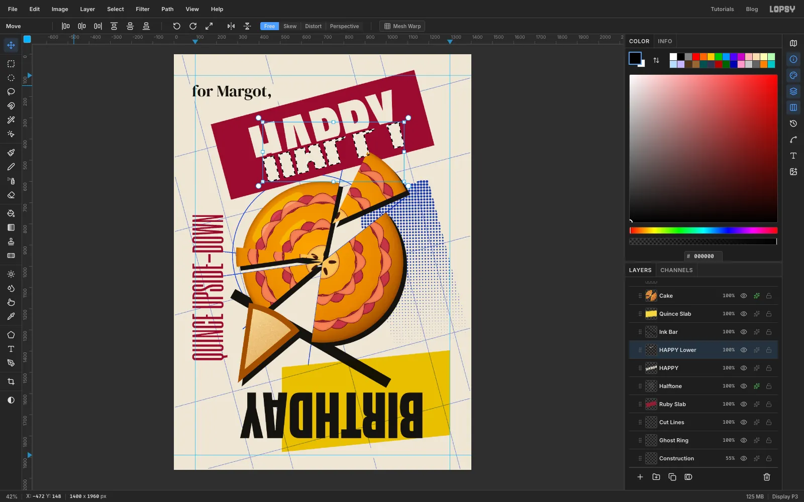

Paste has switched you to the **Move** tool, so use the arrow keys to
nudge the lower half about **30 px** to the right and just a few pixels
down. Each bottom half slips sideways off its top half, and a thin ruby
seam opens along the cut. Press [[Cmd+D]].

Keep the slide small. If it's much more than a third of a letter's width,
the two halves stop reading as one word.

## Colour DAY ruby

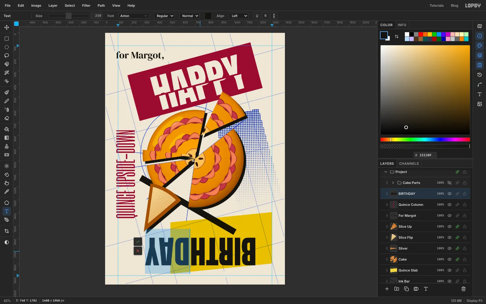

Pick the **Text** tool and click on BIRTHDAY to edit it. It stays upside
down while you work.

Press [[End]], then [[Shift+Left]] three times to select **DAY**. The
keys follow the word's own order, so the highlight shows up on the left
side of the upside-down word.

Click the **Text color** swatch in the options bar, type `8E1F33` into
its hex field and press [[Enter]]. Click the swatch again to close it,
then press [[Tab]]. Only DAY turns ruby.

## Add a caption and a closing line

Click *Slice Up* first, then choose **IBM Plex Mono**, **Medium**, size
**24**, in drafting blue. Type **fig. 1 — exploded view** in an empty
area. Rotate it with [[Cmd]] held so it snaps to **15°**, and drag it to
float just above the slab's top edge, like a label on a drawing.

Do the same in ink for **make a wish — then turn it over**. Click near
the very bottom of the card to start it, well clear of BIRTHDAY. Clicks
close to rotated text can land in its text box and edit it instead. Use
the arrow keys to bring the line up under the yellow slab, roughly under
the right half of BIRTHDAY. You'll line it up exactly in the next step.

## Group and move the notes

Click the caption's row and [[Shift]]-click the closing line's row. Then
choose **Layer → Group Layers** and name the group *Notes*.

With the group selected, drag with the **Move** tool to shift both lines
together. Go about 40 px left and 10 px down, until the closing line's
right edge lines up with the right edge of the B and it sits just inside
the bottom margin guide. The caption moves with it, which gives it a
little more air above the slab.

Erase the construction lines from under the caption with a **Size 44**
eraser sweep, as you did for the greeting.

## Add print grain

Collapse both groups. Click *Cake Parts* and add a layer called *Grain*,
so it sits above everything.

Choose **Select → All**, fill with mid grey `#808080` and run **Add
Noise** at **22** with **Mono** on. Deselect. Set the blend mode to
**Overlay** and the opacity to **35%**. Mid grey disappears on Overlay,
so only the speckle shows. That takes the digital edge off the flat
colours.

Hide the guides with **View → Show Guides**. Save the project with
**File → Save Project**, and export it with **File → Quick Export PNG**.
