Dieselpunk is the machine age seen through a slightly smoky lens: the 1930s and 40s, when airships, propeller planes and streamlined locomotives were the future. As a graphic style it takes the geometry of Art Deco and makes it heavier and more industrial:

- **materials you could touch**: riveted steel plate, brass trim, enamel and worn paper
- **aviation and engines**: hangars, propellers, airships and searchlights
- **a warm, limited palette**: gunmetal, oxblood, brass and sepia, like an old photo under bar lights
- **stencil and Deco lettering**: type that looks painted on a crate or cast in a nameplate

In this tutorial you'll use all four for **Aerodrome**, a made-up steakhouse in an old airship hangar. The menu is **1200 × 1700 px**. The top half is the restaurant's name over a photo of an airship in its hangar, and the bottom half holds two menu cards bolted to the steel.

You'll need one photo from Wikimedia Commons, released into the public domain by the National Museum of the U.S. Navy:

- **USS Macon (ZRS-5) (23967960381).jpg**, the US Navy airship *Macon* docked in her new hangar at Moffett Field in October 1933. Download the 1600 px version.

The tools you'll use:

- **Add Noise** and **Clouds** for a steel plate and paper stains
- the **Brush** with Shift-click lines, and its **Spacing** setting turned up to draw rows of rivets
- a **layer mask** made from an Elliptical and a Rectangular Marquee, and a **Gradient Map** group adjustment for sepia
- the **Clone Stamp** to tidy up the photo
- the **Gradient** tool, **Select → Shrink** and **Lasso** for brass and ribbon shapes
- the **Shape** tool for rounded cards, a disc, and squares turned into diamonds with the rotate handle
- the **Pen** tool and **text on a path** for a round badge
- **Duplicate Layer**, **Rotate 90°**, **Merge Down** and group transforms
- layer effects (**Drop Shadow**, **Inner Glow**, **Stroke**) and a **Vignette** on the whole document

The palette is gunmetal and brass, with oxblood and sepia:

- Gunmetal `#2A2F31`, seam shadow `#0E1112`, seam highlight `#6A7376`, rivets `#A3A9A6`
- Sepia photo `#120B09` → `#7E2C1E` → `#C48A4C` → `#EFE2C4`
- Brass `#5A3A12` → `#E9C46F` → `#8A5E22` → `#F6DE94` → `#7A5019` → `#D4A653`
- Gold type `#D9AE5C`, screws `#C9A04F`
- Oxblood ribbon `#B23224` → `#7A1C14` → `#4A0F0A`, badge `#6E1912`, menu red `#8E2A1C`
- Parchment `#EADCB8`, cream `#F4E6C4`, menu ink `#221C16`, description brown `#3A2A1E`

The type is four Google fonts: **Limelight** for the name, **Stardos Stencil** for headings and the badge, **Antonio** for dish names and prices, and **Special Elite** for the typewriter descriptions.

> **Note:** Shortcuts are written for a Mac. On Windows use [[Ctrl]] wherever it says [[Cmd]].

> **Tip:** A Text tool click inside an existing text layer edits that layer instead of starting a new one. Changing the font or size while a text layer is selected also restyles that layer. Before you set up the next piece of type, click a non-text layer such as a card, then type in empty space and move the text afterwards.

## Make the steel plate

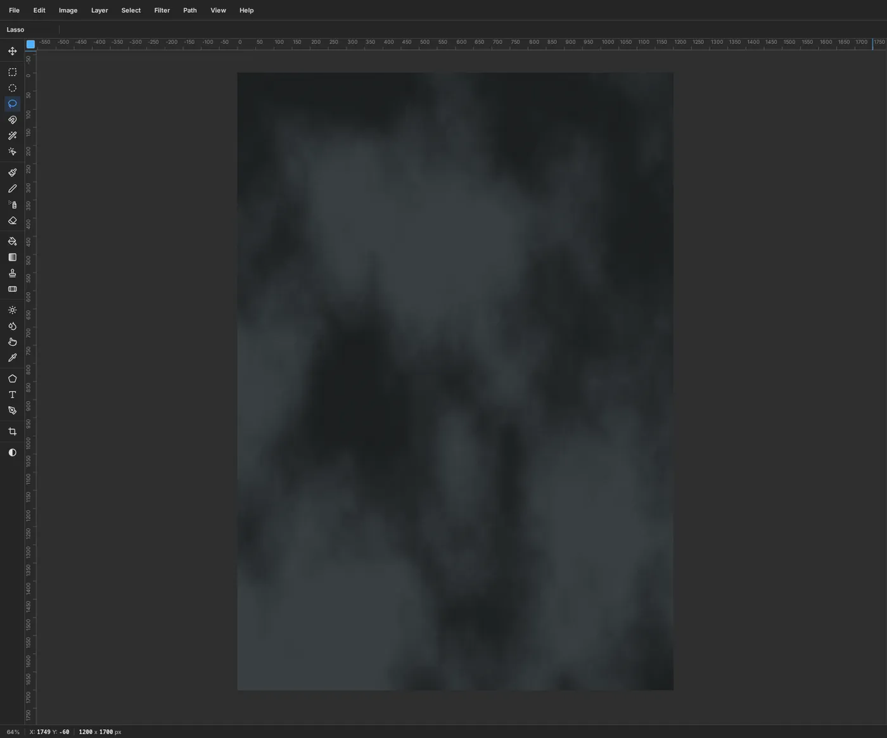

Choose **File → New** and make a document **1200** wide and **1700** high. A new document has a *Project* group holding a *Background* layer and an empty *Layer 1*.

Click *Background*, set the foreground colour to `#2A2F31` and choose **Edit → Fill**. Then run **Filter → Add Noise…** with **Mono** and **Gaussian** selected and **Amount** `12`. That gives the flat grey a fine grain, like rolled steel.

Rename *Layer 1* to `Grime` and run **Filter → Clouds…** with **Scale** `4`. Open its effects drawer, set the blend mode to **Overlay**, and lower its opacity to `35%`. The clouds now darken and lighten the steel in soft, uneven patches.

## Draw the plate seams

The menu is made of four steel plates: one for the header, two side by side for the menu, and a strip for the footer. Add a layer named `Seams` and pick the **Brush** with **Size** `4` and **Hardness** `100`.

Set the foreground to `#0E1112`. The dark lines are the gaps between plates. Click on the left edge of the canvas at `y = 760`, then [[Shift]]-click on the right edge at the same height to draw a straight line between the two clicks. Do the same at `y = 1600`, then draw a vertical line down the middle from `600, 760` to `600, 1600`.

Switch the brush to **Size** `2` and the colour to `#6A7376`. Draw a second set of lines 4 px below and 4 px right of the first (at `y = 764`, `y = 1604` and `x = 604`). The thin light line next to the dark one reads as the lit edge of an overlapping plate.

## Add rows of rivets with brush spacing

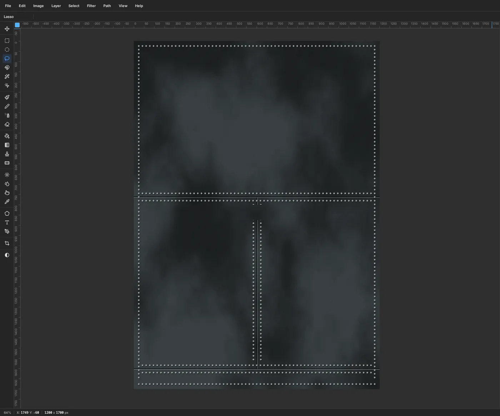

Add a layer named `Rivets`. Click the brush tip thumbnail at the left end of the options bar to open the **Brushes** panel, and on the **Shape** tab set **Size** `9`, **Hardness** `100` and **Spacing** `200`. Close it with the ✕. Spacing is the gap between dabs as a percentage of the brush size, so at 200% each dab lands 18 px from the last and a stroke becomes a row of dots.

Set the foreground to `#A3A9A6` and draw each row with a click and a [[Shift]]-click:

- around the outside, 24 px in from each edge of the canvas
- two rows along each horizontal seam, about 16 px above and 20 px below it (at `744` and `780`, and at `1584` and `1620`)
- two rows down the middle seam, at `x = 584` and `x = 620`, from just below the top seam to just above the bottom one

Rivets hold the plates together, so they always follow the edges and seams. That's what makes the steel look built rather than printed.

Give the layer a **Drop Shadow** (Offset X `1`, Offset Y `2`, Blur `2`, Opacity `90%`, colour `#050607`) and an **Inner Glow** (Size `3`, Opacity `70%`, colour `#2B3133`). The dark inner glow shades each rivet's rim so it looks domed, and the shadow lifts it off the plate.

The word STEAKHOUSE will sit across the top of the middle seam later, so clear a gap for it now. Drag a marquee from about `560, 792` to `645, 874`, around the top of the two middle rivet rows, and press [[Delete]]. Select *Seams* and press [[Delete]] again to cut the seam line with the same marquee, then press [[Cmd+D]].

> **Tip:** The Brushes panel only closes with its ✕ button, not with Escape. Remember to set **Spacing** back to about `5` before you draw ordinary lines later.

## Drop in the airship photo

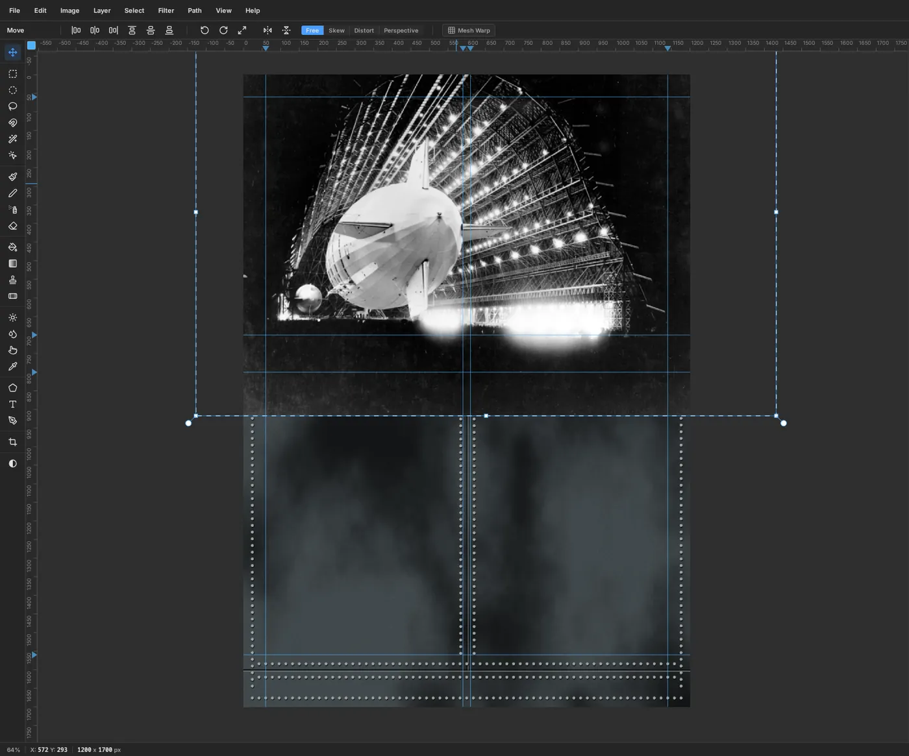

Click *Rivets*, then drag the USS Macon photo from your desktop onto the canvas. Lopsy puts it on a new layer, scales it to fit the canvas width and leaves its transform handles showing. Rename the layer `Airship Photo`.

With the handles still live, hold [[Cmd]] and drag the bottom-right corner handle outwards until the photo is about one and a half times as big (roughly 1875 px wide). [[Cmd]] keeps the proportions. Then drag the middle of the photo up and left until the airship's tail sits near the top centre and its nose fills the left half of the header. Press [[Cmd+D]] to commit.

Don't worry that the photo now covers most of the menu. The next step cuts it down to an arch.

## Select an arch

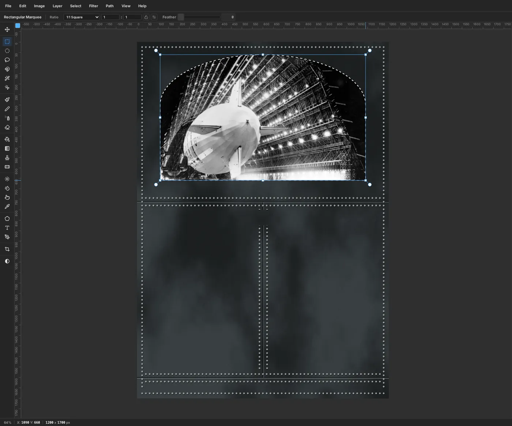

An Art Deco arch is a half-ellipse sitting on a rectangle, and that's exactly how you select it.

1. Pick the **Elliptical Marquee** and drag from `110, 60` to `1090, 540`. That's an ellipse 980 px wide whose middle is at `y = 300`.
2. Switch to the **Rectangular Marquee**, hold [[Shift]] and drag from `110, 300` (the middle of the ellipse's left side) down to `1090, 660`. [[Shift]] adds the rectangle to the ellipse.

The bottom half of the ellipse disappears inside the rectangle, leaving one arch-shaped selection.

## Mask the photo to the arch

With *Airship Photo* selected, click **Add Mask** at the bottom of the Layers panel. With a selection active, the mask shows only the selected area and hides the rest, and the selection is dropped.

A mask hides pixels without deleting them, so if you want to shift the photo inside the arch later you still can.

## Turn the photo sepia with a Gradient Map

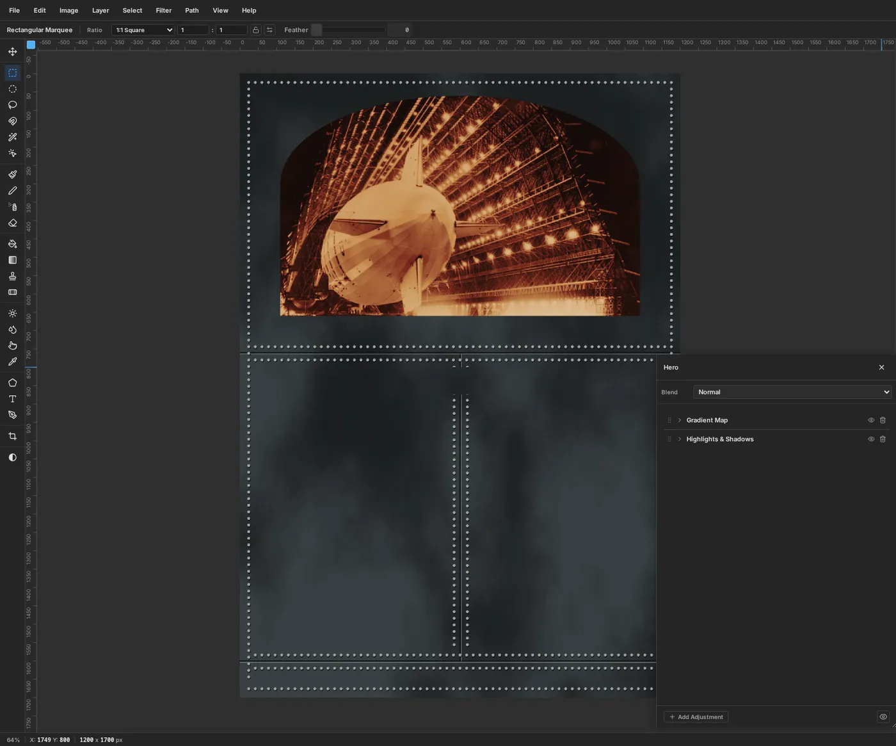

With *Airship Photo* selected, choose **Layer → Group Layers** and name the group `Hero`. Click the group's effects button in the Layers panel. On a group, this drawer holds **adjustments** that apply to everything inside the group.

Click **Add Adjustment → Gradient Map**. Click the left stop and type `#120B09` into its hex field, and set the right stop to `#EFE2C4`. Click the bar at about 42% to add a stop and make it `#7E2C1E`, then add another at about 74% and make it `#C48A4C`. The map replaces each grey in the photo with the colour at that point on the bar, so dark trusses go deep brown and the lamps go cream.

Add a **Highlights & Shadows** adjustment and set **Highlights** to `-12` to bring back a little detail in the brightest part of the airship. Keep it subtle: large negative values flatten the lamps.

The photo also shows the top of a small blimp parked in the bottom-left corner of the hangar. Once the ribbon goes on, only a sliver of it peeks out above the ribbon and looks like a mistake, so remove it now. Select *Airship Photo*, pick the **Clone Stamp** at **Size** `44`, [[Alt]]-click on the hangar truss just above it to set the source, and paint over the blimp. A second pass at **Size** `28` cleans up the last sliver.

## Frame the arch in brass

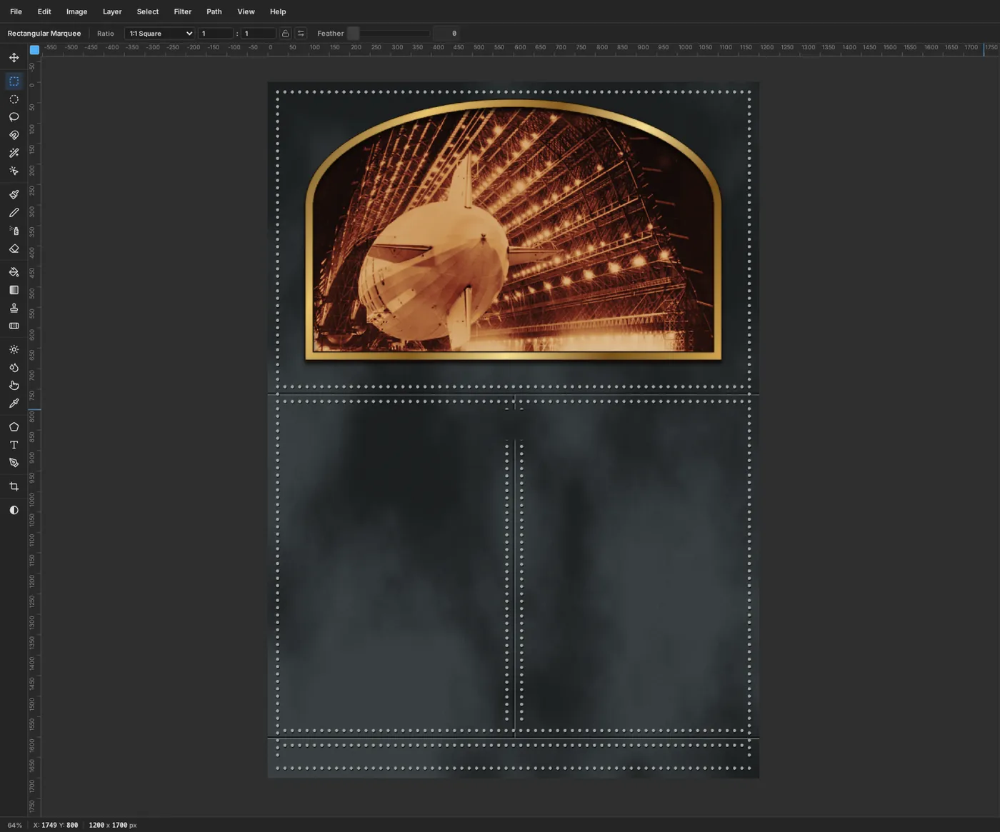

Click **Add Layer** and name the layer `Brass Arch`. Because *Airship Photo* was selected, the new layer lands inside the *Hero* group. Drag its row up above the *Hero* group, or the Gradient Map turns the brass sepia too.

Make the same arch selection again, 18 px bigger all round: an ellipse from `92, 42` to `1108, 558`, then a [[Shift]]-dragged rectangle from `92, 300` to `1108, 678`.

Pick the **Gradient** tool, open the **Gradient Editor** and give it six stops for polished brass: `#5A3A12`, `#E9C46F` at 22%, `#8A5E22` at 45%, `#F6DE94` at 62%, `#7A5019` at 80% and `#D4A653`. Drag from the top-left of the selection to its bottom-right. Alternating light and dark bands are what make flat colour read as curved metal.

Keep the selection and choose **Select → Shrink…** with `18` px, then press [[Delete]]. Only an 18 px brass band remains around the photo. Press [[Cmd+D]].

Give *Brass Arch* a **Drop Shadow** (Offset Y `8`, Blur `16`, Opacity `85%`, `#050404`), an **Inner Glow** (Size `5`, Opacity `80%`, `#3B2408`) and a 2 px **Stroke** in `#1E1306`.

## Lasso the ribbon

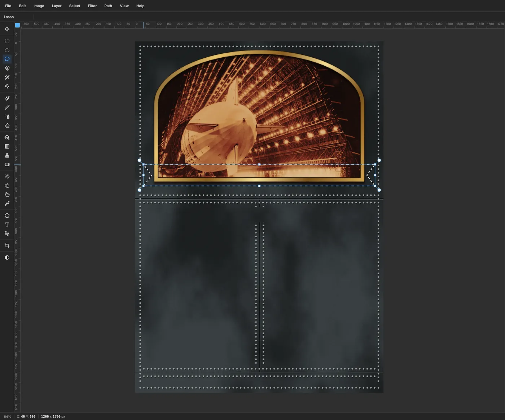

Add a layer named `Banner`. The ribbon is a long bar about 104 px tall with a V-shaped notch cut into each end, a "swallow-tail".

Pick the **Lasso** and click around these six points, ending back on the first one: the top-left corner at `40, 595`, the top-right corner at `1160, 595`, the notch point `1120, 647`, the bottom-right corner `1160, 699`, the bottom-left corner `40, 699`, and the left notch point `80, 647`.

## Fill the ribbon

With the **Gradient** tool, set three stops: `#B23224`, `#7A1C14` in the middle and `#4A0F0A`. Drag from the top of the ribbon straight down to its bottom, then press [[Cmd+D]].

Give *Banner* a **Drop Shadow** (Offset Y `10`, Blur `18`, Opacity `80%`) and a 3 px **Stroke** in `#D9AE5C`. The gold edge ties the ribbon to the brass arch.

## Set the name in Limelight

Click *Banner* so the next text starts fresh. Pick the **Text** tool, choose **Limelight** at **Size** `84` with **Center** alignment, set the foreground to `#F4E6C4`, click at `600, 590` and type `AERODROME`. Press [[Tab]] to commit.

In the **Text** panel, set **Letter spacing** to `10` px. Deco capitals look best with air between them. Then add a small **Drop Shadow** (Offset Y `4`, Blur `3`, Opacity `70%`, `#2A0906`) so the letters sit on the ribbon rather than float above it.

Check the result. The capitals should sit in the vertical middle of the ribbon, with the same red above and below them. If they don't, nudge the layer with the arrow keys.

## Add STEAKHOUSE with brass rules

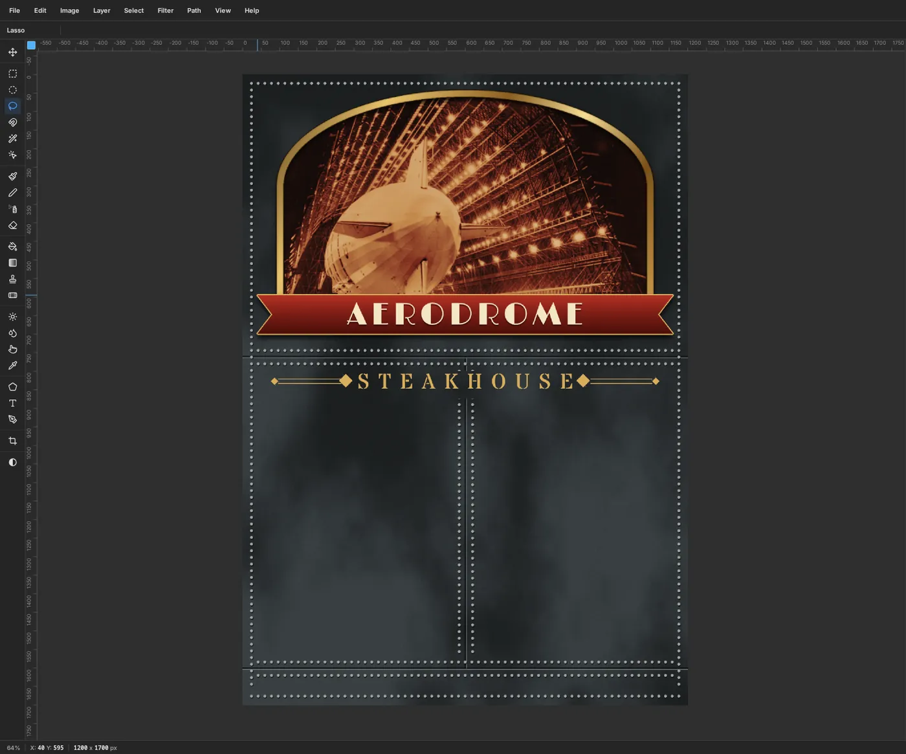

Click *Banner* first, so the new font settings don't restyle *AERODROME*. Set the foreground to `#D9AE5C`, and with the **Text** tool choose **Stardos Stencil** at `58`, still centred. Click at `600, 790`, type `STEAKHOUSE` and press [[Tab]]. Set **Letter spacing** to `24`.

Now the double rules. Add a layer named `Brass Rules`, pick the **Brush** at **Size** `3`, and in the Brushes panel set **Spacing** back to `5`. With a click and a [[Shift]]-click each time, draw four lines:

1. Left side, top: from `96, 821` to `266, 821`.
2. Left side, bottom: from `96, 833` to `266, 833`.
3. Right side, top: from `938, 821` to `1104, 821`.
4. Right side, bottom: from `938, 833` to `1104, 833`.

Then the diamonds. Pick the **Shape** tool, choose **Polygon** with **Sides** `4`, and set its **Fill** swatch to `#D9AE5C`. Click once without dragging and a dialog asks for the size. Make a `26` × `26` square at `282, 827` and another at `922, 827`, next to the inner ends of the rules, and a `14` × `14` square at `86, 827` and `1114, 827`, at the outer ends.

A 4-sided polygon is a square, so turn each one into a diamond. For each of the four squares:

1. Drag a marquee just around it.
2. Switch to the **Move** tool and drag the round rotation handle with [[Cmd]] held. [[Cmd]] snaps to 15° steps, so stop when it has turned 45°.
3. Press [[Cmd+D]] to commit the rotation.

## Draw the first menu card

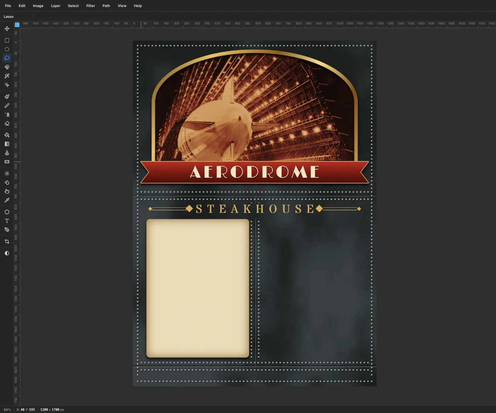

Turn on the rulers if they're hidden and click the top ruler at `70`, `570`, `630` and `1130` and the left ruler at `880` and `1556` to drop guides for the two cards.

Add a layer named `Grill Card`. Pick the **Shape** tool, choose **Rectangle**, set **Corner Radius** to `14` and the **Fill** swatch to `#EADCB8`. Shape drags grow out from the point where you press, so press in the centre of the left card area (`320, 1218`) and drag out to the bottom-right guide corner (`570, 1556`). The card snaps to the guides on all four sides.

[[Cmd]]-click the layer's thumbnail to select the card, run **Filter → Add Noise…** with **Mono**, **Gaussian** and **Amount** `7`, then press [[Cmd+D]]. Give the card:

- an **Inner Glow** of Size `70`, Opacity `80%` in `#7E5A2A`, to age the edges
- a 3 px **Stroke** in `#C9A04F`
- a **Drop Shadow** with Offset Y `10`, Blur `20` and Opacity `80%`

## Duplicate it for the second card

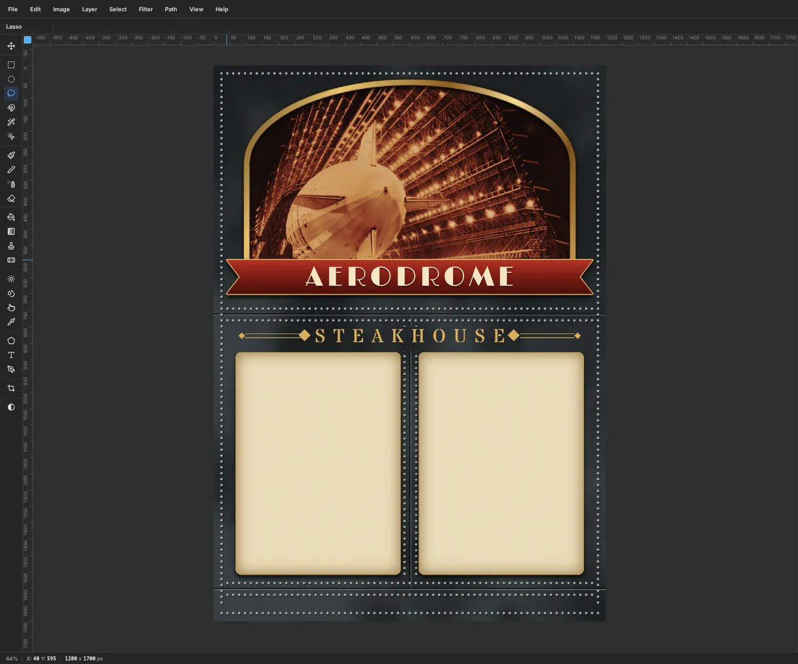

Choose **Layer → Duplicate Layer**. The copy lands exactly on top of the original, so rename it `Bar Card` and drag it with the **Move** tool until its left edge sits on the guide at `630`. Effects are duplicated too.

Use the arrow keys to correct any small vertical drift. Each press moves the layer 1 px, and the card's top should line up with the first card's at `880`.

## Select both cards at once

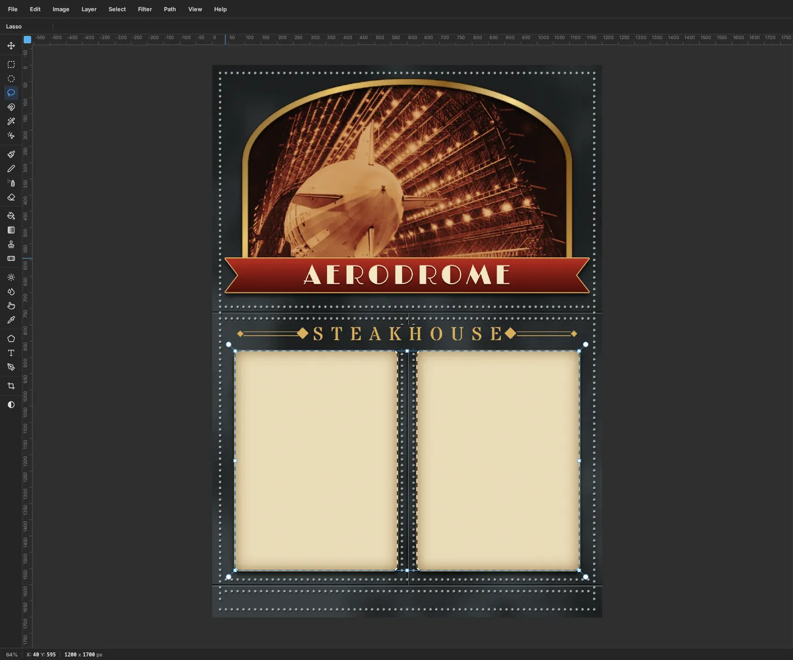

Add a layer named `Paper Stains` above the two cards. Then build a selection of both cards from their thumbnails:

1. [[Cmd]]-click the *Grill Card* thumbnail to load its shape as a selection.
2. [[Cmd+Shift]]-click the *Bar Card* thumbnail to add the second shape.

The selection follows the rounded corners exactly, which would be fiddly with a marquee.

## Stain the paper

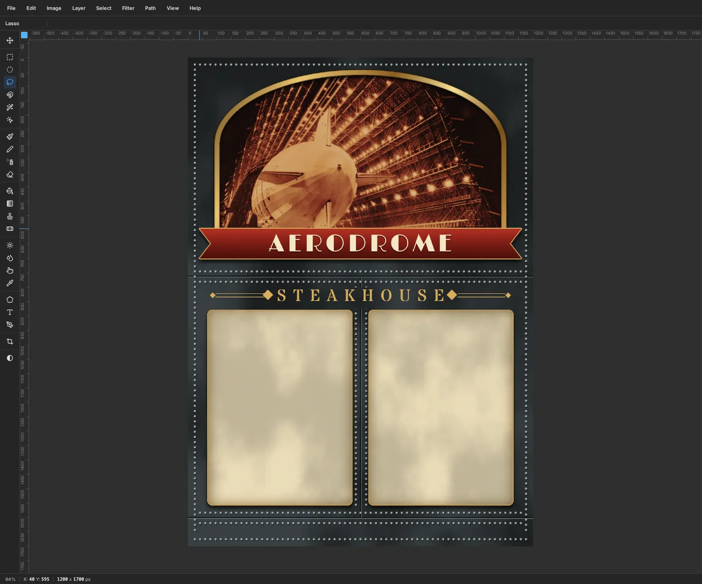

With *Paper Stains* still selected and the selection active, run **Filter → Clouds…** with **Scale** `7`. The clouds only fill the selection. Press [[Cmd+D]].

Open the effects drawer for *Paper Stains*, set the blend mode to **Multiply**, and lower its opacity to `18%`. Multiply only darkens, so the light parts of the clouds vanish and the dark parts become faint tea stains.

## Write the grill list

From here on, start every new text layer by clicking a non-text layer such as *Bar Card*, as the tip at the top explains. Set the foreground to `#8E2A1C`, and with the **Text** tool make **Stardos Stencil** `36`, centred, at `320, 900`. Type `FROM THE GRILL`, press [[Tab]] and set **Letter spacing** to `6`. Make `HANGAR SIDES` the same way, centred at `880, 900`.

Click *Bar Card* again, then choose **Antonio** at `30`, **Left** alignment and foreground `#221C16`. Click at `100, 960` and type the five dish names, pressing [[Return]] after each: `THE ZEPPELIN`, `SPITFIRE RIBEYE`, `WING COMMANDER`, `THE HANGAR STEAK` and `LANDING GEAR LAMB`.

Press [[Tab]], set **Letter spacing** to `1` and **Line height** to `3.9`. A tall line height leaves room under each name for its description. Move the layer so the first name sits about 40 px below the header.

## Add descriptions and prices

Click *Bar Card*, choose **Special Elite** at `18` in `#3A2A1E`, and click in empty canvas, away from the other text. Type the five descriptions, pressing [[Return]] twice after each so there's a blank line between them:

- `32 oz porterhouse, dry-aged 40 days`
- `16 oz ribeye, chili-coffee crust`
- `9 oz filet, bone-marrow butter`
- `butcher's cut, salsa verde, smoked onion`
- `double-cut chops, mint gremolata`

Press [[Tab]] and set **Line height** to `3.25`. With the blank lines, that matches the spacing of the names.

Drag the block with the **Move** tool until the first description sits just under *THE ZEPPELIN*, then fine-tune with the arrow keys so every description is about 12 px below its name.

For the prices, use **Antonio** `30` in `#8E2A1C` with **Right** alignment. Click at `540, 960` (right-aligned text grows leftwards from where you click) and type `68`, `44`, `52`, `29` and `38` on separate lines. Give it the same **Line height** of `3.9`, then nudge it until each price lines up with its dish name.

## Fill the second card

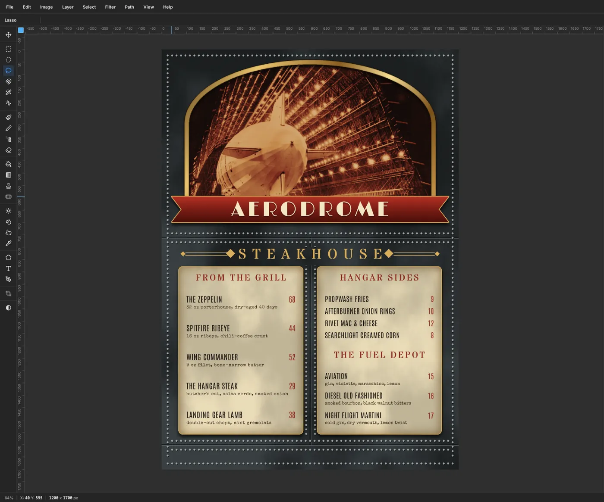

The right card uses the same fonts and colours as the left one, in two sections. Make each block as its own text layer, then move it into place:

1. **Sides.** Antonio `28` in `#221C16`, **Left**, letter spacing `1`, **Line height** `1.75`. Click at `660, 960` and type `PROPWASH FRIES`, `AFTERBURNER ONION RINGS`, `RIVET MAC & CHEESE` and `SEARCHLIGHT CREAMED CORN` on separate lines. Sides have no descriptions, so they sit closer together. Move the block so its first line starts about 40 px below the *HANGAR SIDES* heading.
2. **Side prices.** Antonio `28` in `#8E2A1C`, **Right**, **Line height** `1.75`. Click at `1100, 960` and type `9`, `10`, `12` and `8`. Nudge them level with the sides.
3. **Second heading.** Stardos Stencil `36` in `#8E2A1C`, centred, letter spacing `6`. Type `THE FUEL DEPOT` at `x = 880`, then move it so it sits about 50 px below *SEARCHLIGHT CREAMED CORN*.
4. **Cocktails.** Antonio `28` in `#221C16`, **Left**, **Line height** `2.85`: `AVIATION`, `DIESEL OLD FASHIONED` and `NIGHT FLIGHT MARTINI`, starting at `x = 660` about 40 px below the heading's rules.
5. **Cocktail prices.** Antonio `28` in `#8E2A1C`, **Right** at `x = 1100`, **Line height** `2.85`: `15`, `16` and `17`.
6. **Cocktail descriptions.** Special Elite `18` in `#3A2A1E`, **Left**, **Line height** `2.2`: `gin, violette, maraschino, lemon`, `smoked bourbon, black walnut bitters` and `cold gin, dry vermouth, lemon twist`, with a blank line between each. Move it so each description sits about 12 px under its cocktail, as on the left card.

> **Tip:** Letter spacing carries over from the last text you set up. If the cocktail descriptions come out widely tracked, select the layer and set **Letter spacing** back to `0` in the Text panel.

Keep the spacing consistent with the left card: about 40 px from each heading's rule to the first item, and roughly the same space left at the bottom of both cards.

## Add rules and brass screws

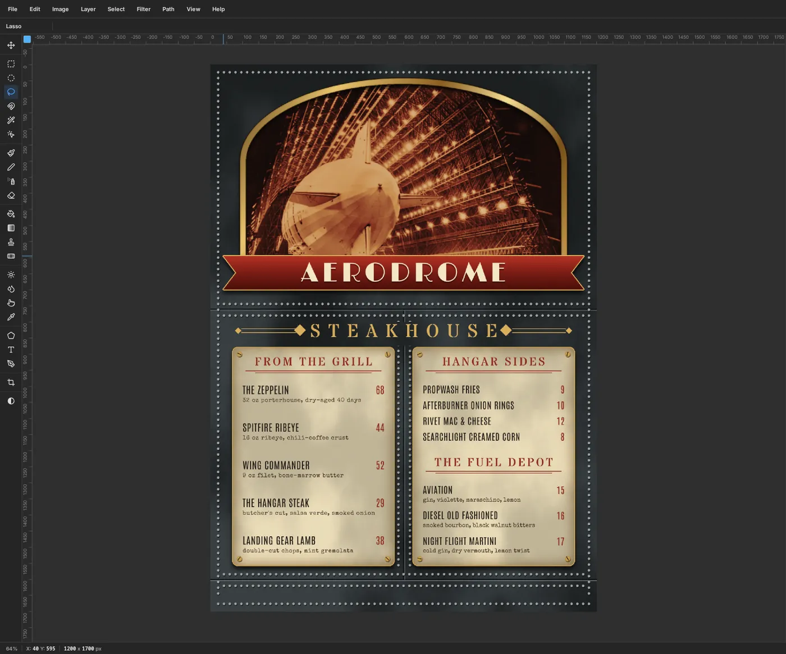

Add a layer named `Card Rules`. With the **Brush** at **Size** `2` in `#8E2A1C`, draw a long line under each heading and a shorter one 6 px below it, using a click and a [[Shift]]-click:

- *FROM THE GRILL*: `110` to `530` at `y = 952`, then `140` to `500` at `y = 958`
- *HANGAR SIDES*: `670` to `1090` at `y = 952`, then `700` to `1060` at `y = 958`
- *THE FUEL DEPOT*: the same lengths as *HANGAR SIDES*, about 14 px below the heading's letters

Choose **Edit → Clear Guides** before the next part, because marquee edges snap to guides and would stretch the screws. Add a layer named `Screws` and pick the **Elliptical Marquee**:

1. Zoom in on the top-left corner of the left card and drag a 16 px circle centred about 20 px in from both edges, at `90, 900`.
2. Hold [[Shift]] and drag the same size circle in each of the other seven corners. The centres are `550, 900`, `90, 1536` and `550, 1536` on the left card, and `650, 900`, `1110, 900`, `650, 1536` and `1110, 1536` on the right. Holding [[Shift]] adds each circle to the selection.
3. Fill the selection with `#C9A04F` and press [[Cmd+D]].

For the slots, pick the **Pencil** at **Size** `2` in `#3A2810`. Draw a short line across each screw with a click and a [[Shift]]-click, at a different angle on each, the way real screws end up. Give the *Screws* layer a tiny **Drop Shadow** (Offset X `1`, Offset Y `2`, Blur `2`, `#2A1A08`) and an **Inner Glow** (Size `4`, `#6B4A1E`) so the screws look round.

## Add the footer line

Click *Screws*, then make a centred **Stardos Stencil** line at `19` px in `#D9AE5C` with **Letter spacing** `2.5`. Click at `600, 1632`, the middle of the footer strip, and type:

`OPEN NIGHTLY FROM 5 PM  ✦  ’TIL THE LAST LANDING  ✦  RUNWAY 2, CLOVER FIELD`

Check that it clears the side rivets with room to spare. If it runs into them, lower the size or the letter spacing rather than squeezing it between the rows. Nudge it with the arrow keys until it sits midway between the two bottom rivet rows.

## Start the propeller badge

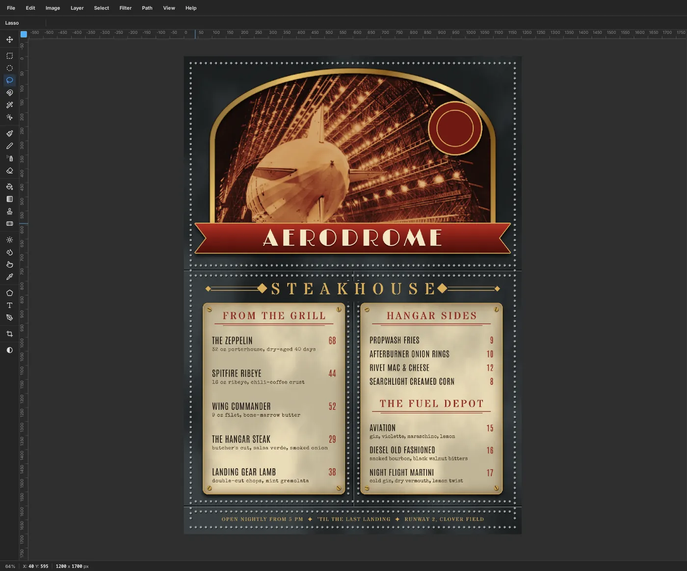

Click the top layer in the Layers panel, then add a layer named `Badge Disc` so it sits above everything. Pick the **Shape** tool, choose **Ellipse**, set **Fill** to `#6E1912`, then hold [[Cmd]] and drag out from about `965, 255` until the circle is about 184 px across. [[Cmd]] keeps it round. Give it a 5 px **Stroke** in `#D9AE5C` and a **Drop Shadow** (Offset X `4`, Offset Y `8`, Blur `14`, Opacity `75%`).

Add a layer named `Badge Ring`. With the **Elliptical Marquee**, drag a circle 132 px across with the same centre. Fill it with `#D9AE5C`, choose **Select → Shrink…** with `3` px and press [[Delete]]. That leaves a thin ring.

## Lasso a pair of blades

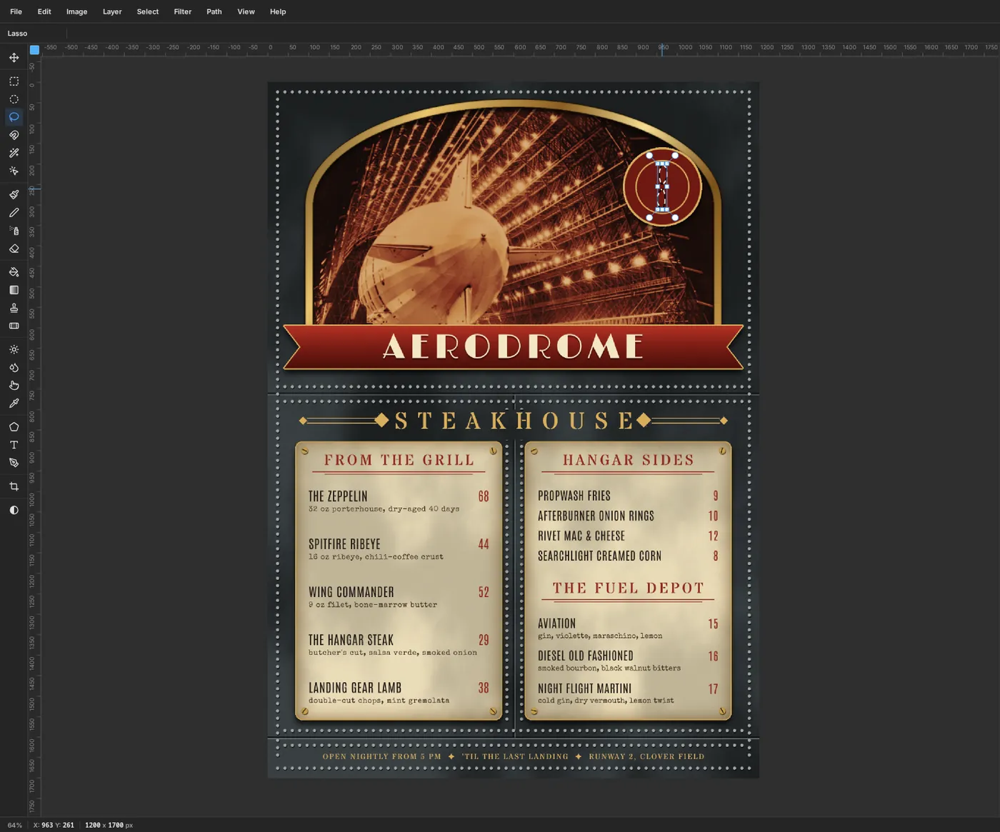

Add a layer named `Propeller`. With the **Lasso**, click around a slim leaf shape about 50 px long pointing straight up from the centre of the disc. It's slightly wider on one side, like a real propeller blade. Then hold [[Shift]] and lasso a matching blade pointing straight down.

Fill the selection with `#F4E6C4` and press [[Cmd+D]].

## Make it a four-blade propeller

Choose **Layer → Duplicate Layer**, then click **Rotate 90° CW** in the **Move** tool's options bar. With nothing selected it turns the whole copy about its centre, so the two new blades point left and right. Press [[Cmd+E]] to merge the copy down into *Propeller*.

For the hub, make a 20 px circle with the **Elliptical Marquee** in the centre and fill it with `#D9AE5C`. Give the *Propeller* layer a small **Drop Shadow** in `#1A0503` so the propeller sits above the disc.

Select *Badge Disc*, *Badge Ring* and *Propeller* together (click the top one, [[Shift]]-click the bottom one), choose **Layer → Group Layers** and name the group `Badge`. With the group selected and the **Move** tool active, drag the rotation handle anticlockwise with [[Cmd]] held until it snaps to -15°, then press [[Cmd+D]]. The whole group turns as one, and the propeller looks as if it's spinning.

## Draw arcs for the badge text

Text on a path follows the direction the path was drawn in. For the top line, the path runs left to right over the top. For the bottom line it runs left to right *under* the bottom, so both read the right way up.

Pick the **Pen** tool. The top arc is a half-circle 72 px from the badge centre, just inside the ring:

1. Press at `893, 255` (the left side) and drag straight up about 40 px to pull out handles.
2. Press at `965, 183` (the top) and drag about 40 px to the right.
3. Press at `1037, 255` (the right side) and drag straight down about 40 px.
4. Click the **✓** (Commit path) button in the options bar. This saves the path without stroking it.

Draw the bottom arc the same way, 86 px from the centre so the text sits between the ring and the rim: press at `879, 255` and drag down, at `965, 341` and drag right, at `1051, 255` and drag up, then click ✓. The two arcs appear in the Paths panel as *Path 1* and *Path 2*.

## Set the text on the arcs

Click *Propeller* so the text lands inside the *Badge* group. Make a **Stardos Stencil** layer at `15` px in `#F4E6C4` with **Letter spacing** `2`, typed in empty canvas: `✦ FLAME-GRILLED ✦`. Press [[Tab]] to commit it. With the layer selected and the **Text** tool active, choose **Path 1** from the **Text path** dropdown in the options bar, and set the alignment to **Center** so it runs evenly over the top.

Do the same with `EST. 1934 ✦ HANGAR 9` and **Path 2**. Nudge the bottom line up a few pixels with the arrow keys so it sits in the middle of the band between the ring and the rim.

Check the badge against the brass arch. If it touches the arch, select the *Badge* group and drag it a little down and left. Path text that's inside the group moves with the group.

## Finish with a vignette

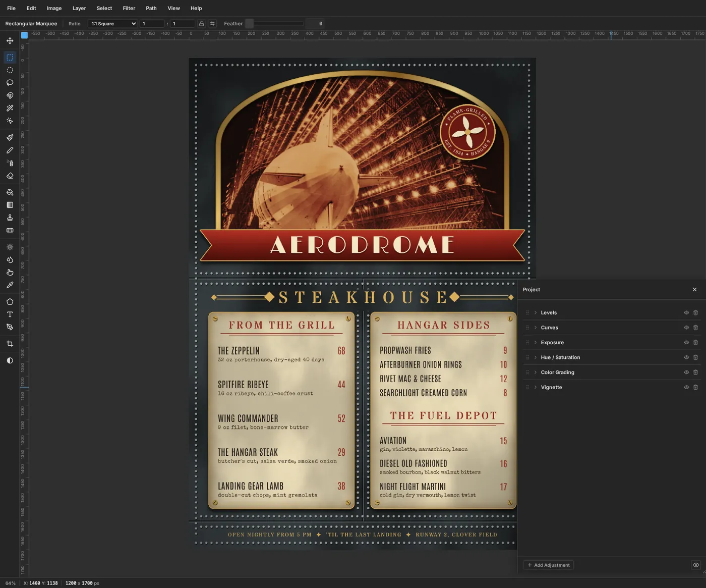

Select the *Project* group and open its effects drawer. Click **Add Adjustment → Vignette** and set it to `35`. The corners of the steel fall gently into shadow, which pulls your eye toward the arch and the cards.

Save with **File → Save Project**, and export with **File → Quick Export PNG**.
