A duotone print uses two inks and the colour of the paper, and nothing else. Record sleeves were printed that way for decades because it was cheap, and the limit turned out to be a look of its own: a photo in one ink, a flat shape in the other, and big type.

You'll make **Carrier Pigeon**, a sleeve for a made-up band called The Night Mail, on a **1500 × 1500 px** canvas. The idea is an airmail envelope: a striped border, a postmark, a PAR AVION label, and a real homing pigeon standing where the stamp would be.

The tools you'll use:

- the **Shape** tool for a circle, a rounded label and three ring paths
- a **gradient** inside a selection and the **Halftone** filter for the dots
- the **Pen** to cut the bird out of its photo, then **Path to Selection** and a **layer mask**
- a group with a **Gradient Map** and **Contrast** adjustment, set to **Multiply**
- **Select → Grow** for a paper-coloured rim around the bird
- the **Brush** with [[Shift]]-click lines for the border
- **text on a path**, a smooth Pen curve stroked with [[Enter]], and a rotated group for the postmark
- **Snap to Layers**, arrow-key nudges and **Rotate 90°** for the type
- **Add Noise** in **Soft Light** for print grain

There are two inks and a paper:

- Paper `#EFE6D0`
- Navy `#16245A`, deep navy `#101C4E` (photo shadows), mid navy `#5B699F` (photo midtones)
- Orange `#F2502A`
- Grain grey `#808080` (a texture layer, not an ink)

The type is **Anton** for the headlines and **Space Mono** for everything small.

You need one photo. This tutorial uses [Homing Pigeon](https://commons.wikimedia.org/wiki/File:Homing_Pigeon.jpg) by Sundaramoorthy K, from Wikimedia Commons, licensed CC BY 4.0. Download it at about 1920 px wide. Any side-on photo of a bird against a plain wall will work the same way.

> **Note:** Shortcuts are written for a Mac. On Windows use [[Ctrl]] wherever it says [[Cmd]].

## Fill the paper

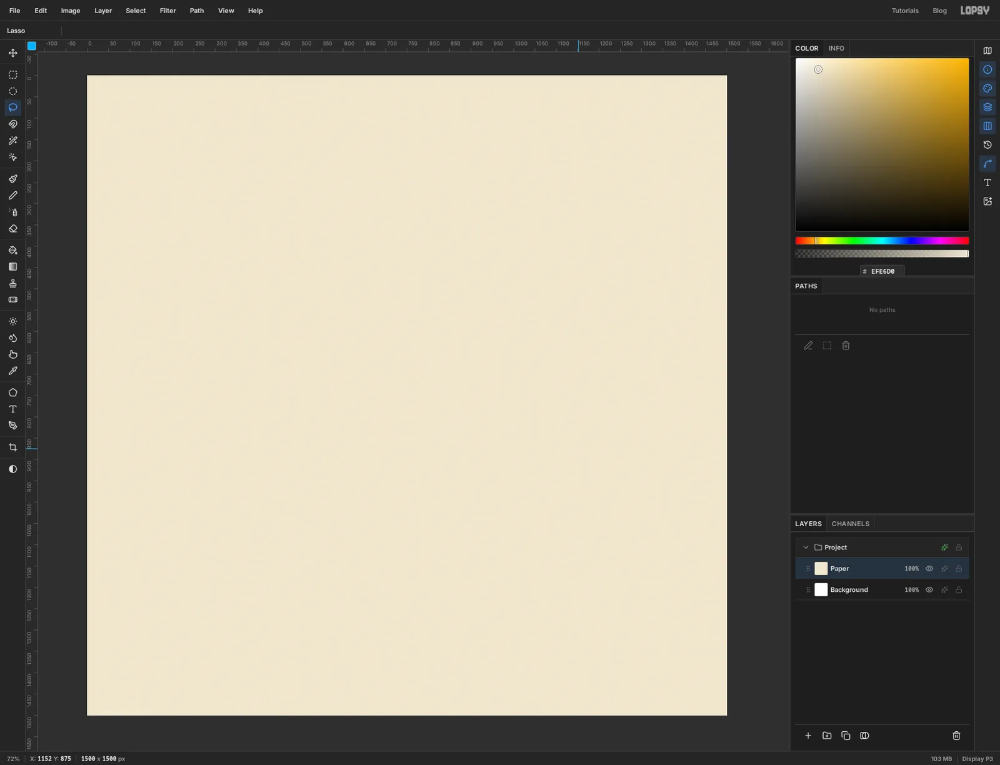

Choose **File → New** and make a document **1500** wide and **1500** high with a **White** background, then click **Create**. Rename *Layer 1* to *Paper*.

Set the foreground colour to `#EFE6D0`, press [[Cmd+A]] and choose **Edit → Fill**. Press [[Cmd+D]] to deselect.

Flat cream looks like a screen, not like paper. Choose **Filter → Add Noise…**, set **Amount** to **6** and click **Apply**. It's barely visible, and that's enough for now.

## Draw the sun

Add a layer called *Sun* and set the foreground to `#F2502A`.

Take the **Shape** tool. In the options bar set **Shape** to **Ellipse** and **Output** to **Pixels**. The Shape tool draws from the centre outward, so press where you want the middle of the sun: a little right of centre and a little above the middle of the canvas. Hold [[Cmd]] to keep it a perfect circle and drag until the circle is about 900 px across. Going by the rulers, that's pressing near 920 across and 650 down, and dragging until the edge of the circle reaches about 1370 on the top ruler. Leave a gap of roughly 130 px between the circle and the right edge of the canvas, because a border and a line of small type go there later.

## Paint a gradient inside the circle

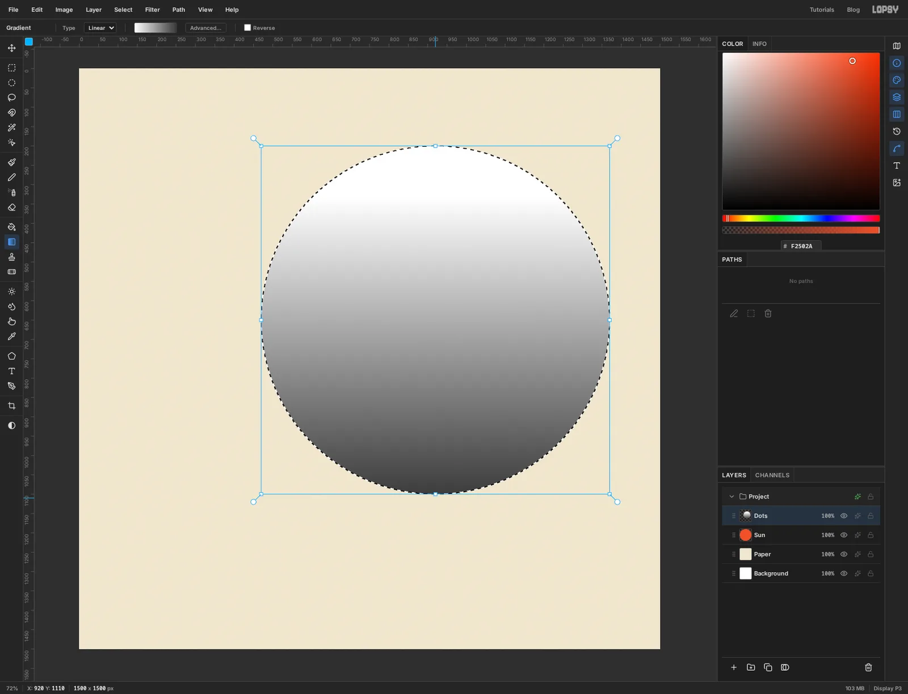

The Halftone filter turns light and dark into small and large dots, so it needs something to read. Give it a gradient.

Add a layer called *Dots*. Hold [[Cmd]] and click the *Sun* layer's thumbnail to load the circle as a selection, then click the *Dots* row again so you're painting on the new layer.

Pick the **Gradient** tool and click **Advanced…**. Set the left stop to `#FFFFFF` and the right stop to `#3A3A3A`, then click **Done**. Drag straight down from just inside the top of the circle to just past its bottom edge. The selection keeps the gradient inside the circle.

## Turn the gradient into halftone dots

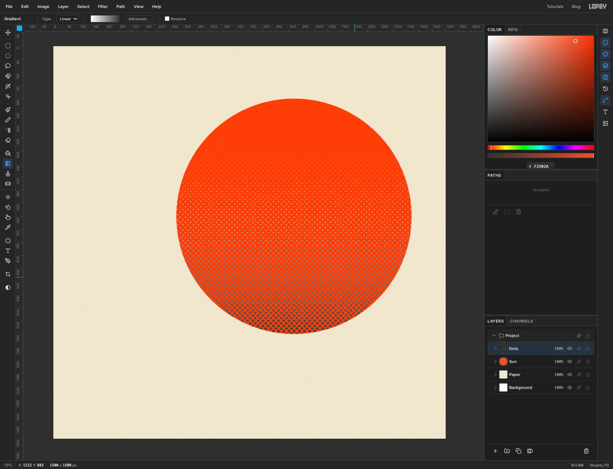

With the selection still active, choose **Filter → Halftone…**. Set **Dot Size** to **14**, **Angle** to **45** and **Softness** to **0.5**, leave **Density** at **1**, then click **Apply**. Press [[Cmd+D]].

The filter keeps only the dots and leaves the gaps between them transparent, so the orange shows through straight away. The dots are still grey, though, and grey isn't one of the two inks.

## Ink the dots navy

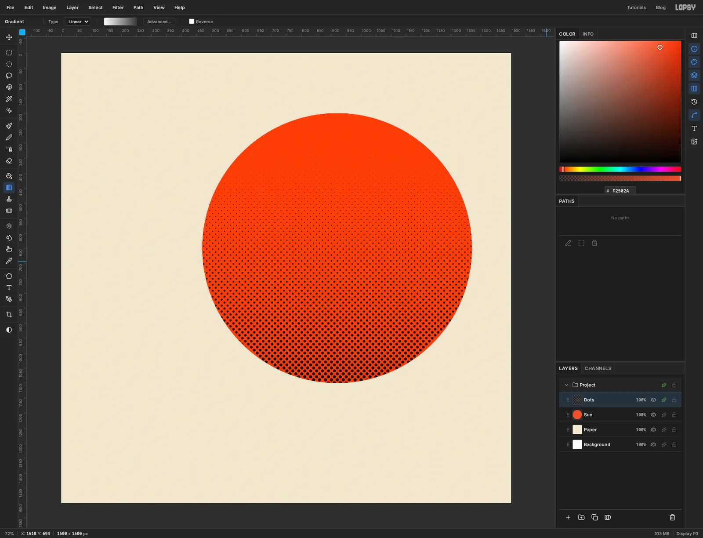

Click the effects button on the *Dots* row to open the effects drawer. Tick **Color Overlay**, select it in the list and set **Overlay color** to `#16245A`. In the same drawer, change **Blend** to **Multiply**, then close the drawer.

Multiply is what makes this read as print. Where navy ink lands on orange ink the two darken each other, the way overprinted inks do on paper.

## Drop in the photo

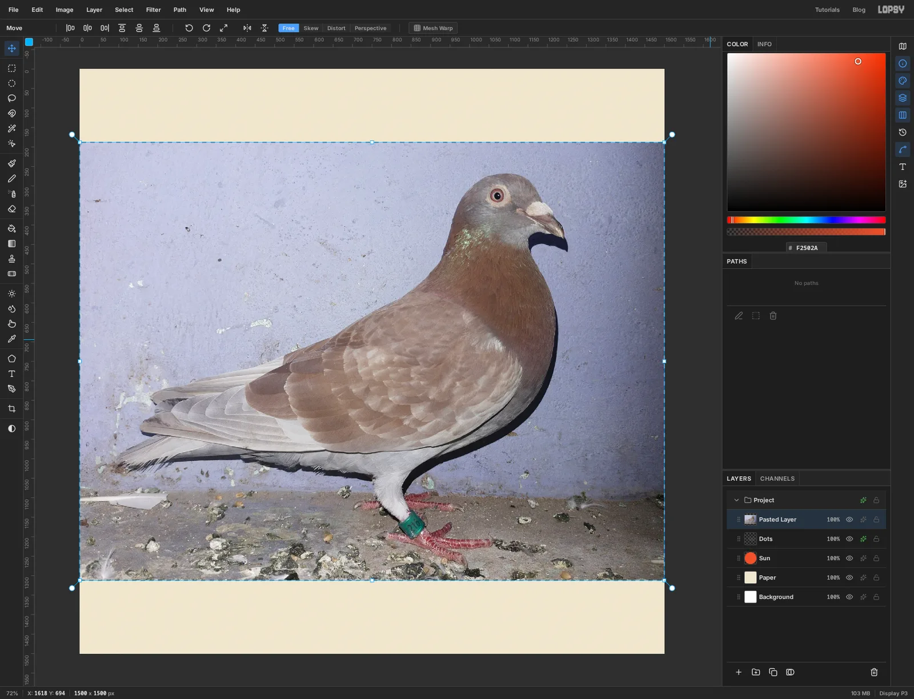

Drag the photo file from your desktop onto the canvas. Lopsy adds it as a new layer called *Pasted Layer*, scaled to fit the canvas, with transform handles around it.

The pigeon is a good size as it lands, with its feet about a fifth of the way up from the bottom, so there's nothing to change: press [[Escape]] to put the handles away. If your photo lands smaller, drag a corner handle with [[Cmd]] held to scale it up, then press [[Cmd+D]] to commit. Rename the layer *Pigeon*.

## Trace the bird with the Pen

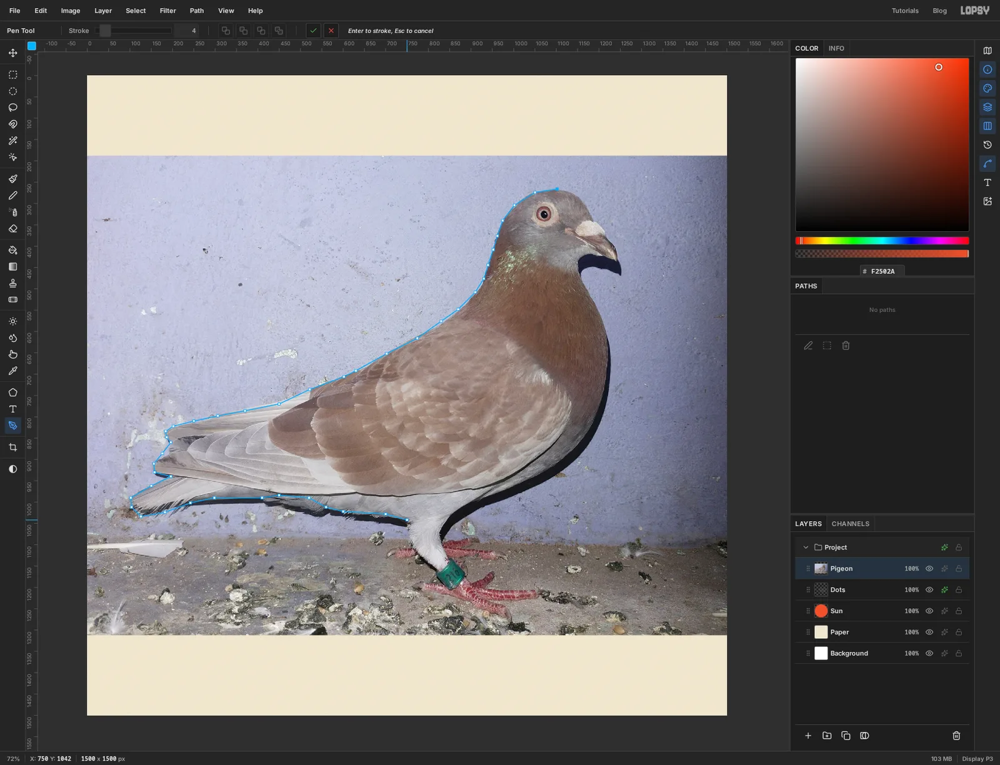

A magic wand struggles here: the pale tail is almost the colour of the wall and the floor is a mess. Tracing by hand is slower and gives a much cleaner edge.

Take the **Pen** tool. Start at the top of the head and click your way around the bird, one click per anchor. Put the anchors close together around the beak, the feather tips and the toes, and far apart along the smooth back. Around a hundred clicks is about right.

Three things to watch:

- The dark shape under the chin and along the belly is a **shadow on the wall**, not bird. Keep the line on the feathers.
- Include the **leg ring and the toes**. A bird cut off at the ankle looks like it's floating.
- Stay a pixel or two **inside** the edge. A sliver of lilac wall is more obvious than a sliver of missing feather.

## Close the path

When you get back to the top of the head, click the first anchor to close the shape. The path is saved as *Path 1*.

If an anchor is in the wrong place, drag it. You can keep adjusting until the outline sits right, and [[Cmd+Z]] steps back through the edits.

## Turn the path into a selection

Open the **Paths** panel from the strip of panel buttons on the far right. Click *Path 1* to select it, then click **Path to Selection** at the bottom of the panel. Marching ants now follow your outline.

Click *Path 1* once more to deselect the path. It stays in the panel, and you'll use it again in a few steps.

## Mask the background away

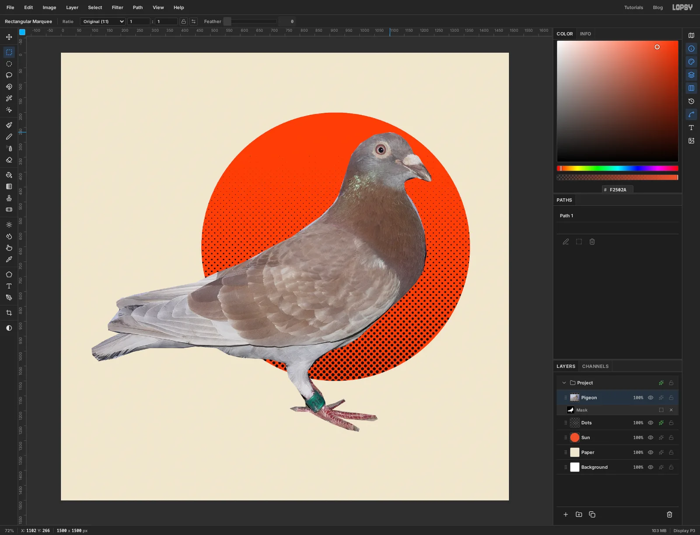

Click the *Pigeon* row in the Layers panel, then click **Add Mask** in the panel's toolbar. Everything outside the selection disappears, and a *Mask* row appears under the layer.

A mask hides the wall rather than deleting it. If you find you cut too close somewhere, click the mask thumbnail and paint with the **Eraser** to bring pixels back, or the **Brush** to hide more. Click the *Pigeon* row when you're done so you're back on the layer itself.

## Make the photo one ink

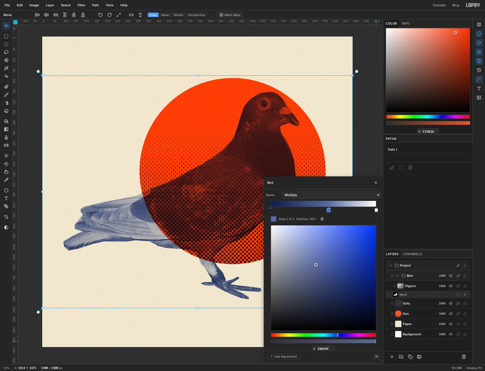

Adjustments in Lopsy belong to groups, so the bird needs one. With *Pigeon* active choose **Layer → Group Layers** and rename the group *Bird*.

Click the effects button on the *Bird* row. Choose **Add Adjustment → Gradient Map**. A gradient map replaces every tone in the photo with a colour from a gradient: shadows take the left end, highlights take the right.

- Click the left stop and type `#101C4E`.
- Click the right stop and type `#FFFFFF`.
- Click the gradient bar a little right of the middle to add a third stop, and type `#5B699F`. This keeps the midtones from going thin and grey.

Then set the drawer's **Blend** to **Multiply**. White turns into nothing under Multiply, so the photo's highlights become bare paper and the bird prints as a single navy ink. Over the orange disc it turns a muddy dark red-brown, which the next few steps deal with.

## Add contrast

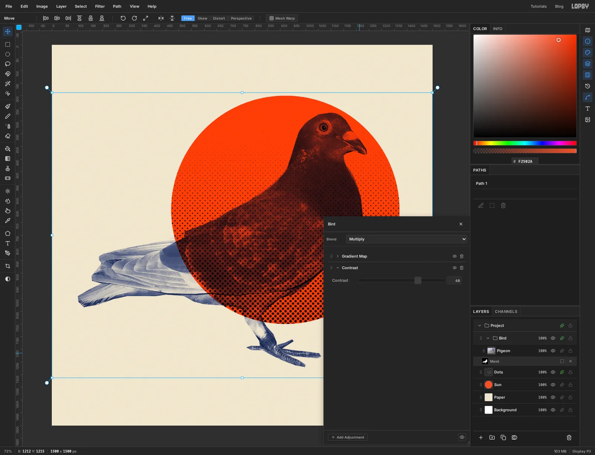

In the same drawer choose **Add Adjustment → Contrast** and set it to **40**. The pale tail gets more shape and the wing feathers separate. Close the drawer.

## Knock the bird out of the sun

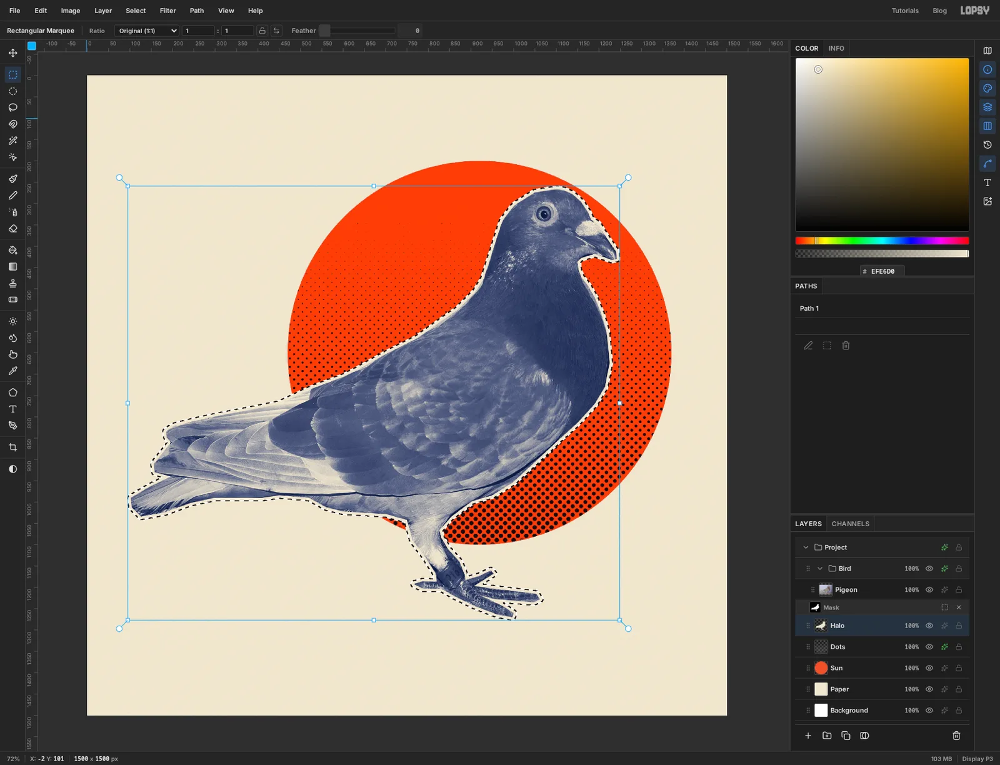

Navy multiplied over orange is too dark to read as a bird. Printers solve this by leaving a hole in the second ink, and you can do the same with a cream shape behind the bird.

Click the *Dots* layer and add a layer called *Halo*. It lands between the dots and the *Bird* group.

In the **Paths** panel, select *Path 1* and click **Path to Selection** again, then click the path to deselect it. Choose **Select → Grow…**, enter **7** and click **Apply**. Make sure *Halo* is the active layer, set the foreground to `#EFE6D0` and choose **Edit → Fill**.

## Let a little orange back in

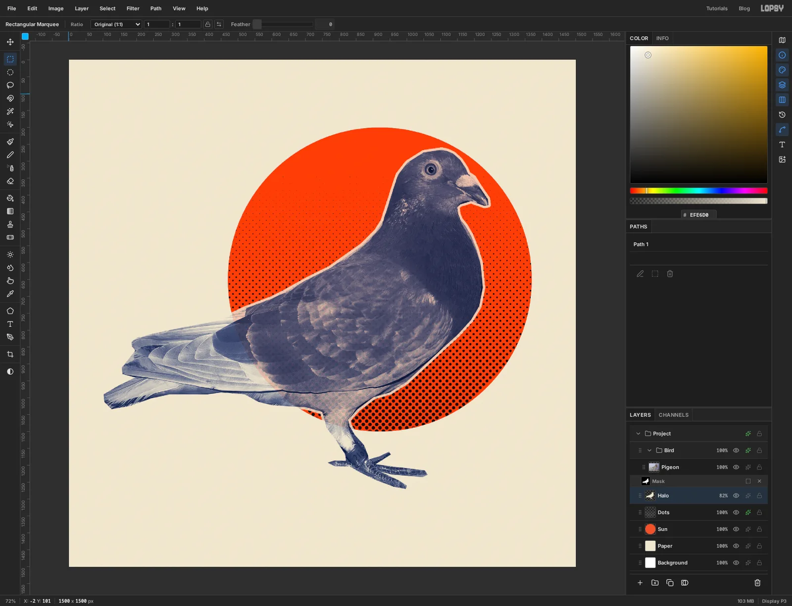

Press [[Cmd+D]]. The 7 px you grew the selection by now show as a cream rim around the bird, which lifts it cleanly off the sun.

Click the opacity value on the *Halo* row and drag it down to about **82%**. A trace of orange and dots comes back through the body, so the bird still looks printed over the sun instead of pasted on top of it.

## Colour the leg ring

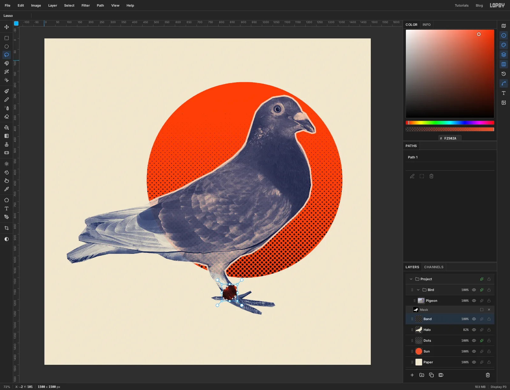

Homing pigeons wear a numbered ring, and this one makes a nice spot of the second ink.

Add a layer called *Band* above *Halo*. Take the **Lasso**, draw closely around the ring on the bird's leg, set the foreground to `#F2502A` and choose **Edit → Fill**. Press [[Cmd+D]]. Because the *Bird* group above multiplies over it, the ring keeps its photographic shading and the number stamped on it, in orange.

## Start the airmail stripes

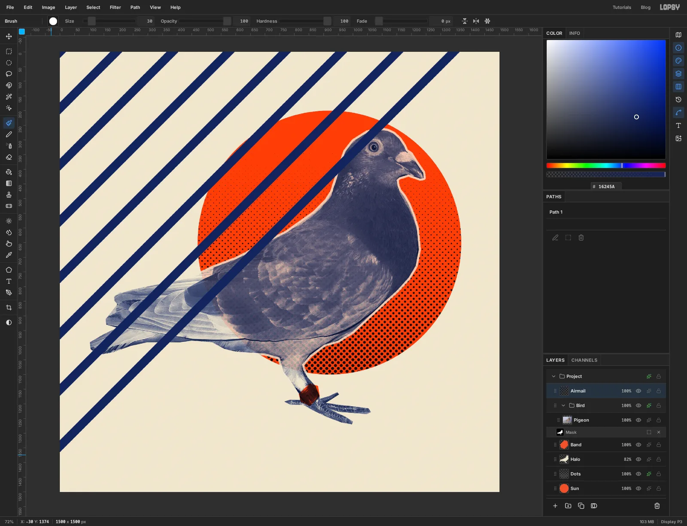

Click the *Bird* group and add a layer called *Airmail*. A new layer made while a group is selected lands inside the group, where it would pick up the gradient map. Drag its row up until it sits above *Bird*, outside the group.

Take the **Brush**. Set **Size** to **30** and **Hardness** to **100**, and set the foreground to `#16245A`.

A click followed by a [[Shift]]-click paints a straight line between the two points. Click just outside the top edge of the canvas, then [[Shift]]-click just outside the left edge, the same distance from the top-left corner, so the line runs at 45°. Starting outside the canvas hides the brush's round ends.

Work along the top edge using the ruler, leaving about 190 px between one navy stripe and the next. When you run out of top edge, carry on down the right edge, ending each line on the bottom edge.

## Add the orange stripes

Switch the foreground to `#F2502A` and paint an orange stripe halfway between each pair of navy ones, the same way. You end up with about sixteen stripes of each colour, covering the whole canvas.

It looks like a mess for a moment. Only the outer edge is going to survive.

## Cut the stripes down to a border

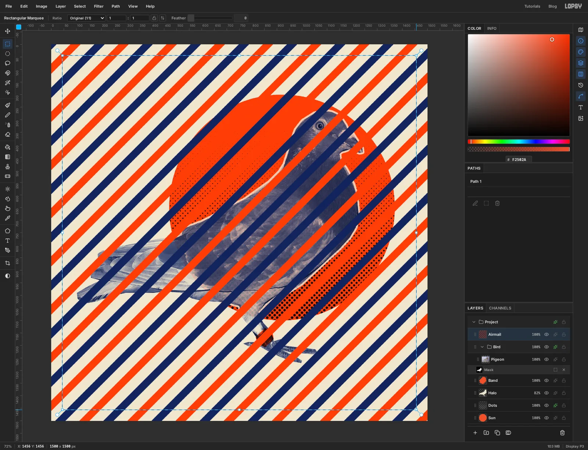

Take the **Rectangular Marquee** and drag from near the top-left corner to near the bottom-right, leaving a band about one and a half stripes wide (roughly 45 px) all the way around. Use the rulers to keep the band even on all four sides.

Press [[Delete]], then [[Cmd+D]]. The middle of the *Airmail* layer is gone and the stripes are left as an envelope border.

## Add a ledge for the bird to stand on

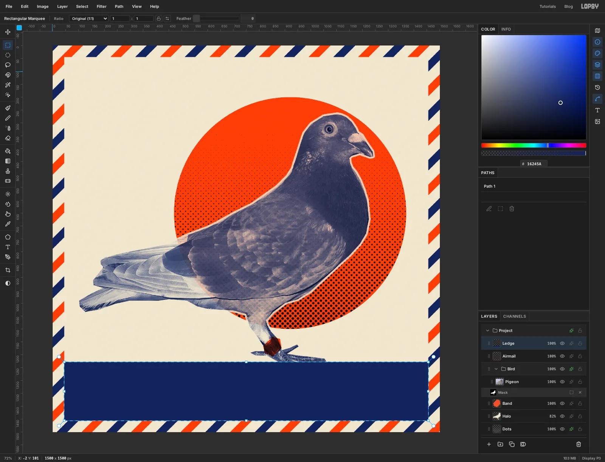

Add a layer called *Ledge* above *Airmail* and set the foreground to `#16245A`.

With the Rectangular Marquee, drag a box across the bottom of the canvas, from the inside edge of the border on the left to the inside edge on the right, and down to the inside edge at the bottom. Put its top edge level with the pigeon's front toes, so the toes rest on it and the lowest claw disappears behind it. Choose **Edit → Fill** and press [[Cmd+D]].

The ledge gives the bird something to stand on and gives the band name somewhere to go.

## Set the first line of the title

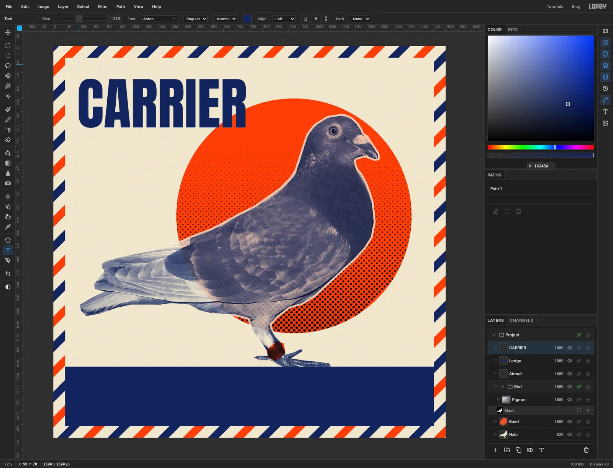

Take the **Text** tool. Choose **Anton** from the font list, set **Size** to **215** and keep the foreground on navy `#16245A`.

Click near the top-left corner of the paper and type **CARRIER**, then press [[Tab]] to commit. With the **Move** tool, place it so the gap to the left of the C is a little wider than the border. The end of the word runs over the edge of the sun, and navy reads well on both cream and orange.

> **Tip:** Changing the font or size while a text layer is active restyles that layer. Before you set up a new piece of type, click a non-text layer such as *Ledge* first.

## Stack the second line with snapping

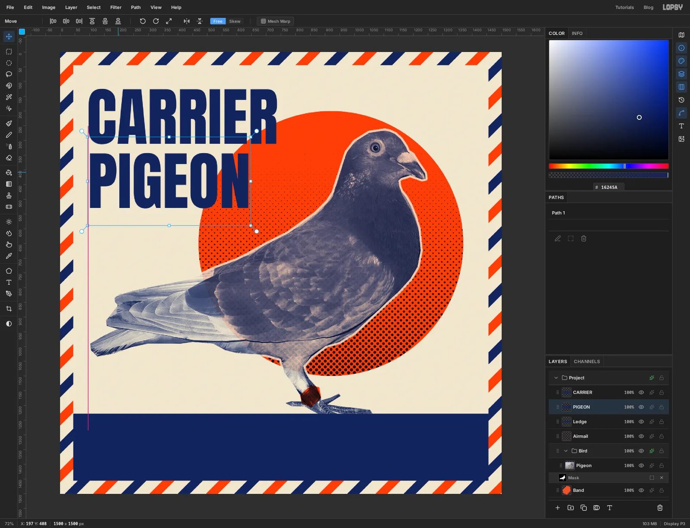

Click the *Ledge* layer, take the Text tool again, click in the empty paper below the title and type **PIGEON**. Press [[Tab]].

Choose **View → Snap to Layers**. Now drag PIGEON up under CARRIER with the Move tool. Pink guides appear whenever one of its edges lines up with an edge of another layer, and the drag lands on them. Leave a gap between the lines of about one stroke width of the letters.

Check what the guide caught. It can lock to any layer's edge, and the *Halo* layer's left edge sits only a few pixels from the title's. If PIGEON lands slightly off, finish with the [[←]] and [[→]] keys until the P sits exactly under the C.

## Draw the postmark rings as paths

The postmark goes at the top right, where a stamp would be. It's built from three circles that share a centre.

Click *CARRIER*, the top layer in the stack, and add a layer called *Postmark* above it. Take the **Shape** tool, keep **Ellipse** and change **Output** to **Path**. Now a drag adds a path to the Paths panel instead of painting.

Press in the middle of the empty corner, hold [[Cmd]] and drag out a circle about 235 px across. Then, starting from the same point each time, draw one about 150 px across and one about 170 px across. The Paths panel lists them as *Path 2*, *Path 3* and *Path 4*. Set **Output** back to **Pixels** when you're done.

## Stroke the two rings

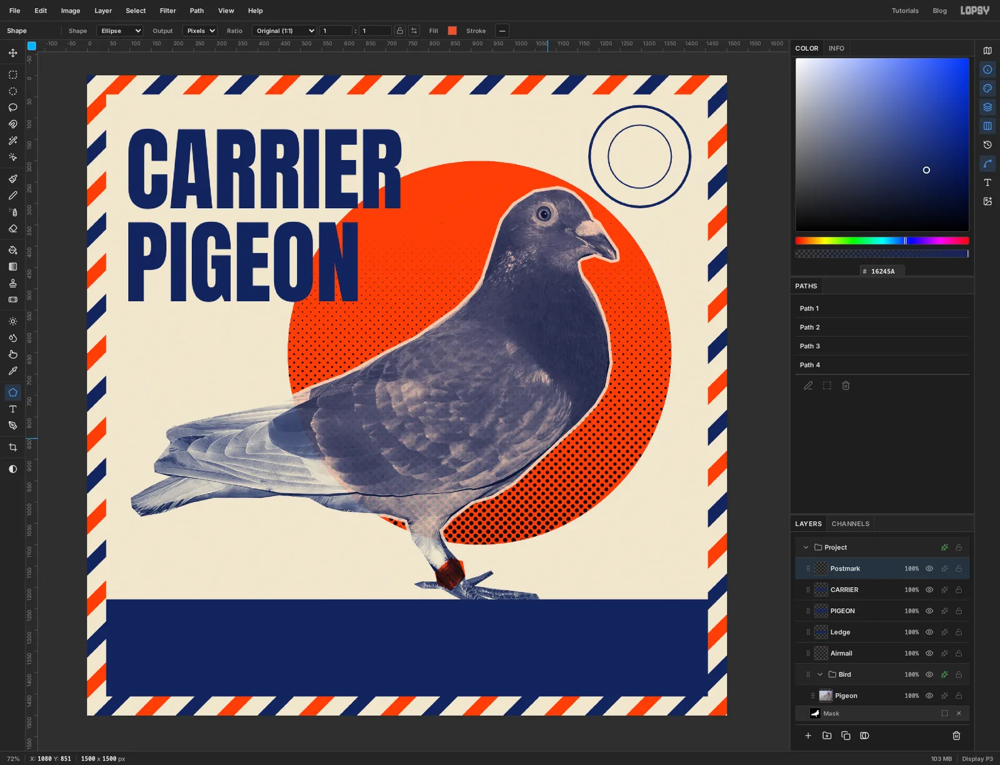

Set the foreground to navy and make sure *Postmark* is the active layer. In the Paths panel select *Path 2*, the biggest circle, and click **Stroke Path**. Enter a **Width** of **6** and click **Stroke**. Select *Path 3*, the smallest, and stroke it at **3**.

*Path 4*, the middle one, stays unpainted. It's the line the lettering will sit on.

## Wrap text around the ring

Click the *Postmark* layer, take the Text tool, choose **Space Mono** and set **Size** to **23**. Click on empty paper somewhere away from the postmark and type:

`CARRIER PIGEON POST * BY AIR * 1961 *`

Press [[Tab]]. With the text layer still active, open the **Path** dropdown at the right of the options bar and choose **Path 4**. The line jumps onto the circle and wraps around it.

The text should fill the ring with the last star meeting the first letter. If it overlaps itself, lower the size by a point. If there's a gap, raise it.

## Stamp the date in the middle

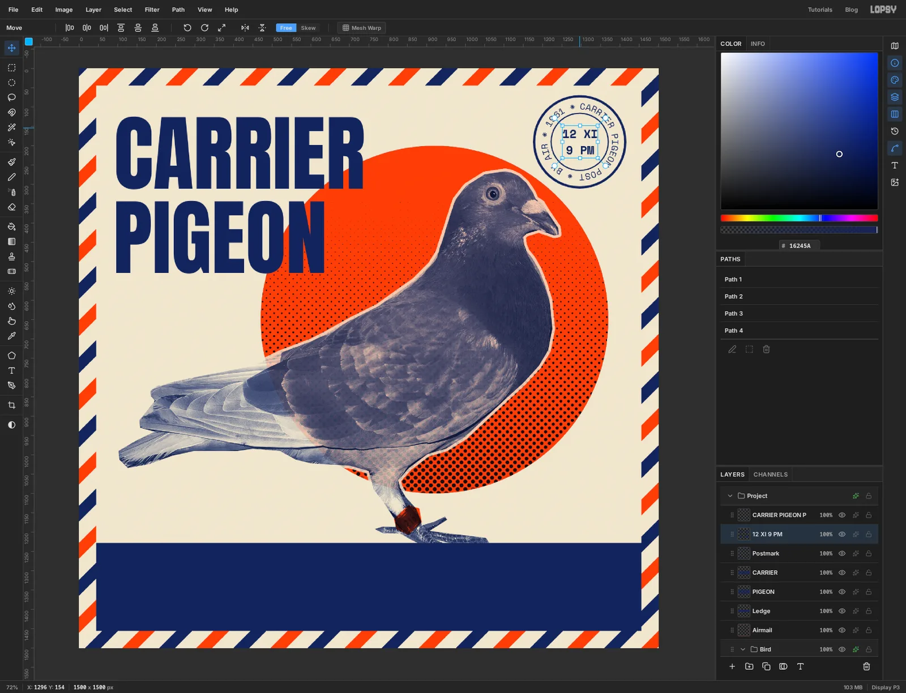

Click the *Postmark* layer again. In the Text tool set the weight to **Bold**, **Size** to **30** and **Align** to **Center**. Click inside the inner ring, type **12 XI**, press [[Enter]] and type **9 PM**. Press [[Tab]].

Switch to the Move tool and nudge the two lines with the arrow keys until the gap between the type and the ring looks the same on all four sides.

## Draw one wavy line with the Pen

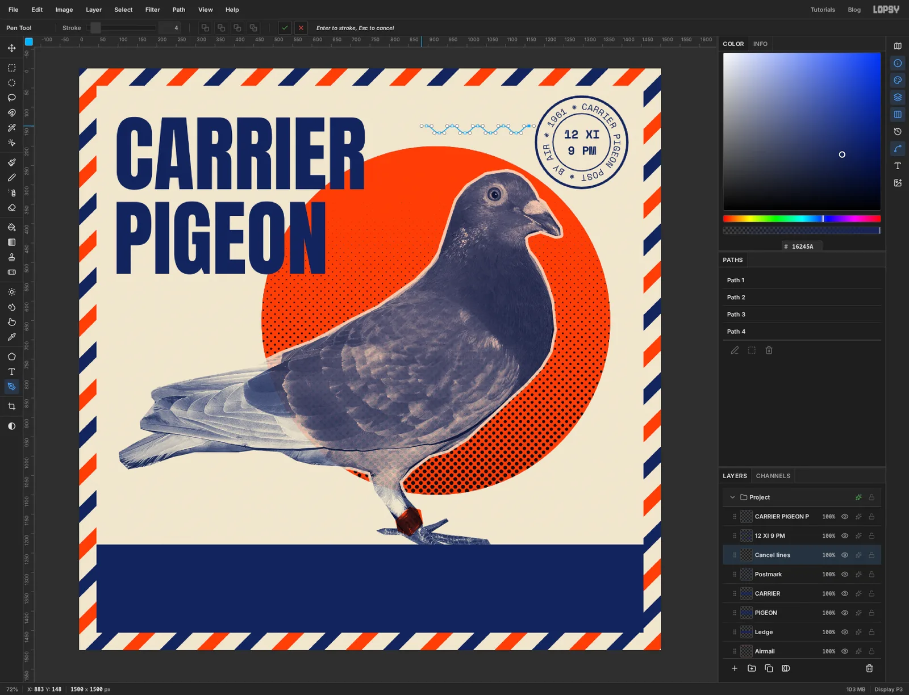

Cancellation marks are the wavy lines a post office prints beside the postmark. You only need to draw one.

Click *Postmark*, add a layer called *Cancel lines* and take the **Pen**. Set **Stroke** to **4** in the options bar.

Start just left of the outer ring and work leftward, placing nine anchors that alternate a little above and a little below an imaginary line, about 35 px apart. Don't just click this time. At each anchor, **press and drag** a short way to the left before letting go. That pulls out a pair of handles and turns the zigzag into a smooth wave.

Press [[Enter]]. The Pen strokes the path onto the layer in the foreground colour.

## Duplicate the line into four

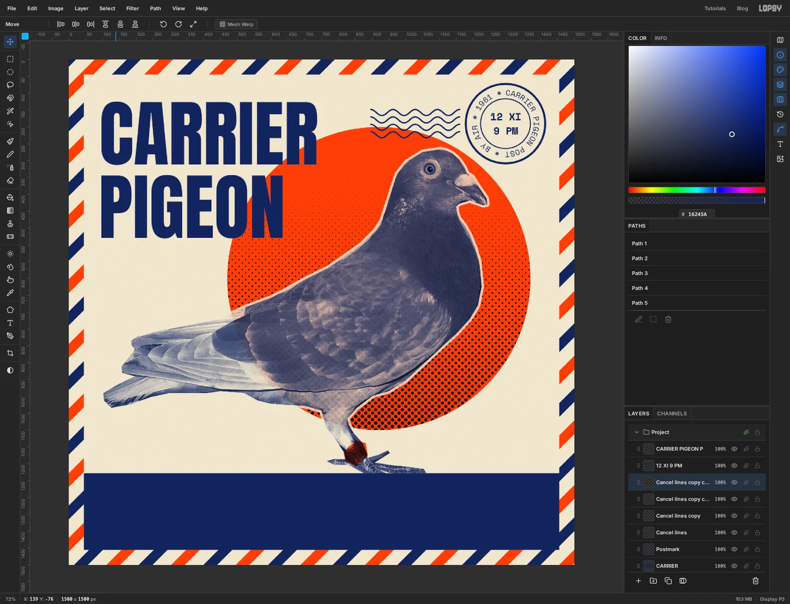

In the Paths panel, click the new path to deselect it. With *Cancel lines* active and the Move tool selected, choose **Layer → Duplicate Layer**. The copy sits exactly on top of the original. Press [[Shift+↓]] twice and [[↓]] twice to drop it 22 px.

Do that twice more, duplicating the newest copy each time, so there are four evenly spaced waves. Then press [[Cmd+E]] three times to merge the copies back down into one *Cancel lines* layer.

## Group the postmark

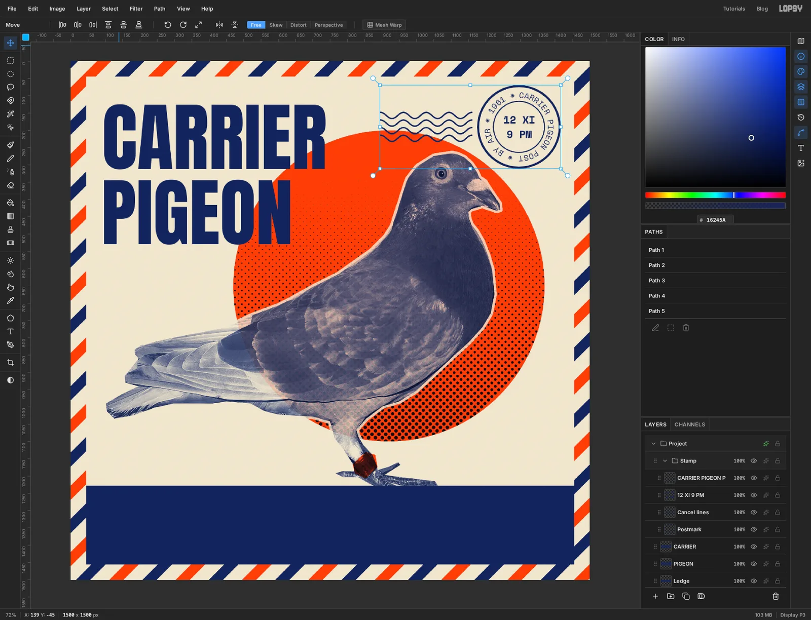

The postmark is four layers: the rings, the lines, the date and the text on the ring. To tilt them together they need to be one group.

Text on a path can't be rotated while it's still live, so click the ring text layer and click **Rasterize Layer** in the Layers panel toolbar. Do this last, once you're happy with the wording.

Now click the top postmark layer, hold [[Shift]] and click *Postmark* at the bottom of the set, so all four are selected. Choose **Layer → Group Layers** and name the group *Stamp*. With the Move tool, the handles frame the whole postmark.

## Tilt the postmark

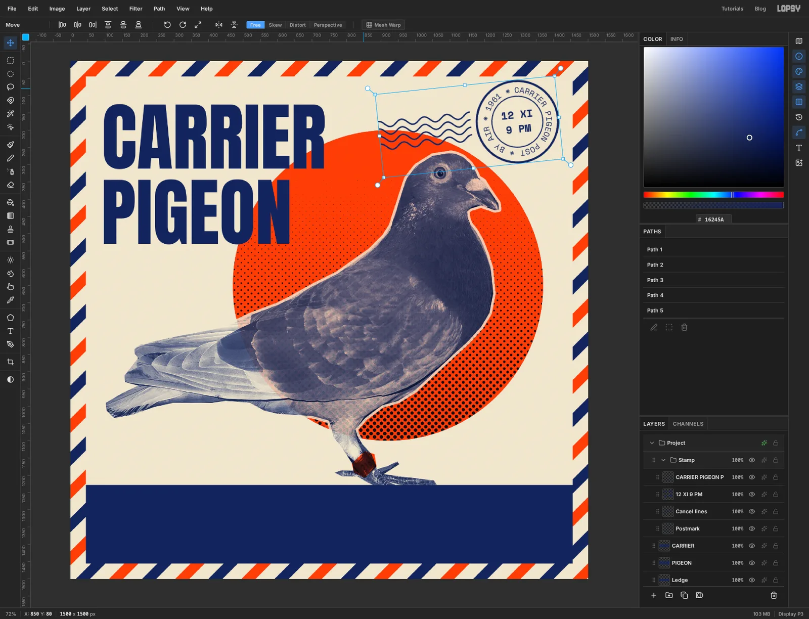

A postmark that sits perfectly level looks typeset. Drag one of the round handles that sit just outside the corners of the frame to turn the group about **6°** anticlockwise. It's a slight tilt, as in the screenshot. Press [[Cmd+D]] to commit.

Rotating swings the ring toward the border and the lines toward the bird. With the *Stamp* group still selected, use the arrow keys to nudge it until the ring has clear paper between it and the stripes, and the lowest wave clears the top of the pigeon's head.

## Set the band name on the ledge

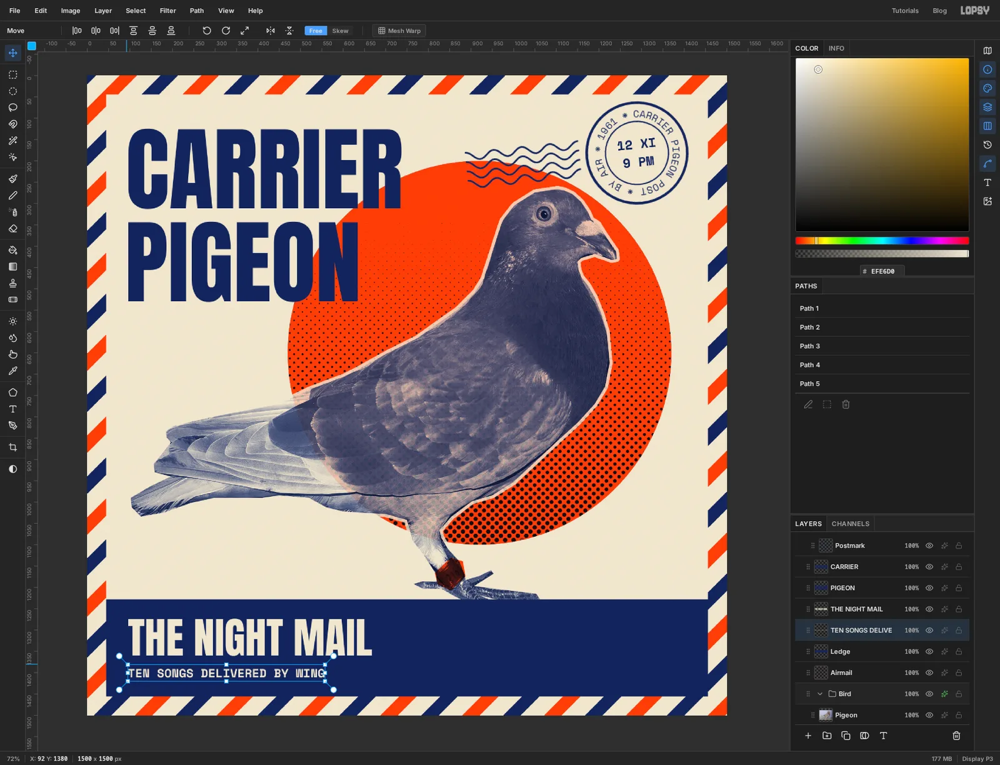

Click the *Ledge* layer and set the foreground to the paper colour `#EFE6D0`. In the Text tool set **Align** back to **Left**.

- **Anton**, Regular, size **100**: type **THE NIGHT MAIL**.
- **Space Mono**, Bold, size **28**: type **TEN SONGS DELIVERED BY WING**.

Type each one, press [[Tab]], and click *Ledge* again before setting up the next.

With the Move tool, line both up with the left edge of the title. Then seat them in the ledge: the space above the big line should equal the space below the small line, about 45 px each. It's worth zooming in for this, because a block of type that sits high or low in its box is the first thing people notice.

## Draw the PAR AVION label

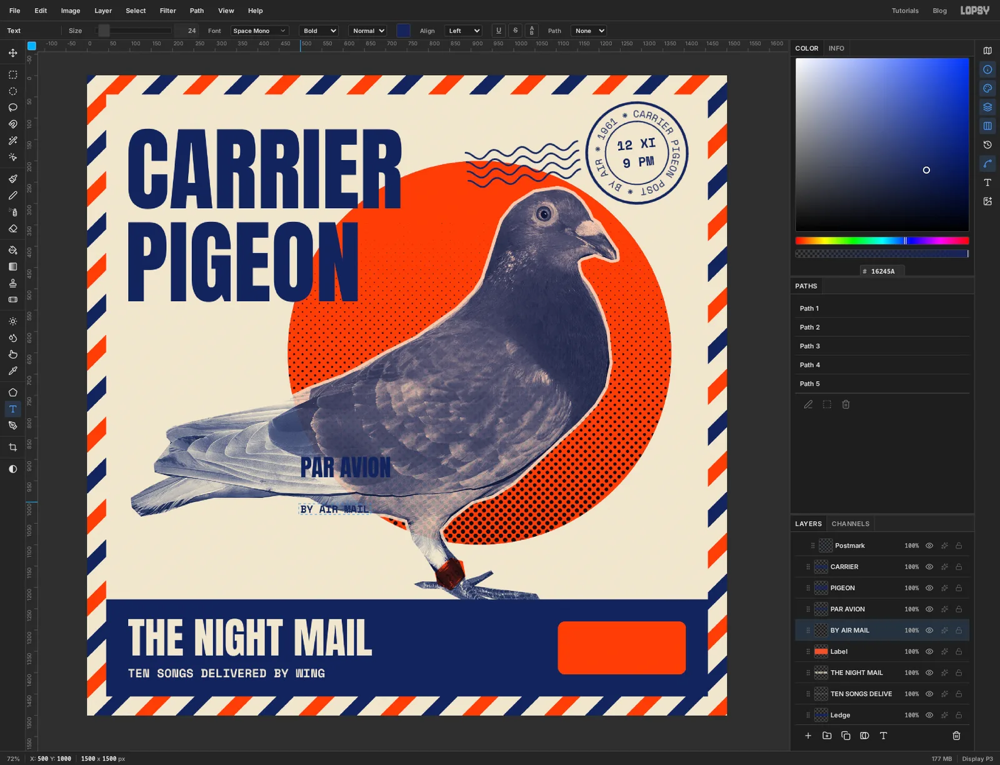

Add a layer called *Label* and set the foreground to `#F2502A`. Take the **Shape** tool, set **Shape** to **Rectangle**, **Output** to **Pixels** and **Corner Radius** to **16**.

Press in the right half of the ledge and drag out a label about 300 px wide and 125 px tall. Remember that the shape grows from the centre. Aim for the same gap above and below the label, and make the gap to the right end of the ledge match the gap to the left of the band name.

Set the foreground to navy and type the two lines anywhere clear of the label and the other type, clicking *Label* before each one. They're only parked there, so it doesn't matter if they land on the bird:

- **Anton**, Regular, size **56**: **PAR AVION**
- **Space Mono**, Bold, size **24**: **BY AIR MAIL**

## Seat the text in the label

Drag PAR AVION onto the label with the Move tool. **Snap to Layers** is still on, so a pink line appears when the centre of the text meets the centre of the label. Let it land there, then do the same with BY AIR MAIL.

Finish with the arrow keys. The two lines should sit as one block in the middle of the label, with about 14 px between them and the same margin above PAR AVION as below BY AIR MAIL. Both lines are capitals, so there are no descenders to allow for.

## Add the track list

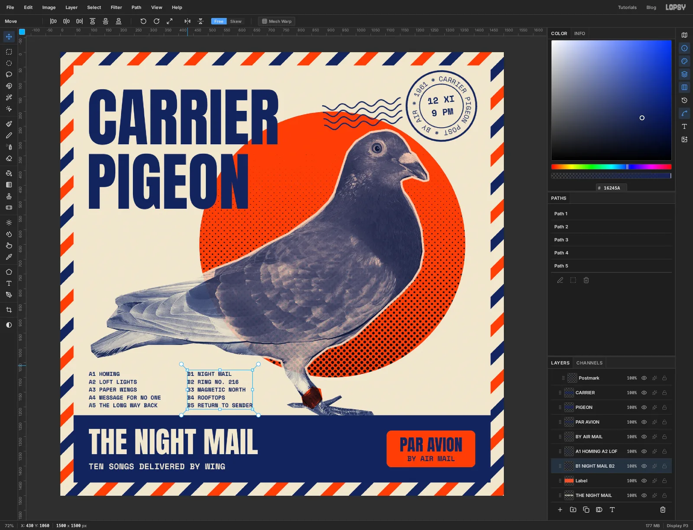

The paper under the tail is empty, and a sleeve needs songs. Click *Label*, set the Text tool to **Space Mono**, Bold, size **19**, navy.

Click under the tail and type side A, pressing [[Enter]] after each title:

`A1 HOMING` · `A2 LOFT LIGHTS` · `A3 PAPER WINGS` · `A4 MESSAGE FOR NO ONE` · `A5 THE LONG WAY BACK`

Press [[Tab]], click *Label* again, and type side B in a second block to its right:

`B1 NIGHT MAIL` · `B2 RING NO. 216` · `B3 MAGNETIC NORTH` · `B4 ROOFTOPS` · `B5 RETURN TO SENDER`

Move the first column so its left edge lines up with the title, and put both columns at the same height, with a gap under the last line about as tall as one line of the list.

## Turn the catalogue number on its side

Click *Label* once more and type one more line in **Space Mono**, Bold, size **22**: `NM-1961 / STEREO / 33 RPM`. Press [[Tab]].

With the Move tool active, click **Rotate 90° CW** in the options bar. The line turns where it stands and stays editable.

## Tuck it against the border

Drag the vertical line into the strip of paper between the sun and the right-hand border. Centre it on the sun's height, and leave a little more room on the border side than on the sun side, since the stripes are the busier neighbour.

## Add print grain

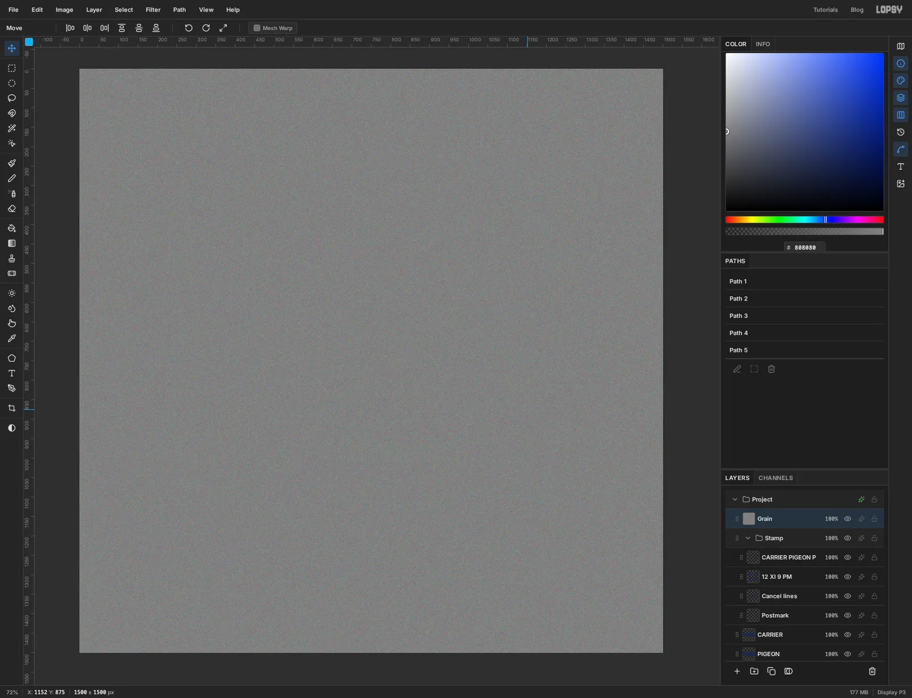

The inks are still too clean. Add a layer called *Grain*, fill it with `#808080`, and run **Filter → Add Noise…** with **Amount** at **40**.

The new layer lands just above whichever layer was active, part-way up the stack. Drag its row to the very top, above the *Stamp* group and outside it, so the grain covers everything.

## Blend the grain and export

Open the effects drawer for *Grain* and set **Blend** to **Soft Light**. Mid-grey does nothing in Soft Light, so only the speckle is left, slightly lightening and darkening the inks. Lower the layer's opacity to about **45%**.

Choose **File → Quick Export PNG** for the image, and **File → Save Project** to keep the layers.

A few things to try from here: swap the two inks for another pair, such as forest green and mustard; move the *Halo* layer two or three pixels sideways to fake a misregistered print; or change the wording on the ring by retyping it before the rasterize step.
