A duotone prints a photo in just two inks: a dark one for the shadows and a
bright one for the highlights. It's one of the oldest tricks in magazine
design. It makes any photo look printed rather than snapped, and it ties
the picture to the type, because the type uses the same inks.

In this tutorial you'll make **THAW**, the cover of an imaginary quarterly
about cold places. A blue-morph Arctic fox sits in deep violet ink on a
flat coral page. Its ear tucks over the masthead, and the cover lines sit
in the margin beside it. You'll build it at **1600 × 2080 px**, roughly the
shape of a real magazine.

The photo is [Posing for a portrait](https://commons.wikimedia.org/wiki/File:Posing_for_a_portrait_(Unsplash).jpg)
by Jonatan Pie on Wikimedia Commons. It's in the public domain (**CC0**),
so you can use it freely. Download a version about 2,500 px wide. Any
portrait of a dark animal against snow or a pale sky works the same way.

Along the way you'll use:

- pasting and scaling a photo, the **Eyedropper**, and filling with the **Rectangular Marquee**
- the **Magic Wand**, **Inverse**, **Shrink**, **Grow**, **Feather**, and [[Shift]]-add and [[Shift]]+[[Alt]]-intersect marquees
- **Gradient Map** and **Curves** adjustments on layer groups
- text in **Abril Fatface**, **DM Serif Display** and **IBM Plex Sans Condensed**, with letter spacing and alignment
- the **Pencil** for straight rules and barcode bars, and **Merge Down**
- rotating a selection and a line of live text with the **Move** tool's rotate handle
- the **Clone Stamp**, **Burn**, **Add Noise**, the **Overlay** blend mode and layer opacity
- ruler guides, Snap to Guides and the grid

The palette:

- Duotone map `#1E1440` → `#6E2C5E` → `#DD8275`
- Violet ink `#1E1440` (masthead, strap and cover lines)
- Coral `#DD8275` (the page and the cover-story kicker)
- Cream `#FFF1E2` (title, dek, badge and barcode box)
- Grain grey `#808080` (in Overlay mode)

## Set up the canvas and margin guides

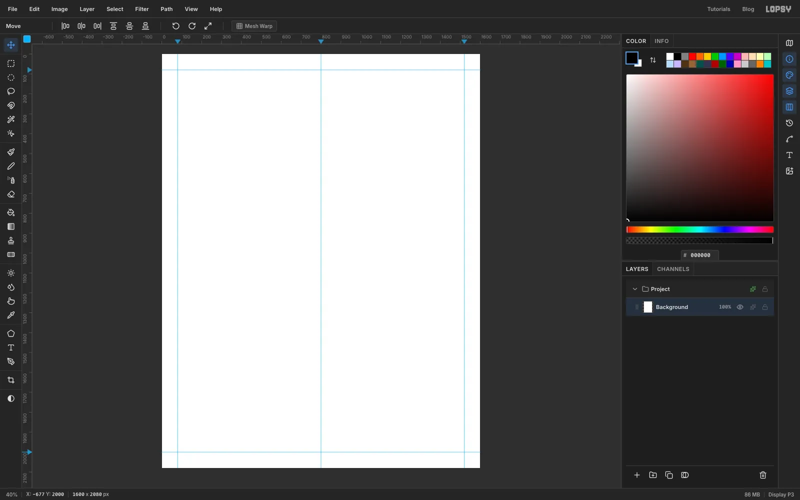

Choose **File → New**, enter **1600 × 2080** pixels with a **White**
background and click **Create**. The new document comes with an empty
*Layer 1*. Select it and delete it with the trash button at the bottom of
the Layers panel.

Click the top ruler at **80**, **800** and **1520** to drop three vertical
guides: the left margin, the centre line and the right margin. Click the
left ruler at **80** and **2000** for the top and bottom margins. Every
piece of type will hang off these.

## Paste the fox photo into a group

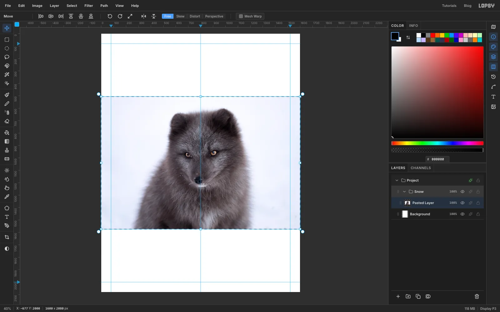

Click **New Group** at the bottom of the Layers panel and name the group
*Snow*. Open the downloaded photo in another app, copy it, and press
[[Cmd+V]] in Lopsy. The pasted layer lands inside *Snow*. The photo is
wider than the canvas, so Lopsy shrinks it to fit and switches to the
**Move** tool with the photo selected.

## Scale the photo up

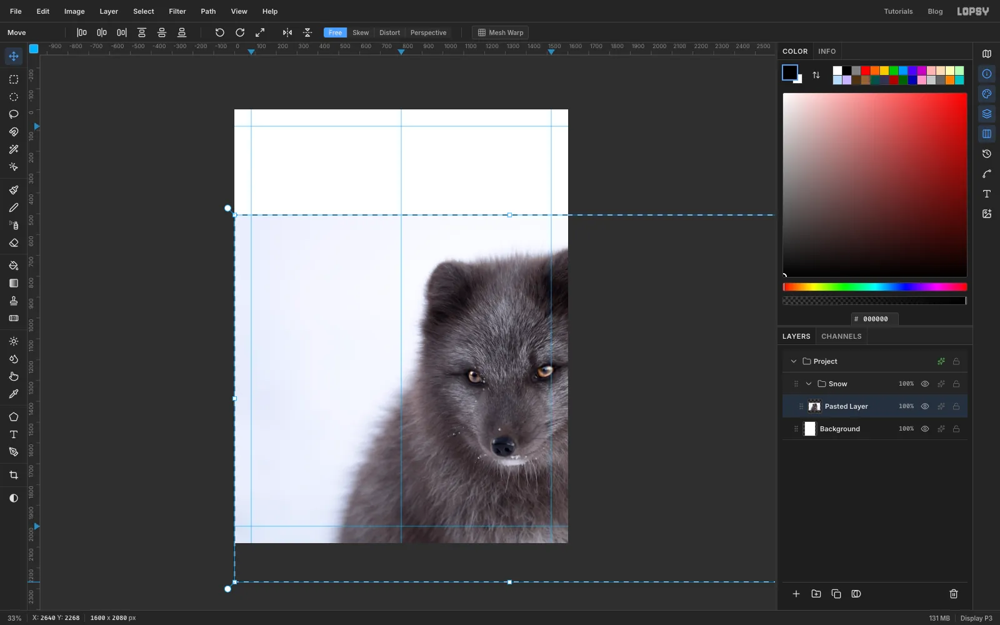

At canvas width the fox is too small for a cover. Press [[Cmd+-]] to zoom out
so you can see past the edges. Then hold [[Cmd]] and drag the bottom-right
corner handle out until the photo is about **165%** of its fitted size,
roughly 2,640 px wide. The status bar's X readout under the pointer gives
you the position of the corner as you drag. [[Cmd]] keeps the proportions.

## Centre the face

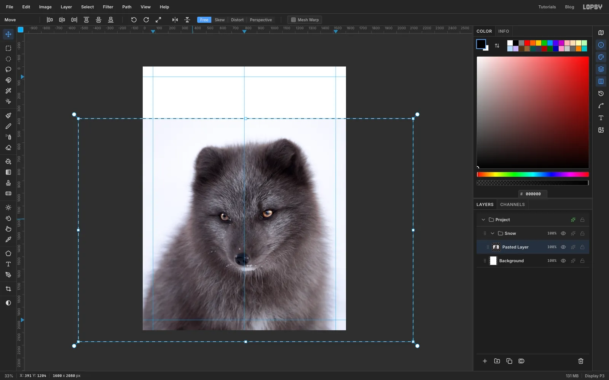

Drag inside the transform box to move the photo. Put the fox's nose on the
centre guide, its ear tips about a quarter of the way down the page, and
the photo's bottom edge past the bottom of the canvas. The face should
be big: the shoulders run off both sides. Press [[Cmd+D]] to commit, then
double-click the layer name and rename it *Photo*.

## Fill the empty sky with snow

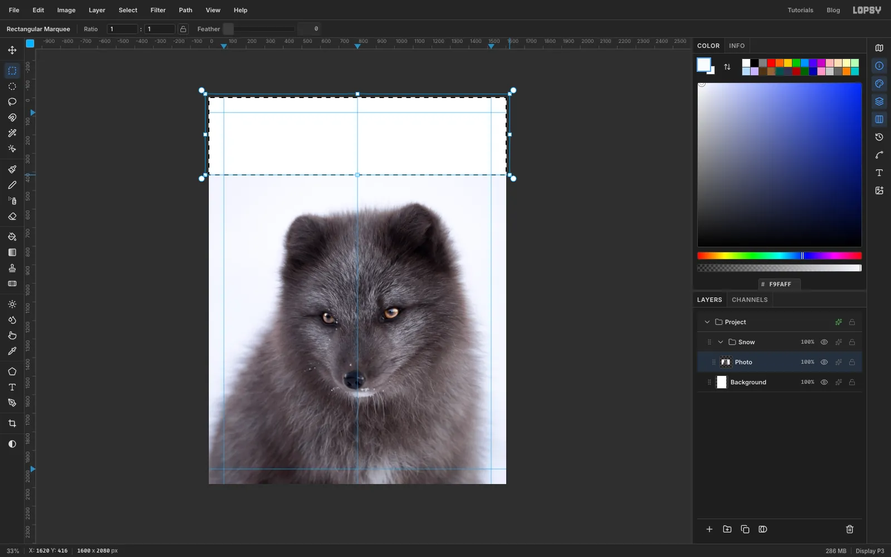

There's a white band above the photo with nothing in it. Pick the
**Eyedropper** and click the snow just below the photo's top edge. That
makes the snow colour the foreground. Pick the **Rectangular Marquee** and
drag from above the top-left corner of the canvas to just past the right
edge, ending a few pixels below the top of the photo. Choose
**Edit → Fill**, then [[Cmd+D]].

Don't worry about a faint seam. In a moment every pale tone turns into the
same flat coral.

## Select the snow with the Magic Wand

Pick the **Magic Wand**, set **Tolerance** to **40** and leave
**Contiguous** on. Click the snow to the left of the fox. The snow around
the fox is one connected area, so a single click selects all of it, right
up to the fur.

## Invert and soften the selection

Choose **Select → Inverse** so the fox is selected instead. Then:

1. **Select → Shrink…** by **4** px. That trims off the pale halo of snow
   caught in the fur tips.
2. **Select → Feather…** by **3** px. That keeps the edge soft, like fur.

Shrink also pulls the selection 4 px in from the canvas edges, which would
leave a thin gap where the fox runs off the page. Pick the
**Rectangular Marquee**, hold [[Shift]] and drag a thin strip along the
bottom edge, starting and ending outside the canvas. Do the same up the
lower part of the left edge. [[Shift]] adds each strip to the selection.

## Copy the fox into its own group

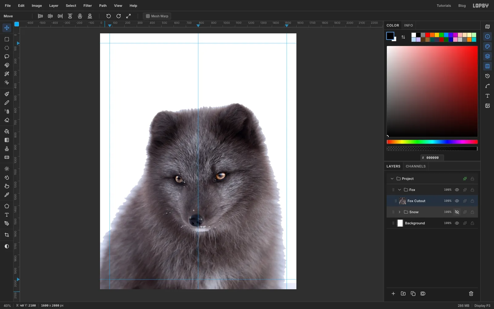

Press [[Cmd+C]]. Collapse the *Snow* group with its arrow and click its row,
then click **New Group** and name it *Fox*. Because *Snow* was collapsed,
*Fox* is created next to it, not inside it. Press [[Cmd+V]]: the fox pastes
into *Fox* in exactly the same place. Rename the layer *Fox Cutout*.

Click the eye on *Snow* to hide it and check the cutout on white, then
show it again.

## Fill the fox out of the background

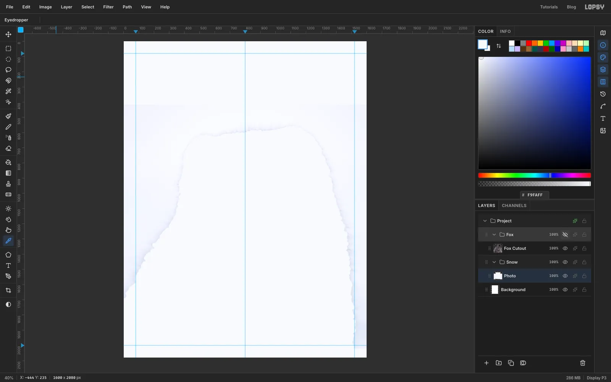

The original fox is still in *Photo*, underneath the cutout. Later, a
faint ghost of its outline would show around the cutout's edge. Remove it
now:

1. [[Cmd]]-click the *Fox Cutout* thumbnail to load the fox's shape as a
   selection.
2. Choose **Select → Grow…** by **10** px.
3. Expand *Snow*, click *Photo*, and sample the snow with the
   **Eyedropper** again.
4. Choose **Edit → Fill**, then [[Cmd+D]].

Hide *Fox* for a moment to see the result: *Photo* is now just snow. Then
show *Fox* again.

## Map the snow to two inks

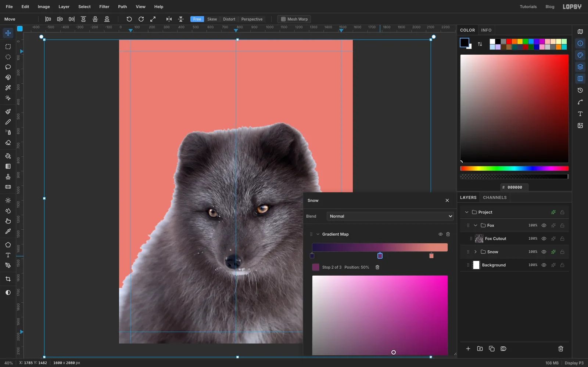

Click the effects button on the *Snow* group's row to open its drawer.
Click **Add Adjustment** and choose **Gradient Map**. A gradient map
recolours every pixel by its brightness: the left end of the bar paints
the shadows and the right end paints the highlights.

1. Click the left stop and type `#1E1440` in the **Hex** field.
2. Click the right stop, type `#DD8275`, and drag the stop left to
   **88%**.
3. Click the handle row at **50%** to add a stop, and type `#6E2C5E`.

Anything brighter than 88% now comes out as solid coral, so all the snow,
and the seam from earlier, turns into one flat ink.

## Add contrast to the fox with Curves

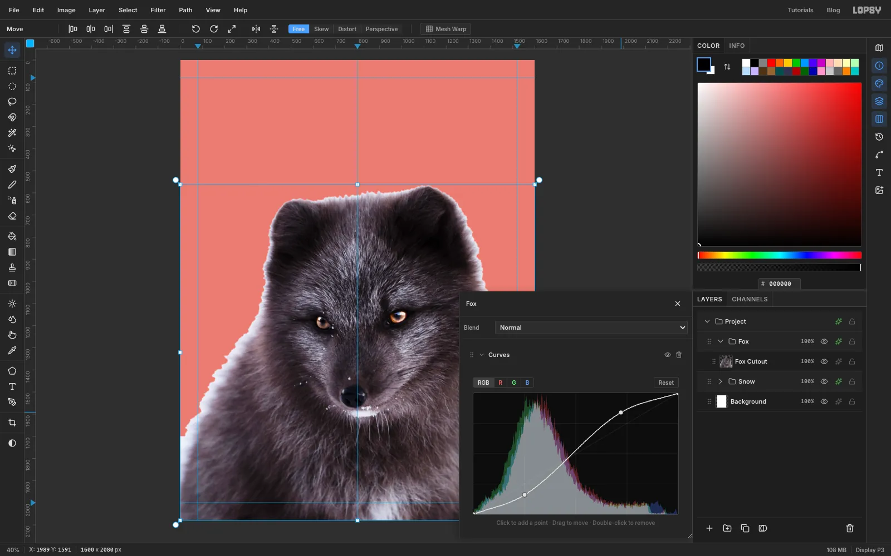

Open the *Fox* group's drawer, click **Add Adjustment** and choose
**Curves**. Click on the diagonal a quarter of the way along and drag that
point down a little. Then click three quarters of the way along and drag
that point up a little. The gentle S-curve deepens the shadows and lifts
the highlights, so the fur keeps its texture when it's mapped to ink.

## Map the fox with the same inks

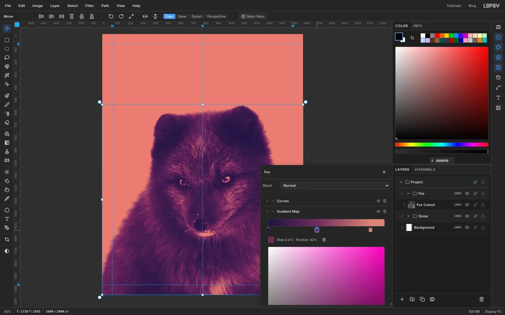

Still in the *Fox* drawer, add a second **Gradient Map** with the same
three colours: `#1E1440` at 0%, `#6E2C5E` at **42%** and `#DD8275` at 88%.
The plum stop sits a little further left than on the snow. That lifts the
fox's midtones, so the brow and muzzle keep their shape instead of sinking
into one dark plum mass. The Curves node sits above the map in the list,
so the contrast is added first and then the ink is mapped. The fox turns
deep violet with plum fur and coral catchlights in the eyes.

Each group has its own map. That's what lets the masthead slide *between*
them.

## Set the masthead behind the ears

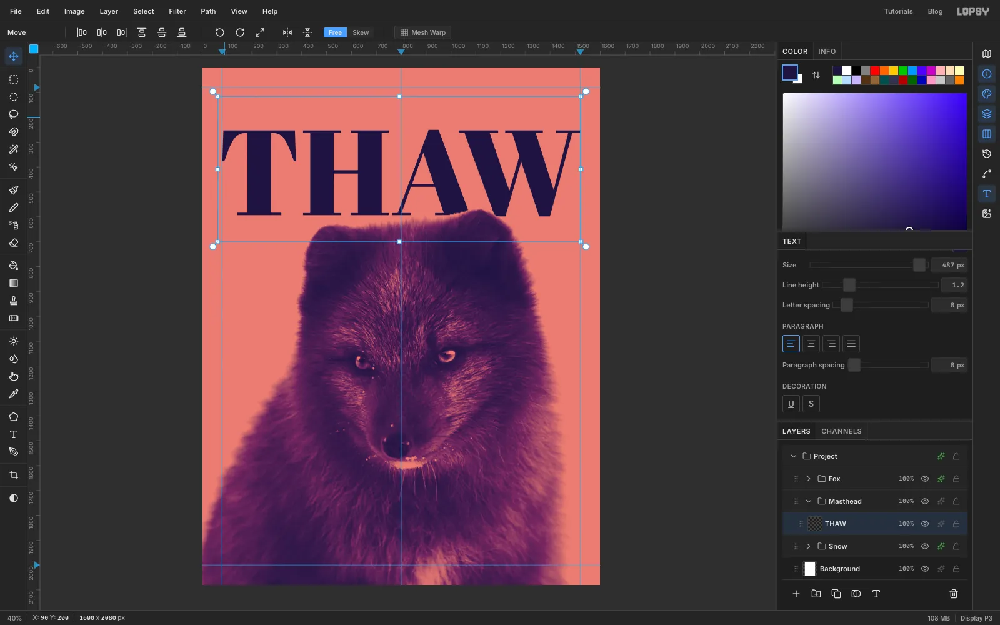

Collapse *Fox* and *Snow*, click the *Snow* row and click **New Group**.
Name it *Masthead*. It sits above *Snow* and below *Fox*, so anything in
it goes behind the fox but in front of the coral.

With the *Masthead* row selected, pick the **Text** tool. Set the font to
**Abril Fatface**, **Size 487** and the text colour to `#1E1440`. Click
near the top of the page, type `THAW` and press [[Tab]] to commit. Switch
to the **Move** tool and nudge the word with the arrow keys
([[Shift]] moves 10 px at a time) until the T's serif touches the left
guide and the tops of the letters sit about 250 px down. At this size the
word runs exactly from margin to margin, and the fox's right ear tucks
over the foot of the W.

## Add the strap line

Click the *Masthead* row again before you change any text settings.
Otherwise the new settings restyle THAW. Set **IBM Plex Sans Condensed**,
weight **SemiBold**, **Size 28**, and in the Text panel **Letter spacing 5**.

Click in the empty space above THAW and type
`A QUARTERLY OF COLD PLACES`. Nudge it so it starts on the left guide,
with the tops of its capitals about 18 px below the top margin guide.

For the right-hand side, click the *Masthead* row again, then choose
**Align right** in the Text panel. Click just left of the right guide at
the same height and type `NO. 14 · WINTER 2026`. With Align right, the
point you click becomes the line's right edge. To get the middle dot, copy
it from this page and paste it. Nudge the line onto the right guide.

## Draw a rule under the strap

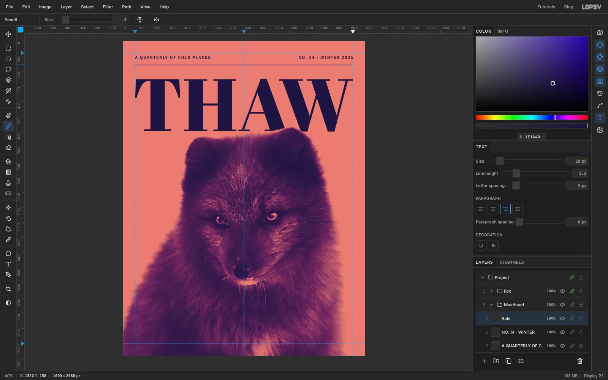

Click the *Masthead* row, click **Add Layer** and name it *Rule*. Set the
foreground to `#1E1440`, pick the **Pencil** at **Size 3**, and click on
the left guide about 40 px below the strap. Hold [[Shift]] and click on the
right guide at the same height. The Pencil draws a dead-straight line
between the two clicks.

## Write the side cover lines

Click the collapsed *Fox* row and click **New Group**. Name the new group
*Cover Lines*. It sits on top, so its text stays above the fox.

Add a layer called *Rules* inside it. With the Pencil at **Size 4**, draw a
70 px rule from the left guide about a third of the way down, and a second
one about 280 px lower.

Each cover line is two text layers. Click the *Cover Lines* row before each
one, so your settings don't restyle the last text:

- The kicker `SEA ICE` in **IBM Plex Sans Condensed Bold**, **Size 26**,
  **Letter spacing 5**, **Align left**, colour `#1E1440`, starting 20 px
  under the rule.
- The headline in **DM Serif Display**, **Size 46**, **Line height 1.08**,
  letter spacing back to **0**. Press [[Enter]] between the lines:
  *The long* / *goodbye on* / *Hudson Bay*.

Repeat under the second rule with `LEMMINGS` and *Where have* / *the boom* /
*years gone?*. Nudge each block onto the left guide. Keep the lines short:
the fox's cheek is only about 300 px away.

## Set the cover story

The story block sits over the dark fur of the chest, so it's set in cream.
As before, click the *Cover Lines* row before you change the settings for
each piece. Make the pieces from the bottom up. The Text tool edits any text whose box
you click inside, so clicking below existing text could add to it instead
of starting a new layer.

1. **The dek.** IBM Plex Sans Condensed **Medium**, **Size 35**,
   **Line height 1.3**, **Letter spacing 1**, colour `#FFF1E2`, **Align center**.
   Click on the centre guide near the bottom and type
   *It can hear a lemming under half a metre of snow.*, [[Enter]],
   *Can it outlast a warming Arctic?*
2. **The title.** DM Serif Display, **Italic**, **Size 172**,
   **Letter spacing 0**, still cream and centred. Click on the centre guide well above the dek and type
   *The Tundra Fox*. Nudge it so its baseline sits about 45 px above the
   top of the dek.
3. **The kicker.** IBM Plex Sans Condensed **Bold**, **Size 28**,
   **Letter spacing 8**, colour `#DD8275`. Type `THE COVER STORY` above the
   title and leave about 45 px between it and the title's capitals.

## Cut a disc for the badge

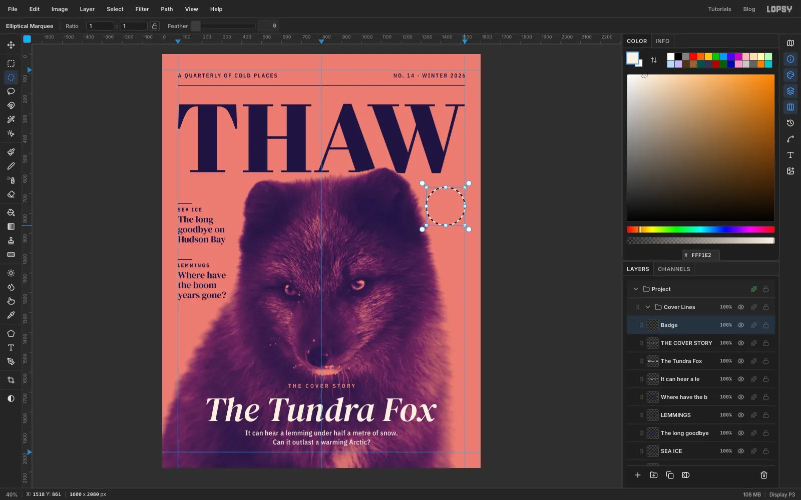

Click *Cover Lines* and add a layer called *Badge*. Set the foreground to
`#FFF1E2`. Pick the **Elliptical Marquee**, hold [[Cmd]] and drag a circle about
190 px across. [[Cmd]] keeps the marquee a perfect circle. Place it in the coral to the right of the fox's
head, about 25 px clear of the fur, with its right edge on the right guide. Choose **Edit → Fill** and [[Cmd+D]].

## Type the badge

Click the *Badge* row and set **Abril Fatface**, **Size 74**,
**Letter spacing 0**, **Align center**, colour `#1E1440`. Click above the disc and type `-50°`
(paste the degree sign). Use the ordinary hyphen: Abril's true minus sign is
a hairline, and next to these heavy numerals it reads as a dash.

Click *Badge* again and set **IBM Plex Sans Condensed Bold**, **Size 18**,
**Letter spacing 3**, **Line height 1.25**. Click below the disc and type
*AND STILL* / *HUNTING*. Nudge both into the disc so the stack is
centred, with the number about 12 px above the small type.

## Merge the badge and tilt it

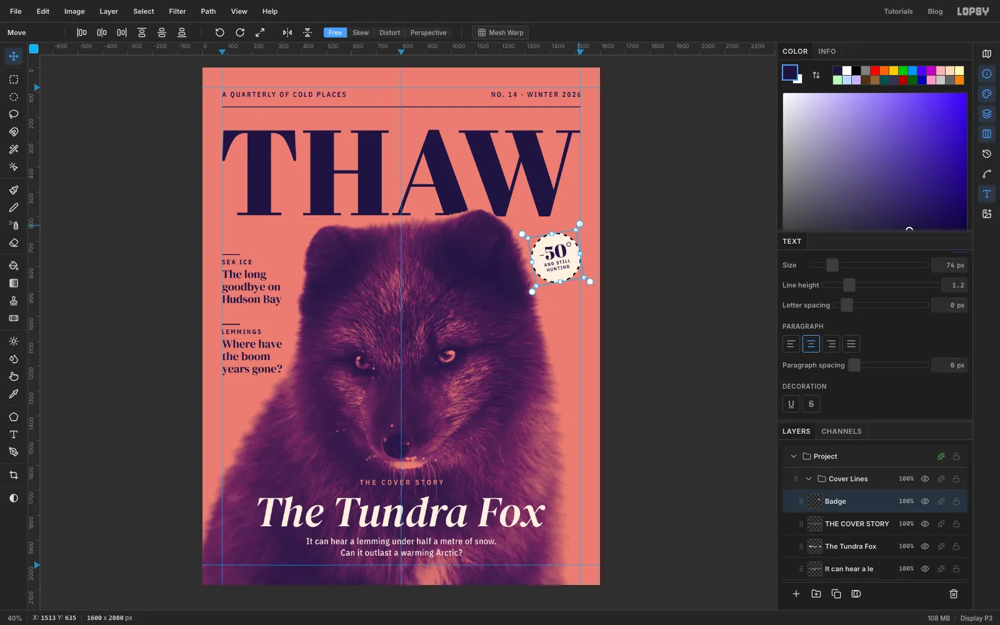

Click the top text layer of the badge and choose **Layer → Merge Down**
twice. The number, the label and the disc become a single *Badge* layer.
Draw an elliptical marquee just around the disc, pick the **Move** tool,
and drag the rotate handle outside the box's top-right corner anticlockwise
until the badge tilts slightly, about **10°** (less than one 15° snap). Press [[Cmd+D]] to commit.

## Add a barcode box

Click *Cover Lines* and add a layer called *Barcode*. In the bottom-right
corner, drag a small box about 110 px wide and a little less tall, from
below and right of the title's x down to where the right and bottom guides
meet. Snap to
Guides is on by default, so the right and bottom edges land exactly on the
guides. Fill it with cream. It should sit almost entirely on coral, clear
of the fur and the title.

Switch the foreground to `#1E1440` and zoom in to 400% or more. Draw the
bars with the **Pencil**: click at the top of a bar and [[Shift]]-click at
the bottom. Use **Size 2**,
**4** and **6** for thin, medium and thick bars, with gaps of 2 or 4 px.
About 20 bars, mixing the widths at random, looks like a real barcode.
Click the *Barcode* row and finish with the digits `9 771748 091146` in IBM
Plex Sans Condensed **Medium**, **Size 11**, **Letter spacing 0**,
**Align center**, centred under the bars. Leave the same 12 px of
cream on all four sides.

## Run a photo credit up the margin

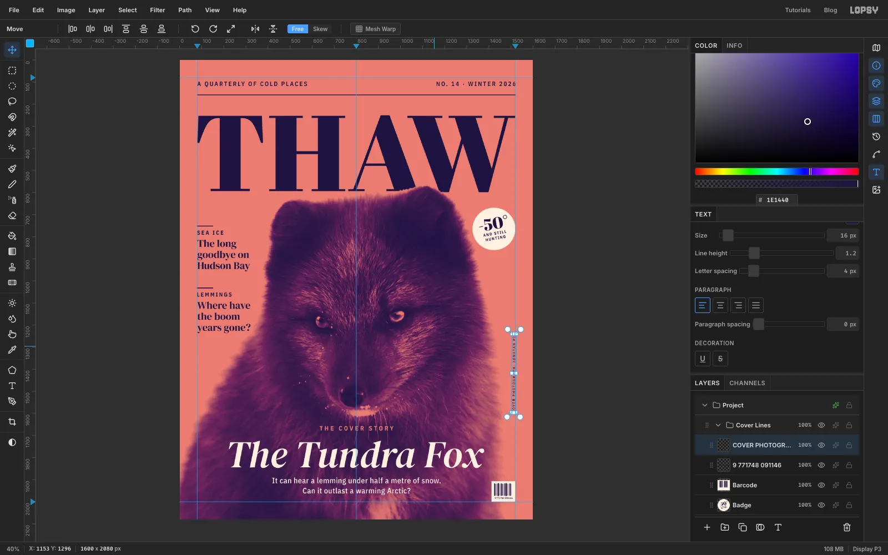

The strip of coral between the badge and the barcode is too narrow for a
cover line, but it's the classic spot for a photo credit. Click *Cover Lines*,
set IBM Plex Sans Condensed **Medium**, **Size 16**, **Letter spacing 4**,
**Align left**, colour `#1E1440`, and type `COVER PHOTOGRAPH: JONATAN PIE` anywhere in
empty space.

Pick the **Move** tool. Hold [[Cmd]] and drag the rotate handle at the
text's top-right corner anticlockwise until the line stands upright.
[[Cmd]] snaps the angle to 15° steps, so it stops exactly at 90°, and the
rotation sticks as soon as you let go. Nudge the credit with the arrow keys
onto the right guide, centred in the gap between the badge and the
barcode. It reads from bottom to top, as spine and
margin credits usually do.

## Clean up the fur under the masthead

Zoom in where the ear crosses the masthead. The very tips of the fur are
pale, so they print as a thin coral fringe against the violet letters.
Trim it back just in that area:

1. Expand *Fox*, click *Fox Cutout*, then [[Cmd]]-click its thumbnail.
2. Choose **Select → Shrink…** by **6** px, then **Select → Inverse**.
3. With the **Rectangular Marquee**, hold [[Shift]]+[[Alt]] and drag a band
   across the whole page from just above the ears to just below the
   bottom of the masthead. [[Shift]]+[[Alt]] keeps only the part of the
   selection inside the band.
4. **Select → Feather…** by **2** px, press [[Delete]], then [[Cmd+D]].

## Clone out the snow crumbs

The fox has crumbs of snow on its nose and cheeks. In the duotone they
show up as bright coral specks. Pick the **Clone Stamp** at **Size 18**.
[[Alt]]-click clean fur just left of the first crumb to set the source,
then click once on each of the bigger crumbs on the bridge of the nose and
the cheeks. The source follows each click, so it always copies fur from
just to the left. A few tiny specks can stay, since they read as texture,
and leave the white lip alone: it's real fur.

## Burn down the pale bib

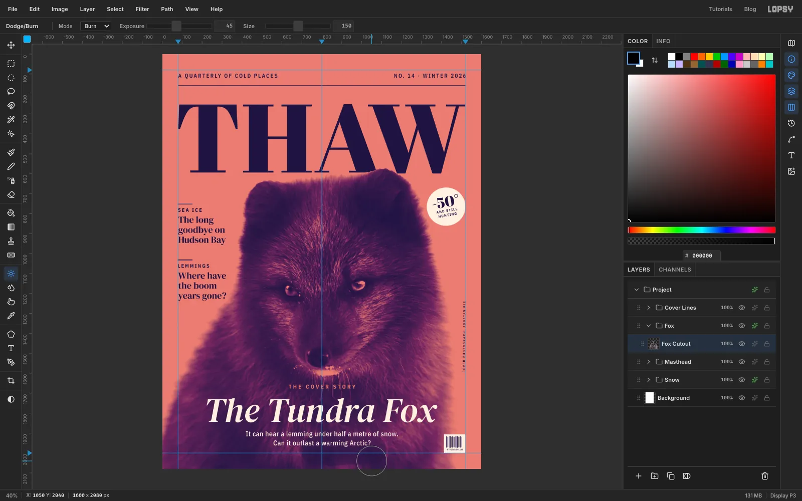

The fox's white bib sits right under the dek and makes it harder to read.
With *Fox Cutout* still selected, pick the **Dodge** tool, switch it to
**Burn**, and set **Exposure 45** and **Size 150**. Drag two slow strokes
across the bib. Each stroke darkens the fur a step, and because it's inside
the *Fox* group it darkens towards the violet ink.

## Shade the fur behind the title

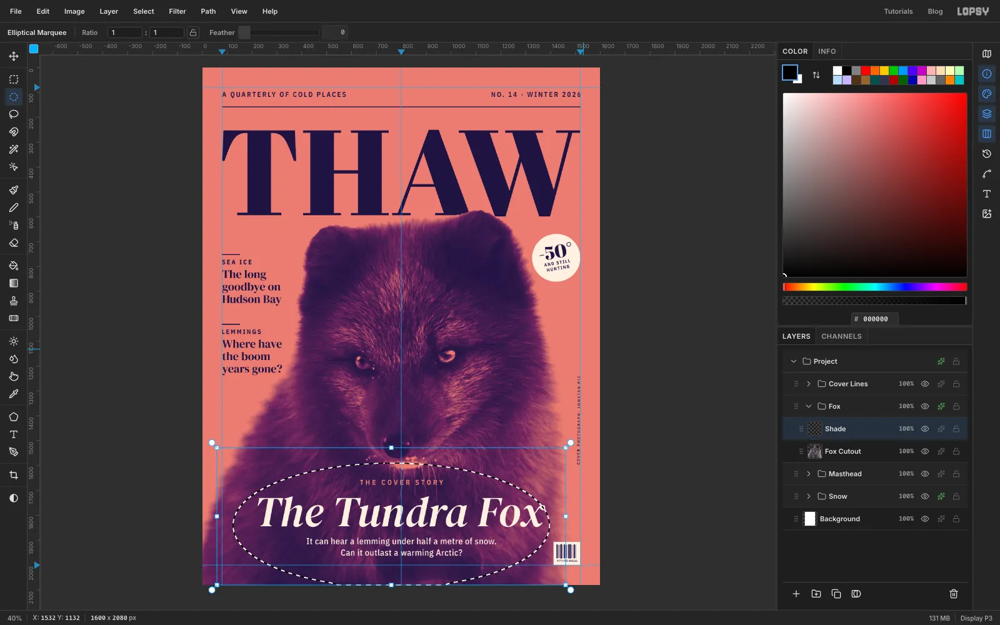

Add a layer called *Shade* above *Fox Cutout*, inside the *Fox* group. Set
the foreground to black. Draw a wide **Elliptical Marquee** across the
chest, from just inside the left edge to the barcode and from above the
kicker to off the bottom of the page. Apply **Select → Feather…** at
**90** px, choose **Edit → Fill**, then [[Cmd+D]]. Set the layer's opacity
to **45%** from the opacity button on its row.

Because *Shade* is inside the *Fox* group, the black is mapped to violet
ink, so the chest gets deeper without turning grey.

## Add print grain

Collapse *Fox* and *Cover Lines*, click the *Cover Lines* row and add a
layer called *Grain*. Because the group is collapsed, the new layer goes
above everything instead of inside it. Set the foreground to `#808080`, choose
**Select → All**, then **Edit → Fill**. Run **Filter → Add Noise…** with
**Amount 50**, **Mono** and **Gaussian**. Open the layer's drawer, set the
blend mode to **Overlay**, and lower the opacity to **50%**. Mid grey
disappears in Overlay, and only the noise is left: the flat coral and the
fur now share one printed texture.

## Check the alignment with the grid and guides

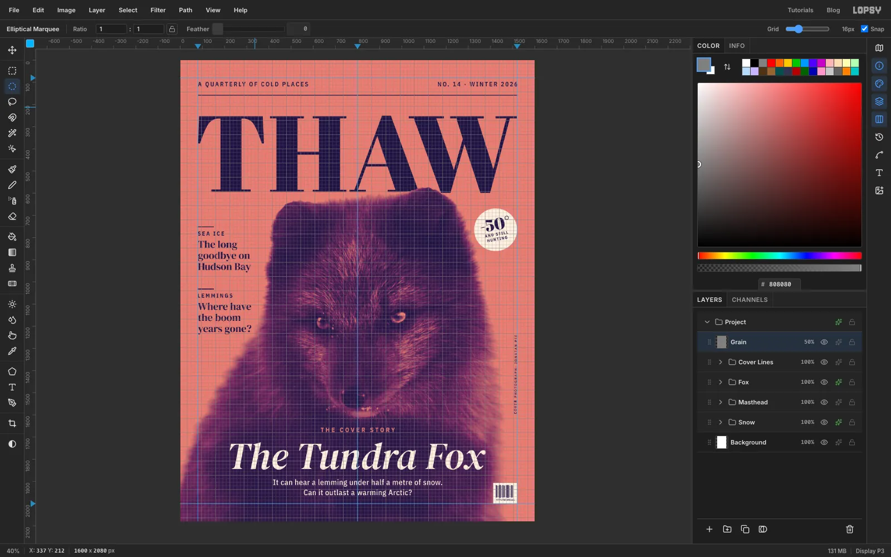

Choose **View → Show Grid** and look down the left margin. The T of THAW,
the strap, the rules and both cover lines should all start on the same
line. The masthead's W, the right strap, the badge, the credit and the
barcode should all stop at the right guide. Nudge anything that's off, then choose
**View → Show Grid** again to hide it.

Save with **File → Save Project** and export with
**File → Quick Export PNG**.
