Banknotes are the last place most of us still see real engraving every
day. The portrait or landscape (the *vignette*) is cut into steel as
thousands of lines that thicken in the shadows and thin out in the light.
Around it sit *guilloché* patterns, the interlaced curves a rose-engine
lathe draws: wave lattices, rosettes and rope borders.

In this tutorial you'll borrow that look for a 50th birthday card, a note
issued by **The Bank of Fifty Years**. A Galápagos tortoise makes a fine
mascot for a half century: slow, steady and still winning. The card is
**1800 × 900 px**.

The tortoise is engraved from a photo,
[Galapagos Geochelone nigra porteri.jpg](https://commons.wikimedia.org/wiki/File:Galapagos_Geochelone_nigra_porteri.jpg)
on Wikimedia Commons, which is in the **public domain**. Download the
1,024 × 683 original.

Along the way you'll use:

- the **Pen** tool, to draw a sine wave, rose-curve lace and the outline of the tortoise
- **Duplicate Layer**, arrow-key nudges and **Merge Down**, to step one line into a lattice
- the **rotation handle** with [[Cmd]] held, to snap turns to 15°
- **Kaleidoscope**, to mirror a few strokes into a full rosette
- **Sunburst**, for medallion rays, disc hairlines and a serrated seal
- **Define Pattern** and **Fill with Pattern**, for hairlines and ridges
- **Mesh Warp**, to arch the ridges over the shell
- **Threshold** and the **Magic Wand**, to turn ridges and tone into engraved lines
- a **layer mask** with a gradient, for the oval fade
- the Move tool's handles on **several layers at once**
- text in **UnifrakturCook**, **Cinzel**, **Bodoni Moda**, **Oswald**, **Old Standard TT** and **Pinyon Script**, plus text bound to a circular path

The palette:

- Paper `#F1EAD6`, fibres `#D8C9A6`
- Underprint `#C9D9BE` → `#F1E8D2` → `#EADCC8`
- Lattice green `#8DB39A`, lattice peach `#E7B48F`
- Border `#2E5A48`, ink green `#1E4636`, mid green `#3E6B55`
- Rosette tint `#F6EBD3` → `#EDCDB0` → `#B7CDAE`
- Engraving sepia `#3B2618`
- Serial and seal red `#A8261E`

> **Tip:** Positions are in document pixels, written `x, y`. The status bar
> at the bottom shows where the pointer is. **Edit → Fill** fills the
> selection with the foreground colour, and [[Cmd+D]] deselects. New layers
> appear above the selected layer. If the selected row is an *expanded*
> group, the new layer goes inside it; if the group is *collapsed*, it goes
> next to it.

> **Tip:** For an exact rectangle or ellipse, pick the **Rectangular** or
> **Elliptical Marquee**, make sure nothing is selected, and click the
> canvas once without dragging. A dialog asks for the **From X / Y** and
> **To X / Y** corners. Each layer's effects drawer (the sparkle icon on its
> row) holds its effects and its **Blend** dropdown.

## Set up the paper and guides

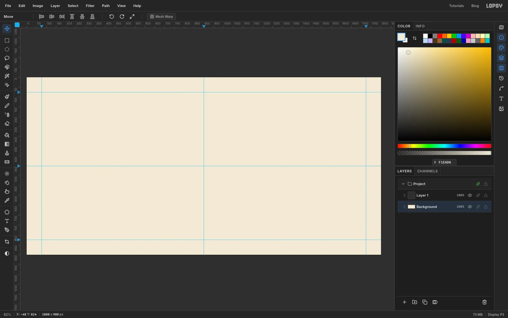

Choose **File → New**, enter **1800 × 900** and click **Create**. Click the
*Background* row, set the foreground to paper `#F1EAD6` and choose
**Edit → Fill**.

Click the top ruler at `76`, `900` and `1724`, then the left ruler at `76`,
`450` and `824`. The outer guides mark the inside edge of the border band,
and the centre guides help you place things.

A new document also comes with an empty *Layer 1*. Leave it for now and
delete it when you finish.

## Add paper fibres

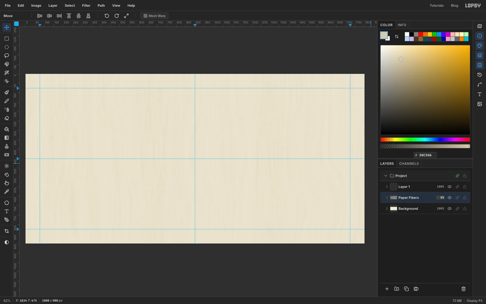

Add a new layer named *Paper Fibers*. Set the foreground to `#D8C9A6` and
choose **Filter → Fibers…** with **Variance** `8` and **Strength** `40`.
Set the layer's **Blend** to **Multiply** and its opacity to **8%**. You
should only just notice the fibres.

## Lay a split-fountain underprint

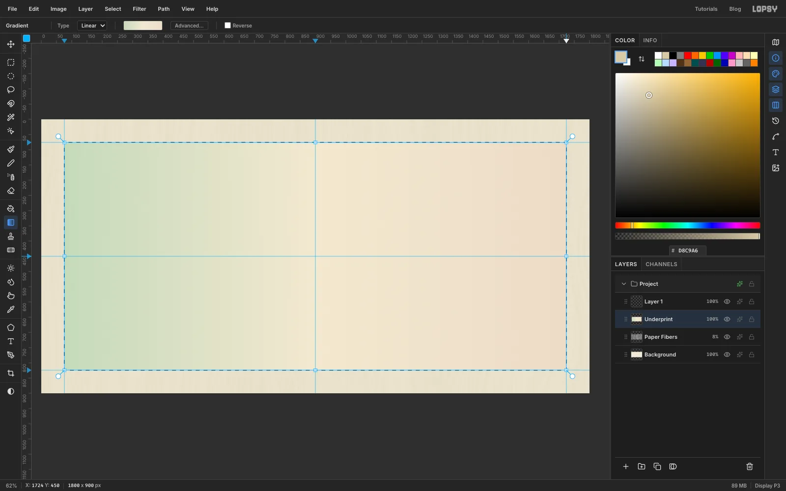

Add a layer named *Underprint*. Select from `76, 76` to `1724, 824`, the
area inside the guides.

Pick the **Gradient** tool, set **Type** to **Linear** and click
**Advanced…**. Set three stops: sage `#C9D9BE` at the left, cream `#F1E8D2`
in the middle and warm cream `#EADCC8` at the right. Drag from the left
guide to the right guide along the middle of the note.

Deselect. Set the layer to **Multiply** at **55%**. Security printers call
a blended ink like this a *split fountain*. It's subtle, but it makes the
note feel printed rather than flat.

## Draw one sine wave with the Pen

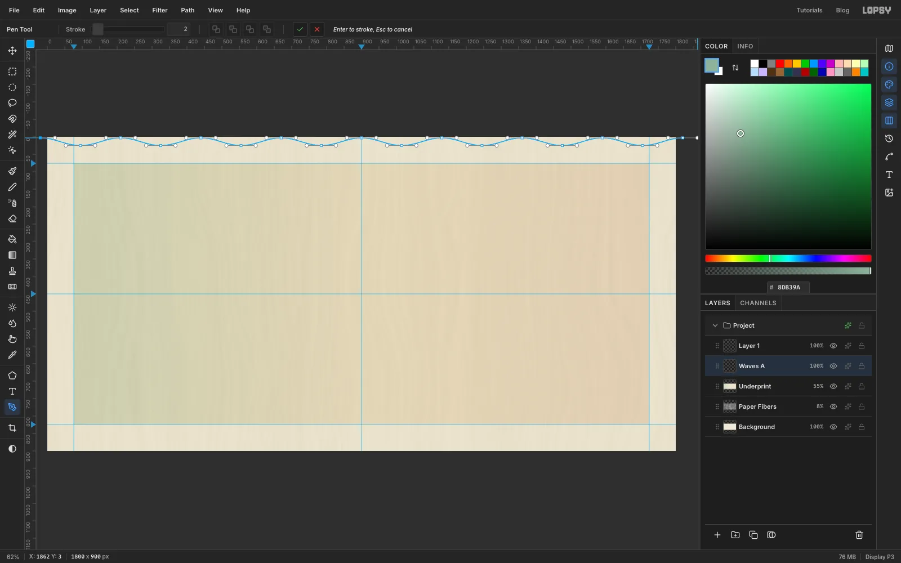

Add a layer named *Waves A* and set the foreground to lattice green
`#8DB39A`. Pick the **Pen** tool and set its **Stroke** to `2`.

Draw a wave along the very top of the note. Start just off the left edge
at `-20, 3`. **Click and drag** about 42 px to the right to pull out a
smooth handle. Then add the next anchor 115 px further right at `95, 25`,
dragging again. Keep going, alternating between `y = 3` and `y = 25`, every
115 px, until you are past the right edge.

Press [[Enter]]. The Pen strokes the path with the foreground colour.

> **Tip:** Keep the wave's highest points inside the canvas. Anything that
> sticks out past the top edge is clipped, and every copy you make in the
> next step inherits the gap.

## Step the wave down the note

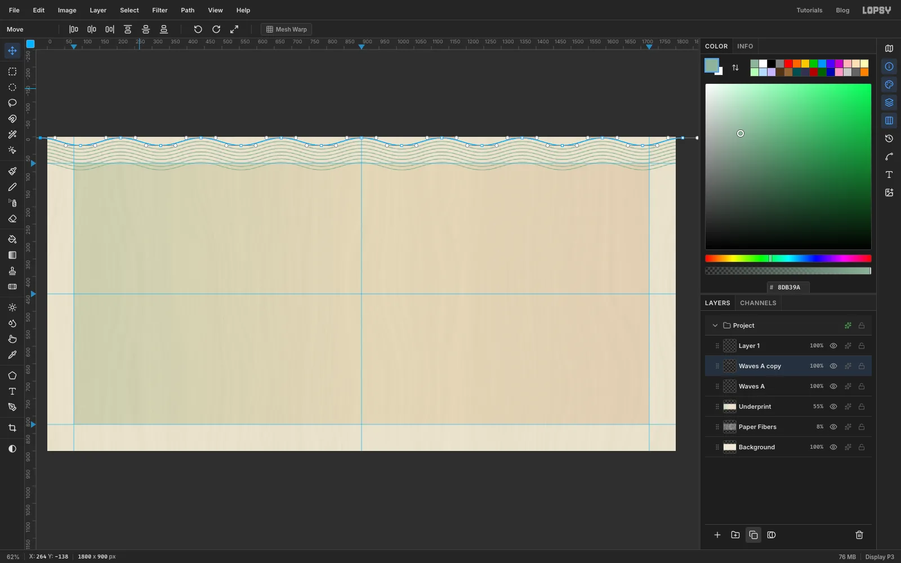

Now turn one wave into a lattice of 128, doubling the count each time:

1. Pick the **Move** tool and click **Duplicate Layer** at the bottom of the Layers panel.
2. Press [[Down]] 10 times, so the copy sits 10 px below the original.
3. Choose **Layer → Merge Down**. You now have 2 waves.
4. Duplicate again and nudge by `20` ([[Shift+Down]] twice), then merge. You have 4.
5. Repeat with nudges of `40`, `80`, `160`, `320` and `640` px. For the long ones, hold [[Shift+Down]] and watch the ruler, then correct with single presses.

After seven rounds the waves cover the whole note at a 10 px pitch.

## Weave a second set of waves

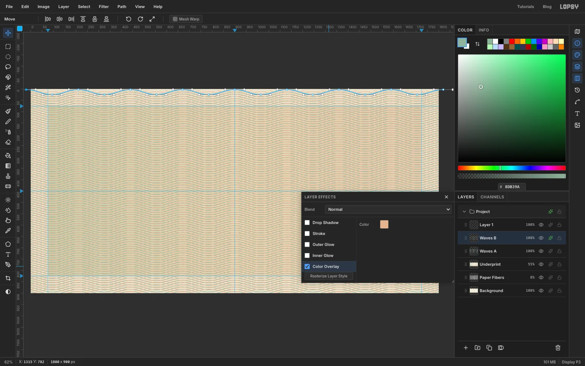

Duplicate *Waves A* and rename the copy *Waves B*. Choose
**Image → Flip Vertical**, then nudge the copy down 5 px. Flipping puts its
crests where *Waves A* has troughs, so the two sets cross like woven rope.

Open *Waves B*'s effects drawer and turn on **Color Overlay** in peach
`#E7B48F`. Set *Waves B* to **70%** opacity and *Waves A* to **55%**.

## Trim the lattice to the margin

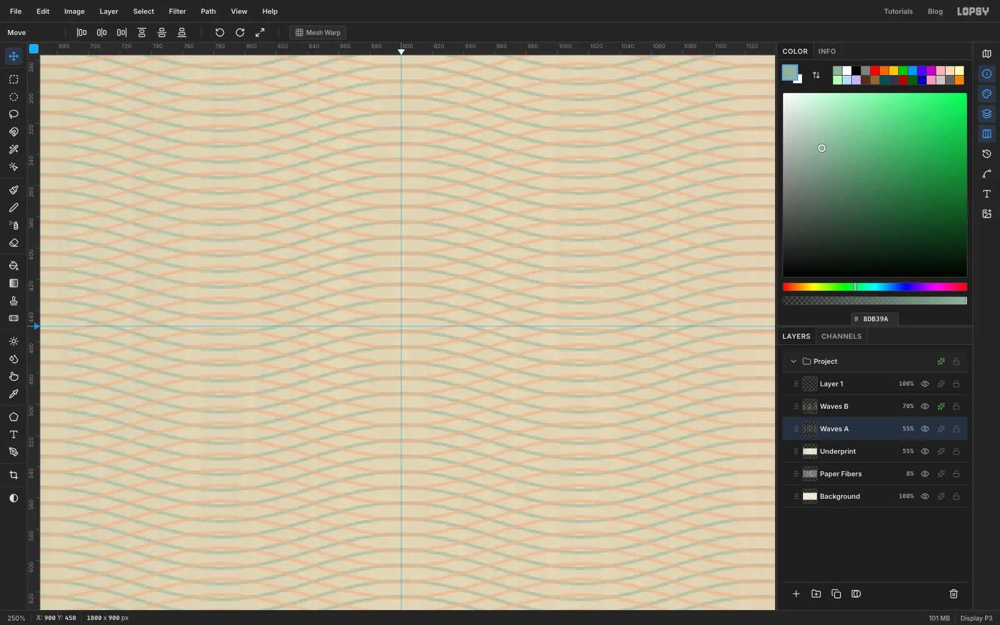

Zoom in to see the weave. Then keep the paper margin clean: select from
`18, 18` to `1782, 882`, choose **Select → Inverse**, and press [[Delete]]
on *Waves A* and again on *Waves B*. Deselect.

## Fill the border band

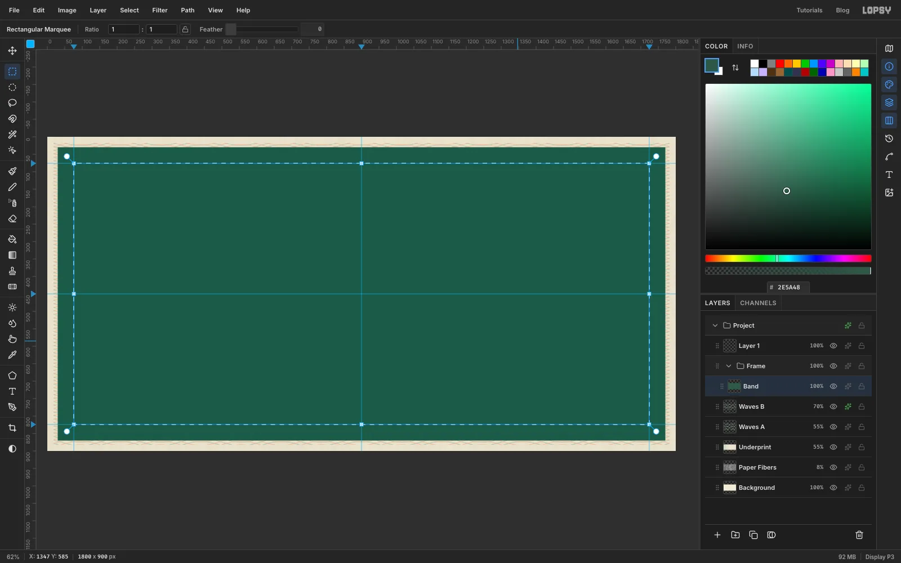

Click *Waves B* and add a **New Group** named *Frame*. Inside it add a
layer named *Band*.

Set the foreground to `#2E5A48`. Select from `30, 30` to `1770, 870` and
fill. Then select from `76, 76` to `1724, 824`, the inside of the guides,
and press [[Delete]]. Deselect.

## Cut the rope out of the band

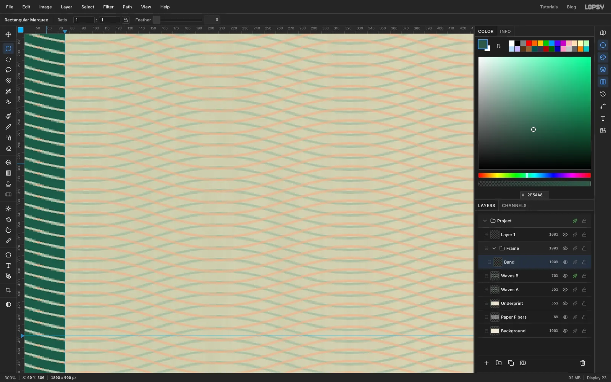

[[Cmd]]-click the *Waves A* thumbnail to select its lines. Click the *Band*
row, press [[Delete]] and deselect.

The waves are now cut out of the band. The paper shows through as light
wavy lines, like the twisted rope borders on old notes.

## Add the keylines

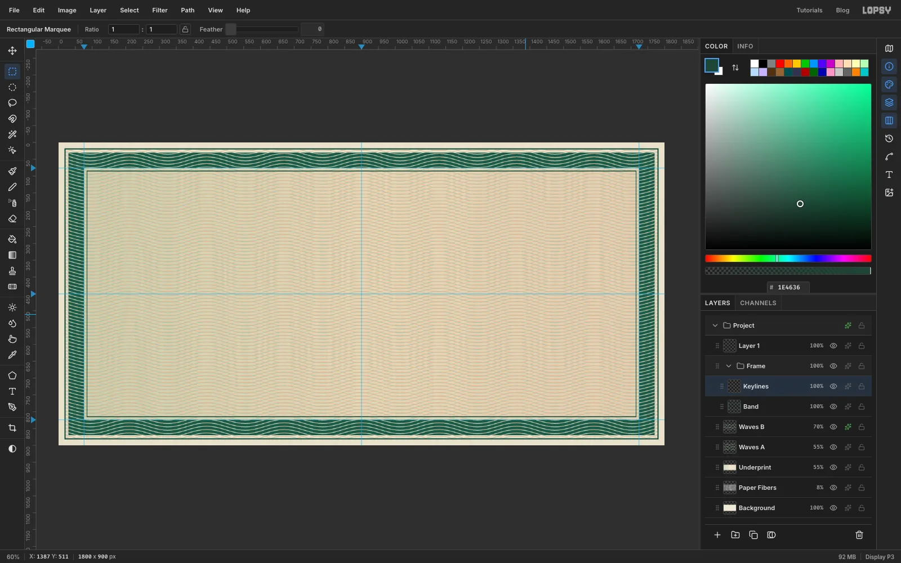

Add a layer named *Keylines* and set the foreground to ink green `#1E4636`.

1. Select from `18, 18` to `1782, 882` and fill.
2. Choose **Select → Shrink…** `3` and press [[Delete]]. That leaves a 3 px outer line.
3. Select from `84, 84` to `1716, 816` and fill.
4. Shrink by `2` and delete, for a 2 px inner line.

Deselect.

## Make the corner medallions

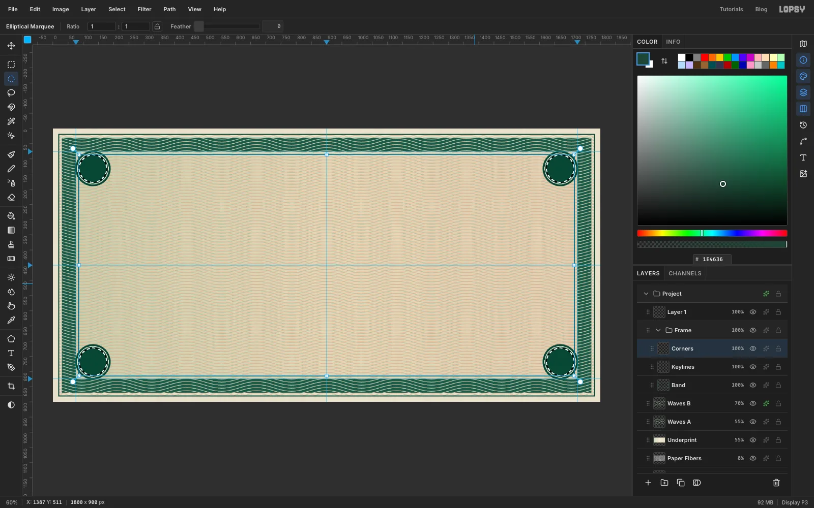

Add a layer named *Corners*. With the Elliptical Marquee, select from
`74, 74` to `190, 190` and fill. Do the same at the other three corners:
`1610, 74` to `1726, 190`, `74, 710` to `190, 826`, and `1610, 710` to
`1726, 826`.

[[Cmd]]-click the *Corners* thumbnail. Shrink by `6` and fill with paper
`#F1EAD6`. Shrink by `2` and fill with ink green. Then shrink by `4` more.
Keep this selection for the next step.

## Fill the medallions with rays

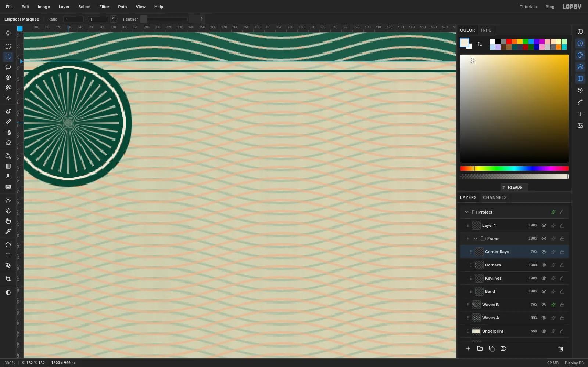

Add a layer named *Corner Rays* and set the foreground to paper. Choose
**Filter → Sunburst…** and set:

- **Rays** `36`, **Length** `6`, **Width** `22`
- **Taper**, **Fade** and **Softness** `0`
- **Center X** `7.33` and **Center Y** `14.67`, which puts the centre at `132, 132`
- **Opacity** `100`

**Center X** and **Y** are percentages of the canvas: 132 px across an
1800 px width is 132 ÷ 18 = 7.33%.

Click **Apply**. Sunburst only paints inside the selection.

Run it three more times, once for each other corner:

- top right: **Center X** `92.67`, **Center Y** `14.67`
- bottom left: **Center X** `7.33`, **Center Y** `85.33`
- bottom right: **Center X** `92.67`, **Center Y** `85.33`

Deselect and set *Corner Rays* to **70%**.

## Start the rosette with a ruled disc

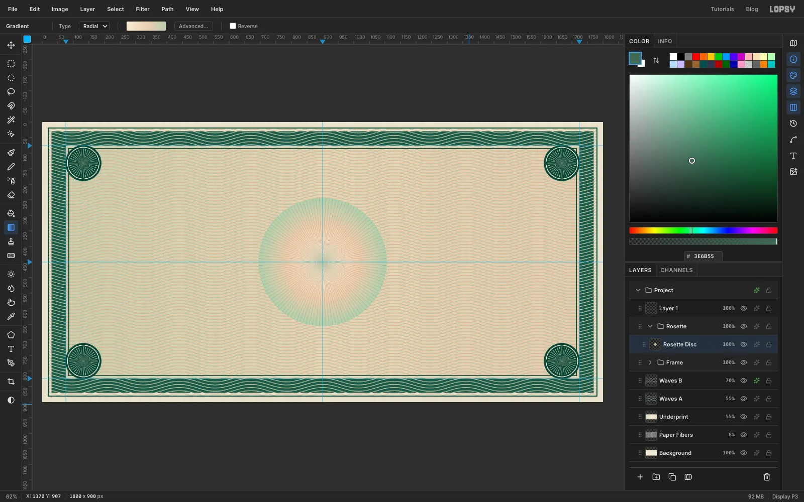

You'll build the rosette at the centre of the canvas, because
**Kaleidoscope** mirrors around the canvas centre. You'll move it into
place at the end.

Collapse *Frame*, click it, and add a **New Group** named *Rosette*. Inside
it add a layer named *Rosette Disc*. Select a circle from `694, 244` to
`1106, 656`.

Pick the Gradient tool, set **Type** to **Radial**, and set three stops:
`#F6EBD3`, `#EDCDB0` at about the middle, and `#B7CDAE`. Drag from the
centre, `900, 450`, out to the right edge of the circle.

Set the foreground to mid green `#3E6B55` and choose **Filter → Sunburst…**
with **Rays** `120`, **Length** `21`, **Width** `16`, **Taper** `50`,
**Fade** and **Softness** `0`, **Center X** and **Y** `50`, and
**Opacity** `30`. You get fine hairlines
radiating across the disc. Deselect.

Add a layer named *Disc Rule*. Select the same circle again, fill it, shrink
by `2` and delete, which leaves a thin rule around the rim.

## Draw one ellipse ring

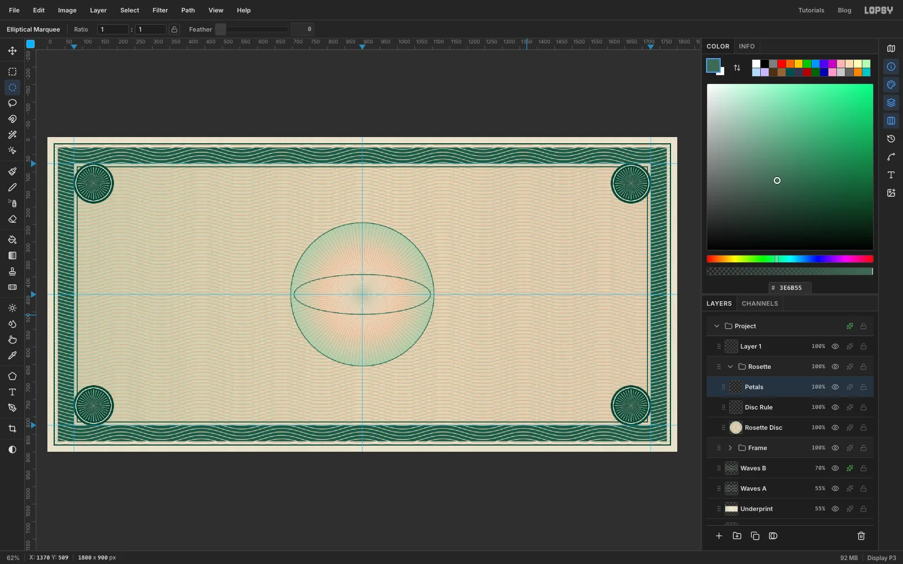

Add a layer named *Petals*. With the foreground still mid green, select an
ellipse from `704, 392` to `1096, 508`. Fill it, shrink by `2` and press
[[Delete]], which leaves a 2 px ring. Deselect.

## Turn a copy with the rotation handle

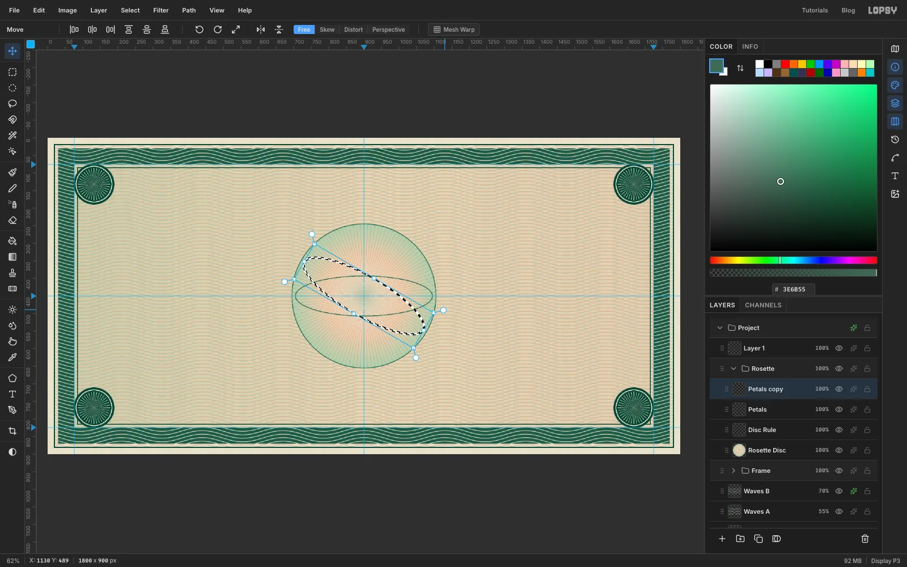

Duplicate *Petals*. [[Cmd]]-click the copy's thumbnail to select its
pixels, then pick the **Move** tool. Hold [[Cmd]] and drag the round
**rotation handle** off the top-right corner until the ring has turned
**30°** clockwise, two snaps. [[Cmd]] snaps the turn to 15° steps. Press
[[Cmd+D]]: deselecting is what applies the rotation. Then choose
**Layer → Merge Down**.

## Build twenty-four petals

Repeat the duplicate, select, rotate and merge three more times:

- **60°**: you now have 4 rings, at 0, 30, 60 and 90°
- **120°**: 8 rings, which cover 0–90° and 120–210°. Because an ellipse looks the same turned half a circle, that's every 30° step.
- **15°**: you now have rings at every 15°. A few sit exactly on top of each other, which is fine.

That's 12 different angles, and each ring makes two petals, so you get the
24-petal rose a guilloché lathe would cut.

## Draw rose-curve lace in one wedge

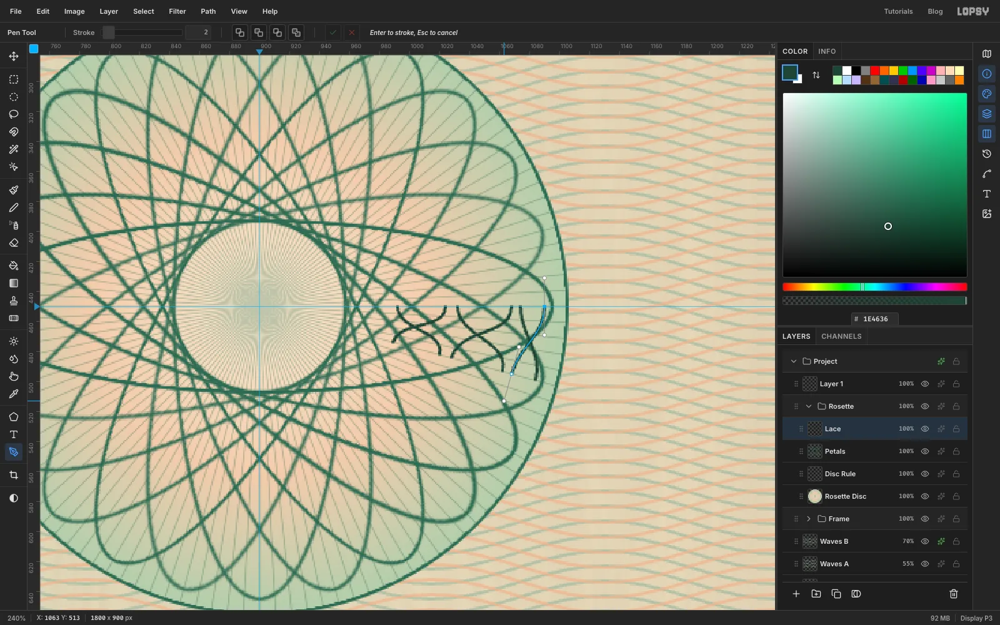

**Kaleidoscope** with 12 segments copies one thin slice, the 15° wedge
just below the horizontal centre line on the right, and mirrors it all
the way round. Whatever you draw in
that wedge becomes lace.

Add a layer named *Lace*, set the foreground to ink green, and give the
Pen a **Stroke** of `2`. Zoom in on the area just right of the centre.

Draw six short curves, each one its own path with two anchors. For each
curve, click-drag the first anchor a few pixels straight down and the
second a few pixels along the 15° line, then press [[Enter]] before you
start the next one:

1. `992, 450` → `1020, 482`
2. `1024, 450` → `989, 474`
3. `1032, 450` → `1062, 493`
4. `1068, 450` → `1028, 484`
5. `1074, 450` → `1084, 499`
6. `1090, 450` → `1068, 495`

Each pair of curves crosses like a small X.

## Mirror the lace with Kaleidoscope

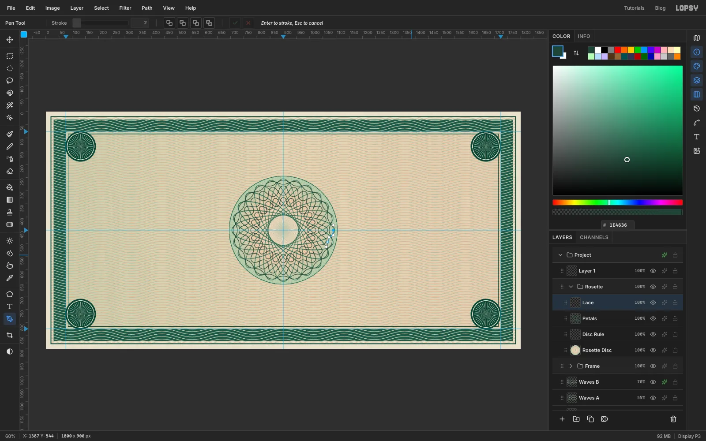

Fit the view to the screen. With *Lace* selected, choose
**Filter → Kaleidoscope…**, set **Segments** to `12` and **Rotation** to
`0`, and click **Apply**. The six curves become 144, a ring of looping
lace around the petals.

## Add the hub

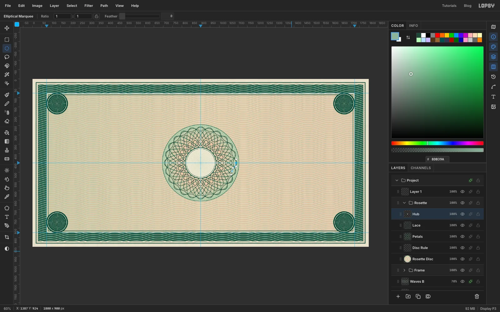

Add a layer named *Hub*. Select a circle from `816, 366` to `984, 534` and
fill it with ink green. Then step inwards, filling as you go:

1. Shrink by `3` and fill with paper.
2. Shrink by `4` and fill with ink green.
3. Shrink by `1` and fill with paper.

That leaves a double rule.

Keep the selection. Set the foreground to `#8DB39A` and run **Sunburst**
with **Rays** `72`, **Length** `8`, **Width** `30`, **Taper** `0`,
**Fade** `40`, **Softness** `0`, **Center X** and **Y** `50` and
**Opacity** `45`. Pale rays fill the hub
behind where the numeral will go. Deselect.

## Move the rosette group into place

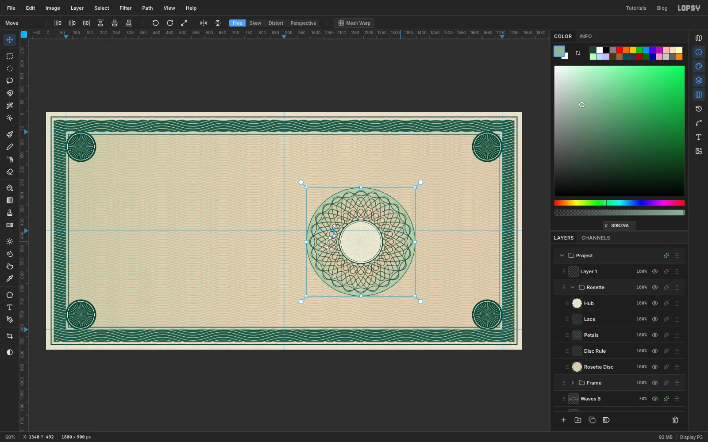

Click the *Rosette* group's row and pick the **Move** tool. Drag the
rosette right, so its centre lands near `1190, 492`. Then fine-tune with
the arrow keys until the disc is centred there. Every layer in the group
moves together.

Open the **Paths** panel and delete the six lace paths, so their outlines
don't sit over your artwork.

## Clear a space for the vignette

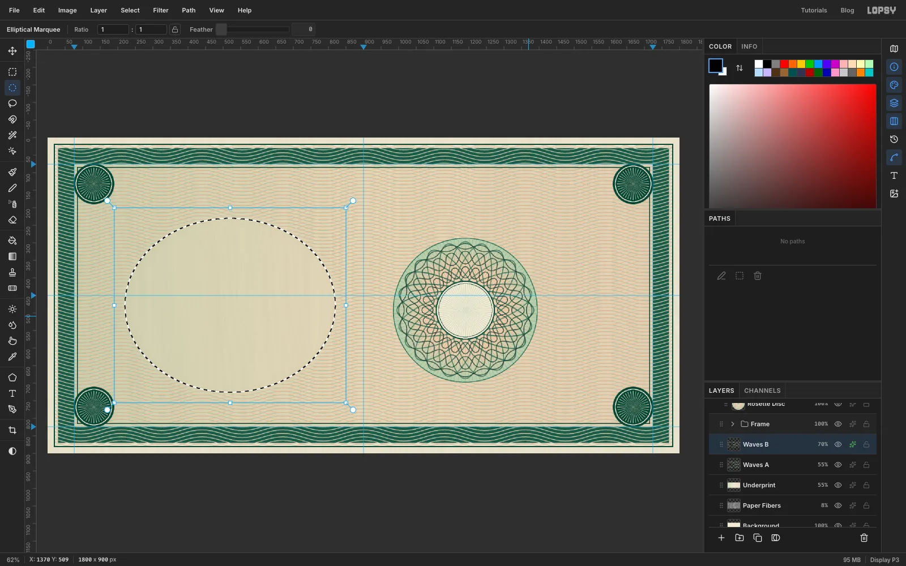

Engravers leave the vignette on clean paper. Select an ellipse from
`220, 230` to `820, 726` and choose **Select → Feather…** `30`. Press
[[Delete]] on *Waves A*, then on *Waves B*. Deselect.

## Drop in the tortoise photo

Collapse *Rosette*, click it and add a **New Group** named *Vignette*.
Inside it add a layer named *Sky Lines*. You'll use it later.

Drag the downloaded tortoise photo from your desktop onto the canvas. It
lands as a new layer at the top-left corner, at full size. Rename it
*Tortoise*. You'll engrave it at full size, where the lines are easier to
control, and scale it down at the end.

## Trace the tortoise with the Pen

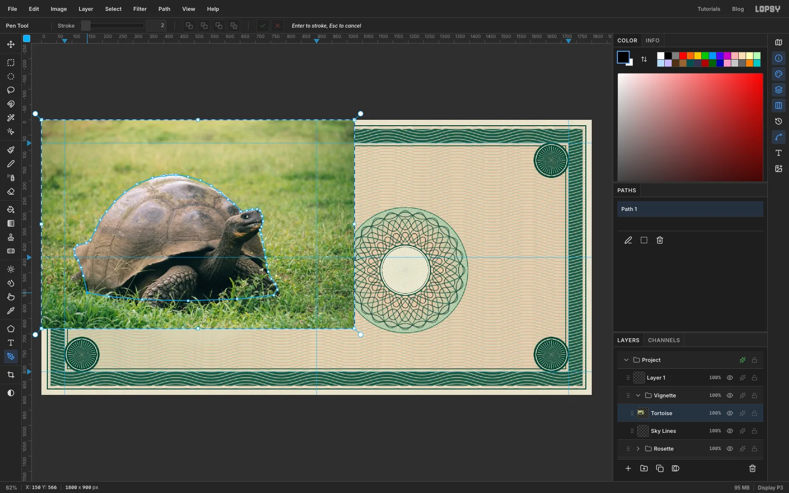

Pick the **Pen** tool and click your way around the tortoise. Plain clicks
are fine here, with about 45 anchors, closer together around the head and
neck. Start at the back foot near `150, 566` and go up the back of the
shell. Follow the dome over to the neck near `650, 300`, then go round the
head and down the chest to the front foot near `772, 556`. Finish along
the ground line.

Click the first anchor again to close the path.

## Cut the tortoise out

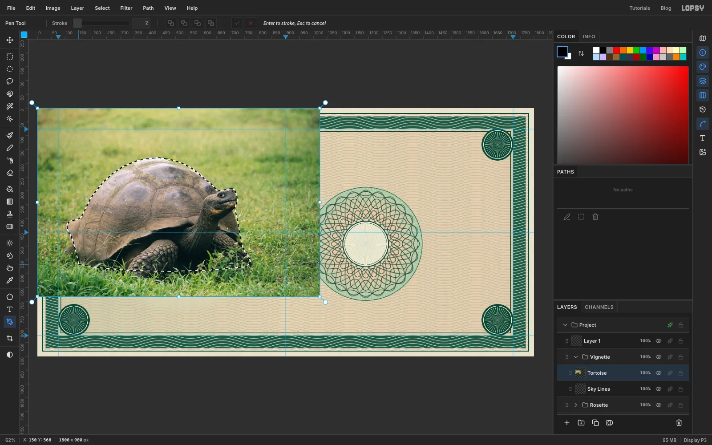

In the **Paths** panel, click the new path and click **Path to Selection**,
then **Delete Path**. Choose **Select → Inverse** and press [[Delete]] to
clear the grass and background. Deselect.

## Take the colour out

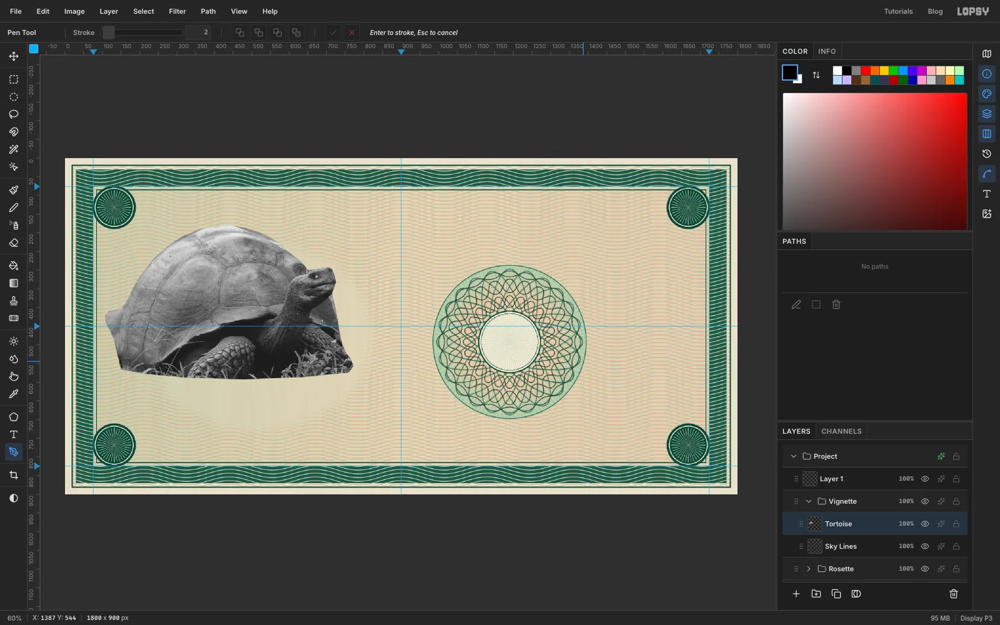

Choose **Filter → Desaturate**. Then choose **Filter → Brightness/Contrast…**
with **Contrast** `-12`. A slightly flatter photo gives the engraving more
middle tones to work with.

## Rule the sky and start the clouds

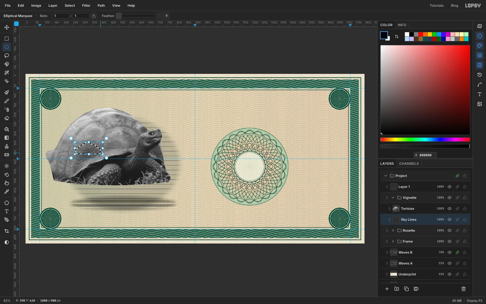

Make a hairline pattern. Add a layer named *Tile*, select from `0, 0` to
`10, 1` and fill it with black. Then select from `0, 0` to `10, 5` and
choose **Edit → Define Pattern**. Deselect and delete the *Tile* layer.
The pattern stays.

Click *Sky Lines*. Select an ellipse from `220, 230` to `820, 726`,
feather it `24`, and choose **Edit → Fill with Pattern…** with the hairline
tile at **Scale** `100%`. You get crisp 1 px lines, 5 px apart.

For the ground, select an ellipse from `240, 652` to `800, 724` and
feather it `16`. Fill with the pattern again with **Vertical Offset**
`50%`. That puts a second line between each pair, so the ground reads
darker.

For the first cloud, select a flat ellipse from `262, 410` to `410, 426`
for its base. With the Elliptical Marquee still active, hold [[Shift]]
and drag five circles along the top of the base, overlapping it. Make them
about 25 px across at the ends and 50 px in the middle, with the biggest
centred near `330, 388`.

## Cut the clouds and fade the sky

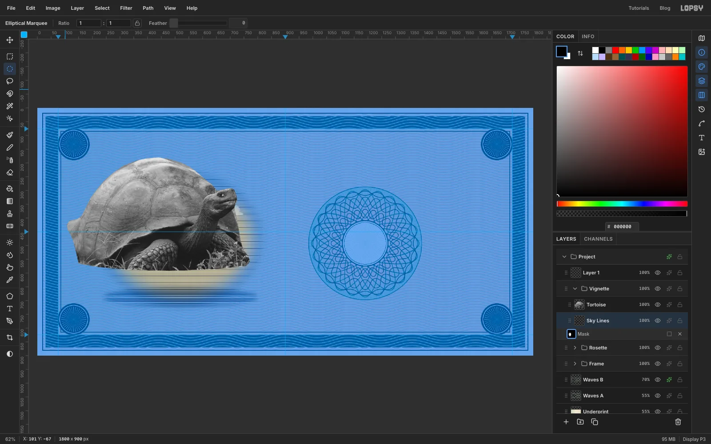

Feather the cloud selection `2` and press [[Delete]]. Make a smaller second
cloud the same way, with its base from `640, 377` to `748, 391` and four
puffs on top. Deselect.

Now fade the sky. Click **Add Mask** at the bottom of the Layers panel,
then click the mask thumbnail (**Edit mask for Sky Lines**) so you paint
into the mask. The blue tint shows you are editing it.

1. Pick the Gradient tool with a black-to-white linear gradient and drag from `520, 262` down to `520, 372`. The lines now fade out toward the top.
2. Select the vignette ellipse again (`220, 230` to `820, 726`), shrink it by `40`, feather it by `56` and choose **Select → Inverse**.
3. Fill with black, which fades every edge of the oval softly.

Deselect.

## Ink the sky in sepia

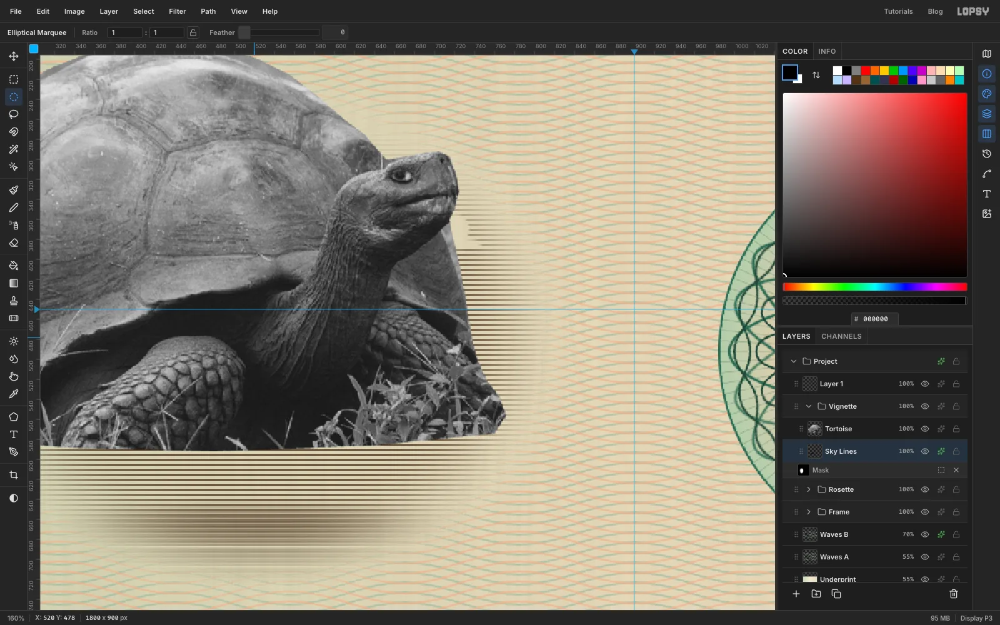

Click the *Sky Lines* row itself, not its mask. Turn on **Color Overlay**
in sepia `#3B2618`. That's the engraving ink for the whole vignette.

## Keep a silhouette and draw a contour

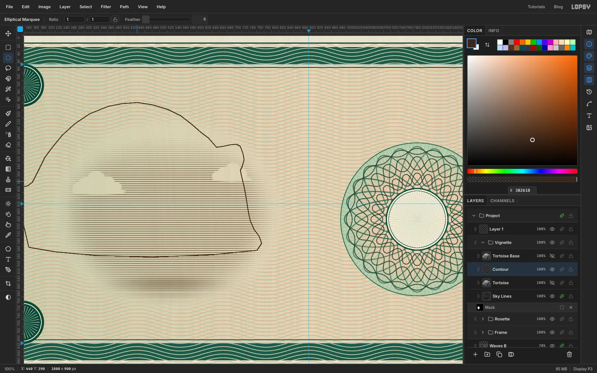

Click *Tortoise* and duplicate it as *Tortoise Base*. Hide *Tortoise Base*
with its eye icon. You'll use its shape to trim things later.

Click *Tortoise* and add a layer named *Contour*. [[Cmd]]-click the
*Tortoise Base* thumbnail, grow the selection by `2` and fill with sepia.
[[Cmd]]-click *Tortoise Base* again and press [[Delete]] on *Contour*. That
leaves a 2 px outline. Hide *Tortoise* for a moment to check it, then show
it again.

## Make a ridge tile

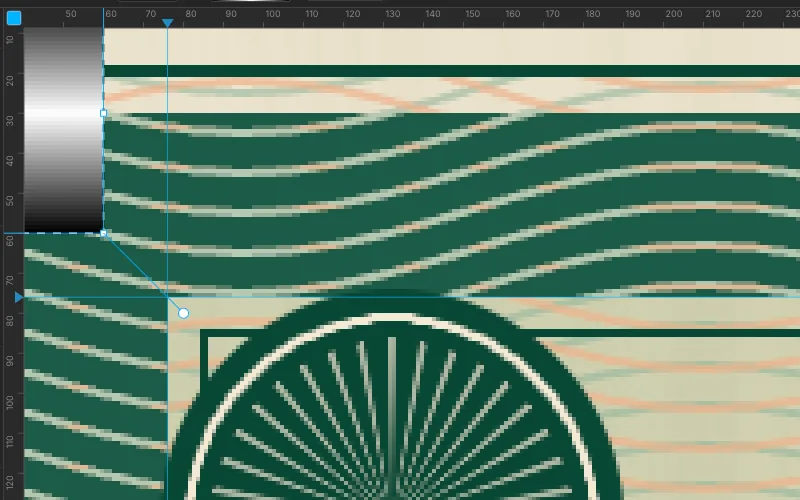

Engraved lines come from ridges. Add a layer named *Ridge Tile* and select
from `0, 0` to `60, 60`. Make a linear gradient that runs black, white,
black, and drag it from the top of the square to the bottom. Choose
**Edit → Define Pattern**, deselect, and delete the layer.

## Prepare the tone layers

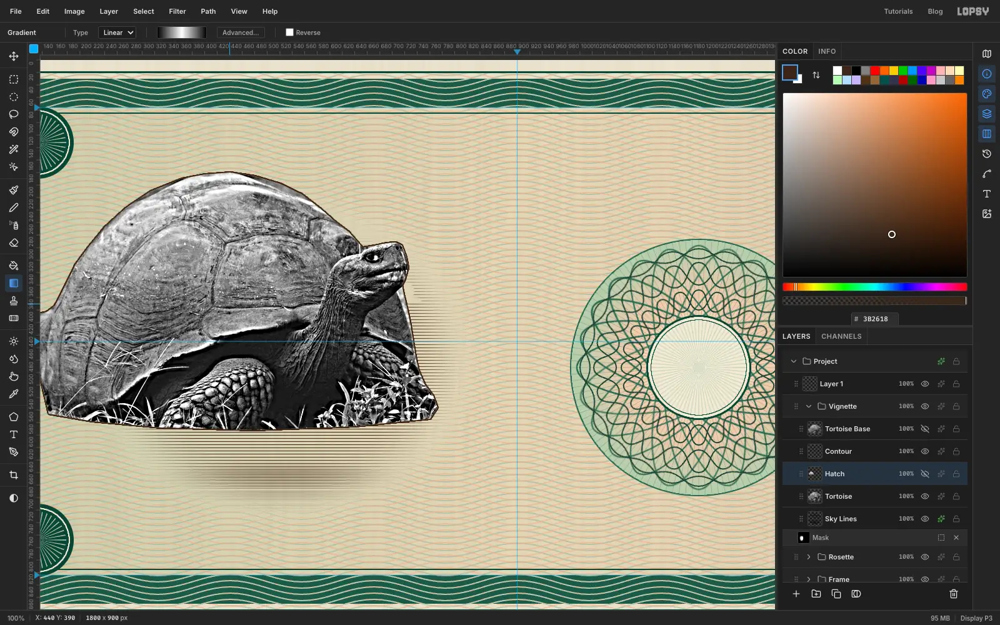

Click *Tortoise*. Choose **Filter → Gaussian Blur…** `1`, then
**Filter → Unsharp Mask…** with **Radius** `6`, **Amount** `1.8` and
**Threshold** `0`. This brings out the plates of the shell.

Duplicate it and name the copy *Hatch*. Run **Brightness/Contrast** on
*Hatch* with **Brightness** `30`. Crosshatching made from this brighter
copy only survives in the darkest shadows. Hide *Hatch* with its eye icon
for now, so you can see the next steps.

## Arch the ridges with Mesh Warp

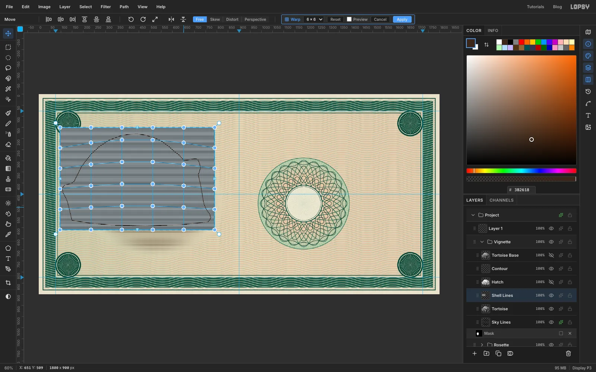

Click *Tortoise* and add a layer named *Shell Lines*. Select from
`96, 150` to `790, 610`, which covers the tortoise. Fill with the ridge
pattern at **Scale** `10%`, which gives a ridge every 6 px.

Pick the Move tool and click **Mesh Warp** in the options bar. Set the
grid to **6 × 6**. Leave the points on the outside edge alone, and drag
the inner points straight up. Counting rows from the top, lift the second
row the most: about 35 px for its two middle points and 23 px for the
outer two. Lift each row below a little less, down to about 15 and 9 px on
the fifth row.

Click **Apply**. The ridges now curve over the dome of the shell. Deselect.

## Threshold the ridges into engraving

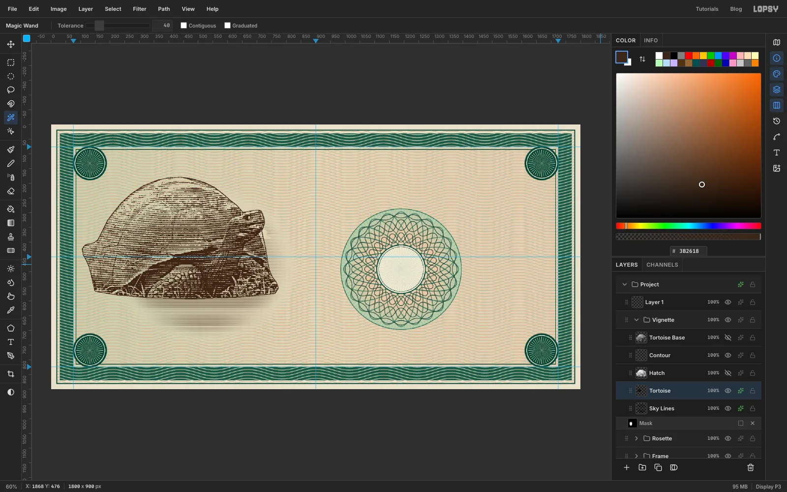

1. [[Cmd]]-click *Tortoise Base*, choose **Select → Inverse**, and press [[Delete]] on *Shell Lines* so the ridges only cover the tortoise.
2. Set *Shell Lines* to **50%** and choose **Merge Down**. The ridges blend into the photo.
3. Choose **Filter → Threshold…** with **Level** `120`. Where the photo is dark, the ridges stay fat. Where it's light, they thin to hairlines.
4. Pick the **Magic Wand**, turn **Contiguous** off, set **Tolerance** to `40`, and click a white spot on the tortoise. Press [[Delete]] to clear all the white.
5. Turn on **Color Overlay** in sepia.

## Rotate ridges for the crosshatch

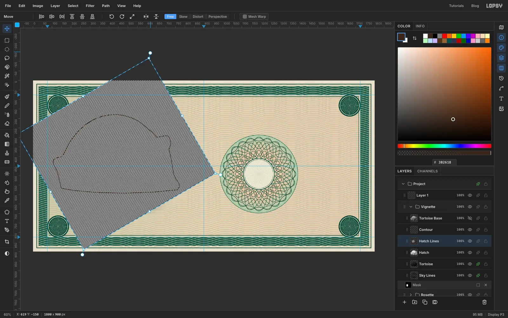

Show *Hatch* again, click it, and add a layer named *Hatch Lines*. Select a rectangle about
800 × 700 px centred on the tortoise, from `40, 30` to `840, 730`, and fill
it with the ridge pattern at `10%`.

With the Move tool, hold [[Cmd]] and drag the rotation handle to turn the
ridges **30° anticlockwise**, two snaps. Press [[Cmd+D]] to commit.

## Engrave the crosshatch

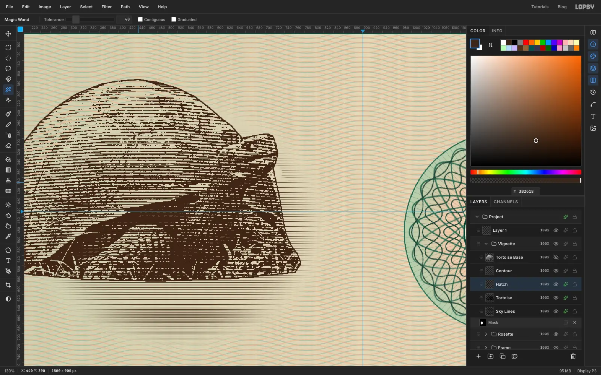

Repeat the four engraving moves on *Hatch Lines*:

1. Trim it to *Tortoise Base*.
2. Set it to 50% and Merge Down into *Hatch*.
3. Run **Threshold** with **Level** `110`.
4. Wand-delete the white and add a sepia **Color Overlay**.

The diagonal lines only show where the shell and body are darkest.

## Scale all the tortoise layers at once

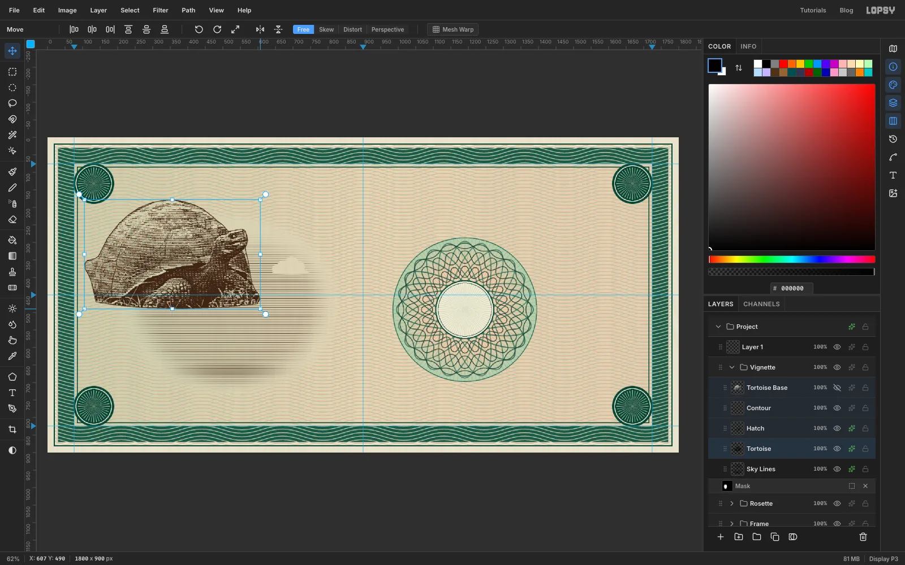

Click *Tortoise*, then [[Shift]]-click *Tortoise Base*. That selects
*Tortoise*, *Hatch*, *Contour* and *Tortoise Base* together. Make sure
nothing is marquee-selected.

Pick the Move tool. One box frames all four layers. Hold [[Cmd]] to keep
the proportions and drag the bottom-right handle inwards until the box is
three-quarters as wide, about 500 px instead of 667. The top-left corner
stays put.

## Move the tortoise into the vignette

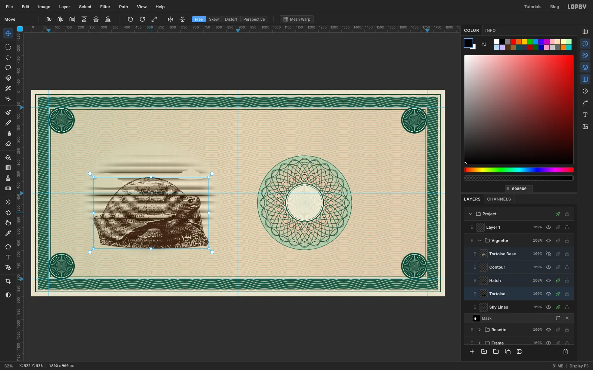

Drag inside the box to move the tortoise into the oval, centred near
`522, 536`. Press [[Cmd+D]] to commit. All four layers move as one and
stay lined up.

## Seat the tortoise

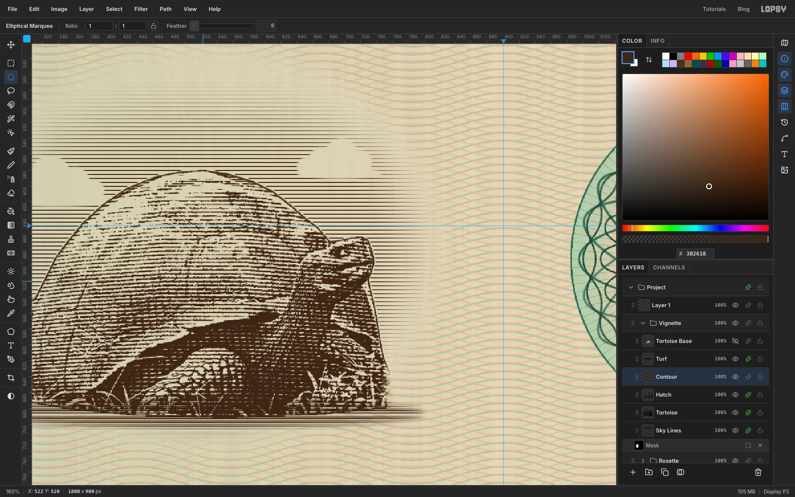

Clear the sky behind the body: [[Cmd]]-click *Tortoise Base*, grow by `3`,
click *Sky Lines* and press [[Delete]].

Ground it. Patterns don't survive a reload, so define the hairline tile
again if you closed the project. Click *Contour* and add a layer named
*Turf*. Select an ellipse from `243, 668` to `800, 704`, feather it `8`,
and fill with the hairline pattern twice, with **Vertical Offset** `0%`
and then `50%`. Give it a sepia Color Overlay.

Soften the two hard cut edges, the back rim and the front foot. Select an
ellipse from `261, 533` to `289, 593`, then hold [[Shift]] and add one from
`752, 616` to `784, 692`. Feather by `8`. Click *Contour* and press
[[Delete]], then do the same on *Tortoise* and on *Hatch*. Deselect.

Finally, add an eye. On *Contour*, select a small ellipse about 8 × 7 px at
`692, 482` and fill it with sepia.

## Engrave the HAPPY BIRTHDAY cartouche

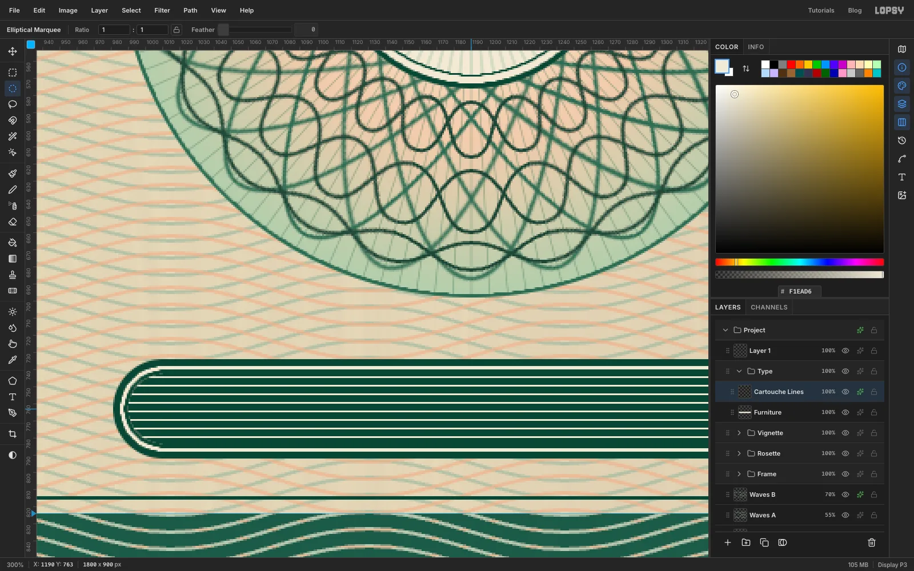

Collapse *Vignette*, click it, and add a **New Group** named *Type*. Inside
it add a layer named *Furniture*.

Build a pill from three shapes. Set the foreground to ink green, select
from `1010, 734` to `1370, 792` and fill. Then fill two circles at the
ends, from `981, 734` to `1039, 792` and from `1341, 734` to `1399, 792`.

[[Cmd]]-click *Furniture*, then:

1. Shrink by `4` and fill with paper.
2. Shrink by `2` and fill with ink green.
3. Shrink by `2` more and fill with paper.

Keep that selection, add a layer named *Cartouche Lines*, and fill with
the hairline pattern four times, with **Vertical Offset** `0`, `20`, `40`
and `60%`. Four lines in every five are filled, so it reads as dense
engraved green. Deselect and give it an ink-green Color Overlay.

## Set the blackletter title

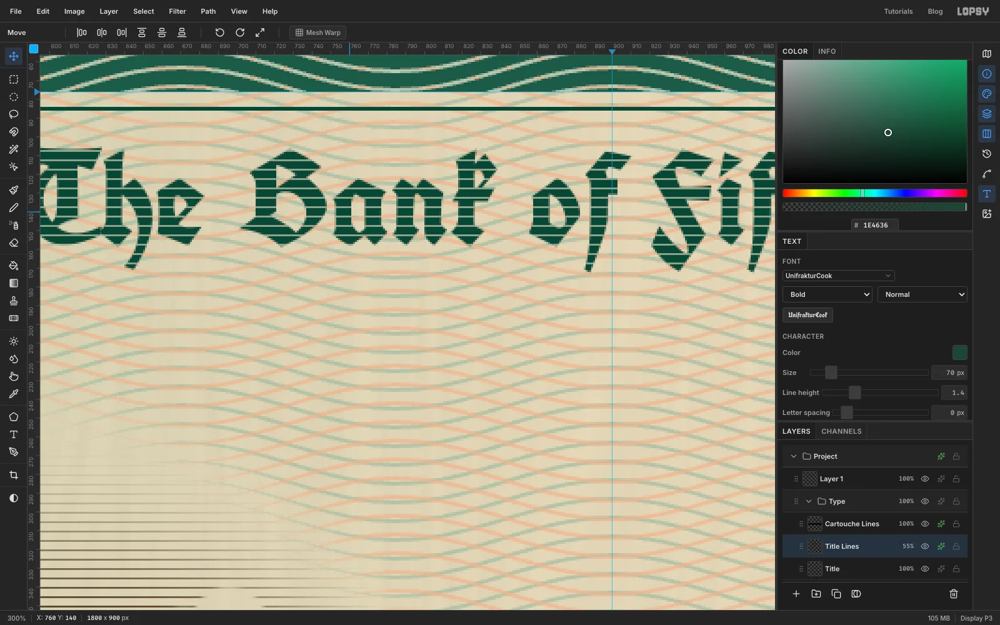

Click *Furniture* and pick the **Text** tool. Set the font to
**UnifrakturCook** at `70` px in ink green, with **Align** **Center**.
Click near `900, 140`, type **The Bank of Fifty Years** and press [[Tab]]
to commit. Nudge it with the arrow keys until it's centred on the middle
guide.

To make it look cut, not printed: [[Cmd]]-click the title's thumbnail,
add a layer named *Title Lines* and fill with the hairline pattern at
**Vertical Offset** `40%`. Give it a paper-coloured Color Overlay at
**55%** opacity. Deselect.

> **Tip:** The Text panel's settings double as the tool's defaults, and
> clicking a text layer loads its settings. Before each new text, click a
> raster layer and check that **Letter spacing** in the Text panel is `0`.

## Add the subtitle, serials and numerals

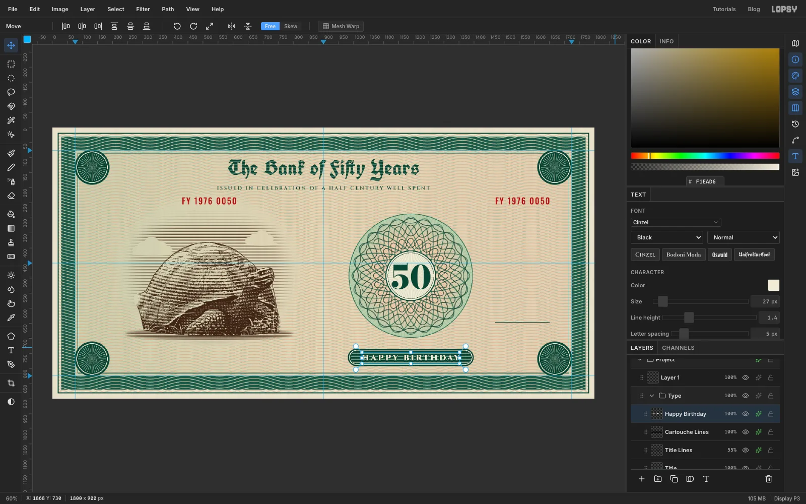

Click *Furniture* before each new text, and centre each one with the arrow
keys:

- **Subtitle:** Cinzel SemiBold, 17 px, ink green, centred at `900, 200`. Type **ISSUED IN CELEBRATION OF A HALF CENTURY WELL SPENT** and set **Letter spacing** to `4`.
- **Serials:** Oswald Medium, 28 px, red `#A8261E`, **FY 1976 0050** with letter spacing `3`. Put one at `520, 243`, over the vignette, and one at `1560, 243`, over the right column.
- **Hub numeral:** Bodoni Moda ExtraBold, 108 px, ink green. Type **50** and centre it on the hub at `1190, 492`, with clear air inside the inner ring.
- **Cartouche text:** click *Cartouche Lines* first. Use Cinzel Black, 27 px, paper, letter spacing `5`. Type **HAPPY BIRTHDAY** and centre it on the pill at `1190, 763`. Open its effects drawer and turn on **Stroke**, **Width** `2`, ink green. The outline keeps the hatching from crowding the thin parts of the letters.

## Fill the corners with numerals

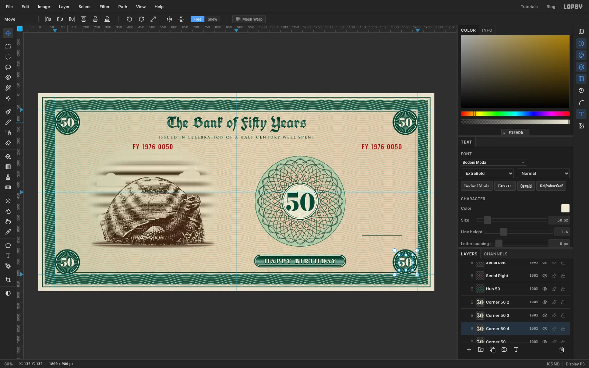

Set a **50** in Bodoni Moda ExtraBold at `50` px in paper, centred on the
top-left medallion at `132, 132`. Duplicate it three times and nudge each
copy into place. Nudge by `1536` right for the top right, `636` down for
the bottom left, and both for the bottom right.

## Write the signature column

Click *Furniture* and pick the **Pencil**. Set the foreground to ink
green, click at `1470, 646`, then [[Shift]]-click at `1650, 646` for a
straight signature rule.

Then add the column text, centred on `x = 1560`:

- **Old Standard TT** Italic, 18 px, ink green, at `y = 516`, typed on three lines with [[Enter]] between them: *This note entitles the bearer / to cake, candles and fifty / years of bragging rights.*
- **Pinyon Script**, 27 px, sepia, just above the rule at `y = 626`: *Many Happy Returns*
- **Cinzel** Bold, 11 px, ink green, letter spacing `3`, under the rule at `y = 662`: **CHIEF CASHIER OF CAKE**

Under the vignette, add **SLOW · STEADY · STILL WINNING** in Cinzel Bold,
16 px, sepia, letter spacing `4`. Centre it on `520, 763`, the same line
as HAPPY BIRTHDAY.

## Stamp a serrated red seal

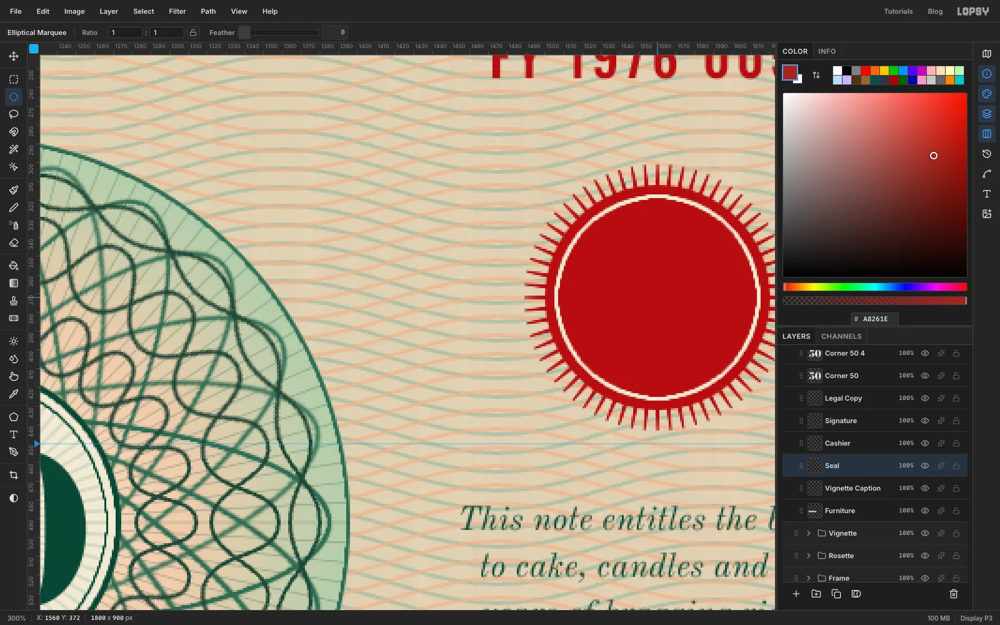

Click the **SLOW · STEADY · STILL WINNING** text layer and add a layer named *Seal*. Select a circle
from `1489, 301` to `1631, 443` and set the foreground to red.

Run **Sunburst** with **Rays** `64`, **Length** `5`, **Width** `100`,
**Taper** `100`, **Fade** and **Softness** `0`, **Center X** `86.67`,
**Center Y** `41.33` and **Opacity** `100`. A taper of
100 makes spikes that are widest at the centre, so their tips form a
serrated edge.

Select a smaller circle from `1500, 312` to `1620, 432` and fill it with
red. Shrink by `5` and fill with paper, then shrink by `2` and fill with
red, for a cream inner rule. Deselect.

## Turn the seal and its letter together

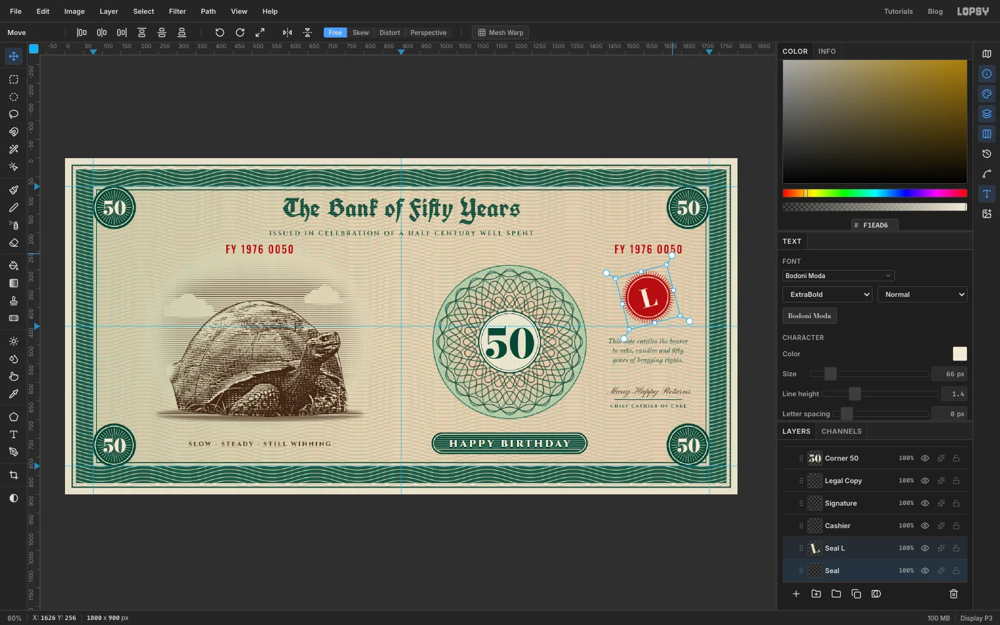

Add an **L** (Roman 50) in Bodoni Moda ExtraBold, 66 px, paper, and centre
it on the seal at `1560, 372`.

Click *Seal*, then [[Shift]]-click the **L** layer. With the Move tool and
nothing marquee-selected, hold [[Cmd]] and drag a rotation handle to turn
both **15°** anticlockwise. Press [[Cmd+D]]. The **L** stays live text
with the turn stored on it.

Set *Seal* to **Multiply** at **92%**, so the paper texture shows through
the ink.

## Run microprint round the rosette

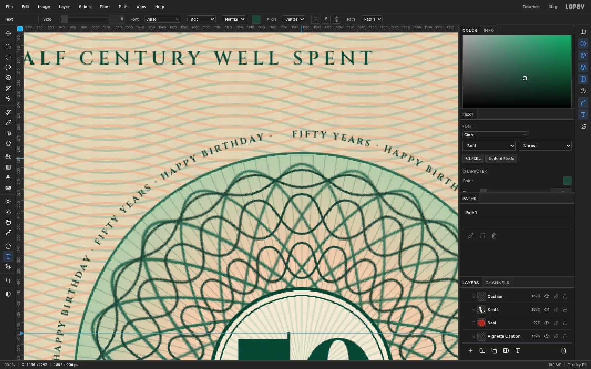

Select a circle from `971, 273` to `1409, 711`, just outside the disc, and
choose **Selection → Path** from the **Select** menu. Deselect.

Click *Furniture*, check that letter spacing is `0`, and set Cinzel Bold at
`8` px in ink green. Click in empty space and type
**FIFTY YEARS · HAPPY BIRTHDAY ·** seven times, then press [[Tab]].

Set **Letter spacing** to `1.8`. In the Text options, set **Path** to the
new path. The type runs round the circle, and the spacing makes the seven
repeats close the loop without a gap. Click the path's row in the Paths
panel to hide its outline.

## Save and export

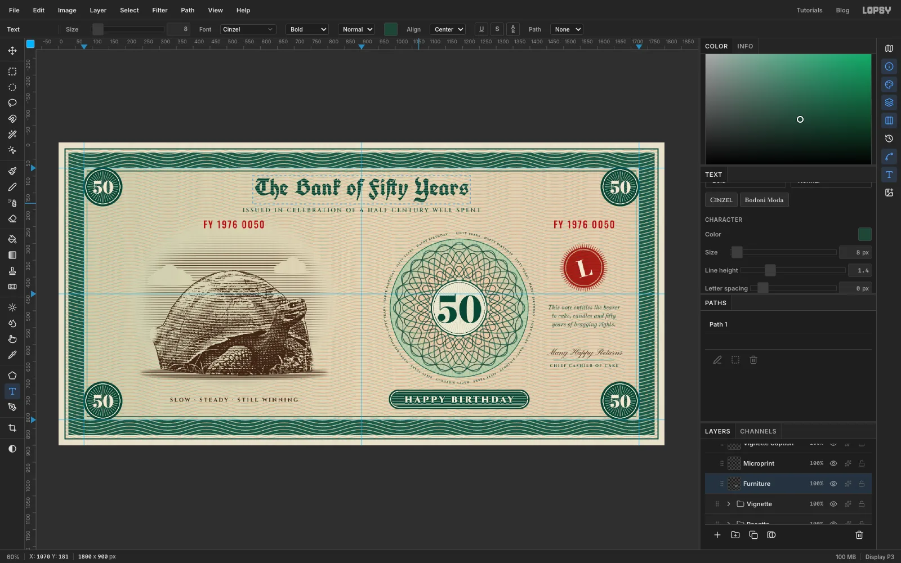

Delete the empty *Layer 1*. Choose **File → Save Project** to keep the
layers editable, then
**File → Quick Export PNG** for the card. Print it at 7 × 3.5 inches and it
folds neatly into a wallet. The recipient can keep it as legal tender for
cake.
