Old engravings make tone out of lines. Thin lines read as light grey,
fat lines as dark, and a second set of lines crossing the first gives you
shadow. A stencil can do the same job: cut each set of lines into its own
plate, print the plates one after another, and the hatching builds up
exactly as an engraver's would.

In this tutorial you'll make **Unstriped Quagga**, a 2400 × 1720 px
contact sheet for a three-plate hatch stencil. The top row shows the three
brass plates. The bottom row shows the **progressive proofs**: the first
plate on its own, then two plates, then all three. The quagga was a zebra
that was striped only at the front; the last one died in 1883. This one comes
from the only photographs of a living quagga, taken at the London Zoo in 1870.

The photo is [Quagga HIFI](https://commons.wikimedia.org/wiki/File:Quagga_HIFI.jpg)
on Wikimedia Commons, Frederick York's 1870 photograph of the London Zoo mare,
in the **public domain**. To follow along, download the full-size version
(3414 px wide). Any side-on photo of an animal against a busy background works too.

Along the way you'll use:

- **Rulers** and **guides** with snapping, and the **grid**
- pasting and scaling a photo, the **Lasso**, **Select → Inverse**, **Desaturate**
- **Gaussian Blur**, **Brightness/Contrast**, **Threshold** and the **Magic Wand** with Contiguous off
- the **Gradient** tool, **Define Pattern** and **Fill with Pattern** (with Scale and Column Stagger)
- rotating a layer with the **Move** tool's rotate handle, opacity and **Merge Down**
- loading a layer's shape with [[Cmd]]-click, **Grow**, and cutting one layer with another
- the **Shape** tool with guides, **Add Noise** and **Motion Blur** for brushed brass
- **Color Overlay**, **Inner Glow**, **Drop Shadow** and the **Multiply** and **Overlay** blend modes
- grouping, duplicating and dragging groups; **undo** and **redo**
- the **Pencil** with [[Shift]]-click lines, the **Eraser** and a soft **Brush**
- text in **IM Fell French Canon**, **IM Fell Double Pica** italic, **Big Shoulders Stencil** and **Special Elite**, with letter spacing

The palette:

- Paper `#E9DFC9`, plate tone `#E4D7BC`
- Plate-mark shade `#8C7148`, highlight `#FBF4E4`
- Brass `#634A24` → `#9A7C44` → `#C8AB6E` → `#A6884C` → `#7F6232` → `#574022`
- Brass shadow `#3A2810`, cut edge `#4A3210`
- Raw umber `#6E6440`, burnt umber `#5E4029`, iron-gall black `#1C2230`
- Type ink `#2B1D14`, register red `#A8382C`, pin crosses `#6B5232`
- Foxing `#B4823F`, edge age `#CDB287`

## Set up the sheet, guides and paper

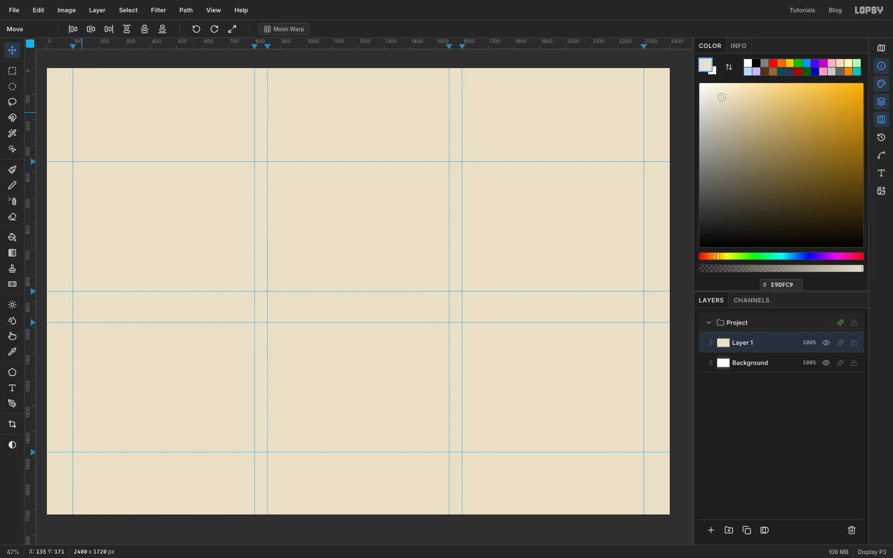

Choose **File → New** and create a **2400 × 1720** px document.

The sheet is a grid of six cells, each 700 × 500 px. Click the top ruler to
drop vertical guides at **100**, **800**, **850**, **1550**, **1600** and
**2300**. Click the left ruler for horizontal guides at **360**, **860**,
**980** and **1480**. That gives three columns with 50 px gutters, a row of
plates on top and a row of proofs underneath, with room for a header and
footer. **View → Snap to Guides** is on by default; leave it on.

Set the foreground to `#E9DFC9`, select *Layer 1*, press [[Cmd+A]] and choose
**Edit → Fill**. Rename the layer *Paper* (double-click its name).

## Paste the photo

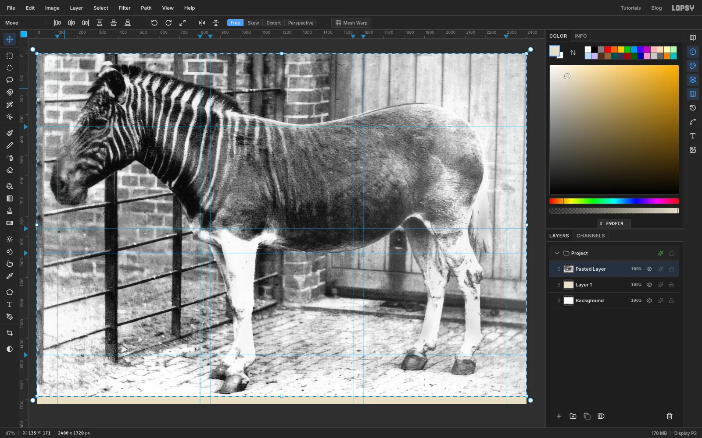

Open the downloaded photo in another app, copy it, and paste it into
Lopsy with [[Cmd+V]]. Lopsy shrinks an oversized paste to fit the canvas
and switches to the **Move** tool. Press [[Cmd+D]] to drop it, and rename
the layer *Quagga Photo*.

## Lasso the quagga

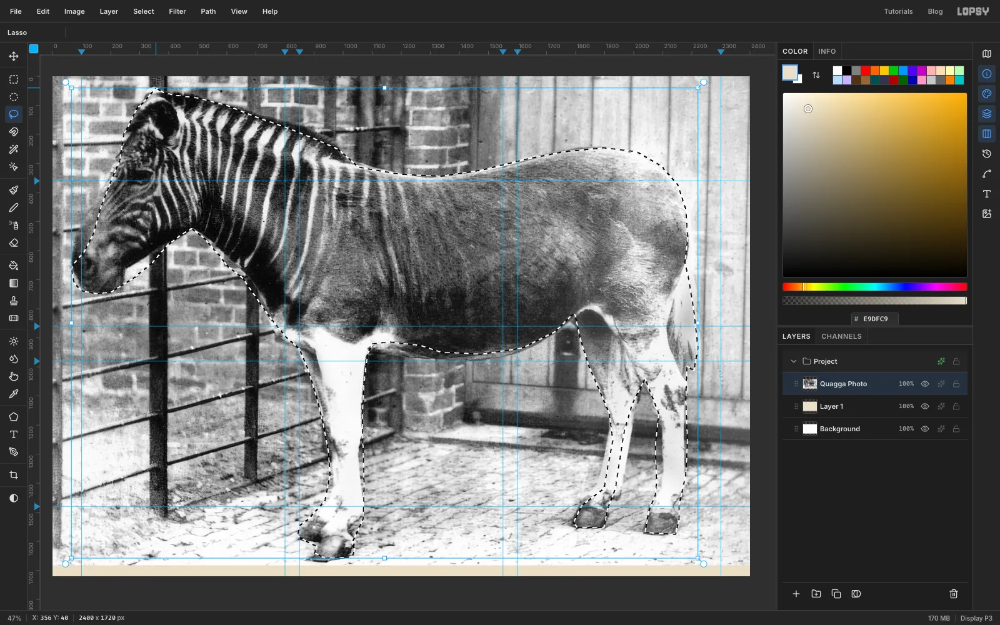

Pick the **Lasso** and trace round the animal. Work slowly round the
ears and muzzle, go in between the front and hind legs, and take in
the tail. The brick wall behind the mane is close in tone to the
mane itself, so trust your eye there rather than any automatic tool.
Small wobbles won't matter, because the quagga ends up a fifth of this size.

## Cut it out and desaturate it

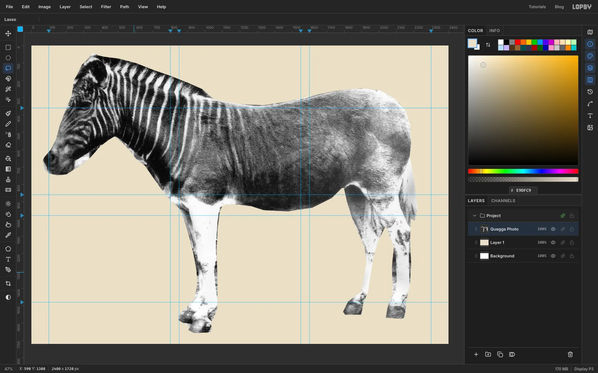

Choose **Select → Inverse**, press [[Delete]] and then [[Cmd+D]]. Then choose
**Filter → Desaturate**. The old print has a slight colour cast, and everything
from here on works on brightness alone.

## Scale it down

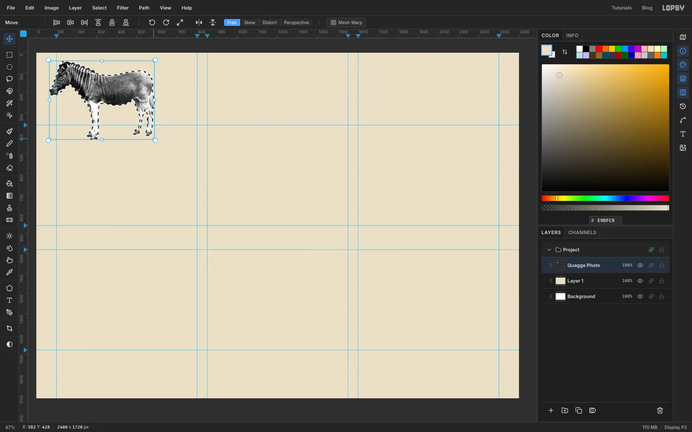

Pick the **Move** tool. [[Cmd]]-click the *Quagga Photo* thumbnail in the
Layers panel to load the animal's shape as a selection, and handles appear
around it. Hold [[Cmd]] and drag the bottom-right corner handle up and to the
left until the quagga is about **520 px** wide, a little narrower than one
cell. [[Cmd]] keeps the proportions. Press [[Cmd+D]] to commit.

## Move it into the bottom-right cell

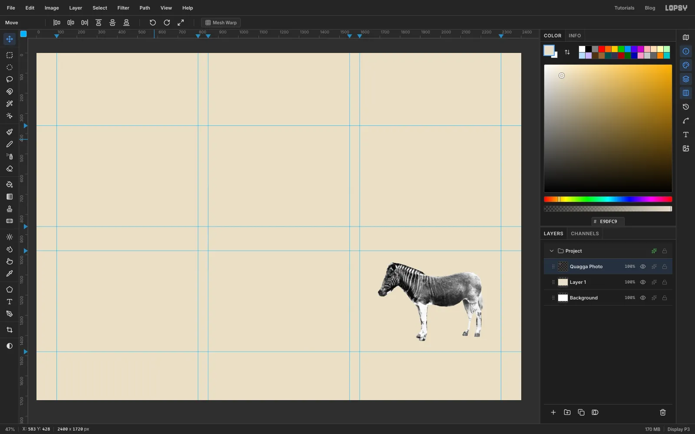

This cell will become the finished proof, so you build all three plates
here first. Drag the quagga into the bottom-right cell (between the guides at
1600 and 2300, 980 and 1480) and nudge it with the arrow keys until it sits
in the middle. [[Shift]]+arrow moves 10 px at a time.

## Back it with a white card

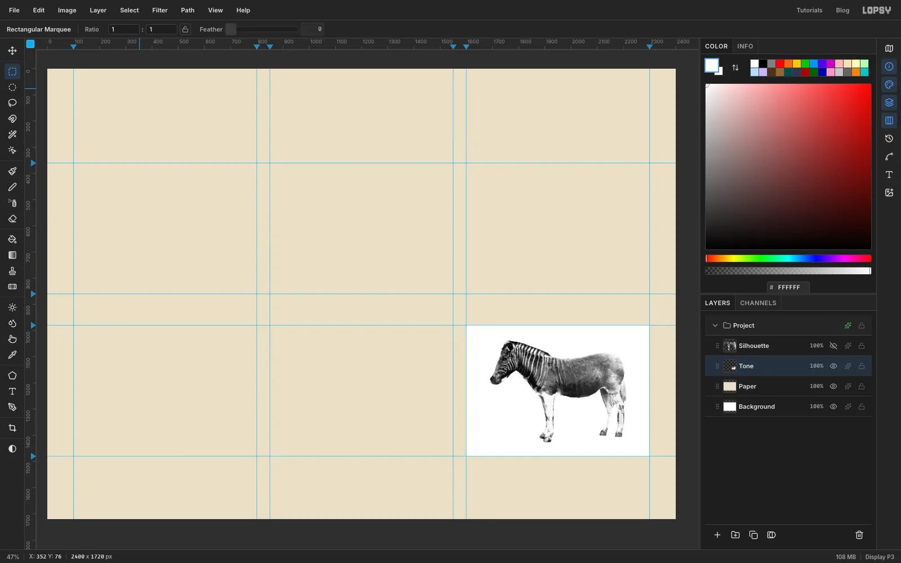

First, keep a copy of the cut-out for later: with *Quagga Photo* selected,
click **Duplicate Layer** at the bottom of the Layers panel, rename the copy
*Silhouette* and hide it with its eye icon.

Select *Paper* and add a new layer called *Tone* (the **+** button); new
layers always land just above the selected one. Pick the **Rectangular Marquee**
and click once without dragging inside the cell. A dialog opens where you
can type exact corners: **From 1600, 980** to **2300, 1480**. Set the
foreground to `#FFFFFF` and choose **Edit → Fill**, then press [[Cmd+D]].
Now select *Quagga Photo* and choose **Layer → Merge Down**. You have the
grey quagga on a white card in one layer, still called *Tone*, and white will
mean "no ink".

## Make a ridge tile

Engraved lines that swell in the dark areas need a "ridge" pattern: a
gradient from black to white and back to black, repeated.

Add a new layer called *Ridge Tile*. Click once with the Rectangular Marquee in an empty
part of the sheet and make an **80 × 80** px square. Pick the **Gradient**
tool, click the gradient swatch to open the editor, and set three stops:
`#000000` at 0%, `#FFFFFF` at 50% and `#000000` at 100%. Drag from the top
edge of the square straight down to the bottom edge. Choose **Edit → Define Pattern**,
press [[Cmd+D]], and delete the *Ridge Tile* layer. The pattern stays.

> **Tip:** Patterns last for the session, not the project file. If you
> reload the page, define the tile again before the next steps.

## Soften the fur

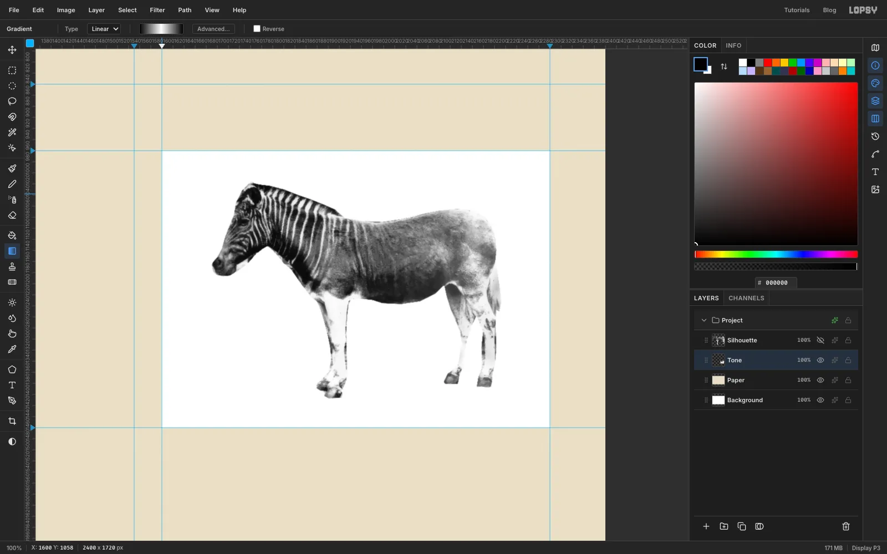

Select *Tone* and choose **Filter → Gaussian Blur…** with **2** px. Fur
is full of tiny bright and dark flecks, and a blur lets each hatch line
swell and thin smoothly instead of breaking into crumbs.

## Copy the tone and push the contrast

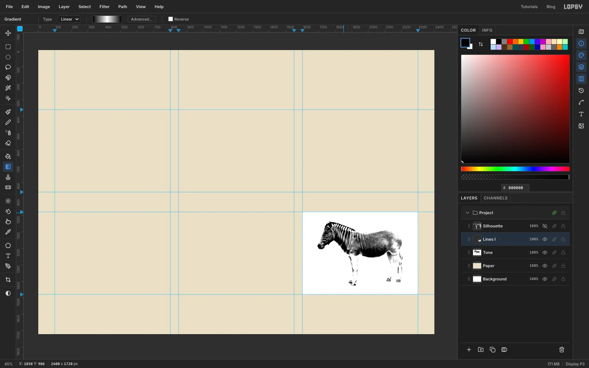

Each plate starts as a copy of *Tone*. With *Tone* selected, click
**Duplicate Layer** and rename the copy *Lines I*. Choose
**Filter → Brightness/Contrast…** and set **Brightness 5**, **Contrast 60**.
The extra contrast keeps the highlights clean, so plate I won't cut into
the white legs and belly.

## Lay the ridges over it at half opacity

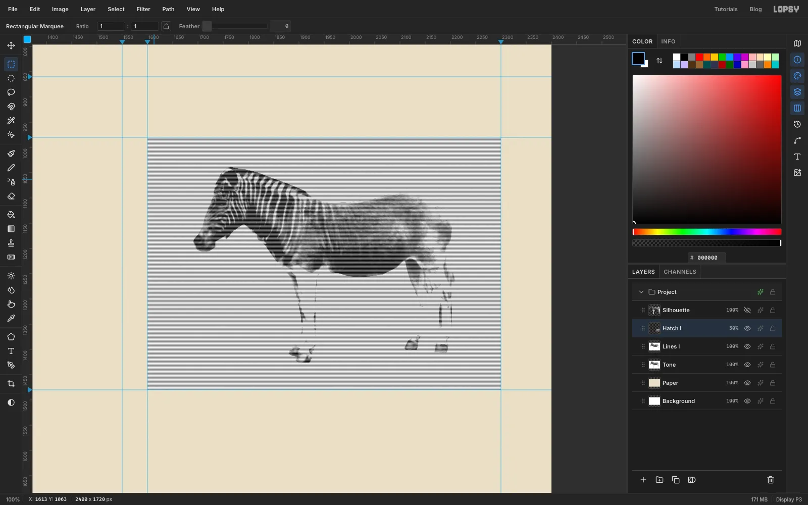

Add a new layer called *Hatch I*; it lands right above *Lines I*. Click
once with the Rectangular Marquee and select the cell exactly (**From 1600, 980**
to **2300, 1480**). Choose **Edit → Fill with Pattern…**, pick your ridge
tile, set **Scale** to **10%** and click **Apply**. The 80 px tile becomes
an 8 px line spacing. Press [[Cmd+D]].

Open the opacity control on the *Hatch I* row and set it to **50%**.

## Merge, threshold and lift out the white

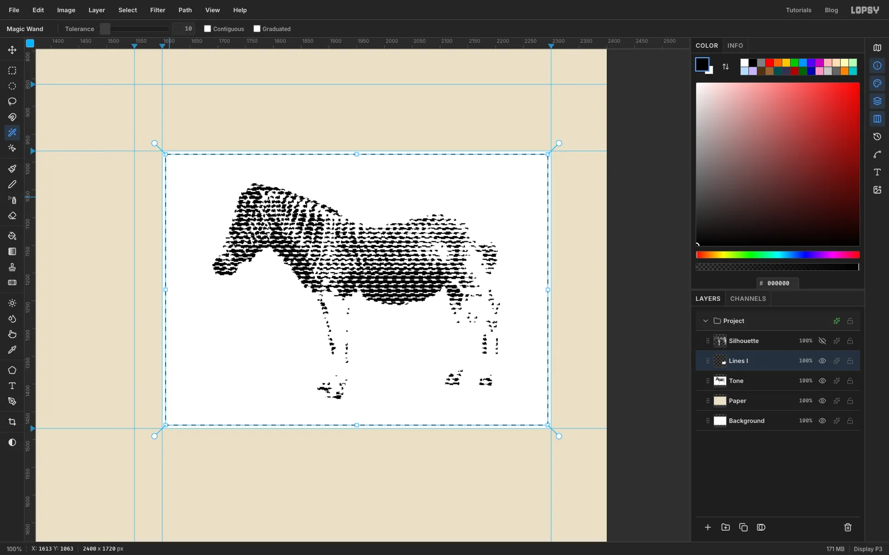

With *Hatch I* selected, choose **Layer → Merge Down**. The ridges and the
tone are now averaged together in *Lines I*. Choose **Filter → Threshold…**
with **Level 108**. Where the quagga is dark, more of each ridge falls under
the level, so the line comes out fatter; where it's light, the line thins out
and disappears. That is the engraver's swelling line, made by arithmetic.

Two clean-ups:

1. Click once with the Rectangular Marquee and enter **From 1606, 986** to
   **2294, 1474**, 6 px inside the cell. Choose **Select → Inverse** and press
   [[Delete]]. This trims the softened card edge left by the blur.
2. Pick the **Magic Wand**, set **Tolerance** to **10** and turn **Contiguous**
   off in the options bar. Click any white pixel to select all the white,
   press [[Delete]], then [[Cmd+D]].

*Lines I* is now black lines on transparency. Hide it with its eye icon so it
doesn't get in the way of the next plate.

## Plate II: rotate the ridges to 45°

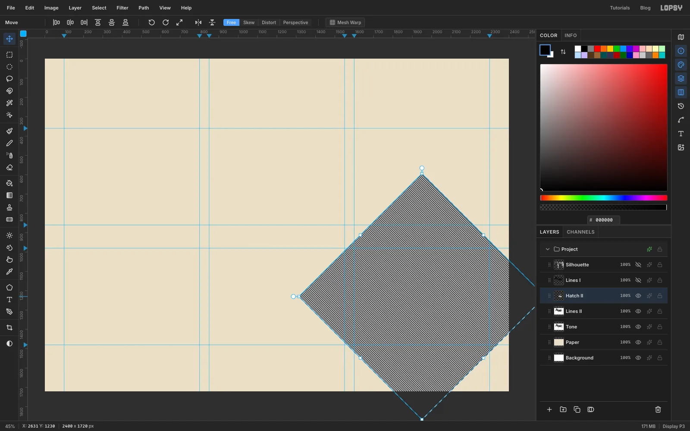

Plate II follows the same recipe, with diagonal lines:

1. Select *Tone*, click **Duplicate Layer**, and rename the copy *Lines II*.
2. **Filter → Brightness/Contrast…** with **Brightness 0**, **Contrast 60**.
3. Add a new layer called *Hatch II* (it lands above *Lines II*).
4. A diagonal hatch needs a bigger patch of ridges. Click once with the
   Rectangular Marquee and enter **From 1500, 780** to **2400, 1680**, a 900 px
   square centred on the cell. **Edit → Fill with Pattern…** at **10%** again.
5. Pick the **Move** tool, hold [[Cmd]] and drag the round rotate handle just
   outside a corner **clockwise** until the box has turned **45°**. [[Cmd]]
   snaps the angle in 15° steps. Press [[Cmd+D]] to commit. The square is big
   enough that its turned corners still cover the whole cell.
6. Set *Hatch II* to **50%** opacity and **Merge Down**.
7. **Threshold** at **84**. The lower level means only the darker half of the
   tones get lines on this plate.
8. Trim the edge and wand out the white exactly as for plate I, then hide *Lines II*.

## Plate III: shadows on the other diagonal

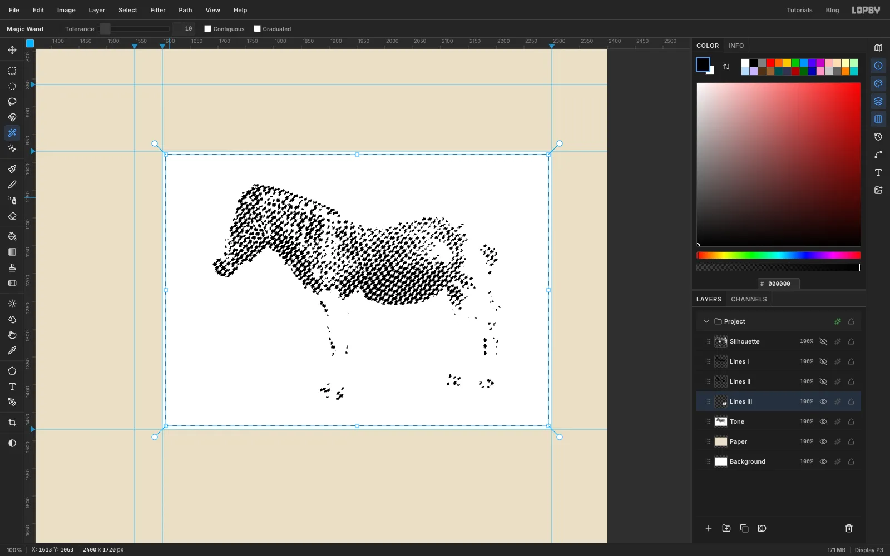

Plate III carries the darkest tones: the stripes on the neck, the mane and
the shadow under the belly. Repeat the plate II recipe with these changes:

- Name the copy *Lines III* and its ridge layer *Hatch III*.
- **Brightness −5**, **Contrast 100**.
- Turn the ridge square **45° anticlockwise** this time, so these lines cross
  plate II's at right angles (135°, measured the same way as plate II's 45°).
- **Threshold** at **80**.

Leave *Lines III* visible. Picture the three plates on top of each other:
horizontal lines wherever there is tone, diagonals in the mid-tones, and
crossed diagonals in the shadows. That's classic crosshatching.

## Add a contour to plate III

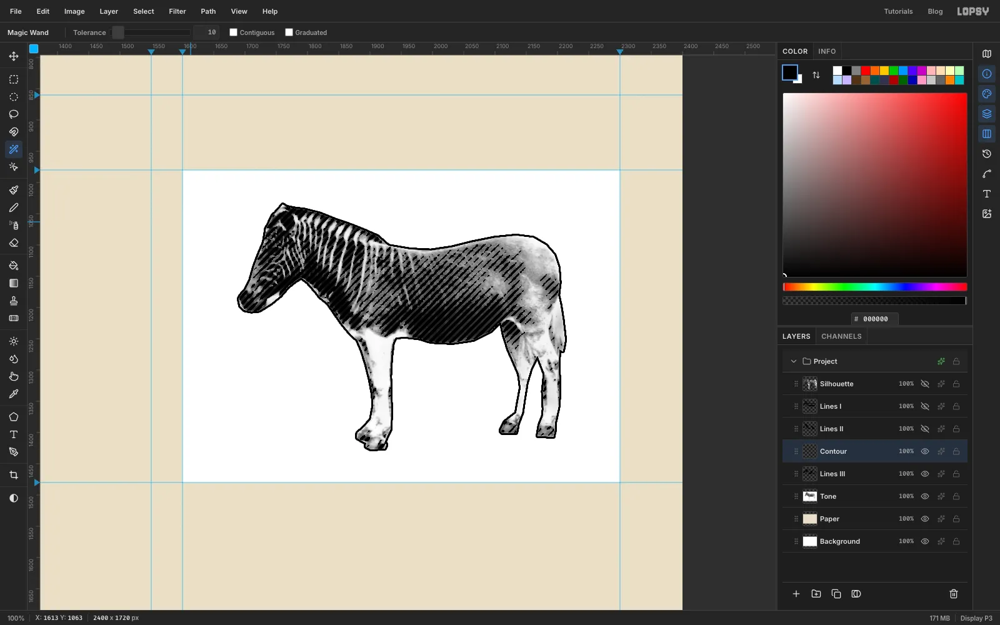

The white legs have no tone, so no plate prints them, and they'd float
away. Engravers solve this with an outline.

With *Lines III* selected, add a new layer called *Contour*.
[[Cmd]]-click the hidden *Silhouette* thumbnail to load the animal's shape,
choose **Select → Grow…** with **3** px, set the foreground to black and
choose **Edit → Fill**. [[Cmd]]-click *Silhouette* again and press
[[Delete]]. That leaves a 3 px ring. Press [[Cmd+D]] and choose
**Layer → Merge Down** to fold it into *Lines III*. You can leave
*Silhouette* hidden; nothing else uses it.

## Cut the stencil ties

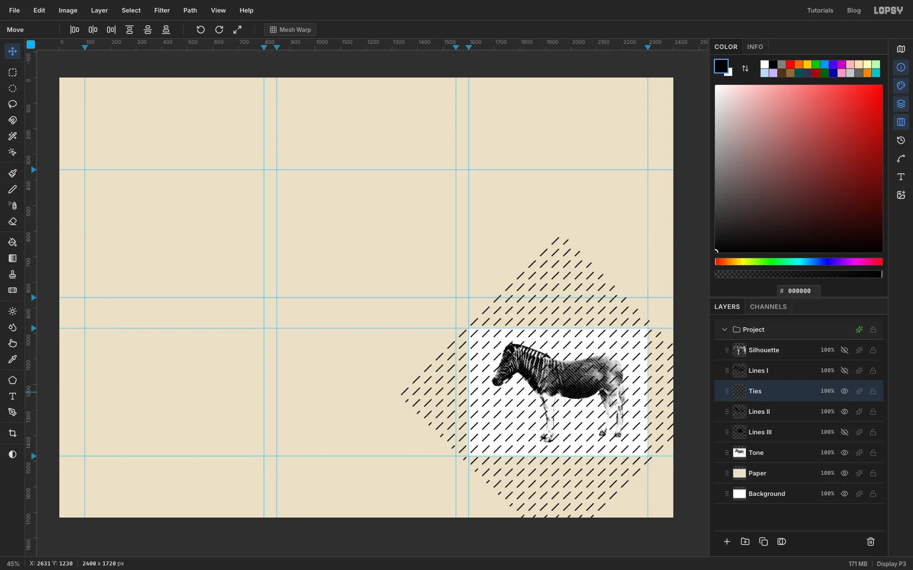

A real stencil can't have long, unsupported slits: the strips of metal
between them would flap, and the island inside the contour would fall
out. Stencil cutters leave little bridges called **ties**. You'll cut them
out of the line layers with a second pattern.

**Make the tie tile.** Add a new layer anywhere. With the Rectangular Marquee,
click once in an empty corner of the sheet and enter **From 1174, 160** to
**1178, 200**, a 4 × 40 px bar, and fill it with black. Then click once more and
enter **From 1160, 160** to **1192, 224**: a 32 × 64 px box with the bar at its
top-centre. Choose **Edit → Define Pattern**, press [[Cmd+D]] and delete the layer.

**Cut the ties, once for each plate:**

1. Select the plate's *Lines* layer and add a new layer above it called *Ties*.
2. Select the same area you filled with ridges for that plate: the cell for
   plate I, the 900 px square for plates II and III.
3. **Edit → Fill with Pattern…**, pick the tie tile, **Scale 100%**,
   **Column Stagger 50%**. The stagger turns the bars into a brick pattern, so
   the gaps don't line up into stripes across the animal. Use a different
   **Horizontal Offset** for each plate (0, 11 and 22).
4. For plates II and III, rotate the *Ties* layer exactly as you rotated that
   plate's ridges (Move tool, [[Cmd]]-drag the rotate handle 45° the same way,
   [[Cmd+D]]), so the bars cross the slits at right angles.
5. [[Cmd]]-click the *Ties* thumbnail, click the plate's *Lines* row, press
   [[Delete]] and then [[Cmd+D]]. Delete the *Ties* layer.

Every slit, and the contour, is now broken every few dozen pixels.

## Press a plate mark

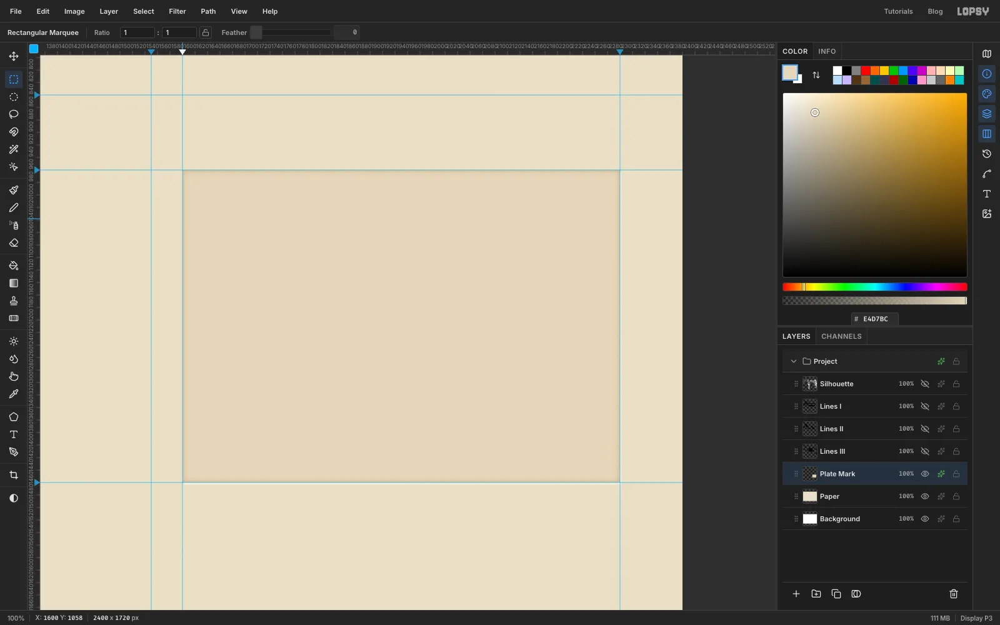

A printed proof shows a **plate mark**, the dent the plate presses into damp
paper. Delete the *Tone* layer; it has done its job. Select *Paper*, add a
new layer called *Plate Mark*, select the whole cell and fill it with
`#E4D7BC`.

Open the layer's effects with the button on its row:

- **Inner Glow**: colour `#8C7148`, **Size 14**, **Opacity 45%**, for the shaded inside edge.
- **Drop Shadow**: colour `#FBF4E4`, **Offset X 2**, **Offset Y 3**, **Blur 2**, **Opacity 80%**. A pale "shadow" reads as the paper catching light below the dent.

## Ink the three plates

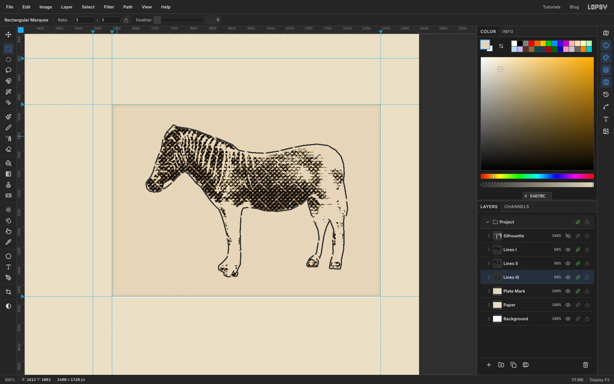

Show the three *Lines* layers. On each one, turn on **Color Overlay** in the
effects drawer and set the ink, then set the blend mode to **Multiply** and
the opacity to **88%**:

- *Lines I*: raw umber `#6E6440`
- *Lines II*: burnt umber `#5E4029`
- *Lines III*: iron-gall black `#1C2230`

Multiply lets each ink darken the one beneath it, like real overprinting,
and 88% keeps a little of the earlier plates showing through.

## Group the final state

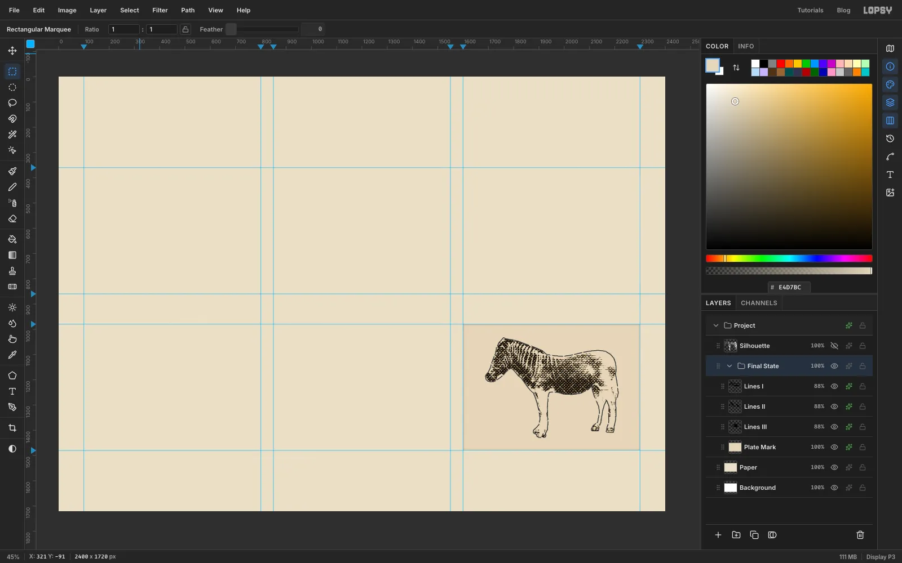

Click the *Plate Mark* row, [[Shift]]-click *Lines I* to select the four layers,
and choose **Layer → Group Layers**. Rename the group *Final State*.

## Duplicate the group and drag it one cell left

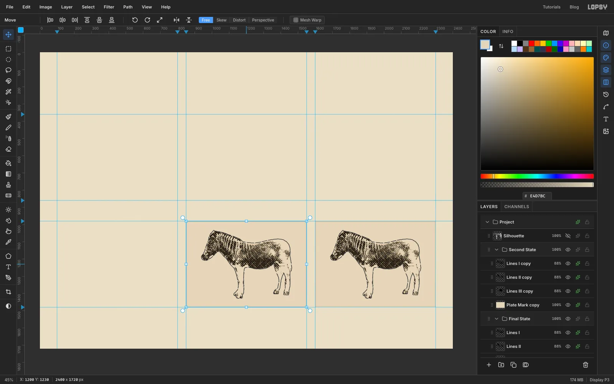

With *Final State* selected, click **Duplicate Layer** and rename the
copy *Second State*. Its layers are named *Lines I copy*, *Lines II copy* and
so on. Pick the **Move** tool and drag the proof one cell to the left: when a
group is selected, everything in it moves together. Finish with the arrow keys
until the plate mark sits exactly between the middle column's guides
([[Shift]]+arrow moves 10 px). Then expand the group and delete *Lines III copy*,
because the second state hasn't had plate III yet.

## Make the first state

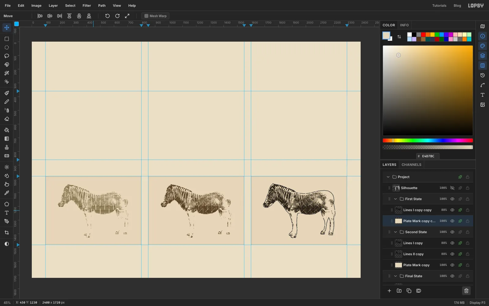

Do the same again from *Second State*: duplicate it, rename the copy
*First State*, drag it into the bottom-left cell, and delete its
*Lines II copy copy* layer. Read left to right, the bottom row now shows
the image building up one plate at a time.

> **Tip:** This is a good moment to check undo. Press [[Cmd+Z]] a few times
> to step back through the delete and the move, then [[Cmd+Shift+Z]] the same
> number of times. The proofs come back exactly as they were.

## Draw the first brass blank

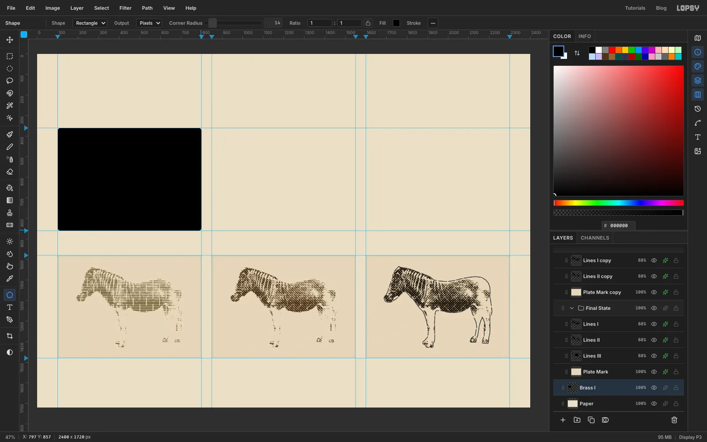

You'll make the plates one at a time: draw, brush, cut, then move on to the next.

Select *Paper* and add a layer called *Brass I*. Pick the **Shape** tool and
choose **Rectangle**, **Pixels** output and **Corner Radius 14**, with any
fill colour and no stroke. Shapes grow out from where you press. Press as
close to the middle of the top-left cell as you can, then drag out towards
its bottom-right corner. The corner snaps onto the guides. If the plate
isn't quite centred, undo and press again a little closer to the middle:
the plate should fill the cell exactly. (A temporary guide through the
cell's centre at x 450 and y 610 makes the press snap there too.)

## Brush the brass

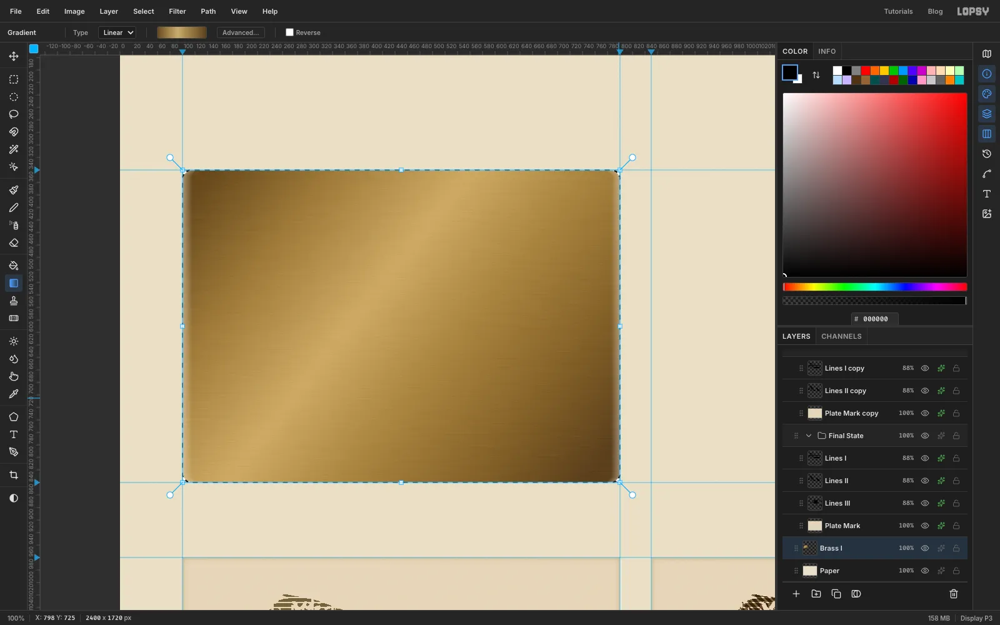

Keep *Brass I* selected and [[Cmd]]-click its thumbnail to load its shape.
Pick the **Gradient** tool, open the gradient editor and set six stops:
`#634A24` at 0%, `#9A7C44` at 20%, `#C8AB6E` at 42%, `#A6884C` at
60%, `#7F6232` at 82% and `#574022` at 100%. Drag diagonally across the plate.

With the selection still active, choose **Filter → Add Noise…** with
**Amount 40**, **Mono**, **Gaussian**, then **Filter → Motion Blur…** with
**Angle 0** and **Distance 30**. The noise smears into the fine horizontal
grain of brushed metal. Press [[Cmd+D]].

## Bring a copy of the lines up to the plate

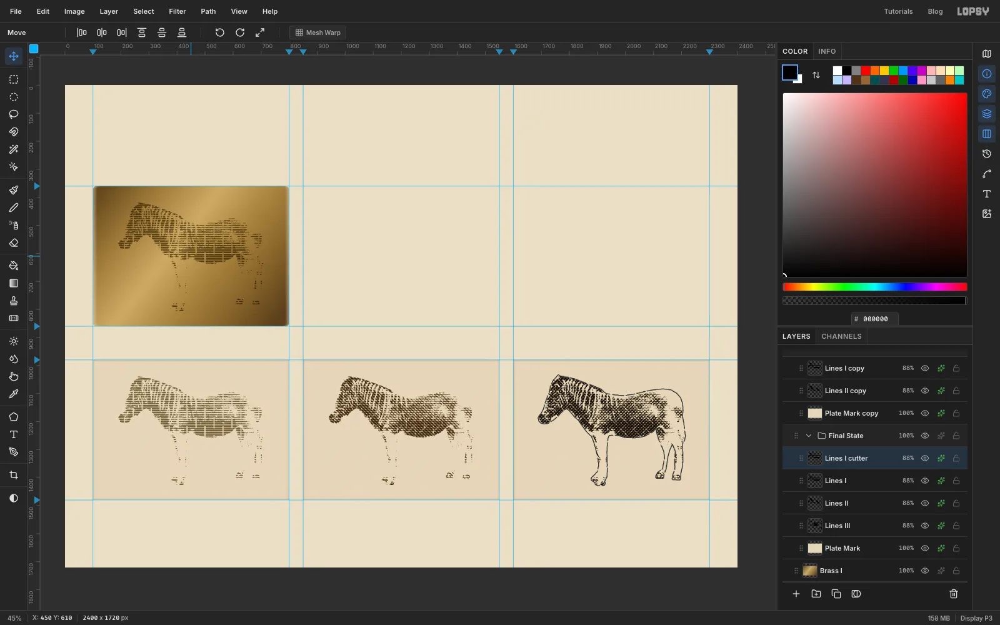

Expand *Final State*, select *Lines I* and click **Duplicate Layer**. Rename
the copy *Lines I cutter*. With the Move tool, drag it onto the brass plate
in the top-left cell. Then nudge it with the arrow keys until it sits over
the plate exactly where the proof sits in its own cell, the same distance
from the plate's edges. The cuts must match the proof, because the proof is
what this plate prints.

## Cut the slits and punch the holes

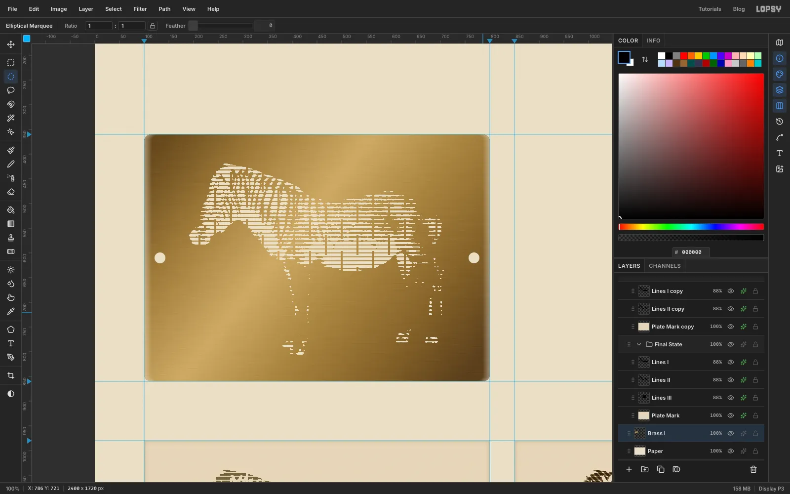

[[Cmd]]-click the cutter's thumbnail, click the *Brass I* row and press
[[Delete]]. The slits are now holes in the brass. Press [[Cmd+D]] and delete
the cutter layer.

For the registration holes, pick the **Elliptical Marquee** and drag a small
circle, about 22 px across, centred 32 px in from the middle of the plate's
left edge. Hold [[Shift]] and drag a matching circle on the right edge, then
press [[Delete]] and [[Cmd+D]].

Now repeat the last four steps for *Brass II* in the top-middle cell (cut with
a copy of *Lines II*) and *Brass III* in the top-right cell (cut with a copy of
*Lines III*). Drag each gradient at a slightly different angle so the plates
don't look stamped from one sheet.

## Cut the plate numerals

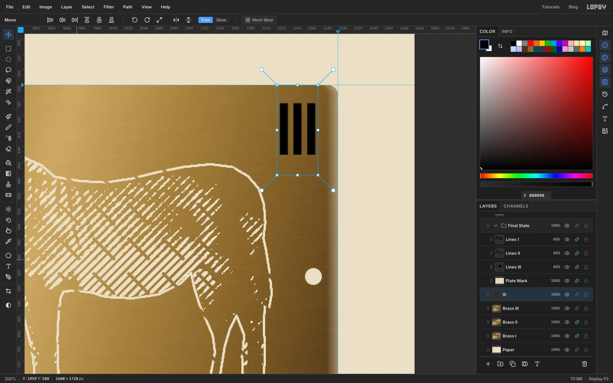

Select *Brass I*, then pick the **Text** tool and set **Big Shoulders Stencil**,
**Bold**, **84** px, **Right** aligned. Click near the top-right corner of the
plate, type `I` and press [[Shift+Enter]] to commit. [[Cmd]]-click the text
layer's thumbnail, click the *Brass I* row, press [[Delete]] and [[Cmd+D]],
and delete the text layer. A stencil face keeps its own little ties, so the
numeral cuts cleanly. Do `II` and `III` on the other plates.

## Give the plates some thickness

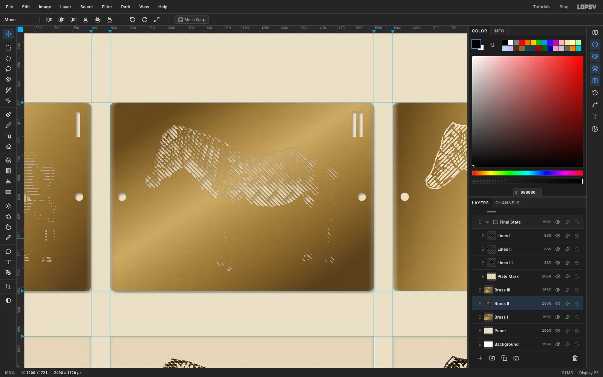

Open the effects for each brass layer:

- **Drop Shadow**: `#3A2810`, **Offset X 3**, **Offset Y 5**, **Blur 5**, **Opacity 38%**.
  You'll see it through the slits too, offset from the cut, which is
  exactly what a shadow under a stencil plate does.
- **Inner Glow**: `#4A3210`, **Size 2**, **Opacity 40%**, which darkens every cut edge.

Select the three brass layers and group them as *Stencil Plates*. Group
the three proof groups as *Proofs*.

## Rule the header, footer and label rows

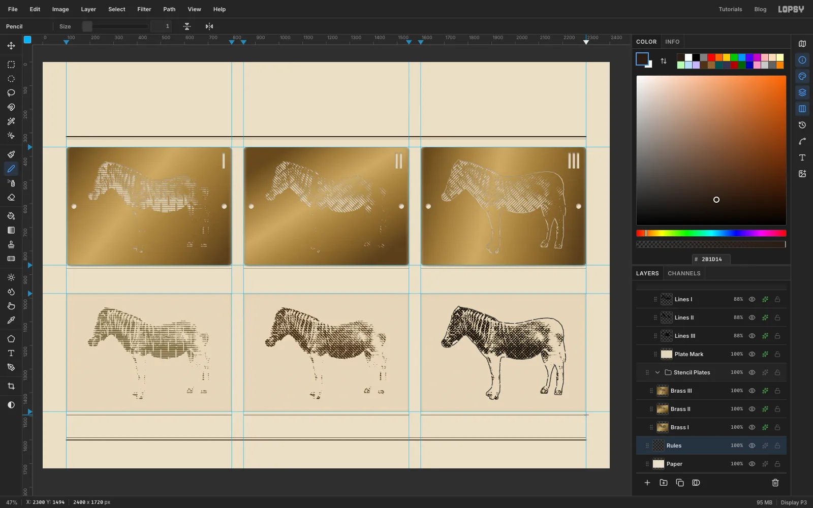

Select *Paper*, add a layer called *Rules*, set the foreground to
`#2B1D14` and pick the **Pencil**. To draw a straight line, click at one
end, hold [[Shift]] and click at the other. The status bar shows the cursor's
X and Y, so you can find each row before you click.

- Under the header, from the left guide to the right guide: **Size 4** at
  y 316, then **Size 1** at y 326.
- Above the footer: **Size 1** at y 1590, then **Size 4** at y 1600.
- At **Size 1**, a hairline 14 px under each cell, as wide as the cell:
  y 874 for the plates and y 1494 for the proofs.

## Set the title and subtitle

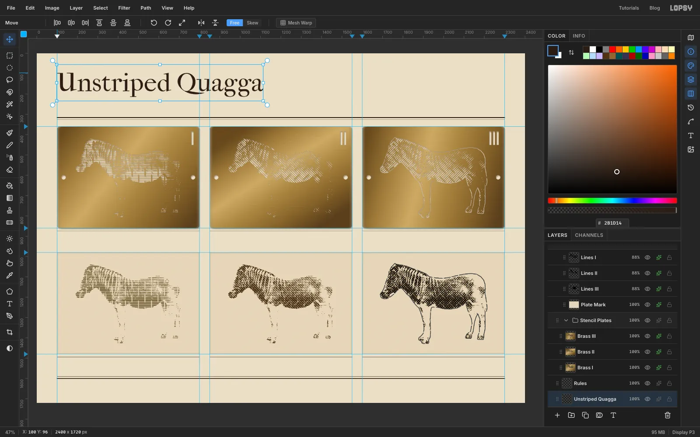

Text settings restyle whichever text layer is selected, so always click
the *Paper* row before you change them for a new piece of text.

Select *Paper*, pick the **Text** tool and set **IM Fell French Canon**,
**128** px, colour `#2B1D14`, **Left**. Click near the top-left, type
*Unstriped Quagga* and press [[Shift+Enter]]. With the Move tool, nudge it
so the U lines up with the left guide.

Select *Paper* again. Set **IM Fell Double Pica**, **Italic**, **30** px, click
under the title and type: *A three-plate hatch stencil, cut after Frederick
York's 1870 photograph of the quagga mare at the London Zoo*.

## Add the right-hand header block

Select *Paper*, then set **Big Shoulders Stencil**, **SemiBold**, **28** px,
**Right**, and click at the right guide. Type three lines, pressing [[Enter]] between them: *STENCIL
CONTACT SHEET*, *THREE PLATES IN BRASS*, *SHEET 1 OF 1*. Commit with
[[Shift+Enter]]. In the **Text** panel, set **Letter spacing** to **1.5**:
spaced capitals read better and keep the stencil ties open.

Nudge the block until its right edge is on the 2300 guide and its last
baseline sits on the subtitle's baseline. Then select *Paper* and set Letter
spacing back to 0 so it doesn't carry over to the next text.

## Label every cell

Each cell gets a stencil label on the left of its hairline and an italic
caption on the right, about 16 px below the hairline.

For each label: select *Paper*, set **Big Shoulders Stencil**, **Bold**,
**36** px, **Left**, click at the cell's left edge, type the name and commit.
Set **Letter spacing 2** in the Text panel. The names are *PLATE I*, *PLATE II*,
*PLATE III*, *FIRST STATE*, *SECOND STATE* and *FINAL STATE*.

For each caption: select *Paper* again, set Letter spacing back to **0**, then
**IM Fell Double Pica**, **Italic**, **26** px, **Right**. Click at the cell's
right edge and type:

- *ground hatch, horizontal* / *half-tones, cut at 45°* / *shadows & contour, cut at 135°*
- *plate I in raw umber* / *plus plate II, burnt umber* / *plus plate III, iron-gall black*

Nudge each caption with the arrow keys until its baseline matches the stencil label's.

## Write the footer

Select *Paper* and, under the footer rule, in **IM Fell Double Pica Italic**
at **24** px, set a colophon at the left: *Hatch lines 8 px apart, tied every 64 px. Inks: raw
umber, burnt umber and iron-gall black.* Select *Paper* again and, at the right, right-aligned: *Equus
quagga quagga. The last of its kind died at Artis, Amsterdam, on 12 August 1883.*
Put both on the same baseline. Click the *Rules* row, [[Shift]]-click the last
text layer to select everything in between, and choose **Layer → Group Layers**.
Name the group *Type*.

## Add the registration marks

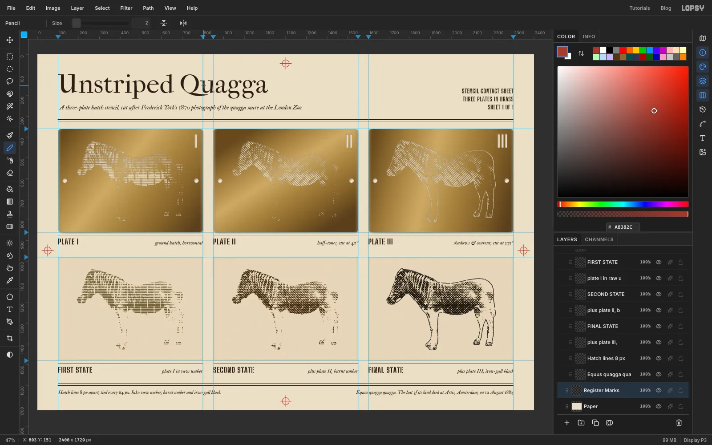

Turn on **View → Show Grid** to help you place things evenly. Select *Paper*
and add a layer called *Register Marks*. Pick the **Shape** tool, choose
**Ellipse**, remove the fill and add a stroke of `#A8382C` at **Width 2**.
Click once (don't drag) to open the size dialog and make a **34 × 34** circle
in the left margin, level with the gap between the rows. Do the same in the
right margin and at the top and bottom centre of the sheet. Then pick the
**Pencil** at **Size 2** in the same red and [[Shift]]-click a cross through
each circle.

Now select the top row of the Layers panel and add a layer called *Proof Pins*.
With the Pencil still at **Size 2**, in `#6B5232`, [[Shift]]-click a small
cross inside each proof, level with where the brass plates' punch holes are.
These pin marks show where the plates were registered. Turn the grid off.

## Stamp the final state

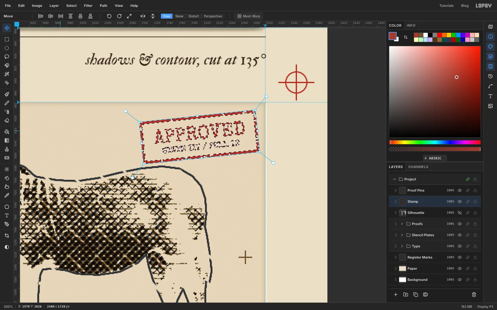

Select *Silhouette* (near the top of the stack, above the groups) and add a
layer called *Stamp*. With the Shape tool (Rectangle, no fill, stroke
`#A8382C`, **Width 4**, **Corner Radius 6**), click once in the empty corner above
the final proof's back and make a **184 × 64** frame.

Select *Stamp*, pick the Text tool, set **Special Elite**, **31** px, **Center**,
colour `#A8382C`, and type *APPROVED* in the top half of the frame. Choose
**Layer → Merge Down** to merge it into *Stamp*. Select *Stamp* again, set the
size to **13** px and type *STATE III / PULL 12* under it, then merge that down too.

Rubber stamps never print solid. Pick the **Eraser** at **Size 4** and click
a few dozen times along the frame, then a handful of times at **Size 2** over
the lettering. Keep those clear of the letters' main strokes, or *APPROVED*
starts to misspell itself. [[Cmd]]-click the stamp's thumbnail, pick the Move
tool and drag the rotate handle about **6°** anticlockwise, without [[Cmd]]
so it doesn't snap, and press [[Cmd+D]]. Set the layer to **Multiply** at **85%**.

## Age the paper

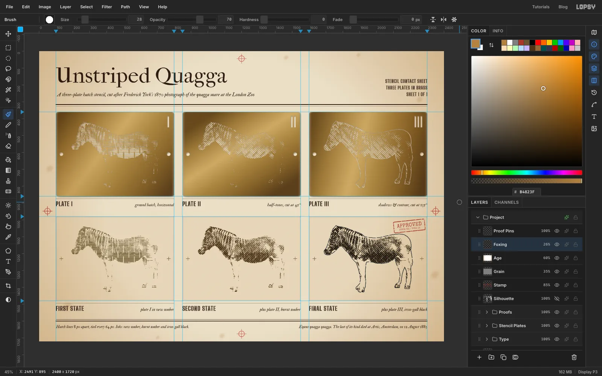

Three layers above *Stamp* finish it. Make sure nothing is selected ([[Cmd+D]]) first.

1. **Grain**: add a layer, fill it with `#808080` (select all, **Edit → Fill**),
   apply **Add Noise** at **30**, **Mono**, **Gaussian**, deselect, and set the
   layer to **Overlay** at **35%**.
2. **Age**: add a layer. In the Gradient options choose **Radial**, then
   replace the brass stops with three: `#FFFFFF` at 0%, `#FFFFFF` at 55% and
   `#CDB287` at 100%. Drag from the centre of the sheet to a corner and set the
   layer to **Multiply** at **60%**. White does nothing in Multiply, so only the
   edges darken.
3. **Foxing**: add a layer, pick the **Brush** with **Hardness 0** and
   `#B4823F`, and click a few soft dabs of different sizes, mostly near the
   edges. Apply **Gaussian Blur** at **8** px and set the layer to **Multiply** at **26%**.

Save the project with **File → Save Project**, and export with
**File → Quick Export PNG**.
